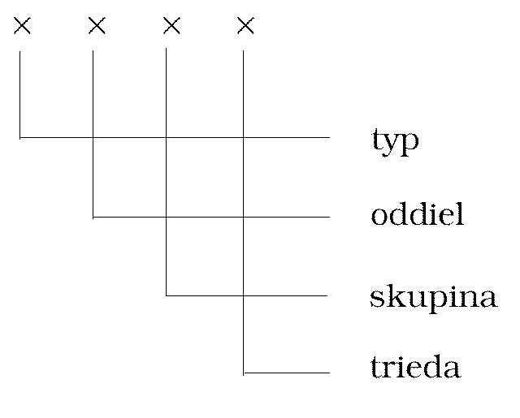

Príloha č. 1 k opatreniu č. 128/2000 Z. z.

- SYSTÉM KÓDOVANIA KLASIFIKÁCIE A ZOZNAM SKRATIEK POUŽÍVANÝCH V KLASIFIKÁCII

  - I. Systém kódovania klasifikácie

    - 1. Systém kódovania klasifikácie má štyri úrovne:

      - 1a. prvá úroveň obsahuje typ podľa najväčšieho podielu využitia úžitkovej plochy a označuje sa jednociferným číselným kódom,

      - 1b. druhá úroveň obsahuje oddiel podľa najväčšieho podielu plôch v rámci typu, ktorý sa označuje dvojciferným číselným kódom,

      - 1c. tretia úroveň obsahuje skupinu podľa najväčšieho podielu plôch v rámci oddielu, ktorý sa označuje trojciferným číselným kódom,

      - 1d. štvrtá úroveň obsahuje triedu podľa najväčšieho podielu plôch v rámci oddielu, ktorý sa označuje štvorciferným číselným kódom.

    - 2. Pre číselný kód klasifikácie sa zavádza toto označenie:

    - 

  - II. Zoznam skratiek používaných v klasifikácii

    - KS Klasifikácia stavieb

    - KTS Klasifikácia typov stavieb (CC - Classification of Types of Construction)

    - ÚKP Ústredná klasifikácia produkcie (CPC - Central Product Classification)

    - ex čiastočný prevod (extraction)

    - i. n. inde neklasifikované

    - JKSO Jednotná klasifikácia stavebných objektov a stavebných prác výrobnej povahy
