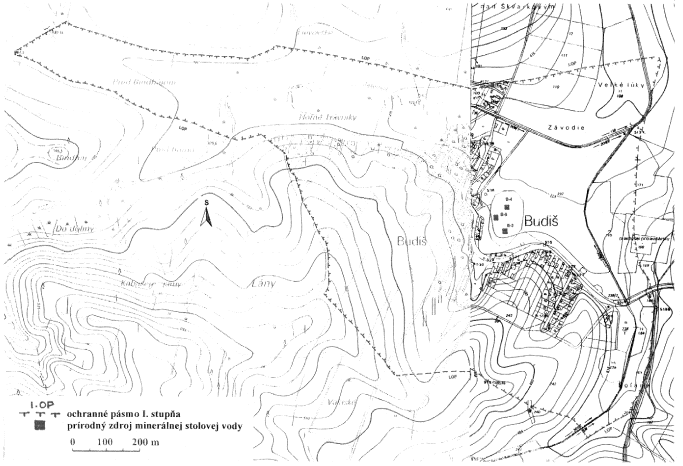
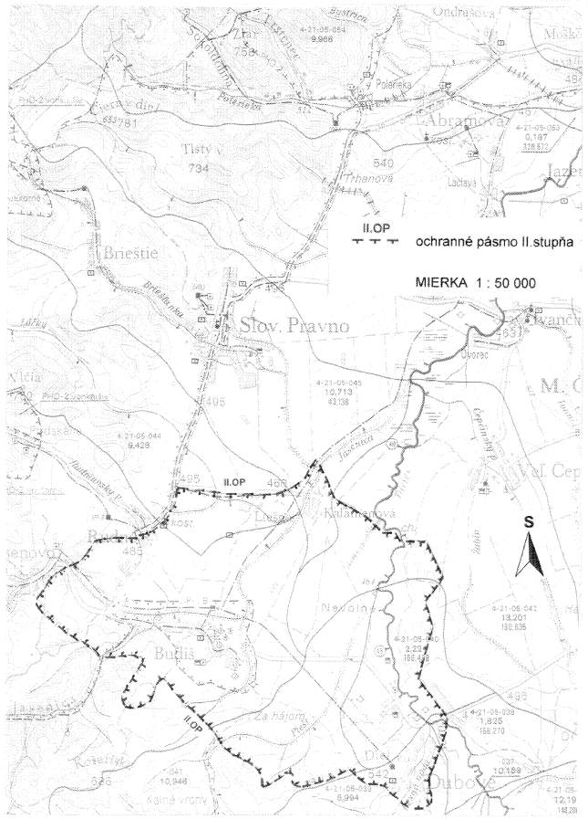

Príloha č. 1 k vyhláške č. 178/2000 Z. z. OCHRANNÉ PÁSMO I. STUPŇA PRÍRODNÝCH ZDROJOV MINERÁLNYCH STOLOVÝCH VÔD V BUDIŠI

Príloha č. 2 k vyhláške č. 178/2000 Z. z.

OCHRANNÉ PÁSMO II. STUPŇA PRÍRODNÝCH ZDROJOV MINERÁLNYCH STOLOVÝCH VÔD V BUDIŠI

Príloha č. 3 k vyhláške č. 178/2000 Z. z.

POPIS HRANÍC OCHRANNÝCH PÁSIEM PRÍRODNÝCH ZDROJOV MINERÁLNYCH STOLOVÝCH VÔD V BUDIŠI

Ochranné pásmo I. stupňa

Ochranné pásmo I. stupňa je vyznačené v mapovom podklade - Štátna mapa odvodená v mierke 1 : 5 000, listy Horná Štubňa 8-5, Horná Štubňa 7-5, Horná Štubňa 7-6.

Ochranné pásmo I. stupňa chráni výverovú oblasť. Západojužné ohraničenie pásma sa začína na odbočke zo štátnej cesty Rudno - Budiš a tvorí ho okraj štátnej cesty III. triedy vedúci až po existujúcu zástavbu v západnej časti obce Budiš. Odtiaľ hranica sleduje južným oblúkovitým smerom poľnú cestu na dĺžke približne 550 m. Ďalej sa hranica stáča na juhovýchod a po asi 320 m priameho smerovania pokračuje ďalej východným a juhovýchodným smerom cez polia, pričom tesne pred zmenou smeru na severovýchod pretína bezmenný pravostranný prítok potoka Jasenica. Po krátkom úseku severovýchodného smerovania pokračuje hranica severným smerom až za intravilán obce nad časť Veľké lúky. Tu sa hranica prudko stáča a vedie ďalej západným smerom, sledujúc potok Jasenica až k miestnej ceste. Pokračuje po jej južnom okraji po štátnu cestu Rudno - Budiš, po ktorej ide ďalej juhozápadným smerom až po štátnu cestu III. triedy, kde sa napája na západojužné ohraničenie.

Ochranné písmo II. stupňa

Ochranné pásmo II. stupňa je vyznačené v mapovom podklade - Vodohospodárska mapa Slovenskej republiky v mierke 1 : 50 000, list Turčianske Teplice 36-11.

Ochranné pásmo II. stupňa chráni akumulačnú oblasť. Severné ohraničenie sa začína severne nad obcou Rudno na štátnej ceste Rudno - Kaľamenová. Po tejto ceste ide hranica až po obec Kaľamenová, kde nad severnou časťou obce prechádza cez potok Jasenica. Ďalej hranica pokračuje juhovýchodným smerom, pretína rieku Turiec a sleduje ju južným smerom až po miesto, kde ju hranica opäť pretína. Pokračuje južným smerom až za obec Dubové, kde sa stáča na severozápad, obchádza obec Budiš z južnej strany a oblúkom smerujúcim k obci Jasenovo sa napája cez obec Rudno na severné ohraničenie.

Príloha č. 4 k vyhláške č. 178/2000 Z. z.

POPIS HYDROGEOLOGICKEJ ŠTRUKTÚRY PRÍRODNÝCH ZDROJOV MINERÁLNYCH STOLOVÝCH VÔD V BUDIŠI

Hydrogeologická štruktúra minerálnych vôd v Budiši je klasifikovaná ako otvorená. V hydrogeologickej štruktúre je vyčlenená infiltračná oblasť, v ktorej dochádza k dopĺňaniu, akumulačná oblasť, v ktorej sa formujú základné fyzikálno-chemické vlastnosti, a výverová oblasť.

Výverová oblasť je poloodkrytá, prírodná minerálna voda vyviera zo sekundárnych akumulácií v pokryvných útvaroch.

Za infiltračné oblasti prírodných minerálnych vôd sa považujú územia južne a západne od výverovej oblasti v pohoriach Žiar a Malá Fatra. Tieto územia sú budované horninami kryštalinika a karbonátovými horninami mezozoika, ktoré sa ponárajú pod neogénnu výplň kotliny. Zásoby prírodnej minerálnej vody v oblasti Budiša sa dopĺňajú infiltráciou zrážok.

Výstup minerálnych vôd s obsahom voľného CO2 v oblasti Budiša podmieňuje priaznivá geologicko-tektonická stavba tohto územia. Turčianska kotlina je oblasť tektonicky silne porušená. Na priebeh a križovanie zlomov sa viažu výskyty minerálnych vôd. Vychádza sa z toho, že žriedlová línia je totožná s poruchovým pásmom pod údolnou nivou potoka Jasenica na úpätí severovýchodných svahov vyvýšeniny nad obcou Budiš. Je ohraničená dvoma ďalšími približne rovnobežnými poruchami v severovýchodno-juhozápadnom smere, ktoré zároveň uvedenú vyvýšeninu ohraničujú. Centrom žriedlovej línie je spodná časť, ktorá zahŕňa priamo obec Budiš. Táto oblasť je v bezprostrednom kontakte s obyčajnými podzemnými vodami plytkého i hlbšieho obehu. Preplynené prírodné minerálne vody sa druhotne akumulujú v hydrogeologicky priaznivých vrstvách neogénu, v ktorých sa v konečnej fáze formujú ich výsledné fyzikálno-chemické vlastnosti.
