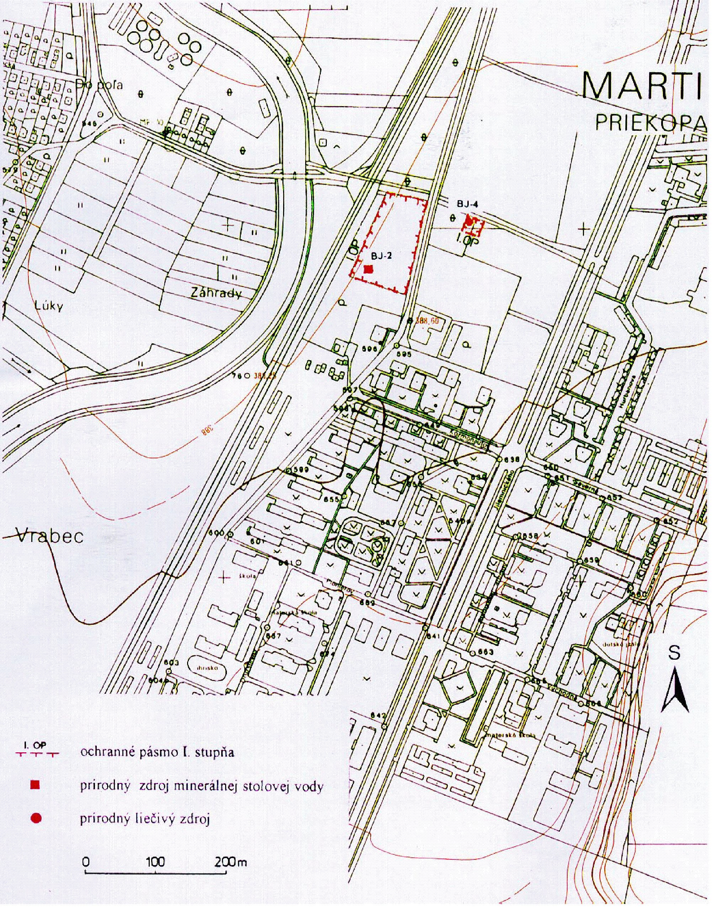
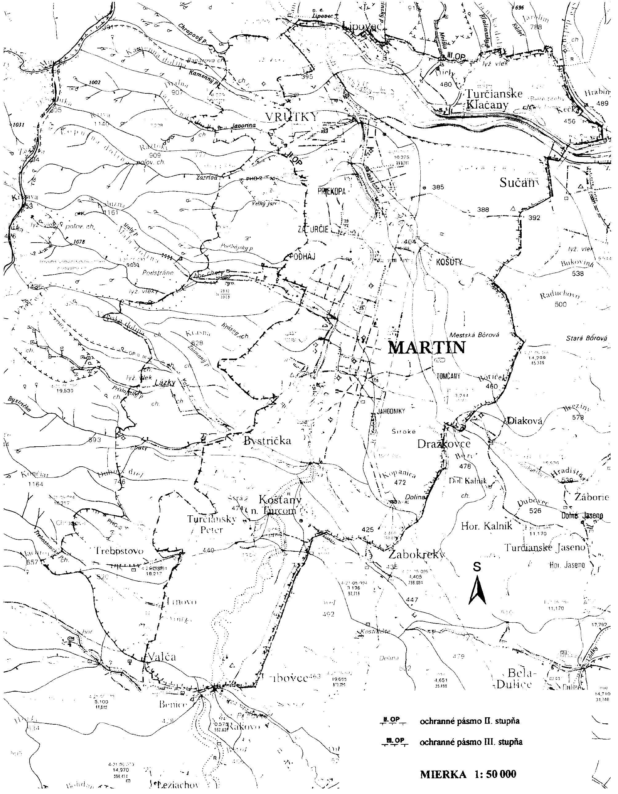

Príloha č. 1 k vyhláške č. 20/2000 Z. z. OCHRANNÉ PÁSMO I. STUPŇA PRÍRODNÝCH LIEČIVÝCH ZDROJOV A PRÍRODNÝCH ZDROJOV MINERÁLNYCH STOLOVÝCH VÔD V MARTINE

Príloha č. 2 k vyhláške č. 20/2000 Z. z.

OCHRANNÉ PÁSMO I. STUPŇA PRÍRODNÝCH LIEČIVÝCH ZDROJOV A PRÍRODNÝCH ZDROJOV MINERÁLNYCH STOLOVÝCH VÔD V MARTINE

Príloha č. 3 k vyhláške č. 20/2000 Z. z.

OCHRANNÉ PÁSMO II. A III. STUPŇA PRÍRODNÝCH LIEČIVÝCH ZDROJOV A PRÍRODNÝCH ZDROJOV MINERÁLNYCH STOLOVÝCH VÔD V MARTINE

Príloha č. 4 k vyhláške č. 20/2000 Z. z.

POPIS HRANÍC OCHRANNÝCH PÁSIEM PRÍRODNÝCH LIEČIVÝCH ZDROJOV A PRÍRODNÝCH ZDROJOV MINERÁLNYCH STOLOVÝCH VÔD V MARTINE

Ochranné pásmo I. stupňa

Ochranné pásmo I. stupňa je vyznačené v mapovom podklade – Štátna mapa odvodená v mierke 1 : 5 000, listy Martin 2-3, Martin 2-4.

Ochranné pásmo I. stupňa chráni výverovú oblasť a má štyri časti:

Prvá časť tvorí uzavretý polygón okolo zdroja BJ-2 a predstavuje v plnom rozsahu územie plniarne ohraničenej oplotením.

Druhú časť tvorí štvorcové ohraničenie zdroja BJ-4 (približne 25 x 25 m). Hranica je totožná s rozsahom parcely č. 508/282.

Tretiu časť tvorí uzavretý polygón okolo Hájskeho medokýša. Západnú hranicu tvorí cesta vedúca z Jahodníkov ku skanzenu (ľavý okraj komunikácie), ktorá približne 75 m juhozápadne od Hájskeho medokýša pokračuje po vrstevnici 430 v údolí potoka Medokýš. Vo vzdialenosti približne 125 m juhovýchodne od prameňa pokračuje východné ohraničenie rovnobežne pozdĺž potoka Medokýš vo vzdialenosti približne 60 m.

Aj štvrtú časť predstavuje uzavretý polygón. Východné a južné ohraničenie prebieha pozdĺž poľnej cesty vedenej južným okrajom mesta (časťou Jahodníky) smerom na západ až po vrstevnicu 420, pokračuje po vrstevnici 420 až po križovanie s poľnou cestou, kde sa spája s východným ohraničením.

Územie ochranného pásma I. stupňa zaberá plochu približne 0,103 km2.

Ochranné pásmo II. stupňa

Ochranné pásmo II. stupňa je vyznačené v mapovom podklade – Vodohospodárska mapa Slovenskej republiky v mierke 1 : 50 000, listy Martin 26-33, Turčianske Teplice 36-11.

Ochranné pásmo II. stupňa chráni akumulačnú oblasť. Severné ohraničenie sa začína v Panošinskej doline. Pokračuje smerom na východ po pravej strane Krpelianskeho kanála až k obci Lipovec. Prechádza údolím Kozinského potoka, potoka Mníšia, Klačianskeho potoka a Kúdeľa až po čiastkovú rozvodnicu prebiehajúcu hrebeňom Jarolím (788). Ďalej pokračuje juhovýchodným smerom údolím Sučianskej doliny až ku Krpelianskemu kanálu, pri ktorom sa kolmo stáča v smere toku a pokračuje pravým brehom kanála. Po približne 750 m prechádza hranica naprieč Krpelianskym kanálom a Váhom k železničnej trati, kde sa stáča na západ. Ďalej vedie hranica pozdĺž železničnej trate, kde sa približne po 250 m opäť stáča smerom na juh a obchádza obec Sučany zo západnej strany až po štátnu cestu vedúcu do Martina. Odtiaľ vedie hranica popri ceste vedúcej k Bôrovskému potoku, pokračuje južným smerom údolím Bôrovského potoka, obchádza kótu Bôriček (460) z východnej a južnej strany k západnej časti obce Dražkovce. Prechádza cez Sklabinský potok až k ceste Dražkovce – Martin. Tu sa kolmo stáča na západ, pokračuje pozdĺž cesty a približne po 500 m sa stáča na juh a juhozápad k obci Žabokreky, ktorú obchádza zo severnej strany. Ďalej pretína Žabokrecký potok a Beliansky potok a pokračuje až k štátnej ceste Martin – Príbovce, po ktorej pokračuje južným smerom. Na križovatke ciest sa východná hranica stáča na západ, pretína údolie Turca v mieste sútoku s Blatnickým potokom, obchádza obce Benice a Valča zo severnej strany a po 1 500 m sa stáča na sever. Hranica pokračuje severným smerom popri obciach Trnovo a Trebostovo, pretína Trebostovský potok, kde sa stáča na západ. Obchádza obec Trebostovo smerom k ohybu Peterského potoka a stáča sa na sever až k poľnej ceste. Tu vytvára výbežok k obci Turčiansky Peter, prechádza údolím Sadového potoka, obcou Bystrička a údolím Zlámaného potoka. Ďalej sa napája na poľnú cestu, po ktorej pokračuje smerom na kótu Krásna (628), oblúkovite sa stáča na severovýchod, pretína údolie Krásneho potoka pod vodnou nádržou a pokračuje smerom na Podháj. Prechádza cez cestu vedúcu z Martina na Martinské hole a po 500 m sa kolmo stáča na západ, vedie cez Podháj, pretína údolie Podhájskeho potoka a Veľkého jarku. Ďalej zo západu obchádza Vrútky, pretína údolia Zázrivej, Javoriny a Kamenného potoka, kolmo sa stáča na východ a opäť koso na severozápad. Ďalej hranica pokračuje pozdĺž Váhu vo vzdialenosti približne 350 m v dĺžke 1 000 m, odkiaľ sa kolmo stáča na severovýchod, pretína Váh, Krpeliansky kanál a v údolí Panošinskej doliny sa spája s východiskovým bodom hranice.

Územie ochranného pásma II. stupňa zaberá plochu 64,3 km2.

Ochranné pásmo III. stupňa

Ochranné pásmo III. stupňa je vyznačené v mapovom podklade – Vodohospodárska mapa Slovenskej republiky v mierke 1 : 50 000, listy Martin 26-33, Turčianske Teplice 36-11.

Ochranné pásmo III. stupňa chráni infiltračnú oblasť. Severné, východné a južné ohraničenie je totožné s vytýčenou hranicou ochranného pásma II. stupňa. Severne od obce Valča hranica ďalej vedie po rozvodnici medzi Valčianskym a Trebostovským potokom až na kótu Macúrová (657). Od kóty Macúrová pokračuje hranica severovýchodným smerom oblúkovitými výbežkami naprieč údolím Trebostovského a bezmenného potoka. Ďalej hranica vedie údolím pravostranného prítoku Peterského potoka, potom údolím Peterského potoka smerom na kótu Dubový diel (742). Západné ohraničenie pokračuje naprieč údoliami Bystričky a Príslopského potoka, ponad chatovú oblasť a lyžiarske vleky Lázky, pokračuje údolím Valaskej doliny v dĺžke približne 1 500 m a potom oblúkovite prechádza do údolia Pivovarského potoka. Nad sútokom Pivovarského potoka a Malého potoka pretína cestu vedúcu z Martina na Martinské hole. Hranica oblúkovite pokračuje severným smerom naprieč údoliami Podhájskeho potoka, Veľkého jarku, údolím Zázrivej a pri Hradišti sa napája na lesnú cestu vedúcu k poľovníckym chatám. Potom sa kolmo stáča do údolia Javoriny, pokračuje týmto údolím smerom na severozápad a približne po 500 m oblúkovite prechádza naprieč hrebeňom Diaľna a údolím Kamenného potoka smeruje k Bagarovej chate a po lesnej ceste až k Chrapovému potoku. Ďalej hranica pokračuje údolím Chrapového potoka až po sútok s Váhom, pretína rieku Váh a pokračuje do Panošinskej doliny, kde sa napája na začiatok severného ohraničenia.

Územie ochranného pásma III. stupňa zaberá plochu 89,6 km2.

Príloha č. 5 k vyhláške č. 20/2000 Z. z.

POPIS HYDROGEOLOGICKEJ ŠTRUKTÚRY PRÍRODNÝCH LIEČIVÝCH ZDROJOV A PRÍRODNÝCH ZDROJOV MINERÁLNYCH STOLOVÝCH VÔD V MARTINE

Ochranné pásma sú vymedzené na základe výsledkov hydrogeologického prieskumu a návrhu záverečnej správy vypracovanej H. Bergerovou a kolektívom: Martin – Fatra, ochranné pásma, rok 1996.

Hydrogeologická štruktúra je klasifikovaná ako otvorená so zakrytou až odkrytou výverovou oblasťou. V hydrogeologickej štruktúre je vyčlenená infiltračná oblasť, v ktorej dochádza k dopĺňaniu, akumulačná oblasť, v ktorej sa formujú základné fyzikálno-chemické vlastnosti, a výverová oblasť.

Formovanie a obeh minerálnych vôd sa uskutočňuje v klastických neogénnych sedimentoch reprezentovaných martinským súvrstvím. Kolektory sú z litologického hľadiska budované karbonatickými pieskami. Vody majú relatívne hlboký obeh a sú sýtené juvenilným oxidom uhličitým. V podloží martinského súvrstvia sa nachádzajú sedimenty budišského súvrstvia a paleogénu.

Na formovaní a obehu sa podieľa aj tektonická stavba. Celá hydrogeologická štruktúra je prevažne vyčlenená na základe tektonických zlomov. Významnou mierou sa na stavbe podieľajú priečne zlomy severovýchodno-juhozápadného smeru (bôrovský a košútsky zlom), blatnický zlom oddeľujúci severnú a južnú časť kotliny a trebostovský zlom oddeľujúci martinskú prepadlinu od podhájskej kryhy a zlomy západovýchodného smeru.

Za infiltračnú oblasť hydrogeologickej štruktúry minerálnych vôd v Martine-Záturčí i v Martine-Jahodníkoch sa považuje neogénna výplň Turčianskej kotliny, t. j. martinské súvrstvie (martinská prepadlina). Nie je vylúčené, že určitý podiel vôd infiltruje do klastických sedimentov na západnom okraji kotliny, a preto sa za infiltračnú oblasť považuje aj časť východných svahov Lúčanskej Malej Fatry pokrytej neogénnymi sedimentmi a podhájska kryha.

Za akumulačnú oblasť sa považuje oblasť martinskej prepadliny, ktorá je budovaná sedimentmi martinského súvrstvia a predstavuje zároveň aj infiltračnú oblasť.

Výverová oblasť má dve časti. Prvá časť predstavuje zakrytú výverovú oblasť zdrojov BJ-2 a BJ-4, v ktorej kolektor minerálnych vôd (martinské súvrstvie) nevystupuje na povrch, ale je zakrytý nepriepustnými sedimentmi. Exploatácia minerálnych vôd je možná len hydrogeologickými vrtmi. V tejto časti sú vyčlenené dve samostatné ochranné pásma I. stupňa, a to osobitne pre zdroj BJ-2 a osobitne pre zdroj BJ-4.

Druhá časť predstavuje odkrytú výverovú oblasť, v ktorej kolektor minerálnych vôd vystupuje priamo na povrch, resp. je prekrytý priepustnými kvartérnymi sedimentmi. Aj v tejto časti sú vyčlenené dve ochranné pásma I. stupňa. Prvé chráni okolie prameňa Hájsky medokýš vrátane aluviálnej nivy potoka Medokýš. Druhé pásmo je vyčlenené na ochranu zaniknutého prirodzeného výveru Prdľavka.
