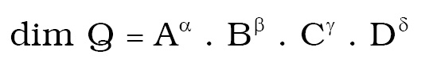

# § 2 Spôsob tvorby odvodených jednotiek SI a násobkov jednotiek SI

(1) Odvodená jednotka SI sa získa zo základných jednotiek SI použitím rovnice, ktorou sa definuje príslušná odvodená veličina. Rozmer odvodenej veličiny Q vo vzťahu k základným jednotkám v koherentnej sústave jednotiek sa určuje

,

kde dim Q je rozmer veličiny Q,

A, B, C, D sú rozmerové symboly veličín

základných jednotiek,

α, ß, γ, δ sú rozmerové exponenty.

Dosadením symbolov základných jednotiek SI za jednotlivé veličiny do uvedenej rovnice sa získa vyjadrenie odvodenej veličiny pomocou základných jednotiek SI.

(2) Odvodené jednotky SI, pri ktorých možno používať osobitný názov a symbol, sú uvedené v prílohe č. 1. Tieto názvy a symboly možno používať aj pri tvorbe ďalších odvodených jednotiek SI.

(3) Spôsob tvorby odvodených jednotiek rovinného a priestorového uhla je daný pri

- a) radiáne ako rovinný uhol medzi dvoma polomermi kružnice, ktoré na obvode kružnice vytínajú oblúk, ktorého dĺžka sa rovná polomeru kružnice,

- b) steradiáne ako priestorový uhol kužeľa, ktorý má svoj vrchol v strede gule a vytína na povrchu gule plochu, ktorej plošný obsah sa rovná plošnému obsahu štvorca, ktorého strana sa rovná polomeru gule.

(4) Násobky jednotiek SI sa vytvárajú násobením základných jednotiek SI alebo násobením odvodených jednotiek SI násobkom – mocninou s dekadickým základom zo súboru mocnín podľa prílohy č. 2. Názov násobku jednotky sa vytvorí pridaním príslušnej predpony k názvu jednotky. Nevzťahuje sa na hmotnosť, pri ktorej sa násobky jednotky tvoria od gramu. Symbol násobku jednotky SI sa vytvorí spojením symbolu predpony a symbolu jednotky. Zložené predpony vytvorené spojením viacerých predpôn nemožno používať.

(5) Dekadické násobky jednotiek SI s osobitným názvom sú uvedené v prílohe č. 3.

(6) V spojení s jednotkami uvedenými v prílohe č. 3 a ich symbolmi možno používať predpony a ich symboly uvedené v prílohe č. 2.

(7) Ak je odvodená jednotka vyjadrená ako zlomok, jej násobky možno vyjadriť pripojením predpony k jednotkám v čitateli alebo v menovateli alebo v obidvoch.
