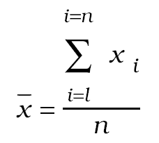
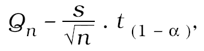
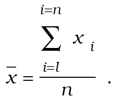
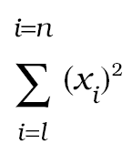
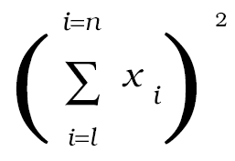
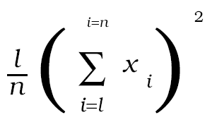
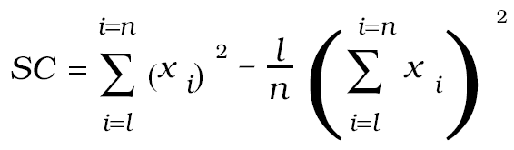
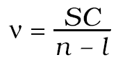
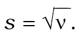

Príloha č. 2 k vyhláške č. 207/2000 Z. z.

- REFERENČNÁ METÓDA ŠTATISTICKEJ KONTROLY SKUTOČNÉHO OBSAHU VÝROBKU V OZNAČENÝCH SPOTREBITEĽSKÝCH BALENIACH 1. Požiadavky na meranie skutočného obsahu označených spotrebiteľských balení

- Skutočný obsah označených spotrebiteľských balení možno merať buď priamo vážením, alebo objemovými meradlami, alebo v prípade kvapalín nepriamo, zistením hmotnosti zabaleného výrobku a jeho hustoty.

- Nezávisle od použitej metódy chyba merania skutočného obsahu označeného spotrebiteľského balenia nesmie byť väčšia ako jedna pätina dovolenej zápornej chyby pre menovité množstvo označeného spotrebiteľského balenia.

- 2. Požiadavky na kontrolu dávok označených spotrebiteľských balení

- Kontrola je výberová a pozostáva z dvoch častí:

- a) z kontroly skutočného obsahu každého označeného spotrebiteľského balenia vo výbere,

- b) z kontroly, pri ktorej sa zisťuje priemerný skutočný obsah označených spotrebiteľských balení vo výbere.

- Dávka sa považuje za vyhovujúcu vtedy, ak výsledky obidvoch kontrol spĺňajú kritériá jej prijatia.

- Pre každú z týchto kontrol sú možné dva varianty skúšania:

- a) nedeštruktívnou metódou, t. j. metódou bez otvorenia obalu,

- b) deštruktívnou metódou, t. j. metódou vyžadujúcou otvorenie alebo porušenie obalu.

- Deštruktívna skúška sa používa len vtedy, ak skúšku nemožno vykonať nedeštruktívnou metódou. Spravidla sa nepoužíva pri dávkach menších ako 100 kusov balení.

- 2.1 Dávky označených spotrebiteľských balení

- 2.1.1 Dávka, ktorá má byť kontrolovaná, musí obsahovať všetky označené spotrebiteľské balenia rovnakého menovitého množstva, toho istého typu a z toho istého výrobného cyklu, ktoré boli zabalené na tom istom mieste. Veľkosť dávky je obmedzená množstvami uvedenými ďalej.

- 2.1.2 Ak sa označené spotrebiteľské balenia kontrolujú na konci baliacej linky, počet balení v každej dávke sa musí rovnať maximálnej hodinovej produkcii linky bez ohľadu na veľkosť dávky. V ostatných prípadoch dávka môže obsahovať najviac 10 000 kusov.

- 2.1.3 Ak je v dávke menej ako 100 kusov, pri skúške nedeštruktívnou metódou sa vykoná kontrola všetkých kusov (stopercentná kontrola).

- 2.1.4 Skôr, ako sa vykonajú skúšky uvedené v bodoch 2.2 a 2.3, je potrebné náhodne vybrať dostatočný počet označených spotrebiteľských balení z dávky tak, aby bolo možné vykonať kontrolu, ktorá vyžaduje väčší rozsah výberu. Na účely inej kontroly sa potrebný výber uskutoční náhodne z prvého výberu a balenia sa očíslujú. Očíslovanie označených spotrebiteľských balení sa musí vykonať pred začiatkom meraní.

- 2.2 Kontrola najmenšieho prijateľného obsahu označeného spotrebiteľského balenia

- Najmenší prijateľný obsah v označenom spotrebiteľskom balení sa vypočíta odčítaním dovolenej zápornej chyby pre príslušný obsah od menovitého množstva označeného spotrebiteľského balenia.

- Označené spotrebiteľské balenia v dávke, ktorých skutočný obsah je menší ako najmenší prijateľný obsah, považujú sa za chybné.

- 2.2.1 Nedeštruktívna skúška

- Nedeštruktívna skúška sa vykonáva podľa preberacieho plánu s dvoma výbermi (pozri tabuľku č. 1).

- Počet kontrolovaných balení v prvom kroku sa musí rovnať rozsahu prvého výberu podľa preberacieho plánu. Ak počet chybných kusov zistených v prvom výbere

- a) je menší alebo sa rovná prvému kritériu prijatia, dávka sa považuje za vyhovujúcu na účely tejto kontroly,

- b) je väčší alebo sa rovná prvému kritériu zamietnutia, dávka sa zamietne,

- c) sa nachádza medzi prvým kritériom prijatia a prvým kritériom zamietnutia, kontroluje sa v druhom kroku druhý výber, ktorého rozsah je uvedený v preberacom pláne.

- Chybné kusy z prvého a druhého výberu sa spočítajú. Ak súčet chybných kusov je

- a) menší alebo sa rovná druhému kritériu prijatia, dávka sa považuje za vyhovujúcu na účely tejto kontroly,

- b) väčší alebo sa rovná druhému kritériu zamietnutia, dávka sa zamietne.

- Tabuľka č. 1

- Počet kusov v dávke | Výbery | | | Počet chybných kusov |

- | Poradie, krok | Počet kusov | Súhrnný počet kusov | Kritérium prijatia | Kritérium zamietnutia

- 100 - 500 | Prvý | 30 | 30 | 1 | 3

- | druhý | 30 | 60 | 4 | 5

- 501 - 3 200 | prvý | 50 | 50 | 2 | 5

- | druhý | 50 | 100 | 6 | 7

- 3 201 a viac | prvý | 80 | 80 | 5 | 7

- | druhý | 80 | 160 | 8 | 9

- 2.2.2 Deštruktívna skúška

- Deštruktívna skúška sa vykonáva podľa preberacieho plánu s jedným výberom a používa sa len pri dávke 100 kusov a viac.

- Počet kontrolovaných označených spotrebiteľských balení je 20.

- Ak počet chybných kusov zistených vo výbere je menší alebo sa rovná kritériu prijatia, dávka sa považuje za vyhovujúcu.

- Ak počet chybných kusov zistených vo výbere je väčší alebo sa rovná kritériu zamietnutia, dávka sa zamietne.

- Počet kusov v dávke | Počet kusov vo výbere | Počet chybných kusov |

- | | Kritérium prijatia | Kritérium zamietnutia

- akýkoľvek počet (n ≥ 100) | 20 | 1 | 2

- 2.3 Kontrola priemerného skutočného obsahu jednotlivých označených spotrebiteľských balení v dávke

- 2.3.1 Dávka označených spotrebiteľských balení sa považuje za vyhovujúcu na účely tejto kontroly, ak výberový priemer

- 

- skutočných obsahov xi celkového počtu n označených spotrebiteľských balení vo výbere je väčší ako hodnota

- 

- kde znamená

- Qn menovité množstvo obsahu označeného spotrebiteľského balenia,

- n počet balení vo výbere určenom na túto kontrolu,

- s odhad smerodajnej odchýlky skutočných obsahov v dávke,

- t(1- α) Studentov t - faktor závislý od počtu stupňov voľnosti ν = n - 1 a pravdepodobnosti (1 - α) = 0,995.

- 2.3.2 Ak xi je nameraná hodnota skutočného obsahu i-teho kusa výberu rozsahu n, potom

- 2.3.2.1 výberový priemer nameraných hodnôt sa vypočíta podľa rovnice

- 

- Odhad smerodajnej odchýlky s sa vypočíta takto:

- a) suma štvorcov nameraných hodnôt:

- 

- b) štvorec sumy nameraných hodnôt:

- 

- potom

- 

- c) korigovaný súčet:

- 

- d) odhad rozptylu:

- 

- Odhad smerodajnej odchýlky:

- 

- 2.3.3 Kritériá prijatia alebo zamietnutia dávok označených spotrebiteľských balení skúšaných pri tejto kontrole

- 2.3.3.1 Kritériá nedeštruktívneho skúšania:

- Počet kusov v dávke | Počet kusov vo výbere | Kritérium |

- | | prijatia | zamietnutia

- od 100 do 500 vrátane | 30 | {x bar} ≥ Qn - 0,503 s | {x bar} < Qn - 0,503 s

- > 500 | 50 | {x bar} ≥ Qn - 0,379 s | {x bar} < Qn - 0,379 s

- 2.3.3.2 Kritériá deštruktívneho skúšania:

- Počet kusov v dávke | Počet kusov vo výbere | Kritérium |

- | | prijatia | zamietnutia

- bez ohľadu na počet (≥ 100) | 20 | {x bar} ≥ Qn - 0,640 s | {x bar} < Qn - 0,640 s

- 3. Kritériá porovnania účinnosti použitej kontroly vo vzťahu k referenčnej metóde

- 3.1 Kritérium kontroly najmenšieho prijateľného obsahu označeného spotrebiteľského balenia

- Použitý preberací plán sa považuje za porovnateľný s preberacím plánom uvedeným v tejto prílohe vtedy, ak súradnica na vodorovnej osi zodpovedajúca bodu 0,1 na zvislej osi operatívnej charakteristiky použitého plánu (pravdepodobnosť prijatia dávky = 0,10) sa odlišuje o menej než 15 % od súradnice na vodorovnej osi príslušného bodu operatívnej charakteristiky preberacieho plánu uvedeného v tejto prílohe.

- 3.2 Kritérium kontroly priemerného skutočného obsahu jednotlivých označených spotrebiteľských balení v dávke

- Použitý preberací plán sa považuje za porovnateľný s preberacím plánom uvedeným v tejto prílohe vtedy, ak súradnica na vodorovnej osi zodpovedajúca bodu 0,1 na zvislej osi operatívnej charakteristiky použitého plánu (pravdepodobnosť prijatia dávky = 0,10) sa odlišuje o menej než 0,05 od súradnice na vodorovnej osi príslušného bodu operatívnej charakteristiky preberacieho plánu uvedeného v tejto prílohe, pričom na vodorovnej osi operatívnej charakteristiky je hodnota [Qn– m (1)]/s, kde m (1) je skutočná stredná hodnota obsahu označeného spotrebiteľského balenia v dávke.
