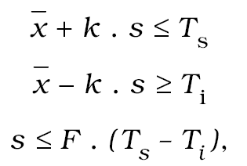
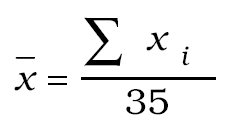
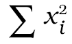
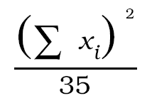
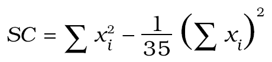
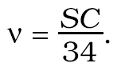
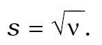
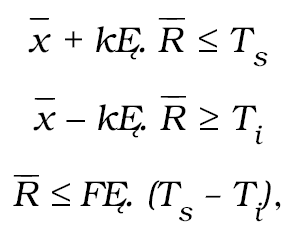
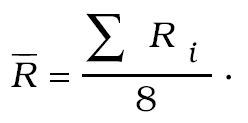

Príloha č. 7

k vyhláške č. 207/2000 Z. z.

REFERENČNÉ METÓDY KONTROLY ODMERNÝCH NÁDOB

1. Metódy výberu

Výber sú vzorky odmerných nádob toho istého vzoru a toho istého výrobcu; musia byť vybraté z dávky, ktorá v princípe zodpovedá hodinovej produkcii.

Ak výsledok kontroly z dávky zodpovedajúcej hodinovej produkcii nie je uspokojivý, možno vykonať druhú skúšku na základe

a) výberu z dávky zodpovedajúcej dlhšiemu času produkcie, alebo

b) výsledkov zaznamenaných na kontrolných kartách výrobcu, ak sa kontrola výroby vykonáva postupom schváleným úradom.

Počet odmerných nádob vo výbere musí byť 35 alebo 40 v závislosti od toho, ktorá z dvoch metód spracovania výsledkov uvedených v bode 3 sa použije.

2. Meranie objemu odmerných nádob vo výbere

Odmerné nádoby sa odvážia prázdne. Naplnia sa vodou s teplotou 20 oC známej hustoty až po hladinu zodpovedajúcu použitej metóde kontroly. Po naplnení sa odmerné nádoby odvážia. Kontrola sa vykoná určenými meradlami vhodnými na tieto účely. Chyba merania objemu nesmie byť väčšia ako 1/5 najväčšej dovolenej chyby zodpovedajúcej menovitému objemu odmernej nádoby.

3. Spracovanie výsledkov

3.1 Metóda smerodajnej odchýlky.

Počet odmerných nádob vo výbere je 35.

3.1.1 Vypočítajú sa (pozri bod 3.1.4):

3.1.1.1 Výberový priemer x zo skutočných objemov xi nádob vo výbere.

3.1.1.2 Odhad smerodajnej odchýlky s od skutočných objemov xi nádob v dávke.

3.1.2 Vypočítajú sa:

3.1.2.1 Horná hranica Ts: súčet vyznačeného objemu (pozri prílohu č. 6, bod 8) a najväčšej dovolenej chyby zodpovedajúcej tomuto objemu.

3.1.2.2 Dolná hranica Ti: rozdiel medzi vyznačeným objemom (pozri prílohu č. 6, bod 8) a najväčšou dovolenou chybou zodpovedajúcou tomuto objemu.

3.1.3 Kritériá prijatia:

Dávka sa považuje za vyhovujúcu požiadavkám tejto vyhlášky, ak čísla x a s súčasne vyhovujú týmto trom nerovnostiam:

kde k = 1,57 a F = 0,266.

3.1.4 Výpočet výberového priemeru x a odhadu smerodajnej odchýlky dávky

Vypočítajú sa:

a) suma z 35 meraní skutočných objemov xi: Σxi

b) výberový priemer z 35 meraní

c) suma štvorcov z 35 meraní

d) štvorec sumy z 35 meraní (Σ xi)2, potom

e) korigovaný súčet:

f) odhad rozptylu:

Odhad smerodajnej odchýlky:

3.2 Metóda priemerného rozpätia

Počet odmerných nádob vo výbere je 40.

3.2.1 Vypočítajú sa (pozri bod 3.2.4):

3.2.1.1 Výberový priemer x skutočných objemov xi nádob vo výbere.

3.2.1.2 Priemerné rozpätie R skutočných objemov xi nádob vo výbere.

3.2.2 Vypočítajú sa:

3.2.2.1 Horná hranica Ts: súčet vyznačeného objemu (pozri prílohu č. 6, bod 8) a najväčšej dovolenej chyby zodpovedajúcej tomuto objemu.

3.2.2.2 Dolná hranica Ti: rozdiel medzi vyznačeným objemom (pozri prílohu č. 6, bod 8) a najväčšou dovolenou chybou zodpovedajúcou tomuto objemu.

3.2.3 Kritériá prijatia:

Dávka sa považuje za vyhovujúcu požiadavkám tejto vyhlášky, ak čísla x a R súčasne vyhovujú týmto trom nerovnostiam:

kde k' = | 0,668

a F' = | 0,628

3.2.4 Výpočet výberového priemeru x a priemerného rozpätia R zo 40 odmerných nádob vo výbere.

3.2.4.1 Postup výpočtu hodnoty x:

a) suma zo 40 meraní skutočných objemov x i: Σ xi

b) výberový priemer z týchto 40 meraní

3.2.4.2 R sa vypočíta delením výberu v chronologickom poradí, vznikne 8 podvýberov, v každom z nich je 5 odmerných nádob.

Postup výpočtu:

a) rozpätie v každom podvýbere, t. j. rozdiel medzi skutočným objemom najväčšej a najmenšej z 5 odmerných nádob v podvýbere; získa sa tak 8 rozpätí:

R1; R2; ....; R8

b) suma rozpätí z 8 podvýberov:

Σ Ri = R1 + R2 + .... + R8.

Priemerné rozpätie R je potom:

