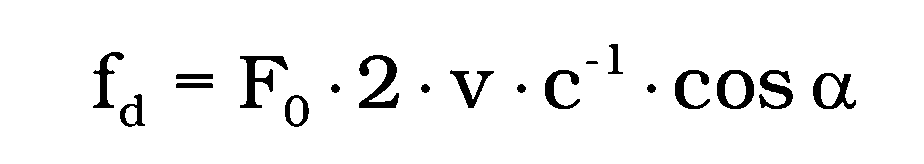
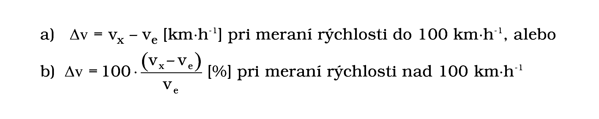
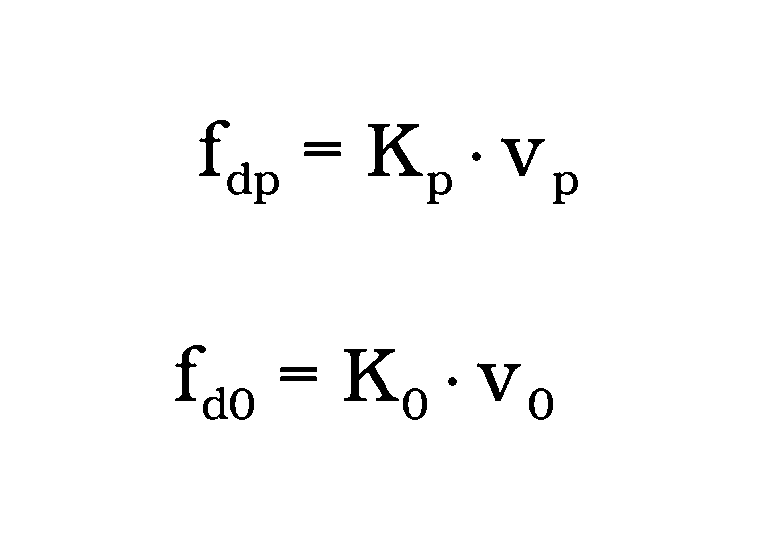

Príloha č. 31 k vyhláške č. 210/2000 Z. z.

- Cestné rýchlomery

  - Prvá časť Vymedzenie meradiel a spôsob ich metrologickej kontroly

    - 1. Táto príloha sa vzťahuje na cestné rýchlomery, ktoré sa používajú na meranie rýchlosti cestných motorových vozidiel pri kontrole dodržiavania pravidiel cestnej premávky ako určené meradlá podľa § 8 zákona.

    - 2. Táto príloha sa vzťahuje na meradlá

      - a) cestné radarové rýchlomery, ktoré pracujú na princípe merania zmeny frekvencie vyžarovaného elektromagnetického mikrovlnného vlnenia, ktoré vzniká odrazom tohto vlnenia od pohybujúceho sa objektu v dôsledku Dopplerovho efektu,

      - b) cestné laserové rýchlomery, ktoré pracujú na princípe vyhodnotenia signálu odrazeného laserového lúča od pohybujúceho sa objektu; spracovaný signál je funkciou okamžitej rýchlosti objektu.

    - 3. Cestné rýchlomery pred uvedením na trh podliehajú schváleniu typu a prvotnému overeniu. Technické požiadavky, metrologické požiadavky, metódy technických skúšok pri schvaľovaní typu a metódy skúšania pri prvotnom a následnom overení cestných rýchlomerov sú uvedené v druhej časti.

    - 4. Cestné rýchlomery schváleného typu výrobca alebo dovozca označí značkou schváleného typu.

    - 5. Cestné rýchlomery, ktoré pri overení vyhovejú ustanoveným požiadavkám, sa označia overovacou značkou a vydá sa doklad o overení.

    - 6. Cestné rýchlomery počas ich používania ako určené meradlá podliehajú následnému overeniu.

  - Druhá časť Technické požiadavky, metrologické požiadavky, metódy technických skúšok a metódy skúšania pri overovaní cestných rýchlomerov

    - 1. Termíny a definície

      - 1.1 Termíny a definície vzťahujúce sa na cestné rýchlomery

        - 1.1.1 Cestný rýchlomer je meradlo určené na meranie rýchlosti cestných motorových vozidiel umiestnené mimo vozidla, ktorého rýchlosť sa meria.

        - 1.1.2 Rýchlosť cestného motorového vozidla je fyzikálna veličina, ktorá je definovaná podielom dĺžky dráhy prekonanej pohybujúcim sa motorovým vozidlom a zodpovedajúceho časového intervalu za podmienky, že pohyb vozidla je rovnomerný po celej dráhe; rýchlosť cestných motorových vozidiel sa vyjadruje v kmh-1.

      - 1.2 Termíny a definície vzťahujúce sa na cestné radarové rýchlomery

        - 1.2.1 Vyžarovacia charakteristika antény je závislosť úrovne vyžiarenej energie od uhla, ktorý je vymedzený stredovou osou antény a priamkou spájajúcou stred antény a merný bod; meria sa pri konštantnej vzdialenosti od stredu antény pre horizontálnu alebo vertikálnu rovinu.

        - 1.2.2 Základný merací uhol α je uhol, ktorý je vymedzený stredovou osou vyžarovacej charakteristiky vysielacej antény a vektorom rýchlosti meraného pohybujúceho sa vozidla.

        - 1.2.3 Merací rozsah (hlavného laloka) vyžarovacej charakteristiky antény je veľkosť uhla so stredom v osi hlavného laloka vyžarovacej charakteristiky antény, ktorý pri základnom meracom uhle nespôsobí chybu merania rýchlosti väčšiu, ako je najväčšia dovolená chyba.

        - 1.2.4 Dopplerov efekt je fyzikálny jav charakterizovaný zmenou frekvencie vlnenia v mieste pozorovateľa pri jeho odraze od pohybujúceho sa objektu.

        - Meraná rozdielová (Dopplerova) frekvencia fd je daná vzťahom

        - 

          - kde F0 – frekvencia mikrovlnného vlnenia (vysielača),

          - fd – rozdielová frekvencia úmerná rýchlosti objektu,

          - v – rýchlosť pohybujúceho sa objektu,

          - α – základný merací uhol,

          - c – rýchlosť šírenia elektromagnetického vlnenia.

          - Tento vzťah je platný za predpokladu, že c je oveľa väčšie ako v.

        - 1.2.5 Mikrovlnné vlnenie je elektromagnetické vlnenie, ktorého frekvencia je v pásme od 3 GHz do 300 GHz.

        - 1.2.6 Nestacionárny režim je režim merania rýchlosti cestného motorového vozidla pohybujúcim sa cestným rýchlomerom (napr. z pohybujúceho sa motorového vozidla).

      - 1.3 Termíny a definície vzťahujúce sa na cestné laserové rýchlomery

        - 1.3.1 Vlnová dĺžka lasera je vlnová dĺžka monochromatického svetelného lúča žiarenia generovaného cestným laserovým rýchlomerom.

        - 1.3.2 Priestorový uhol vyžarovania laserového zväzku je rozbiehavosť vyžarovaného svetelného lúča lasera – vrcholový uhol svetelného kužeľa meraný v horizontálnej aj vo vertikálnej rovine.

        - 1.3.3 Výkon lasera je výkon svetelného lúča vyžiareného laserom.

    - 2. Technické požiadavky

      - 2.1 Konštrukcia cestného rýchlomera (ďalej len „rýchlomer") vrátane vnútornej logiky vyhodnocovania merania zaručuje pri správnom používaní rýchlomera v súlade s technickou dokumentáciou, že indikovaná rýchlosť vozidla nemôže byť priradená inému vozidlu ani vtedy, ak sa

        - a) vozidlá navzájom míňajú, predchádzajú alebo ide o jazdu v súbežných jazdných pruhoch,

        - b) rýchlomer používa na pohybujúcom sa meracom vozidle.

        - Ak táto funkcia nie je v plnej miere zaručená, potom sa rýchlomer vybavuje zariadením, ktoré indikuje nesprávne meranie alebo vynuluje nesprávny výsledok merania.

      - 2.2 Ak rýchlomer dovoľuje meranie rýchlosti motorových vozidiel v obidvoch smeroch (prichádzajúce vozidlá aj odchádzajúce vozidlá), potom je vybavený zariadením rozlišujúcim smer jazdy a indikáciou smeru jazdy. Smer jazdy je vždy súčasťou výsledku merania.

      - 2.3 Rýchlomer sa vybavuje zariadením, ktoré indikuje pokles napájacieho napätia pod hodnotu, pri ktorej chyba merania prekročí najväčšiu dovolenú chybu merania rýchlosti. Zariadenie upozorní obsluhu na nesprávne meranie alebo samo zariadenie nedovolí vykonať chybné meranie.

      - 2.4 Ak sa súčasne s meraním vyhotovuje aj záznam situácie vo forme fotografického obrázka, videozáznamu a podobne, potom sa zabezpečuje správne nastavenie optickej osi záznamu a osi vyžarovacej charakteristiky antény alebo osi vyžarovaného svetelného lúča lasera. Postup nastavenia sa opisuje v technickej dokumentácii rýchlomera.

      - 2.5 Ak sa rýchlomer používa bez optického záznamového zariadenia, potom indikovaná hodnota meranej rýchlosti vozidla zostáva viditeľná dovtedy, kým operátor hodnotu manuálne nevymaže nulovaním. Indikovaná hodnota nesmie byť prepísaná novým prejazdom vozidla alebo zrušená akýmkoľvek obslužným úkonom okrem vymazania nulovaním alebo vypnutia celého zariadenia z činnosti.

      - 2.6 Ak rýchlomer má analógovú indikáciu meranej rýchlosti, chyba odčítania indikovanej hodnoty rýchlosti má byť menšia ako 0,5 %. Indikovaná hodnota sa počas 15 minút nesmie zmeniť o viac ako 0,5 %.

      - 2.7 Ak je rýchlomer vybavený optickým záznamovým zariadením na zaznamenávanie situácie a výsledkov, potom každý záznam musí obsahovať

        - a) dátum, čas a miesto merania,

        - b) identifikačné údaje motorového vozidla – evidenčné číslo vozidla,

        - c) odmeranú hodnotu rýchlosti, jednotku rýchlosti (km.h-1) a smer pohybu vozidla (ˇ - príjazd, ^ - odjazd),

        - d) identifikačné údaje rýchlomera (výrobné číslo a pod.),

        - e) označenie verzie použitého programového vybavenia.

      - 2.8 Ak sa rýchlomer používa v nestacionárnom režime, musí byť na zázname vyznačený tento spôsob merania rýchlosti a hodnota rýchlosti pohybujúceho sa rýchlomera.

      - 2.9 Pre laserový rýchlomer musia byť v technickej dokumentácii alebo meracom programe rýchlomera uvedené najmenšia meracia vzdialenosť a najväčší bočný odstup rýchlomera, aby nebola prekročená najväčšia dovolená chyba rýchlosti.

      - 2.10 Rýchlomer musí byť skonštruovaný tak, aby bez porušenia overovacích značiek alebo zabezpečovacích značiek nebolo možné zmeniť jeho programové vybavenie, nastavenie, chránené metrologické parametre ani údaje uložené v pamäti rýchlomera.

      - 2.11 Mechanická konštrukcia a inštalácia na mieste merania zabezpečujú stabilitu merania za bežnej prevádzky motorových vozidiel na všetkých cestách a primeranú odolnosť proti poškodeniu pri preprave.

      - 2.12 Rýchlomery sa konštruujú tak, aby rádiové vysielanie z rádiostanice obsluhy nemalo žiadny vplyv na meranie rýchlosti vozidiel. Ani iné vysielače rozhlasové, televízne, telefónneho systému (mobilný telefónny systém) a pod. nemajú vplyv na meranie rýchlosti vozidiel a na metrologické charakteristiky rýchlomera.

      - 2.13 Rýchlomery sú svojou konštrukciou odolné proti zmenám teploty v rozsahu od -30 oC do +65 oC bez zmeny metrologických charakteristík.

      - 2.14 Na metrologické charakteristiky rýchlomerov nemá vplyv vlhkosť vzduchu a časti vystavené poveternostným vplyvom sú odolné proti vnikajúcemu prachu a striekajúcej vode.

      - 2.15 Rýchlomer nemá pri používaní vyžarovať elektromagnetickú energiu, ktorou by mohla byť rušená činnosť iných technických zariadení podľa požiadaviek elektromagnetickej kompatibility.

      - 2.16 Sprievodná technická dokumentácia

      - Sprievodná technická dokumentácia rýchlomera obsahuje

        - a) fyzikálny princíp činnosti rýchlomera,

        - b) blokové zapojenie rýchlomera s vysvetlením činnosti jednotlivých blokov,

        - c) technickú špecifikáciu parametrov rýchlomera a pracovných podmienok,

        - d) podmienky a spôsoby inštalácie a používanie rýchlomera,

        - e) informáciu o základných zdrojoch chýb, resp. neistôt merania, kvantifikáciu pre jednotlivé spôsoby používania,

        - f) predpokladaný čas bezporuchovej prevádzky,

        - g) zoznam bodov a miest, ktoré treba opatriť zabezpečovacou značkou (plombou), aby sa zabránilo prístupu k dôležitým nastavovacím bodom,

        - h) návod na obsluhu.

      - 2.17 Označenie rýchlomera

        - 2.17.1 Na rýchlomere, ktorý sa môže skladať z niekoľkých funkčne samostatných častí, sú na každej časti nezmazateľným spôsobom uvedené tieto údaje:

          - a) značka alebo meno výrobcu,

          - b) označenie typu rýchlomera,

          - c) výrobné číslo každej časti rýchlomera,

          - d) značka schváleného typu.

        - 2.17.2 Na indikátore rýchlomera a v zázname je pri hodnote rýchlosti v tesnej blízkosti vyznačená meracia jednotka, t. j. km.h-1 alebo km/h.

    - 3. Metrologické požiadavky

      - 3.1 Merací rozsah a chyba meradla

        - 3.1.1 Rýchlomer má merací rozsah rýchlosti najmenej od 30 km.h-1do 150 km.h-1.

        - 3.1.2 Chyba rýchlomera ∆v

        - 

          - kde vx – hodnota rýchlosti, ktorú indikuje rýchlomer,

          - ve – hodnota rýchlosti určená etalónovým zariadením.

      - 3.2 Najväčšia dovolená chyba

        - a) je ±3 km.h-1 pri meraní rýchlosti do 100 km.h-1,

        - b) je ±3 % z hodnoty meranej rýchlosti pre hodnoty rýchlosti nad 100 km.h-1.

      - 3.3 Metrologické požiadavky vzťahujúce sa na cestné radarové rýchlomery

        - 3.3.1 Merací rozsah hlavného laloka vyžarovacej charakteristiky antény je volený tak, aby v celom jeho rozsahu bola chyba merania rýchlosti menšia ako 2 %.

        - 3.3.2 Meranie rýchlosti cestných motorových vozidiel nie je vyhodnocované v tých častiach vyžarovacej charakteristiky antény, kde uhol dopadu mikrovlnného vlnenia môže spôsobiť chybu merania väčšiu ako 2 %.

        - 3.3.3 Základný merací uhol (a) pri šikmom meraní rýchlosti uvedie výrobca rýchlomera v technickej dokumentácii.

        - 3.3.4 Vyžarovaný mikrovlnný výkon a citlivosť prijímača radaru sú zosúladené tak, aby sa v normálnom meracom režime podľa návodu nedal zachytiť pohyb vozidla cez viac ako dva jazdné pruhy, t. j. v treťom jazdnom pruhu.

        - 3.3.5 Zameriavacie zariadenie na nastavenie základného meracieho uhla umožňuje nastavenie s chybou menšou ako 0,5o.

        - 3.3.6 Zameriavacie zariadenie sa nevyžaduje, ak sa rýchlomer bude používať tak, že základný merací uhol je menší ako 10o.

      - 3.4 Metrologické požiadavky vzťahujúce sa na cestné laserové rýchlomery

        - 3.4.1 Priestorový uhol vyžarovania laserového zväzku je uvedený v technickej dokumentácii výrobcu a nesmie byť väčší ako 5 mrad meraný ako rovinný uhol pre horizontálnu a vertikálnu rovinu na úrovni 50 % poklesu vyžarovaného výkonu.

        - 3.4.2 Výkon lasera rýchlomera musí vyhovovať požiadavkám bezpečnosti a ochrany zdravia pre triedu 1 pri jeho používaní.1)

    - 4. Metódy technických skúšok pri schvaľovaní typu a metódy skúšania pri overovaní

    - Technické skúšky rýchlomera pozostávajú

      - a) z vonkajšej obhliadky rýchlomera a príslušenstva,

      - b) zo skúšok rýchlomera v laboratóriu,

      - c) zo skúšok rýchlomera v teréne.

      - 4.1 Referenčné podmienky pri skúškach

        - 4.1.1 Pri skúškach v laboratóriu musí byť teplota okolia 20 oC ±2 oC a relatívna vlhkosť vzduchu do 85 %.

        - 4.1.2 Napájacie napätie rýchlomera má byť v rozsahu hodnôt udávaných výrobcom alebo v prípade neuvedenia odchýlka môže byť –10 % až +20 % od menovitej hodnoty napätia.

        - 4.1.3 Ostatné parametre pri skúške majú menovité hodnoty a tolerancie podľa schválených technických podmienok, ktoré deklaruje výrobca rýchlomera.

      - 4.2 Potrebné pomôcky

        - 4.2.1 Pomôcky na skúšanie cestných radarových rýchlomerov

          - 4.2.1.1 Mikrovlnný elektronický čítač merajúci v rozsahu vstupných frekvencií vysielača cestného radarového rýchlomera (pásmo 34 GHz) s kombinovanou štandardnou neistotou merania frekvencie menšou ako 2 x 10-5.

          - 4.2.1.2 Merač mikrovlnného výkonu s meracou anténou pre výkonové a frekvenčné pásmo vysielača cestného radarového rýchlomera (pásmo 34 GHz) s kombinovanou štandardnou neistotou merania výkonu menšou ako 6 %.

          - 4.2.1.3 Polohovacie zariadenie na meranie vyžarovacej charakteristiky antény v rozsahu ±90o s kombinovanou štandardnou neistotou merania polohovacieho uhla menšou ako 0,2.

          - 4.2.1.4 Elektronický generátor (imitátor) Dopplerových frekvencií, ktorého výstupný signál vyhodnotí cestný radarový rýchlomer ako frekvenciu úmernú rýchlosti pohybujúceho sa vozidla. Generovaná frekvencia je daná vzťahom pre Dopplerovu frekvenciu uvedeným v bode 1.2.4.

          - Ak výrobca rýchlomera neudáva jednotlivé hodnoty pre členy v rovnici podľa bodu 1.2.4, ale len prevodové konštanty, platia tieto vzťahy:

          - 

            - kde vp, v0– rýchlosti pre merané vozidlo na príjazde alebo odjazde,

            - Kp, K0– konštanty rýchlomera pre smer príjazd alebo odjazd,

            - fdp, fd0 – Dopplerove frekvencie pre smer príjazd alebo odjazd.

            - Kombinovaná štandardná neistota frekvencie generátora Dopplerových frekvencií je menšia ako 1 x 10-5.

          - 4.2.1.5 Etalónové zariadenie na meranie rýchlosti motorového vozidla v teréne s meracím rozsahom rýchlostí od 20 km .h-1 do 130 km .h-1 s kombinovanou štandardnou neistotou merania rýchlosti menšou ako 0,5 km . h-1 do rozsahu merania rýchlosti 100 km .h-1 a s kombinovanou štandardnou neistotou merania rýchlosti 0,5 % z hodnoty meranej rýchlosti pre rozsah rýchlosti nad 100 km .h-1.

          - 4.2.1.6 Nastaviteľný stabilizovaný zdroj jednosmerného napätia do 20 V. Skutočná hodnota napätia zdroja sa meria voltmetrom s kombinovanou štandardnou neistotou menšou ako 0,1 %.

          - 4.2.1.7 Skúšobné motorové vozidlo

        - 4.2.2 Pomôcky na skúšanie cestných laserových rýchlomerov

          - 4.2.2.1 Nastaviteľný stabilizovaný zdroj jednosmerného napätia do 20 V. Skutočná hodnota napätia zdroja sa meria voltmetrom s kombinovanou štandardnou neistotou menšou ako 0,1 %.

          - 4.2.2.2 Meracie zariadenie umožňujúce meranie uhlovej šírky laserového zväzku a výkonu lasera podľa údajov v technickej dokumentácii výrobcu.

          - 4.2.2.3 Meracie pásmo na vytýčenie kontrolných bodov skúšobnej dráhy. Kombinovaná štandardná neistota kalibrácie meracieho pásma nemá byť horšia ako (20 + 30 . L) µm, kde L je dĺžka v metroch.

          - 4.2.2.4 Etalónové zariadenie so snímačmi na meranie času prejazdu skúšobného vozidla kontrolnými bodmi skúšobnej dráhy. Kombinovaná štandardná neistota merania času nemá byť horšia ako 1 x 10-5 s.

            - Zariadenie umožňuje meranie rýchlosti motorového vozidla v teréne od 20 km .h-1 do 130 km .h-1 s kombinovanou štandardnou neistotou merania rýchlosti menšou ako 0,5 km .h-1 do rýchlosti 100 km .h-1a s kombinovanou štandardnou neistotou merania rýchlosti 0,5 % z hodnoty meranej rýchlosti pre rýchlosti nad 100 km .h-1.

          - 4.2.2.5 Etalónové zariadenie na simulovanie rýchlosti vozidla – simulátor rýchlosti v rozsahoch frekvencie impulzov a oneskorenia impulzov zodpovedajúcich meraciemu rozsahu rýchlomera s kombinovanou štandardnou neistotou simulovania rýchlosti nepresahujúcou 0,5 km .h-1 pri simulácii rýchlostí do 100 km .h-1 a 0,5 % z hodnoty rýchlosti pre rýchlosti nad 100 km .h-1.

          - 4.2.2.6 Skúšobné motorové vozidlo

      - 4.3 Technické skúšky pri schvaľovaní typu

        - 4.3.1 Vonkajšia obhliadka

        - Pri vonkajšej obhliadke rýchlomera sa kontroluje

          - a) úplnosť predpísanej technickej dokumentácie,

          - b) zhoda predloženého rýchlomera s dokumentáciou,

          - c) stav jednotlivých funkčných celkov z hľadiska prevádzky rýchlomera.

        - 4.3.2 Skúšky cestných radarových rýchlomerov v laboratóriu

          - 4.3.2.1 Meranie frekvencie vysielača cestného radarového rýchlomera

            - Frekvencia F0 (podľa bodu 1.2.4) vysielača rýchlomera sa meria podľa postupu určeného výrobcom. Ak nie je postup výrobcom udaný, meria sa frekvencia mikrovlnným čítačom bezkontaktným spôsobom alebo v meracom bode na meranie frekvencie určenom výrobcom rýchlomera. Meranie sa vykoná po 15 min a po 2 h od pripojenia rýchlomera na napájacie napätie. Hodnota odchýlky frekvencie má byť v oboch prípadoch menšia, ako predpisuje výrobca, alebo taká, aby chyba merania rýchlosti spôsobená zmenou frekvencie F0 nebola väčšia ako 0,1 %. Pre rýchlomery pracujúce v pásme 34 GHz odchýlka frekvencie musí byť menšia ako 34 MHz.

          - 4.3.2.2 Meranie vyžarovacej charakteristiky antény vysielača

            - Pri meraní sa postupuje podľa metodiky stanovenej výrobcom rýchlomera. Meranie sa vykoná pre horizontálnu aj vertikálnu rovinu. Ak výrobca vyžarovaciu charakteristiku antény neudáva alebo vyžarovací uhol zodpovedajúci poklesu výkonu na polovičnú hodnotu je neznámy, tento uhol má byť menší ako uhol, pri ktorom je chyba merania rýchlosti 2 %.

          - 4.3.2.3 Meranie výstupného výkonu vysielača rýchlomera

            - Meranie sa vykoná podľa zapojenia odporúčaného výrobcom rýchlomera. Namerané hodnoty nepresiahnu deklarované parametre v rámci stanovenej neistoty merania. Ak nie je známa hodnota najväčšieho vyžiareného mikrovlnného výkonu rýchlomera, pre rýchlomery pracujúce v K pásme nesmie byť vyžiarený výkon väčší ako 2 mW.

          - 4.3.2.4 Meranie relatívnej citlivosti prijímacej časti rýchlomera

            - Meranie sa vykoná podľa zapojenia odporúčaného výrobcom rýchlomera.

          - 4.3.2.5 Skúška nastavenia základného meracieho uhla α

            - Skúška sa vykoná podľa postupu určeného výrobcom rýchlomera. Ak postup nie je známy, vykoná sa skúška takto: základný merací uhol sa zistí tak, že jedno rameno uhla tvorí vrchol vyžarovacej charakteristiky antény (meranie výkonu alebo detekcia vyžiareného vlnenia) a druhé rameno uhla je vymedzené priamkou zameriavacieho zariadenia. Kombinovaná štandardná neistota merania základného meracieho uhla rýchlomera má byť menšia ako 0,5o.

          - 4.3.2.6 Stanovenie chyby rýchlomera elektronickým generátorom Dopplerových frekvencií

            - Chyba rýchlomera sa stanoví podľa metodiky určenej výrobcom a rozhodnutím o schválení typu rýchlomera. Meranie a vyhodnotenie sa vykoná pre obidva smery – pre prichádzajúce vozidlo a odchádzajúce vozidlo, aspoň 2 x 5 hodnôt rýchlostí v rozsahu do 100 km.h-1 a taktiež 2 x 5 meraní pre rýchlosti nad 100 km.h-1.

          - 4.3.2.7 Skúška relatívnej citlivosti prijímacej časti rýchlomera

            - Relatívna citlivosť prijímacej časti rýchlomera sa meria podľa metodiky stanovenej výrobcom. Hodnota relatívnej citlivosti rýchlomera je taká úroveň signálu na generátore Dopplerových frekvencií pri konštantnej geometrii meracieho pracoviska, ktorá zaručí spoľahlivé odmeranie idúceho vozidla v najväčšej vzdialenosti udanej výrobcom.

          - 4.3.2.8 Skúška vplyvu zmeny napájacieho napätia

            - Nastaviteľným stabilizovaným zdrojom jednosmerného napätia sa sleduje správnosť funkcie rýchlomera v závislosti od zmeny napájacieho napätia. Rýchlomer musí spoľahlivo pracovať aj pri zmene napájacieho napätia v rozsahu uvedenom v technickej dokumentácii výrobcu.

        - 4.3.3 Skúšky cestných radarových rýchlomerov v teréne

          - 4.3.3.1 Skúška správnosti rýchlomera skúšobným vozidlom

            - Skúškou na skúšobnej dráhe sa etalónovým skúšobným zariadením a skúšobným vozidlom zisťuje chyba rýchlomera. Rýchlomer a etalónové zariadenie sa inštalujú podľa predpisu výrobcu. Skúška sa vykoná najmenej pri troch hodnotách rýchlosti v rozsahu do 130 km.h-1v smere prichádzajúceho skúšobného vozidla a pri troch hodnotách rýchlosti v rozsahu do 130 km.h-1v smere odchádzajúceho skúšobného vozidla a vypočíta sa kombinovaná štandardná neistota merania rýchlosti.

          - 4.3.3.2 Skúška relatívnej citlivosti rýchlomera

            - Skúška sa vykoná meraním rýchlosti skúšobného vozidla pohybujúceho sa voči skúšanému rýchlomeru v najväčšej vzdialenosti, ktorú udáva výrobca rýchlomera. Meranie sa vykoná najmenej dvakrát pre prichádzajúce vozidlo a dvakrát pre odchádzajúce vozidlo. Rýchlosť vozidla sa nevyhodnocuje, kontroluje sa len správnosť funkcie rýchlomera.

        - 4.3.4 Skúšky cestných laserových rýchlomerov

          - 4.3.4.1 Skúška vplyvu zmeny napájacieho napätia

            - Nastaviteľným stabilizovaným zdrojom jednosmerného napätia sa sleduje správnosť funkcie rýchlomera v závislosti od zmeny napájacieho napätia. Rýchlomer musí spoľahlivo pracovať aj pri zmene napájacieho napätia v rozsahu uvedenom v technickej dokumentácii výrobcu.

          - 4.3.4.2 Skúška rozlišovacej schopnosti merania vzdialenosti

            - Skúška sa vykoná pre uvedenú najmenšiu meraciu vzdialenosť (napr. 30 m) a pre 50 m alebo 100 m. Cieľová skúšobná plocha sa umiestni v danej vzdialenosti a vykoná sa meranie v rozsahu 1,5-násobku predpokladanej rozlišovacej schopnosti rýchlomera raz vpred a druhý raz vzad.

          - 4.3.4.3 Skúška nastavenia zameriavacieho zariadenia meradla

            - Skúška sa vykoná podľa skúšobného obrazca a vo vzdialenosti podľa odporúčania výrobcu. Kontroluje sa nastavenie podľa tolerančného poľa udávaného výrobcom alebo sa vykoná justáž podľa návodu výrobcu. Ak výrobca nepredpisuje skúšobný obrazec a vzdialenosť, vykoná sa kontrolné meranie podľa štandardného skúšobného obrazca pre laserové meradlá rýchlosti pre vzdialenosť 50 m, resp. 100 m.

          - 4.3.4.4 Skúška správnosti rýchlomera skúšobným vozidlom

            - Skúškou na skúšobnej dráhe sa etalónovým skúšobným zariadením a skúšobným vozidlom zisťuje chyba rýchlomera. Rýchlomer a etalónové zariadenie sa inštalujú podľa predpisu výrobcu. Skúška sa vykoná najmenej pri troch hodnotách rýchlosti v rozsahu do 130 km.h-1v smere prichádzajúceho skúšobného vozidla a pri troch hodnotách rýchlosti v rozsahu do 130 km.h-1 v smere odchádzajúceho skúšobného vozidla a vypočíta sa kombinovaná štandardná neistota merania rýchlosti.

          - 4.3.4.5 Skúška správnosti rýchlomera simuláciou rýchlosti v laboratóriu

            - Skúškou správnosti rýchlomera simulátorom rýchlosti sa zisťuje chyba rýchlomera v laboratóriu. Rýchlomer a simulátor rýchlosti sa inštalujú podľa predpisu výrobcu. Skúška sa vykoná najmenej pri troch hodnotách rýchlosti v rozsahu do 130 km .h-1v smere prichádzajúceho vozidla a pri troch hodnotách rýchlosti v rozsahu do 130 km .h-1 v smere odchádzajúceho vozidla a vypočíta sa kombinovaná štandardná neistota merania rýchlosti.

          - 4.3.4.6 Skúška relatívnej citlivosti rýchlomera

            - Skúška sa vykoná meraním rýchlosti skúšobného vozidla pohybujúceho sa voči skúšanému rýchlomeru v najväčšej vzdialenosti, ktorú udáva výrobca rýchlomera. Meranie sa vykoná najmenej dvakrát pre prichádzajúce vozidlo a dvakrát pre odchádzajúce vozidlo. Rýchlosť vozidla sa nevyhodnocuje, kontroluje sa len správnosť funkcie rýchlomera.

      - 4.4 Rozsah skúšok pri prvotnom overení a následnom overení

        - 4.4.1 Pri prvotnom overení cestných radarových rýchlomerov sa kontroluje zhoda predloženého rýchlomera so schváleným typom a vykoná sa úplný súbor skúšok podľa bodov 4.3.1, 4.3.2 a 4.3.3. Pri skúškach podľa bodov 4.3.2.2 až 4.3.2.6 sa prihliada na rozhodnutie o schválení typu rýchlomera.

        - 4.4.2 Pri následnom overovaní cestných radarových rýchlomerov sa kontroluje zhoda predloženého rýchlomera so schváleným typom a vykonajú sa skúšky v laboratóriu podľa bodov 4.3.1 písm. c), 4.3.2.1 až 4.3.2.6, 4.3.2.8 a 4.3.3.2. Pri skúškach podľa bodov 4.3.2.2 až 4.3.2.6 sa prihliada na rozhodnutie o schválení typu rýchlomera.

        - 4.4.3 Pri prvotnom overení cestných laserových rýchlomerov sa kontroluje zhoda predloženého rýchlomera so schváleným typom a vykonajú sa skúšky podľa bodov 4.3.1, 4.3.4.3 a skúška podľa bodov 4.3.4.4 alebo 4.3.4.5. Ak sa vykonáva skúška podľa bodu 4.3.4.5, musí sa vykonať aj skúška podľa bodu 4.3.4.4 aspoň pri jednej hodnote rýchlosti prichádzajúceho skúšobného vozidla a pri jednej hodnote rýchlosti odchádzajúceho skúšobného vozidla. Pri následnom overení cestných laserových rýchlomerov sa kontroluje zhoda predloženého rýchlomera so schváleným typom a vykonajú sa skúšky podľa bodov 4.3.1, 4.3.4.3 a 4.3.4.5.

      - 4.5 Vyhodnotenie nameraných údajov

        - 4.5.1 Pri cestných radarových rýchlomeroch sa namerané hodnoty rýchlosti pri meraní elektronickým generátorom Dopplerových frekvencií a v teréne vyhodnotia podľa metodiky stanovenej výrobcom rýchlomera a rozhodnutia o schválení typu rýchlomera.

        - 4.5.2. Pri cestných laserových rýchlomeroch sa hodnoty rýchlosti namerané skúšaným rýchlomerom porovnajú s hodnotami rýchlosti skúšobného vozidla vypočítanými zo vzdialenosti kontrolných bodov na skúšobnej dráhe a príslušných časových intervalov prechodu vozidla týmito bodmi alebo s hodnotami indikovanými simulátorom rýchlosti.

    - 5. Overenie

      - Rýchlomer, ktorý pri všetkých skúškach vyhovie ustanoveným požiadavkám, sa označí overovacou značkou a vydá sa doklad o overení.

      - Tie časti, ktoré by po nedovolenom zásahu mohli byť príčinou udania nesprávneho výsledku, musia byť opatrené zabezpečovacou značkou (plombou alebo iným spôsobom ochránené pred nedovoleným zásahom).

      - Overovacie a zabezpečovacie značky sa umiestňujú na rýchlomer v súlade s rozhodnutím o schválení typu rýchlomera.
