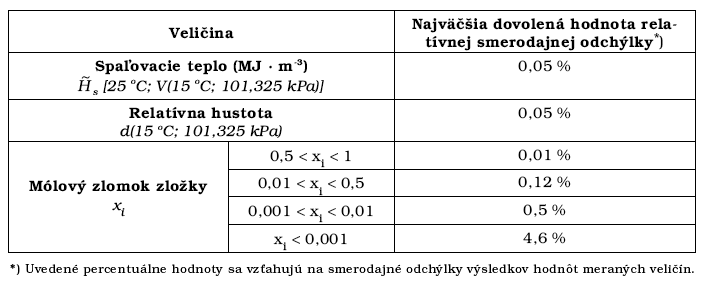
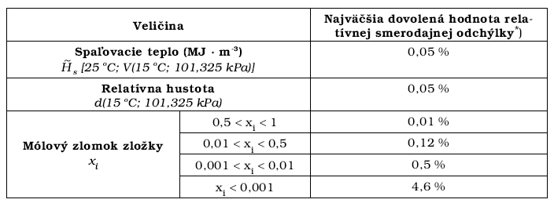

Príloha č. 73 k vyhláške č. 210/2000 Z. z.

- PLYNOVÉ CHROMATOGRAFY NA STANOVENIE ENERGETICKEJ HODNOTY ZEMNÉHO PLYNU

  - Prvá časť Vymedzenie meradiel a spôsob ich metrologickej kontroly

    - 1. Táto príloha sa vzťahuje na procesné plynové chromatografy a laboratórne plynové chromatografy, ktoré sa používajú na meranie chemického zloženia zemného plynu, stanovenie jeho energetickej hodnoty a relatívnej hustoty (ďalej len „plynový chromatograf“). Energetické hodnoty slúžia na výpočet množstva energie obsiahnutej v zemnom plyne.

    - 2. Plynový chromatograf pred uvedením na trh podlieha schváleniu typu a prvotnému overeniu. Metódy technických skúšok pri schvaľovaní typu a metódy skúšania pri overení sú uvedené v druhej časti.

    - 3. Plynový chromatograf schváleného typu výrobca alebo dovozca označí značkou schváleného typu.

    - 4. Plynový chromatograf, ktorý pri overení vyhovie ustanoveným požiadavkám, sa označí overovacou značkou a vydá sa doklad o overení.

    - 5. Plynový chromatograf počas jeho používania ako určeného meradla podlieha následnému overeniu.

  - Druhá časť Technické požiadavky, metrologické požiadavky, metódy technických skúšok pri schvaľovaní typu a metódy skúšania pri overení plynových chromatografov

    - 1. Termíny a definície

      - 1.1 Plynový chromatograf je meradlo určené na stanovenie energetickej hodnoty, t. j. spaľovacieho tepla a výhrevnosti zemného plynu na základe výsledkov analýzy chemického zloženia. Energetická hodnota a ďalšie veličiny sa vypočítajú programom zohľadňujúcim požiadavky príslušnej slovenskej technickej normy.1)

      - 1.2 Procesný plynový chromatograf je plynový chromatograf, ktorý, na rozdiel od laboratórneho plynového chromatografu, je napojený priamo na plynárenskú sieť zemného plynu.

      - 1.3 Spaľovacie teplo je množstvo tepla, ktoré sa uvoľní úplným spálením stanoveného množstva plynu vo vzduchu tak, že tlak p1,pri ktorom daná reakcia prebieha, zostane konštantný a teplota všetkých produktov spaľovania sa vráti na východiskovú teplotu t1 zhodnú s teplotou reagujúcich zložiek, pričom všetky produkty spaľovania sú v plynnom stave s výnimkou vody vytvorenej spálením, ktorá pri teplote t1 skondenzovala do kvapalného stavu.

      - 1.4 Výhrevnosť je množstvo tepla, ktoré sa uvoľní úplným spálením stanoveného množstva plynu vo vzduchu tak, že tlak p1,pri ktorom daná reakcia prebieha, zostane konštantný a teplota všetkých produktov spaľovania sa vráti na východiskovú teplotu t1 zhodnú s teplotou reagujúcich zložiek, pričom všetky produkty spaľovania sú v plynnom stave.

      - 1.5 Mólový zlomok je podiel počtu mólov zložky k počtu mólov plynnej zmesi.

      - 1.6 Objemový zlomok je podiel objemu zložky k objemu zmesi za daných podmienok, t. j. tlaku a teploty.

      - 1.7 Hmotnostný zlomok je podiel hmotnosti zložky k hmotnosti plynnej zmesi.

      - 1.8 Hustota je pomer hmotnosti vzorky plynu k jej objemu za definovaných podmienok.

      - 1.9 Relatívna hustota je hustota plynu delená hustotou suchého vzduchu štandardného zloženia1) za rovnakých stanovených podmienok tlaku a teploty.

      - 1.10 Kalibračný plyn je zmes plynov definovaného zloženia, zabezpečujúceho metrologickú nadväznosť jednotlivých zložiek, používaná pri periodických kalibráciách meradla a pri metrologických skúškach.

      - 1.11 Interný kalibračný plyn je kalibračný plyn, ktorý je súčasťou meradla a slúži na jeho periodickú kalibráciu.

      - 1.12 Externý kalibračný plyn je kalibračný plyn, ktorý netvorí súčasť meradla a používa sa na metrologickú kontrolu meradla.

      - 1.13 Kompresibilitný faktor je pomer skutočného objemu určitej hmotnosti plynu za stanovených podmienok tlaku a teploty a objemu plynu vypočítaného zo stavovej rovnice pre ideálny plyn.

    - 2. Metrologické požiadavky

      - 2.1 Referenčné podmienky: tlak 101,325 kPa, teplota spaľovania 25 oC, teplota merania objemu 15 oC.

      - 2.2 Pracovné podmienky: teplota –18 oC až 55 oC.

      - 2.3 Meracie rozsahy

      - Meracie rozsahy a meracie jednotky stanovovaných veličín na plynovom chromatografe sú tieto:

        - a) mólové zlomky jednotlivých zložiek zemného plynu vyjadrené v %,

        - b) spaľovacie teplo: (25 až 50) MJ . m-3, resp. (7 až 14) kWh .m-3,

        - c) relatívna hustota: 0,555 až 0,700.

        - Merateľné rozsahy mólových zlomkov zložiek sú uvedené v tabuľke č. 1:

        - Tabuľka č. 1

      - Zložka | Merateľné rozsahy %

      - dusík | 0 až 15

      - metán | 75 až 100

      - oxid uhličitý | 0 až 10

      - etán | 0 až 10

      - propán | 0 až 3

      - izobután | 0 až 1

      - n-bután | 0 až 1

      - neopentán | 0,0 až 0,5

      - izopentán | 0,0 až 0,5

      - n-pentán | 0,0 až 0,5

      - C6+ (n-hexán) | 0,0 až 0,2

      - 2.4 Kalibrácia interným kalibračným plynom sa musí v prípade procesného plynového chromatografu vykonávať pravidelne, optimálne raz denne, najmenej však raz za 168 hodín. Na kalibráciu musí byť na chromatografe vyčlenený samostatný vstup, ktorý musí byť zabezpečený proti neoprávnenému zásahu značkou používateľa, napríklad plombou.

        - V prípade laboratórneho plynového chromatografu sa kalibrácia vykonáva bezprostredne pred analýzou odobratej vzorky.

      - 2.5 Interný kalibračný plyn musí byť zabezpečený tak, aby sa zabránilo neoprávnenej manipulácii s ním. Jeho vlastnosti sú uvedené v certifikáte. Rozšírené relatívne neistoty jeho jednotlivých hodnôt vlastností – spaľovacieho tepla, relatívnej hustoty a mólového zlomku metánu nesmú byť väčšie ako 0,25 %. Technické požiadavky na kalibračné plyny na analýzu zemného plynu sú uvedené v bode 3.6.

      - 2.6 Externé kalibračné plyny používané pri metrologickej kontrole sú certifikované referenčné materiály s rôznymi hodnotami spaľovacieho tepla, ktoré musia obsahovať najmenej 11 zložiek. Na overenie sa použijú 2 plyny, pričom hodnoty ich rozšírených relatívnych neistôt nesmú byť väčšie ako 0,2 % príslušnej hodnoty spaľovacieho tepla, relatívnej hustoty a mólového zlomku metánu.

      - 2.7 Opakovateľnosť merania vyjadrená v percentách ako relatívna smerodajná odchýlka z určitého počtu meraní musí byť menšia ako hodnoty uvedené pre jednotlivé veličiny v tabuľke č. 2.

        - Tabuľka č. 2

      - 

        - Kontrola sa vykonáva pri technických skúškach na účely schvaľovania typu meradla a pri prvotnom overení.

      - 2.8 Hodnoty najväčších dovolených chýb pri technických skúškach na účely schvaľovania typu, pri prvotnom a následnom overení pre jednotlivé veličiny sú uvedené v tabuľke č. 3.

        - Tabuľka č. 3

      - 

    - 3. Technické požiadavky

    - 3.1 Plynový chromatograf je spravidla tvorený:

      - a) analytickou časťou – dávkovací systém, teplotne stabilizované chromatografické kolóny, detektor,

      - b) pneumatickou časťou zabezpečujúcou prívod plynov vrátane regulácie vstupných tlakov,

      - c) elektronickou riadiacou a ovládacou jednotkou vrátane integračnej jednotky.

    - 3.1.1 Príslušenstvo:

      - a) sonda na odber vzorky zemného plynu alebo vzorkovnica zemného plynu,

      - b) výstupné potrubie pre plyny vchádzajúce do prístroja,

      - c) tlaková nádoba s nosným plynom,

      - d) tlaková nádoba s interným kalibračným plynom.

    - 3.2 Konštrukcia vlastného prístroja musí zabezpečiť merací systém proti neprípustnej manipulácii.

    - 3.3 Analytická časť musí umožňovať stanovenie všetkých zložiek v jednej analýze. Jednotlivé zložky musia byť separované s výnimkou uhľovodíkov s počtom uhlíkov v reťazci vyšším ako šesť.

    - 3.4 Elektronická riadiaca jednotka môže byť zabudovaná do analytickej časti alebo môže byť umiestnená oddelene ako samostatná časť. Táto jednotka vykonáva integráciu signálu, uchováva kalibračné údaje, vykonáva vyhodnotenie a výpočet spaľovacieho tepla a relatívnej hustoty. Vypočítané údaje sa uchovávajú v elektronickej podobe alebo sa prenášajú do záznamového zariadenia.

    - 3.5 Pneumatická časť zabezpečuje stabilizáciu a reguláciu tlaku nosného plynu, najčastejšie hélia, a pracovných plynov, napr. vodík, vzduch alebo dusík, ktoré sú potrebné na činnosť použitých detektorov alebo na ovládanie pneumatických ventilov analytickej a vzorkovacej časti.

    - 3.6 Interný kalibračný plyn tvorí súčasť meradla a slúži na jeho pravidelnú kalibráciu. Musí obsahovať všetkých 11 zložiek zemného plynu v rozsahoch podľa tabuľky č. 1. V prípade procesného plynového chromatografu sa nesmie kalibračný plyn odpojovať od prístroja. Kalibračný certifikát interného kalibračného plynu musí byť k dispozícii.

    - 3.7 Časť na prepínanie vstupov vzoriek a interného kalibračného plynu pri procesnom plynovom chromatografe býva ovládaná elektronickou jednotkou a musí umožňovať napojenie vzoriek a kalibračného plynu. V prípade použitia viacerých vstupov vzoriek musí byť dĺžka analýzy a početnosť dávkovania nastavená tak, aby bolo možné vykonať aspoň 24 analýz z každého vstupu za 24 hodín. V prípade, že sa odber vzoriek vykonáva mimo budovy, musí byť odberová kapilára temperovaná tak, aby teplota plynu neklesla pod teplotu rosného bodu jednotlivých zložiek zmesi. Prietok vzoriek musí byť nastavený tak, aby časové oneskorenie vzorky plynu bolo kratšie, ako je cyklus dávkovania.

    - 3.8 Tlaková nádoba s kalibračným plynom musí byť vybavená temperovacím zariadením, aby v prípade nižších teplôt prostredia nedochádzalo ku kondenzácii jeho zložiek a aby sa zabezpečila homogenita obsahu tlakovej nádoby.

    - 4. Nápisy a značky

    - 4.1 Štítok

    - Prístroj musí mať trvalý a ľahko čitateľný štítok, ktorý obsahuje tieto údaje:

      - a) ochrannú značku alebo obchodné meno výrobcu,

      - b) rok výroby,

      - c) výrobné číslo,

      - d) typové označenie alebo číslo modelu,

      - e) merací rozsah spaľovacieho tepla pri referenčných podmienkach.

    - 4.2 Umiestnenie overovacej značky

      - Prístroj, ktorý pri overení vyhovie ustanoveným požiadavkám, sa označí overovacou značkou a vydá sa doklad o overení. Umiestnenie overovacej značky sa uvádza v rozhodnutí o schválení typu a v doklade o overení.

    - 5. Metódy technických skúšok

    - 5.1 Prístroj predložený na skúšku na účely schvaľovania typu musí byť kompletný s príslušenstvom a dokumentáciou. Skúšky sa vykonávajú na mieste jeho používania podľa pracovného postupu schváleného Slovenským metrologickým ústavom.

      - Pred technickými skúškami na účely schvaľovania typu sa najskôr vykoná jeho nastavenie interným kalibračným plynom podľa pracovných inštrukcií výrobcu. Nastavenie aj následné skúšky sa vykonávajú v referenčných podmienkach uvedených v bode 2.1 pomocou externých kalibračných plynov, ktorými sú certifikované referenčné materiály s certifikovaným obsahom všetkých požadovaných 11 zložiek zemného plynu.

    - 5.2 Ak sa prístroj používa v prevádzkových podmienkach stanovených výrobcom, potom údaje prístroja pri hodnotení jeho stability za relatívne stabilných podmienok okolia a po kalibrácii interným kalibračným plynom zostávajú pri skúške typu počas 8 hodín v rámci driftu, ktorého priemerná hodnota je menšia alebo nanajvýš sa rovná polovičnej hodnote najväčšej dovolenej chyby.

    - 5.3 Vypočítajú sa relatívne odchýlky v percentách, ktoré sa porovnajú s najväčšou dovolenou chybou pre danú veličinu. Relatívne odchýlky musia byť menšie ako najväčšie dovolené chyby uvedené v tabuľke č. 3.

    - 5.4 Opakovateľnosť merania sa vyhodnotí zo smerodajnej odchýlky 20 nameraných hodnôt. Musí byť menšia ako najväčšie dovolené hodnoty uvedené v tabuľke č. 2.

    - 6. Metódy skúšania pri overení

    - 6.1 Overenie plynového chromatografu sa vykonáva na mieste jeho používania použitím predpísaných metód a certifikovaných referenčných materiálov zmesí plynov – externé kalibračné plyny, ktoré sú nadviazané na národný etalón zloženia vybraných zmesí plynov.

    - 6.2 Prvotné overenie

    - Prvotné overenie prístroja sa vykonáva po schválení jeho typu, a to použitím potrebných pomôcok a externých kalibračných plynov. Pozostáva z týchto krokov:

      - a) vonkajšej obhliadky – kontroly certifikátu interného kalibračného plynu, ktorý musí spĺňať požiadavky metrologickej nadväznosti, úrovne štandardných neistôt a platnosti; kontroly stavu štítkov a plombovania,

      - b) kontroly stavu kalibrácie plynového chromatografu, t.j. kalibračnej tabuľky v overovanom prístroji a jej porovnania s kalibračným certifikátom,

      - c) skúšky správnosti merania hodnôt mólových zlomkov, spaľovacích tepiel a relatívnych hustôt porovnaním s hodnotami uvedenými v certifikáte externého kalibračného plynu,

      - d) skúšky opakovateľnosti merania.

      - Opakovateľnosť merania sa vyhodnotí zo smerodajnej odchýlky 10 nameraných hodnôt. Musí byť menšia ako najväčšie dovolené hodnoty uvedené v tabuľke č. 2.

    - 6.3 Následné overenie

      - Následné overenie pozostáva z rovnakých skúšok ako prvotné overenie s výnimkou skúšky opakovateľnosti merania.

    - 6.4 Na meranie sa použijú certifikované referenčné materiály zmesí plynov, ktoré sú nadviazané na národný etalón mólového zlomku vybraných zmesí plynov.

    - 6.5 Vyhodnotenie nameraných výsledkov a spracovanie výsledkov skúšok

      - Pre každé meranie sa stanoví hodnota rozšírenej neistoty výsledku merania. Pre meradlo, ktoré vyhovie príslušným požiadavkám, sa vystaví doklad o overení a meradlo sa označí overovacou značkou.

    - 1) STN EN ISO 6976 Zemný plyn. Výpočet výhrevnosti, hustoty, relatívnej hustoty a Wobbeho indexu zo zloženia.
