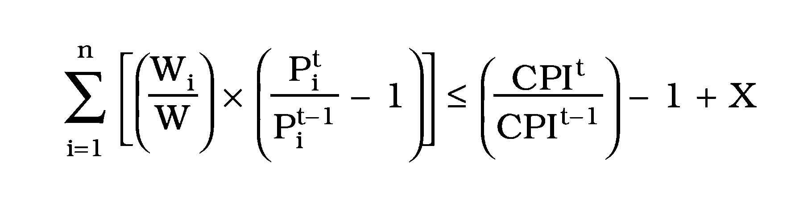

# Článok 2

(1) Pri stanovení cien služieb, ktoré sú zahrnuté do koša služieb, nesmie zvýšenie cien platných pre nasledujúce obdobie regulácie cien presiahnuť tento rozsah:

pričom:

CPIt = index spotrebiteľských cien úhrnom (CPI) za tretí mesiac posledného obdobia regulácie cien (t-1) publikovaný Štatistickým úradom Slovenskej republiky (riadok c – základné obdobie december 1995 = 100),

CPIt-1 = index spotrebiteľských cien úhrnom (CPI) za tretí mesiac predposledného obdobia regulácie cien (t-2) publikovaný Štatistickým úradom Slovenskej republiky (riadok c – základné obdobie december 1995 = 100),

Pti = cena služby i po uvedení navrhovanej zmeny ceny,

Pit-1 = cena služby i v poslednom období regulácie cien,

Wi = výnosy služby i v poslednom období regulácie cien (k poslednému dňu tretieho mesiaca posledného obdobia regulácie cien),

W = celkové výnosy celého koša služieb v poslednom období regulácie cien (k poslednému dňu tretieho mesiaca posledného obdobia regulácie cien),

i = zložka koša služieb,

X = faktor cenovej regulácie,

n = počet zložiek koša služieb.

(2) Zvýšenie ceny jednotlivej služby, ktorá je zahrnutá do koša služieb, okrem ceny za mesačný nájom hlavnej telefónnej stanice smie presiahnuť dvadsať percent (20 %) v kalendárnom roku len v prípade, že takéto zvýšenie vopred schváli úrad. Zvýšenie ceny za mesačný nájom hlavnej telefónnej stanice smie bez predchádzajúceho súhlasu úradu dosiahnuť šesťdesiat percent (60 %) v kalendárnom roku.

(3) V prípadoch, keď cena za služby závisí od vzdialenosti, dennej doby, dňa v týždni alebo od podobných faktorov, na účely tarifného mechanizmu sa použije vážený priemer takýchto cien a výnosov z takýchto služieb.

(4) Hodnota faktora cenovej regulácie je 3 %.

(5) Obdobiami regulácie cien sa rozumejú šesťmesačné obdobia začínajúce 1. januárom a 1. júlom kalendárneho roka.

(6) V prípade, že v priebehu obdobia regulácie cien dôjde k zmene metodiky výpočtu indexu spotrebiteľských cien úhrnom, úrad stanoví po konzultácii s poskytovateľom služieb a so Štatistickým úradom Slovenskej republiky index zodpovedajúci úrovni inflácie za zodpovedajúce obdobie.

(7) V prípade, že poskytovateľ služieb pri stanovení ceny v jednotlivom období regulácie cien nevyužije možnosť zvýšiť ceny v plnom rozsahu, ako mu to dovoľuje vzorec uvedený v odseku 1, môže preniesť rozdiel medzi faktorom, o ktorý mohol ceny zvýšiť, a faktorom, o ktorý ceny skutočne zvýšil, do nasledujúceho obdobia kontroly cien pri dodržaní obmedzenia uvedeného v odseku 2.
