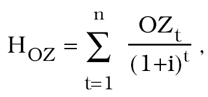
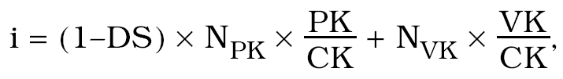
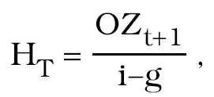
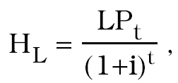
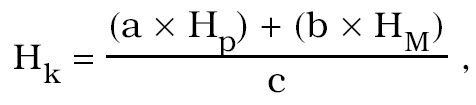
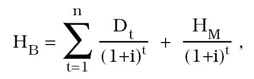

Príloha č. 1 k vyhláške č. 255/2000 Z. z. METÓDY STANOVENIA HODNOTY PODNIKU, JEHO ČASTÍ ALEBO ZLOŽIEK MAJETKU PODNIKU

Výber metódy ohodnotenia je rozhodujúcim spôsobom ovplyvnený predmetom ohodnotenia. Týmto môže byť

a) podnik ako celok,

b) časť podniku (organizačná zložka),

c) zložka majetku podniku.

Podnikom sa rozumie súbor hmotných, ako aj osobných a nehmotných zložiek podnikania. K podniku patria veci, práva a iné majetkové hodnoty.

Za organizačnú zložku podniku sa považuje odštepný závod a iná organizačná zložka zapísaná v obchodnom registri. Na účely ohodnotenia musí byť taká zložka podniku oddeliteľná účtovne a majetkovo.

Jednotlivé zložky majetku podniku predstavujú majetok uvedený v súvahe podniku, majetok uvedený na podsúvahových účtoch, prípadne majetok neevidovaný v účtovníctve.

Majetková metóda stanovenia hodnoty podniku

Majetková hodnota podniku je hodnota prevádzkovo dôležitého a potrebného majetku znížená o všeobecnú hodnotu cudzích pasív, stanovená k termínu ohodnotenia.

Metóda majetkovej hodnoty podniku poskytuje časovo reálne a ľahko kontrolovateľné údaje o štruktúre majetku, objektivizuje údaje z účtovnej evidencie. Jednotlivé časti majetku sa ohodnocujú podľa súvahy (stále aktíva, obežné aktíva, cudzie pasíva), a to reprodukčnou zostatkovou alebo všeobecnou hodnotou.

Majetková hodnota podniku sa stanoví podľa vzťahu:

HM = A + B + C + D – CP,

kde

HM – majetková hodnota podniku,

A – všeobecná hodnota pohľadávok za upísané vlastné imanie,

B – všeobecná hodnota stálych aktív,

C – všeobecná hodnota obežných aktív,

D – všeobecná hodnota ostatných aktív,

CP – všeobecná hodnota cudzích pasív.

Podnikateľská metóda stanovenia hodnoty podniku

a) Podnikateľská hodnota podniku pri časovo neobmedzenej životnosti podniku sa stanoví takto:

HP = HOZ + HT + HNM,

kde

HP – podnikateľská hodnota podniku,

HOZ – hodnota odčerpateľných zdrojov počas hodnoteného obdobia,

HT – trvalá hodnota,

HNM – všeobecná hodnota neupotrebiteľného majetku.

kde

OZt – odčerpateľné zdroje počas hodnoteného obdobia,

i - diskontná sadzba.

kde

DS – daňová sadzba,

NPK – náklady spojené s využívaním cudzích zdrojov,

PK – objem cudzích zdrojov,

NVK – náklady vlastného kapitálu,

VK – objem vlastného kapitálu,

CK – súčet vlastného kapitálu a cudzích zdrojov.

kde

OZt+1 – objem odčerpateľných zdrojov v roku nasledujúcom po sledovanom období,

g – trvalo udržateľná miera rastu odčerpateľných zdrojov.

HNM = HDM + HVM,

kde

HDM – všeobecná hodnota dubiózneho majetku podniku,

HVM – všeobecná hodnota majetku podniku použiteľná pri inej činnosti.

b) Podnikateľská hodnota pri časovo obmedzenej životnosti podniku sa stanoví takto:

HP = HOZ + HL + HNM,

kde

HL – likvidačná hodnota podniku v roku nasledujúcom po sledovanom období.

kde

LPt – predpokladaný výnos zo speňaženia majetku v roku nasledujúcom po sledovanom období.

Likvidačná hodnota podniku

Hodnota majetku podniku sa stanoví likvidačnou metódou v prípade, ak je ohodnocovaný podnik alebo časť podniku v likvidácii alebo v konkurze, prípadne ak sa ohodnocujú zložky majetku podniku v likvidácii alebo v konkurze.

Likvidačná hodnota podniku alebo časti podniku sa stanoví:

HL = (A + B + C + D) x ks,

kde

HL – likvidačná hodnota,

A – všeobecná hodnota pohľadávok za upísané vlastné imanie,

B – všeobecná hodnota stálych aktív,

C – všeobecná hodnota obežných aktív,

D – všeobecná hodnota ostatných aktív,

ks – súhrnný koeficient speňažiteľnosti majetku, ktorý sa stanoví s použitím podnikateľskej metódy, pričom sa zohľadní vnútropodniková štruktúra, postavenie podniku v odvetví, štrukturálne zvláštnosti, pomery miestnych trhov, použiteľnosť majetku pri realizácii nových podnikateľských aktivít, podnikateľský dispozičný priestor, podnikateľské riziko, možnosti prepojenia na iné trhy, primeranosť veľkosti podniku k optimálnemu výkonu.

Likvidačná hodnota zložiek majetku podniku sa stanoví:

HL = (A x ks) + (B x ks) + (C x ks) + (D x ks),

kde

HL – likvidačná hodnota zložiek majetku podniku, ktoré sa speňažujú individuálne,

A x ks – objektivizovaná hodnota pohľadávok za upísané vlastné imanie prepočítaná koeficientom speňažiteľnosti na všeobecné hodnoty,

B x ks – hodnota stálych aktív prepočítaná koeficientom speňažiteľnosti na všeobecné hodnoty,

C x ks – hodnota obežných aktív prepočítaná koeficientom speňažiteľnosti na všeobecné hodnoty,

D x ks – hodnota ostatných aktív prepočítaná koeficientom speňažiteľnosti na všeobecné hodnoty,

ks – koeficient speňažiteľnosti jednotlivých zložiek majetku podniku, ktorý vyjadruje ich technicko-ekonomické parametre a situáciu na relevantnom trhu.

Kombinačná metóda (metóda praktikov)

Všeobecná hodnota podniku alebo jeho častí sa stanoví kombinačnou metódou ako vážený priemer hodnôt získaných výpočtom podnikateľskej a majetkovej hodnoty.

kde

Hk – hodnota podniku vypočítaná kombinačnou metódou,

Hp – podnikateľská hodnota podniku,

HM – majetková hodnota podniku,

a – váha korigujúca podnikateľskú hodnotu podniku,

b – váha korigujúca majetkovú hodnotu podniku,

c – súčet váh podnikateľskej a majetkovej hodnoty.

Porovnávacia metóda

Všeobecná hodnota podniku alebo jeho častí transakčným prístupom sa stanoví porovnaním so vzorovými podnikmi rovnakého odvetvia a zamerania, porovnateľnej veľkosti a štruktúry, ktoré boli kúpené alebo predané v nedávnom čase. Hodnota podniku alebo jeho častí sa stanoví pomocou cenových násobkov vybraných ukazovateľov vzorových podnikov, ktoré sa použijú na ohodnocovaný podnik alebo časť podniku.

Všeobecná hodnota podniku alebo jeho častí vzorovým prístupom sa stanoví porovnaním so vzorovými podnikmi sumarizáciou finančných ukazovateľov po zohľadnení rizikových faktorov, kontrolných príplatkov, diskontov predajnosti.

Všeobecná hodnota podniku alebo jeho častí burzovým prístupom sa stanoví ako súčet budúcich dividend počas sledovaného obdobia a očakávanej majetkovej hodnoty na konci sledovaného obdobia:

kde

HB – hodnota podniku vypočítaná burzovým prístupom,

Dt – vyplácaná dividenda počas sledovaného obdobia,

HM – majetková hodnota podniku na konci sledovaného obdobia,

i – diskontná sadzba.
