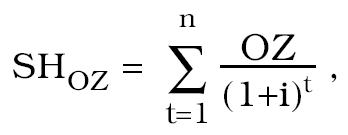
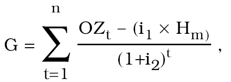
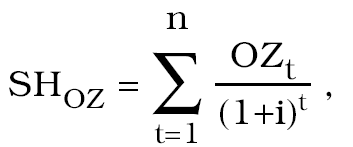

Príloha č. 2 k vyhláške č. 255/2000 Z. z.

STANOVENIE HODNOTY NEHMOTNÉHO INVESTIČNÉHO MAJETKU

1. Všeobecná hodnota zriaďovacích výdavkov sa stanoví ako rozdiel vynaložených výdavkov a účtovných oprávok.

2. Všeobecná hodnota softvéru sa stanoví ako rozdiel medzi reprodukčnou obstarávacou hodnotou a amortizáciou. Pri stanovení všeobecnej hodnoty softvéru sa zohľadní jeho využitie pri činnosti podniku a prínos pri realizovaní jeho aktivít.

3. Všeobecná hodnota nehmotných výsledkov výskumnej a obdobnej činnosti a všeobecná hodnota oceniteľných práv sa stanoví

a) metódou licenčnej analógie v prípade licencií, patentov, ochranných známok a iných obchodovateľných súčastí nehmotného investičného majetku,

b) metódou kapitalizácie odčerpateľných zdrojov; základom je stanovenie dĺžky obdobia v rokoch, počas ktorého sa nehmotný investičný majetok bude využívať; výpočet objemu odčerpateľných zdrojov, ktoré sa vytvárajú využívaním ohodnocovaného nehmotného investičného majetku; stanovenie podielu, ktorý pripadá na ohodnocovaný nehmotný investičný majetok podniku z vytváraných odčerpateľných zdrojov.

HNIM = SHOZ x PNIM,

kde

HNIM – hodnota nehmotného investičného majetku podniku.

kde

n – počet rokov používania nehmotného investičného majetku podniku,

SHOZ – hodnota budúcich odčerpateľných zdrojov ku dňu vypracovania znaleckého posudku,

PNIM – percentuálny podiel, ktorým sa ohodnocovaný NIM podieľa na tvorbe odčerpateľných zdrojov.

4. Iný nehmotný investičný majetok sa člení na goodwill a know-how.

a) Hodnota goodwillu sa stanoví ako

1. rozdiel medzi podnikateľskou a majetkovou hodnotou

G = Hp – Hm,

kde

G – hodnota goodwillu,

Hp – podnikateľská hodnota podniku,

Hm – majetková hodnota podniku.

2. kapitalizovaný rozdiel medzi hodnotou odčerpateľných zdrojov a súčinom miery rentability investovaného kapitálu a všeobecnou hodnotou majetku podniku.

kde

OZt – objem odčerpateľných zdrojov v čase t,

i1 – rentabilita vypočítaná s majetkovou hodnotou podniku,

i2 – diskontná sadzba.

b) Hodnota know-how sa stanoví metódou kapitalizácie odčerpateľných zdrojov; základom je stanovenie dĺžky obdobia v rokoch, počas ktorého sa know-how bude využívať; výpočet objemu odčerpateľných zdrojov, ktoré sa vytvárajú využívaním ohodnocovaného know-how; stanovením podielu, ktorý pripadá na ohodnocovaný know-how z vytváraných odčerpateľných zdrojov

HNIM = SHOZ x PNIM ,

kde

HNIM – hodnota know-how podniku.

kde

n – počet rokov používania know-how podniku,

SHOZ – hodnota budúcich odčerpateľných zdrojov ku dňu vypracovania znaleckého posudku,

PNIM – percentuálny podiel, ktorým sa ohodnocovaný know-how podieľa na tvorbe budúcich odčerpateľných zdrojov.

5. Hodnota nedokončených nehmotných investícií sa stanoví s ohľadom na možnosti ukončenia nehmotného investičného majetku, čas potrebný na skončenie a ich využiteľnosť v podniku. V prípade nevyužiteľnosti všeobecná hodnota, ktorá zodpovedá výnosu zo speňaženia. Základom na výpočet sú vynaložené náklady, ktoré sa objektivizujú na reprodukčné obstarávacie hodnoty.

6. Hodnota poskytnutých preddavkov na nehmotný investičný majetok sa stanovuje s prihliadnutím na schopnosť prijímateľa preddavku splniť zmluvný vzťah a s prihliadnutím na skutočnú využiteľnosť nehmotného investičného majetku v podniku.
