Príloha č. 3 k vyhláške č. 255/2000 Z. z.

POSTUP STANOVENIA HODNOTY BUDOV, HÁL, STAVIEB A POZEMKOV

A. Základné pojmy pri výpočte všeobecnej hodnoty budov, hál a stavieb:

1. Všeobecná hodnota (VŠH)

Rozumie sa cena, ktorá by sa dosiahla pri predajoch rovnakých alebo porovnateľných budov, hál a stavieb v bežnom obchodnom styku k dátumu ohodnotenia.

2. Reprodukčná obstarávacia hodnota (Hr)

Rozumie sa hodnota, za ktorú by bolo možné rovnakú alebo porovnateľnú budovu, halu a stavbu nadobudnúť (obstarať) v čase ohodnotenia bez odpočtu opotrebenia.

3. Reprodukčná zostatková hodnota (Hz)

Rozumie sa reprodukčná obstarávacia hodnota budovy, haly a stavby znížená o primerané opotrebovanie.

4. Podnikateľská hodnota (Hp)

Rozumie sa súčasná hodnota kapitalizovaných odčerpateľných zdrojov z využitia budov, hál a stavieb formou prenájmu.

5. Stavby na bývanie

Sú bytové domy, pri ktorých prevažuje funkcia bývania a rodinné domy.

6. Obytný dom

Je dom, v ktorom zo súčtu podlahovej plochy všetkých miestností v dome pripadajú aspoň dve tretiny podlahovej plochy na byty vrátane bytov a častí bytov užívaných na iné účely ako na bývanie, ako aj vedľajšich miestností a príslušenstva patriaceho k bytom.

7. Rodinný dom

Je stavba, ktorá svojím stavebným usporiadaním zodpovedá požiadavkám na rodinné bývanie a v ktorej je viac ako polovica podlahovej plochy všetkých miestností určená na bývanie. Rodinný dom môže mať najviac tri samostatné byty a najviac dve nadzemné podlažia a podkrovie.

8. Hala

Je stavba s jedným alebo viacerými nadzemnými podlažiami, pri ktorých súčet jednotlivých voľných vnútorných priestorov vymedzených zvislými konštrukciami, podlahou a spodným okrajom stropných alebo nosných strešných konštrukcií pri veľkosti min. 400 m3 je väčší ako dve tretiny obostavaného priestoru stavby. Za zvislé nosné konštrukcie vymedzujúce vnútorný voľný priestor sa nepovažujú vnútorné samostatné podperné tyčové prvky (stĺpy a piliere). Zastavaná plocha haly je minimálne 150 m2 pri pôdorysnom rozmere min. 10 m vo všetkých smeroch.

9. Podlahová plocha bytu

Je súčet plochy jeho obytných miestností a plochy príslušenstva bytu bez plochy lodžií a balkónov.

10. Obytná miestnosť

Je miestnosť priamo osvetlená a priamo vetrateľná s podlahovou plochou aspoň 8 m2, ktorá je priamo alebo dostatočne nepriamo vykurovaná a ktorá vzhľadom na svoje stavebnotechnické usporiadanie a vybavenie je určená na celoročné bývanie. Za uvedených podmienok sa považuje za obytnú miestnosť aj kuchyňa s podlahovou plochou nad 12 m2. Do súčtu podlahovej plochy obytných miestností sa započítava aj plocha zastavaná kuchynskou linkou, kachľami alebo inými vykurovacími telesami, plocha arkierov a ďalej plocha výklenkov, ak sú aspoň 1,20 m široké, 2 m vysoké a 0,30 m hlboké. Nezapočítava sa plocha nábytku vstavaného do steny. Ak má miestnosť skosený strop pod 2 m nad podlahou, počíta sa jej podlahová plocha len štyrmi pätinami.

B. Základné postupy ohodnocovania budov, hál a stavieb

Všeobecná hodnota budov, hál a stavieb sa stanoví týmito postupmi:

1. Úpravou reprodukčnej zostatkovej hodnoty o vplyvy pôsobiace na hodnotu budov, hál a stavieb v danom mieste a čase.

2. Váženým priemerom časovej a podnikateľskej hodnoty. Ak budova, hala a stavba nedosahujú výnos, tak sa vážený priemer nestanovuje.

3. Porovnávaním s už realizovanými prevodmi a prechodmi budov, hál a stavieb v danom mieste a čase. Ak nie sú preskúmateľné údaje na porovnanie, tak sa všeobecná hodnota zistí len podľa bodov 1 a 2.

Pri výpočte sa berú do úvahy všetky okolnosti, ktoré majú vplyv na všeobecnú hodnotu budov, hál a stavieb, okrem vplyvov mimoriadnych okolností trhu (napr. príbuzenský vzťah medzi predávajúcim a kupujúcim, stav tiesne predávajúceho alebo kupujúceho a pod.). Ak nemožno objektívne zistiť tieto skutočnosti, uvedie sa to výrazne v podkladovej časti.

C. Výpočet všeobecnej hodnoty budov, hál a stavieb

C.1 Výpočet reprodukčnej obstarávacej hodnoty (Hr)

a) Preskúmateľný výber porovnateľného objektu z katalógu rozpočtových ukazovateľov (napr. katalógy URS Praha, ročníky 1990 – 1992, katalógy CENEKON, katalógy UEOS Komercia, katalógy UNIKA Bratislava) so stručným opisom zvoleného porovnateľného objektu (reprezentanta) vrátane jednotkovej hodnoty (vybraný ukazovateľ musí byť presne špecifikovaný s uvedením čísla objektu, JKSO a jednotkovej hodnoty podľa katalógu, z ktorého bol vybratý). Jednotková hodnota môže byť preskúmateľným spôsobom upravená podľa jednotlivých charakteristík ohodnocovaného objektu (výška podlaží, plocha podlaží, vybavenosť objektu a pod.) a prepočítaná do cenovej úrovne obdobia, v ktorom sa vykonáva ohodnotenie. Prepočet sa vykoná pomocou indexov nárastu cien stavebných prác a materiálov v stavebníctve vydávaných Štatistickým úradom Slovenskej republiky po jednotlivých štvrťrokoch.

b) Výpočet merných jednotiek stavieb.

b.1. Dĺžky

Dĺžky sa uvádzajú v metroch. Pri kontrolnom meraní sa považuje za správnu pôvodná dĺžka vtedy, keď sa kontrolné meranie neodlišuje o viac ako 1 % z pôvodne nameranej dĺžky. Dĺžky pri zisťovaní zastavanej plochy sa merajú v kolmom priemete do vodorovnej roviny.

Meranie stavieb hodnotených za jednotku dĺžky sa vykonáva, ak ide o

a) podzemné potrubia, káblové trasy, prípojky inžinierskych sietí, ploty,

b) nadzemné silnoprúdové a slaboprúdové elektrické vedenia, ako súčet najkratších vzdušných vzdialeností medzi podporami,

c) ostatné nadzemné vedenia v skutočných dĺžkach,

d) studne, šachty a pod.

Pri výpočte plošných výmer spevnených plôch a komunikácií sa merajú skutočné rozmery.

b.2. Zastavaná plocha (ZP)

Zastavanou plochou stavby sa rozumie plocha ohraničená ortogonálnymi (pravouhlými) priemetmi vonkajšieho líca zvislých konštrukcií všetkých nadzemných a podzemných podlaží do vodorovnej roviny. Izolačné prímurovky sa nezapočítavajú.

Zastavanou plochou nadzemnej časti stavby sa rozumie plocha ohraničená ortogonálnymi priemetmi vonkajšieho líca zvislých konštrukcií všetkých nadzemných podlaží do vodorovnej roviny.

Zastavanou plochou podzemnej časti stavby sa rozumie plocha ohraničená kolmými priemetmi vonkajšieho líca zvislých konštrukcií všetkých podzemných podlaží do vodorovnej roviny. Izolačné prímurovky sa nezapočítavajú.

b.3. Meranie podlažia

1. Podlažím sa na výpočet výmer rozumie časť stavby so svetlou výškou najmenej 1,60 m ohraničená

- dole horným okrajom stropnej nosnej konštrukcie nižšieho podlažia alebo vodorovnou izoláciou pri podzemných podlažiach,

- hore horným okrajom stropnej nosnej konštrukcie tohto podlažia,

- pri najvyššom podlaží horným okrajom stropnej konštrukcie, prípadne podlahy povaly pri strechách, resp. priemernou rovinou horného okraja zastrešenia pri stavbách bez povalového priestoru.

2. Podlažia sa rozdeľujú na nadzemné a podzemné. Za podzemné podlažie sa považuje každé podlažie, ktoré má úroveň horného okraja podlahy v priemere 80 cm pod úrovňou okolitého terénu v styku okraja budovy. Na výpočet priemeru sa uvažujú štyri reprezentatívne rohy posudzovaného podlažia.

Nadzemné podlažia (NP) sa číslujú smerom nahor (1. NP, 2. NP atď.). Ak je podlaha vyššie najmenej o jednu tretinu a najviac o dve tretiny výšky podlažia, možno toto podlažie označiť ako medzipodlažie (MP). Poradové číslo medzipodlažia sa odvodzuje od najbližšieho nižšieho podlažia (napr. 1. MP).

Podzemné podlažia (PP) sa číslujú smerom nadol (1. PP, 2. PP atď.). Ak je podlaha vyššie najmenej o jednu tretinu a najviac o dve tretiny výšky podlažia, možno toto podlažie označiť ako medzipodlažie (MPP). Poradové číslo medzipodlažia sa odvodzuje od najbližšieho vyššieho podlažia (napr. 1. MPP).

Pri opise budovy sa uvádza počet nadzemných a podzemných podlaží.

3. Podlažím je aj podkrovie (STN 73 4301 čl. 2.19).

b.4. Výška podlažia

1. Svetlou výškou podlažia sa rozumie zvislá vzdialenosť medzi horným okrajom podlahy a rovinou spodného okraja stropu alebo stropného podhľadu tohto podlažia. Pri trámových stropoch s viditeľnými trámami sa meria po spodný okraj trámu a pri klenbových stropoch po spodný okraj vrcholu klenby. Pri šikmých stropoch sa meria po najvyššie miesto zošikmenia.

2. Výškou podlažia sa rozumie vzdialenosť medzi hornými okrajmi stropných konštrukcií. Pri jednopodlažných objektoch bez povalového priestoru a pri najvyššom podlaží stavieb s plochou strechou sa výškou podlažia rozumie svetlá výška zväčšená o 0,20 m. V prípade rôznych výšok podlažia sa za výšku podlažia považuje tá, ktorá má najväčšiu zastavanú plochu. Ak nie je k dispozícii výkresová dokumentácia a súčasne nemožno vykonať meranie výšky podlažia, za výšku sa považuje svetlá výška zväčšená o 0,30 m. Také zisťovanie výšky treba zdokumentovať.

3. Výškou podkrovného podlažia bez stropnej konštrukcie sa rozumie vzdialenosť medzi horným okrajom stropu a horným okrajom hrebeňa pri sedlových strechách alebo najvyšším vonkajším okrajom zošikmenia (zaoblenia) časti zastrešenia pri ostatných strechách.

4. Priemernou výškou podlažia sa rozumie vážený priemer všetkých výšok podlaží hodnotenej stavby alebo jej časti. Ako váha sa použije veľkosť zastavanej plochy príslušného podlažia.

b.5. Zastavaná plocha podlažia

1. Zastavanou plochou podlažia sa rozumie plocha pôdorysného rezu na úrovni horného okraja podlahy tohto podlažia ohraničená vonkajším okrajom obvodových konštrukcií tohto podlažia vrátane omietok. Pri objektoch poloodkrytých, resp. ich častí je zastavaná plocha ohraničená vonkajším obvodom obalovej čiary vonkajšieho okraja zvislých konštrukcií. Do zastavanej plochy sa započítavajú aj plochy lodžií a arkierov. Pri zastrešených stavbách alebo ich častí bez zvislých konštrukcií je zastavaná plocha vymedzená ortogonálnym priemetom strešnej konštrukcie do vodorovnej roviny.

2. Do zastavanej plochy sa započítava aj plocha, v ktorej je strop nižšieho podlažia (napr. schodisko, haly, dvorany a pod.). Započítava sa aj priestor arkád, prejazdov a pod., ktoré sú súčasťou nosných konštrukcií stavby. Ak nie sú súčasťou nosných konštrukcií, ohodnotia sa samostatne a nezapočítavajú sa do zastavanej plochy.

3. Priemerná zastavaná plocha sa zistí ako aritmetický priemer všetkých zastavaných plôch jednotlivých podlaží.

b.6. Podlahová plocha

Meria sa v m2. Pod podlahovou plochou sa rozumie vnútorná plocha miestnosti na úrovni podlahy. Do podlahovej plochy sa započítava plocha arkierov, ak majú šírku 1,20 m, hĺbku 0,30 m a výšku 2,0 m. Nezapočítava sa plocha okenných a dverných ústupkov.

b.7. Obostavaný priestor

Meria sa v m3. Obostavaný priestor stavby sa vypočíta podľa STN 73 4055 Výpočet obostavaného priestoru pozemných stavebných objektov ako súčet obostavaného priestoru spodnej stavby, vrchnej stavby a zastrešenia.

Op = Oz + Os + Ov + Ot + Od

Obostavaný priestor základov (Oz) je objem základov daný skutočnou kubatúrou nosných základových konštrukcií. V hornej časti je ich vymedzujúcou rovinou rovina hydroizolácie, v prípade, že hydroizolácia nie je, potom sa za hornú vymedzujúcu rovinu považuje úroveň podlahovej konštrukcie alebo rovina upraveného terénu. V prípade, že nie je k dispozícii projekt stavby, obostavaný priestor sa určuje na základe stanovenia zrovnávanej hrúbky základov. Zrovnávacia hrúbka je závislá od viacerých činiteľov:

– druhu stavby,

– únosnosti základovej pôdy,

– spôsobu založenia a

– počtu podlaží stavby.

Obostavaný priestor spodnej časti objektu (Os) je vymedzený

– po stranách vonkajšími plochami obvodových konštrukcií bez započítania izolačnej prímurovky, v dolnej časti je vymedzujúcou rovinou rovina základov, t. j. rovina hydroizolácie alebo dolná úroveň podlahovej konštrukcie, hornou ohraničujúcou rovinou je vrchný povrch nosnej stropnej konštrukcie nad najvyšším podlažím spodnej časti objektu.

Obostavaný priestor vrchnej časti objektu (Ov) je vymedzený

– po stranách vonkajšími plochami obvodových konštrukcií alebo myslenými obalovými plochami vedenými vonkajším lícom zvislých nosných konštrukcií,

– dolu úrovňou horného povrchu nosnej stropnej konštrukcie nad najvyšším podlažím spodnej časti objektu alebo úrovňou hornej vymedzujúcej roviny základov, ak spodná časť objektu neexistuje,

– hore úrovňou horného povrchu nosnej stropnej konštrukcie nad posledným podlažím.

Obostavaný priestor zastrešenia objektu (Ot) je vymedzený

– po stranách vonkajšími plochami obvodových konštrukcií,

– dolu úrovňou horného povrchu nosnej stropnej konštrukcie nad posledným podlažím, úrovňou spodnej plochy podhľadu úrovňou spodného líca konštrukcie pri objektoch s vnútorným priestorom prebiehajúcim do strešnej konštrukcie,

– hore vonkajšími plochami strechy pri sedlových, valbových, pultových, oblúkových a segmentových strechách, rovinou strednej úrovne medzi najvyšším a najnižším miestom sklonu pri plochých strechách.

Obostavaný priestor súčasti stavby a doplňujúcich stavebných častí objektu (Od), medzi ktoré patria

– arkiere a zasklené pavlače, verandy, otvorené prístavky a kryté podjazdy, balkóny s vyložením väčším ako 0,5 m a pavlače, predložené schody s viac ako s troma stupňami,

– kanály, podzemné priechody, kontrolné chodby, montážne šachty a pod. s prierezom nad 0,5 m2, svetlíky a strešné nadstavby s prednou pohľadovou plochou nad 2,0 m2, prístrešky s vyložením väčším ako 1,0 m, terasy predstavené a nepodpivničené, rampy široké nad 0,5 m, šachty osvetľovacie, zásobovacie a pod.

b.8. Obostavaný priestor ďalších stavebných objektov, ako sú

1. žumpy, septiky, podzemné akumulačné nádrže, bazény, podzemné kanály (kolektory) a pod., je vymedzený

– po stranách vonkajším lícom obvodových konštrukcií vrátane izolácie a prímurovky (ak nie je merateľné, uvažuje sa hrúbka 0,30 m),

– dole spodná úroveň podlahovej konštrukcie vrátane izolácie a ochranných vrstiev (ak nie je merateľná, uvažuje sa hrúbka 0,35 m),

– hore vrchná úroveň stropnej konštrukcie (ak nie je merateľná, uvažuje sa hrúbka 0,30 m).

2. Oporné múry, ktorých obostavaný priestor je daný skutočným objemom nadzemnej časti meranej z najnižšej úrovne terénu.

c) Reprodukčná hodnota sa stanoví ako násobok upravenej hodnoty rozpočtového ukazovateľa a počtu merných jednotiek ohodnocovaného objektu.

Reprodukčná obstarávacia hodnota stavieb (Hr) sa stanoví podľa základného vzťahu

M . RU. kcu . kv . kzp . kvp . km [Sk]

kde M – počet merných jednotiek,

RU – rozpočtový ukazovateľ,

kcu – koeficient nárastu cien,

kv – koeficient vplyvu vybavenosti ohodnocovanej stavby (nadštandard a podštandard),

kzp – koeficient vplyvu zastavanej plochy ohodnocovanej stavby,

kvp – koeficient vplyvu výšky podlaží ohodnocovanej stavby,

km – koeficient umiestnenia ohodnocovanej stavby (bývalé územné vplyvy).

Pri vonkajších úpravách sa vzťah použije bez koeficientov kzp a kvp.

C.2 Stanovenie reprodukčnej zostatkovej hodnoty (Hz)

Reprodukčná zostatková hodnota sa rovná reprodukčnej obstarávacej hodnote stavby zníženej o primerané opotrebovanie.

Reprodukčná zostatková hodnota sa stanoví podľa základného vzťahu:

Hz = Hr – Os [Sk]

kde Hr – reprodukčná obstarávacia hodnota,

Os – hodnota vyjadrujúca opotrebovanie stavby.

C.2.1 Výpočet hodnoty vyjadrujúcej opotrebovanie stavby (Os)

Opotrebovanie stavby vyjadruje hodnotu, o ktorú sa znižuje reprodukčná hodnota z dôvodu veku, technického stavu, predpokladanej životnosti a užívania stavby.

Výpočet opotrebovania sa vykoná lineárnou alebo analytickou metódou. Analytická metóda výpočtu opotrebovania pomocou cenových podielov konštrukcií a vybavenia stavby sa použije v týchto prípadoch:

a) ohodnocovaná stavba je pred opravou alebo po oprave, ktorá sa vykonáva mimo bežnej údržby stavby,

b) ohodnocovaná stavba je vo veľmi dobrom alebo v zlom technickom stave,

c) v prípadoch, v ktorých výpočet opotrebovania lineárnou metódou nezodpovedá skutočnosti alebo opotrebovanie je objektívne väčšie ako 80 %, a

d) pri ohodnocovaní kultúrnych a národných kultúrnych pamiatok.

Hodnota vyjadrujúca opotrebovanie (Os) sa stanoví podľa vzťahu

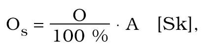

kde O – opotrebovanie stavby v percentách (lineárna alebo analytická metóda),

A – reprodukčná hodnota stavby.

C.2.2 Lineárna metóda

Pri použití lineárnej metódy sa opotrebovanie stavby rovnomerne rozdelí na celú dobu predpokladanej životnosti.

Opotrebovanie v percentách sa stanovuje podľa vzťahu

kde V – vek stavby,

Z – predpokladaná životnosť stavby.

Opotrebovanie nadstavieb a prístavieb sa vypočíta samostatne za každý rok ich veku rovnakým spôsobom, ukončenie predpokladanej životnosti sa však určí vždy pre celý objekt (vrátane nadstavieb a prístavieb) k rovnakému roku.

Maximálna hodnota opotrebovania je:

a) rodinné domy, rekreačné chalupy, rekreačné a záhradkárske chaty, garáže,

vedľajšie stavby a budovy a haly 90 %,

b) vonkajšie úpravy a ostatné stavby neuvedené v písmene a) 95 %.

Vek stavby (V) sa počíta počnúc rokom, v ktorom nadobudlo právoplatnosť kolaudačné rozhodnutie. V prípadoch, keď došlo k užívaniu stavby skôr, vypočíta sa vek tak, že od roku, ku ktorému sa ohodnotenie vykonáva, sa odpočíta rok, v ktorom sa preukázateľne stavba začala užívať. Ak nemožno vek stavby takto zistiť, počíta sa podľa iného dokladu, a ak nie je ani taký doklad, určí sa odborným odhadom s odôvodnením.

Predpokladaná životnosť stavby (Z) je celková predpokladaná životnosť stavby pri bežnej údržbe od jej vzniku až do úplného zániku. Udáva sa v rokoch. Stanoví sa podľa vzťahu

Z = V + T [rok],

kde V – vek stavby,

T – zostatková životnosť stavby.

Základná životnosť stavby (ZZ) sa stanovuje s ohľadom na stavebno-technické prevedenie prvkov dlhodobej životnosti.

Zostatková životnosť stavby (T) za predpokladu bežnej údržby je vek od dátumu odhadu do schátrania stavby. Udáva sa v rokoch. Stanoví sa pomocou súčiniteľa okamžitého stavu prvkov dlhodobej životnosti (kPDŽ) zo základnej zostatkovej životnosti stavby (TT) podľa vzťahu

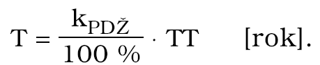

Súčiniteľ okamžitého stavu PDŽ (kPDŽ) vyjadruje stav prvkov dlhodobej životnosti ku dňu odhadu v rozmedzí 0 až 100 % s ohľadom na ich vek. Veľmi dobrý stav zodpovedá hodnote 100 %. V rozmedzí 0 až 100 % sa pohybuje váženým priemerom podľa stavu jednotlivých PDŽ s prihliadnutím na

- to, či sa na posudzovanom objekte nachádzajú všetky PDŽ; počet PDŽ = n,

- cenový podiel jednotlivých PDŽ na ich súčte, ktorý tvorí 100 %,

- stav jednotlivých PDŽ.

Hodnotu kPDŽ možno stanoviť aj odborným odhadom s odôvodnením.

Základná zostatková životnosť stavby (TT) vyjadruje vek stavby od dátumu odhadu do zániku stavby za predpokladu bežnej údržby a stavu PDŽ ku dňu ohodnotenia 100 %. Stanoví sa podľa vzťahu

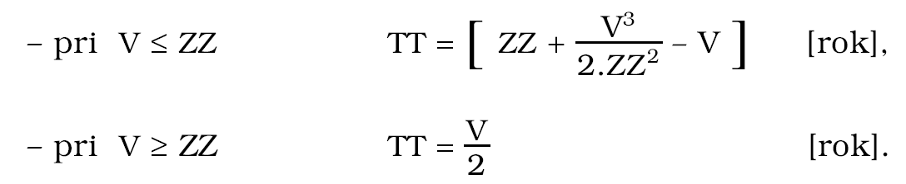

C.2.3 Analytická metóda

Výpočet vychádza zo stanovenia objemových podielov jednotlivých konštrukcií a vybavenia stavby, výpočtu ich opotrebovania. Celkové opotrebovanie stavby je váženým priemerom opotrebovania jednotlivých konštrukcií a vybavení, váhou je objemový podiel. Vek a životnosť sa určujú pri každej konštrukcii a vybavení samostatne. Ak nemožno presne zistiť vek jednotlivých konštrukcií a vybavení, stanoví sa odborným odhadom. V týchto prípadoch možno odborne odhadnúť opotrebovanie jednotlivých konštrukcií a vybavenia (podiel Vk/Zk).

Objemové podiely

a) pri stavbách ohodnocovaných tvorbou rozpočtového ukazovateľa na m2 zastavanej plochy podlažia sa podľa jednotlivých znakov stanovia pomerom reprodukčnej hodnoty danej konštrukcie alebo vybavenia podlaží k celkovej reprodukčnej hodnote podlažia samostatne,

b) pri ostatných stavbách (budovy, haly) sa stanovia pomerom reprodukčnej hodnoty danej konštrukcie alebo vybavenia k celkovej reprodukčnej hodnote.

Vážený podiel jednotlivých konštrukcií a vybavení na opotrebovaní stavby (podlažia) v percentách sa stanovuje podľa vzťahu

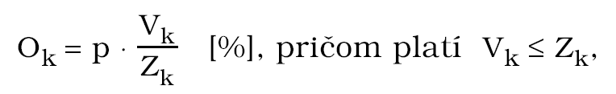

kde p - objemový podiel konštrukcie alebo vybavenia upravený podľa skutočného vyhotovenia na ohodnocovanom objekte (koeficient vybavenia) prepočítaný na celkový súčet objemových podielov 100 %,

Vk - vek konštrukcie alebo vybavenia,

Zk – predpokladaná životnosť konštrukcie alebo vybavenia uvedená v nasledujúcej tabuľke, prípadne stanovená odborným odhadom podľa skutočného stavebno-technického stavu.

| Názov | Predpokladaná životnosť Zk v rokoch

1. | Základy vrátane zemných prác | 150 - 200

2. | Zvislé konštrukcie | 80 - 200

3. | Stropy | 80 - 200

4. | Zastrešenie bez krytiny | 70 - 150

5. | Krytina strechy | 40 - 80

6. | Klampiarske konštrukcie | 30 - 80

7. | Úpravy vnútorných povrchov | 50 - 80

8. | Úpravy vonkajších povrchov | 30 - 60

9. | Vnútorné keramické obklady | 30 - 50

10. | Schody | 80 - 200

11. | Dvere | 50 - 80

12. | Vráta | 30 - 50

13. | Okná | 50 - 80

14. | Povrchy podláh | 15 - 80

15. | Vykurovanie | 20 - 50

16. | Elektroinštalácia | 25 - 50

17. | Bleskozvod | 30 - 50

18. | Vnútorný vodovod | 20 - 50

19. | Vnútorná kanalizácia | 30 - 60

20. | Vnútorný plynovod | 20 - 50

21. | Ohrev teplej vody | 20 - 40

22. | Vybavenie kuchýň | 15 - 30

23. | Vnútorné hygienické zariadenia vrátane WC | 30 - 60

24. | Výťahy | 30 - 50

25. | Ostatné | podľa druhu

Opotrebovanie stavby

a) Pri stavbách hodnotených tvorbou rozpočtového ukazovateľa na m2 zastavanej plochy podlažia opotrebovanie podlažia v percentách sa stanoví podľa vzťahu

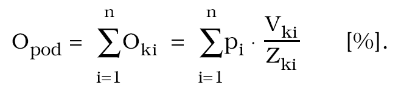

Opotrebovanie nadstavieb a prístavieb sa vypočíta samostatne rovnakým spôsobom, ale predpokladaná životnosť jednotlivých konštrukcií a vybavení sa stanoví vždy pre celý objekt (vrátane nadstavieb a prístavieb) k rovnakému roku.

Celkové opotrebovanie sa stanoví váženým priemerom opotrebovaní jednotlivých podlaží, pričom váhou je zastavaná plocha hodnotených podlaží podľa vzťahu

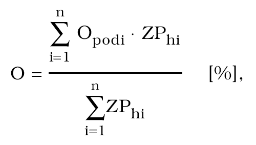

kde Opod - opotrebovanie podlažia alebo jeho časti (prístavby),

ZPh - zastavaná plocha podlažia alebo jeho časti (prístavby).

b) Pri ostatných stavbách (budovy, haly) sa celkové opotrebovanie v percentách stanoví podľa vzťahu

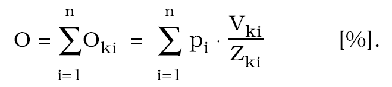

C.3 Stanovenie všeobecnej hodnoty budov, hál a stavieb úpravou reprodukčnej zostatkovej hodnoty o vplyvy pôsobiace na hodnotu budov, hál a stavieb v danom mieste a čase

Táto metodika sa zakladá na stanovení reprodukčnej zostatkovej hodnoty stavieb so zohľadnením všetkých vplyvov, ktoré môžu na všeobecnú hodnotu pôsobiť v danom mieste a čase, okrem vplyvov mimoriadnych okolností trhu (napr. príbuzenský vzťah medzi predávajúcim a kupujúcim, stav tiesne predávajúceho alebo kupujúceho a pod). Celková hodnota budov, hál a stavieb stanovená náhradnou metódou sa vypočíta ako súčet všeobecnej hodnoty stavieb a pozemkov.

Všeobecná hodnota stavieb (VŠH) sa stanoví podľa základného vzťahu

VŠH = Hz . k [Sk],

kde Hz – reprodukčná zostatková hodnota,

k – koeficient zohľadňujúci faktory vplývajúce na hodnotu budov, hál a stavieb.

Faktory vplývajúce na reprodukčnú zostatkovú hodnotu budov, hál a stavieb:

a) trh s budovami, halami a stavbami v danom mieste a čase,

b) veľkosť a význam obce,

c) poloha budov, hál a stavieb v danej obci – vzťah k centru obce,

d) súčasný technický stav budov, hál a stavieb,

e) prevládajúca zástavba v okolí budov, hál a stavieb,

f) príslušenstvo budov, hál a stavieb,

g) typ budov, hál a stavieb,

h) pracovné možnosti obyvateľstva v danom mieste,

i) skladba obyvateľstva v danom mieste,

j) orientácia budov, hál a stavieb k svetovým stranám,

k) konfigurácia terénu,

l) pripravenosť inžinierskych sietí,

m) doprava v okolí budov, hál a stavieb,

n) občianska vybavenosť (obchody, služby, úrady, školstvo, zdravotníctvo, kultúrne, športové, ubytovacie a stravovacie zariadenia),

o) prírodná lokalita v bezprostrednom okolí budov, hál a stavieb,

p) kvalita životného prostredia v danej lokalite,

r) možnosti zmeny v zástavbe – územný rozvoj a jeho vplyv na budovy, haly a stavby,

s) možnosti ďalšieho rozšírenia budov, hál a stavieb,

t) dosahovanie výnosu z budov, hál a stavieb a pod.

C.4 Stanovenie všeobecnej hodnoty budov, hál a stavieb váženým priemerom reprodukčnej zostatkovej hodnoty a podnikateľskej hodnoty

Pri budovách, halách a stavbách, ktoré dosahujú výnos, sa na výpočet všeobecnej hodnoty stanoví reprodukčná zostatková hodnota aj podnikateľská hodnota a váženým priemerom týchto dvoch hodnôt sa stanoví všeobecná hodnota.

C.4.1 Stanovenie podnikateľskej hodnoty budov, hál a stavieb (Hp)

Túto metódu možno použiť len pri objektoch, ktorých výnos možno vypočítať.

Metodický postup výpočtu:

a) stanovenie celkovej podlahovej plochy objektu (m2) s rozdelením podľa účelu využitia (sklady, kancelárie, výroba, spoločné časti a pod.),

b) preskúmateľné určenie úžitkovej hodnoty podľa jednotlivých spôsobov využitia (sadzby nájomného v Sk/m2/rok),

c) výpočet ročného hrubého výnosu – ako súčin typu plochy a jej úžitkovej hodnoty,

d) určenie nákladov na prevádzku budov, hál a stavieb (napr. prevádzkové náklady, náklady na údržbu, správne náklady, výdavky na zhodnotenie, nájom pozemkov v prípade cudzích pozemkov a pod.).

Na výpočet prevádzkových nákladov a nákladov na údržbu možno použiť i výpočet na základe reprodukčnej hodnoty:

a) odhad nevyužitého nájomného (riziko straty príjmu),

b) výpočet čistého výnosu pred zdanením – hrubý výnos znížený o náklady na prevádzku budov, hál a stavieb a o odhad nevyužitého nájomného,

c) výpočet disponibilného výnosu (čistého výnosu zníženého o daň z príjmu/zisku),

d) určenie doby predpokladanej výnosovosti (spravidla 10 rokov).

Podnikateľská hodnota sa stanoví podľa vzťahu

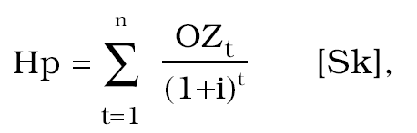

kde OZt – odčerpateľný zdroj v období t,

t – časové obdobie výnosovosti uvažované vo výpočte, pričom t = 1,2...n rokov,

k – diskontná sadzba,

n – doba zostatkovej životnosti.

Poznámky:

1. V odôvodnených prípadoch možno použiť aj iné vzťahy na výpočet podnikateľskej hodnoty z nájmu (napr. zjednodušené vzťahy pre konštantný zisk, neobmedzené časové obdobie a pod.).

2. Pri stanovení všeobecnej hodnoty budov, hál a stavieb podnikateľskou metódou je hodnota pozemku obsiahnutá v odčerpateľných zdrojoch.

C.4.2 Stanovenie hodnoty budov, hál a stavieb kombinačnou metódou

Stanovenie váženého priemeru reprodukčnej zostatkovej hodnoty stavby (HZ) a podnikateľskej hodnoty (Hp), keď Hp = 100 %, sa vykoná podľa nasledujúcich kritérií:

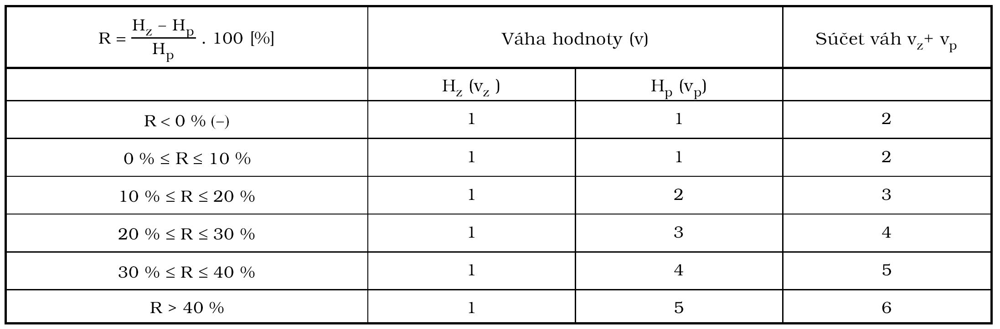

Váženým priemerom sa všeobecná hodnota stanoví podľa vzťahu

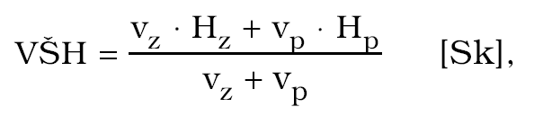

kde Hp – podnikateľská hodnota budov, hál a stavieb,

Hz – reprodukčná zostatková hodnota budov, hál a stavieb + hodnota pozemku,

vz – váha reprodukčnej zostatkovej hodnoty,

vp – váha podnikateľskej hodnoty.

Za reprodukčnú zostatkovú hodnotu sa dosadzuje hodnota stavieb vypočítaná podľa časti C.2 vrátane hodnoty pozemku. Za Hp sa dosadzuje podnikateľská hodnota budovy, haly alebo stavby vrátane prípadného výnosu z nezastavaného pozemku vypočítaná podľa časti C.4.1. Výnimku uvedených podmienok tvorí stav, keď je stavba postavená na cudzom pozemku. V takomto prípade sa do reprodukčnej zostatkovej hodnoty nezapočíta hodnota pozemku a do podnikateľskej hodnoty sa nezapočíta výnos z nezastavaného pozemku.

C.4.3 Stanovenie všeobecnej hodnoty porovnávaním

Všeobecná hodnota sa stanovuje porovnávaním cien budov, hál a stavieb s už realizovanými prevodmi a prechodmi budov, hál, stavieb a pozemkov v danom mieste a čase, pokiaľ sú na to dostupné doklady. Na porovnanie je potrebný súbor aspoň troch budov, hál, stavieb a pozemkov. Porovnanie pri stavbách, bytoch a nebytových priestoroch treba vykonať na mernú jednotku (obostavaný priestor, zastavaná plocha, podlahová plocha, dĺžka a pod.) so zohľadnením odlišností porovnávaných objektov a ohodnocovaného objektu (porovnanie vybavenosti objektov – štandard, nadštandard, podštandard, výška podlaží, zastavaná plocha; poloha, príslušenstvo, technický stav, ekonomické faktory a pod.).

Porovnanie pri pozemkoch treba vykonať na mernú jednotku (výmera pozemku podľa katastra nehnuteľností) so zohľadnením odlišností porovnávaných pozemkov a ohodnocovaného pozemku (druh pozemku, poloha pozemku, stavebná pripravenosť a pod.).

Podklady na porovnanie (doklad o prevode a prechode budov, hál a stavieb – kúpna zmluva, rozhodnutie súdu, exekúcia, konkurz a vyrovnanie a pod. a znalecký posudok, na ktorého základe bol prevod, prechod vložený do katastra nehnuteľností. Pri porovnaní musia byť vylúčené všetky vplyvy mimoriadnych okolností trhu (napr. príbuzenský vzťah medzi predávajúcim a kupujúcim, stav tiesne predávajúceho alebo kupujúceho a pod.).

C.5 Všeobecná hodnota pozemkov

Všeobecná hodnota pozemkov sa stanovuje

a) v obciach, kde už je Ministerstvom financií Slovenskej republiky schválená cenová mapa, podľa nej,

b) metódou polohovej diferenciácie – pomocou jednotkových cien za m2 určených podľa platného cenového predpisu, ktoré sa preskúmateľne upravia koeficientmi zohľadňujúcimi polohovú diferenciáciu pozemku.

a.1. Podľa spracovaných cenových máp

Hodnota pozemku je súčin plochy pozemku a hodnoty za m2 podľa schválenej cenovej mapy.

b.1. Polohovou diferenciáciou

Hodnota pozemku sa stanoví podľa vzťahu

F = Q . k,

kde F – hodnota pozemku stanovená polohovou diferenciáciou,

Q – východisková hodnota,

k – celkový koeficient prepočtu polohy, stanoví sa podľa vzťahu:

k = kt . kd . kv . kp . ki . km. kz.

Východisková hodnota Q

Klasifikácia obce - názov alebo údaj podlá počtu obyvateľov | Hodnota Q Sk/m2

a) Bratislava | 1 500,-

b) Krajské mestá: Nitra, Prešov, Trenčín, Trnava, Žilina, Košice, Banská Bystrica a mestá: Piešťany, Starý Smokovec, Štrbské Pleso, Tatranská Lomnica, Trenčianske Teplice | 800,-

c) Mestá: Poprad, Zvolen, Liptovský Mikuláš, Martin | 500,-

d) Ostatné okresné mestá | 250,-

e) Ostatné obce nad 15 000 obyvateľov | 150,-

f) Ostatné obce od 5 000 do 15 000 obyvateľov | 100,-

g) Ostatné obce od 2 000 do 5 000 obyvateľov | 70,-

h) Ostatné obce do 2 000 obyvateľov | 20,-

Hodnoty jednotlivých koeficientov k

kt – koeficient medzisídliskovej diferenciácie (1,0 – 2,15), stanovuje sa nasledovne:

Klasifikácia obce - názov alebo údaj podlá počtu obyvateľov | kt

a) Bratislava | 2,15

b) Krajské mestá: Nitra, Prešov, Trenčín, Trnava, Žilina, Košice, Banská Bystrica a mestá: Piešťany, Starý Smokovec, Štrbské Pleso, Tatranská Lomnica, Trenčianske Teplice | 2,00

c) Mestá: Poprad, Zvolen, Liptovský Mikuláš, Martin | 1,75

d) Ostatné okresné mestá | 1,60

e) Ostatné obce nad 15 000 obyvateľov | 1,45

f) Ostatné obce od 5 000 do 15 000 obyvateľov | 1,30

g) Ostatné obce od 2 000 do 5 000 obyvateľov | 1,15

h) Ostatné obce do 2 000 obyvateľov | 1,00

kd – koeficient druhu pozemku (0,50 – 1,50) je závislý od druhu uvedeného v katastri nehnuteľností a jeho pripravenosti (vhodnosti) na realizovanie stavby, stanovuje sa nasledovne:

Druh pozemku | kd

a) zastavaný pozemok | 1,0 - 1,5

b) pozemok stavebne pripravený | 1,0 - 1,5

c) pozemok stavebne nepripravený | 0,8 - 1,2

d) iný stavebný pozemok | 0,5 - 0,8

kv – koeficient veľkosti obce (0,60 – 3,50), stanoví sa nasledovne:

Počet obyvateľov | kt

a) nad 1 000 000 | 3,5

b) 500 000 - 1 000 000 | 2,2

c) 200 000 - 500 000 | 1,8

d) 100 000 - 200 000 | 1,5

e) 50 000 - 100 000 | 1,2

f) 20 000 - 50 000 | 0,8

g) 5 000 - 20 000 | 0,7

h) 2 000 - 5 000 | 0,6

i) do 2 000 | 0,6

kp – koeficient obchodnej polohy (0,70 – 2,50), stanoví sa nasledovne:

Poloha | kp

a) obchodná | 2,5

b) obchodná a byty | 2,0

c) obytná | 1,63

d) priemyselná | 0,5

e) vidiecka, obce do 5 000 obyvateľov | 0,7

ki– koeficient vybavenosti technickou infraštruktúrou, stanoví sa nasledovne:

Technická infraštruktúra | ki

a) bez technickej infraštruktúry | 2,5

b) stredná vybavenosť | 2,0

c) dobrá vybavenosť | 1,63

d) veľmi dobrá vybavenosť | 0,5

km – koeficient vnútrosídliskovej diferenciácie (2,0 – 0,50), stanoví sa nasledovne:

Poloha | km

a) centrum | 2,0

b) spádom k okraju širšieho centra | 1,0

c) veľké sídliská | 2,0 - 0,8

d) okrajové polohy | 0,5

e) obce do 5 000 obyvateľov | 2,0 - 1,0

kz – koeficient zvláštnych špeciálnych charakteristík (0,60 – 1,50), pri negatívnych vplyvoch sa stanoví od 0,60 do 1,0 a naopak pri pozitívnych vplyvoch sa stanoví od 1,0 do 1,5.

C.6 Vecné bremená – delenie

Vecné bremená obmedzujú vlastníka budovy, haly, stavby a pozemku v prospech iného. Práva zodpovedajúce vecným bremenám sú v súvislosti s vlastníctvom budovy, haly, stavby a pozemku alebo patria osobe. Vecné bremená prevodom alebo prechodom budov, hál, stavieb a pozemkov prechádzajú na nadobúdateľa. Delia sa na

1. vecné bremená s povinnosťou konať (napr. poskytnúť doživotné bývanie),

2. vecné bremená s povinnosťou zdržať sa (napr. nestavať plot nad určenú výšku),

3. vecné bremená s povinnosťou strpieť (napr. právo prechodu).

C.6.1 Stanovenie hodnoty vecného bremena na pozemku

a) líniovými stavbami,

b) pozemnými stavbami,

c) užívaním (napr. prechodom).

C.6.2 Stanovenie hodnoty vecného bremena na budovách, halách, stavbách a pozemkoch

a) technickými zariadeniami (napr. energetické rozvody a pod.),

b) technologickými zariadeniami (napr. trafozariadenia, kotolne a pod.),

c) zaťažením z dôvodu užívania (napr. doživotné užívanie bytu, prevádzky a pod.),

d) prechodom cez objekt

– trvalé (napr. chodby a pod.),

– občasné (napr. pri opravách fasád a pod.).

C.6.3 Posúdenie vecného bremena

a) či je odplatné alebo

b) bezodplatné.

C.6.4 Vplyv na hodnotu ohodnocovaných budov, hál, stavieb a pozemkov

a) sa znižuje, ak je budova, hala, stavba a pozemok zaťažená ťarchou,

b) sa zvyšuje, ak slúži pre budovu, halu, stavbu a pozemok.

Hodnota vecného bremena sa stanoví kapitalizáciou ročnej hospodárskej škody, ktorá vznikne vlastníkovi budovy, haly, stavby a pozemku. Pokiaľ nemožno urobiť kapitalizáciu bežným spôsobom, zistí sa hodnota vecného bremena vynásobením tejto ročnej škody počtom rokov pravdepodobného trvania závady (napr. dobou trvania úveru) – maximálne však 20 rokov.

Ak je stavebný pozemok zaťažený právom cesty alebo ak sú cezeň vedené inžinierske siete alebo rozvodné siete, takéto miesta pozemku spravidla nemožno používať ako stavebnú plochu. Pri podzemných rozvodoch a kanáloch sa musí dodržiavať ochranné pásmo určitej šírky, pre ktoré platia určité stavebné obmedzenia.

Plochu ochranného pásma možno hodnotiť len ako poľnohospodársku plochu. Rozdiel ceny tejto plochy oproti cene stavebnej plochy predstavuje zníženie ceny pozemku. Pri nevýhodnom vedení rozvodov nebude možné na pozemku vôbec stavať.

Preto je potrebné zistiť

a) hodnotu vecného bremena,

b) hodnotu budovy, haly, stavby a pozemku, na ktorých je zriadené vecné bremeno,

c) hodnotu budovy, haly, stavby a pozemku, v ktorých prospech je vecné bremeno zriadené.

Treba si pritom uvedomiť, že je rozdiel medzi ohodnocovaním vecného bremena ako takého a ohodnocovaním budovy, haly, stavby a pozemku, na ktorých je uložené vecné bremeno, a ohodnocovaním budovy, haly, stavby a pozemku, v ktorých prospech sa vecné bremeno zriaďuje. Z uvedeného vyplýva, že ide v zásade o ohodnotenie výnosov ako súčtu budúcich strát alebo ziskov diskontovaných v čase. Na takéto ohodnotenie platia tieto všeobecné vzťahy:

1. na určitú dobu trvania a nerovnomerné ročné čiastky

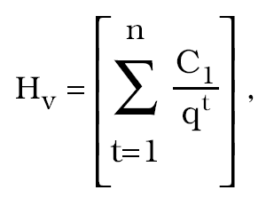

kde Hv - výnos,

n - počet rokov, za ktoré sa dosahujú príjmy,

t - rok, z ktorého sa počíta príjem,

c1 - zisk (čistý príjem) predpokladaný v roku „t“,

q - úrokomer, keď q = 1+ i,

i - u/100, kde u je úroková miera,

2. na určitú dobu trvania „n“ a rovnomerné ročné čiastky „c“

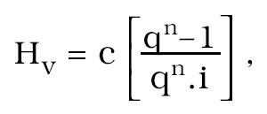

3. rovnomerné ročné čiastky „c“ na neobmedzenú dobu trvania

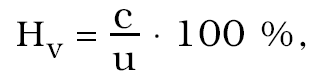

alebo pre jedno percento úrokovej miery

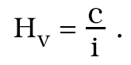

Pri použití tzv. koeficientu kapitalizácie kk

Hv = c.kt,

kde koeficient kapitalizácie je

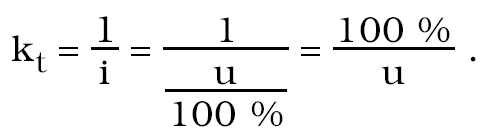

Tabuľka pre koeficient kapitalizácie pre vybrané úrokové miery

Úroková miera u | 3 % | 5 % | 10 % | 15 % | 20 %

Koeficient kapitalizácie kk | 33,33 | 20,00 | 10,00 | 6,67 | 5,00

Stanovenie všeobecnej hodnoty vecného bremena

Pre dohodu na uzavretie zmluvy o zriadení vecného bremena je potrebné poznať náhradu, ktorá je primeraná za jeho zriadenie. Postup vo väčšine prípadov bude štandardný, a to:

a) zistiť ročný príjem oprávnenej osoby z vecného bremena,

b) kapitalizácia ročného príjmu na dobu, počas ktorej bude vecné bremeno trvať,

c) zistiť ročnú stratu povinnej osoby z plnenia vecného bremena,

d) kapitalizácia ročnej straty na dobu, počas ktorej bude vecné bremeno trvať,

e) odvodenie všeobecnej hodnoty vecného bremena ako priemer príjmov a strát.

Odporúča sa použiť reálnu mieru kapitalizácie, a nie nominálnu preto, že ide o budúce sumy, ktoré by mali nahrádzať stratu, ktorá bude počas plnenia vecného bremena trvať.

Všeobecná hodnota budov, hál, stavieb a pozemkov s vecným bremenom

Výpočet všeobecnej hodnoty budov, hál, stavieb a pozemkov, na ktorých je zriadené vecné bremeno, nie je rozdielny ako výpočet bez vecného bremena. Pri výsledku treba vyhodnotiť, do akej miery môže toto bremeno ovplyvniť všeobecnú hodnotu budov, hál, stavieb a pozemkov ako celku alebo jej jednotlivé súčasti. Napríklad vecné bremeno prechodu susedovej vodovodnej prípojky cez časť pozemku, ktorá prakticky neovplyvní všeobecnú (predajnú) hodnotu, ale doživotné užívanie pozemku, bytu, prevádzkovej budovy a pod., podstatne obmedzí ich predaj. Individuálnym postupom pri jednotlivých prípadoch, podrobným hodnotením vstupných a výstupných veličín vecného bremena možno dospieť k optimálnym údajom na ohodnotenie prevodu alebo prechodu budov, hál, stavieb a pozemkov.
