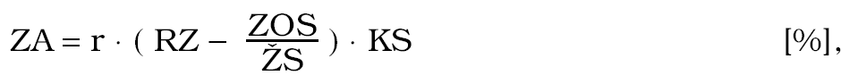
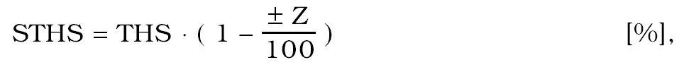

Príloha č. 4 k vyhláške č. 255/2000 Z. z.

POSTUP STANOVENIA HODNOTY STROJOV A STROJOVÝCH ZARIADENÍ

Znalec zatriedi posudzované zariadenie do príslušnej kategórie a jeho všeobecnú hodnotu stanoví týmto postupom:

1. Vypočíta základnú amortizáciu ZA

r – počet odpracovaných rokov [roky],

RZ – ročná zrážka [%],

ŽS – predpokladaná životnosť stroja [roky],

ZOS – zostatkové percento prevádzkyschopného stroja po skončení predpokladanej životnosti [%],

KS – koeficient zmennosti stroja (KS = 1, 2, 3).

2. Vypočíta skutočnú technickú hodnotu stroja STHS

VTHS – východisková technická hodnota stroja,

THS – technická hodnota stroja,

ń Z – zmena stavu technickej hodnoty stroja,

ZA – základná amortizácia,

STHS – skutočná technická hodnota stroja.

3. Stanoví východiskovú hodnotu stroja VHS

(Znalec zdôvodní použitú VHS.)

4. Vypočíta technickú hodnotu stroja vyjadrenú v korunách THSk

VHS – východisková hodnota stroja,

STHS – skutočná technická hodnota stroja,

THMVk – technická hodnota mimoriadnej výbavy stroja,

THSk – technická hodnota stroja vyjadrená v korunách.

5. Vypočíta všeobecnú hodnotu stroja VŠH

VŠH = THSk KP [Sk],

THSk – technická hodnota stroja vyjadrená v korunách,

KP – koeficient predajnosti,

VŠH – všeobecná hodnota stroja; uvedie sa, či je stanovená bez dane alebo s daňou.

Podľa tohto postupu sa môže stanovovať hodnota strojov a strojových zariadení uvedených v nasledujúcich kategóriách. Tieto kategórie zároveň určujú rozsah oprávnenia na výkon znaleckej činnosti v odbore strojárstvo.

6. KATEGORIZÁCIA STROJOV A STROJOVÝCH ZARIADENÍ

6.1 Energetické stroje a strojové zariadenia

Energetické a hnacie stroje a strojové zariadenia | RZ[%] | ZS[%] | zos[%]

zdrojové agregáty a pohonné elektrické sústavy | 5 | 20 | 20

čerpadlá | 10 | 10 | 25

objemové kompresory a vývevy | 8 | 12 | 25

turbokompresory | 6 | 17 | 25

chladiace a mraziace zariadenia | 8 | 12 | 25

piestové motory | 7 | 14 | 25

priemyselné a lodné kotly | 6 | 17 | 25

zariadenia na ústredné vykurovanie | 4 | 25 | 20

parné turbíny | 4 | 25 | 20

plynové turbíny a turboagregáty | 2 | 50 | 5

vodné turbíny | 4 | 25 | 20

vodné turbíny do 10 MW | 2 | 50 | 5

prenosné a pojazdné zariadenia v tomto odvetví | 7 | 14 | 25

6.2 Dopravné stroje a zdvíhadlá

Dopravné stroje a zdvíhadlá | RZ[%] | ZS[%] | zos[%]

žeriavy | 6 | 17 | 25

stavebné žeriavy | 10 | 10 | 25

zdvíhacie mechanizmy | 7 | 14 | 25

výťahy | 7 | 14 | 25

transportné zariadenia na prepravu sypkých materiálov | 8 | 12 | 25

zariadenia na dopravu po lane | 6 | 17 | 25

zariadenia pre ložné operácie | 8 | 12 | 25

dopravné vozíky | 17 | 6 | 30

transportné zariadenia na prepravu kusových materiálov | 9 | 11 | 25

6.3 Vzduchotechnika – klimatizácia

Vzduchotechnika - klimatizácia | RZ[%] | ZS[%] | zos[%]

vzduchotechnické zariadenia | 8 | 12 | 25

klimatizačné zariadenia | 8 | 12 | 25

sušiarne | 7 | 14 | 25

ostatné stroje | 8 | 12 | 25

6.4 Stroje a strojové zariadenia

Pracovné stroje a strojové zariadenia | RZ[%] | ZS[%] | zos[%]

priemyselné elektrotepelné zariadenia | 8 | 12 | 25

ručné mechanizované náradie | 25 | 4 | 30

plniace a baliace stroje a stroje na úpravu obalov | 9 | 11 | 25

zariadenia na čerpanie a meranie kvapalných palív | 8 | 12 | 25

stroje a strojové zariadenia na hlbinné dobývanie | 17 | 6 | 30

banské dopravné zariadenia | 25 | 4 | 30

ťažobné zariadenia hlbinných baní | 6 | 17 | 25

stroje a strojové zariadenia na úpravu uhlia a rúd | 8 | 12 | 25

kolesové rýpadlá a zakladače | 5 | 20 | 20

zariadenia na ťažbu a spracovanie rašeliny | 7 | 14 | 25

stroje a strojové zariadenia koksární | 5 | 20 | 20

stroje a strojové zariadenia oceliarní | 6 | 17 | 25

valcovacie zariadenia | 5 | 20 | 20

stroje a strojové zariadenia zlievarní | 7 | 14 | 25

spoločné zariadenia prevažne pre chemický a potravinársky priemysel | 8 | 12 | 25

zásobníky na stabilné plyny (plynojemy) s premenným obsahom | 4 | 25 | 20

stroje a strojové zariadenia pre chemický priemysel | 8 | 12 | 25

stroje a strojové zariadenia na spracovanie plynných palív | 5 | 20 | 20

stroje a strojové zariadenia na výrobu a spracovanie celulózy, papiera a lepenky | 6 | 17 | 25

stroje a strojové zariadenia na spracovanie gumy a plastických látok | 8 | 12 | 25

obrábacie stroje (okrem drevoobrábacích strojov) | 10 | 10 | 25

tvarovacie stroje na kovy a plastické látky | 10 | 10 | 25

stroje a strojové zariadenia na zváranie, spájkovanie a rezanie kovov | 9 | 11 | 25

zariadenia na povrchovú úpravu | 9 | 11 | 25

stroje a strojové zariadenia pre drevospracujúci priemysel | 10 | 10 | 25

stroje a strojové zariadenia pre sklársky priemysel | 8 | 12 | 25

stroje a strojové zariadenia pre textilný a odevný priemysel | 7 | 14 | 25

stroje a strojové zariadenia na výrobu odevov | 14 | 7 | 30

stroje a strojové zariadenia pre kožiarsky priemysel | 7 | 14 | 25

stroje a strojové zariadenia pre cukrovary, pivovary, sladovne, liehovary, pálenice, likérky, na spracovanie vína, výrobu droždia, plesní, octu, kyselín, enzýmov, tukov; pre škrobárne a sušiarne zemiakov | 7 | 14 | 25

stroje na spracovanie mlieka, vajec, obilia a krmív, múky, mäsa, rýb, tabaku, výrobu čokolády, cukroviniek a konzervovanie potravín | 7 | 14 | 25

stroje a strojové zariadenia na lesnú výrobu | 10 | 10 | 25

stroje a strojové zariadenia na zemné, stavebné a cestné práce | 16 | 6 | 30

stroje a strojové zariadenia na spracovanie nerastných surovín | 8 | 12 | 25

poľnohospodárske stroje a zariadenia | 10 | 10 | 25

stroje na pestovanie, hnojenie a ochranu kultúr | 20 | 5 | 30

stroje a strojové zariadenia pre verejné stravovanie | 8 | 12 | 25

čistiace, pracie, žehliace, upratovacie, holičské a kadernícke zariadenia a prístroje | 10 | 10 | 25

šijacie a pletacie stroje pre domácnosť | 14 | 7 | 30

ostatné stroje | 10 | 10 | 25

6.5 Jemná mechanika

Jemná mechanika | RZ[%] | ZS[%] | zos[%]

mechanické meracie prístroje | 9 | 11 | 25

váhy | 8 | 12 | 25

časomerné mechanické prístroje | 9 | 11 | 25

reprografické zariadenia | 20 | 5 | 20

fotodokumentačné zariadenia | 20 | 5 | 20

mechanika prístrojov | 9 | 11 | 20

ostatné stroje | 10 | 10 | 20

dopravné vozíky | 17 | 6 | 30

transportné zariadenia na prepravu kusových materiálov | 9 | 11 | 25
