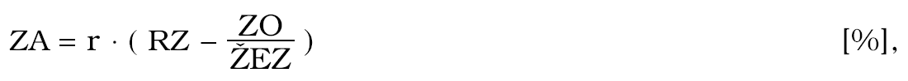
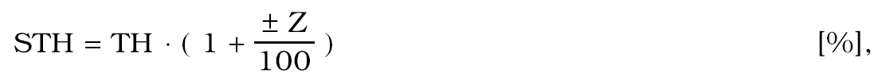

Príloha č. 5 k vyhláške č. 255/2000 Z. z.

POSTUP STANOVENIA HODNOTY ELEKTROTECHNICKÝCH ZARIADENÍ

Znalec zatriedi posudzované zariadenie do príslušnej kategórie a jeho všeobecnú hodnotu stanoví týmto postupom:

1. Vypočíta základnú amortizáciu ZA

EZ – elektrotechnické zariadenia,

r – počet odpracovaných rokov [roky],

RZ – ročná zrážka [%],

ŽEZ – predpokladaná životnosť EZ [roky],

ZO – zostatkové percento prevádzkyschopnosti EZ po skončení predpokladanej životnosti [%].

2. Vypočíta skutočnú technickú hodnotu elektrotechnického zariadenia STH

TH = VTH – ZA [%],

VTH – východisková technická hodnota EZ [%],

TH – technická hodnota EZ [%],

± Z – zmena stavu technickej hodnoty EZ [%],

ZA – základná amortizácia [%],

STH – skutočná technická hodnota EZ [%].

3. Stanoví východiskovú hodnotu elektrotechnického zariadenia VH

(Znalec zdôvodní použitú VH.)

4. Vypočíta technickú hodnotu EZ vyjadrenú v korunách THSk

VH – východisková hodnota elektrotechnického zariadenia,

STH – skutočná technická hodnota elektrotechnického zariadenia,

THSk – technická hodnota EZ vyjadrená v korunách.

5. Stanoví všeobecnú hodnotu elektrotechnického zariadenia VŠH

VŠH = THSk [Sk],

VŠH – všeobecná hodnota elektrotechnického zariadenia,

uvedie sa, či je stanovená bez dane alebo s daňou.

Podľa tohto postupu sa môže stanovovať hodnota elektrotechnických zariadení uvedených v nasledujúcich kategóriách. Tieto kategórie zároveň určujú rozsah oprávnenia na výkon znaleckej činnosti v odbore elektrotechnika silnoprúdová a elektrotechnika slaboprúdová.

6. KATEGORIZÁCIA ELEKTROTECHNICKÝCH ZARIADENÍ

6.1 Silnoprúdové zariadenia

6.1.1 ZARIADENIA NA VÝROBU ELEKTRICKEJ ENERGIE

| | RZ[%] | ŽEZ[roky] | ZO[%]

Elektrárne | | | |

Jadrové | s kombinovaným cyklom | 4 | 25 | 5

| s otvoreným cyklom | 4 | 25 | 5

| s uzavretým cyklom | 4 | 25 | 5

Tepelné | s piest. spaľ. motormi | 5 | 20 | 10

| so spaľ. motormi | 5 | 20 | 10

| so spaľ. turbínami | 5 | 20 | 5

| parné | 5 | 20 | 10

Vodné | akumulačné | 4 | 25 | 15

| derivačné | 4 | 25 | 15

| prečerpávacie | 4 | 25 | 15

| priebežné | 2 | 50 | 10

Geotermické | | 5 | 20 | 20

Solárne | | 10 | 10 | 5

Veterné | | 7 | 15 | 15

Zdroje prúdu elektrochemické | | 20 | 5 | 5

Zdroje prúdu rotačné | | 4 | 25 | 20

Zdroje prúdu statické | | 10 | 10 | 5

6.1.2 ZARIADENIA NA PRENOS A ROZVOD ELEKTRICKEJ ENERGIE

| | RZ[%] | ŽEZ[roky] | ZO[%]

Elektrické vedenia vonkajšie | NN | 4 | 25 | 5

| VN | 4 | 25 | 5

| WN | 4 | 25 | 5

Elektrické vedenia podzemné - káblové | NN | 5 | 20 | 5

| VN | 5 | 20 | 5

| WN | 5 | 20 | 5

Medzisystémové prepojovacie vedenia | | 4 | 25 | 5

Káblové súbory | | 5 | 20 | 10

Stožiare s príslušným vybavením | kovové | 5 | 20 | 10

| drevené | 4 | 25 | 5

Transformátorovne | priemyselné | 5 | 20 | 10

| distribučné | 4 | 25 | 5

| blokové | 4 | 20 | 10

| mobilné | 10 | 10 | 10

Dozorne, jednoradové a viacradové | vonkajšie | 5 | 20 | 5

| vnútorné | 4 | 25 | 10

Rozvodne | vonkajšie | 5 | 20 | 5

| vnútorné | 4 | 25 | 10

Rozvodné zariadenia | | 4 | 25 | 15

Rozvádzače | panelové | 7 | 15 | 5

| rámové | 7 | 15 | 5

| skriňové | 5 | 20 | 5

| pomocné | 5 | 20 | 5

Rozvodnice | | 4 | 25 | 5

Stanice diaľkového ovládania | | 4 | 25 | 5

Elektrická inštalácia | priemyselná | 10 | 10 | 10

| domová | 7 | 14 | 5

Elektroinštalačný materiál (ukladaný, spojovací, pomocný) | | 5 | 20 | 5

Rozvodné prístroje | odpojovacie | 4 | 25 | 5

| spojovacie | 4 | 25 | 5

| spínacie | 4 | 25 | 5

| ochranné a istiace | 5 | 20 | 5

| ovládacie a riadiace | 4 | 25 | 5

| regulačné | 5 | 25 | 5

| elektromagnety | 4 | 25 | 5

Ochrany elektrických prístrojov | | 10 | 10 | 5

Spojovacie výkonové prvky a systémy | | 7 | 14 | 5

6.1.3 ZARIADENIA NA PREMENU ELEKTRICKEJ ENERGIE NA PRÁCU ALEBO NA INÝ DRUH ENERGIE

| | RZ[%] | ŽEZ[roky] | ZO[%]

Elektrické výkonové pohony | | 10 | 10 | 10

Elektrické mechanizmy a pohony elektrických prístrojov | | 10 | 10 | 15

Elektrotepelné zariadenia | | 8 | 12 | 10

Výťahy | | 5 | 20 | 15

Zdvíhacie mechanizmy | | 10 | 10 | 15

Usmerňovače, meniče (nad 1kW) | | 10 | 10 | 10

Meniarne | | 5 | 20 | 10

Zariadenia na povrchovú úpravu kovov elektr. cestou | | 20 | 5 | 10

Stroje na zvarovanie, spájkovanie a rezanie kovov | | 20 | 5 | 15

Svietidlá | priemyselné | 20 | 5 | 10

| domové | 10 | 10 | 20

Svetelná technika | | 17 | 6 | 10

Ultrazvukové zariadenia | | 7 | 15 | 10

Elektrooptické meniče | | 7 | 15 | 10

Domáce elektrospotrebiče (chladničky, práčky, mixéry, vysávače, fritézy, mikrovlnné rúry, kávovary a pod.) | | 12 | 8 | 10

Ručné elektrické náradie | | 20 | 5 | 10

Poznámka:

Domáce elektrospotrebiče, ručné elektrické náradie a svetelnú techniku, ak sú tieto EZ pripojiteľné na sieť 220 V, môžu posudzovať aj znalci z odboru elektrotechnika slaboprúdová.

6.2 Slaboprúdové zariadenia

6.2.1 ELEKTRICKÉ ZARIADENIA NA PRENOS INFORMÁCIÍ

| | RZ[%] | ŽEZ[roky] | ZO[%]

Nadzemné oznamovacie trate | | 4 | 25 | 10

Závesné a samonosné káble | | 5 | 20 | 10

Úložné káble | | 5 | 20 | 15

Optické káble | | 5 | 20 | 10

Ochrany oznamovacích vedení a zariadení | | 10 | 10 | 10

Telefónne prístroje | | 10 | 10 | 10

Verejné telefónne automaty | | 11 | 9 | 10

Mobilné telefóny | | 20 | 5 | 20

Združovacie zariadenia | | 10 | 10 | 10

Telefónne ústredne | reléové | 4 | 25 | 10

| s krížovými spínačmi | 5 | 20 | 10

| elektronické | 7 | 14 | 20

Ďalekopisná technika | | 5 | 20 | 5

Elektrické písacie stroje | | 12 | 8 | 10

Elektronické písacie stroje | | 10 | 10 | 15

Koncové zariadenia prenosu údajov | | 5 | 20 | 10

Prenosové zariadenia | | 5 | 20 | 10

Zosilňovacie stanice | | 7 | 14 | 20

Rádioreléové zariadenia | | 7 | 14 | 20

Rozhlasové vysielače | | 7 | 14 | 20

Televízne vysielače | | 7 | 14 | 20

6.2.2 ELEKTRONICKÉ ZARIADENIA NA SPRACOVANIE INFORMÁCIÍ

| | RZ[%] | ŽEZ[roky] | ZO[%]

Vreckové kalkulátory, diáre | | 17 | 6 | 15

Stolové kalkulátory s tlačou | | 12 | 8 | 15

Počítače | osobné | 17 | 6 | 20

| prenosné | 17 | 6 | 20

| sálové | 12 | 8 | 5

Monitory | | 17 | 6 | 20

Počítačové tlačiarne | | 20 | 5 | 15

Ostatné príslušenstvo počítačov | | 17 | 6 | 20

Programové vybavenie | | 20 | 5 | 15

6.2.3 ELEKTRICKÉ A ELEKTRONICKÉ ZARIADENIA NA ZÁZNAM A REPRODUKCIU INFORMÁCIÍ

| | RZ[%] | ŽEZ[roky] | ZO[%]

Rozhlasové prijímače | | 10 | 10 | 10

Tunery | | 8 | 12 | 15

Kombinácie s neoddeliteľnými komponentmi (veže) | | | |

- stolové | | 12 | 8 | 15

- prenosné | | 14 | 7 | 15

Autorádiá aj s kaz. prehrávačom | | 12 | 8 | 10

Autorádiá s CD prehrávačom | | 12 | 8 | 15

Grafické korektory | | 10 | 10 | 15

Výkonové zosilňovače | | 12 | 8 | 15

Reproduktorové skrine | | 10 | 10 | 15

Reproduktorové sústavy pre hudobné skupiny | | 17 | 6 | 10

Magnetofóny | cievkové | 14 | 7 | 10

| kazet. prenosné aj komb. s prijímačom | 14 | 7 | 10

| kazetové stolové (TD) | 12 | 8 | 15

Záznamníky telefónnych odkazov | | 14 | 7 | 10

CD prehrávače | | 10 | 10 | 20

Gramofóny | | 12 | 8 | 10

Videomagnetofóny, videoprehrávače | | 12 | 8 | 15

TV prijímače | | 12 | 8 | 10

Videokamery (bez záznamu) | | 12 | 8 | 20

Kompaktné videokamery | | 14 | 7 | 15

Antény na príjem rozhlasu | | 12 | 8 | 5

Antény na príjem TV | | | |

Spoločné TV antény | | | |

Antény na satelitný príjem | | | |

Satelitné prijímače | | 8 | 12 | 15

Rádiostanice | | 10 | 10 | 20

Elektronické hry | | 17 | 6 | 5

Elektronické hudobné nástroje | | 14 | 7 | 15

Elektronické aparatúry, efekty | | 12 | 8 | 15

Hracie automaty | hudobné | 12 | 8 | 10

| herné | 20 | 5 | 10

Štúdiové zariadenia | zvukové | 8 | 12 | 15

| obrazové | 10 | 10 | 15

Reprografické zariadenia | | 17 | 6 | 20

Faxy | | 12 | 8 | 15

Súčiastky a konštrukčné prvky pre elektrotechniku a elektroniku | | 17 | 6 | 10

Nosiče záznamu | | | |

mag. pásky - cievky | amatérske | 14 | 6 | 10

| profesionálne | 12 | 8 | 15

mag. pásky - kazety CC | | 14 | 6 | 5

videokazety | amatérske | 14 | 6 | 10

| profesionálne | 12 | 8 | 15

| pre videopožičovne | 33 | 3 | 5

diskety | | 14 | 6 | 10

gramofónové platne | | 14 | 6 | 5

kompaktné disky (CD) | | 8 | 12 | 20

6.2.4 RIADIACE ELEKTRICKÉ A ELEKTRONICKÉ ZARIADENIA

6.2.4.1 ELEKTRICKÉ OVLÁDACIE ZARIADENIA

| RZ[%] | ŽEZ[roky] | ZO[%]

Riadiace systémy pracovných strojov | 9 | 11 | 10

Riadiace systémy výrobných, montážnych a baliacich liniek | 10 | 10 | 10

Riadiace systémy výrobných prevádzok | 10 | 10 | 20

Železničné elektrické zabezpečovacie zariadenia | 8 | 12 | 20

Železničné elektronické zabezpečovacie zariadenia | 7 | 15 | 20

Elektrické zabezpečovacie zariadenia pre iné druhy koľajovej dopravy | 8 | 12 | 20

Elektrické zabezpečovacie zariadenia lanových dráh | 17 | 6 | 5

Elektrické zabezpečovacie zariadenia pre iné druhy dopravy | 8 | 12 | 20

Pozemné systémy na automatické riadenie leteckej prevádzky | 9 | 11 | 20

Systémy diaľkového merania, meracie ústredne | 8 | 12 | 15

Systémy diaľkovej kontroly | 8 | 12 | 15

Systémy operatívneho riadenia, dispečerské systémy | 7 | 15 | 10

6.2.4.2 ELEKTRICKÉ A ELEKTRONICKÉ MERACIE ZARIADENIA

| RZ[%] | ŽEZ[roky] | ZO[%]

Elektrické meracie prístroje (bez prístrojov na meranie času) | 10 | 10 | 10

Elektrické prístroje na meranie času, hodinové zariadenia | 9 | 11 | 10

Elektrónové mikroskopy | 17 | 6 | 5

Elektronické meracie prístroje | 12 | 8 | 20

Elektrické prístroje na meranie neelektrických veličín | 9 | 11 | 20

Elektronické sledovacie a kontrolné zariadenia | 10 | 10 | 25

6.2.4.3 ELEKTRICKÉ OCHRANNÉ ZARIADENIA

| RZ[%] | ŽEZ[roky] | ZO[%]

Elektrické zariadenia na ochranu mobilných prostriedkov pred odcudzením | 12 | 8 | 25

Elektrické zariadenia na ochranu pred vniknutím | 8 | 12 | 10

Elektrické zariadenia na ochranu pred požiarom | 4 | 25 | 10

Elektrické systémy na ochranu jadrových reaktorov | 4 | 25 | 0

6.2.4.4 ELEKTRICKÉ ZARIADENIA OSOBITNÉ

| RZ[%] | ŽEZ[roky] | ZO[%]

Elektrické a elektronické zariadenia zdravotnícke a laboratórne | 10 | 10 | 15
