Príloha č. 6 k vyhláške č. 255/2000 Z. z.

Postup stanovenia hodnoty cestných vozidiel

1. Postup výpočtu základnej amortizácie vozidla ZA

a) Znalec určí základnú amortizáciu za dobu prevádzky vozidla ZAV z amortizačných tabuliek podľa príslušnej kategórie vozidla.

b) Znalec z amortizačnej tabuľky určí podľa príslušnej kategórie vozidla predpokladaný počet najazdených kilometrov PRKM k dátumu ohodnotenia a koeficient počtu najazdených kilometrov KKM.

c) Na základe zisteného skutočného počtu najazdených kilometrov PSKM znalec vypočíta rozdiel v počte najazdených kilometrov RKM podľa vzorca:

RKM = PSKM - PRKM [km].

d) Znalec vypočíta koeficient vplyvu skutočne najazdených kilometrov KAM:

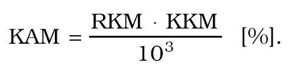

e) Z týchto vstupných údajov ďalej znalec vypočíta celkovú základnú amortizáciu ZA jednotlivých skupín:

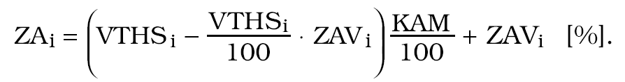

Ak VTHV = 100 %, postupuje podľa zjednodušeného vzorca:

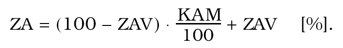

2. Určenie a výpočet technickej hodnoty skupín THS a technickej hodnoty vozidla THV

Určenie technickej hodnoty vozidla THV sa zakladá na posúdení a porovnaní skutočného technického stavu jeho skupín s predpokladaným stavom (určeným celkovou základnou amortizáciou) za rovnakú dobu prevádzky pri rovnakom počte najazdených kilometrov príslušnými skupinami iného vozidla rovnakej kategórie.

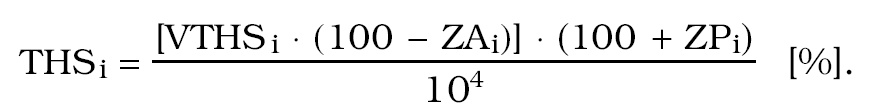

Na základe vypočítaných technických hodnôt jednotlivých skupín THS znalec vypočíta ich jednotlivé pomerné technické hodnoty PTHS:

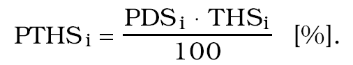

Technická hodnota vozidla THV sa rovná súčtu pomerných technických hodnôt jeho jednotlivých skupín:

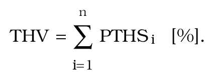

3. Určenie hodnoty mimoriadnej výbavy HMV

Hodnotu mimoriadnej výbavy vypočíta znalec podľa postupov uvedených v znaleckom štandarde:

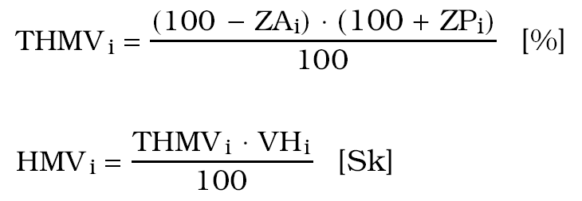

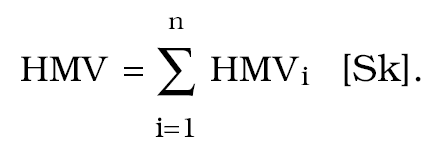

4. Výpočet technickej hodnoty vozidla vyjadrenej v korunách THSk

Technická hodnota v korunách THSk vyjadruje zvyšok technickej životnosti vozidla vyjadrený v korunách a nie sú v nej zahrnuté vplyvy zohľadňujúce trhové a ekonomické podmienky.

Pri výpočte THSk postupuje znalec podľa tohto vzorca:

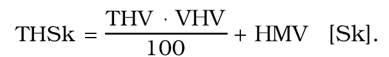

5. Určenie koeficientu predajnosti KP

Pri výpočte koeficientu predajnosti znalec postupuje podľa znaleckého štandardu a postupy náležite zdôvodní.

6. Výpočet všeobecnej hodnoty vozidla VŠH

Všeobecná hodnota vozidla je hodnota v korunách, ktorej výpočet zahŕňa okrem vplyvov opotrebenia aj vplyvy trhu (predajnosť typu vozidla).

Vypočíta sa ako súčin technickej hodnoty vozidla vyjadrenej v korunách s koeficientom predajnosti KP:

VŠH = THSk . KP [Sk].

Výpočet VŠH zoradí znalec do tabuľky výpočtu VŠH

VHV [Sk] |

THSk [%] |

KP [-] |

VŠH [Sk] |

ROH [Sk]* |

* Ak ju treba vypočítať.

7. Výpočet reprodukčnej obstarávacej hodnoty vozidla ROH

Ak treba, znalec vypočíta aj reprodukčnú obstarávaciu hodnotu vozidla ROH.

Reprodukčná obstarávacia hodnota je cena vozidla, ktorú treba vynaložiť na zaobstaranie porovnateľného vozidla obvyklým spôsobom na voľnom trhu v rozhodnej dobe a ktorá podľa osobitného predpisu1) je vstupnou cenou hmotného majetku.

Pri jej výpočte znalec vychádza z aktuálneho vývoja na trhu, aktuálnych ekonomických podmienok a právnych noriem:

ROH = VŠH + NZ [Sk]

NZ – náklady na zaobstaranie vozidla.

Znalec v znaleckom posudku vždy uvedie, či vypočítaná reprodukčná obstarávacia hodnota je vrátane DPH alebo bez DPH.

Rozdelenie vozidiel do kategórií

Cestné vozidlá sa na účely určenia ich hodnoty rozdeľujú do týchto kategórií [v zátvorke je uvedená príslušná kategorizácia podľa osobitného predpisu2)]:

1. Ostatné nemotorové vozidlá s výnimkou invalidných motorových vozíkov (kategória R):

1.1 bicykle detské a bicykle bez prevodov,

1.2 bicykle s prevodmi a špeciálne (športové) bicykle,

1.3 ručné nemotorové vozíky,

1.4 nemotorové vozíky a motorové invalidné vozíky.

2. Motocykle (kategória L):

2.1 malé motocykle nepodliehajúce dopravnej evidencii s maximálnou konštrukčnou rýchlosťou do 50 km/h a trojkolky a štvorkolky s maximálnou konštrukčnou rýchlosťou do 50 km/h a s ľubovoľným druhom pohonu,

2.2 motocykle s EČ a trojkolky a štvorkolky so zdvihovým objemom valcov motora do 125 cm3,

2.3 motocykle s EČ a trojkolky a štvorkolky so zdvihovým objemom valcov motora nad 125 cm3.

3. Osobné motorové vozidlá, dodávkové vozidlá, mikrobusy a ich modifikácie (kategória M):

3.1 vozidlá vyrobené v ČSFR a v bývalých socialistických štátoch do 31. 12. 1991,

3.2 vozidlá so zdvihovým objemom valcov motora V ≤ 1100 cm3,

3.3 vozidlá so zdvihovým objemom valcov motora 1100 < V ≤ 1600 cm3,

3.4 vozidlá so zdvihovým objemom valcov motora 1600 < V ≤ 2000 cm3,

3.5 vozidlá so zdvihovým objemom valcov motora V > 2000 cm3,

3.6 luxusné vozidlá vybraných výrobcov so zdvihovým objemom valcov motora V > 2500 cm3.

4. Úžitkové vozidlá, ich modifikácie, špeciálne úžitkové vozidlá a ich podvozky (kategória N):

4.1 úžitkové vozidlá s celkovou hmotnosťou do 3 500 kg,

4.2 úžitkové vozidlá s celkovou hmotnosťou od 3 501 kg do 12 000 kg,

4.3 úžitkové vozidlá s celkovou hmotnosťou nad 12 000 kg,

4.4 úžitkové vozidlá s celkovou hmotnosťou nad 12 000 kg používané v diaľkovej doprave a spĺňajúce medzinárodné normy a predpisy.

5. Traktory a pojazdné účelové stroje (kategórie T, S, R):

5.1 kolesové traktory (kategória T),

5.2 pásové traktory (kategória T),

5.3 pojazdné stroje na zemné, stavebné a cestné práce (kategória S),

5.4 pojazdné poľnohospodárske stroje (kategória S),

5.5 pojazdné žeriavy (kategória S),

5.6 pojazdná manipulačná technika na ložné a skladové operácie (kategória R),

5.7 stroje na báze ručných motorových vozíkov a traktorov (kategória R).

6. Autobusy (kategória M):

6.1 autobusy s celkovou hmotnosťou menšou ako 5 000 kg a do 19 miest na sedenie,

6.2 autobusy mestskej prepravy osôb,*

6.3 autobusy linkovej prímestskej prepravy osôb,*

6.4 autobusy diaľkovej prepravy osôb.*

7. Prívesy a návesy k vozidlám 2. a 3. kategórie (kategória O):

7.1 prívesy za motocykle a postranné vozíky k motocyklom,

7.2 nákladné prívesy za osobné a terénne osobné automobily a ich modifikácie,

7.3 obytné prívesy a návesy za osobné a terénne osobné automobily a ich modifikácie.

8. Prívesy a návesy za vozidlá 4., 5. a 6. kategórie (kategória O):

8.1 valníkové prívesy a návesy,

8.2 vyklápacie prívesy a návesy,

8.3 špeciálne prívesy a návesy,

8.4 obytné prívesy a návesy.

Postup stanovenia hodnoty dráhových vozidiel

1. Výpočet základnej amortizácie ZA

Vzťahy pre výpočet ZA:

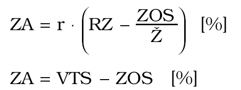

r – počet odpracovaných rokov dráhového vozidla [roky],

RZ – ročná zrážka [%],

Ž – predpokladaná životnosť dráhového vozidla [roky],

ZOS – zostatkové percento prevádzkyschopnosti dráhového vozidla po skončení predpokladanej životnosti [%].

2. Výpočet skutočného technického stavu dráhového vozidla STS

Vzťah pre výpočet STS:

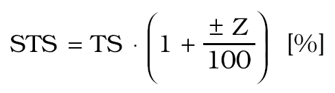

STS – skutočný technický stav dráhového vozidla [%],

TS – technický stav dráhového vozidla [%],

Z – zmena technického stavu dráhového vozidla [%].

3. Stanovenie východiskovej hodnoty dráhového vozidla VH

Znalec zdôvodní použitú VH [Sk].

4. Technická hodnota dráhového vozidla vyjadrená v slovenských korunách THSk

THSk sa vypočíta podľa vzťahu:

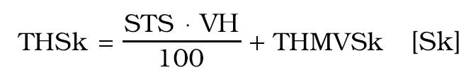

STS – skutočný technický stav dráhového vozidla [%],

VH – východisková hodnota dráhového vozidla [Sk],

THMVSk – technická hodnota mimoriadnej výbavy dráhového vozidla vyjadrená v korunách [Sk].

5. Všeobecná hodnota dráhového vozidla VŠH

VŠH sa vypočíta podľa vzťahu:

VŠH = THSk . KP [Sk]

THSk – technická hodnota dráhového vozidla vyjadrená v korunách [Sk],

KP – koeficient predajnosti dráhového vozidla [–].

Dráhy sa podľa technických podmienok uvedených v osobitnom predpise3) členia na železničné, električkové, trolejbusové, lanové a špeciálne dráhy. Podľa uvedeného postupu sa môže stanovovať hodnota dráhových vozidiel uvedených v príslušných predpisoch. Tieto predpisy zároveň určujú rozsah oprávnenia na výkon znaleckej činnosti v odbore doprava železničná. V zmysle súvisiacich predpisov týkajúcich sa počtu ubehnutých kilometrov a vykonaných opráv znalec vypočíta základnú amortizáciu a stanoví východiskový technický stav dráhového vozidla.

Postup stanovenia hodnoty lietadiel

1. Výpočet základnej amortizácie ZA

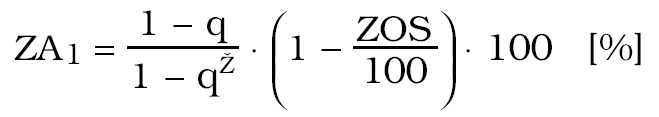

VTS – východiskový technický stav lietadla [%],

ZOS – zostatkové percento prevádzkyschopnosti lietadla [%],

q – podiel odpisov za dva po sebe nasledujúce roky zohľadňujúce morálne opotrebenie lietadla 0 <$E< q <$E< 1,

Ž – doba životnosti [roky],

r – počet odpracovaných rokov [roky],

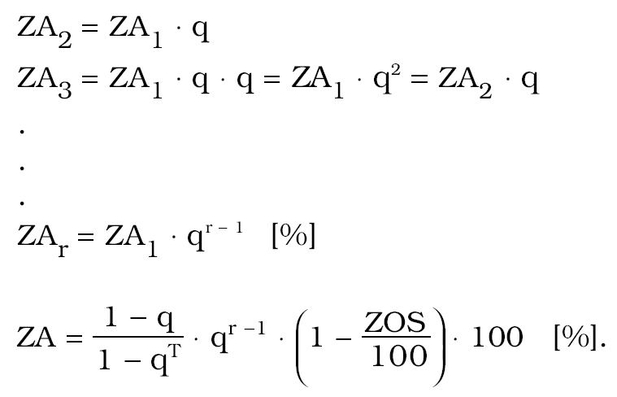

2. Výpočet skutočného technického stavu lietadla

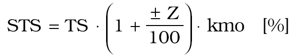

TS – technický stav lietadla [%],

Z – zmena technického stavu lietadla [%],

kmo – koeficient morálneho opotrebenia lietadla.

3. Stanovenie východiskovej hodnoty lietadla

Treba zdôvodniť použitú VH [Sk].

4. Výpočet technickej hodnoty lietadla vyjadrenej v korunách

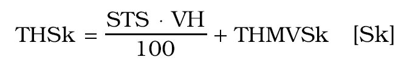

STS – skutočný technický stav lietadla [%],

VH – východisková hodnota lietadla [Sk],

THMVSk – technická hodnota mimoriadnej výbavy lietadla vyjadrená v korunách [Sk].

5. Všeobecná hodnota lietadla

VHŠ sa vypočíta podľa vzťahu:

VŠH = THSk . KP [Sk]

THSk – technická hodnota lietadla [Sk],

KP – koeficient predajnosti lietadla [–].

Podľa tohto postupu môže len znalec z odboru doprava letecká stanovovať hodnotu lietadiel.

Postup stanovenia hodnoty plavidiel

1. Výpočet základnej amortizácie ZA

Vzťahy pre výpočet ZA:

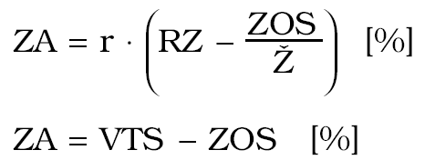

r – počet odpracovaných rokov [roky],

RZ – ročná zrážka [%],

Ž – predpokladaná životnosť plavidla [roky],

ZOS – zostatkové percento prevádzkyschopnosti plavidla po skončení predpokladanej životnosti [%].

2. Výpočet skutočného technického stavu plavidla STS

Vzťah pre výpočet STS:

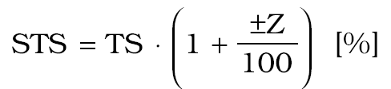

TS – technický stav plavidla [%],

Z – zmena technického stavu plavidla [%].

3. Stanovenie východiskovej hodnoty plavidla VH

Znalec zdôvodní použitú VH [Sk].

4. Technická hodnota plavidla vyjadrená v slovenských korunách THSk

THSk sa vypočíta podľa vzťahu:

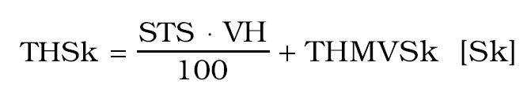

STS – skutočný technický stav plavidla [%],

VH – východisková hodnota plavidla [Sk],

THMVSk – technická hodnota mimoriadnej výbavy plavidla vyjadrená v korunách [Sk].

5. Všeobecná hodnota plavidla VŠH

VŠH sa vypočíta podľa vzťahu:

VŠH = THSk . KP [Sk]

THSk – technická hodnota plavidla vyjadrená v korunách [Sk],

KP – koeficient predajnosti plavidla [–].

Podľa tohto postupu sa môže stanovovať hodnota plavidiel uvedených v osobitnom predpise. Tieto kategórie zároveň určujú rozsah oprávnenia na výkon znaleckej činnosti v odbore doprava vodná.
