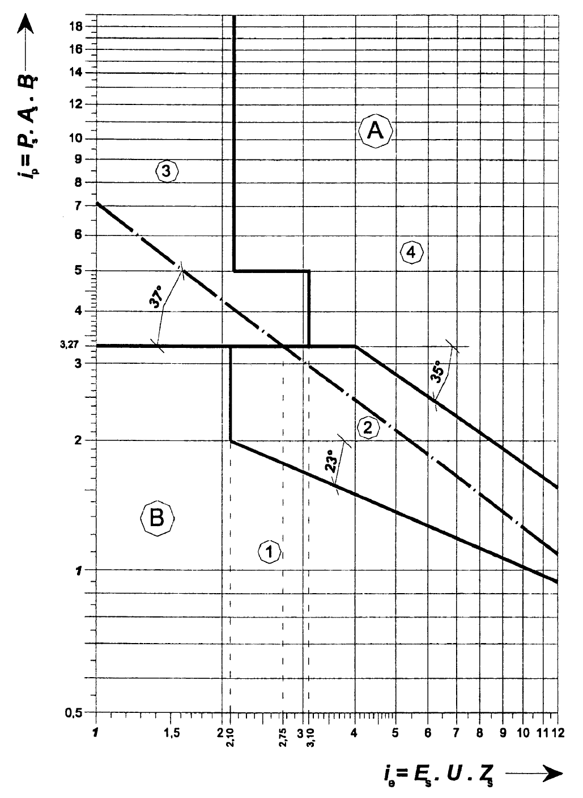

Príloha č. 13 k vyhláške č. 288/2000 Z. z.

VYBAVENIE POŽIARNEHO ÚSEKU ZARIADENÍM ELEKTRICKEJ POŽIARNEJ SIGNALIZÁCIE, STABILNÝM HASIACIM ZARIADENÍM A ZARIADENÍM NA ODVOD TEPLA A SPLODÍN HORENIA

ip – index skladovaných materiálov,

Ps – súčiniteľ hmotnosti,

As – súčiniteľ nebezpečenstva,

Bs – súčiniteľ skladovania,

ie – index ekonomického rizika,

Es – súčiniteľ škôd,

U – súčiniteľ plochy,

Zs – súčiniteľ splodín horenia,

PLOCHA 1 – požiarny úsek nemusí byť vybavený zariadením elektrickej požiarnej signalizácie, stabilným hasiacim zariadením a zariadením na odvod tepla a splodín horenia,

PLOCHA 2 – požiarny úsek musí byť vybavený elektrickou požiarnou signalizáciou,

PLOCHA 3 – požiarny úsek musí byť vybavený stabilným hasiacim zariadením,

PLOCHA 4 – požiarny úsek musí byť vybavený elektrickou požiarnou signalizáciou a stabilným hasiacim zariadením,

PLOCHA A (nad bodkočiarkovanou čiarou) – požiarny úsek musí byť vybavený zariadením na odvod dymu a tepla pri požiari,

PLOCHA B (pod bodkočiarkovanou čiarou) – požiarny úsek nemusí byť vybavený zariadením na odvod dymu a tepla pri požiari.
