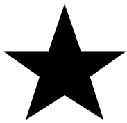

Príloha č. 1 k nariadeniu vlády č. 433/2000 Z. z. SYMBOL ENERGETICKEJ ÚČINNOSTI

Symbol energetickej činnosti podľa § 7 má túto grafickú podobu:

Príloha č. 2 k nariadeniu vlády č. 433/2000 Z. z.

OZNAČOVANIE KOTLOV PODĽA ICH ENERGETICKEJ ÚČINNOSTI

Symboly, ktorými možno podľa § 7 označovať kotol, ak spĺňa zodpovedajúce technické požiadavky na účinnosť pri menovitom a tiež pri čiastočnom výkone:

Symbol | Požadovaná účinnosť pri menovitom výkone Pn a pri strednej teplote vody kotla 70 °C (%) | Požadovaná účinnosť pri čiastočnom zaťažení 0,3 Pn a pri strednej teplote vody kotla > 50 °C (%)

* | > 84 + 2 log Pn | > 80 + 3 log Pn

** | > 87 + 2 log Pn | > 83 + 3 log Pn

*** | > 90 + 2 log Pn | > 86 + 3 log Pn

**** | > 93 + 2 log Pn | > 89 + 3 log Pn

Príloha č. 3 k nariadeniu vlády č. 433/2000 Z. z.

PRESKÚŠANIE TYPU

1. Preskúšanie typu je postup, pri ktorom autorizovaná osoba zisťuje a osvedčuje, že vzorka kotla alebo základného komponentu predstavujúca predpokladanú výrobu alebo dovoz spĺňa príslušné ustanovenia tohto nariadenia.

- 2. Výrobca alebo jeho splnomocnenec poskytuje autorizovanej osobe, ktorú si vyberie

- 2.1. Identifikačné údaje, v prípade splnomocnenca aj identifikačné údaje o výrobcovi.

2.2 Písomné vyhlásenie, že zmluva o vykonaní preskúšania typu nebola uzatvorená s inou autorizovanou osobou.

2.3 Technickú dokumentáciu, ktorej obsah je uvedený v bode 3.

2.4 Reprezentatívnu vzorku predpokladanej výroby alebo dovozu (ďalej iba „typ“). Autorizovaná osoba môže požadovať ďalšie vzorky, ak je to treba na vykonanie skúšok.

3. Technická dokumentácia zahŕňa údaje vzťahujúce sa na návrh, výrobu a prevádzku kotla nevyhnutné na posúdenie zhody kotla s požiadavkami tohto nariadenia a obsahuje

a) všeobecný opis typu,

b) koncepčný návrh, výrobné výkresy, výkresy zostáv, podzostáv a obvodov nevyhnutné na posúdenie zhody,

c) opisy a vysvetlenia nevyhnutné na porozumenie výkresom a grafom a prevádzke (činnosti) kotla,

d) zoznam harmonizovaných slovenských technických noriem použitých úplne alebo čiastočne a opisy riešení prijatých na splnenie základných požiadaviek tam, kde uvedené normy neboli použité,

e) výsledky vykonaných návrhových výpočtov alebo skúšok,

f) protokoly o preskúšaní.

4. Autorizovaná osoba

- 4.1 Preskúma technickú dokumentáciu, overí, či bol typ vyrobený v súlade s touto dokumentáciou, a identifikuje prvky, ktoré boli navrhnuté podľa príslušných ustanovení harmonizovaných slovenských technických noriem, ako aj súčasti, ktoré boli navrhnuté bez použitia príslušných ustanovení týchto noriem.

- 4.2 Vykoná alebo nechá vykonať príslušné overenia a nevyhnutné skúšky na zistenie, či tam, kde sa nepoužili harmonizované slovenské technické normy, riešenie prijaté výrobcom spĺňa základné požiadavky.

- 4.3 Vykoná alebo nechá vykonať príslušné overenia a nevyhnutné skúšky na zistenie, či tam, kde sa zvolilo použitie príslušných harmonizovaných slovenských technických noriem, sa tieto skutočne použili.

- 4.4 Odsúhlasí s výrobcom alebo jeho splnomocnencom miesto, kde sa majú overenia a potrebné skúšky vykonať.

- 4.5 Ak typ spĺňa príslušné ustanovenia tohto nariadenia, autorizovaná osoba vystaví výrobcovi alebo jeho splnomocnencovi certifikát typu. Certifikát typu obsahuje identifikačné údaje o výrobcovi, závery skúšok a nevyhnutné údaje na identifikáciu certifikovaného typu. K certifikátu typu sa prikladá zoznam príslušnej časti technickej dokumentácie, ktorej jedna kópia zostáva uložená u autorizovanej osoby. Ak autorizovaná osoba odmietne výrobcovi alebo jeho splnomocnencovi vystaviť certifikát typu, uvedie podrobné dôvody takého odmietnutia v správe, ktorú mu odovzdá.

- 5. Výrobca alebo jeho splnomocnenec kotla alebo základného komponentu, ktorý vlastní uvedenú technickú dokumentáciu k certifikovanému typu, informuje autorizovanú osobu o akejkoľvek zmene certifikovaného typu. Ak takéto zmeny môžu ovplyvniť zhodu so základnými požiadavkami alebo výrobcom či jeho splnomocnencom určené podmienky na použitie kotla, autorizovaná osoba vykoná dodatočné zistenia, ktorých výsledky uvedie v dodatku k certifikátu typu.

6. Autorizovaná osoba musí oznámiť dôležité informácie týkajúce sa vydaných a zrušených certifikátov skúšky typu a dodatkov k certifikátom iným autorizovaným osobám.

7. Autorizovaná osoba môže dostať kópie certifikátov typu alebo jeho dodatkov. Dodatky k certifikátom musia byť k dispozícii všetkým autorizovaným osobám.

Príloha č. 4 k nariadeniu vlády č. 433/2000 Z. z.

I. OVEROVANIE ZHODY VÝROBKU S CERTIFIKOVANÝM TYPOM

[§ 5 ods. 1 písm. a)]

- 1. Overovanie zhody výrobku s certifikovaným typom je postup, ktorým sa výrobca alebo jeho splnomocnenec presvedčuje a vyhlasuje, že kotly alebo základné komponenty sú v súlade s typom opísaným v certifikáte typu a spĺňajú príslušné požiadavky tohto nariadenia. Výrobca alebo jeho splnomocnenec vydáva písomné vyhlásenie o zhode.

- 2. Výrobca alebo jeho splnomocnenec zabezpečuje všetky opatrenia nevyhnutné na to, aby výrobný postup zabezpečoval zhodu vyrábaných kotlov alebo základných komponentov s typom opísaným v certifikáte typu a s požiadavkami tohto nariadenia, ktoré sa na ne vzťahujú.

- 3. Autorizovaná osoba zvolená výrobcom alebo jeho splnomocnencom vykonáva alebo necháva vykonať v náhodných intervaloch skúšky výrobku. Autorizovaná osoba odoberie vhodnú vzorku hotových výrobkov na mieste, vykoná skúšky definované v príslušných harmonizovaných slovenských technických normách alebo ekvivalentné skúšky a overí zhodu výrobku s požiadavkami príslušného nariadenia. Ak jedna alebo viac vzoriek preskúšaných výrobkov nevyhovuje, odovzdá o tom autorizovaná osoba správu výrobcovi alebo jeho splnomocnencovi, aby sa zabránilo uvedeniu týchto výrobkov na trh.

II. POSUDZOVANIE SYSTÉMU KVALITY VÝROBY

[§ 5 ods. 1 písm. b)]

- 1. Posudzovanie systému kvality výroby je postup, ktorým sa výrobca alebo jeho splnomocnenec spĺňajúci ustanovenie bodu 2 presvedčuje a vyhlasuje, že kotly alebo ich základné komponenty sú v zhode s typom opísaným v certifikáte typu a spĺňajú požiadavky tohto nariadenia. Výrobca alebo jeho splnomocnenec vypracuje písomné vyhlásenie o zhode.

2. Výrobca uplatňuje systém kvality výroby podľa bodu 3, ktorý sa podrobuje dohľadu podľa bodu 4.

3. Systém kvality

- 3.1 Výrobca alebo jeho splnomocnenec poskytuje autorizovanej osobe

a) všetky potrebné informácie o kotloch a základných komponentoch,

b) dokumentáciu o systéme kvality výroby,

c) technickú dokumentáciu vzťahujúcu sa na certifikovaný typ a kópiu certifikátu typu.

3.2 Systém kvality výroby zabezpečuje zhodu kotlov alebo základných komponentov s typom opísaným v certifikáte typu a s požiadavkami tohto nariadenia, ktoré sa na ne vzťahujú. Všetky opatrenia prijaté výrobcom sú systematickým a riadnym spôsobom zdokumentované vo forme inštrukcií, postupov a pokynov. Dokumentácia o systéme kvality umožňuje jednotný výklad programov, plánov, príručiek a záznamov o kvalite. Dokumentácia obsahuje najmä primeraný opis

a) cieľov kvality a organizačnej štruktúry, zodpovednosti a právomoci manažmentu vo vzťahu ku kvalite zariadení,

b) výroby, kontroly kvality a zabezpečovania technickej kvality, ďalších používaných procesov a systematických činností,

c) preskúšania a skúšok, ktoré sa vykonávajú v predvýrobnej, výrobnej a povýrobnej etape vrátane ich počtu,

d) záznamov o kvalite, ako sú kontrolné protokoly a údaje o skúškach, údaje o kalibrácii, záznamy o kvalifikácii príslušných zamestnancov atď.,

e) prostriedkov, ktoré umožňujú monitorovať dosiahnutie požadovanej kvality zariadení a účinné fungovanie systému kvality.

- 3.3 Autorizovaná osoba posudzuje systém kvality, či spĺňa požiadavky uvedené v bode 3.2. Predpoklad zhody s týmito požiadavkami je splnený pri systémoch kvality, ktoré zodpovedajú príslušnej harmonizovanej slovenskej technickej norme. Postup zahŕňa aj posudzovanie na pracoviskách výrobcu. Autorizovaná osoba odovzdáva výrobcovi alebo jeho splnomocnencovi správu. Správa obsahuje výsledky posudzovania vzťahujúce sa na kotly a na základné komponenty, ktorých sa týka, s odôvodneným rozhodnutím.

- 3.4 Výrobca kotla alebo základného komponentu zabezpečuje plnenie záväzkov vyplývajúcich z posúdeného systému kvality a udržuje ho tak, aby bol stále primeraný a účinný. Výrobca alebo jeho splnomocnenec informuje autorizovanú osobu, ktorá posudzovala systém kvality, o každej zamýšľanej zmene v systéme kvality, napr. v dôsledku nových technológií a koncepcie kvality. Autorizovaná osoba posúdi zamýšľané zmeny a rozhodne, či pozmenený systém kvality bude aj naďalej spĺňať požiadavky uvedené v bode 3.2 alebo či treba vykonať nové posudzovanie. Svoje rozhodnutie oznamuje výrobcovi alebo jeho splnomocnencovi. Toto oznámenie obsahuje zdôvodnený záver skúšky a dôkladné posúdenie.

4. Dohľad nad systémom kvality

4.1 Účelom dohľadu je zabezpečiť, aby výrobca náležite plnil záväzky vyplývajúce zo systému kvality.

- 4.2 Na účely dohľadu výrobca umožňuje autorizovanej osobe prístup do priestorov výroby, kontroly, skúšania a skladovania zariadení a poskytuje jej nevyhnutné podklady, najmä

a) dokumentáciu o systéme kvality,

b) podklady o kvalite, napr. správy o kontrolách a výsledky skúšok, údaje o kalibrácii, údaje o kvalifikácii príslušných zamestnancov a podobne.

4.3 Autorizovaná osoba vykonáva pravidelný dohľad, aby sa ubezpečila, že výrobca kotlov alebo základných komponentov udržuje a používa systém kvality a výrobcovi o výsledkoch dohľadu odovzdáva správu.

4.4 Autorizovaná osoba môže naviac vykonávať neohlásený dohľad u výrobcu. Pri neohlásenom dohľade môže autorizovaná osoba vykonávať skúšky alebo ich nechať vykonať na overenie správnej funkcie systému kvality. Autorizovaná osoba poskytuje výrobcovi správu o výsledkoch dohľadu a ak vykonala skúšky, tak aj správu o skúškach.

III. POSUDZOVANIE SYSTÉMU KVALITY VÝROBKOV

[§ 5 ods. 1 písm. c)]

- 1. Posudzovanie systému kvality výrobkov je postup, ktorým sa výrobca alebo jeho splnomocnenec spĺňajúci ustanovenia bodu 2 presvedčuje a vyhlasuje, že kotol alebo základné komponenty sú v zhode s typom opísaným v certifikáte typu a spĺňajú požiadavky tohto nariadenia. Výrobca alebo jeho splnomocnenec vydá písomné vyhlásenie o zhode.

2. Výrobca uplatňuje systém kvality výrobkov podľa bodu 3, ktorý sa podrobuje dohľadu podľa bodu 4.

3. Systém kvality výrobkov

- 3.1 Výrobca alebo jeho splnomocnenec poskytuje autorizovanej osobe:

a) všetky potrebné informácie o kotloch alebo základných komponentoch,

b) dokumentáciu o systéme kvality výrobkov,

c) technickú dokumentáciu vzťahujúcu sa na certifikovaný typ a kópiu certifikátu typu.

- 3.2 V rámci systému kvality výrobkov sa skúša každý kotol alebo základný komponent podľa harmonizovaných slovenských technických noriem alebo sa vykonajú ekvivalentné skúšky na účel zistenia zhody so základnými požiadavkami. Všetky opatrenia prijaté výrobcom sú systematickým a riadnym spôsobom zdokumentované vo forme inštrukcií, postupov a písomných pokynov. Dokumentácia o systéme kvality výrobkov umožňuje jednotný výklad programov, plánov, príručiek a záznamov o kvalite. Dokumentácia obsahuje najmä primeraný opis

a) cieľov kvality a organizačnej štruktúry, zodpovednosti a právomoci manažmentu vo vzťahu ku kvalite zariadení,

b) výroby, postupov riadenia kvality a zabezpečovania kvality, ďalších používaných procesov a systematických činností,

c) preskúšaní a skúšok, ktoré sa budú vykonávať v predvýrobnej, výrobnej a povýrobnej etape, vrátane ich počtu,

d) záznamov o kvalite, ako sú kontrolné protokoly a údaje o skúškach, údaje o kalibrácii, záznamy o kvalifikácii príslušných zamestnancov atď.

- 3.3 Autorizovaná osoba posudzuje systém kvality výrobkov, či spĺňa požiadavky uvedené v bode 3.2. Predpoklad zhody s týmito požiadavkami je splnený pri systémoch kvality výrobkov, ktoré zodpovedajú harmonizovanej slovenskej technickej norme. Postup zahŕňa aj posudzovanie na pracoviskách výrobcu. Výrobca alebo jeho splnomocnenec dostane správu. Správa obsahuje výsledky posudzovania s ich vyhodnotením vzťahujúce sa na kotly alebo základné komponenty, ktorých sa týka.

- 3.4 Výrobca kotla alebo základného komponentu zabezpečuje plnenie záväzkov vyplývajúcich z posúdeného systému kvality výrobkov a udržuje ho tak, aby bol stále primeraný a účinný. Výrobca alebo jeho splnomocnenca informuje autorizovanú osobu, ktorá posudzovala systém kvality, o každej zamýšľanej zmene v systéme kvality výrobkov, napr. v dôsledku nových technológií a koncepcie kvality. Autorizovaná osoba posúdi zamýšľané zmeny a rozhodne, či pozmenený systém kvality výrobkov bude i naďalej spĺňať požiadavky uvedené v bode 3.2 alebo či treba vykonať nové posudzovanie. Svoje rozhodnutie oznamuje výrobcovi alebo jeho splnomocnencovi. Správa obsahuje výsledky posudzovania a odôvodnené rozhodnutie.

4. Dohľad nad systémom kvality výrobkov

4.1 Účelom dohľadu je zabezpečiť, aby výrobca náležite plnil záväzky vyplývajúce zo systému kvality výrobkov.

- 4.2 Na účely dohľadu výrobca umožňuje autorizovanej osobe prístup do priestorov výroby, kontroly, skúšania a skladovania zariadení a poskytuje jej nevyhnutné podklady, najmä

a) dokumentáciu o systéme kvality výrobkov,

b) technickú dokumentáciu,

c) záznamy o kvalite, napríklad kontrolné protokoly, údaje o skúškach, údaje o kalibrácii, záznamy o kvalifikácii príslušných zamestnancov.

4.3 Autorizovaná osoba vykonáva pravidelný dohľad, aby sa ubezpečila, že výrobca kotlov alebo základných komponentov udržuje a používa systém kvality výrobkov a výrobcovi o výsledkoch dohľadu odovzdáva správu.

4.4 Naviac môže autorizovaná osoba vykonávať neohlásený dohľad u výrobcu. Pri neohlásenom dohľade môže autorizovaná osoba vykonávať skúšky alebo ich nechať vykonať na overenie správnej funkcie systému kvality výrobkov. Autorizovaná osoba poskytuje výrobcovi správu o výsledkoch dohľadu a ak vykonala skúšky, tak aj správu o skúškach.

Príloha č. 5 k nariadeniu vlády č. 433/2000 Z. z.

MINIMÁLNE POŽIADAVKY NA AUTORIZOVANÉ OSOBY

1. Autorizovaná osoba, jej zamestnanci, riaditeľ ani osoby zodpovedné za vykonávanie skúšok nesmú byť konštruktérmi, výrobcami, dodávateľmi ani inštalatérmi kotlov alebo základných komponentov, na ktorých vykonávajú kontrolu, ani ich splnomocnencom. Nemôžu byť zainteresovaní priamo alebo ako splnomocnenec na návrhu, konštrukcii, predaji alebo údržbe týchto kotlov alebo základných komponentov. To nebráni možnosti výmeny technických informácií medzi výrobcom a autorizovanou osobou.

2. Autorizovaná osoba a jej zamestnanci musia kontrolovať a skúšať na úrovni najvyššej profesionality a technickej kvalifikácie a nesmú byť pod nijakým nátlakom a stimulom, osobitne finančným, ktorý môže ovplyvniť ich posudzovanie výsledkov kontroly, hlavne od osôb alebo skupiny osôb, ktoré majú záujem na výsledkoch kontroly.

3. Autorizovaná osoba musí mať k dispozícii potrebný personál a vybavenie, ktoré jej umožnia riadne vykonávať administratívne a technické úlohy, ktoré sú spojené s kontrolovaním. Musí mať tiež prístup k zariadeniam, ktoré sú požadované pri špeciálnych kontrolách.

4. Osoby zodpovedné za inšpekciu musia mať

a) technické a profesionálne zaškolenie,

b) dostatočnú znalosť požiadaviek na vykonávané skúšky a primeranú prax pri vykonávaní týchto skúšok,

c) schopnosť vypracúvať certifikáty, záznamy a správy požadované na overenie vykonávania testov.

5. Nestrannosť autorizovanej osoby musí byť zaručená. Odmeňovanie zamestnancov nesmie závisieť od počtu vykonaných skúšok ani od ich výsledkov.

6. Autorizovaná osoba musí mať poistenie zodpovednosti za škodu podľa osobitných predpisov, ak takéto poistenie nie je priamo zabezpečené štátom.

7. Zamestnanci autorizovanej osoby musia byť viazaní povinnosťou mlčanlivosti (s výnimkou zodpovedných správnych štátnych orgánov) v rámci tohto nariadenia alebo akýchkoľvek opatrení vyplývajúcich z národného práva, ktoré majú na ňu vplyv.

Príloha č. 6 k nariadeniu vlády č. 433/2000 Z. z.

ZOZNAM TRANSPONOVANÝCH SMERNÍC

Týmto nariadením sa úplne transponujú nasledujúce smernice:

1. Smernica Rady č. 92/42/EHS z 21. mája 1992 o požiadavkách na účinnosť nových teplovodných kotlov na kvapalné palivá alebo plynné palivá.

2. Smernica Rady č. 93/68/EHS z 22. júla 1993, ktorou sa menia a dopĺňajú smernice č. 87/404/EHS (jednoduché tlakové nádoby), č. 88/378/EHS (bezpečnosť hračiek), č. 89/106/EHS (stavebné výrobky), č. 89/336/EHS (elektromagnetická kompatibilita), č. 89/392/EHS (strojové zariadenie), č. 89/686/EHS (osobné ochranné prostriedky), č. 90/384/EHS (váhy s neautomatickou činnosťou), č. 90/385/EHS (implantovateľné zdravotnícke pomôcky), č. 90/396/EHS (spotrebiče plynných palív), č. 91/263/EHS (telekomunikačné zariadenia), č. 92/42/EHS (nové teplovodné kotly spaľujúce kvapalné palivo alebo plynné palivo) a č. 73/23/EHS (elektrické zariadenia, ktoré sa používajú v určitom rozsahu napätia).

3. Revidovaný preklad Smernice Rady č. 92/42/EHS a Smernice Rady č. 93/68/EHS sa nachádza v Centrálnej prekladateľskej jednotke sekcie Inštitút pre aproximáciu práva Úradu vlády Slovenskej republiky.
