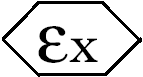

Príloha č. 2 k nariadeniu vlády č. 117/2001 Z. z.

- PODROBNOSTI O TECHNICKÝCH POŽIADAVKÁCH NA ZARIADENIA, OCHRANNÉ SYSTÉMY A PRÍSTROJE

  - Úvod

  - A. Pri technických požiadavkách sa berú do úvahy technické poznatky, ktoré sa môžu rýchlo meniť, operatívne sa zohľadňujú a bezodkladne využívajú.

  - B. Technické požiadavky sa vzťahujú na prístroje iba v tom rozsahu, v ktorom je prístroj určený na zaistenie bezpečnej a spoľahlivej funkcie a prevádzky ochranných systémov z hľadiska nebezpečenstva výbuchu.

    - 1. Spoločné požiadavky na zariadenia a ochranné systémy

    - 1.0 Všeobecné požiadavky

    - 1.0.1 Princípy komplexného zabezpečenia proti výbuchu

      - Zariadenia a ochranné systémy určené na použitie v prostredí s nebezpečenstvom výbuchu sa konštruujú z hľadiska komplexnej bezpečnosti proti výbuchu, na čo sa prijímajú tieto opatrenia:

      - a) ak je to možné, zabrániť vzniku výbušnej atmosféry, ktorá sa môže vytvárať v samotnom zariadení alebo v ochranných systémoch alebo z nich unikať,

      - b) predchádzať iniciácii výbušnej atmosféry pri zohľadnení vlastností všetkých elektrických a neelektrických zdrojov iniciácie,

      - c) ak je napriek tomu pravdepodobný vznik výbuchu, ktorý môže priamo alebo nepriamo ohroziť osoby alebo majetok, prijať opatrenia na okamžité potlačenie výbuchu alebo na obmedzenie rozsahu účinku plameňov a tlaku z výbuchu na zodpovedajúcu úroveň bezpečnosti.

    - 1.0.2 Systémy sa zhotovujú po primeranej analýze možných porúch v prevádzke tak, aby sa, ak je to možné, vylúčili nebezpečné situácie. Každé nesprávne použitie, ktoré možno predvídať, sa berie do úvahy.

    - 1.0.3 Osobitné preskúšania a podmienky údržby

      - Zariadenia a ochranné systémy, ktoré podliehajú osobitným podmienkam preskúšania a údržby, sa zhotovujú s ohľadom na tieto podmienky.

    - 1.0.4 Vonkajšie podmienky

      - Zariadenia a ochranné systémy sa zhotovujú tak, aby boli schopné odolávať skutočným a rozumovo predvídateľným vonkajším podmienkam.

    - 1.0.5 Označovanie

      - Na všetkých zariadeniach a ochranných systémoch sa vyznačia čitateľne a trvalo tieto údaje:

      - a) meno a priezvisko fyzickej osoby alebo obchodné meno právnickej osoby, ktorá je výrobcom, a jej sídlo,

      - b) označenie CE podľa § 21 zákona alebo slovenskej značky zhody podľa § 17 ods. 3 zákona,

      - c) označenie série alebo typu,

      - d) sériové číslo, ak existuje,

      - e) rok výroby,

      - f) špecifické označenie ochrany proti výbuchu doplnené symbolom skupiny a kategóriou zariadenia,

      - g) na zariadeniach skupiny II písmeno „G“ (pre výbušnú atmosféru zloženú z plynov, pár alebo hmly) alebo písmeno „D“ (pre výbušnú atmosféru tvorenú prachom), alebo obidve písmená.

        - Ak je to nevyhnutné, taktiež sa vyznačia všetky informácie dôležité na bezpečné používanie zariadenia alebo ochranného systému.

    - 1.0.6 Návod na obsluhu

      - a) S každým zariadením a ochranným systémom sa dodá návod na obsluhu, ktorý obsahuje najmä tieto informácie:

    - 1. zopakovanie informácií, ktorými sú zariadenia alebo ochranné systémy označené, s výnimkou sériového čísla (1.0.5), spolu s akýmikoľvek vhodnými doplnkovými informáciami na uľahčenie údržby, napríklad adresou opravárenskej organizácie,

    - 2. návod na bezpečné uvedenie do prevádzky, používanie, montáž a demontáž, údržbu, servis a odstraňovanie porúch, inštaláciu, nastavovanie,

    - 3. ak je to nutné, vyznačenie ohrozeného priestoru pred zariadením na uvoľnenie tlaku,

    - 4. ak je to nutné, návod na zaškolenie,

    - 5. podrobnosti, ktoré umožnia bez akýchkoľvek pochybností rozhodnúť, či dané zariadenie stanovenej kategórie alebo ochranný systém možno bezpečne použiť v uvažovanom priestore pri očakávaných prevádzkových podmienkach,

    - 6. elektrické a tlakové parametre, najväčšiu povrchovú teplotu a ďalšie medzné hodnoty,

    - 7. ak je to nutné, špeciálne podmienky použitia vrátane podrobností o nevhodnom použití na iné než určené účely, ku ktorému podľa získaných skúseností môže dôjsť,

    - 8. ak je to nutné, základné vlastnosti náradia, ktoré je pre zariadenie alebo ochranný systém vhodné.

      - b) Návod na obsluhu sa vypracúva v štátnom jazyku alebo v jednom z úradných jazykov členských štátov Európskych spoločenstiev.

        - Návod na obsluhu sa pred uvedením do prevádzky pri všetkých dovážaných zariadeniach a ochranných systémoch preloží do štátneho jazyka alebo do jedného z úradných jazykov členských štátov Európskych spoločenstiev. Preklad vykoná výrobca alebo dovozca.

      - c) Návod obsahuje výkresy a diagramy nevyhnutné na uvedenie do prevádzky, údržbu, inšpekciu, kontrolu správneho chodu, a ak je to vhodné, na opravy zariadení alebo ochranného systému spolu so všetkými vhodnými návodmi, hlavne z hľadiska bezpečnosti.

      - d) Žiadna obchodná literatúra priložená k zariadeniu alebo k ochrannému systému opisujúca zariadenie alebo ochranný systém nie je v rozpore s návodom opisujúcim bezpečnostné hľadiská.

    - 1.1 Výber materiálov

    - 1.1.1 Materiály použité na konštrukciu zariadení a ochranných systémov nespôsobujú výbuch pri predvídanom prevádzkovom namáhaní.

    - 1.1.2 V rozsahu prevádzkových podmienok určených výrobcom nevznikajú reakcie použitého materiálu so zložkami potenciálne výbušného prostredia, ktoré môžu narušiť ochranu proti výbuchu.

    - 1.1.3 Materiály sa vyberajú tak, aby predvídateľné zmeny ich vlastností a ich zlučiteľnosť s inými materiálmi neviedli k zníženiu poskytovanej ochrany; pozornosť sa venuje hlavne koróznym vlastnostiam materiálov, odolnosti proti opotrebovaniu, elektrickej vodivosti, mechanickej pevnosti, odolnosti proti starnutiu, účinkom teploty a zmien teploty.

    - 1.2 Návrh a konštrukcia

    - 1.2.1 Zariadenia a ochranné systémy sa zhotovujú s ohľadom na technické vedomosti v oblasti ochrany proti výbuchu tak, že môžu byť bezpečne prevádzkované počas celého predpokladaného obdobia ich životnosti.

    - 1.2.2 Súčasti určené na vkladanie alebo na použitie ako výmenné časti na zariadenia a ochranné systémy sa zhotovujú tak, že po ich inštalácii podľa návodu výrobcu bezpečne plnia funkciu ochrany proti výbuchu.

    - 1.2.3 Uzavreté konštrukcie a zabránenie úniku

      - Zariadenie, ktoré môže uvoľňovať horľavé plyny alebo prachy, využíva prednostne uzatvorené konštrukcie.

      - Ak sú v zariadení otvory alebo netesné spoje, prednostne sa zhotovujú takým spôsobom, že unikajúce plyny alebo prach nevytvoria mimo zariadenia výbušnú atmosféru.

      - Miesta, do ktorých je materiál privádzaný alebo z ktorých je odoberaný, prednostne sa zhotovujú a zabezpečujú tak, že je pri plnení alebo vypúšťaní obmedzený únik horľavých látok.

    - 1.2.4 Usadzovanie prachu

      - Zariadenia a ochranné systémy, ktoré sú určené na použitie v prašnom prostredí, sa zhotovujú tak, že sa usadený prach na ich povrchu nemôže vznietiť.

      - Všeobecne je tam, kde je to možné, obmedzené usadzovanie prachu. Zariadenia a ochranné systémy sa ľahko čistia.

      - Povrchová teplota častí zariadení sa udržiava dostatočne nízko pod teplotou vznietenia usadeného prachu.

      - Do úvahy sa berie hrúbka vrstvy usadeného prachu, a ak je to potrebné na zabránenie prehrievaniu, vykonajú sa opatrenia na obmedzenie teploty.

    - 1.2.5 Doplnkové ochranné prostriedky

      - Zariadenia a ochranné systémy, ktoré sú vystavené určitému typu vonkajšieho namáhania, vybavia sa, ak je to nutné, doplnkovými ochrannými prostriedkami.

      - Zariadenie vydrží príslušné namáhanie bez nepriaznivých účinkov na ochranu proti výbuchu.

    - 1.2.6 Bezpečné otváranie

      - Ak sú zariadenia a ochranné systémy umiestnené v kryte alebo v zabezpečenom puzdre tvoriacom časť samotnej ochrany proti výbuchu, tento kryt alebo puzdro možno otvoriť len pomocou špeciálneho náradia alebo vhodných ochranných prostriedkov.

    - 1.2.7 Ochrana proti iným nebezpečenstvám

      - Zariadenia a ochranné systémy sa vyrobia tak, aby bolo

      - a) vylúčené akékoľvek poranenie, ktoré môže nastať v dôsledku priameho alebo nepriameho dotyku,

      - b) zabezpečené, že na prístupných častiach nevzniká povrchová teplota alebo sálanie, ktoré môže spôsobiť nebezpečenstvo,

      - c) vylúčené neelektrické nebezpečenstvo, ktoré podľa skúseností môže vzniknúť,

      - d) zabezpečené, že pri predvídateľných podmienkach preťaženia nevznikne nebezpečná situácia.

        - Ak sa na nebezpečenstvá uvedené v tomto bode pri zariadeniach a ochranných systémoch vzťahujú úplne alebo čiastočne iné technické predpisy vydané na vykonanie zákona, potom sa toto nariadenie nevzťahuje na tie zariadenia a ochranné systémy a na tie nebezpečenstvá, na ktoré sa vzťahujú tieto iné technické predpisy.

    - 1.2.8 Preťaženie zariadenia

      - Zariadenie sa vyrobí tak, aby zabránilo preťaženiu zariadenia pomocou využitia meracích, regulačných a ovládacích prístrojov, ako sú nadprúdové ističe, teplotné obmedzovače, diferenciálne tlakové vypínače, regulátory prietokov, časové relé, obmedzovače rýchlosti alebo podobné typy monitorovacích prístrojov.

    - 1.2.9 Systémy v nevýbušnom kryte

      - Ak sú časti, ktoré môžu zapáliť výbušnú atmosféru, umiestnené v kryte, vykonajú sa také opatrenia, ktoré zabezpečia, že kryt vydrží tlak vznikajúci pri explózii výbušnej zmesi vnútri a zabráni preneseniu explózie do výbušnej atmosféry obklopujúcej kryt.

    - 1.3 Potenciálny iniciačný zdroj

    - 1.3.1 Nebezpečenstvo spôsobené rôznymi iniciačnými zdrojmi

      - Potenciálne iniciačné zdroje, ako sú iskry, plamene, elektrické oblúky, vysoké povrchové teploty, akustická energia, žiarenie vo viditeľnom spektre, elektromagnetické vlny a iné iniciačné zdroje, sú vylúčené.

    - 1.3.2 Nebezpečenstvo spôsobené statickou elektrinou

      - Vzniku elektrostatických nábojov schopných vytvárať nebezpečné výboje sa zabráni vhodnými prostriedkami.

    - 1.3.3 Nebezpečenstvo spôsobené blúdivými a zvodovými elektrickými prúdmi

      - V elektricky vodivých častiach zariadení sa zabráni vzniku blúdivých a zvodových prúdov, ktoré môžu viesť napríklad k vzniku nebezpečnej korózie, prehriatiu povrchu alebo iskier schopných spôsobiť iniciáciu.

    - 1.3.4 Nebezpečenstvo spôsobené prehriatím

      - Už pri konštrukcii, ak je to možné, sa zabráni prehriatiu spôsobenému trením alebo nárazmi, napríklad medzi materiálmi a časťami vzájomne sa stýkajúcimi pri otáčaní, alebo vnikaniu cudzích telies.

    - 1.3.5 Nebezpečenstvo spôsobené vyrovnávaním tlaku

      - Zariadenia alebo ochranné systémy sa vyrobia alebo vybavia zabudovaným meracím, ovládacím a regulačným zariadením tak, aby pri vyrovnávaní tlaku v dôsledku ich činnosti nevznikla žiadna rázová vlna alebo stlačenie, ktoré môžu spôsobiť iniciáciu.

    - 1.4 Nebezpečenstvo spôsobené vonkajšími vplyvmi

    - 1.4.1 Zariadenia a ochranné systémy sa vyrobia tak, aby boli schopné vykonávať svoju určenú funkciu pri úplnej bezpečnosti aj v meniacich sa okolitých podmienkach, pod vplyvom rušivých napätí, vo vlhkosti, pri vibráciách, znečistení a pri iných vonkajších vplyvoch v rozsahu prevádzkových podmienok určených výrobcom.

    - 1.4.2 Použité časti zariadenia sú vhodné na predpokladané mechanické a tepelné namáhanie a sú schopné odolať existujúcim alebo očakávaným vplyvom agresívnych látok.

    - 1.5 Požiadavky na bezpečnostné prístroje

    - 1.5.1 Bezpečnostné prístroje pracujú nezávisle od akéhokoľvek meracieho a/alebo ovládacieho a regulačného zariadenia potrebného na prevádzku.

      - Porucha bezpečnostného prístroja je detegovaná vhodnými technickými prostriedkami čo najskôr tak, že sa zníži pravdepodobnosť vzniku nebezpečnej situácie.

      - Všeobecne sa používa princíp uvedenia do bezpečného stavu v prípade poruchy.

      - Bezpečnostné vypínanie všeobecne pôsobí bez prostredníctva softvérových povelov priamo na zodpovedajúci ovládací prístroj.

    - 1.5.2 V prípade poruchy bezpečnostného prístroja zostanú zariadenia alebo ochranné systémy, ak je to možné, uvedené do bezpečného stavu.

    - 1.5.3 Núdzové vypínacie ovládače bezpečnostných prístrojov sa vybavia, ak je to možné, blokovaním proti opätovnému zapnutiu. Nový povel na obnovenie normálnej prevádzky sa vydá iba po úmyselnom odstavení blokovania proti opätovnému zapnutiu.

    - 1.5.4 Ovládacie a zobrazovacie jednotky

      - Ak sa použijú ovládacie a zobrazovacie jednotky, musia byť vyrobené v súlade s ergonometrickými princípmi tak, že je dosiahnutá najvyššia možná úroveň prevádzkovej bezpečnosti z hľadiska nebezpečenstva výbuchu.

    - 1.5.5 Požiadavky na prístroje s meracou funkciou na ochranu proti výbuchu

      - Prístroje s meracou funkciou, ktoré vplývajú na zariadenia, sa vyrobia tak, že zvládajú všetky predvídateľné prevádzkové požiadavky a špeciálne podmienky použitia.

    - 1.5.6 Ak je to nutné, možno vykonať kontrolu presnosti čítania údajov a prevádzkyschopnosti prístrojov s meracou funkciou.

    - 1.5.7 Návrh prístrojov s meracou funkciou ráta s bezpečnostným koeficientom, ktorý zabezpečí, že výstražný prah leží dostatočne ďaleko mimo dolnej medze výbušnosti alebo zápalnosti atmosféry, ktorú zariadenie registruje, predovšetkým s ohľadom na prevádzkové podmienky inštalácie a možnosti odchýlok meracieho systému.

    - 1.5.8 Nebezpečenstvo spôsobené softvérom

      - Pri zariadení, ochrannom systéme alebo bezpečnostných prístrojoch riadených softvérom sa venuje osobitná pozornosť analýze rizika vznikajúceho pri poruchách programu.

    - 1.6 Bezpečnostné požiadavky na systémy

    - 1.6.1 Ručným vypnutím možno odstaviť zariadenie alebo ochranný systém automatického procesu, ak sa odchyľuje od bežných prevádzkových podmienok a ak to neohrozí bezpečnosť.

    - 1.6.2 Ak sa do činnosti uvedie núdzový vypínací systém, nahromadená energia sa čo najrýchlejšie a najbezpečnejšie zníži alebo izoluje tak, aby bola bezpečná. To neplatí pre elektrochemicky viazanú energiu.

    - 1.6.3 Nebezpečenstvo spôsobené poruchou napájania

      - Zariadenia a ochranné systémy, pri ktorých porucha napájania môže mať za následok vznik ďalšieho nebezpečenstva, sa zabezpečujú tak, že možno udržať ich bezpečný prevádzkový stav nezávisle od zvyšku inštalácie.

    - 1.6.4 Nebezpečenstvo spôsobené spojmi

      - Zariadenia a ochranné systémy majú vhodné káblové vývodky a vývodky na rúrkové vedenie.

      - Ak sú zariadenia a ochranné systémy určené na použitie v kombinácii s iným zariadením a ochrannými systémami, urobí sa ich prepojenie bezpečným spôsobom.

    - 1.6.5 Umiestnenie výstražných prístrojov ako súčasti zariadení

      - Ak sú zariadenia alebo ochranné systémy vybavené prístrojmi na detekciu alebo výstražnými prístrojmi na kontrolu prítomnosti výbušnej atmosféry, dodajú sa potrebné návody na zabezpečenie umiestnenia týchto prístrojov na vhodnom mieste.

    - 2. Doplnkové požiadavky na zariadenia

    - 2.0 Požiadavky na zariadenia kategórie M skupiny I

    - 2.0.1 Požiadavky na zariadenia kategórie M1 skupiny I

    - 2.0.1.1 Zariadenie sa zhotovuje tak, aby iniciačné zdroje neboli aktívne ani v prípade výnimočných udalostí týkajúcich sa zariadení.

      - Zariadenie sa vybaví ochrannými prostriedkami tak, aby

      - a) v prípade poruchy jedného z prostriedkov ochrany zabezpečoval druhý nezávislý prostriedok dostatočnú úroveň ochrany alebo

      - b) dostatočná úroveň ochrany sa zabezpečí aj v prípade vzniku dvoch vzájomne nezávislých porúch.

        - Ak je to nutné, toto zariadenie sa zabezpečí dodatočným špeciálnym ochranným prostriedkom. Zariadenie zostane funkčné aj v prítomnosti výbušnej atmosféry.

    - 2.0.1.2 Zariadenie, ak je to potrebné, sa zhotoví tak, aby do jeho vnútra nemohol preniknúť žiaden prach.

    - 2.0.1.3 Na zabránenie vznieteniu zvíreného prachu sa udržiava povrchová teplota častí zariadení dostatočne nízko pod teplotou vznietenia predpokladanej prachovo-vzdušnej zmesi.

    - 2.0.1.4 Zariadenie sa vyrobí tak, že sa otváranie častí zariadenia, ktoré môžu byť zdrojom iniciácie, môže vykonať len v beznapäťovom stave alebo pri iskrovo bezpečných podmienkach. Tam, kde nemožno uviesť zariadenie do beznapäťového stavu, umiestni sa výstražný nápis na otváranú časť zariadenia. Ak je to potrebné, vybaví sa zariadenie vhodným dodatočným blokovacím systémom.

    - 2.0.2 Požiadavky na zariadenia kategórie M2 skupiny I

    - 2.0.2.1 Zariadenie sa vybaví ochrannými prostriedkami zabezpečujúcimi, aby sa zdroje iniciácie nemohli stať aktívnymi pri normálnej prevádzke, pri nepriaznivých prevádzkových podmienkach, ktoré vznikajú hlavne pri hrubom zaobchádzaní a zmenách okolitých podmienok. Zariadenie sa vypne v prípade prítomnosti výbušnej atmosféry.

    - 2.0.2.2 Zariadenie sa zhotoví tak, že možno otvoriť časti zariadení, ktoré môžu byť zdrojom iniciácie, iba v beznapäťovom stave alebo pomocou vhodných blokovacích mechanizmov. Ak nemožno zariadenie uviesť do beznapäťového stavu, umiestni sa na otvárateľnú časť zariadení výstražný štítok.

    - 2.0.2.3 Požiadavky, ktoré sa týkajú nebezpečenstva výbuchu prachu a ktoré sú uvedené pre zariadenia kategórie M1, uplatnia sa aj pre kategóriu M2.

    - 2.1 Požiadavky na kategóriu 1 skupiny zariadení II

    - 2.1.1 Výbušná atmosféra tvorená plynmi, parami alebo hmlami

    - 2.1.1.1 Zariadenie sa zhotoví tak, aby sa zdroje iniciácie nemohli stať aktívnymi ani v prípade výnimočných udalostí týkajúcich sa zariadení. Zariadenie sa vybaví ochrannými prostriedkami tak, aby

      - a) v prípade poruchy jedného z prostriedkov ochrany zabezpečoval ďalší nezávislý prostriedok dostatočnú úroveň ochrany alebo

      - b) dostatočnú úroveň ochrany sa zabezpečil aj v prípade vzniku dvoch vzájomne nezávislých porúch.

    - 2.1.1.2 Pri zariadeniach s povrchmi, kde je pravdepodobnosť ohrevu, vykonajú sa také opatrenia, že určené najväčšie povrchové teploty sa neprekročia ani v najnepriaznivejších podmienkach. V tejto súvislosti sa berie do úvahy aj oteplenie spôsobené zahrievaním a chemickými reakciami.

    - 2.1.1.3 Zariadenie sa zhotoví tak, aby sa otváranie častí zariadenia, ktoré môžu byť zdrojom iniciácie, vykonalo len v stave pokoja alebo pri iskrovo bezpečných podmienkach. Ak nemožno zariadenie uviesť do stavu pokoja, upevní sa na otvárateľnú časť zariadenia výstražný štítok. Ak je to nutné, vybavia sa zariadenia vhodnými dodatočnými blokovacími systémami.

    - 2.1.2 Výbušná atmosféra tvorená prachovo-vzdušnou zmesou

    - 2.1.2.1 Zariadenie sa zhotoví tak, aby nedošlo k iniciácii prítomnej prachovo-vzdušnej zmesi ani v prípade výnimočných udalostí týkajúcich sa zariadení. Zariadenie sa vybaví ochrannými prostriedkami tak, aby

      - a) v prípade poruchy jedného z prostriedkov ochrany zabezpečil ďalší nezávislý prostriedok dostatočnú úroveň ochrany alebo

      - b) dostatočná úroveň ochrany sa zabezpečí aj v prípade vzniku dvoch vzájomne nezávislých porúch.

    - 2.1.2.2 Ak je to potrebné, zhotoví sa zariadenie tak, aby prach mohol vstupovať do zariadenia alebo z neho unikať len v špeciálne na to navrhnutých miestach. Túto požiadavku spĺňajú tiež káblové vývodky a pripojovacie diely.

    - 2.1.2.3 Na zabránenie vznietenia rozvíreného prachu sa udržiava povrchová teplota častí zariadenia dostatočne nízko pod teplotou vznietenia predpokladanej prachovo-vzdušnej zmesi.

    - 2.1.2.4 Na bezpečné otváranie častí zariadenia sa vzťahujú požiadavky uvedené v bode 2.1.1.3.

    - 2.2 Požiadavky na kategóriu 2 skupiny II

    - 2.2.1 Výbušná atmosféra tvorená plynmi, parami alebo hmlami

    - 2.2.1.1 Zariadenie sa zhotoví tak, aby sa zabránilo vzniku iniciačných zdrojov, dokonca aj v prípade často vznikajúcich porúch alebo prevádzkových chýb zariadenia, ktoré sa predpokladajú.

    - 2.2.1.2 Časti zariadenia sa zhotovia tak, aby sa ich stanovené najvyššie povrchové teploty neprekročili ani v prípade nebezpečenstva vznikajúceho v abnormálnych situáciách predvídaných výrobcom.

    - 2.2.1.3 Zariadenie sa zhotoví tak, aby sa otváranie častí zariadenia, ktoré môžu byť zdrojom iniciácie, vykonalo len za beznapäťového stavu alebo pomocou vhodných blokovacích systémov. Ak nemožno zariadenie uviesť do beznapäťového stavu, na otvárateľnú časť zariadenia sa umiestni výstražný štítok.

    - 2.2.2 Výbušná atmosféra tvorená prachovo-vzdušnou zmesou

    - 2.2.2.1 Zariadenie sa zhotoví tak, aby nedošlo k iniciácii prítomnej prachovo-vzdušnej zmesi ani v prípade často vznikajúcich porúch alebo prevádzkových chýb zariadenia, s ktorými sa bežne ráta.

    - 2.2.2.2 Na povrchové teploty sa vzťahujú požiadavky bodu 2.1.2.3.

    - 2.2.2.3 Na ochranu proti prachu sa vzťahuje požiadavka bodu 2.1.2.2.

    - 2.2.2.4 Na bezpečné otváranie častí zariadenia sa vzťahuje požiadavka bodu 2.2.1.3.

    - 2.3 Požiadavky na kategóriu 3 skupiny II

    - 2.3.1 Výbušná atmosféra tvorená plynmi, parami alebo hmlami

    - 2.3.1.1 Zariadenie sa zhotoví tak, aby sa zabránilo vzniku iniciačných zdrojov, ktoré môžu vznikať pri normálnej prevádzke.

    - 2.3.1.2 Pri predpokladaných prevádzkových podmienkach neprekročia povrchové teploty ustanovenú najväčšiu povrchovú teplotu. Väčšie teploty môžu byť vo výnimočných prípadoch dovolené len za predpokladu uplatnenia špeciálnych dodatočných ochranných prostriedkov.

    - 2.3.2 Výbušná atmosféra tvorená prachovo-vzdušnou zmesou

    - 2.3.2.1 Zariadenie sa zhotoví tak, aby nemohlo dôjsť k iniciácii prachovo-vzdušnej zmesi iniciačnými zdrojmi, ktorých vznik je pravdepodobný v normálnych prevádzkových podmienkach.

    - 2.3.2.2 Na povrchové teploty sa vzťahujú požiadavky uvedené v bode 2.1.2.3.

    - 2.3.2.3 Zariadenie vrátane káblových vývodiek a spojovacích dielov sa zhotoví tak, aby prach s ohľadom na veľkosť jeho častíc nemohol vnútri zariadenia vytvárať výbušnú prachovo-vzdušnú zmes ani nebezpečné vrstvy usadeného prachu.

    - 3. Doplnkové požiadavky na ochranné systémy

    - 3.0 Všeobecné požiadavky

    - 3.0.1 Ochranné systémy sa dimenzujú tak, aby obmedzovali účinky výbuchu na zodpovedajúcu úroveň bezpečnosti.

    - 3.0.2 Ochranné systémy sa zhotovia tak, aby umožňovali také umiestnenie, že možno zabrániť rozvinutiu výbuchu do nebezpečných reťazových reakcií alebo rozšírenia plameňa a potlačiť prechod z počiatočného štádia výbuchu do detonácie.

    - 3.0.3 Na zabránenie nebezpečným situáciám si ochranné systémy v prípade poruchy napájania zachovávajú príslušný čas funkčnú schopnosť.

    - 3.0.4 Ochranné systémy nezlyhajú vplyvom vonkajších rušivých vplyvov.

    - 3.1 Projektovanie a konštruovanie

    - 3.1.1 Vlastnosti materiálov

      - Pri určovaní vlastností materiálov sa pre najväčší tlak a teplotu uvažuje s predpokladaným tlakom počas výbuchu vznikajúcim v extrémnych prevádzkových podmienkach a s predpokladanými tepelnými účinkami plameňa.

    - 3.1.2 Ochranný systém sa projektuje tak, aby odolal alebo zachytil výbuchy a odolal očakávanej tlakovej vlne bez straty funkčnosti systému.

    - 3.1.3 Príslušenstvo pripojené k ochranným systémom odolá očakávanému najväčšiemu tlaku výbuchu bez straty funkčnej schopnosti.

    - 3.1.4 Pri projektovaní a konštruovaní ochranných systémov sa berú do úvahy reakcie spôsobené tlakmi v prídavných zariadeniach a pripojených potrubiach.

    - 3.1.5 Ochranné systémy na uvoľnenie tlaku

      - Ak je pravdepodobné, že namáhanie ochranných systémov prekročí ich konštrukčnú pevnosť, použije sa v projekte vhodný prostriedok na uvoľnenie tlaku, ktorý neohrozí osoby v blízkosti.

    - 3.1.6 Ochranné systémy na potlačenie výbuchu

      - Ochranné systémy na potlačenie výbuchu zabezpečia, aby pri iniciácii reagovali na vznikajúci výbuch v čo najskoršom štádiu a čo najlepšie potlačili výbuch z hľadiska najvyššej rýchlosti nárastu tlaku a najvyššieho tlaku výbuchu.

    - 3.1.7 Ochranné systémy na oddelenie výbuchu

      - Ochranné systémy na oddelenie výbuchu, ktoré čo najrýchlejšie oddelia určené zariadenie v počiatočnom štádiu výbuchu pomocou zodpovedajúcich prístrojov, sa projektujú a konštruujú tak, že v prevádzkových podmienkach zostanú bezpečné proti preneseniu vnútorného výbuchu a uchovajú si mechanickú pevnosť.

    - 3.1.8 Ochranné systémy sa môžu zapojiť do obvodu s vhodnou výstražnou medzou tak, aby došlo, ak je to nutné, k prerušeniu dodávky a výstupu produktu a k okamžitému uzatvoreniu tých častí zariadení, ktoré už ďalej nemôžu bezpečne fungovať.
