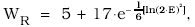
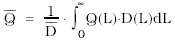

- 1) § 2 ods. 13 zákona Národnej rady Slovenskej republiky č. 272/1994 Z. z. o ochrane zdravia ľudí v znení zákona č. 470/2000 Z. z.

- 2) § 17a ods. 4 písm. c) zákona Národnej rady Slovenskej republiky č. 272/1994 Z. z. v znení zákona č. 470/2000 Z. z.

- 3) Zákon Národnej rady Slovenskej republiky č. 277/1994 Z. z. o zdravotnej starostlivosti v znení neskorších predpisov.

- 4) Zákon č. 90/1998 Z. z. o stavebných výrobkoch v znení neskorších predpisov.

- 5) § 43c zákona č. 50/1976 Zb. o územnom plánovaní a stavebnom poriadku (stavebný zákon) v znení zákona č. 237/2000 Z. z.

- 6) § 43b zákona č. 50/1976 Zb. v znení zákona č. 237/2000 Z. z.

- 7) § 17e ods. 2 zákona Národnej rady Slovenskej republiky č. 272/1994 Z. z. v znení zákona č. 470/2000 Z. z.

- 8) § 17s zákona Národnej rady Slovenskej republiky č. 272/1994 Z. z. v znení zákona č. 470/2000 Z. z.

- 9) § 17f ods. 2 a 4 zákona Národnej rady Slovenskej republiky č. 272/1994 Z. z. v znení zákona č. 470/2000 Z. z.

- 10) § 17f ods. 3 zákona Národnej rady Slovenskej republiky č. 272/1994 Z. z. v znení zákona č. 470/2000 Z. z.

- 11) § 18 ods. 1 písm. a) a b) zákona Národnej rady Slovenskej republiky č. 272/1994 Z. z. v znení zákona Národnej rady Slovenskej republiky č. 222/1996 Z. z.

- 12) § 22 ods. 3 zákona Národnej rady Slovenskej republiky č. 272/1994 Z. z. v znení zákona č. 470/2000 Z. z.

- 13) § 17r ods. 1 zákona Národnej rady Slovenskej republiky č. 272/1994 Z. z. v znení zákona č. 470/2000 Z. z.

- 14) § 2 ods. 24 zákona Národnej rady Slovenskej republiky č. 272/1994 Z. z. v znení zákona č. 470/2000 Z. z.

- 15) § 2 ods. 10 zákona Národnej rady Slovenskej republiky č. 272/1994 Z. z. v znení zákona č. 470/2000 Z. z.

- 16) § 17d a 17e zákona Národnej rady Slovenskej republiky č. 272/1994 Z. z. v znení zákona č. 470/2000 Z. z.

- 17) § 2 ods. 23 zákona Národnej rady Slovenskej republiky č. 272/1994 Z. z. v znení zákona č. 470/2000 Z. z.

- 18) § 2 ods. 21 zákona Národnej rady Slovenskej republiky č. 272/1994 Z. z. v znení zákona č. 470/2000 Z. z.

- 19) § 17h ods. 6 zákona Národnej rady Slovenskej republiky č. 272/1994 Z. z. v znení zákona č. 470/2000 Z. z.

- 20) § 17n ods. 6 zákona Národnej rady Slovenskej republiky č. 272/1994 Z. z. v znení zákona č. 470/2000 Z. z.

- 21) § 16 zákona Národnej rady Slovenskej republiky č. 277/1994 Z. z. v znení zákona č. 80/2000 Z. z.

- 22) STN 01 8012 Bezpečnostné znaky a tabuľky.

- 23) § 17g zákona Národnej rady Slovenskej republiky č. 272/1994 Z. z. v znení zákona č. 470/2000 Z. z.

- 24) § 3 ods. 4 písm. n) vyhlášky Úradu jadrového dozoru Slovenskej republiky č. 245/1999 Z. z. o havarijnom plánovaní pre prípad nehody alebo havárie.

- 1) STN 01 0104 Teória pravdepodobnosti a aplikovaná štatistika. Termíny, definície a označenia.

- 2) STN 73 1001 Zakladanie stavieb. Základová pôda pod plošnými základmi.

- 3) STN 73 6532 Vodné hospodárstvo. Názvoslovie hydrogeológie.

- 1) Radiačný váhový faktor wR vyjadruje rozdielny biologický účinok jednotlivých druhov ionizujúceho žiarenia.

- 2) V odôvodnených prípadoch použitie stupňovitej funkcie pri výpočtoch s neutrónmi možno nahradiť náhradnou funkciou: |

- , kde E je energia neutrónov v MeV. |

- Ak sa radiačné pole skladá z viacerých druhov a energií s rozdielnym WR, absorbovaná dávka sa rozdeľuje do skupín s rovnakými hodnotami WR a potom sa sčítava do celkovej ekvivalentnej dávky, prípadne sa vyjadruje spojitým rozdelením vzhľadom na energiu, pričom sa každý element medzi E a dE násobí príslušnou hodnotou z tabuľky č. 1. Pre druhy žiarenia, ktoré nie sú uvedené v tabuľke č. 1, sa WR zisťuje spočítaním strednej hodnoty faktora kvality v hĺbke 10 mm ICRU sféry (bod 2.2.) vypočítaného takto: |

- , |

- kde D(L)dL je absorbovaná dávka v hĺbke 10 mm v rozmedzí L a L+dL, |

- Q(L) je zodpovedajúci faktor kvality zistený podľa vzťahov uvedených v tabuľke č. 5, |

- L je neobmedzený lineárny prenos energie definovaný ako L = dE/dl, kde dE je stredná strata energie častice s energiou E na dráhe dl vo vode.

- 3) Orgány, ktoré môžu byť s istou pravdepodobnosťou ožiarené selektívne. O niektorých z nich je známe, že môžu byť citlivejšie na vznik nádoru.

- 4) Ostatné orgány a tkanivá na účely výpočtu tkaninových váhových faktorov sú nadobličky, mozog, vzostupná časť hrubého čreva, tenké črevo, obličky, svaly, podžalúdková žľaza, slezina, tymus, maternica.

- 5) Faktor kvality Q vyjadruje rozdielnu biologickú účinnosť jednotlivých druhov ionizujúceho žiarenia.

- 1) Absorpcia v tráviacom ústrojenstve je vyjadrená koeficientom f1 charakterizujúcim v modelových výpočtoch frakciu, ktorá prechádza v tráviacom ústrojenstve do telesných tekutín.

- 2) Absorpcia v pľúcach je vyjadrená typom F, M alebo S charakterizujúcim v modelových výpočtoch rýchlosť, ktorou látka prechádza z pľúc do telesných tekutín (F - rýchlo, M - stredne, S - pomaly), a koeficientom f1 charakterizujúcim frakciu, ktorá prechádza z pľúc do tráviaceho ústrojenstva.

- 1) Na pracovné miesta, na ktorých sa vykonávajú práce s prírodným uránom a tóriom, ochudobneným a obohateným uránom a rádionuklidmi Sm-147, Th-232, U-235 a U-238, sa vzťahujú desaťkrát väčšie hodnoty, ako sú uvedené v tabuľke.

- 2) Konverzné faktory hinh na hodnotenie príjmu vdýchnutím u pracovníkov so zdrojmi ionizujúceho žiarenia sú uvedené v prílohe č. 4.

- 3) Pracovné operácie so suchými pevnými rádioaktívnymi materiálmi, napríklad váženie, delenie, ohrievanie, chov laboratórnych zvierat, s aplikovanými rádionuklidmi.

- 4) Pracovné operácie s rádioaktívnymi materiálmi v roztoku okrem prchavých kvapalín.

- 5) Pracovné operácie s tríciovanými kvapalinami, značenými organickými kvapalinami, roztokmi s rádioaktívnym jódom alebo s inými kvapalinami, pri ktorých je možný vznik rádioaktívnych výparov alebo rádioaktívnej kontaminácie vzduchu.

- 6) Pracovné operácie so suchými pevnými rádioaktívnymi materiálmi, pri ktorých je možný vznik významného množstva respirabilného prachu, napríklad drvenie alebo mletie látok a preosievanie alebo presýpanie suchých prašných materiálov.
