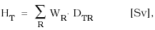
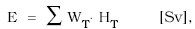
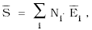
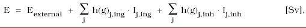
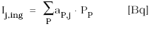

Príloha č. 2 k vyhláške č. 12/2001 Z. z.

- Zásady hodnotenia ožiarenia

  - 1. Vymedzenie veličín používaných pri hodnotení ožiarenia

  - 1.1. Ekvivalentná dávka HT je priemerná absorbovaná dávka v tkanive alebo v orgáne vynásobená príslušnym radiačným váhovým faktorom, ktorého hodnoty sú uvedené v tabuľke č. 1. Ekvivalentná dávka v tkanive alebo orgáne T sa vypočíta takto:

    - 

    - kde

    - DTR je priemerná absorbovaná dávka v tkanive T zo žiarenia R,

    - wR je radiačný váhový faktor.

  - 1.2. Efektívna dávka E je súčtom ekvivalentných dávok HT vo všetkych orgánoch alebo v tkanivách vynásobených príslušným tkanivovým váhovým faktorom wT, ktorého hodnoty sú uvedené v tabuľke č. 2. Efektívna dávka E sa vypočíta takto:

    - 

  - 1.3. Kolektívna efektívna dávka S sa používa na účely kvantifikácie ožiarenia všekych skupín obyvateľstva. Kolektívna efektívna dávka sa vypočíta takto:

    - 

    - kde

    - Ni je počet členov v podskupine obyvateľstva i,

    - Ei je priemerná efektívna dávka v podskupine obyvateľstva i.

  - 1.4. Úväzok ekvivalentnej dávky H(τ) je časový integrál ekvivalentnej dávky v orgáne alebo v tkanive T za čas τ od príjmu rádionuklidu.

  - 1.5. Úväzok efektívnej dávky E(τ) je časový integrál efektívnej dávky za čas τ od príjmu rádionuklidu.

    - Pri výpočte úväzku efektívnej alebo ekvivalentnej dávky sa u osôb starších ako 18 rokov veku počíta s obdobím 50 rokov (τ = 50, H(50), E(50)) a u osôb mladších ako 18 rokov veku s obdobím 70 rokov (τ = 70, H(70), E(70)) od príjmu rádionuklidov.

  - 1.6. Dávkový ekvivalent H je súčin absorbovanej dávky v danom bode tkaniva a faktora kvality Q (tabuľka č. 3).

  - 1.7. Ekvivalentná aktivita rádia je váženym súčtom hmotnostnej aktivity rádia 226, hmotnostnej aktivity thória 232 a hmotnostnej aktivity draslíka 40; určená je vzťahom aRa + 1,25.aTh + 0,086.aK,

  - 1.8. Ekvivalentná objemová aktivita radónu je váženym súčtom objemovej aktivity polónia 218, objemovej aktivity olova 214 a objemovej aktivity bizmutu 214; určená je vzťahom aekv= 0,106.aPo + 0,513.aPb+ + 0,381.aBi.

  - 2. Vymedzenie operačných veličín používaných pri hodnotení vonkajšieho ožiarenia

  - 2.1. Osobný dávkový ekvivalent Hp(d) je dávkový ekvivalent v mäkkých tkanivách v hĺbke d pod stanoveným bodom tela. Jeho jednotkou je sievert.

  - 2.2. Priestorový dávkový ekvivalent H*(d) je dávkový ekvivalent v bode radiačného poľa, ktorý by bol vytvorený zodpovedajúcim rozšíreným a usporiadaným poľom v ICRU sfére v hĺbke d na polomere, ktorý je opačný ako smer poľa. Jeho jednotkou je sievert.

    - Rozšírené a usporiadané pole je pole žiarenia, v ktorom fluencia a jej smerové a energetické rozdelenie sú rovnaké ako v rozšírenom poli, ale fluencia je usporiadaná jedným smerom.

    - Fluencia je podiel dN/da, kde dN je počet častíc, ktoré vstúpia do gule s plochou hlavného rezu da.

    - ICRU sféra je fantóm ľudského tela zavedený Medzinárodnou komisiou pre rádiologické jednotky (ICRU). Pozostáva z tkanivovo ekvivalentného materiálu tvaru gule s priemerom 30 cm, hustotou 1 g.cm-3 a hmotnostným zložením 76,2 % kyslíka, 11,1 % uhlíka, 10,1 % vodíka a 2,6 % dusíka.

  - 2.3. Smerovy dávkovy ekvivalent H'(d,Ω) je dávkový ekvivalent v bode radiačného poľa, ktorý by bol vytvorený zodpovedajúcim rozšíreným poľom v ICRU sfére v hĺbke d v stanovenom smere poľa Ω. Jeho jednotkou je sievert.

    - Rozšírené pole je pole odvodené zo skutočného poľa, pričom fluencia a jej smerové a energetické rozloženie majú rovnaké hodnoty v celom danom objeme, aké má skutočné pole v referenčnom bode.

  - 3. Hodnotenie vonkajšieho a vnútorného ožiarenia

  - 3.1. Pri vonkajšom ožiarení ekvivalentnej dávke v každom orgáne s vynimkou kože zodpovedá hĺbkový osobný dávkový ekvivalent Hp(10), ekvivalentnej dávke v koži povrchový osobný dávkový ekvivalent Hp(0,07).

    - Ak ide o nerovnomerné ožiarenie, pre ekvivalentnú dávku v koži sa berie do úvahy priemer z plochy 1 cm2 kože v najviac ožiarenej oblasti. Ekvivalentnej dávke v očnej šošovke zodpovedá osobný dávkový ekvivalent Hp(3) v hĺbke 3 mm.

  - 3.2. Limity efektívnej dávky (E) sa vzťahujú na súčet efektívnej dávky z vonkajšieho ožiarenia a úväzkov efektívnej dávky z jednotlivych príjmov rádioaktívnej látky v kalendárnom roku zo všetkych zdrojov ionizujúceho žiarenia, ktorým sú vystavení pracovníci so zdrojmi ionizujúceho žiarenia a obyvatelia.

    - Efektívna dávka sa vypočíta takto:

    - 

    - kde

    - Eexternal je príslušná efektívna dávka z vonkajšieho ožiarenia,

    - Ij,ing je príjem rádionuklidu j potravou za rok,

    - Ij,inh je príjem rádionuklidu j dychaním za rok,

    - h(g)j,ing je konverzný faktor na výpočet úväzku efektívnej dávky príjmu rádionuklidu j potravou pre rôzne vekové skupiny g,

    - h (g)j,inh je konverzný faktor na výpočet úväzku efektívnej dávky z príjmu rádionuklidu j vdýchnutím pre rôzne vekové skupiny g.

    - Konverzné faktory na hodnotenie príjmu rádionuklidov sú uvedené v prílohe č. 4.

  - 3.2.1. Príjem rádionuklidov potravou Ij,ing sa vypočíta takto:

    - 

    - kde

    - aP,j je priemerná ročná merná aktivita j-tého rádionuklidu v potravine P a vode [Bq/kg, resp. Bq/l],

    - PPje spotreba potravy P v jednom roku [kg].

    - Ročná spotreba potravín sa určuje zo štatistických prehľadov osobitne pre jednotlivé vekové kategórie.

  - 3.2.2. Príjem rádionuklidov vdýchnutím Ij,inh sa vypočíta takto:

    - Ij,inh = av,j . B [Bq],

    - kde

    - aV,j je priemerná ročná merná aktivita j-tého rádionuklidu vo vzduchu [Bq.m-3],

    - B je množstvo vdýchovaného vzduchu v jednom roku [m3.rok-1].

    - Hodnoty množstva vdýchovaného vzduchu pre jednotlivé skupiny osôb sú uvedené v tabuľke č. 4.

  - 3.2.3. Ožiarenie spôsobené produktmi rádioaktívnej premeny 222Rn a 220Rn sa hodnotí na základe ich príjmu a expozície. Limitom ožiarenia zodpovedajú hodnoty príjmu a expozície produktmi rádioaktívnej premeny 222Rn a 220Rn uvedené v tabuľke č. 5.

    - Objemová aktivita radónu 1 Bq.m-3 pri faktore rovnováhy 0,4 a ročnom pracovnom čase 2000 hodín zodpovedá expozícii latentnej energie alfa žiarenia 4,45.10-3 mJ.h.m-3.

    - Expozícii latentnej energie alfa žiarenia 1 mJ.h.m-3 pri faktore rovnováhy 0,4 a ročnom pracovnom čase 2000 hodín zodpovedá efektívna dávka 1,4 mSv pre pracovníka so zdrojmi žiarenia.

    - Produkty rádioaktívnej premeny 222Rn (krátko žijúce): 218Po, 214Bi, 214Pb, 214Po.

    - Produkty rádioaktívnej premeny 220Rn (krátko žijúce): 216Po, 212Pb, 212Bi, 212Po a 208Tl.

    - Tabuľka č. 1

    - Radiačné váhové faktory1)

- Druh žiarenia | Radiačný váhový faktor WR

- Fotóny (všetky energie) | 1

- Elektróny, mióny (všetky energie) | 1

- 2) Neutróny menej ako 10 keV | 5

- Neutróny 10 keV až 100 keV | 10

- Neutróny 100 keV až 2 MeV | 20

- Neutróny 2 MeV až 20 MeV | 10

- Neutróny viac ako 20 MeV | 5

- Protóny viac ako 2 MeV (okrem odrazených) | 5

- Častice alfa, ťažké jadrá, štiepne fragmenty | 20

  - Tabuľka č. 2

  - Tkanivové váhové faktory

- Tkanivo, orgán | Tkanivový váhový faktor WT

- Gonády3) | 0,20

- Červená kostná dreň3) | 0,12

- Hrubé črevo3) | 0,12

- Pľúca3) | 0,12

- Žalúdok3) | 0,12

- Močový mechúr3) | 0,05

- Mliečna žľaza3) | 0,05

- Pečeň3) | 0,05

- Pažerák3) | 0,05

- Štítna žľaza3) | 0,05

- Koža3) | 0,01

- Povrchy kostí3) | 0,01

- Ostatné orgány a tkanivá4) | 0,05

  - Tabuľka č. 3

  - Faktory kvality Q5) podľa neobmedzeného lineárneho prenosu energie L

- Neobmedzený lineárny prenos energie L [keV.µm-l] | Faktor kvality Q(L)

- menej ako 10 | 1

- 10 až 100 | 0,32.L-2,2

- viac ako 100 | 300.L-0,5

  - Tabuľka č. 4

  - Hodnoty množstva vdychovaného vzduchu pre jednotlivé skupiny osôb

- Skupina osôb | Vek v rokoch | B (m3.rok-1)

- Pracovníci so zdrojmi ionizujúceho žiarenia | nad 18 | 2 000

- Ostatní obyvatelia | 0 - 1 | 1 000

- | 1 - 2 | 2 000

- | 2 - 7 | 4 000

- | 7 - 12 | 6 000

- | 12 - 17 | 8 000

- | nad 17 | 8 500

  - Tabuľka č. 5

  - Hodnoty príjmu a expozície produktmi rádioaktívnej premeny 222Rn a 220Rn

- Efektívna dávka 20 mSv v kalendárnom roku | | |

- &nbsp | Jednotka | Produkty premeny 222Rn | Produkty premeny 220Rn

- Príjem latentnej energie alfa žiarenia | J | 0,017 | 0,051

- Expozícia latentnej energie alfa žiarenia | J.h.m-3 | 0,014 | 0,042

- Efektívna dávka 50 mSv v kalendárnom roku | | |

- &nbsp | Jednotka | Produkty premeny 222Rn | Produkty premeny 220Rn

- Príjem latentnej energie alfa žiarenia | J | 0,042 | 0,127

- Expozícia latentnej energie alfa žiarenia | J.h.m-3 | 0,035 | 0,105
