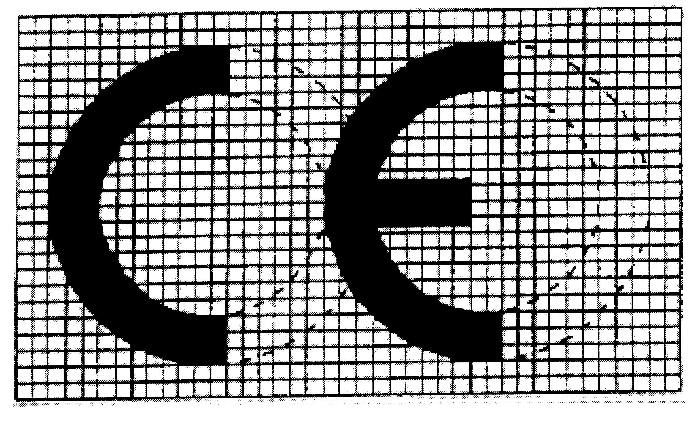

Príloha č. 4 k nariadeniu vlády č. 179/2001 Z. z.

- OZNAČENIE CE

  - Označenie CE sa skladá z písmen „CE“ podľa § 21 zákona.

- 

  - Ak je označenie zmenšené alebo zväčšené, mierka rozmerov zostáva zachovaná.

  - Jednotlivé prvky označenia CE majú približne rovnaký vertikálny rozmer, ktorý je najmenej 5 mm.
