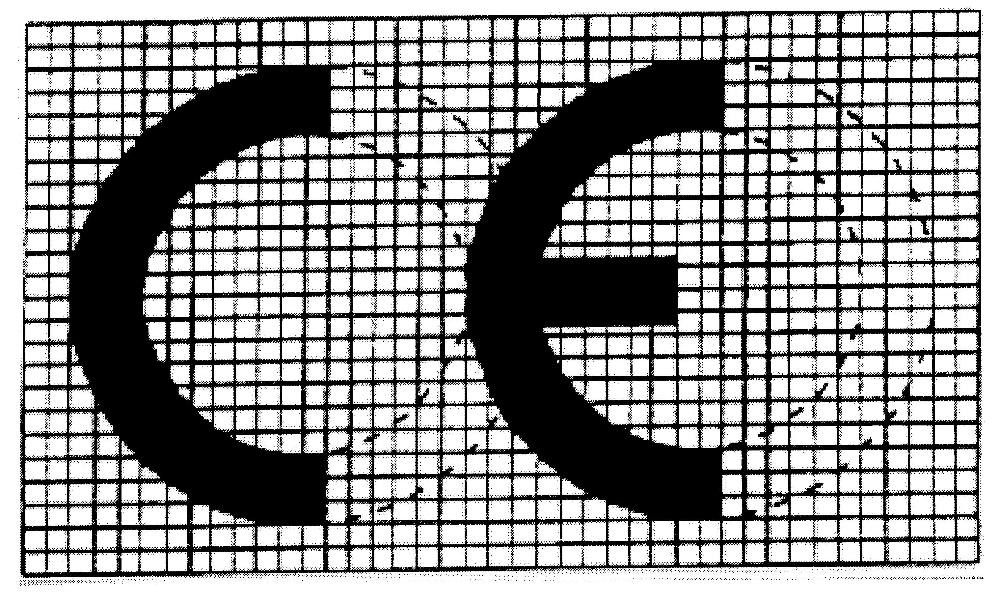

Príloha č. 4 k nariadeniu vlády č. 180/2001 Z. z.

- ZNAČKA ZHODY – OZNAČENIE CE

  - Označenie CE sa skladá z písmen „CE“ podľa § 21 zákona.

- 

  - Ak je označenie zmenšené alebo zväčšené, mierka rozmerov zostáva zachovaná.

  - Jednotlivé prvky označenia CE majú približne rovnaký vertikálny rozmer, ktorý je najmenej 5 mm.

  - Za označením CE nasleduje identifikačný kód autorizovanej osoby, ak vykonáva kontrolu počas výroby, ako aj posledné dvojčíslie roka, keď bolo označenie CE umiestnené na výrobok.
