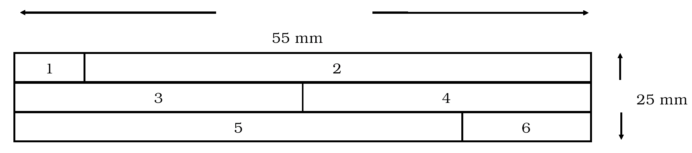

Príloha č. 5 k zákonu č. 238/2001 Z. z.

- Odtlačok osobitnej pečiatky 

  - 1. Štátny znak alebo iný znak, alebo písmená, ktoré charakterizujú Slovenskú republiku.

  - 2. Colný úrad.

  - 3. Číslo dokladu.

  - 4. Dátum.

  - 5. Schválený odosielateľ na podpisovanie.1)

  - 6. Povolenie.
