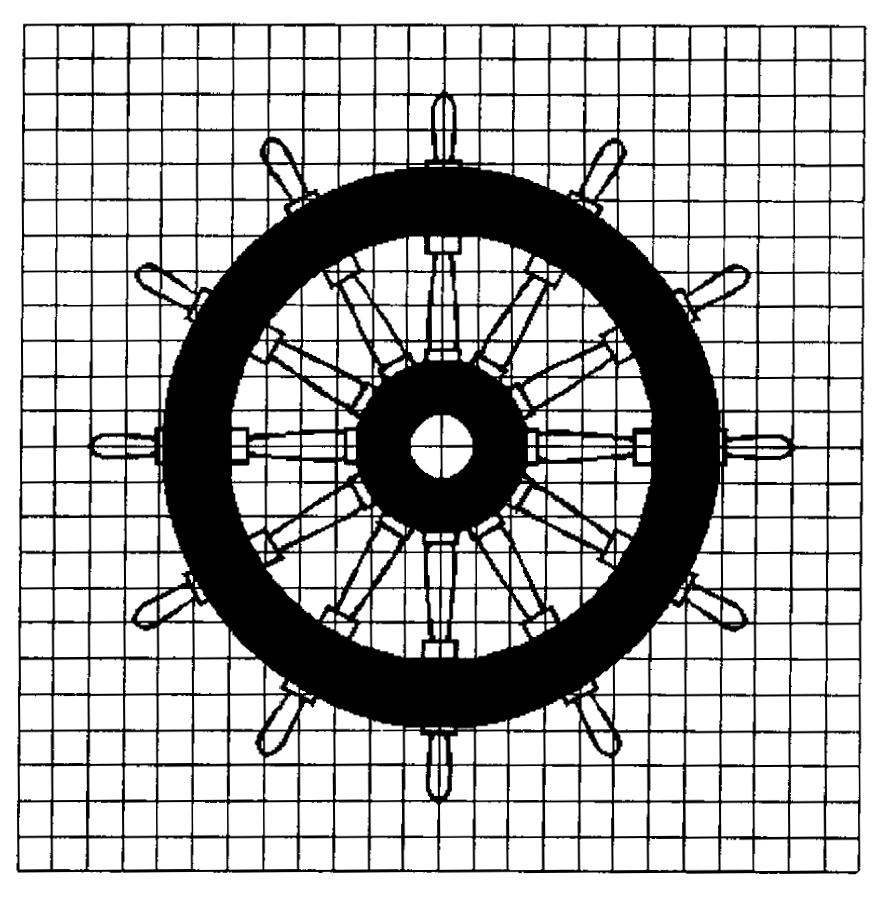

Príloha č. 4 k nariadeniu vlády č. 243/2001 Z. z.

- Značka zhody 

  - Ak je značka zhody zmenšená alebo zväčšená, rešpektujú sa proporcie dané na obrázku.

  - Rôzne komponenty značky zhody majú rovnaké vertikálne rozmery, ktoré sú najmenej 5 mm.

  - Najmenší rozmer značky zhody sa nemusí dodržať pri malých zariadeniach.
