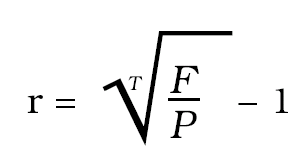

Príloha k zákonu č. 258/2001 Z. z.

- VÝPOČET ROČNEJ PERCENTUÁLNEJ MIERY NÁKLADOV PRI SPOTREBITEĽSKÝCH ÚVEROCH

  - 

  - Význam symbolov:

  - r – neznáma, ktorá vyjadruje ročnú percentuálnu mieru nákladov podľa § 2 písm. c),

  - F – budúca hodnota podľa § 2 písm. c),

  - P – súčasná hodnota, t. j. nominálna hodnota poskytnutého spotrebiteľského úveru,

  - T – časové obdobie splácania spotrebiteľského úveru.

  - Poznámky:

  - a) Ročná percentuálna miera poplatkov má byť vypočítaná v čase, keď sa uzatvára zmluva. Výpočet sa vykoná za predpokladu, že zmluva o spotrebiteľskom úvere bude platná na dohodnuté obdobie a že veriteľ a spotrebiteľ splnia svoje povinnosti podľa podmienok a k dohodnutým termínom.

  - b) V prípade úverových zmlúv obsahujúcich klauzuly povoľujúce zmeny úrokovej miery a poplatkov obsiahnutých v ročnej percentuálnej miere nákladov, ale nekvalifikovateľné v čase, keď sa počítala, ročná percentuálna miera nákladov sa bude počítať na základe predpokladu, že úrok a iné poplatky zostanú stabilné a budú platiť do konca platnosti úverovej zmluvy.

  - c) Všeobecne platí rovnica medzi výškou spotrebiteľských úverov a výškou splátok a úrokov. Výšky finančných prostriedkov poskytnutých alebo uhrádzaných ktoroukoľvek zo zmluvných strán v rôznych lehotách sa nemusia nevyhnutne rovnať a nemusia byť nevyhnutne zaplatené k rovnakým dňom splatnosti.

  - d) Dňom poskytnutia prvého spotrebiteľského úveru je deň, v ktorom sú pre spotrebiteľa disponibilné úverové prostriedky prvého spotrebiteľského úveru alebo v ktorom mu bol dodaný tovar alebo poskytnutá služba.

  - e) Lehoty, ktoré sa používajú pri výpočte, sa vyjadrujú na päť desatinných miest. Za rok sa považuje 365 dní alebo 365,25 dňa, alebo (pri priestupných rokoch) 366 dní, 52 týždňov alebo 12 rovnakých mesiacov. Za rovnaký mesiac sa považuje 30,41666 dňa, t. j. 365/12.

  - f) Výsledok výpočtu bude zaokrúhlený s presnosťou aspoň na jedno desatinné miesto. Pri zaokrúhľovaní na konkrétny počet desatinných miest platí toto pravidlo: ak sa hodnota číslice na desatinnom mieste nasledujúcom za desatinným miestom, na ktoré sa zaokrúhľuje, rovná 5 alebo je väčšia, potom sa k číslici na danom desatinnom mieste pripočíta jednotka.
