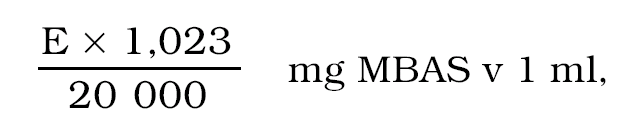
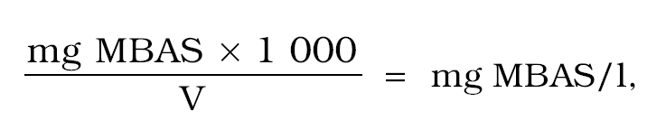
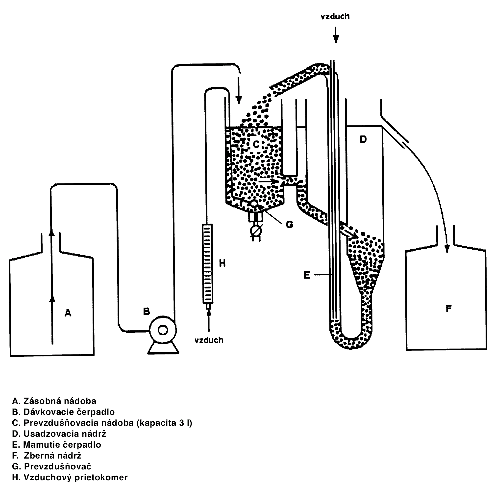
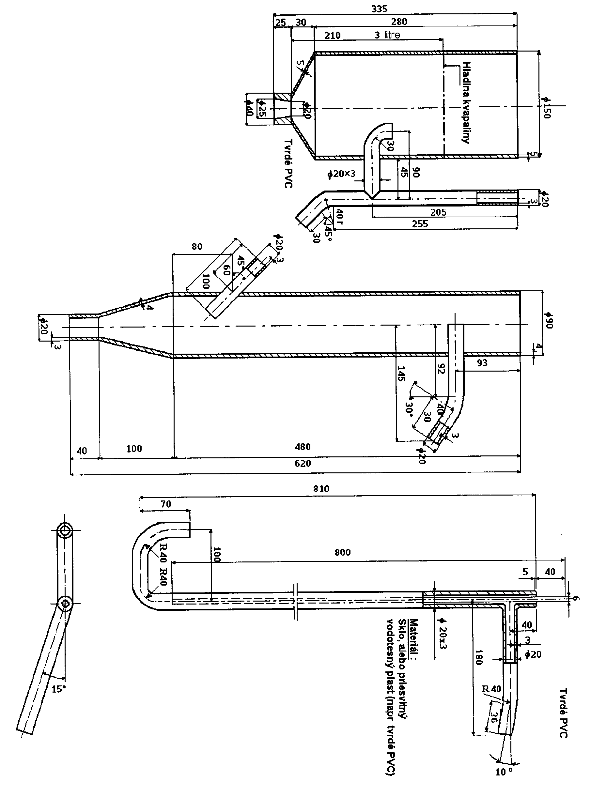
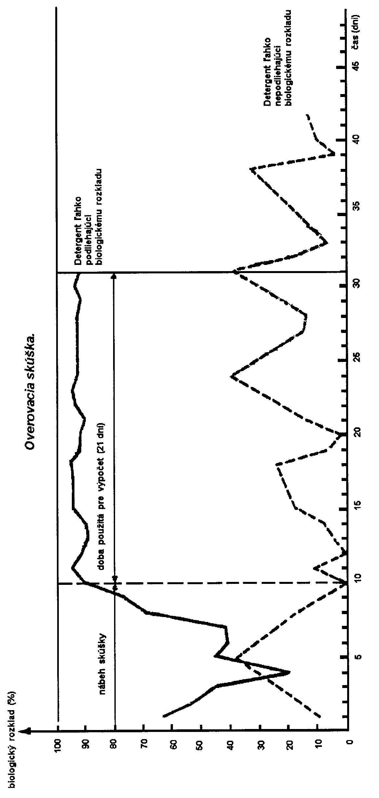
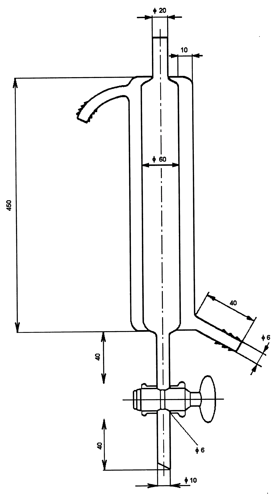

Príloha č. 1 k vyhláške č. 423/2001 Z. z.

- METÓDY KONTROLY BIOLOGICKEJ ODBÚRATEĽNOSTI ANIÓNOVÝCH POVRCHOVO AKTÍVNYCH LÁTOK

  - 1. Referenčná metóda a podmienky jej výkonu (Potvrdzovací test)

  - 1.1. Stanovenie pojmov

    - Aniónové povrchovo aktívne látky (tenzidy) na účely tejto vyhlášky sú povrchovo aktívne látky, ktoré sa po prechode cez katiónový a aniónový menič iónov oddelia frakčnou elúciou a stanovia sa podľa analytického predpisu uvedeného v tejto prílohe ako látka aktívna na metylénovú modrú (ďalej len „MBAS“).

  - 1.2. Potrebné vybavenie

    - Na meranie sa používa zariadenie s aktivovaným kalom, ktoré je schematicky zobrazené na obrázku č. 1 a podrobnejšie zobrazené na obrázku č. 2.

    - Zariadenie pozostáva zo zásobnej nádrže A na modelovú odpadovú vodu, z dávkovacieho čerpadla B, z prevzdušňovacej nádoby C, zo sedimentačnej nádoby D, zo vzduchového čerpadla na tlakový vzduch E na recirkuláciu aktivovaného kalu a zo zbernej nádoby F na odtekajúcu spracovanú odpadovú vodu.

    - Nádoby A a F s objemom najmenej 24 l sú vyrobené zo skla alebo z vhodného plastu. Čerpadlo B má zaručovať rovnomerný prítok umelej odpadovej vody k prevzdušňovacej nádobe; v normálnej prevádzke sa v nádobe nachádzajú 3 l odpadovej vody. V nádobe C je v jej kužeľovitom dne umiestnená sklená frita G na prevzdušňovanie. Vzduch vháňaný cez fritu sa meria prietokomerom H.

  - 1.3. Modelová odpadová voda

    - Na vykonanie testu sa používa modelová odpadová voda. Na tento účel sa na 1 l pitnej vody rozpustí:

    - 160 mg peptónu,

    - 110 mg mäsového extraktu,

    - 30 mg močoviny (CO(NH2)2),

    - 7 mg chloridu sodného (NaCl),

    - 4 mg chloridu vápenatého (CaCl2. 2 H2O),

    - 2 mg síranu horečnatého (MgSO4. 7 H2O),

    - 28 mg hydrogenfosforečnanu didraselného (K2HPO4)a

    - 20 ±2 mg MBAS.

    - MBAS sa extrahuje zo skúšaného materiálu metódou uvedenou v tejto prílohe.

    - Modelová odpadová voda sa denne pripravuje čerstvá.

  - 1.4. Príprava vzoriek

  - 1.4.1. Čisté povrchovo aktívne látky sa testujú bez predbežnej úpravy. Na prípravu modelovej odpadovej vody (1.3.) sa stanoví obsah MBAS.

  - 1.4.2. Pri pracích prostriedkoch a čistiacich prostriedkoch pripravených na základe receptúry sa zistí obsah MBAS a mydla. Extrahuje sa alkoholom a oddelia sa MBAS (bod 2). Obsah MBAS v extrakte musí byť pre výrobu modelovej odpadovej vody známy.

  - 1.5. Prevádzka testovacieho zariadenia

    - Na začiatku testu sa prevzdušňovacia nádoba C, ako aj sedimentačná nádoba D naplnia modelovou odpadovou vodou. Sedimentačná nádoba D sa upevní v takej výške, aby sa v prevzdušňovacej nádobe C nachádzali 3 l.

    - Očkovanie sa uskutoční s 3 ml tekutého odpadu z čistiarne odpadovej vody dobrej kvality, ktorý sa čerstvo odoberie z odtoku biologickej čistiarne odpadových vôd určenej na odpadovú vodu z domácností. Vzorka z odtoku sa udržiava v aeróbnych podmienkach od odobratia až po použitie. Zapne sa prívod vzduchu G, vzduchové čerpadlo na tlakový vzduch E a dávkovacie čerpadlo B. Prítok modelovej odpadovej vody do prevzdušňovacej nádoby C musí byť 1l/hod., čo zodpovedá priemernému času jej zotrvania v prevzdušňovacej nádobe – 3 hodiny.

    - Prívod vzduchu sa nastaví tak, aby obsah prevzdušňovacej nádoby C zotrval stále v suspenznom stave a aby sa dodržal minimálny obsah rozpusteného kyslíka 2 mg/l. Tvorbe peny sa zabráni vhodnými prostriedkami. Nesmú sa použiť odpeňovacie prostriedky, ktoré majú inhibujúci vplyv na aktivovaný kal, ani také prostriedky, ktoré obsahujú MBAS. Čerpadlo E sa nastaví tak, aby bol neustále zabezpečený rovnomerný spätný tok aktivovaného kalu zo sedimentačnej nádoby D k prevzdušňovacej nádobe C. Kal nazhromaždený na dne sedimentačnej nádoby D alebo v spätnom toku sa najmenej raz denne privádza späť do obehu rozmiešavaním kefkou alebo inými vhodnými prostriedkami. Ak sa kal neusadzuje, jeho sedimentáciu a zahusťovanie možno zlepšiť prípadným opakovaným pridaním po 2 ml 5 % roztoku chloridu železitého.

    - Voda odtekajúca zo sedimentačnej nádoby D sa zachytáva v zbernej nádobe F počas 24 hodín. Po uplynutí tohto času a po dôkladnom premiešaní sa odoberie vzorka. Následne sa zberná nádoba F dôkladne vyčistí.

  - 1.6. Kontrola meracieho zariadenia

    - Obsah MBAS v modelovej odpadovej vode (v mg/l) sa stanoví bezprostredne pred použitím.

    - Obsah MBAS (v mg/l) v odtoku zachytenom v zbernej nádobe F počas 24 hodín sa analyticky stanoví podľa tej istej metódy bezprostredne po odobratí vzorky; ak to nie je možné, vzorka sa zakonzervuje (prednostne zmrazením).

    - Koncentrácia sa stanoví s presnosťou na 0,1 mg/l MBAS.

    - Na kontrolu bezchybnej prevádzky meracieho zariadenia sa dvakrát do týždňa zmeria chemická spotreba kyslíka (ďalej len „CHSK“) alebo rozpustený organický uhlík (ďalej len „DOC“) odpadovej vody prefiltrovanej cez sklené vlákna v zbernej nádobe F a prefiltrovanej modelovej odpadovej vody v zásobnej nádobe A.

    - Po dosiahnutí začiatku biologického odbúravania MBAS, ktorý je rovnaký temer na deň, sa tendencia priebehu procesu ustáli, to znamená, že po skončení doby nábehu podľa obrázku č. 3 by sa mala naďalej neustále znižovať hodnota CHSK alebo DOC.

    - Sušina aktivovaného kalu v g/l v prevzdušňovacej nádobe sa zisťuje dvakrát do týždňa. Ak je jej obsah väčší než 2,5 g/l, nadbytok aktivovaného kalu sa odstráni.

    - Test biologickej odbúrateľnosti sa vykoná pri približne konštantnej teplote miestnosti v rozsahu medzi 19 oC až 24 oC.

  - 1.7. Výpočet biologickej odbúrateľnosti

    - Biologická odbúrateľnosť MBAS v percentách sa vypočítava denne z obsahu MBAS v mg/l modelovej odpadovej vody a odtoku nazbieraného v zbernej nádobe F.

    - Vypočítané hodnoty biologickej odbúrateľnosti sa graficky znázornia podľa obrázku č. 3.

    - Výpočet hodnôt biologickej odbúrateľnosti MBAS sa určí ako aritmetický priemer z hodnôt biologickej odbúrateľnosti, ktoré sa zistili po skončení doby nábehu počas 21 po sebe nasledujúcich dní pri konštantnom odbúravaní v bezporuchovej prevádzke. Doba nábehu nesmie v žiadnom prípade trvať viac než 6 týždňov.

    - Denné hodnoty biologickej odbúrateľnosti sa vypočítajú s presnosťou na 0,1 %. Konečný výsledok sa zaokrúhli na celé čísla.

    - V mnohých prípadoch možno obmedziť počet stanovení, na zistenie strednej hodnoty sa však použijú výsledky najmenej zo štrnástich denných odberov vzoriek, ktoré sa rozdelia na obdobie 21 dní nasledujúcich po dobe nábehu.

  - 2. Predbežné spracovanie analyzovaného materiálu

  - 2.1. Úvodné poznámky

  - 2.1.1. Spracovanie vzoriek

    - Pri stanovení biologickej odbúrateľnosti aniónových povrchovo aktívnych látok v pracích prostriedkoch a v čistiacich prostriedkoch potvrdzovacím testom sa pri spracovaní vzoriek postupuje takto:

  - Produkty | Spracovanie vzoriek

  - Aniónové tenzidy | Žiadne

  - Pracie prostriedky a čistiace prostriedky | Extrakcia alkoholom a následná izolácia aniónových tenzidov výmenou iónov

    - Účelom extrakcie je odstránenie nerozpustných a anorganických zložiek komerčného produktu, ktoré by mohli narúšať test biologickej odbúrateľnosti.

  - 2.1.2. Metóda výmeny iónov

    - Na uskutočnenie testu biologickej odbúrateľnosti je potrebné izolovanie a oddelenie aniónových tenzidov od mydla, neiónových a katiónových tenzidov.

    - Výsledok sa docieli metódou výmeny iónov prostredníctvom makroporéznej iónomeničovej živice a vhodných elučných prostriedkov na frakčnú elúciu. Týmto spôsobom sa v jednom pracovnom úkone izoluje mydlo, aniónové a neiónové tenzidy.

  - 2.1.3. Analytická kontrola

    - Obsah aniónových tenzidov v pracích prostriedkoch a v čistiacich prostriedkoch sa po homogenizácii stanoví analytickou metódou MBAS. Obsah mydla sa stanoví prostredníctvom vhodnej analytickej metódy. Analýza produktu je potrebná na výpočet množstiev, ktoré sú nevyhnutné na prípravu frakcie pre test biologickej odbúrateľnosti.

    - Kvantitatívna extrakcia nie je potrebná; malo by sa však extrahovať najmenej 80 % neiónových tenzidov. Spravidla sa získa 90 % a viac neiónových tenzidov.

  - 2.2. Princíp

    - Z homogénnej vzorky (prášok, pasty a predtým vysušené roztoky) sa získa etanolový extrakt, ktorý obsahuje tenzidy, mydlá a ostatné zložky vzorky pracích prostriedkov a čistiacich prostriedkov rozpustné v alkohole.

    - Etanolový extrakt sa dosucha odparí, rozpustí sa v zmesi izopropanolu s vodou a tento roztok sa nechá prejsť cez kombináciu meničov iónov zo silne kyslého katexu a makroporézneho anexu zahriateho na 50 0C. Táto teplota je potrebná, aby sa zabránilo vyzrážaniu mastných kyselín v kyslom prostredí.

    - Neiónové tenzidy zostanú vo filtráte.

    - Mastné kyseliny z mydla sa oddelia elúciou etanolom obsahujúcim CO2.

    - Aniónové tenzidy sa získajú elúciou vodným roztokom hydrogenuhličitanu amónneho a izopropanolu ako amónne soli. Tieto amónne soli sa použijú na test biologickej odbúrateľnosti. Katiónové tenzidy, ktoré by mohli narúšať test biologickej odbúrateľnosti a analytickú metódu, sa eliminujú katexom nasadeným nad anexom.

  - 2.3. Chemikálie a prístroje

  - 2.3.1. Deionizovaná voda

  - 2.3.2. Etanol, 95 objemových % C2H5OH (prípustný denaturačný prostriedok: metyletylketón alebo metanol).

  - 2.3.3. Zmes izopropanolu s vodou pripravená z 50 objemových dielov izopropanolu CH3CHOH-CH3 a50 objemových dielov vody (2.3.1).

  - 2.3.4. Etanol sýtený plynným CO2(zhruba 0,1 % CO2);

    - na prípravu sa použije prívodná rúrka so zabudovanou fritou, cez ktorú sa nechá 10 minút prúdiť CO2cez etanol (2.3.2.).

    - Použijú sa len čerstvo pripravené roztoky.

  - 2.3.5. Roztok hydrogenuhličitanu amónneho pripravený rozpustením 0,3 mol NH4HCO3v1000 ml zmesi izopropanolu s vodou (60 objemových dielov izopropanolu a 40 objemových dielov vody 2.3.1).

  - 2.3.6. Menič katiónov (katex) (KAT), silno kyslý, odolný proti alkoholu, (50 – 100 mesh).

  - 2.3.7. Menič aniónov (anex) (AAT), makroporézny, Merck Lewatit MP 7080 (70 –150 mesh) alebo rovnocenný.

  - 2.3.8. Kyselina chlorovodíková, 10 % (objemových) HCl.

  - 2.3.9. Destilačná banka s kónickým zábrusom a spätným chladičom, obsah 2 000 ml.

  - 2.3.10. Nuča (vyhrievateľná) pre filtračný papier, priemer 90 mm.

  - 2.3.11. Odsávacia fľaša, 2 000 ml.

  - 2.3.12. Iónomeničový stĺpec s vyhrievaným plášťom a kohútom: priemer vnútornej rúrky 60 mm, výška 450 mm (obrázok č. 4).

  - 2.3.13. Vodný kúpeľ

  - 2.3.14. Vákuová sušiareň

  - 2.3.15. Termostat

  - 2.3.16. Rotačná vákuová odparka

  - 2.4. Príprava extraktu a oddelenie aniónových tenzidov

  - 2.4.1. Príprava extraktu

    - Na test biologickej odbúrateľnosti je potrebných asi 50 g povrchovo aktívnej látky ako MBAS. Na jednorazovú extrakciu sa nepoužíva viac než 1 000 g produktu, môže však byť potrebná extrakcia viacerých dávok vzorky. Z praktických dôvodov je vo väčšine prípadov pri príprave extraktov na test biologickej odbúrateľnosti najvyššia hranica 5 000 g.

    - Podľa skúsenosti je šaržovité získavanie extraktov pracovno-technicky výhodnejšie než práca s väčším množstvom. Predpísané množstvá meničov zodpovedajú pracovnej kapacite 600 mmol až 700 mmol tenzidov a mydla.

  - 2.4.2. Oddelenie zložiek rozpustných v alkohole

    - Po vnesení 250 g skúmaného pracieho prostriedku a čistiaceho prostriedku do 1250 ml etanolu sa zmes zahreje do varu. Zmes sa za stáleho miešania varí pod spätným chladičom 1 hodinu. Horúci alkoholový roztok sa prefiltruje cez nuču zahriatu na 50 oC s filtrom s hrubými pórmi a rýchlo sa odsaje. Následne sa banka a nuča premyjú s 200 ml horúceho etanolu. Filtrát a premývací alkohol sa zachytia v prázdnej odsávačke.

    - Pri pastovitých a kvapalných produktoch sa naváži toľko pracích prostriedkov a čistiacich prostriedkov, aby bolo prítomných najviac 55 g aniónového tenzidu a 35 g mydla. Navážené množstvo sa vysuší. Vysušený zvyšok sa rozpustí v 2 000 ml etanolu. Postup skúmania sa opakuje.

    - Ak má práškovitý prací prostriedok alebo čistiaci prostriedok výrazne nižšiu sypnú hmotnosť (menej ako 300 g/l), odporúča sa zvýšiť množstvo etanolu až po zmiešavací pomer 20 : 1.

    - Etanolový filtrát sa dosucha odparí s výhodou pomocou rotačnej odparky. Ak je potrebné väčšie množstvo extraktu, postup sa opakuje. Zvyšok sa rozpustí v 5 000 ml zmesi izopropanolu s vodou.

  - 2.4.3. Príprava iónomeničových stĺpcov

    - Katexový stĺpec

    - 600 ml KAT (2.3.6.) sa nasype do 3 000 ml kadičky a zaleje sa 2 000 ml kyseliny chlorovodíkovej (2.3.8.) a za občasného miešania sa nechá stáť. Kyselina sa dekantuje a KAT sa spláchne deionizovanou vodou do stĺpca (2.3.12.), do ktorého bol predtým vložený chumáč sklenej vaty. Stĺpec sa premyje deionizovanou vodou pri rýchlosti prietoku 10 až 30 ml/min. Tým je stĺpec KAT pripravený na prevádzku.

    - Anexový stĺpec

    - 600 ml AAT (2.3.7.) sa nasype do kadičky a dokonale sa zaleje 2 000 ml deionizovanej vody. Menič iónov sa nechá najmenej 2 hodiny napučiavať. Následne sa AAT spláchne deionizovanou vodou do stĺpca, do ktorého bol predtým vložený chumáč sklenej vaty.

    - Stĺpec sa vymýva 0,3 M roztokom hydrogenuhličitanu amónneho (2.3.5.) až do negatívnej reakcie na chloridy. Na to je potrebných asi 5 000 ml roztoku. Následne sa dodatočne premyje s 2000 ml deionizovanej vody. Voda sa vytesní s 2 000 ml zmesi izopropanolu s vodou (2.3.3.) pri rýchlosti prietoku 10 až 30 ml/min. Stĺpec AAT sa teraz nachádza vo forme OH- a je pripravený na prevádzku.

  - 2.4.4 Postup výmeny iónov

    - Obidva iónomeničové stĺpce sa spoja takým spôsobom, aby sa stĺpec KAT nachádzal pred stĺpcom AAT. Iónomeničové stĺpce sa zahrievajú na 50 oC za použitia termostatu.

    - 5 000 ml roztoku získaného postupom podľa 2.4.2. sa zahreje na 60 oC a horúci roztok sa nechá prejsť pri rýchlosti prietoku 20 ml/min. cez kombináciu stĺpcov. Nakoniec sa stĺpce vymyjú v 1 000 ml horúcej zmesi izopropanolu s vodou (2.3.3.)

    - Na získanie aniónových tenzidov (MBAS) sa oddelí katiónový stĺpec. Zo stĺpca KAT sa eluujú mastné kyseliny z mydla pomocou 5 000 ml roztoku CO2vetanole zahriateho na 50 oC (2.3.4.). Eluát sa nepoužije. Následne sa vyeluuje MBAS zo stĺpca AAT pomocou 5 000 ml roztoku hydrogenuhličitanu amónneho (2.3.5) a eluát sa vysuší na vodnom kúpeli alebo v rotačnej odparke. Vysušený zvyšok obsahuje MBAS (ako amónnu soľ) a poprípade netenzidové aniónové látky, ktoré test biologickej odbúrateľnosti nenarúšajú. Ku zvyšku sa pridá deionizovaná voda až do definovaného objemu a stanoví sa obsah MBAS podľa bodu 3. Roztok sa použije ako roztok aniónového tenzidu na test biologickej odbúrateľnosti. Uskladňuje sa pri teplote pod 5 oC.

  - 2.4.5. Regenerácia použitých meničov

    - Menič katiónov sa po použití zlikviduje.

    - Menič aniónov sa regeneruje preliatím asi 5 000 ml až 6 000 ml roztoku hydrogenuhličitanu amónneho (2.3.5) cez stĺpec pri rýchlosti prietoku asi 20 ml/min., až kým je eluát bez obsahu aniónových tenzidov (test na metylénovú modrú). Nakoniec sa cez menič aniónov preleje ešte 2000 ml zmesi izopropanolu s vodou (2.3.3.). Po tomto je menič aniónov opäť pripravený na prevádzku.

  - 3. Stanovenie aniónových povrchovo aktívnych látok pri teste biologickej odbúrateľnosti

  - 3.1. Princíp

    - Metóda je založená na skutočnosti, že katiónové farbivo metylénová modrá tvorí s aniónovými tenzidmi modré soli, ktoré sú extrahovateľné chloroformom. Na elimináciu rušivých látok sa vykoná extrakcia najskôr z alkalického roztoku. Extrakt sa pretrepe s kyslým roztokom metylénovej modrej. Absorbancia oddelenej organickej fázy sa zmeria fotometricky v absorpčnom maxime vlnovej dĺžky 650 nm.

  - 3.2. Chemikálie a prístroje

  - 3.2.1. Tlmivý roztok pH 10 : 24 g hydrogenuhličitanu sodného (NaHCO3) p. a. a 27 g bezvodého uhličitanu sodného (Na2CO3) p. a. sa rozpustí v deionizovanej vode a doplní sa na 1000 ml.

  - 3.2.2. Neutrálny roztok metylénovej modrej:

    - 0,35 g metylénovej modrej p. a. sa rozpustí v deionizovanej vode a doplní sa na 1000 ml. Roztok sa pripraví najmenej 24 hodín pred použitím. Absorbancia chloroformovej fázy slepej vzorky nesmie oproti čistému chloroformu pri 650 nm prekročiť 0,015 pri 1 cm hrúbke vrstvy.

  - 3.2.3. Zriedená kyselina chlorovodíková (HCl)

    - (20 ml koncentrovanej kyseliny chlorovodíkovej p. a. sa doplní vodou na 1000 ml).

  - 3.2.4. Chloroform (trichlórmetán) CHCl3p. a. (čerstvo destilovaný).

  - 3.2.5. Metylester kyseliny dodecylbenzénsulfónovej

  - 3.2.6. Roztok hydroxidu draselného v etanole (KOH 0,1M)

  - 3.2.7. Etanol (C2H5OH) p. a.

  - 3.2.8. 0,5 M kyselina sírová (H2SO4)

  - 3.2.9. Roztok fenolftaleínu:

    - 1 g fenolftaleínu sa za stáleho miešania rozpustí v 50 ml etanolu a 50 ml deionizovanej vody. Zrazenina sa odfiltruje.

  - 3.2.10. Kyselina chlorovodíková v metanole

    - (250 ml koncentrovanej kyseliny chlorovodíkovej p. a. sa zmieša so 750 ml metanolu).

  - 3.2.11. Oddeľovací lievik, 250 ml

  - 3.2.12. Odmerná banka, 50 ml

  - 3.2.13. Odmerná banka, 500 ml

  - 3.2.14. Odmerná banka, 1000 ml

  - 3.2.15. Destilačná banka so zábrusom a spätným chladičom, 250 ml; varné guľôčky.

  - 3.2.16. pH-meter

  - 3.2.17. Fotometer na merania pri 650 nm s 1 cm až 5 cm kyvetami

  - 3.2.18. Hruboporézny filtračný papier

  - 3.3. Postup

    - Analytické vzorky sa nesmú odoberať cez penovú vrstvu.

    - Potrebné laboratórne sklo sa po dôkladnom vyčistení vodou pred použitím dobre prepláchne kyselinou chlorovodíkovou v metanole (3.1.10.) a následne deionizovanou vodou.

    - Pri odoberaní vzorky skúšaného prítoku a odtoku z čistiarne s aktivovaným kalom sa vzorka okamžite filtruje. Prvých 100 ml filtrátu sa nepoužije.

    - Do 250 ml oddeľovacieho lievika (3.2.11.) sa pridá, po prípadnej neutralizácii, presné množstvo vzorky. Vzorka by mala obsahovať 20 mg až 50 mg MBAS. Pri nižšom obsahu MBAS sa môže použiť až 100 ml vzorky. Ak sa použije menej než 100 ml, deionizovanou vodou sa zriedi na 100 ml. Ku vzorke sa pridá 10 ml tlmivého roztoku (3.2.1.), 5 ml neutrálneho roztoku metylénovej modrej (3.2.1.) a 15 ml chloroformu (3.2.4.). Zmes sa opatrne pretrepáva jednu minútu. Po oddelení fáz sa chloroformová vrstva odpustí do druhého oddeľovacieho lievika so 110 ml deionizovanej vody a 5 ml kyslého roztoku metylénovej modrej (3.2.3.). Zmes sa pretrepáva jednu minútu. Chloroformová vrstva sa odpustí do odmernej banky (3.2.12.) cez vatový filter vopred vymytý alkoholom a zmáčaný chloroformom.

    - Alkalické a kyslé roztoky sa trikrát extrahujú, pričom pri druhej a tretej extrakcii sa použije 10 ml chloroformu. Spojené chloroformové extrakty sa prefiltrujú cez ten istý vatový filter a doplnia sa až po značku 50 ml banky (3.2.12.) chloroformom použitým na premytie vaty. Zmeria sa absorbancia chloroformového roztoku oproti chloroformu pri 650 nm v 1 cm až 5 cm kyvetách. Celý postup sa vykoná so slepým pokusom.

  - 3.4. Kalibračná krivka

    - Zo štandardného roztoku metylesteru kyseliny dodecylbenzénsulfónovej (tetrapropylénový typ, molová hmotnosť 340) po zmydelnení v hydroxide draselnom sa pripraví kalibračný roztok.

    - MBAS sa počíta ako dodecylbenzénsulfonát sodný (molová hmotnosť 348).

    - Príprava základného roztoku

    - V banke s guľatým dnom sa naváži 400 mg až 500 mg metylesteru kyseliny dodecylbenzénsulfónovej (3.2.5.) s presnosťou na 0,1 mg a pridá sa 50 ml etanolového roztoku hydroxidu draselného (3.2.6.) a niekoľko varných guľôčok. Varí sa pod spätným chladičom jednu hodinu. Po ochladení sa chladič a zábrus premyje 30 ml etanolu a pridá sa k obsahu banky. Roztok sa titruje kyselinou sírovou na fenolftaleín až do odfarbenia. Roztok sa preleje do 1 000 ml odmernej banky (3.2.14.), doplní sa po značku deionizovanou vodou a premieša sa.

    - Štandardný roztok obsahuje:

  - 

    - kde E = hmotnosť vzorky v mg.

    - Na zostrojenie kalibračnej krivky sa odoberie 1, 2, 4, 6, 8 ml štandardného roztoku a doplní sa deionizovanou vodou na 100 ml. Postupuje sa tak, ako je to opísané v 3.3. (vrátane slepého pokusu).

  - 3.5. Výpočet výsledkov

    - Obsah aniónových tenzidov vo forme MBAS vo vzorke sa odčíta z kalibračnej krivky (3.4.). Celkový obsah MBAS vo vzorke sa vypočíta podľa vzťahu:

  - 

    - kde V = objem použitej vzorky (v ml).

    - Výsledky sa vyjadrujú ako dodecylbenzénsulfonát sodný (molová hmotnosť 348).

  - 3.6. Vyjadrenie výsledkov

    - Výsledky sa udávajú v mg MBAS/l s presnosťou na 0,1.

  - 

  - 

  - 

    - Výpočet biologickej odbúrateľnosti

  - 

    - Vyhrievaná výmenná kolóna

    - (Všetky rozmery sú uvedené v milimetroch)
