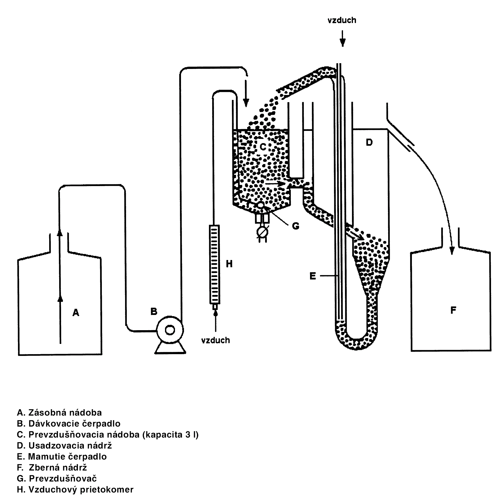
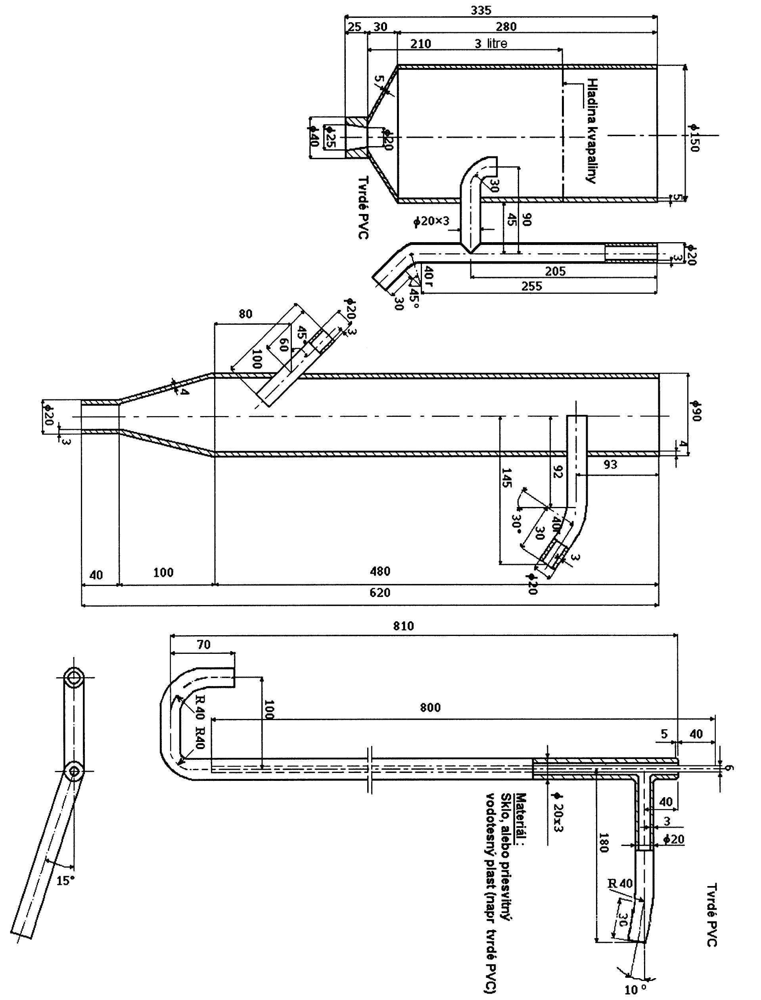
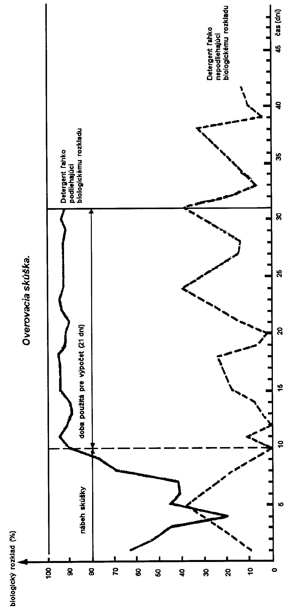
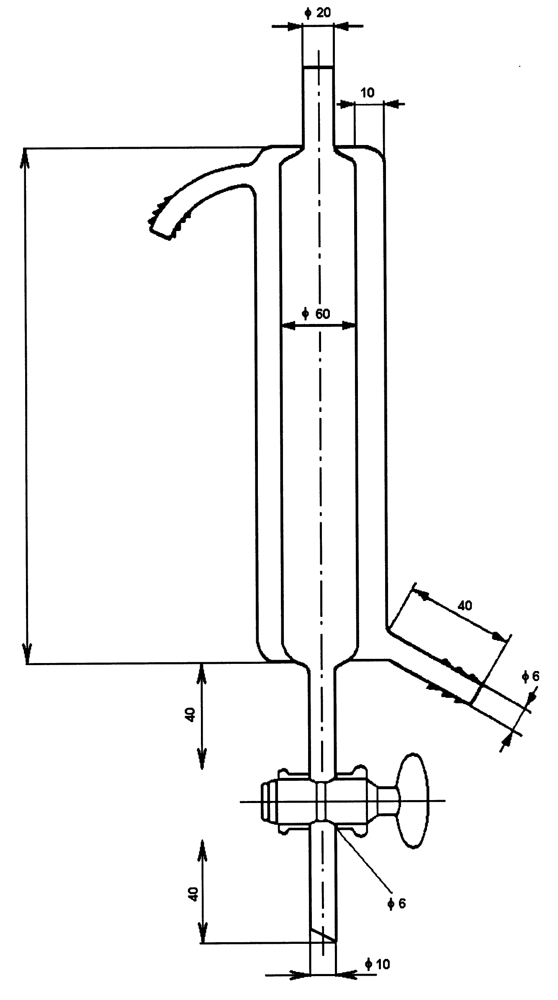
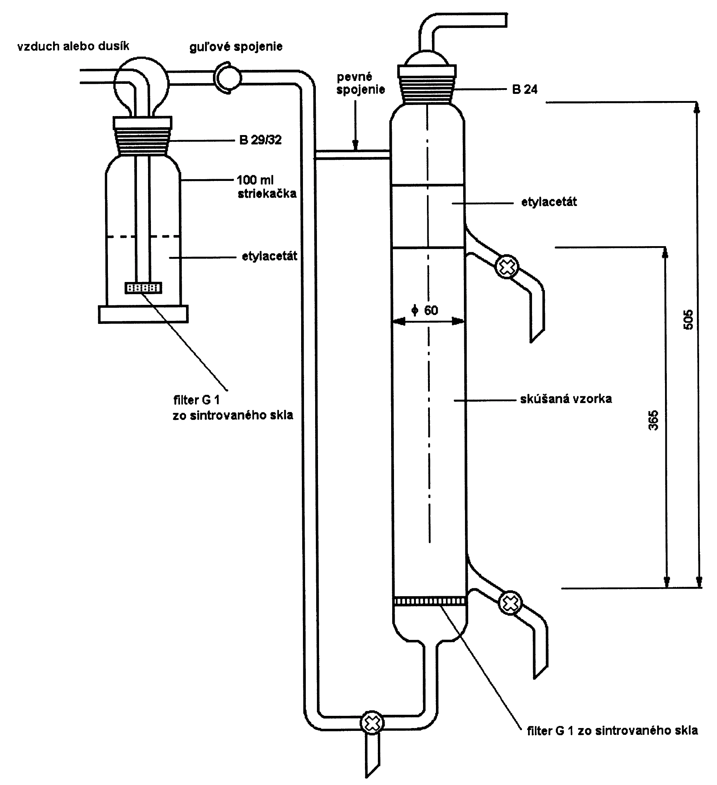

Príloha č. 2 k vyhláške č. 423/2001 Z. z.

- METÓDY KONTROLY BIOLOGICKEJ ODBÚRATEĽNOSTI NEIÓNOVÝCH POVRCHOVO AKTÍVNYCH LÁTOK

  - 1. Referenčná metóda a podmienky jej výkonu (Potvrdzovací test)

  - 1.1. Stanovenie pojmov

    - Neiónové povrchovo aktívne látky (tenzidy) na účely tejto prílohy sú povrchovo aktívne látky, ktoré sa stanovia po prechode cez katiónový a aniónový menič iónov podľa analytického predpisu uvedeného ako látka aktívna na bizmut (BiAS: bismuth-active substance).

  - 1.2. Potrebné vybavenie

    - Na meranie sa používa zariadenie s aktivovaným kalom, ktoré je schematicky znázornené na obrázku č. 1 a podrobnejšie zobrazené na obrázku č. 2.

    - Zariadenie pozostáva zo zásobnej nádrže A na modelovú odpadovú vodu, z dávkovacieho čerpadla B, z prevzdušňovacej nádoby C, zo sedimentačnej nádoby D, zo vzduchového čerpadla na tlakový vzduch E (mamutové čerpadlo) na recirkuláciu aktivovaného kalu a zo zbernej nádoby F na odtekajúcu spracovanú odpadovú vodu.

    - Nádoby A a F s objemom najmenej 24 l sú vyrobené zo skla alebo z vhodného plastu. Čerpadlo B má zaručovať rovnomerný prítok umelej odpadovej vody k prevzdušňovacej nádobe; v normálnej prevádzke sa v nádobe nachádzajú 3 l odpadovej vody. V nádobe C je v jej kužeľovitom dne umiestnená sklená frita G na prevzdušňovanie. Vzduch vháňaný cez fritu sa meria prietokomerom H.

  - 1.3. Modelová odpadová voda

    - Na vykonanie testu sa používa modelová odpadová voda. Na tento účel sa na 1 l pitnej vody rozpustí:

    - 160 mg peptónu,

    - 110 mg mäsového extraktu,

    - 30 mg močoviny (CO(NH2)2)

    - 7 mg chloridu sodného (NaCl),

    - 4 mg chloridu vápenatého (CaCl2. 2 H2O),

    - 2 mg síranu horečnatého (MgSO2. 7 H2O),

    - 28 mg hydrogenfosforečnanu didraselného (K2HPO4)a

    - 10 ±1 mg BiAS.

    - BiAS sa extrahuje zo skúšaného materiálu metódou uvedenou v tejto prílohe.

    - Modelová odpadová voda sa denne pripravuje čerstvá.

  - 1.4. Príprava vzoriek

  - 1.4.1. Čisté povrchovo aktívne látky sa testujú bez predbežnej úpravy. Na prípravu modelovej odpadovej vody (1.3.) sa stanoví obsah BiAS.

  - 1.4.2. Pri pracích prostriedkoch a čistiacich prostriedkoch pripravených na základe receptúry sa zistí obsah BiAS, MBAS a mydla. Extrahuje sa alkoholom a oddelí sa BiAS (bod 2). Obsah BiAS v extrakte musí byť pre výrobu modelovej odpadovej vody známy.

  - 1.5. Prevádzka skúšobného zariadenia

    - Na začiatku testu sa prevzdušňovacia nádoba C, ako aj sedimentačná nádoba D naplnia modelovou odpadovou vodou. Sedimentačná nádoba D sa upevní v takej výške, aby sa v prevzdušňovacej nádobe C nachádzali 3 l.

    - Očkovanie sa uskutoční s 3 ml tekutého odpadu z čistiarne odpadovej vody dobrej kvality, ktorý sa čerstvo odoberie z odtoku biologickej čistiarne odpadových vôd určenej na odpadovú vodu z domácností. Vzorka z odtoku sa udržiava v aeróbnych podmienkach od odobratia až po použitie. Zapne sa prívod vzduchu G, vzduchové čerpadlo na tlakový vzduch E a dávkovacie čerpadlo B. Prítok modelovej odpadovej vody do prevzdušňovacej nádoby C musí byť 1 l/hod., čo zodpovedá priemernému času jej zotrvania v prevzdušňovacej nádobe – tri hodiny.

    - Prívod vzduchu sa nastaví tak, aby obsah prevzdušňovacej nádoby C zotrval stále v suspenznom stave a aby sa dodržal minimálny obsah rozpusteného kyslíka 2 mg/l. Tvorbe peny sa zabráni vhodnými prostriedkami. Nesmú sa použiť odpeňovacie prostriedky, ktoré majú inhibujúci vplyv na aktivovaný kal, ani také prostriedky, ktoré obsahujú BiAS. Čerpadlo E sa nastaví tak, aby bol neustále zabezpečený rovnomerný spätný tok aktivovaného kalu zo sedimentačnej nádoby D k prevzdušňovacej nádobe C. Kal nazhromaždený na dne sedimentačnej nádoby D alebo v spätnom toku sa najmenej raz denne privedie späť do obehu rozmiešaním sedimentu kefkou alebo inými vhodnými prostriedkami. Ak sa kal neusadzuje, jeho sedimentáciu a zahusťovanie možno zlepšiť prípadným opakovaným pridaním po 2 ml 5 % roztoku chloridu železitého.

    - Voda odtekajúca zo sedimentačnej nádoby D sa zachytáva v zbernej nádobe F počas 24 hodín. Po uplynutí tohto času a po dôkladnom premiešaní sa odoberie vzorka. Následne sa zberná nádoba F starostlivo vyčistí.

  - 1.6. Kontrola meracieho zariadenia

    - Obsah BiAS v modelovej odpadovej vode (v mg/l) sa stanoví bezprostredne pred použitím.

    - Obsah BiAS (v mg/l) v odtoku zachytenom v zbernej nádobe F počas 24 hodín sa analyticky stanoví podľa tej istej metódy bezprostredne po odobratí vzorky; ak to nie je možné, vzorka sa zakonzervuje (prednostne zmrazením).

    - Koncentrácia sa stanoví s presnosťou na 0,1 mg/l BiAS.

    - Na kontrolu bezchybnej prevádzky meracieho zariadenia sa dvakrát do týždňa zmeria CHSK alebo DOC odpadovej vody prefiltrovanej cez sklené vlákna v zbernej nádobe F a prefiltrovanej modelovej odpadovej vody v zásobnej nádobe A.

    - Po dosiahnutí nábehu biologického rozkladu BiAS, ktorý je rovnaký temer na deň, sa tendencia priebehu procesu ustáli, to znamená, že po skončení doby nábehu podľa obrázku č. 3 by sa mala naďalej neustále znižovať hodnota CHSK alebo DOC.

    - Sušina aktivovaného kalu v g/l v prevzdušňovacej nádobe sa zisťuje dvakrát do týždňa. Ak je jej obsah väčší než 2,5 g/l, nadbytok aktivovaného kalu sa odstráni.

    - Test biologickej odbúrateľnosti sa vykoná pri približne konštantnej teplote miestnosti v rozsahu 19 oC až 24 oC.

  - 1.7. Výpočet biologickej odbúrateľnosti

    - Biologická odbúrateľnosť BiAS v percentách sa vypočítava denne z obsahu BiAS v mg/l modelovej odpadovej vody a odtoku nazbieraného v zbernej nádobe F.

    - Vypočítané hodnoty biologickej odbúrateľnosti sa graficky znázornia podľa obrázku č. 3.

    - Výpočet hodnôt biologickej odbúrateľnosti BiAS sa určí ako aritmetický priemer z hodnôt biologickej odbúrateľnosti, ktoré sa zistili po skončení doby nábehu počas 21 po sebe nasledujúcich dní pri konštant-nom odbúravaní v bezporuchovej prevádzke. Doba nábehu nesmie v žiadnom prípade trvať viac než šesť týždňov.

    - Denné hodnoty biologickej odbúrateľnosti sa vypočítajú s presnosťou na 0,1 %; konečný výsledok sa však zaokrúhli na celé čísla.

    - Počet stanovení možno obmedziť, avšak na zistenie strednej hodnoty sa použijú výsledky z najmenej 14 denných odberov vzoriek, ktoré sa rozdelia na obdobie 21 dní nasledujúcich po dobe nábehu.

  - 2. Predbežné spracovanie analyzovaného materiálu

  - 2.1. Úvodné poznámky

  - 2.1.1. Spracovanie vzoriek

    - Pri stanovení biologickej odbúrateľnosti neiónových povrchovo aktívnych látok v pracích prostriedkoch a čistiacich prostriedkoch potvrdzovacím testom sa pri spracovaní vzoriek postupuje takto:

  - Produkty | Spracovanie vzoriek

  - Neiónové tenzidy | Žiadne

  - Pracie prostriedky a čistiace prostriedky | Extrakcia alkoholom a následná izolácia neiónových tenzidov výmenou iónov

    - Účelom extrakcie je odstránenie nerozpustných a anorganických zložiek komerčného produktu, ktoré by mohli narúšať test biologickej odbúrateľnosti.

  - 2.1.2. Metóda výmeny iónov

    - Na uskutočnenie testu biologickej odbúrateľnosti je potrebné izolovanie a oddelenie neiónových tenzidov od mydla, aniónových a katiónových tenzidov.

    - Tento výsledok sa docieli metódou výmeny iónov prostredníctvom makroporéznej iónomeničovej živice a vhodných elučných prostriedkov na frakčnú elúciu. Týmto spôsobom sa v jednom pracovnom úkone izoluje mydlo, aniónové a neiónové tenzidy.

  - 2.1.3. Analytická kontrola

    - Koncentrácia aniónových a neiónových tenzidov v pracích prostriedkoch a čistiacich prostriedkoch sa po homogenizácii stanoví analytickou metódou MBAS a BiAS. Obsah mydla sa stanoví prostredníctvom vhodnej analytickej metódy.

    - Táto analýza produktu je potrebná na výpočet množstiev, ktoré sú nevyhnutné na prípravu frakcií pre test biologickej odbúrateľnosti.

    - Kvantitatívna extrakcia nie je potrebná; malo by sa však extrahovať najmenej 80 % neiónových tenzidov. Spravidla sa získa 90 % a viac neiónových tenzidov.

  - 2.2. Princíp

    - Z homogénnej vzorky (prášok, pasty a predtým vysušené roztoky) sa získa etanolový extrakt, ktorý obsahuje tenzidy, mydlo a ostatné zložky vzorky pracích prostriedkov a čistiacich prostriedkov rozpustné v alkohole.

    - Etanolový extrakt sa dosucha odparí, rozpustí sa v zmesi izopropanolu s vodou a tento roztok sa nechá prejsť cez kombináciu meničov iónov zo silne kyslého katexu a makroporézneho anexu zahriateho na 50 oC. Táto teplota je potrebná, aby sa zabránilo vyzrážaniu mastných kyselín v kyslom prostredí.

    - Katiónové tenzidy, ktoré by mohli narúšať test biologickej odbúrateľnosti a analytickú metódu, sa eliminujú katexom nasadeným nad anexom.

    - Eluát vytekajúci z kombinovaných meničov iónov obsahuje neiónové tenzidy, ktoré sa získajú odparením rozpúšťadla z eluátu.

  - 2.3. Chemikálie a prístroje

  - 2.3.1. Deionizovaná voda

  - 2.3.2. Etanol, 95 objemových % C2H5OH (prípustný denaturačný prostriedok: metyletylketón alebo metanol).

  - 2.3.3. Zmes izopropanolu s vodou pripravená z 50 objemových dielov izopropanolu (CH3CHOH-CH3) a 50 objemových dielov vody (2.3.1.).

  - 2.3.4. Roztok hydrogenuhličitanu amónneho pripravený rozpustením 0,3 mol NH4HCO3 v 1 000 ml zmesi izopropanolu s vodou pozostávajúcej zo 60 objemových dielov izopropanolu a 40 objemových dielov vody (2.3.1.).

  - 2.3.5. Katex (KAT), silno kyslý, odolný voči alkoholu (50 – 100 mesh).

  - 2.3.6. Anex (AAT), makroporézny, Merck Levatit MP 7080 (70 – 150 mesh) alebo rovnocenný.

  - 2.3.7. Kyselina chlorovodíková, 10 hmotnostných %.

  - 2.3.8. Destilačná banka s kónickým zábrusom a so spätným chladičom, obsah 2 000 ml.

  - 2.3.9. Nuča (vyhrievateľná) pre papierové filtre, priemer 90 mm.

  - 2.3.10. Odsávačka, 2 000 ml.

  - 2.3.11. Iónomeničový stĺpec s vyhrievaným plášťom a kohútom: Priemer vnútornej rúry 60 mm, výška 450 mm (obrázok č. 4).

  - 2.3.12. Vodný kúpeľ

  - 2.3.13. Vákuová sušiareň

  - 2.3.14. Termostat

  - 2.3.15. Rotačná vákuová odparka

  - 2.4. Príprava extraktu a oddelenie neiónových tenzidov

  - 2.4.1. Príprava extraktu

    - Pre test biologickej odbúrateľnosti je potrebných asi 25 g povrchovo aktívnej látky ako BiAS.

    - Pri príprave extraktov pre testy biologickej odbúrateľnosti musí byť jednorazovo extrahované množstvo produktu obmedzené najviac na 2 000 g. Preto na test biologickej odbúrateľnosti môže byť potrebná dvakrát alebo častejšie opakovaná extrakcia, aby sa získalo nevyhnutné množstvo aktívnej látky.

    - Podľa skúsenosti je šaržovité získavanie extraktov pracovno-technicky výhodnejšie než práca s väčším množstvom.

  - 2.4.2. Oddelenie zložiek rozpustných v alkohole

    - Po vnesení 250 g skúmaného pracieho prostriedku alebo čistiaceho prostriedku do 1 250 ml etanolu sa zmes zahreje do varu. Zmes sa za stáleho miešania varí pod spätným chladičom jednu hodinu. Horúci alkoholový roztok sa prefiltruje cez nuču zahriatu na 50 oC s filtrom s hrubými pórmi a rýchlo sa odsaje. Následne sa banka a nuča vypláchnu 200 ml horúceho etanolu. Filtrát a preplachovací alkohol sa zachytia v prázdnej odsávačke.

    - Pri pastovitých a kvapalných produktoch sa naváži toľko pracích prostriedkov a čistiacich prostriedkov, aby bolo prítomných najviac 25 g aniónového tenzidu a 35 g mydla. Toto navážené množstvo sa vysuší. Vysušený zvyšok sa rozpustí v 2 000 ml etanolu. Postup skúmania sa opakuje.

    - Ak má práškovitý prací prostriedok alebo čistiaci prostriedok výrazne nižšiu sypnú hmotnosť (menej ako 300 g/l), odporúča sa zvýšiť množstvo etanolu až po zmiešavací pomer 20 : 1.

    - Etanolový filtrát sa odparí dosucha s výhodou pomocou rotačnej odparky. Ak je potrebné väčšie množstvo extraktu, postup sa opakuje. Zvyšok sa rozpustí v 5 000 ml zmesi izopropanolu s vodou.

  - 2.4.3. Príprava iónomeničových stĺpcov

    - Katexový stĺpec

    - 600 ml KAT (2.3.5.) sa nasype do 3 000 ml kadičky, zaleje sa 2 000 ml kyseliny chlorovodíkovej (2.3.7.) a za občasného miešania sa nechá stáť. Kyselina sa dekantuje a KAT sa spláchne deionizovanou vodou do stĺpca (2.3.11.), do ktorého bol predtým vložený chumáč sklenej vaty. Stĺpec sa premyje deionizovanou vodou pri rýchlosti prietoku 10 až 30 ml/min. až do neprítomnosti chloridov. Následne sa voda vytesní zmesou izopropanolu s vodou (2.3.3.) pri rýchlosti prietoku tiež 10 až 30 ml/min. Tým je stĺpec KAT pripravený na prevádzku.

    - Anexový stĺpec

    - 600 ml AAT (2.3.6.) sa nasype do kadičky a dokonale sa zaleje 2 000 ml deionizovanej vody. Menič iónov sa nechá najmenej dve hodiny napučiavať. Následne sa AAT spláchne deionizovanou vodou do stĺpca, do ktorého bol predtým vložený chumáč sklenej vaty.

    - Stĺpec sa vymýva 0,3M roztokom hydrogenuhličitanu amónneho (2.3.4.) až po neprítomnosť chloridov. Na to je potrebných asi 5 000 ml roztoku. Následne sa dodatočne premyje 2 000 ml deionizovanej vody. Voda sa vytesní 2 000 ml zmesi izopropanolu s vodou (2.3.3.) pri rýchlosti prietoku 10 až 30 ml/min. Stĺpec AAT sa teraz nachádza vo forme OH– a je pripravený na prevádzku.

  - 2.4.4. Postup výmeny iónov

    - Obidva iónomeničové stĺpce sa spoja takým spôsobom, aby sa stĺpec KAT nachádzal pred stĺpcom AAT. Iónomeničové stĺpce sa zahrievajú za použitia termostatu na 50 oC. 5 000 ml roztoku získaného postupom podľa 2.4.2. sa zahreje na 60 oC a horúci roztok sa nechá prejsť pri rýchlosti prietoku 20 ml/min. cez kombináciu stĺpcov. Nakoniec sa stĺpce vymyjú 1 000 ml horúcej zmesi izopropanolu s vodou (2.3.3.).

    - Na získanie neiónových tenzidov sa spojí filtrát a vymývací alkohol a odparí sa dosucha s výhodou pomocou rotačnej odparky. Vysušený zvyšok obsahuje BiAS. Pridá sa deionizovaná voda, až kým sa nedosiahne definovaný objem, a stanoví sa obsah BiAS podľa 3.3. Tento roztok sa použije ako základný roztok neiónových povrchovo aktívnych látok na test biologickej odbúrateľnosti. Roztok sa uskladňuje pri teplotách pod 5 oC.

  - 2.4.5. Regenerácia použitých meničov

    - Menič katiónov sa po použití zlikviduje.

    - Menič aniónov sa regeneruje preliatím asi 5 000 ml až 6 000 ml roztoku hydrogenuhličitanu amónneho (2.3.4.) cez stĺpec pri rýchlosti prietoku asi 10 ml/min., až kým je eluát bez obsahu aniónových tenzidov (test na metylénovú modrú). Nakoniec sa cez menič aniónov preleje ešte 2 000 ml zmesi izopropanolu s vodou (2.3.3.).

    - Po tomto je menič aniónov opäť pripravený na prevádzku.

  - 3. Stanovenie neiónových povrchovo aktívnych látok pri teste biologickej odbúrateľnosti

  - 3.1. Princíp

    - Povrchovo aktívne látky sa po premiešavaní vzduchom alebo dusíkom skoncentrujú v etylacetáte a oddelia sa. V použitom množstve vzorky by mal byť obsah neiónových tenzidov v rozsahu 250 µg až 800 µg.

    - Po oddelení fáz a odparení rozpúšťadla sa neiónové tenzidy vo vodnom roztoku vyzrážajú modifikovaným Dragendorffovým činidlom (KBiJ4+ BaCl2+ ľadová kyselina octová).

    - Zrazenina sa odfiltruje, premyje kyselinou octovou a rozpustí sa vo vínane amónnom. Bizmut nachádzajúci sa v roztoku sa potenciometricky titrujte pri pH 4 až 5 roztokom pyrolidinditiokarbamátu za použitia hladkej platinovej indikátorovej elektródy a kalomelovej alebo Ag/AgCl referenčnej elektródy.

    - Metóda je použiteľná pre neiónové tenzidy so 6 až 30 alkylénoxidovými skupinami.

    - Výsledok titrácie sa násobí empirickým kalibračným faktorom 54, čím sa prepočíta na porovnávaciu látku nonylfenol s 10 molmi etylénoxidu (NP 10).

  - 3.2. Chemikálie a prístroje

    - Všetky vodné roztoky sa pripravujú s deionizovanou vodou (2.3.1.).

  - 3.2.1. Čistý etylacetát, čerstvo destilovaný.

  - 3.2.2. Hydrogenuhličitan sodný (NaHCO3) p. a.

  - 3.2.3. Zriedená kyselina chlorovodíková (HCl)

    - (20 ml koncentrovanej kyseliny chlorovodíkovej p. a. sa doplní vodou na 1 000 ml).

  - 3.2.4. Metanol p. a., čerstvo destilovaný, sa uskladňuje v sklených fľašiach.

  - 3.2.5. Brómkrezolový purpur, 0,1 g v 100 ml/l metanolu.

  - 3.2.6. Zrážacie činidlo

    - Zrážacie činidlo je zmesou dvoch objemových dielov roztoku A a jedného objemového dielu roztoku B. Zmes sa uschováva v hnedej fľaši a má trvanlivosť jeden týždeň.

  - 3.2.6.1. Roztok A

    - 1,7 g dusičnanu bizmutitého p. a. (BiONO3.H2O) sa rozpustí v 20 ml kyseliny octovej a doplní sa vodou na 100 ml. Rozpustí sa 65 g jodidu draselného p. a. v 200 ml vody. Obidva tieto roztoky sa zmiešajú v 1 000 ml odmernej banke, pridá sa 200 ml kyseliny octovej (3.2.7.) a doplní sa vodou po značku.

  - 3.2.6.2. Roztok B

    - 290 g chloridu bárnatého (BaCl2.2 H2O) p. a. sa rozpustí v 1 000 ml vody.

  - 3.2.7. Kyselina octová, 99- až 100-percentná (kyselina octová nižšej koncentrácie nie je vhodná).

  - 3.2.8. Roztok vínanu amónneho: zmieša sa 12,4 g kyseliny vínnej p. a. a 12,4 ml roztoku amoniaku p. a. (d = 0,91 g/ml) a doplní sa vodou na 1 000 ml (alebo sa použije ekvivalentné množstvo vínanu amónneho p. a.).

  - 3.2.9. Roztok amoniaku: 40 ml roztoku amoniaku p. a. (d = 0,91 g/ml) sa zriedi vodou na 1 000 ml.

  - 3.2.10. Štandardný acetátový tlmivý roztok: Do kadičky sa dá 40 g hydroxidu sodného p. a., rozpustí sa v približne 500 ml vody a ochladí sa. Pridá sa 120 ml kyseliny octovej (3.2.7.). Po dôkladnom zmiešaní a ochladení sa roztok preleje do 1 000 ml odmernej banky a doplní sa vodou po značku.

  - 3.2.11. Roztok pyrolidínditiokarbamátu (ďalej len „karbamátový roztok“)

    - 103 mg sodnej soli kyseliny pyrolidínditiokarbónovej (C5H8NNaS2.2 H2O) sa rozpustí v približne 500 ml vody, pridá sa 10 ml n-amylalkoholu p. a. a 0,5 g hydrogenuhličitanu sodného p. a. a doplní sa na 1 000 ml.

  - 3.2.12. Roztok síranu meďnatého (na kalibráciu roztoku 3.2.11.)

    - Základný roztok

    - 1,249 g síranu meďnatého p. a. (CuSO4.5 H2O) sa zmieša s 50 ml 1 N H2SO4 a doplní sa vodou na 1 000 ml.

    - Kalibračný roztok

    - 50 ml základného roztoku sa zmieša s 10 ml 1 N H2SO4 a doplní sa vodou na 1 000 ml.

  - 3.2.13. Chlorid sodný p. a.

  - 3.2.14. Prístroj na vyfukovanie bubliniek z tenzidu (obrázok č. 5). Priemery skleného filtračného prevzdušňovača a valca majú byť rovnakej veľkosti.

  - 3.2.15. Deliaci lievik, 250 ml.

  - 3.2.16. Magnetická miešačka s miešadielkom, 25 mm až 30 mm.

  - 3.2.17. Goochov téglik, priemer perforovaného dna 25 mm, typ G 4.

  - 3.2.18. Okrúhly filter z netkaného skleného rúna, priemer 27 mm, priemer vláken 0,5 µm až 1,5 µm.

  - 3.2.19. Dve odsávacie fľaše s výstupkom a gumovou manžetou, objem 250 ml a 500 ml.

  - 3.2.20. Registračný potenciometer s hladkou platinovou indikačnou elektródou a kalomelovou alebo Ag/AgCl referenčnou elektródou (merací rozsah 250 mV), s automatickou byretou s obsahom 20 ml až 25 ml alebo alternatívne príslušné manuálne zariadenie.

  - 3.3. Postup

  - 3.3.1. Skoncentrovanie a oddelenie povrchovo aktívnych látok

    - Vodná vzorka sa prefiltruje cez filter s hrubými pórmi. Prvých 100 ml filtrátu sa nepoužije.

    - Do vyfukovacieho prístroja, ktorý bol predtým prepláchnutý etylacetátom, sa pridá odmerané množstvo vzorky, ktoré má obsahovať 250 µg až 800 µg neiónových tenzidov. Na zlepšenie oddeľovacieho účinku sa pridá 100 g chloridu sodného a 5 g hydrogenuhličitanu sodného.

    - Ak objem vzorky prekročí 500 ml, tieto soli sa dajú do vyfukovacieho prístroja v tuhej forme a rozpustia sa zavádzaním dusíka alebo vzduchu.

    - Ak sa použije menšie množstvo vzorky, tieto soli sa rozpustia v 400 ml vody a pridajú sa vo forme roztoku. V každom prípade sa vyfukovací prístroj doplní vodou až po horný vypúšťací kohút. Do vodnej fázy sa opatrne pridá 100 ml etylacetátu. Premývacia fľaša sa za prívodu prúdu plynu (dusík alebo vzduch) naplní asi do dvoch tretín etylacetátom. Cez zabudovaný prietokomer sa aparatúrou vedie tok plynu rýchlosťou 30 až 60 l/hod.

    - Prietok plynu sa spočiatku postupne zvyšuje. Množstvo plynu sa nastaví tak, aby fázy zostali viditeľne oddelené a aby sa zabránilo zmiešaniu fáz a prechodu etylacetátu do roztoku. Po piatich minútach sa prítok plynu zastaví. Ak sa objem organickej fázy rozpustením vo vode zmenšil o viac než 20 %, pracovný úkon sa opakuje so zníženým prietokom plynu.

    - Organická fáza sa vypustí do oddeľovacieho lievika. Vodná fáza, ktorá sa prípadne usadila v oddeľovacom lieviku (má to byť len niekoľko mililitrov), sa prenesie späť do vyfukovacieho prístroja a etylacetátová fáza sa prefiltruje cez suchý filter s hrubými pórmi do 250 ml kadičky.

    - Do vyfukovacieho prístroja sa opätovne dá 100 ml etylacetátu a vzduch alebo dusík sa nechá prúdiť ďalších päť minút. Organická fáza sa vypustí do oddeľovacieho lievika použitého už pri prvom oddeľovaní. Vodná fáza sa nepoužije a organická fáza sa nechá prejsť cez rovnaký filter. Oddeľovací lievik a filter sa opláchnu 20 ml etylacetátu. Extrakt etylacetátu sa na vodnom kúpeli v digestore odparí dosucha. Na urýchlenie odparovania sa na povrch roztoku nasmeruje ľahký prúd vzduchu.

  - 3.3.2. Zrážanie a filtrovanie

    - Sušina (odparok) získaná podľa 3.3.1. sa rozpustí v 5 ml etanolu, pridá sa 40 ml vody a 0,5 ml zriedenej kyseliny chlorovodíkovej (3.2.3.) a roztok sa premieša magnetickým miešadielkom. Do tohto roztoku sa pridá z odmerného valca 30 ml zrážacieho činidla (3.2.6.). Za neustáleho miešania sa tvorí zrazenina. Po 10 minútach sa miešanie preruší a nechá sa najmenej 5 minút postáť. Filtruje sa cez Goochov téglik, ktorého dno je vyložené filtračnou vložkou zo sklených vláken. Filter sa najskôr navlhčí 2 ml kyseliny octovej a trochu sa odsaje. Kadička, magnetické miešadielko a téglik sa dôkladne premyjú kyselinou octovou, na čo je potrebných asi 40 ml až 50 ml. Zrazeninu pevne priľnutú na kadičku nie je potrebné kvantitatívne priviesť na filter, pretože roztok získaný rozpustením zrazeniny sa pred filtráciou vnesie do zrážacej kadičky a zrazenina, ktorá tam zostala, sa rozpustí.

  - 3.3.3. Rozpúšťanie zrazeniny

    - Zrazenina sa rozpustí pridaním horúceho roztoku vínanu amónneho (asi 80 oC) (3.2.8.) v troch dávkach po 10 ml. Každá dávka sa nechá niekoľko minút postáť vo filtri, skôr než sa presaje cez filter do fľaše. Obsah filtračnej fľaše sa prenesie do zrážacej kadičky. Nechá sa stiecť ďalších 20 ml roztoku vínanu amónneho po stenách zrážacej kadičky, aby sa rozpustili všetky zvyšky zrazeniny. Filtračný téglik, nadstavec a odsávacia fľaša sa premyjú 150 ml až 200 ml vody, ktorá sa prenesie do zrážacej kadičky.

  - 3.3.4. Titrácia

    - Vzorka sa mieša magnetickým miešadielkom (3.2.16.), pridá sa niekoľko kvapiek roztoku brómkrezolového purpuru (3.2.5.) a upraví sa zriedeným roztokom amoniaku (3.2.9.) na farebný prechod dofialova (roztok je následkom prítomnosti zvyškov kyseliny octovej, ktoré pochádzajú z premývania, slabo kyslý). Pridá sa 10 ml štandardného acetátového tlmivého roztoku (3.2.10.), do roztoku sa zavedú elektródy a potenciometricky sa titruje karbamátovým roztokom (3.2.11.) s ponorenou špičkou byrety.

    - Rýchlosť titrácie nemá prekročiť 2 ml/min.

    - Za konečný bod sa považuje priesečník dotyčníc, ktoré sú zostrojené na obidve vetvy potenciometrickej krivky. Príležitostne pozorované sploštenie potenciometrickej krivky sa dá odstrániť vyčistením platinovej elektródy (prebrúsením brúsnym papierom).

  - 3.3.5. Slepý pokus

    - Paralelne s vlastným stanovením prebieha slepý pokus, pri ktorom sa použije 5 ml metanolu a 40 ml vody a ďalej sa postupuje podľa 3.3.2. Spotreba pri slepom pokuse by mala byť menšia než 1 ml odmerného roztoku, v opačnom prípade treba pochybovať o čistote činidiel (3.2.3., 3.2.7., 3.2.8., 3.2.9., 3.2.10.), najmä o ich obsahu ťažkých kovov; v tomto prípade sa pripravia nanovo a stanovenia sa opakujú. Pri výpočte sa zohľadní výsledok slepého pokusu.

  - 3.3.6. Kontrola presnej koncentrácie karbamátového roztoku

    - Presná koncentrácia karbamátového roztoku sa pri používaní stanovuje denne. Na tento účel sa titruje 10 ml kalibračného roztoku síranu meďnatého (3.2.12.) roztokom karbamátu po pridaní 100 ml vody a 10 ml štandardného acetátového tlmivého roztoku (3.2.10.).

    - Ak je spotrebované množstvo „a“ ml, presná koncentrácia f (faktor roztoku) sa vypočíta takto:

    - f = 10/a.

    - Touto presnou koncentráciou sa násobí spotreba titračného činidla.

  - 3.4. Výpočet výsledkov

    - Každý neiónový tenzid má kalibračný faktor závislý od jeho zloženia, najmä od dĺžky jeho alkénoxidového reťazca. Koncentrácie neiónových tenzidov sa vyjadria pomerom k referenčnej látke: tou je nonylfenol s 10 jednotkami etylénoxidu (NP 10).

    - Prepočítavací faktor je 0,054.

    - Množstvo tenzidu prítomného vo vzorke sa pomocou tohto faktora vypočíta takto:

    - (b – c) . f . 0,054 = mg neiónového tenzidu ako NP 10,

    - kde

    - b = spotreba karbamátového roztoku v ml,

    - c = spotreba karbamátového roztoku pri slepom pokuse v ml,

    - f = faktor karbamátového roztoku.

  - 3.5. Vyjadrenie výsledkov

    - Výsledky sa udávajú v mg/l ako NP 10 s presnosťou na 0,1.

    - Obrázok č. 1

  - 

    - Obrázok č. 2

  - 

    - Obrázok č. 3

    - Výpočet biologickej odbúrateľnosti

  - 

    - Obrázok č. 4

    - Vyhrievaná výmenná kolóna

    - (Všetky rozmery sú uvedené v milimetroch)

  - 

    - Obrázok č. 5

    - Prístroj na vyfukovanie bubliniek

    - (Všetky rozmery sú uvedené v milimetroch)

  - 

    - Poznámka

    - Kontrola biologickej odbúrateľnosti povrchovo aktívnych látok v pracích prostriedkoch a čistiacich prostriedkoch, ktorá sa vykonala podľa rovnocenného právneho predpisu v tretej krajine za podmienok a metodikami podľa § 6 ods. 6 zákona, je kontrola vykonaná pre

    - a) aniónové povrchovo aktívne látky podľa jednej z nasledujúcich metód:

  - 1. metóda OECD zverejnená v technickej správe OECD z 11. júna 1976 Navrhovaná metóda stanovenia biologickej odbúrateľnosti povrchovo aktívnych látok v syntetických pracích a čistiacich prostriedkoch,

  - 2. metóda platná v Nemecku, ustanovená Nariadením o odbúrateľnosti aniónových a neiónových povrchovo aktívnych látok v pracích a čistiacich prostriedkoch z 30. januára 1977, ktorá bola zverejnená v Spolkovom vestníku 1977, časť I, s. 244, v Zbierke nariadení z 18. júna 1980 a v Spolkovom vestníku 1980, časť I, s. 706,

  - 3. metóda platná vo Francúzsku, schválená výmerom z 28. decembra 1977, zverejnená v Journal officiel de la République francaise 18. januára 1978, s. 514 a 515, a experimentálna norma T 73-260, jún 1981, vydaná asociáciou Association francaise de normalisation (AFNOR),

  - 4. metóda platná v Spojenom kráľovstve pod označením Porous Pot Test, ktorá je opísaná v technickej správe č. 70 (1978) výskumného strediska Water Research Centre,

    - b) neiónové povrchovo aktívne látky podľa jednej z nasledujúcich metód:

  - 1. metóda OECD zverejnená v technickej správe OECD z 11. júna 1976 Navrhovaná metóda stanovenia biologickej odbúrateľnosti povrchovo aktívnych látok v syntetických pracích a čistiacich prostriedkoch,

  - 2. metóda platná v Nemecku, ustanovená Nariadením o odbúrateľnosti aniónových a neiónových povrchovo aktívnych látok v pracích a čistiacich prostriedkoch z 30. januára 1977, ktorá bola zverejnená v Spolkovom vestníku 1977, časť I, s. 244, v Zbierke nariadení z 18. júna 1980 a v Spolkovom vestníku 1980, časť I, s. 706,

  - 3. metóda platná vo Francúzsku, schválená výmerom z 28. decembra 1977, zverejnená v Journal officiel de la République francaise 18. januára 1978, a experimentálna norma T 73-270, marec 1974, vydaná asociáciou Association francaise de normalisation (AFNOR),

  - 4. metóda platná v Spojenom kráľovstve pod označením Porous Pot Test, ktorá je opísaná v technickej správe č. 70 (1978) výskumného strediska Water Research Centre.
