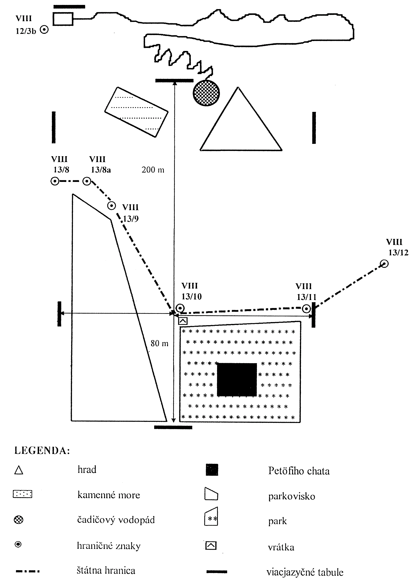

Príloha č. 1

- Plán

  - vyznačeného priestoru uvedeného v článku 2 ods. 3 Dohody medzi vládou Slovenskej republiky a vládou Maďarskej republiky o možnosti prehliadky historických pamiatok a prírodných hodnôt nachádzajúcich sa v blízkosti spoločnej štátnej hranice oboch krajín

- 
