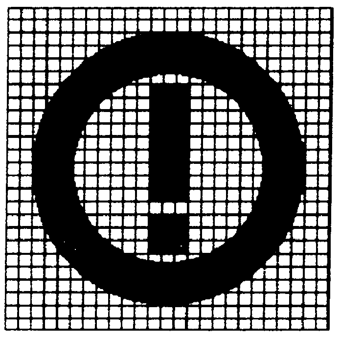

Príloha č. 6 k nariadeniu vlády č. 443/2001 Z. z.

- Označenie CE

  - 1. Grafickú podobu označenia CE ustanovuje osobitný predpis.19)

    - V prípade zmenšenia alebo zväčšenia označenia CE sa dodržujú proporcie dané pomocnou mriežkou.

  - 2. Označenie CE má výšku najmenej 5 mm okrem prípadov, keď to neumožňuje povaha prístroja.

  - 3. Označenie CE sa pripája na výrobok alebo na jeho identifikačný štítok. Okrem toho sa uvádza na obale (ak jestvuje) a v sprievodnej dokumentácii.

  - 4. Označenie CE sa umiestňuje na viditeľné miesto, čitateľne a nezmazateľne.

    - Prvotná klasifikácia rádiových zariadení a koncových telekomunikačných zariadení

    - a priradenie identifikačných znakov

  - 1. Rádiové zariadenia a koncové telekomunikačné zariadenia, ktoré možno uvádzať na trh a do prevádzky bez obmedzení, tvoria triedu. Táto trieda sa označuje ako „Trieda 1“. Tejto triede zariadení nie je priradený identifikačný znak.

  - 2. Rádiové zariadenia, pre ktoré platia obmedzenia na ich prevádzkovanie v Slovenskej republike10) alebo v rámci krajín Európskej únie, tvoria triedu. Táto trieda sa označuje ako „Trieda 2“. Zariadeniam patriacim do tejto triedy sa priraďuje tento identifikačný znak:

  - 

  - 3. Orientačný zoznam zariadení patriacich do uvedených tried zverejňuje Komisia ES na internetovej stránke obsahujúcej informácie o smernici č. 1999/5/ES (http://europa.eu.int/comm/enterprise/rtte). Rádiové zariadenia, pre ktoré platia obmedzenia na ich prevádzkovanie v Slovenskej republike, zverejňuje úrad vo vestníku ministerstva a na internetovej stránke na adrese http://www.teleoff.gov.sk/.
