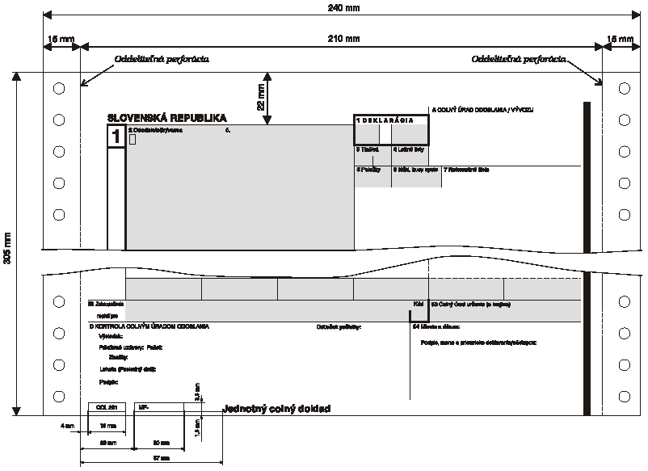
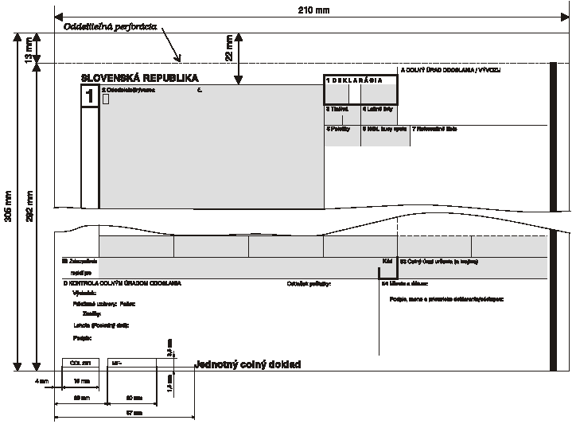

Príloha č. 10 k vyhláške č. 519/2001 Z. z.

- Príloha č. 24a

- TECHNICKÁ ÚPRAVA TLAČIVA JEDNOTNÉHO COLNÉHO DOKLADU A TLAČIVA DOPLNKOVÉHO DOKLADU

- A. Vyhotovenie na tabelačnom papieri

- B. Vyhotovenie v lepenom zväzku

[Příloha 11](../assets/45851414849462ee46ae175d585fe12cf1634e508ad248e85252336e115b1161.pdf)
