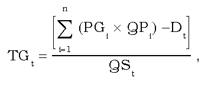
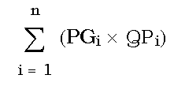
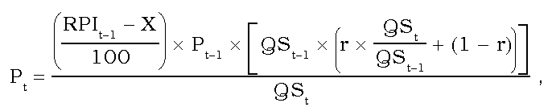
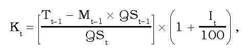

# Článok 2

(1) Spôsob výpočtu maximálneho prípustného výnosu na objemovú jednotku dodanú odberateľom v roku t zohľadňuje ekonomicky oprávnené náklady a primeraný zisk z vykonávania regulovanej činnosti.5)

(2) Pri návrhu cenových taríf na rok t bude mať regulovaný subjekt na zreteli, aby skutočne dosiahnutý priemerný výnos za predaj zemného plynu v roku t na objemovú jednotku neprekročil maximálnu cenu na rok t.

(3) Spôsob výpočtu maximálnej ceny podľa tohto článku sa vzťahuje na regulovaný subjekt, ktorého dodávka zemného plynu odberateľom v roku t-1 bola vyššia ako 100 000 000 objemových jednotiek.

(4) Pre regulovaný subjekt s výnimkou regulovaného subjektu uvedeného v odseku 3 cenové tarify za dodávky zemného plynu odberateľom určí úrad podľa § 12 ods. 1 písm. a) a ods. 2 zákona.

(5) Maximálny prípustný výnos na objemovú jednotku dodanú odberateľom v roku t sa vypočíta podľa vzorca:

Mt= CPt + Pt - Kt,

pričom

CPt = neovplyvniteľné náklady v Sk na objemovú jednotku dodanú odberateľom v roku t,

Pt = ovplyvniteľné náklady v Sk na objemovú jednotku dodanú odberateľom v roku t,

Kt = korekčný faktor v Sk na objemovú jednotku v roku t na vyrovnanie nedostatku alebo prebytku príjmov v roku t-1.

(6) Neovplyvniteľné náklady CPtv Sk na objemovú jednotku dodanú odberateľom v roku t sa vypočítajú podľa vzorca:

CPt= TGt+ TOt/QSt,

pričom

TGt = celkové plánované náklady v Sk na objemovú jednotku, ktoré môže regulovaný subjekt vynaložiť na nákup zemného plynu v roku t,

TOt = celkové ostatné plánované neovplyvniteľné náklady v Sk v roku t, ktoré zahŕňajú najmä poplatky za vydanie licencií a dane z nehnuteľností,6)

QSt = celkový plánovaný objem predaného zemného plynu v objemovej jednotke v roku t.

- a) Celkové plánované náklady na nákup zemného plynu v Sk na objemovú jednotku sa určujú použitím vzorca:

pričom

 = súčet plánovaných nákladov na celkový nákup plynu u zmluvných dodávateľov,

n = počet zmlúv,

PGi = plánovaná cena za nákup zemného plynu v Sk na objemovú jednotku v roku t podľa i-tej zmluvy,

QPi = plánované množstvo nakúpeného zemného plynu v objemovej jednotke v roku t podľa i-tej zmluvy. Súčet QPije daný plánovaným objemom predaja zemného plynu QSta predpokladanými stratami pri rozvode zemného plynu v roku t,

Dt = úradom nepovolené náklady na nákup zemného plynu v Sk, pri ktorých regulovaný subjekt nepreukáže úradu, že pri nákupe zemného plynu vyvinul maximálne úsilie o dosiahnutie čo najnižších možných cien. = úradom nepovolené náklady na nákup zemného plynu v Sk, pri ktorých regulovaný subjekt nepreukáže úradu, že pri nákupe zemného plynu vyvinul maximálne úsilie o dosiahnutie čo najnižších možných cien.

(7) Ovplyvniteľné náklady v Sk na objemovú jednotku dodanú odberateľom v roku t pri zachovaní úrovne kvality služieb poskytovaných zákazníkom minimálne na úrovni roku 2001 sa vypočítajú podľa vzorca:

pričom

RPIt-1 = aritmetický priemer indexov spotrebiteľských cien, ktorým je položka „spotrebiteľské ceny úhrnom, rovnaké obdobie predchádzajúceho roku sa rovná 100“, publikovaných Štatistickým úradom Slovenskej republiky, v období od októbra v roku t-2 až do septembra v roku t-1,

X = faktor cenovej regulácie v %,

Pt-1 = ovplyvniteľné náklady v Sk na objemovú jednotku v roku t-1,

QSt = celkový plánovaný objem predaného zemného plynu v roku t,

QSt-1 = celkový predpokladaný objem predaného zemného plynu v roku t-1,

r = variabilný stimulátor príjmov, ktorý vyjadruje percentuálny podiel príjmových požiadaviek, ktorý sa bude meniť v závislosti od množstva predaného zemného plynu.

(8) Korekčný faktor v Sk na objemovú jednotku v roku t na vyrovnanie nedostatku alebo prebytku príjmov v roku t-1 sa vypočíta podľa vzorca:

pričom

Tt-1 = celkové predpokladané výnosy v Sk v roku t-1 za predaj zemného plynu,

Mt-1 = maximálny prípustný výnos v Sk na objemovú jednotku pre rok t-1,

It = prípustná úroková miera v roku t v %.

(9) Hodnota Itv prípade, že

- a) Kt > 0, je rovná úrokovej sadzbe: 12M BRIBOR (predaj), ktorý publikuje Národná banka Slovenska za obdobie január až september v roku t-1 + 5 % a ktorý sa vypočíta ako priemer mesačných priemerov,

- b) Kt< 0, je rovná úrokovej sadzbe: 12M BRIBOR (predaj), ktorý publikuje Národná banka Slovenska za obdobie január až september v roku t-1 a ktorý sa vypočíta ako priemer mesačných priemerov.

(10) Ak sa počas regulačného obdobia zmení metodika výpočtu indexu spotrebiteľských cien úhrnom, úrad stanoví po konzultácii s regulovaným subjektom a so Štatistickým úradom Slovenskej republiky index zodpovedajúci úrovni inflácie za obdobie, v ktorom nastali zmenené podmienky.

(11) Hodnota korekčného faktora K2003je 0 a číselnú hodnotu parametrov X, P2002 a r pre regulované subjekty uvedené v odseku 3 určí úrad v jednotlivých rozhodnutiach na základe predložených podkladov.
