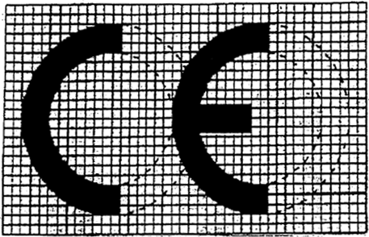

Príloha č. 10 k nariadeniu vlády č. 569/2001 Z. z.

- OZNAČENIE CE

  - 1. Označenie CE sa skladá z iniciálok CE podľa tejto grafickej úpravy (obr. 1).

  - 2. V prípade zmenšenia alebo zväčšenia označenia CE proporcie uvedené na rastrovanej kresbe sa musia dodržať.

  - 3. Rozličné prvky označenia CE musia mať približne rovnaké rozmery kolmice, ktoré nesmú byť menšie ako 5 mm. Pre pomôcky malých rozmerov môže notifikovaná osoba udeliť výnimku z tohto obmedzenia.

  - 

    - Obr. 1. Označenie CE
