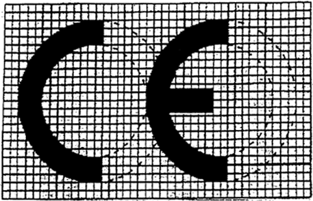

Príloha č. 9 k nariadeniu vlády č. 570/2001 Z. z.

- OZNAČENIE CE

  - 1. Označenie CE sa po nadobudnutí účinnosti medzinárodnej dohody PECA stane slovenskou značkou zhody pre určené výrobky. Skladá sa z iniciálok CE podľa grafickej úpravy uvedenej v prílohe k zákonu.

    - Od nadobudnutia účinnosti medzinárodnej dohody PECA sa budú používať § 18 a 19 zákona a grafické zobrazenie uvedené v prílohe č. 1 zákona sa bude považovať za slovenskú značku zhody pre určené výrobky.

  - 2. V prípade zmenšenia alebo zväčšenia označenia CE sa proporcie vyplývajúce z rastrovanej grafickej úpravy dodržia.

    - Rozličné prvky označenia CE majú približne rovnaké rozmery kolmice, ktoré nie sú menšie ako 5 mm. Pre pomôcky malých rozmerov môže autorizovaná osoba udeliť výnimku z tohto obmedzenia.

  - 

    - Obr. Označenie CE
