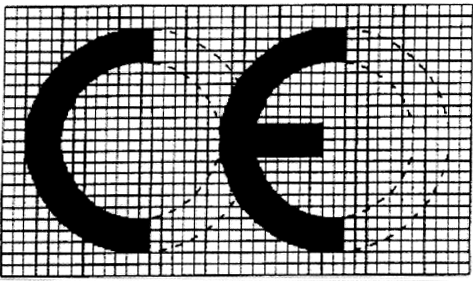

Príloha č. 12 k nariadeniu vlády č. 572/2001 Z. z.

- OZNAČENIE CE

  - 1. Označenie CE sa skladá z iniciálok CE podľa grafickej úpravy uvedenej v prílohe k zákonu.

  - 2. V prípade zmenšenia alebo zväčšenia označenia CE proporcie vyplývajúce z rastrovanej grafickej úpravy sa dodržia.

  - 3. Rozličné prvky označenia CE majú približne rovnaké rozmery kolmice, ktoré nie sú menšie ako 5 mm. Na pomôcky malých rozmerov môže notifikovaná osoba udeliť výnimku z tohto obmedzenia.

  - 
