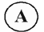

# § 9 Evidencia semenných zdrojov, ich označovanie v teréne a v lesníckych mapách

(1) Okresný úrad13) vedie evidenciu semenných zdrojov v rámci územnej pôsobnosti okresného úradu. Vlastníci alebo užívatelia lesov vedú evidenciu vlastných semenných zdrojov.14)

(2) Zmeny v uznaných semenných zdrojoch podľa stavu k 31. decembru kalendárneho roka vlastník alebo užívateľ semenného zdroja15) oznamuje lesníckemu ústavu, ktorý ich po overení oznamuje okresnému úradu.

(3) Výberový strom sa v teréne označuje číslom stromu podľa uznávacieho listu žltou farbou. Číslo na výberovom strome sa umiestňuje vo výške d1,3 m na mieste viditeľnom z najbližšej komunikácie. Od tohto čísla sa po obvode kmeňa vyznačujú žltou farbou dva pruhy o šírke 5 cm a s medzerou medzi pruhmi o šírke 15 cm.

(4) Uznaný lesný porast kategórie A sa v teréne označuje jedným pruhom zelenej farby po celom obvode kmeňa o šírke 5 cm vo výške d1,3 m na okrajových stromoch porastu tak, aby bol viditeľný od stromu k stromu.

(5) Uznaný lesný porast kategórie B sa v teréne označuje znakom „X“ zelenej farby na okrajových stromoch lesného porastu tak, aby bol viditeľný od stromu k stromu.

(6) Zdroje reprodukčného materiálu vyznačujú užívatelia lesov v teréne v určenej lehote.16)

(7) V lesníckych mapách sa jednotlivé zdroje reprodukčného materiálu označujú týmito značkami:

a) výberové stromy | ,

b) uznané lesné porasty kategórie A | ,

c) uznané lesné porasty kategórie B | ,

d) semenné porasty | ,

e) lesné porasty v génovej základni | ,

d) semenné sady | .

