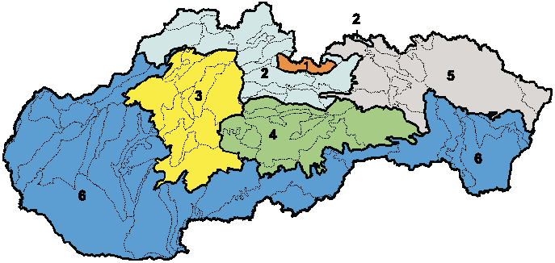

Príloha č. 3 k vyhláške č. 64/2001 Z. z.

- Jedľa biela Abies alba MILL. 

  - Semenárske oblasti

  - 1. Tatranská

  - 2. Severoslovenská

  - 3. Stredoslovenská

  - 4. Horehronsko-hnilecká

  - 5. Východokaspatská

  - 6. Juhoslovenská

  - V AREÁLI PRIRODZENÉHO ROZŠÍRENIA

    - 1. Tatranská oblasť

      - Tatry 47 (Liptovské Tatry 47A, Roháče 47A, Liptovské kopy 47A, Vysoké Tatry 47A).

    - 2. Severoslovenská oblasť

      - Tatry 47 (Belianske Tatry 47B, Široká 47B, Osobitá 47C, Sivý vrch 47D), Pieniny 41B, Podtatranská kotlina 43 (Liptovská kotlina 43A, Popradská kotlina 43B, Tatranské podhorie 43B), Nízke Tatry 46 (Salatíny 46A, Demänovské vrchy 46A, Ďumbier S 46Bb, Prašivá S 46Bb, Kráľova hoľa S 46Cb, Priehyba S 46Cb, Predná hoľa 46D, Kozie chrbty 46E), Chočské vrchy 35, Stredné Beskydy 33 (Oravské Beskydy 33A, Podbeskydská brázda 33A, Podbeskydská vrchovina 33A, Oravská Magura 33A, Kysucké Beskydy 33B, Kysucká vrchovina 33C, Oravská vrchovina 33D), Oravská kotlina 44, Skorušinské vrchy 45, Zuberská brázda 45, Západné Beskydy 32, Javorníky 23.

    - 3. Stredoslovenská oblasť

      - Veľká Fatra 35, Starohorské vrchy 35, Žilinská kotlina 24, Strážovské vrchy 25A, Súľovské vrchy 25B, Malá Fatra 34A, Turčianska kotlina 26, Žiar 34B, Hornonitrianska kotlina 6, Vtáčnik 27B, Kremnické vrchy 27B, Žiarska kotlina 8, Štiavnické vrchy 27A, Javorie 27A, Pliešovská kotlina 27A, Pohronský Inovec 27A.

    - 4. Horehronsko-hnilecká oblasť

      - Zvolenská kotlina 17 (Sliačska kotlina 17A, Zvolenská pahorkatina 17A, Slatinská kotlina 17A, Detvianska kotlina 17A, Rohy 17A, Bystrická vrchovina 17B, Bystrické podolie 17B, Ponická vrchovina 17B, Povraznícka brázda 17B), Poľana 37, Nízke Tatry 46 (Ďumbier J 46Ba, Prašivá J 46Ba, Kráľova hoľa J 46Ca, Priehyba J 46Ca), Horehronské podolie 36 (Lopejská kotlina 36A, Bystrianske podhorie 36A, Heľpianske podolie 36B, Breznianska kotlina 36C), Spišsko-gemerský kras 39, Veporské vrchy, Stolické vrchy 38, Volovské vrchy 28A, Revúcka vrchovina 18, Rožňavská kotlina 18.

    - 5. Východokarpatská oblasť

      - Levočské vrchy 42A, Bachureň 42A, Spišská Magura 42B, Ždiarska brázda 42B, Hornádska kotlina 29, Branisko 40, Čierna Hora 28B, Šarišská vrchovina 22 (Šarišské podolie 22A, Stráže 22A), Spišsko-šarišské medzihorie 22 (Ľubovnianska kotlina, Ľubotínska pahorkatina 22B, Jakubianska brázda 22B, Hromovec 22B), Čergov 41A, Ľubovnianska vrchovina 41A, Nízke Beskydy 21 (Bušov 21B, Ondavská vrchovina 21A, Laborecká vrchovina 21A, Beskydské predhorie 21A), Bukovské vrchy 31.

  - MIMO AREÁLU PRIRODZENÉHO ROZŠÍRENIA

    - 6. Juhoslovenská oblasť

      - Záhorská nížina 1 (Borská nížina 1A, Chvojnická pahorkatina 1B, Dyjsko-moravská niva 1C, Dolnomoravská niva 1C), Malé Karpaty 13, Myjavská pahorkatina 14, Biele Karpaty 15, Považské podolie 16, Podunajská nížina 2 (Podunajská rovina 2A, Čenkovská niva 2A, Podunajská pahorkatina 2B, Dolnovážska niva 2C, Nitrianska niva 2C, Žitavská niva 2C, Hronská niva 2C, Ipeľská niva 2C), Burda 3, Považský Inovec 5, Tríbeč 7, Krupinská kotlina 9, Ostrožky 9, Juhoslovenská kotlina 10, Gemerská pahorkatina 10, Cerová vrchovina 11, Slovenský kras 19, Košická kotlina 12, Abovská pahorkatina 12, Slanské vrchy 20A, Zemplínske vrchy 20B, Východoslovenská nížina 4 (Východoslovenská rovina 4A, Východoslovenská pahorkatina 4B), Vihorlatské vrchy 30.
