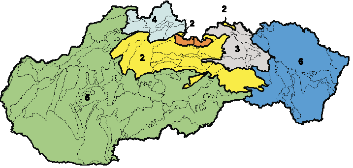

Príloha č. 5 k vyhláške č. 64/2001 Z. z.

- Smrekovec opadavý Larix decidua MILL. 

- Semenárske oblasti

  - 1. Tatranská

  - 2. Stredoslovenská

  - 3. Šarišsko-spišská

  - 4. Oravská

  - 5. Juhozápadoslovenská

  - 6. Východoslovenská

  - V AREÁLI PRIRODZENÉHO ROZŠÍRENIA

    - 1. Tatranská oblasť

      - Tatry 47 (Liptovské Tatry 47A, Roháče 47A, Liptovské kopy 47A, Vysoké Tatry 47A).

    - 2. Stredoslovenská oblasť

      - Tatry 47 (Belianske Tatry 47B, Široká 47B, Osobitá 47C, Sivý vrch 47D), Pieniny 41B, Podtatranská kotlina 43 (Liptovská kotlina 43A, Popradská kotlina 43B, Tatranské podhorie 43B), Nízke Tatry 46 (Salatíny 46A, Demänovské vrchy 46A, Ďumbier, Prašivá 46B (Ďumbier, Prašivá, juh 46Ba, Ďumbier, Prašivá, sever 46Bb), Kráľova hoľa 46C, Priehyba 46C, Predná hoľa 46D, Kozie chrbty 46E), Veľká Fatra 35, Starohorské vrchy 35, Chočské vrchy 35, Turčianska kotlina 26, Malá Fatra 34A, Spišsko-gemerský kras 39, Volovské vrchy 28A.

    - 3. Šarišsko-spišská oblasť

      - Hornádska kotlina 29, Branisko 40, Šarišská vrchovina 22 (Šarišské podolie 22A, Stráže 22A), Spišsko-šarišské medzihorie 22 (Ľubovnianska kotlina 22B, Ľubotínska pahorkatina 22B, Jakubianska brázda 22B, Hromovec 22B), Levočské vrchy 42A, Bachureň 42A, Spišská Magura 42B, Ždiarska brázda 42B, Ľubovnianska vrchovina 41A.

    - 4. Oravská oblasť

      - Skorušinské vrchy 45, Zuberská brázda 45, Oravská kotlina 44, Stredné Beskydy 33 (Oravské Beskydy 33A, Podbeskydská brázda 33A, Podbeskydská vrchovina 33A, Oravská Magura 33A, Kysucké Beskydy 33B, Kysucká vrchovina 33C, Oravská vrchovina 33D).

  - MIMO AREÁLU PRIRODZENÉHO ROZŠÍRENIA

    - 5. Juhozápadoslovenská oblasť

      - Západné Beskydy 32, Javorníky 23, Žilinská kotlina 24, Strážovské vrchy 25A, Súľovské vrchy 25B, Považské podolie 16, Biele Karpaty 15, Myjavská pahorkatina 14, Malé Karpaty 13, Žiar 34B, Považský Inovec 5, Hornonitrianska kotlina 6, Tríbeč 7, Žiarska kotlina 8, Štiavnické vrchy 27A, Javorie 27A, Pliešovská kotlina 27A, Pohronský Inovec 27A, Vtáčnik 27B, Kremnické vrchy 27B, Zvolenská kotlina 17 (Sliačska kotlina 17A, Zvolenská pahorkatina 17A, Slatinská kotlina 17A, Detvianska kotlina 17A, Rohy 17A, Bystrická vrchovina 17B, Bystrické podolie 17B, Ponická vrchovina 17B, Povraznícka brázda 17B), Poľana 37, Veporské vrchy, Stolické vrchy 38, Horehronské podolie 36 (Lopejská kotlina 36A, Bystrianske podhorie 36A, Heľpianske podolie 36B, Breznianska kotlina 36C), Revúcka vrchovina 18, Rožňavská kotlina 18, Slovenský kras 19, Juhoslovenská kotlina 10, Gemerská pahorkatina 10, Krupinská kotlina 9, Ostrožky 9, Cerová vrchovina 11, Podunajská nížina 2 (Podunajská rovina 2A, Čenkovská niva 2A, Podunajská pahorkatina 2B, Nitrianska niva 2C, Žitavská niva 2C, Hronská niva 2C, Ipeľská niva 2C), Burda 3, Záhorská nížina 1 (Borská nížina 1A, Chvojnická pahorkatina 1B, Dyjsko-moravská niva 1C, Dolnomoravská niva 1C).

    - 6. Východoslovenská oblasť

      - Čergov 41A, Nízke Beskydy 21 (Bušov 21B, Ondavská vrchovina 21A, Laborecká vrchovina 21A, Beskydské predhorie 21A), Bukovské vrchy 31, Vihorlatské vrchy 30, Východoslovenská nížina 4 (Východoslovenská rovina 4A, Východoslovenská pahorkatina 4B), Slanské vrchy 20A, Zemplínske vrchy 20B, Košická kotlina 12, Abovská pahorkatina 12, Čierna hora 28B.
