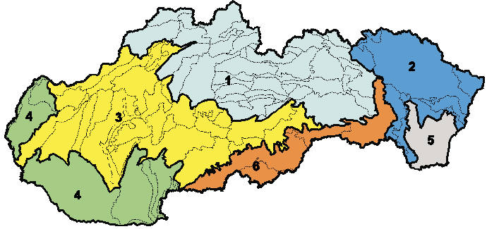

Príloha č. 7 k vyhláške č. 64/2001 Z. z.

- Dub zimný Quercus petraea LIEBL. Dub letný Quercus robur L. 

- Dub zimný

  - 1. Severoslovenská

  - 2. Východoslovenská

  - 3. Stredoslovenská

    - Dub letný

  - 4. Západoslovenská

  - 5. Juhovýchodoslovenská

    - Spoločná oblasť

  - 6. Juhoslovenská

    - Dub zimný Quercus petraea MATT./LIEBL.

  - V AREÁLI PRIRODZENÉHO ROZŠÍRENIA

    - 2. Východoslovenská oblasť

      - Slanské vrchy 20A, Zemplínske vrchy 20B, Východoslovenská nížina 4 (Východoslovenská pahorkatina 4B), Vihorlatské vrchy 30, Nízke Beskydy 21 (Bušov 21B, Ondavská vrchovina 21A, Laborecká vrchovina 21A, Beskydské predhorie 21A), Bukovské vrchy 31, Čergov 41A.

    - 3. Stredoslovenská oblasť

      - Malé Karpaty 13, Myjavská pahorkatina 14, Biele Karpaty 15, Považské podolie 16, Súľovské vrchy 25B, Žilinská kotlina 24, Strážovské vrchy 25A, Považský Inovec 5, Podunajská pahorkatina 2 (Nitrianska pahorkatina 2B, Trnavská pahorkatina 2B, Nitrianska niva 2C, Žitavská niva 2C, Dolnovážska niva 2C), Hornonitrianska kotlina 6, Tríbeč 7, Žiar 34B, Vtáčnik 27B, Kremnické vrchy 27B, Žiarska kotlina 8, Štiavnické vrchy 27A, Javorie 27A, Pliešovská kotlina 27A, Pohronský Inovec 27A, Zvolenská kotlina 17 (Sliačska kotlina 17A, Zvolenská pahorkatina 17A, Slatinská kotlina 17A, Detvianska kotlina 17A, Rohy 17A, Bystrická vrchovina 17B, Bystrické podolie 17B, Ponická vrchovina 17B, Povraznícka brázda 17B), Poľana 37, Krupinská kotlina 9, Ostrožky 9, Veporské vrchy, Stolické vrchy 38, (Veporské vrchy, Stolické vrchy, juh 38a, Stolica 38b), Revúcka vrchovina 18, Rožňavská kotlina 18.

    - 6. Juhoslovenská oblasť

      - Juhoslovenská kotlina 10, Gemerská pahorkatina 10, Cerová vrchovina 11, Slovenský kras 19, Košická kotlina 12, Abovská pahorkatina 12.

  - MIMO AREÁLU PRIRODZENÉHO ROZŠÍRENIA

    - 1. Severoslovenská oblasť

      - Tatry 47 (Liptovské Tatry 47A, Roháče 47A, Liptovské kopy 47A, Vysoké Tatry 47A, Belianske Tatry 47B, Široká 47B, Osobitá 47C, Sivý vrch 47D), Pieniny 41B, Podtatranská kotlina 43 (Liptovská kotlina 43A, Popradská kotlina 43B, Tatranské podhorie 43B), Levočské vrchy 42A, Bachureň 42A, Spišská Magura 42B, Ždiarska brázda 42B, Ľubovnianska vrchovina 41A, Spišskošarišské medzihorie 22 (Ľubovnianska kotlina 22B, Ľubotínska pahorkatina 22B, Jakubianska brázda 22B, Hromovec 22B), Šarišská vrchovina 22 (Šarišské podolie 22A, Stráže 22A), Hornádska kotlina 29, Branisko 40, Volovské vrchy 28A, Čierna hora 28B, Nízke Tatry 46 (Salatíny 46A, Demänovské vrchy 46A, Kráľova hoľa 46C, Priehyba 46C, Predná hoľa 46D, Kozie chrbty 46E), Spišsko-gemerský kras 39, Horehronské podolie 36 (Lopejská kotlina 36A, Bystrianske podhorie 36A, Breznianska kotlina 36C), Veporské vrchy, Stolické vrchy 38 (Veporské vrchy, Stolické vrchy, sever 38b okrem Stolice 38b), Veľká Fatra 35, Starohorské vrchy 35, Chočské vrchy 35, Turčianska kotlina 26, Malá Fatra 34A, Skorušinské vrchy 45, Zuberská brázda 45, Oravská kotlina 44, Stredné Beskydy 33 (Oravské Beskydy 33A, Podbeskydská brázda 33A, Podbeskydská vrchovina 33A, Oravská Magura 33A, Kysucké Beskydy 33B, Kysucká vrchovina 33C, Oravská vrchovina 33D), Západné Beskydy 32, Javorníky 23, Ďumbier, Prašivá 46B (Ďumbier, Prašivá, juh 46Ba, Ďumbier, Prašivá, sever 46Bb), Heľpianske podolie 36B.

    - 4. Západoslovenská oblasť

      - Záhorská nížina 1 (Borská nížina 1A, Chvojnická pahorkatina 1B, Dyjsko-moravská niva 1C, Dolnomoravská niva 1C), Podunajská nížina 2 (Podunajská rovina 2A, Čenkovská niva 2A, Podunajská pahorkatina 2 (Hronská pahorkatina 2B, Ipeľská pahorkatina 2B, Hronská niva 2C, Ipeľská niva 2C), Burda 3.

    - 5. Juhovýchodoslovenská oblasť

      - Východoslovenská nížina 4 (Východoslovenská rovina 4A).

      - Dub letný Quercus robur L.

  - V AREÁLI PRIRODZENÉHO ROZŠÍRENIA

    - 4. Západoslovenská oblasť

      - Záhorská nížina 1 (Borská nížina 1A, Chvojnická pahorkatina 1B, Dyjsko-moravská niva 1C, Dolnomoravská niva 1C), Podunajská nížina 2 (Podunajská rovina 2A, Čenkovská niva 2A, Podunajská pahorkatina 2 (Hronská pahorkatina 2B, Ipeľská pahorkatina 2B, Hronská niva 2C, Ipeľská niva 2C), Burda 3.

    - 5. Juhovýchodoslovenská oblasť

      - Východoslovenská nížina 4 (Východoslovenská rovina 4A).

    - 6. Juhoslovenská oblasť

      - Juhoslovenská kotlina 10, Gemerská pahorkatina 10, Cerová vrchovina 11, Slovenský kras 19, Košická kotlina 12, Abovská pahorkatina 12.

  - MIMO AREÁLU PRIRODZENÉHO ROZŠÍRENIA

    - 1. Severoslovenská oblasť

      - Tatry 47 (Liptovské Tatry 47A, Roháče 47A, Liptovské kopy 47A, Vysoké Tatry 47A, Belianske Tatry 47B, Široká 47B, Osobitá 47C, Sivý vrch 47D), Pieniny 41B, Podtatranská kotlina 43 (Liptovská kotlina 43A, Popradská kotlina 43B, Tatranské podhorie 43B), Levočské vrchy 42A, Bachureň 42A, Spišská Magura 42B, Ždiarska brázda 42B, Ľubovnianska vrchovina 41A, Spišskošarišské medzihorie 22 (Ľubovnianska kotlina 22B, Ľubotínska pahorkatina 22B, Jakubianska brázda 22B, Hromovec 22B), Šarišská vrchovina 22 (Šarišské podolie 22A, Stráže 22A), Hornádska kotlina 29, Branisko 40, Volovské vrchy 28A, Čierna hora 28B, Nízke Tatry 46 (Salatíny 46A, Demänovské vrchy 46A, Kráľova hoľa 46C, Priehyba 46C, Predná hoľa 46D, Kozie chrbty 46E), Spišsko-gemerský kras 39, Horehronské podolie 36 (Lopejská kotlina 36A, Bystrianske podhorie 36A, Breznianska kotlina 36C), Veporské vrchy, Stolické vrchy 38 (Veporské vrchy, Stolické vrchy, sever 38b okrem Stolice 38b), Veľká Fatra 35, Starohorské vrchy 35, Chočské vrchy 35, Turčianska kotlina 26, Malá Fatra 34A, Skorušinské vrchy 45, Zuberská brázda 45, Oravská kotlina 44, Stredné Beskydy 33 (Oravské Beskydy 33A, Podbeskydská brázda 33A, Podbeskydská vrchovina 33A, Oravská Magura 33A, Kysucké Beskydy 33B, Kysucká vrchovina 33C, Oravská vrchovina 33D), Západné Beskydy 32, Javorníky 23, Ďumbier, Prašivá 46B (Ďumbier, Prašivá, juh 46Ba, Ďumbier, Prašivá, sever 46Bb), Heľpianske podolie 36B.

    - 2. Východoslovenská oblasť

      - Slanské vrchy 20A, Zemplínske vrchy 20B, Východoslovenská nížina 4 (Východoslovenská pahorkatina 4B), Vihorlatské vrchy 30, Nízke Beskydy 21 (Bušov 21B, Ondavská vrchovina 21A, Laborecká vrchovina 21A, Beskydské predhorie 21A), Bukovské vrchy 31, Čergov 41A.

    - 3. Stredoslovenská oblasť

      - Malé Karpaty 13, Myjavská pahorkatina 14, Biele Karpaty 15, Považské podolie 16, Súľovské vrchy 25B, Žilinská kotlina 24, Strážovské vrchy 25A, Považský Inovec 5, Podunajská pahorkatina 2 (Nitrianska pahorkatina 2B, Trnavská pahorkatina 2B, Nitrianska niva 2C, Žitavská niva 2C, Dolnovážska niva 2C), Hornonitrianska kotlina 6, Tríbeč 7, Žiar 34B, Vtáčnik 27B, Kremnické vrchy 27B, Žiarska kotlina 8, Štiavnické vrchy 27A, Javorie 27A, Pliešovská kotlina 27A, Pohronský Inovec 27A, Zvolenská kotlina 17 (Sliačska kotlina 17A, Zvolenská pahorkatina 17A, Slatinská kotlina 17A, Detvianska kotlina 17A, Rohy 17A, Bystrická vrchovina 17B, Bystrické podolie 17B, Ponická vrchovina 17B, Povraznícka brázda 17B), Poľana 37, Krupinská kotlina 9, Ostrožky 9, Veporské vrchy, Stolické vrchy 38 (Veporské vrchy, Stolické vrchy, juh 38a, Stolica 38b), Revúcka vrchovina 18, Rožňavská kotlina 18.
