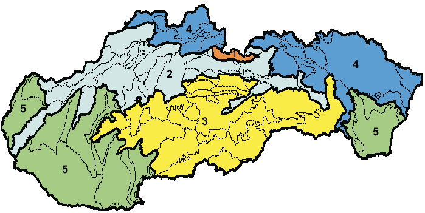

Príloha č. 8 k vyhláške č. 64/2001 Z. z.

- Semenárske oblasti pre ostatné dreviny 

- Semenárske oblasti

  - 1. Tatranská

  - 2. Karpatsko-podtatranská

  - 3. Stredoslovenská

  - 4. Beskydská

  - 5. Juhoslovenská

  - 1. Tatranská oblasť

    - Tatry 47 (Liptovské Tatry 47A, Roháče 47A, Liptovské kopy 47A, Vysoké Tatry 47A).

  - 2. Karpatsko-podtatranská oblasť

    - Malé Karpaty 13, Myjavská pahorkatina 14, Biele Karpaty 15, Považské podolie 16, Javorníky 23, Považský Inovec 5, Strážovské vrchy 25A, Súľovské vrchy 25B, Žilinská kotlina 24, Malá Fatra 34A, Žiar 34B, Hornonitrianska kotlina 6, Turčianska kotlina 26, Veľká Fatra 35, Chočské vrchy 35, Starohorské vrchy 35, Tatry 47 (Belianske Tatry 47B, Široká 47B, Sivý vrch 47D), Podtatranská kotlina 43 (Liptovská kotlina 43A, Popradská kotlina 43B, Tatranské podhorie 43B), Nízke Tatry 46 (Salatíny 46A, Demänovské vrchy 46A, Kozie chrbty 46E), Hornádska kotlina 29, Spišsko-gemerský kras 39, Branisko 40, Čierna hora 28B.

  - 3. Stredoslovenská oblasť

    - Tríbeč 7, Žiarska kotlina 8, Štiavnické vrchy 27A, Javorie 27A, Pliešovská kotlina 27A, Pohronský Inovec 27A, Vtáčnik 27B, Kremnické vrchy 27B, Zvolenská kotlina 17 (Sliačska kotlina 17A, Zvolenská pahorkatina 17A, Slatinská kotlina 17A, Detvianska kotlina 17A, Rohy 17A, Bystrická vrchovina 17B, Bystrické podolie 17B, Ponická vrchovina 17B, Povraznícka brázda 17B), Poľana 37, Krupinská kotlina 9, Ostrožky 9, Košická kotlina 12, Abovská pahorkatina 12, Nízke Tatry 46 (Ďumbier, Prašivá 46B, Kráľova hoľa 46C, Priehyba 46C, Predná hoľa 46D), Horehronské podolie 36 (Lopejská kotlina 36A, Bystrianske podhorie 36A, Heľpianske podolie 36B, Breznianska kotlina 36C), Veporské vrchy, Stolické vrchy 38, Volovské vrchy 28A, Revúcka vrchovina 18, Rožňavská kotlina 18, Slovenský kras 19.

  - 4. Beskydská oblasť

    - Západné Beskydy 32, Stredné Beskydy 33 (Oravské Beskydy 33A, Podbeskydská brázda 33A, Podbeskydská vrchovina 33A, Oravská Magura 33A, Kysucké Beskydy 33B, Kysucká vrchovina 33C, Oravská vrchovina 33D), Oravská kotlina 44, Skorušinské vrchy 45, Zuberská brázda 45, Tatry 47 (Osobitá 47C), Levočské vrchy 42A, Bachureň 42A, Spišská Magura 42B, Ždiarska brázda 42B, Šarišská vrchovina 22 (Šarišské podolie 22A, Stráže 22A), Spišskošarišské medzihorie 22 (Ľubovnianska kotlina 22B, Ľubotínska pahorkatina 22B, Jakubianska brázda 22B, Hromovec 22B), Ľubovnianska vrchovina 41A, Čergov 41A, Pieniny 41B, Nízke Beskydy 21 (Bušov 21B, Ondavská vrchovina 21A, Laborecká vrchovina 21A, Beskydské predhorie 21A), Bukovské vrchy 31, Vihorlatské vrchy 30, Slanské vrchy 20A.

  - 5. Juhoslovenská oblasť

    - Záhorská nížina 1 (Borská nížina 1A, Chvojnická pahorkatina 1B, Dyjsko-moravská niva 1C, Dolnomoravská niva 1C), Podunajská nížina 2 (Podunajská rovina 2A, Čenkovská niva 2A, Podunajská pahorkatina 2B, Dolnovážska niva 2C, Nitrianska niva 2C, Žitavská niva 2C, Hronská niva 2C, Ipeľská niva 2C), Burda 3, Juhoslovenská kotlina 10, Gemerská pahorkatina 10, Východoslovenská nížina 4 (Východoslovenská rovina 4A, Východoslovenská pahorkatina 4B, Zemplínske vrchy 20B, Cerová vrchovina 11.
