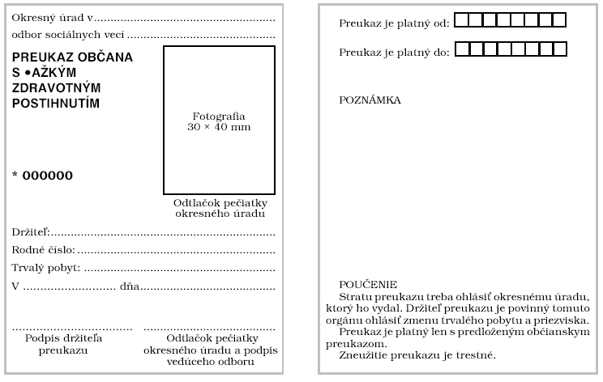

Príloha č. 6 k zákonu č. 195/1998 Z. z.

- Vzor preukazu občana s ťažkým zdravotným postihnutím

- Preukaz občana s ťažkým zdravotným postihnutím je 75 mm široký a 100 mm vysoký. Preukaz je vytlačený na tvrdom bielom papieri.

- Na líci preukazu je v ľavom hornom rohu uvedený drobným typom písma text „Okresný úrad v ......................., odbor sociálnych vecí“.

- Pod týmto textom na ľavej strane sú zvýrazneným veľkým typom písma slová „PREUKAZ OBČANA S ŤAŽKÝM ZDRAVOTNÝM POSTIHNUTÍM“ vysoké 3 mm, pod ním hviezdička a text s veľkými výraznými číslicami vysokými 5 mm, konkrétne päťmiestne evidenčné číslo začínajúce sa nulou. Evidenčné číslo prideľuje okresný úrad, ktorý vedie evidenciu preukazov.

- Napravo od evidenčného čísla je obdĺžnik 30 mm široký a 40 mm vysoký. V obdĺžniku je text „Fotografia 30 x 40 mm“ a pod tým „Odtlačok pečiatky okresného úradu“.

- V druhej polovici preukazu je na ľavej strane uvedený text 2 mm vysoký na troch riadkoch. V prvom riadku „Držiteľ:“, v druhom riadku „Rodné číslo:“, v treťom „Trvalý pobyt:“. Ostávajúca časť textu je vybodkovaná do konca pravej strany. V štvrtom riadku je text 2 mm vysoký „V ............. dňa ...................“.

- V poslednom riadku preukazu je uvedený text „..................... Podpis držiteľa preukazu“ a „................ Odtlačok pečiatky okresného úradu a podpis vedúceho odboru“.

- Na opačnej strane preukazu v hornej časti je uvedený text 3 mm vysoký „Preukaz je platný od: “ a pod ním „Preukaz je platný do: “.

- Pod týmto textom je uvedené veľkým typom písma 2 mm vysokým slovo „POZNÁMKA“. V poznámke sa uvádza napríklad druh zdravotného postihnutia, obmedzenie spôsobilosti na právne úkony, pozbavenie spôsobilosti na právne úkony, v prípade, že ide o občana s praktickou slepotou alebo úplnou slepotou, uvádzajú sa slová nevidiaci-blind.

- V dolnej časti preukazu je uvedené zvýrazneným veľkým typom písma 5 mm vysokým slovo „POUČENIE“ a pod ním 2 mm vysoký text poučenia, menej výrazný: „Stratu preukazu treba ohlásiť okresnému úradu, ktorý ho vydal. Držiteľ preukazu je povinný tomuto orgánu ohlásiť zmenu trvalého pobytu a priezviska. Preukaz je platný len s predloženým občianskym preukazom. Zneužitie preukazu je trestné.“

- V prípade odkázanosti na sprievodcu je z dolného ľavého rohu preukazu do pravej časti po spodok obdĺžnika pre fotografiu 30 x 40 mm červená čiara široká 30 mm.

- Za sprievodcu sa považuje občan alebo pes so špeciálnym výcvikom, ktorý poskytuje občanovi s ťažkým zdravotným postihnutím sprievod na zabezpečenie pohybu, orientácie a dorozumievania so spoločenským prostredím.
