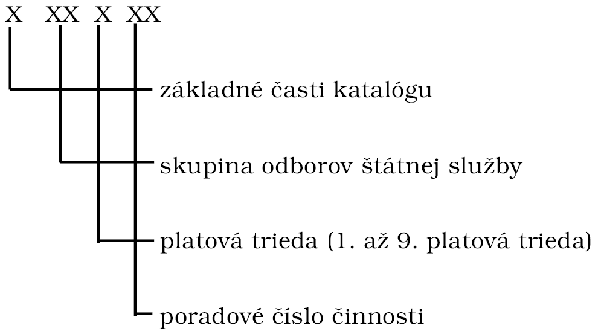

Príloha č. 1 k nariadeniu vlády č. 110/2002 Z. z.

- KATALÓG

- ČINNOSTÍ V ŠTÁTNEJ SLUŽBE

- Prehľad

1.01 Spoločné činnosti v štátnej službe ...................................................................................................... | 1093

2. Činnosti štátnej správy .......................................................................................................................... | 1098

2.01 Doprava, pošta a telekomunikácie ........................................................................................................... | 1098

2.02 Financie a správa daní ............................................................................................................................. | 1101

2.03 Geodézia, kartografia a kataster .............................................................................................................. | 1102

2.04 Hospodárstvo ............................................................................................................................................ | 1105

2.05 Jadrový dozor ........................................................................................................................................... | 1106

2.06 Justícia ..................................................................................................................................................... | 1107

2.07 Kultúra ..................................................................................................................................................... | 1108

2.08 Normalizácia, metrológia a skúšobníctvo ................................................................................................. | 1109

2.09 Obrana ..................................................................................................................................................... | 1110

2.10 Ochrana utajovaných skutočností ........................................................................................................... | 1112

2.11 Pôdohospodárstvo .................................................................................................................................... | 1113

2.12 Práca, inšpekcia práce a sociálne veci ..................................................................................................... | 1117

2.13 Priemyselné vlastníctvo ............................................................................................................................ | 1121

2.14 Správa a privatizácia národného majetku ................................................................................................ | 1123

2.15 Správa štátnych hmotných rezerv ............................................................................................................ | 1123

2.16 Školstvo .................................................................................................................................................... | 1124

2.17 Štatistika .................................................................................................................................................. | 1125

2.18 Úrad vlády Slovenskej republiky .............................................................................................................. | 1126

2.19 Verejné obstarávanie ................................................................................................................................ | 1128

2.20 Vnútro - Archívnictvo ............................................................................................................................... | 1128

2.21 Vnútro - Civilná ochrana ......................................................................................................................... | 1130

2.22 Vnútro - Migračná politika ....................................................................................................................... | 1131

2.23 Vnútro - Verejná správa a všeobecná správa .......................................................................................... | 1132

2.24 Výstavba a regionálny rozvoj .................................................................................................................... | 1135

2.25 Zahraničné veci ........................................................................................................................................ | 1137

2.26 Zdravotníctvo ............................................................................................................................................ | 1138

2.27 Životné prostredie .................................................................................................................................... | 1139

3. Činnosti štátnych záležitostí ................................................................................................................ | 1141

3.01 Najvyšší kontrolný úrad Slovenskej republiky ......................................................................................... | 1141

3.02 Najvyšší súd Slovenskej republiky a súdy ............................................................................................... | 1142

3.03 Prokuratúra ............................................................................................................................................. | 1143

Štruktúra číslovania činností .......................................................................................................................... | 1145

- 1.01 SPOLOČNÉ ČINNOSTI V ŠTÁTNEJ SLUŽBE

- 1. PLATOVÁ TRIEDA

- Kvalifikačné predpoklady: úplné stredné vzdelanie a osobitný kvalifikačný predpoklad, ak je ustanovený osobitným predpisom.

- Funkcia: referent

- Činnosti:

- 1.01 Čiastková činnosť pri vybavovaní jednoduchej odbornej agendy pri príprave podkladov na riadenie, na rozhodovanie alebo na kontrolu.

- 1.02 Preberanie, zhromažďovanie a príprava podkladov na riadenie, na rozhodovanie alebo na kontrolu pod odborným vedením.

- 2. PLATOVÁ TRIEDA

- Kvalifikačné predpoklady: úplné stredné vzdelanie, odborná prax viac ako dva roky a osobitný kvalifikačný predpoklad, ak je ustanovený osobitným predpisom.

- Funkcia: samostatný referent

- Činnosti:

- 2.01 Rutinné vybavovanie odbornej agendy tvoriacej podklad na riadenie, na rozhodovanie alebo na kontrolu.

- 2.02 Spracúvanie prehľadov, výkazov alebo štatistík tvoriacich podklad na riadenie, na rozhodovanie alebo na kontrolu.

- 3. PLATOVÁ TRIEDA

- Kvalifikačné predpoklady: úplné stredné vzdelanie alebo vyššie odborné vzdelanie, odborná prax viac ako štyri roky a osobitný kvalifikačný predpoklad, ak je ustanovený osobitným predpisom.

- Funkcia: odborný referent

- Činnosti:

- 3.01 Vykonávanie čiastkovej odbornej činnosti v osobnom úrade tvoriacej podklad na riadenie, na rozhodovanie alebo na kontrolu.

- 3.02 Vybavovanie čiastkovej odbornej agendy vo vecne vymedzenej oblasti tvoriacej podklad na riadenie, na rozhodovanie alebo na kontrolu.

- 3.03 Vedenie centrálnej evidencie petícií a sťažností vrátane evidencie ich vybavenia.

- 3.04 Zabezpečovanie odbornej agendy spojenej so sprístupňovaním informácií.

- 4. PLATOVÁ TRIEDA

- Kvalifikačné predpoklady: úplné stredné vzdelanie alebo vyššie odborné vzdelanie, odborná prax viac ako šesť rokov a osobitný kvalifikačný predpoklad, ak je ustanovený osobitným predpisom.

- Funkcia: hlavný referent

- Činnosti:

- 4.01 Samostatné vybavovanie odbornej agendy uplatňovania štátnozamestnaneckých vzťahov vo vecne vymedzenej oblasti v osobnom úrade alebo v úrade pre štátnu službu.

- 4.02 Vybavovanie ucelenej odbornej agendy vo vecne vymedzenej oblasti tvoriacej podklad na riadenie, na rozhodovanie, na kontrolu alebo príprava podkladov na odborné stanoviská v štátnej službe.

- 4.03 Kontrolná činnosť v určenom rozsahu vrátane spracúvania návrhov na uloženie postihov, prešetrovanie a kontrola vybavovania podaní.

- 4.04 Samostatné vybavovanie ucelenej agendy na úseku oslobodzovania občanov od povinnosti vykonať mimoriadnu službu v ústrednom orgáne štátnej správy, v inom orgáne štátnej správy s celoštátnou pôsobnosťou alebo v štátnom orgáne vykonávajúcom štátne záležitosti s celoštátnou pôsobnosťou.

- 5. PLATOVÁ TRIEDA

- Kvalifikačné predpoklady: vysokoškolské vzdelanie prvého stupňa alebo vysokoškolské vzdelanie druhého stupňa a osobitný kvalifikačný predpoklad, ak je ustanovený osobitným predpisom.

- Funkcia: radca

- Činnosti:

- 5.01 Odborná príprava rozhodnutí v osobnom úrade alebo v úrade pre štátnu službu.

- 5.02 Zostavovanie rozpočtu v určenom rozsahu a sledovanie plnenia príjmov a čerpania výdavkov v štátnej službe.

- 5.03 Samostatná odborná čiastková činnosť vo vymedzenej oblasti alebo odborná činnosť súvisiaca s vypracúvaním čiastkových podkladov na odborné stanoviská v ústrednom orgáne štátnej správy, v inom orgáne štátnej správy alebo v štátnom orgáne vykonávajúcom štátne záležitosti.

- 5.04 Príprava rozhodnutí vo vecne vymedzenej oblasti štátnej správy v ústrednom orgáne štátnej správy alebo v inom orgáne štátnej správy.

- 5.05 Odborná činnosť súvisiaca s tvorbou návrhov právnych predpisov alebo s aproximáciou práva vo vecne vymedzenej oblasti.

- 5.06 Kontrolná činnosť vo vecne vymedzenej oblasti pod vedením vedúceho kontrolnej skupiny.

- 5.07 Odborná činnosť spojená s analýzou masmediálnej politiky v štátnej službe.

- 5.08 Príprava a vypracúvanie návrhov pokynov a opatrení na úseku hospodárskej mobilizácie vrátane jej finančného a materiálneho zabezpečovania.

- 5.09 Kontrolná činnosť v určenom rozsahu z úrovne okresu.

- 6. PLATOVÁ TRIEDA

- Kvalifikačné predpoklady: vysokoškolské vzdelanie prvého stupňa alebo vysokoškolské vzdelanie druhého stupňa, odborná prax viac ako dva roky a osobitný kvalifikačný predpoklad, ak je ustanovený osobitným predpisom.

- Funkcia: samostatný radca

- Činnosti:

- 6.01 Samostatná odborná činnosť pri zabezpečovaní právnych vzťahov štátnych zamestnancov v osobnom úrade.

- 6.02 Tvorba služobných predpisov na zabezpečovanie uplatňovania právnych vzťahov štátnych zamestnancov v služobnom úrade.

- 6.03 Samostatná odborná činnosť pri vykonávaní ucelenej agendy v oblasti rozpočtovania alebo financovania v štátnej službe.

- 6.04 Samostatná odborná činnosť pri príprave návrhov právnych predpisov alebo pri aproximácii práva vo vecne vymedzenej oblasti.

- 6.05 Prieskumno-previerková činnosť vrátane spracúvania návrhov opatrení vo vecne vymedzenej oblasti v ústrednom orgáne štátnej správy, v inom orgáne štátnej správy s celoštátnou pôsobnosťou.

- 6.06 Samostatná odborná činnosť pri navrhovaní opatrení alebo samostatné posudzovanie a vypracúvanie odborných stanovísk vo vecne vymedzenej oblasti v ústrednom orgáne štátnej správy, v inom orgáne štátnej správy s celoštátnou pôsobnosťou, alebo v štátnom orgáne vykonávajúcom štátne záležitosti s celoštátnou pôsobnosťou.

- 6.07 Analytická činnosť a vyhodnocovanie efektívnosti programov a projektov zahraničnej pomoci patriacich do pôsobnosti ústredného orgánu štátnej správy.

- 6.08 Protokolárne zabezpečovanie oficiálnych návštev a služobných zahraničných návštev (napr. návštev hláv štátov a vlád, šéfov parlamentov, členov vlád).

- 6.09 Štátny dozor nad poisťovňami, verejnoprávnymi inštitúciami, finančným trhom, obcami alebo právnickými osobami z úrovne ústredného orgánu štátnej správy alebo z orgánu štátnej správy s celoštátnou pôsobnosťou.

- 6.10 Analytická činnosť a príprava podkladov na rozhodovanie vo vymedzenej oblasti správy štátneho fondu alebo štátnej podpornej politiky.

- 6.12 Analytická, metodická a organizačná činnosť v oblasti zverejňovania informácií, ako aj priame zverejňovanie informácií v ústrednom orgáne štátnej správy, v inom orgáne štátnej správy s celoštátnou pôsobnosťou alebo v štátnom orgáne vykonávajúcom štátne záležitosti s celoštátnou pôsobnosťou.

- 6.13 Analytická, metodická a organizačná činnosť v oblasti sprístupňovania informácií, prípadne aj s priamym spracovaním a sprístupnením informácie v ústrednom orgáne štátnej správy, v inom orgáne štátnej správy s celoštátnou pôsobnosťou alebo v štátnom orgáne vykonávajúcom štátne záležitosti s celoštátnou pôsobnosťou.

- 6.14 Rozhodovacia činnosť v oblasti sprístupňovania informácií v ústrednom orgáne štátnej správy, v inom orgáne štátnej správy s celoštátnou pôsobnosťou alebo v štátnom orgáne vykonávajúcom štátne záležitosti s celoštátnou pôsobnosťou.

- 6.15 Kontrolná činnosť vrátane spracúvania návrhov na uloženie postihov, ako aj prešetrovania a kontroly vybavovania závažných podaní na celoštátnej úrovni, na úrovni viacerých krajov alebo na úrovni kraja.

- 6.16 Samostatná odborná činnosť pri príprave návrhov na vydávanie rozhodnutí vo vecne vymedzenej oblasti štátnej správy na úrovni viacerých krajov.

- 6.17 Koordinovanie a organizovanie kontrolných akcií, ich príprava a analýza vrátane spracúvania programu kontroly, kontrolná činnosť a spolupráca pri realizácii výsledkov kontroly alebo vybavovania podaní na úrovni okresu.

- 6.18 Analytická a realizačná činnosť pri zabezpečovaní projektov častí štátneho informačného systému.

- 7. PLATOVÁ TRIEDA

- Kvalifikačné predpoklady: vysokoškolské vzdelanie druhého stupňa, odborná prax viac ako štyri roky a osobitný kvalifikačný predpoklad, ak je ustanovený osobitným predpisom.

- Funkcia: odborný radca alebo okresný radca

- Činnosti:

- 7.01 Koordinovanie systému štátnej služby vedúcim úradu v služobnom úrade.

- 7.02 Koordinačná a metodická činnosť pri zabezpečovaní uplatňovania právnych vzťahov štátnych zamestnancov v osobnom úrade.

- 7.03 Tvorba služobných predpisov na zabezpečovanie uplatňovania právnych vzťahov štátnych zamestnancov z úrovne najvyššieho služobného úradu.

- 7.04 Koordinačná a metodická činnosť na úseku rozpočtovania a financovania v ústrednom orgáne štátnej správy, v inom orgáne štátnej správy s celoštátnou pôsobnosťou alebo s pôsobnosťou v rámci kraja, v štátnom orgáne vykonávajúcom štátne záležitosti s celoštátnou pôsobnosťou alebo s pôsobnosťou v rámci kraja.

- 7.05 Tvorba všeobecne záväzných vyhlášok pre príslušný územný celok podľa splnomocnení ustanovených zákonom z legislatívnej stránky alebo z vecnej stránky s okresnou pôsobnosťou, s krajskou pôsobnosťou alebo s vyššou pôsobnosťou.

- 7.06 Koordinačná a metodická činnosť vo vecne vymedzenej oblasti v pôsobnosti ústredného orgánu štátnej správy alebo iného orgánu štátnej správy s celoštátnou pôsobnosťou.

- 7.07 Analytická činnosť vrátane vyhodnocovania výsledkov a príprava návrhov riešení vo vecne vymedzenej oblasti v pôsobnosti ústredného orgánu štátnej správy, iného orgánu štátnej správy s celoštátnou pôsobnosťou alebo štátneho orgánu vykonávajúceho štátne záležitosti s celoštátnou pôsobnosťou.

- 7.08 Analytická činnosť na účely prípravy všeobecne záväzných právnych predpisov v pôsobnosti ústredného orgánu štátnej správy, iného orgánu štátnej správy s celoštátnou pôsobnosťou alebo štátneho orgánu vykonávajúceho štátne záležitosti s celoštátnou pôsobnosťou.

- 7.09 Tvorivé spracúvanie masmediálnej politiky a koordinovanie výstupov vo vzťahu k verejnosti a k ostatným orgánom s prihliadnutím na zahraničnopolitickú orientáciu, aktívne tlmočenie štátnej politiky smerom k verejnosti.

- 7.10 Koordinovanie dvojstrannej a mnohostrannej spolupráce na úrovni riadiacej jednotky PHARE v ústrednom orgáne štátnej správy alebo v štátnom orgáne vykonávajúcom štátne záležitosti s celoštátnou pôsobnosťou.

- 7.11 Rozpracúvanie koncepcií programov začleňovania do Európskej únie v ústrednom orgáne štátnej správy alebo v štátnom orgáne vykonávajúcom štátne záležitosti s celoštátnou pôsobnosťou.

- 7.12 Analytická a realizačná činnosť v systéme prijímania fondov Európskej únie pre podporné rozvojové programy v ústrednom orgáne štátnej správy alebo v štátnom orgáne vykonávajúcom štátne záležitosti s celoštátnou pôsobnosťou.

- 7.13 Analytická činnosť, príprava a organizovanie štátneho dozoru nad poisťovňami, verejnoprávnymi inštitúciami, finančným trhom, obcami alebo právnickými osobami vrátane vedenia skupiny v rámci rozsahu a pôsobnosti ústredného orgánu štátnej správy alebo orgánu štátnej správy s celoštátnou pôsobnosťou.

- 7.14 Koordinačná a metodická činnosť pri rozhodovaní o efektívnom vynakladaní prostriedkov štátneho fondu alebo štátnej podpornej politiky.

- 7.15 Koordinovanie a organizovanie kontrolných akcií, ich príprava a analýza vrátane spracúvania programu kontroly a vykonávania kontrolnej činnosti v pôsobnosti ústredného orgánu štátnej správy alebo iného orgánu štátnej správy s celoštátnou pôsobnosťou.

- 7.16 Prešetrovanie sťažností alebo petícií, ako aj následná kontrola prijatých opatrení v pôsobnosti ústredného orgánu štátnej správy, iného orgánu štátnej správy alebo štátneho orgánu vykonávajúceho štátne záležitosti s celoštátnou pôsobnosťou.

- 7.17 Kontrola hospodárenia s prostriedkami štátneho rozpočtu, s prostriedkami zo zahraničia a s majetkom štátu v ústredných orgánoch štátnej správy, v iných orgánoch štátnej správy s celoštátnou pôsobnosťou, v štátnych orgánoch vykonávajúcich štátne záležitosti s celoštátnou pôsobnosťou a v právnických osobách a fyzických osobách.

- 7.18 Rozhodovanie v druhom stupni správneho konania v rámci riadnych a mimoriadnych opravných prostriedkov na úrovni ústredného orgánu štátnej správy.

- 7.19 Koordinovanie a metodické usmerňovanie civilnej ochrany na úrovni ústredného orgánu štátnej správy, iného orgánu štátnej správy s celoštátnou pôsobnosťou alebo štátneho orgánu vykonávajúceho štátne záležitosti s celoštátnou pôsobnosťou.

- 7.20 Koncepčná a metodická činnosť pri vydávaní interných aktov riadenia na úseku hospodárskej mobilizácie, kontrolná a analytická činnosť na úseku obrany na úrovni ústredného orgánu štátnej správy, iného orgánu štátnej správy s celoštátnou pôsobnosťou alebo štátneho orgánu vykonávajúceho štátne záležitosti s celoštátnou pôsobnosťou.

- 7.21 Systémová a vývojová činnosť pri riešení jednotlivých úloh častí štátneho informačného systému.

- 7.22 Koncepčná a koordinačná činnosť v oblasti sprístupňovania alebo zverejňovania informácií v ústrednom orgáne štátnej správy alebo v štátnom orgáne vykonávajúcom štátne záležitosti s celoštátnou pôsobnosťou.

- 7.23 Koordinovanie, metodické usmerňovanie a spracúvanie právnych úprav a noriem na podmienky Európskej únie.

- 7.24 Koncepčná, kontrolná a rozhodovacia činnosť v oblasti vybavovania sťažností a petícií, ako aj vybavovanie sťažností alebo petícií na úrovni orgánov štátnej správy s celoštátnou pôsobnosťou alebo s pôsobnosťou na úrovni kraja, alebo na úrovni štátneho orgánu vykonávajúceho štátne záležitosti s celoštátnou pôsobnosťou.

- 7.25 Analýza protokolov z kontrolnej činnosti vrátane vyhodnotenia výsledkov zistení a príprava návrhov na vydanie rozhodnutí v otázkach patriacich do kompetencie ústredného orgánu štátnej správy alebo orgánu štátnej správy s pôsobnosťou vo viacerých krajoch.

- 7.26 Koncepčná, koordinačná a kontrolná činnosť vrátane vedenia kontrolnej skupiny v rámci viacerých krajov alebo v rámci kraja.

- 7.27 Analýza finančného riadenia a predkladanie návrhov riešení pri vykonávaní vnútorného auditu v pôsobnosti ústredného orgánu štátnej správy alebo v štátnom orgáne vykonávajúcom štátne záležitosti s celoštátnou pôsobnosťou.

- 8. PLATOVÁ TRIEDA

- Kvalifikačné predpoklady: vysokoškolské vzdelanie druhého stupňa, odborná prax viac ako šesť rokov a osobitný kvalifikačný predpoklad, ak je ustanovený osobitným predpisom.

- Funkcia: hlavný radca alebo krajský radca

- Činnosti:

- 8.01 Koordinovanie systému štátnej služby vedúcim úradu v služobnom úrade s celoštátnou pôsobnosťou alebo s pôsobnosťou na úrovni kraja.

- 8.02 Tvorba koncepcie štátnozamestnaneckých vzťahov vrátane metodickej činnosti z úrovne úradu pre štátnu službu.

- 8.03 Tvorba služobných predpisov na zabezpečovanie uplatňovania právnych vzťahov štátnych zamestnancov z úrovne úradu pre štátnu službu.

- 8.04 Tvorba koncepcie štátnozamestnaneckých vzťahov v osobnom úrade, ktorým je ústredný orgán štátnej správy alebo štátny orgán vykonávajúci štátne záležitosti s celoštátnou pôsobnosťou.

- 8.05 Koordinačná a metodická činnosť osobného úradu, ktorým je ústredný orgán štátnej správy alebo štátny orgán vykonávajúci štátne záležitosti s celoštátnou pôsobnosťou vo vzťahu k priamo riadeným orgánom štátnej správy alebo vo vzťahu k priamo riadeným štátnym orgánom vykonávajúcim štátne záležitosti.

- 8.06 Koncepčná a koordinačná činnosť na úseku rozpočtovania a financovania, príprava návrhov rozpočtu a záverečného účtu za rozpočtovú kapitolu ústredného orgánu štátnej správy alebo štátneho orgánu vykonávajúceho štátne záležitosti s celoštátnou pôsobnosťou.

- 8.07 Normotvorná činnosť (tvorba všeobecne záväzných právnych predpisov alebo slovenských technických noriem) v pôsobnosti ústredného orgánu štátnej správy alebo iného orgánu štátnej správy s celoštátnou pôsobnosťou.

- 8.08 Koncepčná a koordinačná činnosť zameraná na tvorbu a realizáciu rozvoja vo vecne vymedzenej oblasti štátnej správy v ústrednom orgáne štátnej správy alebo v inom orgáne štátnej správy s celoštátnou pôsobnosťou.

- 8.09 Tvorba koncepcie integrácie do európskych integračných štruktúr v ústrednom orgáne štátnej správy alebo v inom orgáne štátnej správy s celoštátnou pôsobnosťou.

- 8.10 Tvorba koncepcie prijímania zahraničnej pomoci a zahraničnej spolupráce v ústrednom orgáne štátnej správy alebo v inom orgáne štátnej správy s celoštátnou pôsobnosťou.

- 8.11 Tvorba koncepcie aproximácie práva k právu Európskeho spoločenstva, medzinárodných inštitúcií, Európskej únie a Rady Európy v súvislosti s úsilím o vstup do európskych štruktúr a jej aktualizácia v ústrednom orgáne štátnej správy.

- 8.12 Koncepčná, koordinačná a kontrolná činnosť v systéme prijímania fondov Európskej únie pre podporné rozvojové programy v ústrednom orgáne štátnej správy alebo v štátnom orgáne vykonávajúcom štátne záležitosti s celoštátnou pôsobnosťou.

- 8.13 Tvorba odvetvovej koncepcie prípravy mládeže na povolania, spracúvanie návrhov obsahu odborných predmetov a zmien v sústave učebných a študijných odborov v stredných odborných učilištiach a stredných odborných školách vrátane usmerňovania stredných odborných učilíšť, stredných odborných škôl a združených stredných škôl v odbornej časti prípravy učebných a študijných odborov v ústrednom orgáne štátnej správy.

- 8.14 Koncepčná a usmerňovacia činnosť ústredného orgánu štátnej správy na úseku štátneho dozoru nad poisťovňami, verejnoprávnymi inštitúciami, obcami alebo právnickými osobami vrátane komplexnej systémovej analýzy štátneho dozoru.

- 8.15 Koncepčná a systémová činnosť pri rozhodovaní o opatreniach politiky štátu v oblasti správy štátneho fondu alebo štátnej podpornej politiky v ústrednom orgáne štátnej správy alebo v inom orgáne štátnej správy s celoštátnou pôsobnosťou.

- 8.16 Koncepčná, koordinačná a kontrolná činnosť vrátane vedenia kontrolnej akcie alebo kontrolnej skupiny v rozsahu pôsobnosti ústredného orgánu štátnej správy.

- 8.17 Koncepčná a koordinačná činnosť vrátane vedenia prípravy a realizácie kontrolných akcií s celoštátnou pôsobnosťou pri kontrole uplatňovania práv a dodržiavania povinností vyplývajúcich z finančno-ekonomických vzťahov, ktorých účastníkom je štát, v oblasti hospodárenia s rozpočtovými prostriedkami, s majetkom, s majetkovými právami a s pohľadávkami štátu.

- 8.18 Koncepčná, koordinačná, kontrolná a rozhodovacia činnosť v oblasti vybavovania sťažností a petícií, ako aj priame vybavovanie sťažností alebo petícií v ústrednom orgáne štátnej správy alebo v štátnom orgáne vykonávajúcom štátne záležitosti s celoštátnou pôsobnosťou.

- 8.19 Koncepčná a usmerňovacia činnosť, komplexná systémová analýza v oblasti kontroly a tvorba zásad metodickej činnosti v ústrednom orgáne štátnej správy.

- 8.20 Tvorivé spracúvanie a koordinovanie masmediálnej politiky vlády z celospoločenského hľadiska s prihliadnutím na zahraničnopolitickú orientáciu, aktívne tlmočenie politiky vlády alebo členov vlády smerom k verejnosti.

- 8.21 Systémová a vývojová činnosť pri projektovaní častí štátneho informačného systému.

- 8.22 Tvorba koncepcie, koordinovanie vývoja a realizácie štátneho informačného systému alebo častí štátneho informačného systému v ústrednom orgáne štátnej správy alebo v štátnom orgáne vykonávajúcom štátne záležitosti s celoštátnou pôsobnosťou.

- 8.23 Koncepčná, koordinačná a organizačná činnosť v rozsahu vecnej a územnej pôsobnosti správy finančnej kontroly alebo daňového orgánu vrátane usmerňovania jeho jednotlivých činností.

- 8.24 Tvorba koncepcie a programov rozvoja kraja.

- 8.25 Koncepčná audítorská a usmerňovacia činnosť vrátane vykonávania vnútorného auditu v oblasti finančného riadenia v rozsahu pôsobnosti ústredného orgánu štátnej správy alebo štátneho orgánu vykonávajúceho štátne záležitosti s celoštátnou pôsobnosťou.

- 9. PLATOVÁ TRIEDA

- Kvalifikačné predpoklady: vysokoškolské vzdelanie druhého stupňa, odborná prax viac ako deväť rokov a osobitný kvalifikačný predpoklad, ak je ustanovený osobitným predpisom.

- Funkcia: štátny radca

- Činnosti:

- 9.01 Koordinovanie systému štátnej služby vedúcim úradu ústredného orgánu štátnej správy alebo štátneho orgánu vykonávajúceho štátne záležitosti s celoštátnou pôsobnosťou.

- 9.02 Tvorba štátnej politiky, koncepcií a programov dlhodobého rozvoja spoločenského systému alebo jeho jednotlivých oblastí v ústrednom orgáne štátnej správy.

- 9.03 Tvorba zákonov v ústrednom orgáne štátnej správy alebo v štátnom orgáne vykonávajúcom štátne záležitosti s celoštátnou pôsobnosťou.

- 9.04 Koordinovanie celoštátneho alebo medzištátneho systému s vnútornými a vonkajšími väzbami na ďalšie systémy rôznorodých odborov a smerov z ústredného orgánu štátnej správy alebo v inom orgáne štátnej správy s celoštátnou pôsobnosťou na základe kompetencie ustanovenej osobitným zákonom alebo uznesením vlády.

- 9.05 Tvorba koncepcií a koordinovanie programov pre vstup do medzinárodných integračných štruktúr v ústrednom orgáne štátnej správy alebo v štátnom orgáne vykonávajúcom štátne záležitosti s celoštátnou pôsobnosťou.

- 9.06 Tvorba a realizácia štátnej politiky v oblasti mnohostranných alebo dvojstranných vzťahov v ústrednom orgáne štátnej správy alebo v štátnom orgáne vykonávajúcom štátne záležitosti s celoštátnou pôsobnosťou.

- 9.07 Koordinovanie budovania štátneho informačného systému, štandardizačná a metodická činnosť pre procesy informatizácie spoločnosti s medzinárodnými väzbami.

- 2. ČINNOSTI ŠTÁTNEJ SPRÁVY

- 2.01 DOPRAVA, POŠTA A TELEKOMUNIKÁCIE

- 4. PLATOVÁ TRIEDA

- Kvalifikačné predpoklady: úplné stredné vzdelanie alebo vyššie odborné vzdelanie, odborná prax viac ako šesť rokov a osobitný kvalifikačný predpoklad, ak je ustanovený osobitným predpisom.

- Funkcia: hlavný referent

- Činnosti:

- 4.01 Samostatná odborná príprava rozhodnutí na vydávanie povolení a udeľovanie licencií v oblasti prevádzkovania železničných dráh, špeciálnych dráh a lanových dráh a štátny odborný dozor na železničných dráhach, špeciálnych dráhach a lanových dráhach.

- 4.02 Samostatná činnosť dráhového správneho úradu pre stavby a práce v ochrannom pásme železničných dráh, špeciálnych dráh a lanových dráh sčasti v obvode týchto dráh.

- 4.03 Štátny odborný technický dozor nad technickou bezpečnosťou a spôsobilosťou určených technických zariadení (napr. tlakové, plynové, zdvíhacie, dopravné, elektrické) vo vymedzenom rozsahu a nad určenými činnosťami vykonávanými fyzickými osobami a právnickými osobami.

- 4.04 Dozor nad technickou a prevádzkovou spôsobilosťou plavidiel vnútrozemskej plavby vo vymedzenom rozsahu.

- 4.05 Štátny odborný dozor na vodných cestách vnútrozemskej plavby vo vymedzenom rozsahu.

- 4.06 Štátny odborný dozor nad plavebnou bezpečnosťou vo vnútrozemskej plavbe vo vymedzenom rozsahu vrátane zabezpečovania podkladov na rozhodovanie.

- 4.07 Samostatná odborná činnosť pri kontrole, meraní, rozhodovaní a povoľovaní v štátnej správe telekomunikácií vo vymedzenom rozsahu.

- 4.08 Spracúvanie podkladov na rozhodovanie a vedenie evidencie na úseku cestnej dopravy a premávky na pozemných komunikáciách na úrovni kraja vykonávané štátnym zamestnancom po splnení osobitného kvalifikačného predpokladu.2)

- 4.09 Rozhodovacia činnosť v povoľovacom konaní podľa zákona o premávke na pozemných komunikáciách vrátane kontrolnej činnosti vo vymedzenom rozsahu na úrovni okresu vykonávaná štátnym zamestnancom po splnení osobitného kvalifikačného predpokladu.2)

- 5. PLATOVÁ TRIEDA

- Kvalifikačné predpoklady: vysokoškolské vzdelanie prvého stupňa alebo vysokoškolské vzdelanie druhého stupňa a osobitný kvalifikačný predpoklad, ak je ustanovený osobitným predpisom.

- Funkcia: radca

- Činnosti:

- 5.01 Vedenie registra lietadiel a evidencie leteckého personálu v zmysle príslušných ustanovení leteckého zákona a leteckých predpisov vykonávané štátnym zamestnancom po splnení osobitného kvalifikačného predpokladu.3)

- 6. PLATOVÁ TRIEDA

- Kvalifikačné predpoklady: vysokoškolské vzdelanie prvého stupňa alebo vysokoškolské vzdelanie druhého stupňa, odborná prax viac ako dva roky a osobitný kvalifikačný predpoklad, ak je ustanovený osobitným predpisom.

- Funkcia: samostatný radca

- Činnosti:

- 6.01 Samostatné vykonávanie štátneho odborného dozoru zameraného na kontrolu plnenia podmienok, ktoré boli stanovené pri vydaní povolenia alebo udelení licencie na dráhach.

- 6.02 Samostatná činnosť dráhového správneho úradu v oblasti špeciálneho stavebného úradu pre stavby železničných dráh, špeciálnych dráh a lanových dráh a pre stavby na týchto dráhach.

- 6.03 Samostatná odborná činnosť v oblasti právnej agendy špeciálneho stavebného úradu, štátneho odborného technického dozoru a železničných dráh.

- 6.04 Samostatný dozor nad technickou a prevádzkovou spôsobilosťou plavidiel vnútrozemskej plavby.

- 6.05 Samostatný štátny odborný dozor na vodných cestách vnútrozemskej plavby.

- 6.06 Samostatný štátny odborný dozor nad plavebnou bezpečnosťou vo vnútrozemskej plavbe.

- 6.07 Štátny odborný dozor v subjektoch vykonávajúcich činnosť podľa leteckého zákona.

- 6.08 Štátny odborný dozor nad spôsobilosťou palubných sprievodcov vykonávaný štátnym zamestnancom po splnení osobitného kvalifikačného predpokladu.3)

- 6.09 Samostatná odborná činnosť pri kontrole, meraní, rozhodovaní a povoľovaní v štátnej správe telekomunikácií v oblasti regulácií.

- 6.10 Samostatná odborná činnosť pri kontrole, meraní, rozhodovaní a povoľovaní v štátnej správe telekomunikácií v oblasti schvaľovania spôsobilosti telekomunikačných zariadení.

- 6.11 Samostatná odborná činnosť pri kontrole, meraní, rozhodovaní a povoľovaní v štátnej správe telekomunikácií v oblasti správy a ochrany frekvenčného spektra.

- 6.12 Samostatná odborná činnosť pri kontrole, meraní, rozhodovaní a povoľovaní v štátnej správe telekomunikácií v oblasti výstavby telekomunikačných stavieb.

- 6.13 Samostatná odborná činnosť pri kontrole, meraní, rozhodovaní a povoľovaní v štátnej správe telekomunikácií v oblasti štátneho dohľadu.

- 6.14 Samostatná odborná činnosť pri kontrole, meraní, rozhodovaní a povoľovaní v štátnej správe pošty v oblasti regulácie trhu poštových služieb.

- 6.15 Samostatná odborná činnosť pri kontrole, meraní, rozhodovaní a povoľovaní v štátnej správe pošty v oblasti dohľadu nad trhom poštových služieb.

- 6.16 Rozhodovacia činnosť v povoľovacom konaní v oblasti správneho orgánu pre cesty v stanovenom rozsahu vrátane kontrolnej činnosti na cestách na úrovni kraja vykonávaná štátnym zamestnancom po splnení osobitného kvalifikačného predpokladu.2)

- 6.17 Rozhodovacia činnosť v povoľovacom konaní v oblasti správneho orgánu pre miestne a účelové komunikácie v stanovenom rozsahu vrátane kontrolnej činnosti na miestnych a účelových komunikáciách na úrovni okresu vykonávaná štátnym zamestnancom po splnení osobitného kvalifikačného predpokladu.2)

- 6.18 Rozhodovacia činnosť v povoľovacom konaní podľa zákona o premávke na pozemných komunikáciách vrátane kontrolnej činnosti na úrovni kraja alebo na úrovni okresu vykonávaná štátnym zamestnancom po splnení osobitného kvalifikačného predpokladu.2)

- 7. PLATOVÁ TRIEDA

- Kvalifikačné predpoklady: vysokoškolské vzdelanie druhého stupňa, odborná prax viac ako štyri roky a osobitný kvalifikačný predpoklad, ak je ustanovený osobitným predpisom.

- Funkcia: odborný radca alebo okresný radca

- Činnosti:

- 7.01 Koordinačná, metodická a rozhodovacia činnosť v oblasti prevádzkovania železničných dráh, špeciálnych dráh a lanových dráh, prevádzkovania dopravy na železničných dráhach, špeciálnych dráhach a lanových dráhach a v oblasti štátneho odborného dozoru na uvedených dráhach.

- 7.02 Koordinačná, metodická a rozhodovacia činnosť dráhového správneho úradu v oblasti povoľovania stavieb a prác v ochrannom pásme železničných dráh, špeciálnych dráh a lanových dráh a sčasti v obvode týchto dráh a v oblasti špeciálneho stavebného úradu pre stavby železničných dráh, špeciálnych dráh a lanových dráh a pre stavby na týchto dráhach.

- 7.03 Štátny odborný technický dozor nad technickou bezpečnosťou a spôsobilosťou určených technických zariadení (napr. tlakové, plynové, zdvíhacie, elektrické, dopravné), lanových dráh a špeciálnych dráh a nad určenými činnosťami vykonávanými fyzickými osobami a právnickými osobami.

- 7.04 Koordinačná a metodická činnosť štátneho odborného dozoru v oblasti technickej a prevádzkovej spôsobilosti plavidiel vnútrozemskej plavby.

- 7.05 Koordinačná a metodická činnosť štátneho odborného dozoru nad vodnými cestami vo vnútrozemskej plavbe.

- 7.06 Koordinačná a metodická činnosť štátneho odborného dozoru nad plavebnou bezpečnosťou vo vnútrozemskej plavbe.

- 7.07 Tvorba plavebných predpisov s celoštátnou pôsobnosťou, aplikácia právnych noriem a vybavovanie odbornej agendy v oblasti vnútrozemskej plavby v zmysle zákona o správnom konaní.

- 7.08 Metodická a koordinačná činnosť v rámci jednotlivých oblastí štátneho odborného dozoru nad leteckou prevádzkou, leteckou technikou a leteckou pozemnou zabezpečovacou technikou.

- 7.09 Štátny odborný dozor nad prevádzkou pozemnej zabezpečovacej leteckej techniky.

- 7.10 Štátny odborný dozor nad systémom zabezpečovania verejného poriadku a bezpečnosti na civilných letiskách vykonávaný zamestnancom po splnení osobitných kvalifikačných predpokladov.3)

- 7.11 Metodická, koordinačná činnosť a dohľad štátnej správy telekomunikácií v oblasti regulácií.

- 7.12 Metodická, koordinačná činnosť a dohľad štátnej správy telekomunikácií v oblasti schvaľovania spôsobilosti telekomunikačných zariadení.

- 7.13 Metodická, koordinačná činnosť a dohľad štátnej správy telekomunikácií v oblasti správy a ochrany frekvenčného spektra.

- 7.14 Metodická, koordinačná činnosť a dohľad štátnej správy telekomunikácií v oblasti výstavby telekomunikačných stavieb.

- 7.15 Metodická, koordinačná, dozorná a rozhodovacia činnosť v oblasti štátneho dohľadu telekomunikácií.

- 7.16 Metodická, koordinačná a inšpekčná činnosť štátnej správy pošty v oblasti regulácií.

- 7.17 Metodická, koordinačná, dozorná a rozhodovacia činnosť v štátnej správe pošty v oblasti dohľadu nad trhom poštových služieb.

- 7.18 Koncepčná a rozhodovacia činnosť v povoľovacom konaní v oblasti špeciálneho stavebného úradu alebo správneho orgánu pre cesty v stanovenom rozsahu vrátane kontrolnej činnosti na cestách na úrovni kraja vykonávaná štátnym zamestnancom po splnení osobitného kvalifikačného predpokladu.2)

- 7.19 Koncepčná a rozhodovacia činnosť v povoľovacom konaní v oblasti cestnej dopravy v stanovenom rozsahu vrátane kontrolnej činnosti v cestnej doprave na úrovni kraja vykonávaná štátnym zamestnancom po splnení osobitného kvalifikačného predpokladu.2)

- 7.20 Koncepčná a rozhodovacia činnosť v povoľovacom konaní pre mestské dráhy a dráhy osobitného určenia v stanovenom rozsahu vrátane kontrolnej činnosti vo vymedzenom rozsahu na úrovni kraja vykonávaná štátnym zamestnancom po splnení osobitného kvalifikačného predpokladu.2)

- 7.21 Koncepčná, koordinačná a rozhodovacia činnosť v povoľovacom konaní v oblasti špeciálneho stavebného úradu alebo správneho orgánu pre miestne a účelové komunikácie v stanovenom rozsahu vrátane kontrolnej činnosti na miestnych a účelových komunikáciách na úrovni okresu vykonávaná štátnym zamestnancom po splnení osobitného kvalifikačného predpokladu.2)

- 7.22 Analytická a rozhodovacia činnosť v oblasti štátneho odborného dozoru nad diaľnicami, špeciálneho stavebného úradu pre diaľnice alebo cestného správneho orgánu na diaľniciach vykonávaná v ústrednom orgáne štátnej správy.

- 8. PLATOVÁ TRIEDA

- Kvalifikačné predpoklady: vysokoškolské vzdelanie druhého stupňa, odborná prax viac ako šesť rokov a osobitný kvalifikačný predpoklad, ak je ustanovený osobitným predpisom.

- Funkcia: hlavný radca alebo krajský radca

- Činnosti:

- 8.01 Koncepčná, koordinačná a metodická činnosť nad technickou bezpečnosťou a spôsobilosťou určených technických zariadení (napr. tlakové, plynové, zdvíhacie, elektrické, dopravné), prevádzkou lanových dráh a špeciálnych dráh a nad určenými činnosťami vykonávanými fyzickými osobami a právnickými osobami.

- 8.02 Metodická a koordinačná činnosť v rámci jednotlivých oblastí Štátneho dráhového úradu, tvorba opatrení na zvýšenie bezpečnosti dráh v celoštátnom rozsahu.

- 8.03 Metodická a koordinačná činnosť štátneho odborného dozoru v oblasti vnútrozemskej plavby a zastupovanie celospoločenských záujmov v styku so zahraničím, tvorba opatrení s celoštátnou pôsobnosťou.

- 8.04 Štátny odborný dozor nad činnosťou fyzických osôb a právnických osôb poverených vykonávaním telekomunikačných služieb a spojových služieb pre leteckú meteorológiu, nad činnosťou leteckej meteorologickej služby a nad vykonávaním koordinácie pátrania a záchrany.

- 8.05 Tvorba opatrení a metodická činnosť na zvýšenie bezpečnosti leteckej prevádzky s celoštátnou pôsobnosťou.

- 8.06 Štátny odborný dozor nad typovou spôsobilosťou, prevádzkou lietadiel a spôsobilosťou leteckého personálu v kategórii lietadiel s celkovou vzletovou hmotnosťou do 5 700 kg vykonávaný štátnym zamestnancom po splnení osobitného kvalifikačného predpokladu.3)

- 8.07 Tvorba nových riešení a koncepcií rozvoja telekomunikácií s celoštátnou pôsobnosťou a s väzbami na zahraničie v oblasti regulácií.

- 8.08 Tvorba nových riešení a koncepcií rozvoja telekomunikácií s celoštátnou pôsobnosťou a s väzbami na zahraničie v oblasti schvaľovania spôsobilosti telekomunikačných zariadení.

- 8.09 Tvorba nových riešení a koncepcií rozvoja rádiokomunikačných služieb v oblasti správy a ochrany kmitočtového spektra s celoštátnou pôsobnosťou a s väzbami na zahraničie.

- 8.10 Tvorba nových riešení a koncepcií rozvoja telekomunikácií s celoštátnou pôsobnosťou a s väzbami na zahraničie v oblasti výstavby telekomunikačných stavieb.

- 8.11 Tvorba nových riešení a koncepcií rozvoja telekomunikácií s celoštátnou pôsobnosťou a s väzbami na zahraničie v oblasti štátneho dohľadu telekomunikácií.

- 8.12 Koncepčná, koordinačná a kontrolná činnosť pri vykonávaní štátnej správy, spolupráca s ústrednými orgánmi štátnej správy pri rozvoji a plnení úloh štátnej dopravnej politiky na úrovni kraja vykonávaná štátnym zamestnancom po splnení osobitného kvalifikačného predpokladu.2)

- 8.13 Koordinačná a metodická činnosť ústredného orgánu štátnej správy na úseku štátneho odborného dozoru, špeciálneho stavebného úradu alebo cestného správneho orgánu nad cestami, miestnymi komunikáciami a účelovými komunikáciami alebo diaľnicami.

- 9. PLATOVÁ TRIEDA

- Kvalifikačné predpoklady: vysokoškolské vzdelanie druhého stupňa, odborná prax viac ako deväť rokov a osobitný kvalifikačný predpoklad, ak je ustanovený osobitným predpisom.

- Funkcia: štátny radca

- Činnosti:

- 9.01 Štátny odborný dozor nad typovou spôsobilosťou, prevádzkou lietadiel a nad spôsobilosťou leteckého personálu v kategórii lietadiel s celkovou vzletovou hmotnosťou nad 5 700 kg vykonávaný štátnym zamestnancom po splnení osobitného kvalifikačného predpokladu.3)

- 9.02 Štátny odborný dozor nad riadením letovej prevádzky s väzbou na zahraničných užívateľov vzdušného priestoru a riadenie letovej prevádzky lietadiel iných štátov vykonávaný štátnym zamestnancom po splnení osobitného kvalifikačného predpokladu.3)

- 2.02 FINANCIE A SPRÁVA DANÍ

- 3. PLATOVÁ TRIEDA

- Kvalifikačné predpoklady: úplné stredné vzdelanie alebo vyššie odborné vzdelanie, odborná prax viac ako štyri roky a osobitný kvalifikačný predpoklad, ak je ustanovený osobitným predpisom.

- Funkcia: odborný referent

- Činnosti:

- 3.01 Vedenie účtovníctva štátnych príjmov ako podkladu na prípravu rozhodnutí v správnom konaní.

- 4. PLATOVÁ TRIEDA

- Kvalifikačné predpoklady: úplné stredné vzdelanie alebo vyššie odborné vzdelanie, odborná prax viac ako šesť rokov a osobitný kvalifikačný predpoklad, ak je ustanovený osobitným predpisom.

- Funkcia: hlavný referent

- Činnosti:

- 4.01 Vyrubovanie daní, stanovovanie preddavkov na príslušnú daň, ich predpisovanie.

- 4.02 Vykonávanie jednoduchých daňových kontrol.

- 4.03 Súhrnné zabezpečovanie a stanovovanie prevodu podielových daní do rozpočtov miestnych samospráv alebo do vybraných štátnych účelových fondov podľa rozvrhových normatívov stanovených zákonom.

- 4.04 Vyhľadávanie, spracúvanie a hodnotenie použiteľnosti rozhodujúcich informácií a zákonných podmienok o daňovom dlžníkovi, ktoré predchádzajú vydaniu rozhodnutia o začatí daňového exekučného konania.

- 5. PLATOVÁ TRIEDA

- Kvalifikačné predpoklady: vysokoškolské vzdelanie prvého stupňa alebo vysokoškolské vzdelanie druhého stupňa a osobitný kvalifikačný predpoklad, ak je ustanovený osobitným predpisom.

- Funkcia: radca

- Činnosti:

- 5.01 Metodická činnosť na úseku účtovníctva pre oblasť miestnej samosprávy.

- 5.02 Daňová kontrola v určenej oblasti u daňového subjektu v zmysle príslušných predpisov.

- 5.03 Správa daní na zverenom úseku (napr. daň z príjmov právnických osôb, daň z príjmov fyzických osôb, cestná daň, daň z pridanej hodnoty, spotrebná daň, dedičská daň, darovacia daň, daň z prevodu a prechodu nehnuteľností).

- 5.04 Registrovanie daňových subjektov a platiteľov daní vrátane vydávania rozhodnutí a poskytovania poradenstva na úseku registračnej a oznamovacej povinnosti daňových subjektov.

- 5.05 Dozor nad lotériou, stávkovými kanceláriami, výhernými prístrojmi alebo kasínami.

- 6. PLATOVÁ TRIEDA

- Kvalifikačné predpoklady: vysokoškolské vzdelanie prvého stupňa alebo vysokoškolské vzdelanie druhého stupňa, odborná prax viac ako dva roky a osobitný kvalifikačný predpoklad, ak je ustanovený osobitným predpisom.

- Funkcia: samostatný radca

- Činnosti:

- 6.01 Samostatná odborná činnosť pri posudzovaní navrhovanej štátnej pomoci v orgáne štátnej správy s celoštátnou pôsobnosťou.

- 6.02 Komplexné zabezpečovanie správy daní vrátane navrhovania opatrení na základe analytickej činnosti.

- 6.03 Zabezpečovanie a vykonávanie komplexnej analytickej a kontrolnej činnosti v oblasti daní vrátane spracúvania návrhov na opatrenia a vyvodzovania postihov.

- 6.04 Vykonávanie všetkých úkonov súvisiacich so zabezpečovaním daňových pohľadávok a daňových nedoplatkov.

- 6.05 Vykonávanie všetkých úkonov súvisiacich s vymáhaním daňových pohľadávok a daňových nedoplatkov.

- 6.06 Analyzovanie a hodnotenie podozrení z trestných činov súvisiacich s porušením daňových zákonov.

- 6.07 Posudzovanie podozrení z trestných činov súvisiacich s porušením daňových zákonov a príprava rozhodnutí.

- 7. PLATOVÁ TRIEDA

- Kvalifikačné predpoklady: vysokoškolské vzdelanie druhého stupňa, odborná prax viac ako štyri roky a osobitný kvalifikačný predpoklad, ak je ustanovený osobitným predpisom.

- Funkcia: odborný radca alebo okresný radca

- Činnosti:

- 7.01 Analýza metodickej činnosti v oblasti účtovníctva, účtovného výkazníctva alebo audítorstva s medzinárodnými väzbami v ústrednom orgáne štátnej správy.

- 7.02 Analytická a koordinačná činnosť na realizáciu dlhovej a emisnej politiky štátu.

- 7.03 Analytická činnosť na prípravu, organizovanie a zostavovanie štátneho záverečného účtu.

- 7.04 Analytická činnosť v oblasti verejných financií vo väzbe na makro- a mikroekonomické prostredia v ústrednom orgáne štátnej správy.

- 7.05 Analytická činnosť v oblasti financovania priebežného schodku štátneho rozpočtu alebo verejných rozpočtov.

- 7.06 Analytická činnosť pri poskytovaní štátnej pomoci na podporu hospodárskeho rozvoja v orgáne štátnej správy s celoštátnou pôsobnosťou.

- 7.07 Zabezpečovanie metodického poradenstva vrátane metodického usmerňovania kontrolných skupín v rozsahu pôsobnosti daňového orgánu alebo správy finančnej kontroly.

- 7.08 Konanie vo veciach opravných prostriedkov proti rozhodnutiam daňových úradov.

- 7.09 Koordinovanie rozhodujúcich smerov rozvoja vo finančnej a daňovej oblasti v rozsahu pôsobnosti daňového orgánu alebo správy finančnej kontroly.

- 7.10 Preverovanie podozrení z trestných činov súvisiacich s porušením daňových zákonov a rozhodovanie o týchto podozreniach.

- 7.11 Koordinačná a metodická činnosť v oblasti daňového preverovania na celoštátnej úrovni.

- 8. PLATOVÁ TRIEDA

- Kvalifikačné predpoklady: vysokoškolské vzdelanie druhého stupňa, odborná prax viac ako šesť rokov a osobitný kvalifikačný predpoklad, ak je ustanovený osobitným predpisom.

- Funkcia: hlavný radca alebo krajský radca

- Činnosti:

- 8.01 Tvorba koncepcie riadenia štátneho dlhu v strednom a dlhodobom časovom horizonte v priamej nadväznosti na zámery finančnej politiky vlády a menovej politiky Národnej banky Slovenska.

- 8.02 Rozhodovanie o poskytnutí štátnej pomoci na podporu hospodárskeho rozvoja v orgáne štátnej správy s celoštátnou pôsobnosťou.

- 8.03 Koordinovanie a organizovanie komplexného celoštátneho daňového systému a usmerňovanie jeho jednotlivých úsekov činností.

- 8.04 Koncepčná a koordinačná činnosť v rozsahu celoštátneho daňového preverovania vrátane usmerňovania jeho jednotlivých činností.

- 2.03 GEODÉZIA, KARTOGRAFIA A KATASTER

- 2. PLATOVÁ TRIEDA

- Kvalifikačné predpoklady: úplné stredné vzdelanie, odborná prax viac ako dva roky a osobitný kvalifikačný predpoklad, ak je ustanovený osobitným predpisom.

- Funkcia: samostatný referent

- Činnosti:

- 2.01 Spravovanie registrov na zápisy vlastníckych a iných práv k nehnuteľnostiam a na úradné overovanie vybraných geodetických činností vrátane poskytovania informácií o zápise vlastníckych a iných práv k nehnuteľnostiam.

- 3. PLATOVÁ TRIEDA

- Kvalifikačné predpoklady: úplné stredné vzdelanie alebo vyššie odborné vzdelanie, odborná prax viac ako štyri roky a osobitný kvalifikačný predpoklad, ak je ustanovený osobitným predpisom.

- Funkcia: odborný referent

- Činnosti:

- 3.01 Spracúvanie popisných a geodetických údajov katastra nehnuteľností, geodetických základov, automatizované spracúvanie údajov pre geografický informačný systém v rastrovom a vektorovom stave a príprava podkladov na poskytovanie geodetických a kartografických informácií.

- 3.02 Príprava, kontrola a dokumentácia podkladov na tvorbu a vydávanie štátnych mapových diel a na tvorbu základnej bázy údajov geografického informačného systému.

- 4. PLATOVÁ TRIEDA

- Kvalifikačné predpoklady: úplné stredné vzdelanie alebo vyššie odborné vzdelanie, odborná prax viac ako šesť rokov a osobitný kvalifikačný predpoklad, ak je ustanovený osobitným predpisom.

- Funkcia: hlavný referent

- Činnosti:

- 4.01 Geodetická činnosť pri tvorbe a aktualizácii štátnych mapových diel a odborná činnosť na úseku katastra nehnuteľností.

- 4.02 Zisťovanie a prešetrovanie vlastníckych a iných práv k nehnuteľnostiam pri tvorbe a aktualizácii operátov katastra nehnuteľností.

- 5. PLATOVÁ TRIEDA

- Kvalifikačné predpoklady: vysokoškolské vzdelanie prvého stupňa alebo vysokoškolské vzdelanie druhého stupňa a osobitný kvalifikačný predpoklad, ak je ustanovený osobitným predpisom.

- Funkcia: radca

- Činnosti:

- 5.01 Samostatná odborná činnosť v katastri nehnuteľností vyžadujúca ovládanie predchádzajúcich evidencií (pozemková kniha, pozemkový kataster, evidencia nehnuteľností).

- 6. PLATOVÁ TRIEDA

- Kvalifikačné predpoklady: vysokoškolské vzdelanie prvého stupňa alebo vysokoškolské vzdelanie druhého stupňa, odborná prax viac ako dva roky a osobitný kvalifikačný predpoklad, ak je ustanovený osobitným predpisom.

- Funkcia: samostatný radca

- Činnosti:

- 6.01 Metodické usmerňovanie technologických postupov v oblasti geodézie, kartografie a katastra zamestnávateľov rezortu.

- 6.02 Katastrálne konanie, rozhodovanie o určení priebehu hranice pozemkov, o zmenách hraníc katastrálnych území, o oprave chýb v katastrálnom operáte a o prešetrovaní zmien údajov katastra nehnuteľností.

- 6.03 Zabezpečovanie odbornej činnosti na úseku spracúvania písomných a grafických údajov katastra nehnuteľností, poskytovanie geodetických a kartografických informácií, automatizované spracúvanie základnej bázy údajov geografického informačného systému v rastrovom a vektorovom tvare.

- 7. PLATOVÁ TRIEDA

- Kvalifikačné predpoklady: vysokoškolské vzdelanie druhého stupňa, odborná prax viac ako štyri roky a osobitný kvalifikačný predpoklad, ak je ustanovený osobitným predpisom.

- Funkcia: odborný radca alebo okresný radca

- Činnosti:

- 7.01 Tvorba koncepcie prepojenia centrálnej bázy údajov automatizovaného informačného systému geodézie, kartografie a katastra nehnuteľností s okresnými bázami údajov vrátane projektovania ich väzieb na štátny informačný systém.

- 7.02 Tvorba koncepcie rozvoja technickej normalizácie, metrológie a štandardizácie v odbore geodézie, kartografie a katastra nehnuteľností s väzbou na systém európskych a medzinárodných noriem.

- 7.03 Tvorba koncepcie rozvoja vedy a techniky na úseku geodézie, kartografie a katastra nehnuteľností na celoštátnej úrovni.

- 7.04 Tvorba koncepcie a dlhodobých výhľadov na tvorbu a aktualizáciu základných máp veľkých mierok na celoštátnej úrovni.

- 7.05 Tvorba koncepcie budovania a obnovy štátnej priestorovej, trigonometrickej, nivelačnej a gravimetrickej siete a podrobných bodových polí na celoštátnej úrovni.

- 7.06 Metodické usmerňovanie evidovania nehnuteľností významných z hľadiska ochrany vnútorného poriadku a bezpečnosti štátu.

- 7.07 Štátny dozor nad úrovňou spravovania, aktualizácie a obnovy katastra nehnuteľností právnickými osobami a fyzickými osobami, ktorých výsledky sa preberajú do katastra nehnuteľností s celoštátnou pôsobnosťou.

- 7.08 Štátny dozor nad úrovňou spravovania, aktualizácie a obnovy operátov katastra nehnuteľností právnickými osobami a fyzickými osobami, ktoré obnovujú a aktualizujú operáty katastra nehnuteľností s celoštátnou pôsobnosťou.

- 7.09 Štátny dozor v právnických osobách a fyzických osobách, ktoré tvoria, obnovujú a aktualizujú štátne mapové diela stredných a malých mierok s celoštátnou pôsobnosťou.

- 7.10 Štátny dozor v právnických osobách a fyzických osobách, ktoré budujú a aktualizujú geodetické základy s celoštátnou pôsobnosťou.

- 7.11 Štátny dozor v právnických osobách a fyzických osobách na úseku uplatňovania automatizovaného informačného systému geodézie, kartografie a katastra nehnuteľností v nadväznosti na príslušné informačné systémy s celoštátnou pôsobnosťou.

- 7.12 Katastrálne konanie, rozhodovanie o návrhoch na vklad vlastníckeho alebo iného práva do katastra nehnuteľností vykonávané štátnym zamestnancom po získaní osobitnej odbornej spôsobilosti.4)

- 7.13 Metodické usmerňovanie zápisov vlastníckych a iných práv k nehnuteľnostiam do katastra nehnuteľností vrátane druhostupňového odvolacieho konania vykonávané štátnym zamestnancom po získaní osobitnej odbornej spôsobilosti. 4)

- 7.14 Katastrálne konanie na obnovu katastrálneho operátu, na tvorbu vektorovej katastrálnej mapy a pri revízii údajov v katastrálnych operátoch.

- 7.15 Odborná špecializovaná činnosť na úseku katastra nehnuteľností a pri tvorbe štátnych mapových diel.

- 7.16 Úradné overovanie výsledkov geodetických činností, ktoré sa preberajú do štátnej dokumentácie vykonávané štátnym zamestnancom po získaní osobitnej odbornej spôsobilosti.5)

- 8. PLATOVÁ TRIEDA

- Kvalifikačné predpoklady: vysokoškolské vzdelanie druhého stupňa, odborná prax viac ako šesť rokov a osobitný kvalifikačný predpoklad, ak je ustanovený osobitným predpisom.

- Funkcia: hlavný radca alebo krajský radca

- Činnosti:

- 8.01 Tvorba koncepcie rozvoja a normotvorná činnosť v oblasti štátneho evidenčného systému katastra nehnuteľností na celoštátnej úrovni.

- 8.02 Koncepčná a normotvorná činnosť v oblasti kartografie a štandardizácie geografického názvoslovia vrátane ich koordinácie na celoštátnej úrovni.

- 8.03 Koncepčná a normotvorná činnosť v oblasti dokumentácie, archivácie a tvorby základnej bázy údajov geografického informačného systému alebo informačného systému geodetických základov vrátane ich koordinácie na celoštátnej úrovni.

- 8.04 Koncepčná a normotvorná činnosť v oblasti spravovania súboru popisných informácií katastra nehnuteľností vrátane ich koordinácie na celoštátnej úrovni.

- 8.05 Koncepčná a normotvorná činnosť v oblasti spravovania súboru geodetických informácií katastra nehnuteľností vrátane ich koordinácie na celoštátnej úrovni.

- 8.06 Koncepčná a normotvorná činnosť v oblasti pozemkových úprav, registrov pôvodného stavu a registrov obnovenej evidencie pozemkov vrátane ich koordinácie na celoštátnej úrovni.

- 8.07 Koncepčná a normotvorná činnosť v oblasti obnovy katastrálneho operátu, vyhotovovania nových súborov popisných informácií a nových súborov geodetických informácií a v oblasti revízie údajov katastra nehnuteľností vrátane ich koordinácie na celoštátnej úrovni.

- 8.08 Koncepčná, metodická a odborná činnosť katastra nehnuteľností na úrovni kraja aj pre úradné overovanie výsledkov geodetických a kartografických činností, ktoré sa preberajú do štátnych dokumentačných fondov, vykonávaná štátnym zamestnancom po získaní osobitnej odbornej spôsobilosti.5)

- 2.04 HOSPODÁRSTVO

- 3. PLATOVÁ TRIEDA

- Kvalifikačné predpoklady: úplné stredné vzdelanie alebo vyššie odborné vzdelanie, odborná prax viac ako štyri roky a osobitný kvalifikačný predpoklad, ak je ustanovený osobitným predpisom.

- Funkcia: odborný referent

- Činnosti:

- 3.01 Podiel na vykonávaní špecializovanej energetickej kontrolnej a inšpekčnej činnosti vrátane technických meraní a vyhodnocovania nameraných údajov a prípravy čiastkových podkladov na odborné výstupy.

- 3.02 Príprava návrhov na rozhodovanie o určení kvality zliatkov a drahých kovov vrátane označovania zliatkov a drahých kovov.

- 3.03 Kontrolná činnosť na úseku ochrany spotrebiteľa pri predaji výrobkov a poskytovaní služieb spotrebiteľom na vnútornom trhu pod vedením vedúceho kontrolnej skupiny.

- 4. PLATOVÁ TRIEDA

- Kvalifikačné predpoklady: úplné stredné vzdelanie alebo vyššie odborné vzdelanie, odborná prax viac ako šesť rokov a osobitný kvalifikačný predpoklad, ak je ustanovený osobitným predpisom.

- Funkcia: hlavný referent

- Činnosti:

- 4.01 Preverovanie a prešetrovanie sťažností vrátane prípravy podkladov na rozhodovanie na úseku ochrany spotrebiteľa na úrovni okresu alebo na úrovni kraja vykonávané štátnym zamestnancom po splnení osobitného kvalifikačného predpokladu.2)

- 4.02 Kontrola rýdzosti drahých kovov deštruktívnymi skúšobnými metódami vrátane prípravy rozhodnutí o zaradení do príslušného stupňa rýdzosti.

- 4.03 Samostatná kontrolná činnosť na úseku ochrany spotrebiteľa na vnútornom trhu vrátane preverovania a prešetrovania podaní občanov.

- 4.04 Príprava podkladov na rozhodovanie štátnej správy na úseku puncovej inšpekcie u podnikateľov.

- 5. PLATOVÁ TRIEDA

- Kvalifikačné predpoklady: vysokoškolské vzdelanie prvého stupňa alebo vysokoškolské vzdelanie druhého stupňa a osobitný kvalifikačný predpoklad, ak je ustanovený osobitným predpisom.

- Funkcia: radca

- Činnosti:

- 5.01 Kontrolná činnosť pri zabezpečovaní náročných kontrolných akcií v právnických osobách a fyzických osobách predávajúcich výrobky na vnútorný trh alebo dodávajúcich výrobky na vnútorný trh, alebo poskytujúcich služby vrátane zisťovania nedostatkov, ich príčin a osôb zodpovedných za ich vznik.

- 5.02 Zabezpečovanie vykonávania štátnej správy na úseku puncovej inšpekcie v podnikateľských subjektoch.

- 5.03 Kontrola rýdzosti materiálov, polotovarov a výrobkov z drahých kovov deštruktívnymi skúšobnými metódami vrátane prípravy rozhodnutí o zaradení do stupňa rýdzosti.

- 5.04 Čiastková odborná činnosť v oblasti štátneho odborného dozoru energetiky (elektrina, plyn, teplo) vrátane prípravy a spracúvania podkladov na vydávanie vyjadrení, stanovísk a rozhodnutí.

- 6. PLATOVÁ TRIEDA

- Kvalifikačné predpoklady: vysokoškolské vzdelanie prvého stupňa alebo vysokoškolské vzdelanie druhého stupňa, odborná prax viac ako dva roky a osobitný kvalifikačný predpoklad, ak je ustanovený osobitným predpisom.

- Funkcia: samostatný radca

- Činnosti:

- 6.01 Realizácia koncepcie zahraničnej obchodnej politiky v konkrétnom teritóriu vrátane analytickej činnosti v oblasti zahraničnej obchodnej politiky pre potreby ústredných orgánov štátnej správy.

- 6.02 Zabezpečovanie a koordinovanie vykonávania štátnej správy na úseku puncovej kontroly vo všetkých prípadoch činností podľa puncového zákona.

- 6.03 Odborná špecializovaná činnosť štátneho odborného dozoru vo vymedzenej oblasti energetiky (elektrina, plyn, teplo).

- 6.04 Kontrolná činnosť pri zabezpečovaní a realizácii kontrolných akcií na úseku technickej kontroly výrobkov a posudzovania zhody výrobkov na vnútornom trhu vrátane vedenia kontrolnej skupiny.

- 6.05 Analytická a kontrolná činnosť na úseku ochrany spotrebiteľa na úrovni kraja vykonávaná štátnym zamestnancom po splnení osobitného kvalifikačného predpokladu.2)

- 6.06 Vykonávanie štátnej správy na úseku ochrany spotrebiteľa, kontrolná a dozorná činnosť v podnikateľských subjektoch na úrovni okresu vykonávaná štátnym zamestnancom po splnení osobitného kvalifikačného predpokladu.2)

- 7. PLATOVÁ TRIEDA

- Kvalifikačné predpoklady: vysokoškolské vzdelanie druhého stupňa, odborná prax viac ako štyri roky a osobitný kvalifikačný predpoklad, ak je ustanovený osobitným predpisom.

- Funkcia: odborný radca alebo okresný radca

- Činnosti:

- 7.01 Koordinovanie vzťahov so zahraničnými obchodnými inštitúciami a ich orgánmi v konkrétnom teritóriu pri zabezpečovaní obchodnej politiky.

- 7.02 Metodické a organizačné zabezpečovanie puncovej inšpekcie a koordinovanie vykonávania štátnej správy na úseku puncovej inšpekcie v podnikateľských subjektoch v oblasti drahých kovov vrátane vedenia inšpekčnej skupiny.

- 7.03 Rozhodovacia činnosť na úseku puncovej kontroly podľa puncového zákona vrátane koordinovania prípravy odborných rozhodnutí.

- 7.04 Štátny odborný dozor v oblasti energetiky.

- 7.05 Čiastková špecializovaná činnosť pri hlavnom dozore v baníctve a pri činnostiach vykonávaných banským spôsobom, najmä vykonávanie prehliadok objektov, zariadení a pracovísk, zisťovanie príčin a následkov vážnych prevádzkových nehôd a vážnych pracovných úrazov vykonávané štátnym zamestnancom po splnení osobitného kvalifikačného predpokladu.6)

- 7.06 Koncepčná a metodická činnosť pri vykonávaní štátnej správy na úseku ochrany spotrebiteľa na úrovni kraja vykonávaná štátnym zamestnancom po splnení osobitného kvalifikačného predpokladu.2)

- 7.07 Koordinačná, kontrolná a dozorná činnosť pri vykonávaní štátnej správy na úseku ochrany spotrebiteľa vrátane vydávania rozhodnutí na úrovni okresu vykonávaná štátnym zamestnancom po splnení osobitného kvalifikačného predpokladu.2)

- 7.08 Koordinačná a plánovacia činnosť pri vykonávaní kontroly na úseku ochrany spotrebiteľa a nedovolených obchodných praktík (napr. obchodných podmienok veriteľov pri zmluvných podmienkach).

- 7.09 Analytická, metodická a koordinačná činnosť pri vykonávaní štátnej regulácie v sieťových odvetviach.

- 8. PLATOVÁ TRIEDA

- Kvalifikačné predpoklady: vysokoškolské vzdelanie druhého stupňa, odborná prax viac ako šesť rokov a osobitný kvalifikačný predpoklad, ak je ustanovený osobitným predpisom.

- Funkcia: hlavný radca alebo krajský radca

- Činnosti:

- 8.01 Koordinovanie zahraničnej obchodnej politiky a obchodných záujmov štátu v zahraničí.

- 8.02 Koncepčná a metodická činnosť pri tvorbe systému kontroly a určovaní hlavných smerov kontroly obchodnej činnosti na vnútornom trhu, výrobnej alebo inej činnosti slúžiacej na zabezpečovanie potrieb vnútorného trhu, služieb cestovného ruchu a ubytovacích služieb, ako aj trhového dohľadu na celoštátnej úrovni.

- 8.03 Hlavný dozor v baníctve a pri činnostiach vykonávaných banským spôsobom, metodické usmerňovanie činností vrátane rozhodnutí o povoľovaní pri hlavnom dozore v baníctve, pri výrobe výbušnín, spracovaní a používaní výbušnín na trhanie a ohňostrojové práce vykonávané štátnym zamestnancom po splnení osobitného kvalifikačného predpokladu.6)

- 8.04 Rozhodovacia, koordinačná a kontrolná činnosť štátnej správy na úseku puncovej kontroly a puncovej inšpekcie na celoštátnej úrovni.

- 8.05 Koncepčná a metodická činnosť v oblasti Štátnej energetickej inšpekcie na celoštátnej úrovni.

- 2.05 JADROVÝ DOZOR

- 6. PLATOVÁ TRIEDA

- Kvalifikačné predpoklady: vysokoškolské vzdelanie prvého stupňa alebo vysokoškolské vzdelanie druhého stupňa, odborná prax viac ako dva roky a osobitný kvalifikačný predpoklad, ak je ustanovený osobitným predpisom.

- Funkcia: samostatný radca

- Činnosti:

- 6.01 Štátny dozor nad jadrovou bezpečnosťou jadrových zariadení zameraný najmä na pomocné systémy vrátane systémov kontroly.

- 6.02 Previerky bezpečnostných analýz a previerky bezpečnostných štúdií jadrových zariadení.

- 7. PLATOVÁ TRIEDA

- Kvalifikačné predpoklady: vysokoškolské vzdelanie druhého stupňa, odborná prax viac ako štyri roky a osobitný kvalifikačný predpoklad, ak je ustanovený osobitným predpisom.

- Funkcia: odborný radca

- Činnosti:

- 7.01 Koordinovanie činností a plnenia záväzkov vyplývajúcich z členstva v medzinárodných organizáciách v oblasti jadrovej bezpečnosti a kontroly jadrových materiálov (napr. Medzinárodná agentúra pre atómovú energiu, Organizácia Zmluvy o všeobecnom zákaze jadrových skúšok).

- 7.02 Koordinovanie vedecko-technickej spolupráce s medzinárodnými organizáciami a združeniami v oblasti jadrovej bezpečnosti a kontroly jadrových materiálov (napr. Medzinárodná agentúra pre atómovú energiu, Organizácia Zmluvy o všeobecnom zákaze jadrových skúšok).

- 8. PLATOVÁ TRIEDA

- Kvalifikačné predpoklady: vysokoškolské vzdelanie druhého stupňa, odborná prax viac ako šesť rokov a osobitný kvalifikačný predpoklad, ak je ustanovený osobitným predpisom.

- Funkcia: hlavný radca

- Činnosti:

- 8.01 Štátny dozor nad jadrovou bezpečnosťou jadrových zariadení zameraný na systémy súvisiace s bezpečnosťou jadrových zariadení vrátane ich systémov kontroly a riadenia a elektrického napájania.

- 8.02 Posudzovanie koncepcie dlhodobého rozvoja technickej normalizácie v oblasti využívania jadrovej energetiky a štátneho dozoru nad jadrovou bezpečnosťou jadrových zariadení.

- 8.03 Koordinovanie a tvorba koncepcie rozvoja komplexného podporného informačného systému pre potreby vykonávania štátneho dozoru nad jadrovou bezpečnosťou.

- 8.04 Koordinovanie činností pri vypracúvaní a previerkach bezpečnostných štúdií jadrových zariadení.

- 8.05 Tvorba koncepcie dvojstranných vzťahov a technickej spolupráce v oblasti jadrovej bezpečnosti a kontroly jadrových materiálov.

- 8.06 Tvorba koncepcie integrácie do Európskej únie v oblasti jadrovej energetiky.

- 9. PLATOVÁ TRIEDA

- Kvalifikačné predpoklady: vysokoškolské vzdelanie druhého stupňa, odborná prax viac ako deväť rokov a osobitný kvalifikačný predpoklad, ak je ustanovený osobitným predpisom.

- Funkcia: štátny radca

- Činnosti:

- 9.01 Štátny dozor nad jadrovou bezpečnosťou a zabezpečovaním kvality jadrových zariadení zameraný na systémy primárneho okruhu a bezpečnostné systémy vrátane ich systémov kontroly a riadenia a zaistenia elektrického napájania.

- 2.06 JUSTÍCIA

- 4. PLATOVÁ TRIEDA

- Kvalifikačné predpoklady: úplné stredné vzdelanie alebo vyššie odborné vzdelanie, odborná prax viac ako šesť rokov a osobitný kvalifikačný predpoklad, ak je ustanovený osobitným predpisom.

- Funkcia: hlavný referent

- Činnosti:

- 4.01 Samostatná odborná redakčná činnosť súvisiaca s vydávaním Zbierky zákonov Slovenskej republiky alebo Obchodného vestníka.

- 6. PLATOVÁ TRIEDA

- Kvalifikačné predpoklady: vysokoškolské vzdelanie prvého stupňa alebo vysokoškolské vzdelanie druhého stupňa, odborná prax viac ako dva roky a osobitný kvalifikačný predpoklad, ak je ustanovený osobitným predpisom.

- Funkcia: samostatný radca

- Činnosti:

- 6.01 Odborná špecializovaná redakčná činnosť pri vydávaní Zbierky zákonov Slovenskej republiky alebo Obchodného vestníka.

- 7. PLATOVÁ TRIEDA

- Kvalifikačné predpoklady: vysokoškolské vzdelanie druhého stupňa, odborná prax viac ako štyri roky a osobitný kvalifikačný predpoklad, ak je ustanovený osobitným predpisom.

- Funkcia: odborný radca alebo okresný radca

- Činnosti:

- 7.01 Koordinovanie činností a odborné redakčno-organizačné zabezpečovanie jednotlivých vydaní Zbierky zákonov Slovenskej republiky alebo Obchodného vestníka.

- 8. PLATOVÁ TRIEDA

- Kvalifikačné predpoklady: vysokoškolské vzdelanie druhého stupňa, odborná prax viac ako šesť rokov a osobitný kvalifikačný predpoklad, ak je ustanovený osobitným predpisom.

- Funkcia: hlavný radca alebo krajský radca

- Činnosti:

- 8.01 Koordinovanie a komplexné zabezpečovanie činností pri vydávaní Zbierky zákonov Slovenskej republiky alebo Obchodného vestníka.

- 2.07 KULTÚRA

- 4. PLATOVÁ TRIEDA

- Kvalifikačné predpoklady: úplné stredné vzdelanie alebo vyššie odborné vzdelanie, odborná prax viac ako šesť rokov a osobitný kvalifikačný predpoklad, ak je ustanovený osobitným predpisom.

- Funkcia: hlavný referent

- Činnosti:

- 4.01 Registrácia periodickej tlače na úrovni okresu alebo na úrovni kraja vrátane rozhodovania o udeľovaní postihov vykonávaná štátnym zamestnancom po splnení osobitného kvalifikačného predpokladu.2)

- 5. PLATOVÁ TRIEDA

- Kvalifikačné predpoklady: vysokoškolské vzdelanie prvého stupňa alebo vysokoškolské vzdelanie druhého stupňa a osobitný kvalifikačný predpoklad, ak je ustanovený osobitným predpisom.

- Funkcia: radca

- Činnosti:

- 5.01 Samostatné zabezpečovanie a vykonávanie čiastkovej odbornej, kontrolnej alebo previerkovej činnosti na úseku ochrany pamiatkového fondu.

- 6. PLATOVÁ TRIEDA

- Kvalifikačné predpoklady: vysokoškolské vzdelanie prvého stupňa alebo vysokoškolské vzdelanie druhého stupňa, odborná prax viac ako dva roky a osobitný kvalifikačný predpoklad, ak je ustanovený osobitným predpisom.

- Funkcia: samostatný radca

- Činnosti:

- 6.01 Vykonávanie štátnej správy na úseku ochrany pamiatkového fondu.

- 6.02 Samostatné spracúvanie návrhov a odborných podkladov na rozhodovanie o vyhlásení, zmene alebo zrušení vyhlásenia národnej kultúrnej pamiatky a pamiatkového územia.

- 7. PLATOVÁ TRIEDA

- Kvalifikačné predpoklady: vysokoškolské vzdelanie druhého stupňa, odborná prax viac ako štyri roky a osobitný kvalifikačný predpoklad, ak je ustanovený osobitným predpisom.

- Funkcia: odborný radca alebo okresný radca

- Činnosti:

- 7.01 Vykonávanie štátneho dohľadu a metodické usmerňovanie odbornej činnosti na úseku ochrany pamiatkového fondu.

- 7.02 Koordinovanie a metodické usmerňovanie prípravy návrhov a odborných podkladov na rozhodovanie o vyhlásení, zmene alebo zrušení vyhlásenia národnej kultúrnej pamiatky a pamiatkového územia.

- 8. PLATOVÁ TRIEDA

- Kvalifikačné predpoklady: vysokoškolské vzdelanie druhého stupňa, odborná prax viac ako šesť rokov a osobitný kvalifikačný predpoklad, ak je ustanovený osobitným predpisom.

- Funkcia: hlavný radca alebo krajský radca

- Činnosti:

- 8.01 Koncepčná a koordinačná činnosť štátnej správy na úseku ochrany pamiatkového fondu.

- 2.08 NORMALIZÁCIA, METROLÓGIA A SKÚŠOBNÍCTVO

- 5. PLATOVÁ TRIEDA

- Kvalifikačné predpoklady: vysokoškolské vzdelanie prvého stupňa alebo vysokoškolské vzdelanie druhého stupňa a osobitný kvalifikačný predpoklad, ak je ustanovený osobitným predpisom.

- Funkcia: radca

- Činnosti:

- 5.01 Odborná činnosť pri primárnej etalonáži veličiny alebo samostatného meracieho rozsahu, overovanie a kalibrácia meradiel.

- 6. PLATOVÁ TRIEDA

- Kvalifikačné predpoklady: vysokoškolské vzdelanie prvého stupňa alebo vysokoškolské vzdelanie druhého stupňa, odborná prax viac ako dva roky a osobitný kvalifikačný predpoklad, ak je ustanovený osobitným predpisom.

- Funkcia: samostatný radca

- Činnosti:

- 6.01 Samostatná odborná činnosť pri riešení metrologických úloh vrátane vypracúvania etalonážnych postupov.

- 6.02 Štátny metrologický dozor v orgánoch štátnej správy, u podnikateľov a u iných právnických osôb.

- 7. PLATOVÁ TRIEDA

- Kvalifikačné predpoklady: vysokoškolské vzdelanie druhého stupňa, odborná prax viac ako štyri roky a osobitný kvalifikačný predpoklad, ak je ustanovený osobitným predpisom.

- Funkcia: odborný radca

- Činnosti:

- 7.01 Odborná činnosť pri realizácii, medzinárodnom porovnávaní, uchovávaní a odovzdávaní hodnoty príslušnej meracej jednotky alebo stupnice hodnôt fyzikálnej alebo technickej veličiny na úrovni referenčného etalónu.

- 7.02 Koordinačná a kontrolná činnosť v oblasti štátneho metrologického dozoru vrátane vedenia kontrolnej skupiny.

- 7.03 Koordinačná, metodická a kontrolná činnosť v oblasti autorizácie podnikateľov alebo iných právnických osôb na vykonávanie overovania určených meradiel a úradného merania.

- 7.04 Koordinovanie a dohľad nad činnosťou v oblasti technickej normalizácie s ohľadom na strategické potreby národného hospodárstva vykonávané z úrovne ústredného orgánu štátnej správy.

- 8. PLATOVÁ TRIEDA

- Kvalifikačné predpoklady: vysokoškolské vzdelanie druhého stupňa, odborná prax viac ako šesť rokov a osobitný kvalifikačný predpoklad, ak je ustanovený osobitným predpisom.

- Funkcia: hlavný radca alebo krajský radca

- Činnosti:

- 8.01 Koordinovanie odborných činností pri realizácii, medzinárodnom porovnávaní, uchovávaní a odovzdávaní hodnoty meracej jednotky alebo stupnice hodnôt fyzikálnej alebo technickej veličiny národného etalónu.

- 8.02 Koordinovanie odborných činností pri vykonávaní metrologickej kontroly meradiel na celoštátnej úrovni.

- 8.03 Koordinovanie odborných činností pri príprave a certifikácii referenčných materiálov na celoštátnej úrovni.

- 8.04 Koncepčná a metodická činnosť v oblasti štátneho metrologického dozoru.

- 8.05 Kontrolná činnosť v oblasti autorizácie, posudzovania zhody a certifikácie vrátane vydávania rozhodnutí.

- 8.06 Koncepčná, koordinačná a metodická činnosť v oblasti technickej normalizácie v ústrednom orgáne štátnej správy.

- 2.09 OBRANA

- 3. PLATOVÁ TRIEDA

- Kvalifikačné predpoklady: úplné stredné vzdelanie alebo vyššie odborné vzdelanie, odborná prax viac ako štyri roky a osobitný kvalifikačný predpoklad, ak je ustanovený osobitným predpisom.

- Funkcia: odborný referent

- Činnosti:

- 3.01 Vybavovanie a vedenie komplexnej agendy a evidenčných úkonov súvisiacich s evidenciou brancov alebo občanov podliehajúcich brannej povinnosti.

- 3.02 Vybavovanie a vedenie komplexnej agendy a evidenčných úkonov súvisiacich s evidenciou vecných prostriedkov pre potreby ozbrojených síl.

- 3.03 Vybavovanie a vedenie komplexnej agendy a evidenčných úkonov súvisiacich s dopĺňaním ozbrojených síl.

- 3.04 Odborná príprava rozhodnutí v prvom stupni správneho konania súvisiacich s evidenciou občanov určených na výkon civilnej služby a vo výkone civilnej služby.

- 4. PLATOVÁ TRIEDA

- Kvalifikačné predpoklady: úplné stredné vzdelanie alebo vyššie odborné vzdelanie, odborná prax viac ako šesť rokov a osobitný kvalifikačný predpoklad, ak je ustanovený osobitným predpisom.

- Funkcia: hlavný referent

- Činnosti:

- 4.01 Príprava podkladov na rozhodovanie v druhom stupni správneho konania na úseku obrany na území viacerých krajov.

- 4.02 Vykonávanie štátnej správy v druhom stupni na úseku obrany vo veciach, v ktorých v správnom konaní v prvom stupni konajú územné vojenské správy.

- 4.03 Samostatná odborná činnosť pri príprave podkladov na rozhodovanie o zdravotnej spôsobilosti brancov, odvedencov, vojakov vo výkone vojenskej služby, vojakov, ktorým bol výkon základnej služby alebo náhradnej služby prerušený, a vojakov v zálohe vykonávať vojenskú službu vykonávaná v územnej vojenskej správe alebo vo vyššej vojenskej správe.

- 4.04 Vybavovanie ucelených odborných agend pri vykonávaní štátnej správy (napr. na úseku registrácie a kontroly podnikateľov, pamiatkovej starostlivosti, cestnej dopravy, prírodných zdrojov, obchodu alebo základnej technickej vybavenosti) na území vojenského obvodu.

- 5. PLATOVÁ TRIEDA

- Kvalifikačné predpoklady: vysokoškolské vzdelanie prvého stupňa alebo vysokoškolské vzdelanie druhého stupňa a osobitný kvalifikačný predpoklad, ak je ustanovený osobitným predpisom.2)

- Funkcia: radca

- Činnosti:

- 5.01 Príprava rozhodnutí v konaní o náhrade škody podľa osobitného predpisu6a) na organizačnej zložke ozbrojených síl alebo na útvare Policajného zboru.

- 5.02 Príprava podkladov v disciplinárnom konaní podľa osobitného predpisu6a) na organizačnej zložke ozbrojených síl alebo na útvare Policajného zboru.

- 6. PLATOVÁ TRIEDA

- Kvalifikačné predpoklady: vysokoškolské vzdelanie prvého stupňa alebo vysokoškolské vzdelanie druhého stupňa, odborná prax viac ako dva roky a osobitný kvalifikačný predpoklad, ak je ustanovený osobitným predpisom.

- Funkcia: samostatný radca

- Činnosti:

- 6.01 Zabezpečovanie odbornej činnosti na úseku územného plánovania a stavebného poriadku vrátane zabezpečovania správneho konania vo vojenskom obvode a pri stavbách pre potreby obrany štátu mimo územia vojenských obvodov.

- 6.02 Zabezpečovanie odbornej činnosti na úseku spracúvania písomných a grafických údajov katastra nehnuteľností, automatizované spracúvanie bázy údajov informačného systému katastra nehnuteľností vrátane zabezpečovania správneho konania vo vojenskom katastrálnom úrade.

- 6.03 Špecializovaná odborná činnosť pri zisťovaní príčin vzniku požiarov a analýza príčin vzniku požiarov, spracúvanie odborných posudkov o príčinách vzniku požiarov vo vojenských útvaroch a vojenských zariadeniach na území viacerých krajov.

- 6.04 Plánovacia činnosť alebo kontrolná činnosť vo vzťahu k hlavným plánovacím a riadiacim dokumentom v oblasti obrannej politiky, obranného plánovania alebo systému obrany štátu v ústrednom orgáne štátnej správy.

- 6.05 Koordinovanie a kontrola činnosti vojenského a hospodárskeho využívania územia vojenského obvodu vrátane rozhodovacej činnosti štátnej správy na úseku všeobecnej vnútornej správy na území vojenského obvodu.

- 6.06 Metodické usmerňovanie konania o náhrade škody podľa osobitného predpisu6a) vrátane prípravy a kontroly rozhodnutí v druhom stupni konania na organizačnej zložke ozbrojených síl s celoštátnou pôsobnosťou alebo na útvare Policajného zboru s krajskou pôsobnosťou.

- 6.07 Metodická, odborná a poradenská činnosť v disciplinárnych veciach na organizačnej zložke ozbrojených síl s celoštátnou pôsobnosťou alebo na útvare Policajného zboru s krajskou pôsobnosťou.

- 7. PLATOVÁ TRIEDA

- Kvalifikačné predpoklady: vysokoškolské vzdelanie druhého stupňa, odborná prax viac ako štyri roky a osobitný kvalifikačný predpoklad, ak je ustanovený osobitným predpisom.

- Funkcia: odborný radca alebo okresný radca

- Činnosti:

- 7.01 Odborná špecializovaná činnosť na úseku územného plánovania a stavebného poriadku vo vojenských obvodoch a pri stavbách pre potreby obrany štátu mimo územia vojenských obvodov.

- 7.02 Odborná špecializovaná činnosť na úseku katastra nehnuteľností vo vojenských obvodoch vykonávaná štátnym zamestnancom po získaní osobitnej odbornej spôsobilosti.4)

- 7.03 Štátny odborný dozor nad bezpečnosťou práce, bezpečnosťou technických zariadení a nad dodržiavaním stanovených pracovných podmienok vo vojenských útvaroch a vojenských zariadeniach a pri používaní špeciálnej vojenskej techniky vykonávaný štátnym zamestnancom po splnení osobitného kvalifikačného predpokladu.7)

- 7.04 Štátny odborný dozor nad bezpečnosťou práce a bezpečnosťou technických zariadení a nad dodržiavaním určených pracovných podmienok pri projektovaní, výrobe a používaní vyhradených technických zariadení a špeciálnej vojenskej techniky vrátane vykonávania úradných skúšok technických zariadení vykonávaný štátnym zamestnancom po splnení osobitného kvalifikačného predpokladu.7)

- 7.05 Štátny požiarny dozor v oblasti posudzovania projektovej dokumentácie stavieb, kontroly zabezpečovania požiarnej ochrany vo vojenských útvaroch a vojenských zariadeniach a špeciálnej vojenskej techniky.

- 7.06 Koordinačná a metodická činnosť vojenských správ pri organizovaní a zabezpečovaní výkonu civilnej služby a kontrola plnenia povinností vyplývajúcich zo zákona u zamestnávateľov a na mieste výkonu civilnej služby s celoštátnou pôsobnosťou.

- 7.07 Štátna správa na územnej vojenskej správe alebo vyššej vojenskej správe na úseku obrany pri rozhodovaní o zdravotnej spôsobilosti brancov, odvedencov, vojakov vo výkone vojenskej služby, vojakov, ktorým bol výkon základnej služby alebo náhradnej služby prerušený, a vojakov v zálohe vykonávať vojenskú službu vykonávaná štátnym zamestnancom po získaní základnej špecializácie v príslušnom odbore.8)

- 7.08 Tvorba koncepcie vojenskej zahraničnej politiky v konkrétnom teritóriu vrátane analytickej činnosti v oblasti vojenskej zahraničnej politiky pre potreby ústredných orgánov štátnej správy.

- 7.09 Koordinačná a kontrolná činnosť v oblasti odzbrojovacieho procesu vyplývajúca z medzinárodných zmlúv, medzinárodných dohôd a medzinárodných dokumentov vykonávaná ústredným orgánom štátnej správy.

- 8. PLATOVÁ TRIEDA

- Kvalifikačné predpoklady: vysokoškolské vzdelanie druhého stupňa, odborná prax viac ako šesť rokov a osobitný kvalifikačný predpoklad, ak je ustanovený osobitným predpisom.

- Funkcia: hlavný radca alebo krajský radca

- Činnosti:

- 8.01 Tvorba koncepcie rozvoja na úseku územného plánovania a stavebného poriadku pre potreby obrany štátu v ústrednom orgáne štátnej správy.

- 8.02 Tvorba koncepcie rozvoja v oblasti informačného systému katastra nehnuteľností pre potreby obrany štátu v ústrednom orgáne štátnej správy vykonávaná štátnym zamestnancom po získaní osobitnej odbornej spôsobilosti.4)

- 8.03 Koncepčná a koordinačná činnosť na úseku lesov nevyhnutných pre potreby obrany štátu v ústrednom orgáne štátnej správy.

- 8.04 Tvorba koncepcie rozvoja v oblasti štátnej správy poľnohospodárskeho pôdneho fondu pre potreby obrany štátu v ústrednom orgáne štátnej správy.

- 8.05 Štátny odborný dozor nad bezpečnosťou práce a nad dodržiavaním stanovených pracovných podmienok vo vojenských útvaroch a vojenských zariadeniach a pri používaní špeciálnej vojenskej techniky v ústrednom orgáne štátnej správy vykonávaný štátnym zamestnancom po splnení osobitného kvalifikačného predpokladu.7)

- 8.06 Štátny odborný dozor ústredného orgánu štátnej správy nad bezpečnosťou práce a bezpečnosťou technických zariadení a nad dodržiavaním stanovených pracovných podmienok pri vývoji, výrobe a používaní špeciálnej vojenskej techniky vykonávaný štátnym zamestnancom po splnení osobitného kvalifikačného predpokladu.7)

- 8.07 Štátny požiarny dozor vo vojenských útvaroch a vojenských zariadeniach a pri používaní špeciálnej vojenskej techniky vykonávaný ústredným orgánom štátnej správy.

- 8.08 Koncepčná a koordinačná činnosť na úseku vojenskej lekárskej posudkovej činnosti v ústrednom orgáne štátnej správy vykonávaná štátnym zamestnancom po získaní základnej špecializácie a nadstavbovej špecializácie v príslušnom odbore.8)

- 8.09 Koncepčná a koordinačná činnosť orgánov právnej služby ozbrojených zložiek pri uplatňovaní práv a záujmov vyplývajúcich zo vzťahov, v ktorých jedným z účastníkov je štát (napr. občianskoprávne, obchodné, správne, pracovnoprávne).

- 8.10 Spracúvanie a posudzovanie zásadných materiálov koncepčného charakteru súvisiacich s tvorbou a uplatňovaním vojenskej politiky štátu v teritóriu pôsobenia.

- 8.11 Koncepčná a koordinačná činnosť na úseku obrannej politiky, obranného plánovania alebo systému obrany štátu v ústrednom orgáne štátnej správy.

- 8.12 Tvorba systému uvádzania rezortu do stupňov pohotovosti a jeho koordinovanie s celoštátnymi systémami pre krízové situácie z úrovne ústredného orgánu štátnej správy.

- 8.13 Tvorba koncepcie vojnových a mierových štruktúr ozbrojených síl na úrovni ministerstva obrany.

- 2.10 OCHRANA UTAJOVANÝCH SKUTOČNOSTÍ

- 3. PLATOVÁ TRIEDA

- Kvalifikačné predpoklady: úplné stredné vzdelanie alebo vyššie odborné vzdelanie, odborná prax viac ako štyri roky a osobitný kvalifikačný predpoklad, ak je ustanovený osobitným predpisom.

- Funkcia: odborný referent

- Činnosti:

- 3.01 Činnosť na úseku šifrovej služby, zabezpečovanie komunikačného spojenia ústredia s diplomatickou misiou v zahraničí.

- 3.02 Zabezpečovanie komunikačného spojenia iných krajín s ústredným orgánom štátnej správy.

- 3.03 Usmerňovanie a kontrola utajovaných skutočností vykonávané štátnym zamestnancom po získaní osvedčenia.8a)

- 4. PLATOVÁ TRIEDA

- Kvalifikačné predpoklady: úplné stredné vzdelanie alebo vyššie odborné vzdelanie, odborná prax viac ako šesť rokov a osobitný kvalifikačný predpoklad, ak je ustanovený osobitným predpisom.

- Funkcia: hlavný referent

- Činnosti:

- 4.01 Vykonávanie štátnej správy na úseku ochrany utajovaných skutočností pri určovaní osôb oprávnených oboznamovať sa so štátnym tajomstvom na úrade pre ochranu utajovaných skutočností.

- 4.02 Odborná činnosť na úseku šifrovej služby, zabezpečovanie komunikačného spojenia ústredia s diplomatickou misiou v zahraničí, vykonávanie činností vyplývajúcich zo súčinnosti s ústrednými orgánmi štátnej správy využívajúcimi špeciálnu techniku.

- 4.03 Odborná činnosť na úseku šifrovej služby a zabezpečovania úloh ochrany diplomatickej misie v zahraničí, činnosť vyplývajúca zo súčinnosti odborných zložiek diplomatických misií.

- 4.04 Metodické usmerňovanie a kontrola utajovaných skutočností z úrovne ústredného orgánu štátnej správy, z iného orgánu štátnej správy s celoštátnou pôsobnosťou, z úrovne štátneho orgánu vykonávajúceho štátne záležitosti s celoštátnou pôsobnosťou alebo z úrovne kraja vykonávané štátnym zamestnancom po získaní osvedčenia.8a)

- 5. PLATOVÁ TRIEDA

- Kvalifikačné predpoklady: vysokoškolské vzdelanie prvého stupňa alebo vysokoškolské vzdelanie druhého stupňa a osobitný kvalifikačný predpoklad, ak je ustanovený osobitným predpisom.

- Funkcia: radca

- Činnosti:

- 5.01 Samostatná odborná činnosť spojená s tvorbou systémov šifrovej ochrany informácií vrátane výroby šifrových materiálov pre rezorty štátnej správy.

- 6. PLATOVÁ TRIEDA

- Kvalifikačné predpoklady: vysokoškolské vzdelanie prvého stupňa alebo vysokoškolské vzdelanie druhého stupňa, odborná prax viac ako dva roky a osobitný kvalifikačný predpoklad, ak je ustanovený osobitným predpisom.

- Funkcia: samostatný radca

- Činnosti:

- 6.01 Špeciálny servis pre šifrové orgány štátnej správy v oblasti aplikovanej kryptológie.

- 6.02 Koordinačná, analytická a kontrolná činnosť na úseku ochrany utajovaných skutočností z úrovne ústredného orgánu štátnej správy, iného orgánu štátnej správy s celoštátnou pôsobnosťou, štátneho orgánu vykonávajúceho štátne záležitosti s celoštátnou pôsobnosťou alebo z úrovne kraja vykonávaná štátnym zamestnancom po získaní osvedčenia.8a)

- 7. PLATOVÁ TRIEDA

- Kvalifikačné predpoklady: vysokoškolské vzdelanie druhého stupňa, odborná prax viac ako štyri roky a osobitný kvalifikačný predpoklad, ak je ustanovený osobitným predpisom.

- Funkcia: odborný radca alebo okresný radca

- Činnosti:

- 7.01 Kryptologicko-technická činnosť, testovanie a vyhodnocovanie špecifických parametrov systémov a technických prostriedkov vrátane kontrolnej činnosti na úrovni ústredného orgánu štátnej správy.

- 7.02 Metodická a kontrolná činnosť pri zabezpečovaní šifrovej služby a komunikačného spojenia, koncepčná činnosť na úseku zabezpečovania súčinnosti zahraničného spojenia s ústrednými orgánmi štátnej správy.

- 8. PLATOVÁ TRIEDA

- Kvalifikačné predpoklady: vysokoškolské vzdelanie druhého stupňa, odborná prax viac ako šesť rokov a osobitný kvalifikačný predpoklad, ak je ustanovený osobitným predpisom.

- Funkcia: hlavný radca alebo krajský radca

- Činnosti:

- 8.01 Metodická a normotvorná činnosť na úseku šifrovej ochrany informácií s celoštátnou pôsobnosťou.

- 9. PLATOVÁ TRIEDA

- Kvalifikačné predpoklady: vysokoškolské vzdelanie druhého stupňa, odborná prax viac ako deväť rokov a osobitný kvalifikačný predpoklad, ak je ustanovený osobitným predpisom.

- Funkcia: štátny radca

- Činnosti:

- 9.01 Koordinovanie celoštátneho systému šifrovej ochrany informácií.

- 2.11 PÔDOHOSPODÁRSTVO

- 3. PLATOVÁ TRIEDA

- Kvalifikačné predpoklady: úplné stredné vzdelanie alebo vyššie odborné vzdelanie, odborná prax viac ako štyri roky a osobitný kvalifikačný predpoklad, ak je ustanovený osobitným predpisom.

- Funkcia: odborný referent

- Činnosti:

- 3.01 Príprava podkladov na vykonávanie štátnej odbornej kontroly pôdy, hnojív, krmív, pesticídov, rastlín, rastlinných produktov alebo osív a sadív vrátane analytickej a laboratórnej činnosti pri použití osobitných metód zisťovania.

- 3.02 Odborné úkony pri prehliadke jatočných zvierat a prehliadke mäsa a orgánov zvierat, vyšetrovanie zrakom, prerezávaním a narezávaním ako podklad na rozhodovanie pri vykonávaní štátnej správy vykonávané zamestnancom po získaní osvedčenia o atestácii.9)

- 3.03 Samostatná činnosť na úseku ochrany lesného fondu a štátneho dozoru v lesoch, vedenie evidencie lesov alebo prešetrovanie dodržiavania podmienok rozhodnutí na úrovni okresu vykonávaná štátnym zamestnancom po splnení osobitného kvalifikačného predpokladu.2)

- 3.04 Odborná činnosť na úseku poľovníctva pri vydávaní poľovných lístkov a pri evidovaní priestupkov a disciplinárnych previnení na úrovni okresu vykonávaná štátnym zamestnancom po splnení osobitného kvalifikačného predpokladu.2)

- 5. PLATOVÁ TRIEDA

- Kvalifikačné predpoklady: vysokoškolské vzdelanie prvého stupňa alebo vysokoškolské vzdelanie druhého stupňa a osobitný kvalifikačný predpoklad, ak je ustanovený osobitným predpisom.

- Funkcia: radca

- Činnosti:

- 5.01 Spracúvanie metodík vyšetrovania vrátane spracúvania laboratórno-analytických hodnotiacich správ v oblasti ekológie pôd, výživy rastlín, osív a sadív, hnojív a pod. ako podklad na rozhodovanie pri vykonávaní štátnej kontroly.

- 5.02 Odborná činnosť pri zakladaní a vyhodnocovaní štátnych odrodových pokusov rastlín alebo pokusov právnej ochrany rastlín a vegetačných skúšok ako podklad na rozhodovanie o štátnej registrácii odrôd a na uznávanie a kontrolu množiteľských porastov osív a sadív.

- 5.03 Príprava rozhodnutí na registračné konanie vrátane zakladania a vyhodnocovania pokusov biologickej účinnosti pesticídov, hnojív, krmív alebo biologického testovania výživy hospodárskych zvierat.

- 5.04 Príprava rozhodnutí na vykonávanie štátnej správy na úseku potravinového dozoru vrátane vykonávania mikrobiologických analýz (biochémia, serológia), ich vyhodnocovanie a identifikácia jednotlivých skupín a druhov mikroorganizmov.

- 5.05 Odborná činnosť pri vykonávaní chemických analýz vrátane ich vyhodnocovania v oblasti stopovej analýzy s použitím spektroskopických, chromatografických, voltamperometrických, polarografických, imunochemických metód alebo polymerázovej reťazovej reakcie vrátane analýz založených na elektroforetických metódach na prípravu rozhodnutí pri potravinovom dozore a kontrole.

- 5.06 Štátna správa na úseku veterinárnej starostlivosti, veterinárneho dozoru a kontroly (napr. zdravie zvierat a ochrana zvierat, veterinárna hygiena a ekológia, hygiena potravín a potravinový dozor) vykonávaná štátnym zamestnancom pod vedením veterinárneho lekára s atestáciou.

- 5.07 Štátna správa na úseku poradenskej a informačnej služby pre podnikateľské subjekty pôdohospodárstva so zameraním na rozvojové programy regiónu.

- 5.08 Štátna správa na úseku podpornej politiky štátu na zabezpečenie pomoci pri rozvojových aktivitách podnikateľských subjektov pôdohospodárstva formou dotácií, pôžičiek, úverov a pod.

- 6. PLATOVÁ TRIEDA

- Kvalifikačné predpoklady: vysokoškolské vzdelanie prvého stupňa alebo vysokoškolské vzdelanie druhého stupňa, odborná prax viac ako dva roky a osobitný kvalifikačný predpoklad, ak je ustanovený osobitným predpisom.

- Funkcia: samostatný radca

- Činnosti:

- 6.01 Rastlinolekárska kontrola na hraničnom priechode pri dovoze a vývoze rastlín, rastlinných produktov alebo prípravkov na ochranu rastlín.

- 6.02 Rastlinolekárska kontrola pri dovoze a vývoze rastlín, rastlinných produktov alebo prípravkov na ochranu rastlín alebo vykonávanie fytoopatrení vo vnútrozemí.

- 6.03 Štátna odborná kontrola pri výrobe, spracúvaní, skladovaní, preprave a uvádzaní do obehu a používaní hnojív, krmív, osív a sadív alebo vo vinárstve a vinohradníctve alebo odborná špecializovaná činnosť pri skúšaní, overovaní, hodnotení a registrácii hnojív, krmív, osív a sadív.

- 6.04 Diagnostikovanie chorôb a škodcov rastlín a produktov rastlinného pôvodu ako súčasť vykonávania štátnej odbornej poľnohospodárskej kontroly.

- 6.05 Štátna správa na úseku veterinárnej starostlivosti, veterinárneho dozoru a kontroly v oblasti špecializovanej odbornej činnosti (napr. zdravie zvierat a jeho ochrana, ochrana zvierat, veterinárna hygiena a ekológia, hygiena potravín) vykonávaná štátnym zamestnancom po získaní osvedčenia o atestácii prvého stupňa.9)

- 6.06 Metodické usmerňovanie a zodpovednosť za správnosť uplatňovania kontrolného systému kvality potravín.

- 6.07 Štátny dozor na úseku plemenitby a šľachtenia hospodárskych zvierat vrátane dozoru nad odbornou spôsobilosťou chovateľov vykonávaný štátnym zamestnancom po splnení osobitného kvalifikačného predpokladu.10)

- 6.08 Komplexné zabezpečovanie a metodické usmerňovanie podnikateľských subjektov pôdohospodárstva na úseku poradenskej a informačnej služby (napr. o koncepcii rozvoja kraja, výživovej politiky štátu).

- 6.09 Komplexné zabezpečovanie a metodické usmerňovanie vykonávania štátnej správy na úseku podpornej politiky štátu s cieľom zabezpečiť rozvoj pôdohospodárstva vrátane prípravy rozhodnutí o priznaní dotácií.

- 6.10 Komplexné zabezpečovanie a metodické usmerňovanie podnikateľských subjektov a nepodnikateľských subjektov pôdohospodárstva v oblasti hospodárskej mobilizácie, štátneho a služobného tajomstva a civilnej ochrany.

- 6.11 Odborná činnosť pri vykonávaní štátnej správy a dozoru v lesoch, vydávanie rozhodnutí o využívaní a vyňatí pozemku z lesného pôdneho fondu a usmerňovanie rozvoja lesného hospodárstva na úrovni okresu vykonávané štátnym zamestnancom po splnení osobitného kvalifikačného predpokladu.2),11)

- 6.12 Odborná činnosť pri vykonávaní štátnej správy na úseku poľovníctva pri rozhodovaní o uznaní poľovných revírov, pri úprave stavu zveri, jej odchyte a kŕmení v čase núdze na úrovni okresu vykonávaná štátnym zamestnancom po splnení osobitného kvalifikačného predpokladu.2),11)

- 6.13 Odborná činnosť v konaní o pozemkových úpravách pri spracúvaní návrhov na racionálne usporiadanie pozemkového vlastníctva a návrhov na osobitnú sústavu obhospodarovania, určovania stupňa kontaminácie pôd a spracúvania návrhov a rozhodnutí o oceňovaní pozemkov vykonávaná štátnym zamestnancom po splnení osobitného kvalifikačného predpokladu.2)

- 6.14 Odborná činnosť pri zabezpečovaní vykonávania štátnej správy v konaní o pozemkových úpravách, pri reštitučných konaniach a v ďalších konaniach súvisiacich s usporiadaním pozemkového vlastníctva v záujme optimálneho a funkčného usporiadania pozemkov vykonávaná štátnym zamestnancom po splnení osobitného kvalifikačného predpokladu.2)

- 6.15 Odborná činnosť pri vykonávaní štátnej správy pri rozhodovaní o právnych vzťahoch pri povoľovaní vkladov údajov do katastra nehnuteľností vrátane vydávania rozhodnutí o usporiadaní pozemkového vlastníctva vykonávaná štátnym zamestnancom po splnení osobitného kvalifikačného predpokladu.2)

- 6.16 Odborná činnosť pri zabezpečovaní vykonávania štátnej správy v konaní o pozemkových úpravách pri sceľovaní, parcelácii, usporiadaní pozemkov, rozmiestňovaní druhov pozemkov, arondácii hraníc, navrhovaní vodohospodárskych, protierozívnych, ekologických, komunikačných a iných opatrení v súlade s požiadavkami a podmienkami ochrany a zlepšenia životného prostredia vykonávaná štátnym zamestnancom po splnení osobitného kvalifikačného predpokladu.2)

- 6.17 Odborná činnosť pri zabezpečovaní vykonávania štátnej správy pri spracúvaní projektov pozemkových úprav a iných konaní súvisiacich s výkonom geodetických činností pri usporiadaní pozemkového vlastníctva vykonávaná štátnym zamestnancom po splnení osobitného kvalifikačného predpokladu.2)

- 6.18 Odborná činnosť pri zabezpečovaní vykonávania štátnej správy na úseku ochrany poľnohospodárskeho pôdneho fondu na úrovni okresu vrátane vydávania rozhodnutí o ochrane, využívaní, zmene druhu, prípadne vyňatí poľnohospodárskej pôdy z poľnohospodárskeho pôdneho fondu vykonávaná štátnym zamestnancom po splnení osobitného kvalifikačného predpokladu.2)

- 6.19 Analytická činnosť pri realizácii priamych platieb a zúčtovania prostriedkov štátneho rozpočtu a Európskej únie na úseku podpornej a dotačnej politiky štátu v pôdohospodárstve.

- 6.20 Metodické usmerňovanie a zodpovednosť za spracovanie vyhodnotenia mikrobiologických, chromatografických a biochemických vyšetrení rastlín, rastlinných produktov, krmív, hnojív alebo osív a sadív.

- 7. PLATOVÁ TRIEDA

- Kvalifikačné predpoklady: vysokoškolské vzdelanie druhého stupňa, odborná prax viac ako štyri roky a osobitný kvalifikačný predpoklad, ak je ustanovený osobitným predpisom.

- Funkcia: odborný radca alebo okresný radca

- Činnosti:

- 7.01 Odborná metodická činnosť na úseku agrochémie, rastlinolekárskej starostlivosti, odrodového skúšobníctva, krmív alebo právnej ochrany odrôd vrátane registrácie, ekologického poľnohospodárstva alebo uznávania a kontroly osív a sadív.

- 7.02 Odborná činnosť pri vykonávaní štátnej správy na úseku potravinového dozoru nad výrobou potravín alebo tabakových výrobkov, manipuláciou s nimi, ich uvádzaním do obehu a nad ich dovozom a vývozom z hľadiska ich zdravotnej neškodnosti a kvality, pričom pri tabakových výrobkoch len z hľadiska kvality vrátane vydávania rozhodnutí.

- 7.03 Koncepčná a metodická činnosť pri tvorbe vnútorného systému kontroly kvality potravín s celoštátnou pôsobnosťou.

- 7.04 Veterinárny dozor pri vývoze, dovoze a prevoze zvierat, spermy, samčích pohlavných buniek, embryí, živočíšnych produktov alebo krmív vrátane vydávania rozhodnutí a postihov, vykonávanie veterinárnych ochranných opatrení proti zavlečeniu nákazy vykonávané štátnym zamestnancom po získaní osvedčenia o atestácii prvého stupňa.9)

- 7.05 Veterinárny farmaceutický dozor a kontrola nad výrobou, distribúciou, dovozom alebo používaním veterinárnych liekov, veterinárnych prípravkov a veterinárnych pomôcok vykonávané štátnym zamestnancom po získaní osvedčenia o atestácii prvého stupňa.9)

- 7.06 Koordinovanie, kontrola a usmerňovanie vykonávania štátnej správy na úseku veterinárnej starostlivosti, veterinárneho dozoru a kontroly vykonávané štátnym zamestnancom po získaní osvedčenia o atestácii druhého stupňa.9)

- 7.07 Koordinačná a metodická činnosť na úseku veterinárnej starostlivosti, veterinárneho dozoru alebo veterinárnej kontroly na úrovni orgánu štátnej správy s celoštátnou pôsobnosťou vykonávaná štátnym zamestnancom po získaní osvedčenia o atestácii druhého stupňa.9)

- 7.08 Štátny dozor nad dodržiavaním zákona o plemenitbe a šľachtení hospodárskych zvierat, komplexné zabezpečovanie dozoru pri vývoze a dovoze plemenného biologického materiálu a spolupráca pri tvorbe právnych noriem a predpisov vykonávané štátnym zamestnancom po splnení osobitného kvalifikačného predpokladu.10)

- 7.09 Koncepčná, koordinačná a metodická činnosť pri tvorbe regionálnych programov a projektov rozvoja vidieka a poľnohospodárstva na úrovni regiónu.

- 7.10 Metodické usmerňovanie okresov a vykonávanie štátnej správy a dozoru v lesnom hospodárstve (napr. ochrana lesa, hospodárenie v lese, poľovníctvo) na úrovni kraja vykonávané štátnym zamestnancom po splnení osobitného kvalifikačného predpokladu.2),11)

- 7.11 Metodické usmerňovanie a kontrola vykonávania štátnej správy v rozhodovaní a konaní o pozemkových úpravách, pri reštitučných konaniach a v ďalších konaniach súvisiacich s usporiadaním pozemkového vlastníctva v záujme optimálneho priestorového a funkčného usporiadania pozemkov vykonávané štátnym zamestnancom po splnení osobitného kvalifikačného predpokladu.2)

- 7.12 Metodické usmerňovanie a kontrola vykonávania štátnej správy v konaní o pozemkových úpravách pri spracúvaní návrhov na racionálne usporiadanie pozemkového vlastníctva a návrhov na osobitnú sústavu obhospodárenia, určovania stupňa kontaminácie pôd a spracúvania návrhov a rozhodnutí o oceňovaní pozemkov vykonávané štátnym zamestnancom po splnení osobitného kvalifikačného predpokladu.2)

- 7.13 Metodické usmerňovanie a kontrola vykonávania štátnej správy v konaní o pozemkových úpravách pri sceľovaní, parcelácii, usporiadaní pozemkov, rozmiestňovaní druhov pozemkov, arondácii hraníc, pri navrhovaní vodohospodárskych, protierozívnych, ekologických, komunikačných a iných opatrení v súlade s požiadavkami a podmienkami ochrany životného prostredia vykonávané štátnym zamestnancom po splnení osobitného kvalifikačného predpokladu.2)

- 7.14 Metodické usmerňovanie a kontrola vykonávania štátnej správy na úseku pozemkových úprav pri spracúvaní a realizácii projektov pozemkových úprav a iných konaní súvisiacich s vykonávaním geodetických činností pri usporiadaní pozemkového vlastníctva vykonávané štátnym zamestnancom po splnení osobitného kvalifikačného predpokladu.2)

- 7.15 Metodické usmerňovanie a kontrola vykonávania štátnej správy pri rozhodovaní o reštitučných nárokoch, o pozemkových úpravách, v ďalších konaniach súvisiacich s usporiadaním pozemkového vlastníctva a pri povoľovaní vkladov do katastra nehnuteľností vykonávané štátnym zamestnancom po splnení osobitného kvalifikačného predpokladu.2)

- 7.16 Rozhodovanie v rámci riadnych a mimoriadnych opravných prostriedkov v druhom stupni správneho konania (napr. v oblasti pozemkových úprav, ochrany poľnohospodárskeho pôdneho fondu) na úrovni kraja vykonávané štátnym zamestnancom po splnení osobitného kvalifikačného predpokladu.2)

- 7.17 Koordinovanie a metodické usmerňovanie vykonávania štátnej správy na úseku ochrany poľnohospodárskeho pôdneho fondu na úrovni kraja vykonávané štátnym zamestnancom po splnení osobitného kvalifikačného predpokladu.2)

- 7.18 Metodické usmerňovanie a koordinovanie okresov a vykonávanie štátnej správy na úseku rybárstva na úrovni kraja vykonávané štátnym zamestnancom po splnení osobitného kvalifikačného predpokladu.2)

- 7.19 Koncepčná a metodická činnosť na úseku podpornej a dotačnej politiky štátu v pôdohospodárstve pri realizácii priamych platieb a zúčtovania prostriedkov štátneho rozpočtu a Európskej únie.

- 8. PLATOVÁ TRIEDA

- Kvalifikačné predpoklady: vysokoškolské vzdelanie druhého stupňa, odborná prax viac ako šesť rokov a osobitný kvalifikačný predpoklad, ak je ustanovený osobitným predpisom.

- Funkcia: hlavný radca alebo krajský radca

- Činnosti:

- 8.01 Koncepčná a odborná metodická činnosť na úseku agrochémie, rastlinolekárskej starostlivosti, uznávania osív a sadív, výživy a ochrany rastlín, krmív, odrodového skúšobníctva, ekologického poľnohospodárstva alebo prípravkov na ochranu rastlín na úrovni orgánu štátnej správy s celoštátnou pôsobnosťou.

- 8.02 Koncepčná, koordinačná a metodická činnosť na úseku potravinového dozoru nad výrobou potravín alebo tabakových výrobkov, manipuláciou s nimi, ich uvádzaním do obehu a nad ich dovozom a vývozom z hľadiska ich zdravotnej neškodnosti a kvality, pričom pri tabakových výrobkoch len z hľadiska kvality.

- 8.03 Koordinovanie a usmerňovanie vykonávania veterinárneho farmaceutického dozoru nad kontrolou kvality, účinnosti a neškodnosti domácich a zahraničných veterinárnych liekov, veterinárnych preparátov a veterinárnych pomôcok vykonávané štátnym zamestnancom po získaní osvedčenia o atestácii druhého stupňa.9)

- 8.04 Koncepčná a koordinačná činnosť na úseku veterinárnej starostlivosti, veterinárneho dozoru a veterinárnej kontroly na úrovni orgánu štátnej správy s celoštátnou pôsobnosťou vykonávaná štátnym zamestnancom po získaní osvedčenia o atestácii druhého stupňa.9)

- 8.05 Koordinovanie a kontrola vykonávania štátnej správy na úseku veterinárnej starostlivosti, veterinárneho dozoru a veterinárnej kontroly na úrovni kraja vykonávané štátnym zamestnancom po získaní osvedčenia o atestácii druhého stupňa.9)

- 2.12 PRÁCA, INŠPEKCIA PRÁCE A SOCIÁLNE VECI

- 3. PLATOVÁ TRIEDA

- Kvalifikačné predpoklady: úplné stredné vzdelanie alebo vyššie odborné vzdelanie, odborná prax viac ako štyri roky a osobitný kvalifikačný predpoklad, ak je ustanovený osobitným predpisom.

- Funkcia: odborný referent

- Činnosti:

- 3.01 Zabezpečovanie agendy v oblasti sociálnoprávnej ochrany detí a mládeže vo vzťahu k cudzine v orgáne štátnej správy s celoštátnou pôsobnosťou.

- 3.02 Vedenie evidencie občanov s ťažkým zdravotným postihnutím a vydávanie preukazu občana s ťažkým zdravotným postihnutím na úrovni kraja alebo na úrovni okresu vykonávané štátnym zamestnancom po splnení osobitného kvalifikačného predpokladu.2)

- 4. PLATOVÁ TRIEDA

- Kvalifikačné predpoklady: úplné stredné vzdelanie alebo vyššie odborné vzdelanie, odborná prax viac ako šesť rokov a osobitný kvalifikačný predpoklad, ak je ustanovený osobitným predpisom.

- Funkcia: hlavný referent

- Činnosti:

- 4.01 Realizácia transferu výživného zo zahraničia aj do zahraničia v orgáne štátnej správy s celoštátnou pôsobnosťou.

- 4.02 Inšpekcia práce vo vymedzenom rozsahu ako podklad pre odborné stanoviská a na rozhodovanie inšpektorátov práce vykonávaná štátnym zamestnancom po splnení osobitného kvalifikačného predpokladu.12)

- 4.03 Samostatná sociálna činnosť v teréne na prípravu podkladov na rozhodovanie v druhom stupni správneho konania vo veciach opatrovateľskej služby na úrovni kraja vykonávaná štátnym zamestnancom po splnení osobitného kvalifikačného predpokladu.2)

- 4.04 Koordinovanie poskytovania opatrovateľskej starostlivosti v zariadeniach sociálnych služieb na úrovni kraja vykonávané štátnym zamestnancom po splnení osobitného kvalifikačného predpokladu.2)

- 4.05 Samostatná sociálna činnosť v teréne na prípravu podkladov na rozhodovanie o prijímaní opatrení na riešenie nepriaznivej sociálnej situácie občanov prostredníctvom sociálnoprávnej ochrany na úrovni kraja alebo na úrovni okresu vykonávaná štátnym zamestnancom po splnení osobitného kvalifikačného predpokladu.2)

- 4.06 Samostatná sociálna činnosť v teréne na prípravu podkladov na rozhodovanie v druhom stupni správneho konania o poskytovaní starostlivosti v zariadení sociálnych služieb, o skončení poskytovania starostlivosti v nich a o úhrade za poskytnutú starostlivosť v nich na úrovni kraja alebo na úrovni okresu vykonávaná štátnym zamestnancom po splnení osobitného kvalifikačného predpokladu.2)

- 4.07 Príprava podkladov na posudzovanie sociálnych dôsledkov ťažkého zdravotného postihnutia občana na úrovni kraja alebo na úrovni okresu vykonávaná štátnym zamestnancom po splnení osobitného kvalifikačného predpokladu.12)

- 4.08 Organizačné zabezpečovanie poskytovania opatrovateľskej služby občanom s ťažkým zdravotným postihnutím a občanom s nepriaznivým zdravotným stavom v teréne a organizačné zabezpečenie poskytovania opatrovateľskej starostlivosti v zariadeniach sociálnych služieb, ktoré boli zriadené ako organizačná súčasť príslušného orgánu, vykonávané na úrovni okresu štátnym zamestnancom po splnení osobitného kvalifikačného predpokladu.2)

- 4.09 Zisťovanie, prešetrovanie a preverovanie podkladov vo veci nároku na štátne sociálne dávky, dávku sociálnej pomoci a peňažné príspevky na kompenzáciu vrátane prípravy rozhodnutí na úrovni okresu vykonávané štátnym zamestnancom po splnení osobitného kvalifikačného predpokladu.2)

- 5. PLATOVÁ TRIEDA

- Kvalifikačné predpoklady: vysokoškolské vzdelanie prvého stupňa alebo vysokoškolské vzdelanie druhého stupňa a osobitný kvalifikačný predpoklad, ak je ustanovený osobitným predpisom.

- Funkcia: radca

- Činnosti:

- 5.01 Príprava podkladov na vymáhanie výživného vo vzťahu k cudzine na úrovni orgánu štátnej správy s celoštátnou pôsobnosťou.

- 5.02 Príprava podkladov na vydanie rozhodnutia o vrátení dieťaťa neoprávnene premiestneného alebo zadržaného v inom štáte na úrovni orgánu štátnej správy s celoštátnou pôsobnosťou.

- 5.03 Príprava podkladov na rozhodovanie v druhom stupni správneho konania o poskytovaní opatrovateľskej služby a o úhrade za ňu na úrovni kraja vykonávaná štátnym zamestnancom po splnení osobitného kvalifikačného predpokladu.2)

- 5.04 Posudzovanie nároku a príprava podkladov na rozhodovanie o dávke sociálnej pomoci a peňažných príspevkoch na kompenzáciu, o štátnych sociálnych dávkach na úrovni kraja alebo na úrovni okresu vykonávané štátnym zamestnancom po splnení osobitného kvalifikačného predpokladu.2)

- 5.05 Samostatná analytická činnosť na účely poskytovania dávky sociálnej pomoci a peňažných príspevkov na kompenzáciu na úrovni kraja alebo na úrovni okresu vykonávaná štátnym zamestnancom po splnení osobitného kvalifikačného predpokladu.2)

- 5.06 Príprava podkladov na rozhodovanie v druhom stupni správneho konania o poskytovaní starostlivosti v zariadení sociálnych služieb, o skončení poskytovania starostlivosti v nich a o úhrade za poskytnutú starostlivosť v nich na úrovni kraja alebo na úrovni okresu vykonávaná štátnym zamestnancom po splnení osobitného kvalifikačného predpokladu.2)

- 5.07 Samostatná analytická činnosť na úseku sociálnych služieb poskytovaných ďalšími právnickými osobami a fyzickými osobami, ktoré poskytujú sociálne služby za podmienok ustanovených zákonom o sociálnej pomoci na úrovni okresu, vykonávaná štátnym zamestnancom po splnení osobitného kvalifikačného predpokladu.2)

- 5.08 Príprava podkladov na rozhodovanie v prvom stupni správneho konania o poskytovaní opatrovateľskej služby pre občanov zdravotne ťažko postihnutých a občanov s nepriaznivým zdravotným stavom a o úhrade za ňu na úrovni okresu vykonávaná štátnym zamestnancom po splnení osobitného kvalifikačného predpokladu.2)

- 6. PLATOVÁ TRIEDA

- Kvalifikačné predpoklady: vysokoškolské vzdelanie prvého stupňa alebo vysokoškolské vzdelanie druhého stupňa, odborná prax viac ako dva roky a osobitný kvalifikačný predpoklad, ak je ustanovený osobitným predpisom.

- Funkcia: samostatný radca

- Činnosti:

- 6.01 Zabezpečovanie výkonu rozhodnutia o výživnom podľa prideleného teritória v orgáne štátnej správy s celoštátnou pôsobnosťou.

- 6.02 Zabezpečovanie výkonu rozhodnutia súvisiaceho s neoprávneným premiestnením alebo zadržaním dieťaťa alebo výkonu práva styku rodiča s dieťaťom podľa medzinárodného dohovoru o únosoch detí na úrovni orgánu štátnej správy s celoštátnou pôsobnosťou.

- 6.03 Zabezpečovanie opatrení na vykonávanie medzinárodného dohovoru o medzištátnych osvojeniach na úrovni orgánu štátnej správy s celoštátnou pôsobnosťou.

- 6.04 Inšpekcia práce u zamestnávateľov s menšou náročnosťou výrobných procesov a technologických procesov vykonávaná štátnym zamestnancom po splnení osobitného kvalifikačného predpokladu.12)

- 6.05 Inšpekcia práce v oblasti dodržiavania pracovnoprávnych predpisov vrátane mzdových predpisov a záväzkov vyplývajúcich z kolektívnych zmlúv u zamestnávateľov vykonávaná štátnym zamestnancom po splnení osobitného kvalifikačného predpokladu.12)

- 6.06 Rozhodovanie v druhom stupni správneho konania o poskytovaní opatrovateľskej služby a o úhrade za ňu na úrovni kraja vykonávané štátnym zamestnancom po splnení osobitného kvalifikačného predpokladu.2)

- 6.07 Uzatváranie zmlúv o poskytovaní finančných príspevkov na úhradu nákladov za sociálne služby poskytované neštátnymi subjektmi a obcami a zmlúv o poskytovaní jednorazových účelových finančných príspevkov neštátnym subjektom, kontrola hospodárenia s nimi a plnenie ďalších úloh, ktoré súvisia s poskytovaním týchto príspevkov na úrovni kraja, vykonávané štátnym zamestnancom po splnení osobitného kvalifikačného predpokladu.2)

- 6.08 Metodické usmerňovanie a kontrola stravovania a liečebnej výživy v zariadeniach sociálnych služieb na úrovni kraja vykonávané štátnym zamestnancom po splnení osobitného kvalifikačného predpokladu.2)

- 6.09 Rozhodovanie o štátnych sociálnych dávkach na úrovni okresu alebo na úrovni kraja vykonávané štátnym zamestnancom po splnení osobitného kvalifikačného predpokladu.2)

- 6.10 Posudzovanie miery funkčnej poruchy občanov na účely kompenzácie sociálnych dôsledkov ťažkého zdravotného postihnutia alebo posudzovanie dlhodobo nepriaznivého zdravotného stavu dieťaťa na účely štátnych sociálnych dávok na úrovni kraja alebo na úrovni okresu vykonávané štátnym zamestnancom po splnení osobitného kvalifikačného predpokladu2) a po získaní základnej špecializácie a nadstavbovej špecializácie v príslušnom odbore.8)

- 6.11 Vydávanie posudkov na účely kompenzácie sociálnych dôsledkov ťažkého zdravotného postihnutia na úrovni kraja alebo na úrovni okresu vykonávané štátnym zamestnancom po splnení osobitného kvalifikačného predpokladu.2)

- 6.12 Rozhodovanie v prvom stupni správneho konania o poskytovaní starostlivosti v zariadení sociálnych služieb zriadenom krajským úradom alebo okresným úradom, o skončení poskytovania starostlivosti v ňom a o úhrade za poskytnutú starostlivosť v ňom vykonávané štátnym zamestnancom po splnení osobitného kvalifikačného predpokladu.2)

- 6.13 Rozhodovanie o dávke sociálnej pomoci, o sociálnych službách, o miere funkčnej poruchy a o tom, že ide o občana s ťažkým zdravotným postihnutím na účely vydania preukazu občana s ťažkým zdravotným postihnutím, a o peňažných príspevkoch na kompenzáciu na úrovni kraja alebo na úrovni okresu vykonávané štátnym zamestnancom po splnení osobitného kvalifikačného predpokladu.2)

- 6.14 Rozhodovanie v druhom stupni správneho konania o poskytovaní starostlivosti v zariadení sociálnych služieb, o skončení poskytovania starostlivosti v ňom a o úhrade za poskytnutú starostlivosť v ňom na úrovni kraja alebo na úrovni okresu vykonávané štátnym zamestnancom po splnení osobitného kvalifikačného predpokladu.2)

- 6.15 Rozhodovanie o prijímaní opatrení na úseku sociálnoprávnej ochrany, náhradnej rodinnej starostlivosti, sociálnej prevencie alebo výchovnej a poradenskej starostlivosti na úrovni kraja alebo na úrovni okresu vykonávané štátnym zamestnancom po splnení osobitného kvalifikačného predpokladu.2)

- 6.16 Rozhodovanie v prvom stupni správneho konania o poskytovaní opatrovateľskej služby a o úhrade za ňu na úrovni okresu vykonávané štátnym zamestnancom po splnení osobitného kvalifikačného predpokladu.2)

- 6.17 Usmerňovanie a kontrola odborných činností vykonávaných v zariadeniach sociálnych služieb zriadených okresným úradom vykonávané štátnym zamestnancom po splnení osobitného kvalifikačného predpokladu.2)

- 6.18 Koordinovanie činnosti štátnych orgánov sociálnej pomoci, obcí a ďalších právnických osôb a fyzických osôb, ktoré pôsobia v sociálnej pomoci na úseku pomoci občanom s ťažkým zdravotným postihnutím a starým občanom na úrovni okresu, vykonávané štátnym zamestnancom po splnení osobitného kvalifikačného predpokladu.2)

- 7. PLATOVÁ TRIEDA

- Kvalifikačné predpoklady: vysokoškolské vzdelanie druhého stupňa, odborná prax viac ako štyri roky a osobitný kvalifikačný predpoklad, ak je ustanovený osobitným predpisom.

- Funkcia: odborný radca alebo okresný radca

- Činnosti:

- 7.01 Právne zastupovanie klientov v súdnom konaní spojenom s výživným, podávanie opravných prostriedkov, výkon rozsudku, nariadenia alebo iného súdneho rozhodnutia týkajúceho sa platenia výživného vo vzťahu k cudzine z orgánu štátnej správy s celoštátnou pôsobnosťou.

- 7.02 Inšpekcia práce u zamestnávateľov vrátane vyšetrovania príčin smrteľných a ťažkých pracovných úrazov a vyšetrovania prevádzkových nehôd (havárií) technických zariadení, vyšetrovania technických príčin priemyselných otráv a chorôb z povolania vykonávaná štátnym zamestnancom po splnení osobitného kvalifikačného predpokladu.12)

- 7.03 Rozhodovanie v druhom stupni správneho konania v oblasti inšpekcie práce na úrovni orgánu štátnej správy s celoštátnou pôsobnosťou.

- 7.04 Tvorba koncepcie rozvoja sociálnych služieb na úrovni kraja štátnym zamestnancom po splnení osobitného kvalifikačného predpokladu.2)

- 7.05 Metodické usmerňovanie a kontrola vedľajšieho hospodárstva v zariadeniach sociálnych služieb na úrovni kraja vykonávané štátnym zamestnancom po splnení osobitného kvalifikačného predpokladu.2)

- 7.06 Metodické usmerňovanie výchovy v zariadeniach sociálnych služieb na úrovni kraja vykonávané štátnym zamestnancom po splnení osobitného kvalifikačného predpokladu.2)

- 7.07 Metodické a odborné usmerňovanie a kontrola psychologickej starostlivosti a sociálnej práce v zariadeniach sociálnych služieb na úrovni kraja vykonávané štátnym zamestnancom po splnení osobitného kvalifikačného predpokladu.2)

- 7.08 Metodické a odborné usmerňovanie technicko-prevádzkových činností súvisiacich s poskytovaním starostlivosti v zariadeniach sociálnych služieb a s poskytovaním finančných príspevkov na úhradu nákladov na sociálne služby poskytované neštátnymi subjektmi a obcami podľa osobitného zákona na úrovni kraja vykonávané štátnym zamestnancom po splnení osobitného kvalifikačného predpokladu.2)

- 7.09 Usmerňovanie a kontrola odborných činností vykonávaných v zariadeniach sociálnych služieb zriadených krajským úradom vykonávané štátnym zamestnancom po splnení osobitného kvalifikačného predpokladu.2)

- 7.10 Metodické usmerňovanie a kontrola na úseku sociálnoprávnej ochrany, náhradnej rodinnej starostlivosti, sociálnej prevencie alebo výchovnej a poradenskej starostlivosti na úrovni kraja vykonávané štátnym zamestnancom po splnení osobitného kvalifikačného predpokladu.2)

- 7.11 Metodické usmerňovanie vrátane kontroly na úseku dávky sociálnej pomoci, peňažných príspevkov na kompenzáciu na úrovni kraja vykonávané štátnym zamestnancom po splnení osobitného kvalifikačného predpokladu.2)

- 7.12 Metodické usmerňovanie v oblasti aplikácie informačného systému pri poskytovaní štátnych sociálnych dávok alebo dávok sociálnej pomoci a peňažných príspevkov na kompenzáciu na úrovni kraja vykonávané štátnym zamestnancom po splnení osobitného kvalifikačného predpokladu.2)

- 7.13 Koordinačná, metodická a kontrolná činnosť na úrovni kraja alebo na úrovni okresu na úseku štátnych sociálnych dávok alebo na úseku kompenzácie sociálnych dôsledkov ťažkého zdravotného postihnutia vykonávaná štátnym zamestnancom po splnení osobitného kvalifikačného predpokladu,2) alebo na úseku lekárskej posudkovej činnosti vykonávaná štátnym zamestnancom po splnení osobitného kvalifikačného predpokladu2) a po získaní základnej špecializácie a nadstavbovej špecializácie v príslušnom odbore.8)

- 7.14 Metodická činnosť, usmerňovanie a rozhodovanie v sociálnej oblasti vrátane supervízie na úrovni kraja alebo na úrovni okresu vykonávané štátnym zamestnancom po splnení osobitného kvalifikačného predpokladu.2)

- 7.15 Metodické usmerňovanie vykonávania lekárskej posudkovej činnosti z úrovne kraja vykonávané lekárom po získaní základnej špecializácie a nadstavbovej špecializácie v príslušnom odbore.8)

- 7.16 Metodické usmerňovanie vykonávania nelekárskej posudkovej činnosti z úrovne kraja vykonávané štátnym zamestnancom po splnení osobitného kvalifikačného predpokladu.2)

- 7.17 Tvorba koncepcie sociálnych služieb poskytovaných právnickými osobami a fyzickými osobami na úrovni okresu štátnym zamestnancom po splnení osobitného kvalifikačného predpokladu.2)

- 7.18 Tvorba koncepcií a koordinovanie aktivít na úseku sociálnoprávnej ochrany, náhradnej rodinnej starostlivosti, sociálnej prevencie, výchovnej a poradenskej starostlivosti na úrovni okresu vykonávané štátnym zamestnancom po splnení osobitného kvalifikačného predpokladu.2)

- 8. PLATOVÁ TRIEDA

- Kvalifikačné predpoklady: vysokoškolské vzdelanie druhého stupňa, odborná prax viac ako šesť rokov a osobitný kvalifikačný predpoklad, ak je ustanovený osobitným predpisom.

- Funkcia: hlavný radca alebo krajský radca

- Činnosti:

- 8.01 Koncepčná a koordinačná činnosť pri zabezpečovaní medzinárodnoprávnej ochrany detí a mládeže v orgáne štátnej správy s celoštátnou pôsobnosťou.

- 8.02 Právne zastupovanie klientov v súdnom konaní o návrat dieťaťa neoprávnene premiestneného alebo zadržaného v inom štáte, výkon cudzieho rozsudku, nariadenia alebo iného súdneho rozhodnutia vo veciach únosov detí a úpravy styku rodiča s dieťaťom podľa medzinárodných dohovorov na úrovni orgánu štátnej správy s celoštátnou pôsobnosťou.

- 8.03 Právne zastupovanie klientov vo veciach medzištátnych osvojení a ich realizácia podľa medzinárodného dohovoru na úrovni orgánu štátnej správy s celoštátnou pôsobnosťou.

- 8.04 Koordinovanie a vykonávanie inšpekcie práce u zamestnávateľov s vysokou náročnosťou výrobných a technologických procesov vrátane vyšetrovania príčin osobitne komplikovaných prípadov smrteľných a ťažkých pracovných úrazov a vážnych prevádzkových nehôd (havárií) technických zariadení štátnym zamestnancom po splnení osobitného kvalifikačného predpokladu.12)

- 8.05 Tvorba koncepcií zameraných na zjednocovanie a racionalizáciu pracovných metód inšpektorátov práce, usmerňovanie a kontrola inšpektorátov práce v rámci pôsobnosti Národného inšpektorátu práce.

- 8.06 Tvorba koncepcií a koordinovanie aktivít v oblasti sociálnej pomoci občanom s ťažkým zdravotným postihnutím, navrhovanie opatrení zameraných na zlepšenie kvality života občanov s ťažkým zdravotným postihnutím vrátane navrhovania zmien legislatívy v tejto oblasti na úrovni kraja vykonávané štátnym zamestnancom po splnení osobitného kvalifikačného predpokladu.2)

- 8.07 Tvorba koncepcií a koordinovanie aktivít na úseku štátnych sociálnych dávok na úrovni kraja vykonávané štátnym zamestnancom po splnení osobitného kvalifikačného predpokladu.2)

- 8.08 Tvorba koncepcií a koordinovanie aktivít na úseku sociálnoprávnej ochrany, náhradnej rodinnej starostlivosti, sociálnej prevencie alebo výchovnej a poradenskej starostlivosti na úrovni kraja vykonávané štátnym zamestnancom po splnení osobitného kvalifikačného predpokladu.2)

- 8.09 Tvorba koncepcií a koordinovanie aktivít na úseku dávky sociálnej pomoci a peňažných príspevkov na kompenzáciu na úrovni kraja vykonávané štátnym zamestnancom po splnení osobitného kvalifikačného predpokladu.2)

- 8.10 Tvorba koncepcie sociálnych služieb na úrovni kraja vykonávaná štátnym zamestnancom po splnení osobitného kvalifikačného predpokladu.2)

- 8.11 Koordinovanie celoštátneho systému inšpekcie práce a systému ochrany práce alebo systému vykonávania inšpekcie práce s vnútornými a vonkajšími väzbami na ďalšie systémy z úrovne Národného inšpektorátu práce.

- 9. PLATOVÁ TRIEDA

- Kvalifikačné predpoklady: vysokoškolské vzdelanie druhého stupňa, odborná prax viac ako deväť rokov a osobitný kvalifikačný predpoklad, ak je ustanovený osobitným predpisom.

- Funkcia: štátny radca

- Činnosti:

- 9.01 Inšpekcia práce v jadrovej energetike a u zamestnávateľov prevádzkujúcich zariadenia a látky s možnosťou ohrozenia značného územia aj mimo územia štátu vykonávaná štátnym zamestnancom Národného inšpektorátu práce po splnení osobitného kvalifikačného predpokladu.12)

- 2.13 PRIEMYSELNÉ VLASTNÍCTVO

- 2. PLATOVÁ TRIEDA

- Kvalifikačné predpoklady: úplné stredné vzdelanie, odborná prax viac ako dva roky a osobitný kvalifikačný predpoklad, ak je ustanovený osobitným predpisom.

- Funkcia: samostatný referent

- Činnosti:

- 2.01 Zabezpečovanie prihlasovania prihlášok vynálezov, úžitkových vzorov, priemyselných vzorov, topografií polovodičových výrobkov, ochranných známok a označení pôvodu výrobkov, ktoré zakladá právo prednosti na prihlasované predmety priemyselného vlastníctva.

- 2.02 Príprava a spracúvanie údajov na úseku zverejnených prihlášok vynálezov, udelených patentov, do registrov zapísaných úžitkových vzorov, topografií polovodičových výrobkov, priemyselných vzorov, ochranných známok, označení pôvodu výrobkov do textovej a grafickej podoby v rámci tvorby informačného systému v oblasti priemyselného vlastníctva.

- 3. PLATOVÁ TRIEDA

- Kvalifikačné predpoklady: úplné stredné vzdelanie alebo vyššie odborné vzdelanie, odborná prax viac ako štyri roky a osobitný kvalifikačný predpoklad, ak je ustanovený osobitným predpisom.

- Funkcia: odborný referent

- Činnosti:

- 3.01 Spracúvanie podkladov na vydávanie rozhodnutí o udelení priemyselnoprávnej ochrany na vynálezy, úžitkové vzory, topografie polovodičových výrobkov, priemyselné vzory, ochranné známky a na označenia pôvodu výrobkov v prvom stupni konania vrátane vymeriavania poplatkov pri udelení patentu.

- 3.02 Vykonávanie činnosti v oblasti patentových informácií, udržiavania fondu svetovej patentovej dokumentácie, výmeny, spracúvania a sprístupňovania pre potreby rozhodovania o prihláškach vynálezov aj pre potreby technickej verejnosti.

- 3.03 Samostatné vedenie celoštátnych registrov predmetov priemyselného vlastníctva s rozhodujúcimi údajmi o prihláškach vynálezov, úžitkových vzorov, priemyselných vzorov a ochranných známok, o konaní o nich a o udelených ochranných dokumentoch.

- 3.04 Čiastková odborná činnosť na úseku zverejnených prihlášok vynálezov, udelených patentov, do registra zapísaných úžitkových vzorov, priemyselných vzorov, topografií polovodičových výrobkov, ochranných známok a označení pôvodu výrobkov, spracúvanie oznámení a rozhodnutí v rámci tvorby informačného systému v oblasti priemyselného vlastníctva a spracúvanie významných normatívnych oznámení a odporúčaní podľa medzinárodných dohôd.

- 4. PLATOVÁ TRIEDA

- Kvalifikačné predpoklady: úplné stredné vzdelanie alebo vyššie odborné vzdelanie, odborná prax viac ako šesť rokov a osobitný kvalifikačný predpoklad, ak je ustanovený osobitným predpisom.

- Funkcia: hlavný referent

- Činnosti:

- 4.01 Zabezpečovanie odbornej, technickej a vecnej úrovne periodika vydávaného v súlade s medzinárodnými zmluvami, s informáciami zásadnej povahy o zverejnených prihláškach vynálezov, udelených patentoch, zapísaných úžitkových vzoroch, priemyselných vzoroch, topografiách polovodičových výrobkov, ochranných známkach a označeniach pôvodu výrobkov.

- 4.02 Odborná činnosť spojená s vydávaním rozhodnutí o udelení patentov na vynálezy a osvedčení o zápise do registra úžitkových vzorov, topografií polovodičových výrobkov, priemyselných vzorov, ochranných známok, označení pôvodu výrobkov v prvom stupni a v druhom stupni konania vrátane vymeriavania poplatkov pri udelení patentu, kontroly správnosti ich zaplatenia, dožiadania alebo vrátenia poplatku.

- 5. PLATOVÁ TRIEDA

- Kvalifikačné predpoklady: vysokoškolské vzdelanie prvého stupňa alebo vysokoškolské vzdelanie druhého stupňa a osobitný kvalifikačný predpoklad, ak je ustanovený osobitným predpisom.

- Funkcia: radca

- Činnosti:

- 5.01 Čiastková odborná terminologická a normatívna činnosť v oblasti patentových a známkových informácií a činnosť v oblasti Medzinárodného patentového triedenia na potreby konania o prihláškach vynálezov a úžitkových vzorov.

- 6. PLATOVÁ TRIEDA

- Kvalifikačné predpoklady: vysokoškolské vzdelanie prvého stupňa alebo vysokoškolské vzdelanie druhého stupňa, odborná prax viac ako dva roky a osobitný kvalifikačný predpoklad, ak je ustanovený osobitným predpisom.

- Funkcia: samostatný radca

- Činnosti:

- 6.01 Koordinovanie a zabezpečovanie úloh pri tvorbe a údržbe báz údajov celoštátnych registrov predmetov priemyselného vlastníctva, koordinovanie a spracúvanie údajov na ich vydávanie v elektronickej forme a na medzinárodnú výmenu dát s údajmi z patentovoprávnej a známkovoprávnej oblasti.

- 6.02 Samostatná odborná činnosť na úseku zabezpečovania vlastníckych práv majiteľov udelených patentov, do registrov zapísaných úžitkových vzorov a priemyselných vzorov, poskytovanie konzultačnej činnosti na úseku právnych vzťahov k nehmotnému majetku, patentom, úžitkovým vzorom a priemyselným vzorom.

- 6.03 Zabezpečovanie správnosti dodržiavania zákonných predpisov v rozhodovaní o prihláškach vynálezov, úžitkových vzorov, priemyselných vzorov, ochranných známok a označení pôvodu výrobkov, zverejňovaných údajov v periodiku vydávanom v súlade s medzinárodnými zmluvami, nariaďovanie odstraňovania chýb, navrhovanie postupov a opatrení a vyvodzovanie postihov.

- 7. PLATOVÁ TRIEDA

- Kvalifikačné predpoklady: vysokoškolské vzdelanie druhého stupňa, odborná prax viac ako štyri roky a osobitný kvalifikačný predpoklad, ak je ustanovený osobitným predpisom.

- Funkcia: odborný radca

- Činnosti:

- 7.01 Koordinovanie postupov harmonizácie legislatívnych opatrení z oblasti priemyselného vlastníctva vyžadujúce medzinárodnú spoluprácu, spracúvanie analýz s cieľom koordinovať celoštátne a medzinárodné systémy z oblasti priemyselného vlastníctva.

- 7.02 Vypracúvanie odborných patentovoprávnych a technických stanovísk na riešenie špecifických problémov v technickej oblasti v rámci konania o prihláškach vynálezov, priemyselných vzorov a úžitkových vzorov, posudzovanie a rozhodovanie o najnáročnejších technických riešeniach vzhľadom na svetový stav techniky na základe analýzy splnenia zákonných patentovoprávnych kritérií, komplexné zabezpečovanie konania o medzinárodných prihláškach podaných na základe medzinárodnej Zmluvy o patentovej spolupráci ako prijímacieho úradu pre Medzinárodný úrad.

- 7.03 Vypracúvanie odborných známkovoprávnych stanovísk na riešenie špecifických problémov v rámci konania o prihláškach ochranných známok a označení pôvodu výrobkov, posudzovanie a rozhodovanie o funkcii a vyobrazení ochrannej známky na základe rešerše v známkovom registri a analýzy splnenia zákonných známkových kritérií, komplexné zabezpečovanie konania o medzinárodných prihláškach ochranných známok podaných na základe Madridskej dohody o medzinárodnom zápise továrenských alebo obchodných známok.

- 7.04 Koordinovanie a komplexné zabezpečovanie odbornej činnosti na úseku medzinárodných dohôd týkajúcich sa patentovej dokumentácie a medzinárodných klasifikačných sústav na konanie a rozhodovanie o prihláškach vynálezov, úžitkových vzorov, ochranných známok a priemyselných vzorov.

- 7.05 Koordinovanie postupu harmonizácie legislatívnych opatrení z oblasti priemyselných práv s celospoločenským dosahom vyžadujúcim medzinárodnú spoluprácu a koordinovanie celospoločenských a medzinárodných systémov z oblasti priemyselných práv.

- 8. PLATOVÁ TRIEDA

- Kvalifikačné predpoklady: vysokoškolské vzdelanie druhého stupňa, odborná prax viac ako šesť rokov a osobitný kvalifikačný predpoklad, ak je ustanovený osobitným predpisom.

- Funkcia: hlavný radca

- Činnosti:

- 8.01 Tvorba zásadných materiálov na utváranie politiky v oblasti priemyselného práva v rámci plnenia medzinárodných zmlúv a dohovorov, koordinovanie činností vecne príslušných útvarov s medzinárodnými organizáciami.

- 8.02 Tvorba koncepcie a stratégie budovania komplexného informačného systému v oblasti vynálezov, udelených patentov, úžitkových vzorov, priemyselných vzorov, ochranných známok, komplexné zabezpečovanie štátneho informačného systému v priemyselnoprávnej a známkovoprávnej časti, systémové a projekčné úlohy spracúvania údajov v celoštátnych registroch prihlášok predmetov priemyselného vlastníctva a udelených ochranných dokumentov, rozhodovanie o separovaní a spracúvanie údajov na ich vydávanie v elektronickej forme a na medzinárodnú výmenu dát s údajmi z patentovej oblasti a z oblasti ochranných známok.

- 8.03 Tvorba všeobecne záväzných právnych predpisov z patentovej oblasti s celoštátnou pôsobnosťou a medzinárodnými nadväznosťami, rozhodovanie týkajúce sa sporov a odvolaní z patentovoprávnej oblasti.

- 8.04 Tvorba všeobecne záväzných právnych predpisov z oblasti priemyselných práv s celoštátnou pôsobnosťou a s medzinárodnými nadväznosťami, rozhodovanie týkajúce sa sporov a odvolaní z oblasti priemyselných práv.

- 8.05 Tvorba všeobecne záväzných právnych predpisov zo známkovoprávnej oblasti s celoštátnou pôsobnosťou a medzinárodnými nadväznosťami, rozhodovanie týkajúce sa sporov a odvolaní zo známkovoprávnej oblasti.

- 2.14 SPRÁVA A PRIVATIZÁCIA NÁRODNÉHO MAJETKU

- 7. PLATOVÁ TRIEDA

- Kvalifikačné predpoklady: vysokoškolské vzdelanie druhého stupňa, odborná prax viac ako štyri roky a osobitný kvalifikačný predpoklad, ak je ustanovený osobitným predpisom.

- Funkcia: odborný radca

- Činnosti:

- 7.01 Analýza výsledkov procesu privatizácie vrátane prípravy návrhov na rozhodovanie o spôsobe privatizácie.

- 8. PLATOVÁ TRIEDA

- Kvalifikačné predpoklady: vysokoškolské vzdelanie druhého stupňa, odborná prax viac ako šesť rokov a osobitný kvalifikačný predpoklad, ak je ustanovený osobitným predpisom.

- Funkcia: hlavný radca

- Činnosti:

- 8.01 Tvorba metodických pokynov a aplikačných postupov procesu privatizácie.

- 2.15 SPRÁVA ŠTÁTNYCH HMOTNÝCH REZERV

- 4. PLATOVÁ TRIEDA

- Kvalifikačné predpoklady: úplné stredné vzdelanie alebo vyššie odborné vzdelanie, odborná prax viac ako šesť rokov a osobitný kvalifikačný predpoklad, ak je ustanovený osobitným predpisom.

- Funkcia: hlavný referent

- Činnosti:

- 4.01 Komplexné organizovanie súhrnných činností pri manipulácii so zásobami štátnych hmotných rezerv vrátane zabezpečovania technických podmienok skladovania a technických kontrol skladovaných materiálov.

- 7. PLATOVÁ TRIEDA

- Kvalifikačné predpoklady: vysokoškolské vzdelanie druhého stupňa, odborná prax viac ako štyri roky a osobitný kvalifikačný predpoklad, ak je ustanovený osobitným predpisom.

- Funkcia: odborný radca

- Činnosti:

- 7.01 Samostatné spracúvanie komplexných analýz, realizácia, kontrola a usmerňovanie činností pri hospodárení s hnuteľným majetkom a nehnuteľným majetkom mobilizačných rezerv vo vzťahu k ústredným orgánom štátnej správy a ochraňovateľským subjektom.

- 7.02 Samostatné spracúvanie komplexných analýz súvisiacich s hospodárením s hnuteľným majetkom a nehnuteľným majetkom hmotných rezerv (kúpa a predaj zásob, obmena a zámena zásob a pôžička zásob).

- 7.03 Samostatné spracúvanie komplexných analýz súvisiacich s tvorbou pohotovostných zásob, financovaním ochraňovania pohotovostných zásob, s použitím, hospodárením a s kontrolou pohotovostných zásob vrátane zmluvného zabezpečovania ochraňovania pohotovostných zásob.

- 7.04 Samostatné spracúvanie komplexných analýz súvisiacich s hospodárením s núdzovými zásobami ropy a ropných výrobkov a o riešení stavu ropnej núdze.

- 8. PLATOVÁ TRIEDA

- Kvalifikačné predpoklady: vysokoškolské vzdelanie druhého stupňa, odborná prax viac ako šesť rokov a osobitný kvalifikačný predpoklad, ak je ustanovený osobitným predpisom.

- Funkcia: hlavný radca

- Činnosti:

- 8.01 Koncepčná a koordinačná činnosť na úseku hnuteľného majetku a nehnuteľného majetku mobilizačných rezerv a ich obhospodarovanie v súčinnosti s orgánmi riadenia mobilizačných rezerv v príslušných rezortoch, u právnických osôb a fyzických osôb vo väzbe na výstupy krízových plánov.

- 8.02 Koncepčná a koordinačná činnosť na úseku hospodárenia s hnuteľným majetkom a nehnuteľným majetkom hmotných rezerv vo väzbe na stanovené limity a výstupy z krízových plánov s využitím špeciálnych odborných znalostí danej problematiky.

- 8.03 Koncepčná a koordinačná činnosť na úseku tvorby pohotovostných zásob, ich ochraňovania a pripravenosti na použitie v období mimoriadnej situácie a na poskytovanie humanitárnej pomoci doma i v zahraničí.

- 8.04 Koncepčná a koordinačná činnosť na úseku hospodárenia s núdzovými zásobami ropy a ropných výrobkov a riešenie stavu ropnej núdze v nadväznosti na systém krízových plánov.

- 2.16 ŠKOLSTVO

- 5. PLATOVÁ TRIEDA

- Kvalifikačné predpoklady: vysokoškolské vzdelanie prvého stupňa alebo vysokoškolské vzdelanie druhého stupňa a osobitný kvalifikačný predpoklad, ak je ustanovený osobitným predpisom.

- Funkcia: radca

- Činnosti:

- 5.01 Koordinačná, kontrolná a organizačná činnosť na úseku stravovania na úrovni okresu alebo na úrovni kraja vrátane metodického usmerňovania zariadení školského stravovania vykonávaná štátnym zamestnancom po splnení osobitného kvalifikačného predpokladu.2)

- 6. PLATOVÁ TRIEDA

- Kvalifikačné predpoklady: vysokoškolské vzdelanie prvého stupňa alebo vysokoškolské vzdelanie druhého stupňa, odborná prax viac ako dva roky a osobitný kvalifikačný predpoklad, ak je ustanovený osobitným predpisom.

- Funkcia: samostatný radca

- Činnosti:

- 6.01 Štátna správa na úseku starostlivosti o mládež na úrovni okresu alebo na úrovni kraja vykonávaná štátnym zamestnancom po splnení osobitného kvalifikačného predpokladu.2)

- 6.02 Štátna správa na úseku starostlivosti o telesnú kultúru mládeže na úrovni okresu alebo na úrovni kraja vykonávaná štátnym zamestnancom po splnení osobitného kvalifikačného predpokladu.2)

- 6.03 Dohľad nad výživou detí a mládeže na úrovni kraja alebo na úrovni okresu vykonávaný štátnym zamestnancom po splnení osobitného kvalifikačného predpokladu.2)

- 7. PLATOVÁ TRIEDA

- Kvalifikačné predpoklady: vysokoškolské vzdelanie druhého stupňa, odborná prax viac ako štyri roky a osobitný kvalifikačný predpoklad, ak je ustanovený osobitným predpisom.

- Funkcia: odborný radca alebo okresný radca

- Činnosti:

- 7.01 Štátna školská inšpekcia nad úrovňou výchovno-vzdelávacieho procesu a riadenia škôl a školských zariadení.

- 7.02 Koordinovanie metodickej činnosti, usmerňovanie činností metodických združení a predmetových komisií v školách alebo metodikov v školských zariadeniach na úrovni okresu alebo na úrovni kraja vykonávané štátnym zamestnancom po splnení osobitného kvalifikačného predpokladu.2)

- 8. PLATOVÁ TRIEDA

- Kvalifikačné predpoklady: vysokoškolské vzdelanie druhého stupňa, odborná prax viac ako šesť rokov a osobitný kvalifikačný predpoklad, ak je ustanovený osobitným predpisom.

- Funkcia: hlavný radca alebo krajský radca

- Činnosti:

- 8.01 Tvorba koncepcie a koordinovanie štátnej školskej inšpekcie nad úrovňou výchovno-vzdelávacieho procesu na celoštátnej úrovni.

- 8.02 Koordinovanie rozvoja a stratégie informačnej spoločnosti v nadväznosti na budovanie štátnej informačnej politiky na celoštátnej úrovni a medzinárodnej úrovni.

- 8.03 Koncepčná a koordinačná činnosť so zložitými vnútornými a vonkajšími väzbami súvisiacimi s tvorbou stratégie rozvoja vedy a techniky.

- 2.17 ŠTATISTIKA

- 3. PLATOVÁ TRIEDA

- Kvalifikačné predpoklady: úplné stredné vzdelanie alebo vyššie odborné vzdelanie, odborná prax viac ako štyri roky a osobitný kvalifikačný predpoklad, ak je ustanovený osobitným predpisom.

- Funkcia: odborný referent

- Činnosti:

- 3.01 Sledovanie a zabezpečovanie realizačnej fázy spracúvania štatistických údajov na celoštátnej úrovni.

- 3.02 Tvorba a aktualizácia registrov na účely štatistických zisťovaní a spracúvaní alebo tvorba a aktualizácia registrov štátneho informačného systému s celoštátnou pôsobnosťou.

- 3.03 Vykonávanie realizačnej fázy spracúvania štatistických údajov na celoštátnej úrovni alebo na úrovni kraja.

- 4. PLATOVÁ TRIEDA

- Kvalifikačné predpoklady: úplné stredné vzdelanie alebo vyššie odborné vzdelanie, odborná prax viac ako šesť rokov a osobitný kvalifikačný predpoklad, ak je ustanovený osobitným predpisom.

- Funkcia: hlavný referent

- Činnosti:

- 4.01 Zabezpečovanie a vykonávanie organizačnej a realizačnej fázy zisťovania a spracúvania štatistických údajov na celoštátnej úrovni alebo na úrovni kraja.

- 5. PLATOVÁ TRIEDA

- Kvalifikačné predpoklady: vysokoškolské vzdelanie prvého stupňa alebo vysokoškolské vzdelanie druhého stupňa a osobitný kvalifikačný predpoklad, ak je ustanovený osobitným predpisom.

- Funkcia: radca

- Činnosti:

- 5.01 Zabezpečovanie analyticko-interpretačných činností v štátnej štatistike.

- 5.02 Zabezpečovanie bežných aj neštandardných požiadaviek na štatistické informácie.

- 6. PLATOVÁ TRIEDA

- Kvalifikačné predpoklady: vysokoškolské vzdelanie prvého stupňa alebo vysokoškolské vzdelanie druhého stupňa, odborná prax viac ako dva roky a osobitný kvalifikačný predpoklad, ak je ustanovený osobitným predpisom.

- Funkcia: samostatný radca

- Činnosti:

- 6.01 Vypracúvanie štatisticko-ekonomických analýz o stave a vývoji ekonomiky a spoločnosti na celoštátnej úrovni alebo na úrovni kraja.

- 6.02 Metodická činnosť pri určovaní vecnej náplne štatistického informačného systému, prípadne jeho podsystémov vrátane vyhodnocovania jeho účinnosti a kvality na celoštátnej úrovni alebo na úrovni kraja.

- 7. PLATOVÁ TRIEDA

- Kvalifikačné predpoklady: vysokoškolské vzdelanie druhého stupňa, odborná prax viac ako štyri roky a osobitný kvalifikačný predpoklad, ak je ustanovený osobitným predpisom.

- Funkcia: odborný radca

- Činnosti:

- 7.01 Tvorba koncepčných a metodických materiálov na komplexnom (ucelenom) úseku štatistiky.

- 8. PLATOVÁ TRIEDA

- Kvalifikačné predpoklady: vysokoškolské vzdelanie druhého stupňa, odborná prax viac ako šesť rokov a osobitný kvalifikačný predpoklad, ak je ustanovený osobitným predpisom.

- Funkcia: hlavný radca alebo krajský radca

- Činnosti:

- 8.01 Makroekonomické analýzy a prognózy o stave a vývoji ekonomiky na celoštátnej úrovni vrátane medzinárodných porovnávaní.

- 2.18 ÚRAD VLÁDY SLOVENSKEJ REPUBLIKY

- 3. PLATOVÁ TRIEDA

- Kvalifikačné predpoklady: úplné stredné vzdelanie alebo vyššie odborné vzdelanie, odborná prax viac ako štyri roky a osobitný kvalifikačný predpoklad, ak je ustanovený osobitným predpisom.

- Funkcia: odborný referent

- Činnosti:

- 3.01 Zabezpečovanie a registrovanie obrazovej, tlačovej, zvukovej, televíznej a filmovej dokumentácie pre potreby vlády.

- 4. PLATOVÁ TRIEDA

- Kvalifikačné predpoklady: úplné stredné vzdelanie alebo vyššie odborné vzdelanie, odborná prax viac ako šesť rokov a osobitný kvalifikačný predpoklad, ak je ustanovený osobitným predpisom.

- Funkcia: hlavný referent

- Činnosti:

- 4.01 Samostatné zabezpečovanie ucelenej agendy súvisiacej s tvorbou právnych predpisov alebo aproximáciou práva.

- 4.02 Samostatné zabezpečovanie ucelenej vládnej agendy súvisiacej s rozhodovacou činnosťou vlády.

- 4.03 Samostatné zabezpečovanie ucelenej agendy súvisiacej s tvorbou hospodárskej politiky vlády a s rozhodovacou činnosťou vlády.

- 5. PLATOVÁ TRIEDA

- Kvalifikačné predpoklady: vysokoškolské vzdelanie prvého stupňa alebo vysokoškolské vzdelanie druhého stupňa a osobitný kvalifikačný predpoklad, ak je ustanovený osobitným predpisom.

- Funkcia: radca

- Činnosti:

- 5.01 Odborná činnosť spojená s analýzou masmediálnej politiky vlády.

- 6. PLATOVÁ TRIEDA

- Kvalifikačné predpoklady: vysokoškolské vzdelanie prvého stupňa alebo vysokoškolské vzdelanie druhého stupňa, odborná prax viac ako dva roky a osobitný kvalifikačný predpoklad, ak je ustanovený osobitným predpisom.

- Funkcia: samostatný radca

- Činnosti:

- 6.01 Samostatná odborná činnosť súvisiaca s tvorbou návrhov právnych predpisov alebo aproximáciou práva vo vecne vymedzenej oblasti.

- 6.02 Analytická činnosť a vyhodnocovanie efektívnosti programov a projektov zahraničnej pomoci v úrade vlády.

- 6.03 Analytická činnosť a vyhodnocovanie postupov vlády, rezortov a vládnych predstaviteľov v masmediálnej prezentácii prostredníctvom kvantitatívnej aj kvalitatívnej analýzy dennej tlače v úrade vlády.

- 6.04 Vyhodnocovanie reakcie na jednotlivé postupy vlády alebo rezortu v masmédiách a príprava podkladov na rozhodovanie v otázkach ďalšieho smerovania masmediálnej politiky vlády alebo rezortu.

- 6.05 Analytická a organizačná činnosť v oblasti informačných systémov súvisiacich s elektronickým záznamom rokovaní vlády v úrade vlády.

- 7. PLATOVÁ TRIEDA

- Kvalifikačné predpoklady: vysokoškolské vzdelanie druhého stupňa, odborná prax viac ako štyri roky a osobitný kvalifikačný predpoklad, ak je ustanovený osobitným predpisom.

- Funkcia: odborný radca

- Činnosti:

- 7.01 Samostatná odborná činnosť súvisiaca s tvorbou návrhov zákonov, návrhov nariadení vlády alebo aproximáciou práva.

- 7.02 Systémová a analytická činnosť v oblasti kontroly a vybavovania petícií a sťažností, príprava, organizovanie a koordinovanie kontrolných akcií vrátane spracúvania programu kontroly, ako aj vykonávanie kontroly a prešetrovanie petícií a sťažností v úrade vlády.

- 7.03 Tvorba programov vzdelávania a technickej podpory pre potreby aproximácie práva k právu Európskej únie v úrade vlády.

- 7.04 Tvorba a realizácia koncepcií a programov európskej integrácie v úrade vlády.

- 7.05 Koordinačná činnosť v úrade vlády v oblasti tvorby a správy nadrezortných komplexných informačných systémov aproximácie práva.

- 7.06 Koordinovanie celoštátneho systému prijímania zahraničnej pomoci európskych spoločenstiev a ich členských štátov, ďalších krajín a medzinárodných inštitúcií (napr. PHARE, ISPA, SAPARD) v úrade vlády.

- 7.07 Koordinovanie dvojstrannej a mnohostrannej spolupráce na úrovni riadiacej jednotky PHARE v úrade vlády.

- 7.08 Spracúvanie logických rozborov a matematickej analýzy projektov spracúvania dát so zameraním na oblasť aproximácie práva a európskej integrácie v úrade vlády.

- 7.09 Koncepčná činnosť v úrade vlády pri získavaní a analýzach informácií a poznatkov týkajúcich sa vlády a jej predstaviteľov vo verejnej mienke v masovokomunikačných prostriedkoch.

- 7.10 Koncepčná činnosť v úrade vlády v oblasti utvárania imidžu vlády prostredníctvom masmédií smerom k domácej a zahraničnej verejnosti.

- 7.11 Metodická a koordinačná činnosť v oblasti jazykovej a štylistickej správnosti materiálov predkladaných na rokovanie vlády.

- 7.12 Revízia prekladov právnych textov a vydávanie metodických usmernení z úradu vlády.

- 7.13 Koordinačná a metodická činnosť v oblasti informačných systémov súvisiacich s elektronickým záznamom rokovaní vlády v úrade vlády.

- 7.14 Koncepčná a koordinačná informačno-dokumentačná činnosť v oblasti slovenských menšín a komunít v zahraničí v úrade vlády.

- 7.15 Koordinačná a metodická činnosť vo vymedzenej oblasti v úrade vlády (napr. v oblasti ľudských práv, národnostných menšín, etnických skupín, rozvoja regiónu).

- 8. PLATOVÁ TRIEDA

- Kvalifikačné predpoklady: vysokoškolské vzdelanie druhého stupňa, odborná prax viac ako šesť rokov a osobitný kvalifikačný predpoklad, ak je ustanovený osobitným predpisom.

- Funkcia: hlavný radca

- Činnosti:

- 8.01 Koordinovanie a metodické usmerňovanie tvorby návrhov právnych predpisov na ústredných orgánoch štátnej správy predkladaných na rokovanie legislatívnej rady vlády a na rokovanie vlády z úradu vlády.

- 8.02 Koncepčná a koordinačná činnosť v oblasti kontroly a vybavovania petícií a sťažností a kontrolná činnosť vrátane vedenia kontrolnej akcie alebo kontrolnej skupiny a vybavovanie petícií a sťažností v rozsahu pôsobnosti ústredného orgánu štátnej správy.

- 8.03 Tvorba a koordinovanie procesov a výstupov týkajúcich sa európskej integrácie v ústredných orgánoch štátnej správy z úradu vlády.

- 8.04 Koordinačná a kontrolná činnosť zabezpečujúca realizáciu koncepcie aproximácie práva k právu Európskeho spoločenstva, Európskej únie a Rady Európy z úradu vlády.

- 8.05 Tvorba koncepcie aproximácie práva k právu Európskeho spoločenstva, Európskej únie a Rady Európy v súvislosti s úsilím o vstup do európskych štruktúr a jej aktualizácia z úradu vlády.

- 8.06 Tvorba koncepcie celoštátneho systému prijímania a využívania zahraničnej pomoci z úradu vlády.

- 8.07 Tvorba koncepcie zabezpečovania prekladov právnych predpisov, tvorba systému kontroly kvality prekladov a tvorba dokumentácie medzinárodných dokumentov súvisiacich so začleňovaním do európskych štruktúr pre potreby ústredných orgánov štátnej správy z úradu vlády.

- 8.08 Koncepčná a koordinačná činnosť a tvorba všeobecne záväzných právnych predpisov v úrade vlády v oblasti štátneho dozoru nad ochranou osobných údajov v informačných systémoch.

- 8.09 Koncepčná a koordinačná činnosť v oblasti programového a organizačného zabezpečenia rokovaní vlády na úrovni úradu vlády.

- 8.10 Tvorba nariadení vlády a aproximácia práva v úrade vlády.

- 8.11 Koncepčná, metodická a koordinačná činnosť v úrade vlády súvisiaca s aproximáciou práva a legislatívy v oblasti vývoja, realizácie a technickej podpory nadrezortných komplexných informačných systémov s medzinárodnými väzbami.

- 8.12 Koncepčná a koordinačná činnosť vo vymedzenej oblasti v úrade vlády (napr. v oblasti ľudských práv, národnostných menšín, etnických skupín, rozvoja regiónu).

- 9. PLATOVÁ TRIEDA

- Kvalifikačné predpoklady: vysokoškolské vzdelanie druhého stupňa, odborná prax viac ako deväť rokov a osobitný kvalifikačný predpoklad, ak je ustanovený osobitným predpisom.

- Funkcia: štátny radca

- Činnosti:

- 9.01 Tvorba legislatívnej politiky vlády v úrade vlády.

- 9.02 Tvorba zákonov v úrade vlády.

- 9.03 Tvorba a koordinovanie systémov kontroly na celoštátnej úrovni z úradu vlády.

- 9.04 Tvorba štátnej politiky aproximácie práva alebo štátnej politiky európskej integrácie v úrade vlády.

- 9.05 Tvorba štátnej politiky prijímania a využívania zahraničnej pomoci v úrade vlády.

- 9.06 Tvorba politiky štátneho dozoru v oblasti ochrany osobných údajov v informačných systémoch v úrade vlády.

- 9.07 Tvorba štátnej protidrogovej politiky a koncepcií rozvoja celospoločenského systému v boji proti drogám s prihliadnutím na sociologický a psychologický aspekt v úrade vlády.

- 9.08 Tvorba štátnej protidrogovej politiky a koncepcií rozvoja celospoločenského systému v boji proti drogám v oblasti prevencie, liečby a resocializácie v úrade vlády.

- 9.09 Tvorba návrhov rozhodnutí, stanovísk a odporúčaní v legislatívnom procese alebo v procese aproximácie práva v úrade vlády pre legislatívnu radu vlády a vládu.

- 9.10 Tvorba hospodárskej politiky vlády v úrade vlády.

- 2.19 VEREJNÉ OBSTARÁVANIE

- 5. PLATOVÁ TRIEDA

- Kvalifikačné predpoklady: vysokoškolské vzdelanie prvého stupňa alebo vysokoškolské vzdelanie druhého stupňa a osobitný kvalifikačný predpoklad, ak je ustanovený osobitným predpisom.

- Funkcia: radca

- Činnosti:

- 5.01 Poradenské usmerňovanie o zákonných podmienkach zápisu do zoznamu podnikateľov a oznamovacej povinnosti podnikateľov v oblasti verejného obstarávania.

- 5.02 Poradenské usmerňovanie o zákonných podmienkach na zápis do zoznamu odborne spôsobilých osôb a oznamovacej povinnosti v oblasti verejného obstarávania.

- 6. PLATOVÁ TRIEDA

- Kvalifikačné predpoklady: vysokoškolské vzdelanie prvého stupňa alebo vysokoškolské vzdelanie druhého stupňa, odborná prax viac ako dva roky a osobitný kvalifikačný predpoklad, ak je ustanovený osobitným predpisom.

- Funkcia: samostatný radca

- Činnosti:

- 6.01 Odborná špecializovaná redakčná činnosť pri vydávaní Vestníka verejného obstarávania.

- 7. PLATOVÁ TRIEDA

- Kvalifikačné predpoklady: vysokoškolské vzdelanie druhého stupňa, odborná prax viac ako štyri roky a osobitný kvalifikačný predpoklad, ak je ustanovený osobitným predpisom.

- Funkcia: odborný radca alebo okresný radca

- Činnosti:

- 7.01 Dohľad nad verejným obstarávaním alebo dohľad nad koncesným obstarávaním v obstarávateľských subjektoch.

- 7.02 Vedenie správneho konania vo verejnom obstarávaní vrátane konania o uložení pokuty.

- 7.03 Rozhodovanie o námietkach proti postupu obstarávateľa vo verejnom obstarávaní.

- 7.04 Koordinovanie činností a odborno-organizačné zabezpečovanie jednotlivých vydaní Vestníka verejného obstarávania.

- 2.20 VNÚTRO - ARCHÍVNICTVO

- 3. PLATOVÁ TRIEDA

- Kvalifikačné predpoklady: úplné stredné vzdelanie alebo vyššie odborné vzdelanie, odborná prax viac ako štyri roky a osobitný kvalifikačný predpoklad, ak je ustanovený osobitným predpisom.

- Funkcia: odborný referent

- Činnosti:

- 3.01 Kontrola správy záznamov u právnických osôb bez účasti štátu vykonávaná štátnym zamestnancom po splnení osobitného kvalifikačného predpokladu.2)

- 3.02 Spracúvanie a sprístupňovanie archívnych fondov s jednoduchou štruktúrou, príprava podkladov na využívanie archívnych dokumentov v štátnej správe a na poskytovanie správnych informácií.

- 4. PLATOVÁ TRIEDA

- Kvalifikačné predpoklady: úplné stredné vzdelanie alebo vyššie odborné vzdelanie, odborná prax viac ako šesť rokov a osobitný kvalifikačný predpoklad, ak je ustanovený osobitným predpisom.

- Funkcia: hlavný referent

- Činnosti:

- 4.01 Kontrola správy záznamov v orgánoch štátnej správy, analýza stavu a zovšeobecňovanie poznatkov vykonávané štátnym zamestnancom po splnení osobitného kvalifikačného predpokladu.2)

- 4.02 Spracúvanie a sprístupňovanie archívnych fondov orgánov štátnej správy, príprava podkladov na využívanie archívnych dokumentov v štátnej správe a na poskytovanie správnych informácií.

- 5. PLATOVÁ TRIEDA

- Kvalifikačné predpoklady: vysokoškolské vzdelanie prvého stupňa alebo vysokoškolské vzdelanie druhého stupňa a osobitný kvalifikačný predpoklad, ak je ustanovený osobitným predpisom.

- Funkcia: radca

- Činnosti:

- 5.01 Kontrola vyraďovania záznamov z registratúr orgánov štátnej správy, obcí a iných právnických osôb vrátane rozhodovania o ich trvalej dokumentárnej hodnote vykonávaná štátnym zamestnancom po splnení osobitného kvalifikačného predpokladu.2)

- 5.02 Spracúvanie a sprístupňovanie menej zložitých archívnych fondov orgánov štátnej správy a iných právnických osôb, organizovanie využívania archívnych dokumentov pre verejnosť, príprava a vydávanie správnych informácií.

- 6. PLATOVÁ TRIEDA

- Kvalifikačné predpoklady: vysokoškolské vzdelanie prvého stupňa alebo vysokoškolské vzdelanie druhého stupňa, odborná prax viac ako dva roky a osobitný kvalifikačný predpoklad, ak je ustanovený osobitným predpisom.

- Funkcia: samostatný radca

- Činnosti:

- 6.01 Kontrola vyraďovania záznamov z registratúr orgánov štátnej správy a rozhodovanie o ich trvalej dokumentárnej hodnote, posudzovanie vnútorných predpisov orgánov štátnej správy, obcí a iných právnických osôb o správe záznamov a ich vyraďovaní z registratúr, rozhodovanie o ich kvalite a účelnosti vykonávané štátnym zamestnancom po splnení osobitného kvalifikačného predpokladu.2)

- 6.02 Spracúvanie a sprístupňovanie zložitých archívnych fondov orgánov štátnej správy, organizovanie využívania archívnych dokumentov pre orgány štátnej správy, príprava a vydávanie náročných správnych informácií a rešerší.

- 7. PLATOVÁ TRIEDA

- Kvalifikačné predpoklady: vysokoškolské vzdelanie druhého stupňa, odborná prax viac ako štyri roky a osobitný kvalifikačný predpoklad, ak je ustanovený osobitným predpisom.

- Funkcia: odborný radca alebo okresný radca

- Činnosti:

- 7.01 Koordinovanie kontroly správy záznamov a vyraďovania záznamov z registratúr orgánov štátnej správy, obcí a iných právnických osôb, analýza a tvorba koncepcie správy záznamov v orgánoch štátnej správy v obciach a v iných právnických osobách na úrovni kraja alebo na úrovni okresu vykonávané štátnym zamestnancom po splnení osobitného kvalifikačného predpokladu.2)

- 7.02 Analýza registratúrnych systémov, určovanie metód a spôsobov spracúvania a sprístupňovania archívnych fondov orgánov štátnej správy na úrovni kraja alebo na úrovni okresu, koordinovanie a usmerňovanie spracúvania, sprístupňovania a všestranného využívania archívnych dokumentov vykonávané štátnym zamestnancom po splnení osobitného kvalifikačného predpokladu.2)

- 8. PLATOVÁ TRIEDA

- Kvalifikačné predpoklady: vysokoškolské vzdelanie druhého stupňa, odborná prax viac ako šesť rokov a osobitný kvalifikačný predpoklad, ak je ustanovený osobitným predpisom.

- Funkcia: hlavný radca alebo krajský radca

- Činnosti:

- 8.01 Tvorba registratúrnych systémov, určovanie metód a spôsobov spracúvania a sprístupňovania archívnych fondov orgánov štátnej správy na celoštátnej úrovni alebo na úrovni kraja, koordinovanie a usmerňovanie spracúvania, sprístupňovania a všestranného využívania archívnych dokumentov na celoštátnej úrovni alebo na úrovni kraja vykonávané štátnym zamestnancom po splnení osobitného kvalifikačného predpokladu.2)

- 2.21 VNÚTRO - CIVILNÁ OCHRANA

- 3. PLATOVÁ TRIEDA

- Kvalifikačné predpoklady: úplné stredné vzdelanie alebo vyššie odborné vzdelanie, odborná prax viac ako štyri roky a osobitný kvalifikačný predpoklad, ak je ustanovený osobitným predpisom.

- Funkcia: odborný referent

- Činnosti:

- 3.01 Spracúvanie, vedenie a spresňovanie dokumentácie civilnej ochrany.

- 4. PLATOVÁ TRIEDA

- Kvalifikačné predpoklady: úplné stredné vzdelanie alebo vyššie odborné vzdelanie, odborná prax viac ako šesť rokov a osobitný kvalifikačný predpoklad, ak je ustanovený osobitným predpisom.

- Funkcia: hlavný referent

- Činnosti:

- 4.01 Organizovanie činností zložiek komplexného záchranného systému vrátane vykonávania varovania obyvateľstva a vyrozumievania osôb na úrovni kraja vykonávané štátnym zamestnancom po splnení osobitného kvalifikačného predpokladu.2)

- 5. PLATOVÁ TRIEDA

- Kvalifikačné predpoklady: vysokoškolské vzdelanie prvého stupňa alebo vysokoškolské vzdelanie druhého stupňa a osobitný kvalifikačný predpoklad, ak je ustanovený osobitným predpisom.

- Funkcia: radca

- Činnosti:

- 5.01 Koordinovanie činností informačného systému civilnej ochrany na úrovni kraja alebo na úrovni okresu vykonávané štátnym zamestnancom po splnení osobitného kvalifikačného predpokladu.2)

- 5.02 Koordinovanie plánovacej činnosti na úseku civilnej ochrany na úrovni kraja vykonávané štátnym zamestnancom po splnení osobitného kvalifikačného predpokladu.2)

- 5.03 Usmerňovanie a kontrola plnenia úloh na úseku prípravy občanov na sebaochranu a vzájomnú pomoc na úrovni kraja vykonávané štátnym zamestnancom po splnení osobitného kvalifikačného predpokladu.2)

- 5.04 Koordinovanie organizačno-operačných úloh a prípravy na civilnú ochranu na úrovni kraja vykonávané štátnym zamestnancom po splnení osobitného kvalifikačného predpokladu.2)

- 5.05 Koordinovanie evakuácie obyvateľstva na úrovni kraja vykonávané štátnym zamestnancom po splnení osobitného kvalifikačného predpokladu.2)

- 5.06 Koordinovanie individuálnej ochrany obyvateľstva na úrovni kraja vykonávané štátnym zamestnancom po splnení osobitného kvalifikačného predpokladu.2)

- 5.07 Koordinovanie kolektívnej ochrany obyvateľstva na úrovni kraja vykonávané štátnym zamestnancom po splnení osobitného kvalifikačného predpokladu.2)

- 5.08 Usmerňovanie činnosti operačného strediska civilnej ochrany krajského úradu vrátane koordinovania komplexného záchranného systému na úrovni kraja vykonávané štátnym zamestnancom po splnení osobitného kvalifikačného predpokladu.2)

- 5.09 Koordinovanie a kontrola úloh na úseku ochrany obyvateľstva na úrovni okresu vykonávané štátnym zamestnancom po splnení osobitného kvalifikačného predpokladu.2)

- 5.10 Koordinovanie a kontrola úloh na úseku havarijného plánovania na úrovni okresu vykonávané štátnym zamestnancom po splnení osobitného kvalifikačného predpokladu.2)

- 5.11 Koordinovanie a kontrola protichemických, zdravotníckych alebo veterinárnych opatrení civilnej ochrany na úrovni okresu vykonávané štátnym zamestnancom po splnení osobitného kvalifikačného predpokladu.2)

- 5.12 Koordinovanie úloh operačného úseku, prípravy na civilnú ochranu alebo komplexný záchranný systém na úrovni okresu vykonávané štátnym zamestnancom po splnení osobitného kvalifikačného predpokladu.2)

- 6. PLATOVÁ TRIEDA

- Kvalifikačné predpoklady: vysokoškolské vzdelanie prvého stupňa alebo vysokoškolské vzdelanie druhého stupňa, odborná prax viac ako dva roky a osobitný kvalifikačný predpoklad, ak je ustanovený osobitným predpisom.

- Funkcia: samostatný radca

- Činnosti:

- 6.01 Metodické usmerňovanie a koordinovanie úloh operačného plánovania na úrovni kraja vykonávané štátnym zamestnancom po splnení osobitného kvalifikačného predpokladu.2)

- 6.02 Usmerňovanie prevádzky informačného systému civilnej ochrany na úrovni kraja vykonávané štátnym zamestnancom po splnení osobitného kvalifikačného predpokladu.2)

- 6.03 Koordinovanie a organizovanie úloh na úseku havarijného plánovania na úrovni kraja vykonávané štátnym zamestnancom po splnení osobitného kvalifikačného predpokladu.2)

- 6.04 Koordinovanie a kontrola protichemických, zdravotníckych alebo veterinárnych opatrení civilnej ochrany na úrovni kraja vykonávané štátnym zamestnancom po splnení osobitného kvalifikačného predpokladu.2)

- 6.05 Koordinovanie a organizovanie úloh operačného úseku, prípravy na civilnú ochranu alebo na komplexný záchranný systém na úrovni kraja vykonávané štátnym zamestnancom po splnení osobitného kvalifikačného predpokladu.2)

- 6.06 Koordinačná, analytická a kontrolná činnosť na úseku ochrany obyvateľstva na úrovni okresu vykonávaná štátnym zamestnancom po splnení osobitného kvalifikačného predpokladu.2)

- 7. PLATOVÁ TRIEDA

- Kvalifikačné predpoklady: vysokoškolské vzdelanie druhého stupňa, odborná prax viac ako štyri roky a osobitný kvalifikačný predpoklad, ak je ustanovený osobitným predpisom.

- Funkcia: odborný radca alebo okresný radca

- Činnosti:

- 7.01 Koordinovanie a metodické usmerňovanie špecializovaných činností na úseku ochrany obyvateľstva v pôsobnosti ústredného orgánu štátnej správy.

- 7.02 Koordinovanie a metodické usmerňovanie špecializovaných činností na úseku riadenia alebo plánovania civilnej ochrany v pôsobnosti ústredného orgánu štátnej správy.

- 7.03 Koordinovanie a metodické usmerňovanie informačného systému civilnej ochrany na úrovni kraja vykonávané štátnym zamestnancom po splnení osobitného kvalifikačného predpokladu.2)

- 7.04 Metodické usmerňovanie a koordinovanie operačného riadenia alebo prípravy na civilnú ochranu na úrovni kraja vykonávané štátnym zamestnancom po splnení osobitného kvalifikačného predpokladu.2)

- 7.05 Metodické usmerňovanie a koordinovanie úloh na úseku ochrany obyvateľstva, havarijného plánovania alebo režimov života na úrovni kraja vykonávané štátnym zamestnancom po splnení osobitného kvalifikačného predpokladu.2)

- 7.06 Metodické usmerňovanie a koordinovanie úloh civilnej ochrany alebo komplexného záchranného systému na úrovni kraja alebo na úrovni okresu vykonávané štátnym zamestnancom po splnení osobitného kvalifikačného predpokladu.2)

- 2.22 VNÚTRO - MIGRAČNÁ POLITIKA

- 6. PLATOVÁ TRIEDA

- Kvalifikačné predpoklady: vysokoškolské vzdelanie prvého stupňa alebo vysokoškolské vzdelanie druhého stupňa, odborná prax viac ako dva roky a osobitný kvalifikačný predpoklad, ak je ustanovený osobitným predpisom.

- Funkcia: samostatný radca

- Činnosti:

- 6.01 Analytická činnosť v oblasti migrácie súvisiaca s napojením na medzinárodnú informačnú bázu a plnenie úloh medzinárodného koncového uzla štatistickej evidencie v oblasti migrácie a utečeneckej problematiky v pôsobnosti ústredného orgánu štátnej správy.

- 6.02 Samostatná odborná činnosť pri získavaní a vyhodnocovaní informácií o krajinách pôvodu nevyhnutných na vydávanie rozhodnutí vo veci priznávania postavenia utečenca cudzincovi na území štátu.

- 7. PLATOVÁ TRIEDA

- Kvalifikačné predpoklady: vysokoškolské vzdelanie druhého stupňa, odborná prax viac ako štyri roky a osobitný kvalifikačný predpoklad, ak je ustanovený osobitným predpisom.

- Funkcia: odborný radca alebo okresný radca

- Činnosti:

- 7.01 Vypočúvanie cudzincov žiadajúcich o priznanie postavenia utečenca v súlade s medzinárodnými záväzkami, vyhodnocovanie výpovedí a spracúvanie prvostupňových rozhodnutí v konaní o priznanie postavenia utečenca v súlade s medzinárodnými záväzkami.

- 7.02 Koncepčná a metodická činnosť v oblasti ekonomického zabezpečovania migračnej politiky štátu s väzbami na financovanie z mimorozpočtových zahraničných zdrojov.

- 8. PLATOVÁ TRIEDA

- Kvalifikačné predpoklady: vysokoškolské vzdelanie druhého stupňa, odborná prax viac ako šesť rokov a osobitný kvalifikačný predpoklad, ak je ustanovený osobitným predpisom.

- Funkcia: hlavný radca

- Činnosti:

- 8.01 Spracúvanie koncepcií dlhodobého rozvoja ekonomického systému zabezpečujúceho ciele migračnej politiky.

- 2.23 VNÚTRO - VEREJNÁ SPRÁVA A VŠEOBECNÁ SPRÁVA

- 2. PLATOVÁ TRIEDA

- Kvalifikačné predpoklady: úplné stredné vzdelanie, odborná prax viac ako dva roky a osobitný kvalifikačný predpoklad, ak je ustanovený osobitným predpisom.

- Funkcia: samostatný referent

- Činnosti:

- 2.01 Štatistické sledovanie na úseku občianskych preukazov a prihlasovania občanov na trvalý pobyt a na prechodný pobyt pre potreby policajných útvarov a iných štátnych orgánov.

- 2.02 Vykonávanie úkonov spojených s vyšetrovacím procesom v rezorte ministerstva vnútra.

- 3. PLATOVÁ TRIEDA

- Kvalifikačné predpoklady: úplné stredné vzdelanie alebo vyššie odborné vzdelanie, odborná prax viac ako štyri roky a osobitný kvalifikačný predpoklad, ak je ustanovený osobitným predpisom.

- Funkcia: odborný referent

- Činnosti:

- 3.01 Vykonávanie činnosti na úseku občianskych preukazov a prihlasovania občanov na trvalý pobyt a na prechodný pobyt.

- 3.02 Vydávanie vodičských preukazov alebo medzinárodných vodičských preukazov a ich duplikátov vrátane vedenia evidencie.

- 3.03 Evidencia vozidiel fyzických osôb a právnických osôb, vydávanie dokladov a tabuliek s evidenčným číslom vozidla.

- 3.04 Vybavovanie komplexnej agendy a evidenčných úkonov súvisiacich s evidenciou motorových vozidiel diplomatických misií, štátnych poznávacích značiek vyhradených pre služobné potreby a tlačív používaných na dopravných inšpektorátoch.

- 3.05 Usmerňovanie a kontrola registratúrnych stredísk na krajskom úrade alebo na okresnom úrade z úrovne ústredného orgánu štátnej správy.

- 3.06 Odborná príprava a zabezpečovanie podkladov potrebných na rozhodovanie vyšetrovateľa na úrade vyšetrovania Policajného zboru (úrade justičnej polície).

- 4. PLATOVÁ TRIEDA

- Kvalifikačné predpoklady: úplné stredné vzdelanie alebo vyššie odborné vzdelanie, odborná prax viac ako šesť rokov a osobitný kvalifikačný predpoklad, ak je ustanovený osobitným predpisom.

- Funkcia: hlavný referent

- Činnosti:

- 4.01 Samostatné vybavovanie ucelenej agendy na úseku oslobodzovania občanov od povinnosti vykonať mimoriadnu službu na úrovni kraja alebo na úrovni okresu vykonávané štátnym zamestnancom po splnení osobitného kvalifikačného predpokladu.2)

- 4.02 Zabezpečovanie aktivačného a prednostného spojenia pre orgány štátnej správy a iných zamestnávateľov na obdobie brannej pohotovosti štátu na úrovni kraja alebo na úrovni okresu vykonávané štátnym zamestnancom po splnení osobitného kvalifikačného predpokladu.2)

- 4.03 Samostatná činnosť na úseku pasovej služby vrátane prípravy prvostupňového rozhodnutia na úrovni okresu.

- 4.04 Samostatná odborná činnosť pri príprave podkladov na rozhodovanie o zdravotnej spôsobilosti policajtov vykonávať štátnu službu vykonávaná na úrovni lekárskej komisie štátnym zamestnancom po špecializačnej príprave.8)

- 4.05 Kontrolná činnosť vedenia matrík, vedenia a uloženia zbierky listín v územnom obvode z úrovne okresu vykonávaná štátnym zamestnancom po splnení osobitného kvalifikačného predpokladu.2)

- 4.06 Príprava podkladov na rozhodovanie v druhom stupni správneho konania na úseku živnostenského podnikania na úrovni kraja vykonávaná štátnym zamestnancom po splnení osobitného kvalifikačného predpokladu.2)

- 4.07 Vedenie a aktualizácia živnostenského registra na úrovni okresu vykonávané štátnym zamestnancom po splnení osobitného kvalifikačného predpokladu.2)

- 4.08 Matričná činnosť v osobitnej matrike vykonávaná štátnym zamestnancom po splnení osobitného kvalifikačného predpokladu.2)

- 5. PLATOVÁ TRIEDA

- Kvalifikačné predpoklady: vysokoškolské vzdelanie prvého stupňa alebo vysokoškolské vzdelanie druhého stupňa a osobitný kvalifikačný predpoklad, ak je ustanovený osobitným predpisom.

- Funkcia: radca

- Činnosti:

- 5.01 Analytická a operatívna činnosť na úseku medzinárodného pátrania po osobách, veciach a ukradnutých motorových vozidlách v spolupráci s príslušnými pracoviskami kriminálnej polície členských štátov Interpolu.

- 5.02 Samostatné vybavovanie ucelených agend na úseku obrany krajského úradu vo vzťahu k bezpečnostnej rade kraja alebo na úseku obrany okresného úradu vo vzťahu k bezpečnostnej rade okresu.

- 5.03 Vykonávanie ucelenej agendy pri príprave konania o priestupkoch na úrovni okresu alebo na úrovni kraja štátnym zamestnancom po splnení osobitného kvalifikačného predpokladu.2)

- 5.04 Metodické usmerňovanie a kontrola registratúrnych stredísk z úrovne ústredného orgánu štátnej správy.

- 5.05 Analytická a rozhodovacia činnosť v osobitnej matrike vykonávaná štátnym zamestnancom po splnení osobitného kvalifikačného predpokladu.2)

- 6. PLATOVÁ TRIEDA

- Kvalifikačné predpoklady: vysokoškolské vzdelanie prvého stupňa alebo vysokoškolské vzdelanie druhého stupňa, odborná prax viac ako dva roky a osobitný kvalifikačný predpoklad, ak je ustanovený osobitným predpisom.

- Funkcia: samostatný radca

- Činnosti:

- 6.01 Koordinovanie systémov na brannú pohotovosť štátu, hospodársku mobilizáciu alebo na inú krízovú situáciu na úrovni kraja alebo na úrovni okresu vykonávané štátnym zamestnancom po splnení osobitného kvalifikačného predpokladu.2)

- 6.02 Samostatná odborná činnosť pri príprave, organizovaní a realizácii mimoriadnych regulačných opatrení v zásobovaní obyvateľstva životne dôležitými výrobkami na úrovni kraja alebo na úrovni okresu vykonávaná štátnym zamestnancom po splnení osobitného kvalifikačného predpokladu.2)

- 6.03 Metodické usmerňovanie pasovej agendy vrátane kontroly a prípravy rozhodnutí v druhom stupni správneho konania na úrovni kraja vykonávané štátnym zamestnancom po splnení osobitného kvalifikačného predpokladu.2)

- 6.04 Metodická, kontrolná a rozhodovacia činnosť na úseku matrík a štátneho občianstva na úrovni kraja vykonávaná štátnym zamestnancom po splnení osobitného kvalifikačného predpokladu.2)

- 6.05 Koordinačná a metodická činnosť štátnej správy pri organizovaní volieb a referenda na úrovni okresu alebo na úrovni kraja vykonávaná štátnym zamestnancom po splnení osobitného kvalifikačného predpokladu.2)

- 6.06 Analytická a kontrolná činnosť na úseku živnostenského podnikania na úrovni kraja vykonávaná štátnym zamestnancom po splnení osobitného kvalifikačného predpokladu.2)

- 6.07 Samostatná odborná činnosť na úseku živnostenského podnikania, kontrolná a dozorná činnosť v podnikateľských subjektoch na úrovni okresu vykonávané štátnym zamestnancom po splnení osobitného kvalifikačného predpokladu.2)

- 6.08 Zabezpečovanie činností na úseku symbolov a povoľovania verejných zbierok vrátane kontrolnej činnosti na úrovni okresu vykonávané štátnym zamestnancom po splnení osobitného kvalifikačného predpokladu.2)

- 6.09 Rozhodovanie o územných zmenách a správnych zmenách na úrovni okresu vykonávané štátnym zamestnancom po splnení osobitného kvalifikačného predpokladu.2)

- 6.10 Rozhodovanie v správnom konaní o priestupkoch, ich objasňovanie v prvom stupni správneho konania vrátane výkonu rozhodnutí po ich právoplatnosti na úrovni okresu vykonávané štátnym zamestnancom po splnení osobitného kvalifikačného predpokladu.2)

- 7. PLATOVÁ TRIEDA

- Kvalifikačné predpoklady: vysokoškolské vzdelanie druhého stupňa, odborná prax viac ako štyri roky a osobitný kvalifikačný predpoklad, ak je ustanovený osobitným predpisom.

- Funkcia: odborný radca alebo okresný radca

- Činnosti:

- 7.01 Koordinačná a metodická činnosť pri zabezpečovaní opatrení na brannú pohotovosť štátu, hospodársku mobilizáciu alebo na inú krízovú situáciu na úrovni kraja alebo na úrovni okresu vykonávaná štátnym zamestnancom po splnení osobitného kvalifikačného predpokladu.2)

- 7.02 Štátny odborný dozor nad bezpečnosťou práce a bezpečnosťou technických zariadení a nad dodržiavaním ustanovených pracovných podmienok a nad vyhradenými technickými zariadeniami v objektoch s utajovanými skutočnosťami na celoštátnej úrovni vykonávaný štátnym zamestnancom po splnení osobitného kvalifikačného predpokladu.13)

- 7.03 Štátny odborný dozor v oblasti energetiky v objektoch s utajovanými skutočnosťami.

- 7.04 Koordinovanie, kontrola a inšpekčná činnosť v oblasti zložiek životného prostredia v objektoch s utajovanými skutočnosťami vykonávané na úrovni okresu alebo na úrovni kraja.

- 7.05 Zabezpečovanie právnej agendy v pôsobnosti ústredného orgánu štátnej správy na úseku poskytovania zdravotnej starostlivosti a samostatná odborná činnosť na úseku aplikovania právnych noriem pri zabezpečovaní správnej agendy hygienika ozbrojených zložiek.

- 7.06 Koordinačná činnosť a odborné redakčné zabezpečovanie jednotlivých vydaní Vestníka vlády Slovenskej republiky.

- 7.07 Rozhodovacia a kontrolná činnosť na úseku štátnych symbolov, verejných zbierok, registrácie záujmových združení, právnických osôb, neinvestičných fondov alebo neziskových organizácií na úrovni kraja vykonávaná štátnym zamestnancom po splnení osobitného kvalifikačného predpokladu.2)

- 7.08 Metodická, odborná a poradenská činnosť vo veciach priestupkov na úrovni kraja vykonávaná štátnym zamestnancom po splnení osobitného kvalifikačného predpokladu.2)

- 7.09 Rozhodovacia a kontrolná činnosť na úseku územných zmien a správnych zmien na úrovni kraja vykonávaná štátnym zamestnancom po splnení osobitného kvalifikačného predpokladu.2)

- 7.10 Koncepčná a metodická činnosť pri vykonávaní štátnej správy na úseku živnostenského podnikania na úrovni kraja štátnym zamestnancom po splnení osobitného kvalifikačného predpokladu.2)

- 7.11 Koordinačná, kontrolná a dozorná činnosť pri vykonávaní štátnej správy na úseku živnostenského podnikania vrátane vydávania rozhodnutí na úrovni okresu vykonávaná štátnym zamestnancom po splnení osobitného kvalifikačného predpokladu.2)

- 8. PLATOVÁ TRIEDA

- Kvalifikačné predpoklady: vysokoškolské vzdelanie druhého stupňa, odborná prax viac ako šesť rokov a osobitný kvalifikačný predpoklad, ak je ustanovený osobitným predpisom.

- Funkcia: hlavný radca alebo krajský radca

- Činnosti:

- 8.01 Tvorba koncepcie zabezpečovania prevádzky celoštátnej rezortnej počítačovej siete MVNET vrátane realizácie jej ochrany.

- 8.02 Koncepčná činnosť na úseku územného plánovania a stavebného poriadku objektov s utajovanými skutočnosťami na úrovni ústredného orgánu štátnej správy.

- 8.03 Štátny odborný dozor nad bezpečnosťou a ochranou zdravia pri práci, nad dodržiavaním ustanovených pracovných podmienok a vyhradenými technickými zariadeniami v objektoch s utajovanými skutočnosťami na úrovni ústredného orgánu štátnej správy vykonávaný štátnym zamestnancom po splnení osobitného kvalifikačného predpokladu.13)

- 8.04 Štátny odborný dozor nad požiarnou ochranou v objektoch s utajovanými skutočnosťami vykonávaný z úrovne ústredného orgánu štátnej správy.

- 8.05 Koncepčná, koordinačná a kontrolná činnosť štátneho odborného dozoru v oblasti energetiky v objektoch s utajovanými skutočnosťami v rámci rozsahu a pôsobnosti ústredného orgánu štátnej správy.

- 8.06 Koncepčná, koordinačná a kontrolná činnosť v oblasti zložiek životného prostredia v objektoch s utajovanými skutočnosťami vykonávaná z úrovne ústredného orgánu štátnej správy.

- 8.07 Tvorba koncepcií a programov dlhodobého rozvoja rezortnej vzdelávacej sústavy vrátane školskej inšpekcie na úrovni ústredného orgánu štátnej správy.

- 8.08 Zabezpečovanie štátneho zdravotného a potravinového dozoru na území kraja a kontrola vykonávania štátnej správy na úseku ochrany zdravia, zdravých životných a pracovných podmienok a zdravého spôsobu života vykonávané štátnym zamestnancom po získaní základnej špecializácie a nadstavbovej špecializácie v príslušnom odbore.8)

- 8.09 Tvorba koncepcií, koordinačná a metodická činnosť pri vykonávaní štátnej správy na úseku správneho konania vo veciach priestupkov vrátane poradenskej činnosti na úrovni kraja vykonávané štátnym zamestnancom po splnení osobitného kvalifikačného predpokladu.2)

- 8.10 Špeciálne psychofyziologické vyšetrenie pravdovravnosti osôb podozrivých z trestnej činnosti pre orgány činné v trestnom konaní alebo spoľahlivosti osôb na vykonávanie funkcie.

- 8.11 Tvorba koncepcií a tvorba špecifických testovacích metód pre jednotlivé oblasti aplikovanej psychofyziológie v rezorte ministerstva vnútra.

- 2.24 VÝSTAVBA A REGIONÁLNY ROZVOJ

- 4. PLATOVÁ TRIEDA

- Kvalifikačné predpoklady: úplné stredné vzdelanie alebo vyššie odborné vzdelanie, odborná prax viac ako šesť rokov a osobitný kvalifikačný predpoklad, ak je ustanovený osobitným predpisom.

- Funkcia: hlavný referent

- Činnosti:

- 4.01 Samostatná odborná činnosť s rozhodovacou právomocou v oblasti bývania na úrovni kraja vykonávaná štátnym zamestnancom po splnení osobitného kvalifikačného predpokladu.2)

- 5. PLATOVÁ TRIEDA

- Kvalifikačné predpoklady: vysokoškolské vzdelanie prvého stupňa alebo vysokoškolské vzdelanie druhého stupňa a osobitný kvalifikačný predpoklad, ak je ustanovený osobitným predpisom.

- Funkcia: radca

- Činnosti:

- 5.01 Vypracúvanie podkladov na prípravu projektov regionálneho rozvoja.

- 6. PLATOVÁ TRIEDA

- Kvalifikačné predpoklady: vysokoškolské vzdelanie prvého stupňa alebo vysokoškolské vzdelanie druhého stupňa, odborná prax viac ako dva roky a osobitný kvalifikačný predpoklad, ak je ustanovený osobitným predpisom.

- Funkcia: samostatný radca

- Činnosti:

- 6.01 Samostatná odborná činnosť na jednotlivých úsekoch problematiky bývania vrátane spracúvania návrhov na riešenie čiastkových problémov vykonávaná štátnym zamestnancom po splnení osobitného kvalifikačného predpokladu.2)

- 6.02 Samostatná odborná činnosť v oblasti prípravy, realizácie a hodnotenia verejných prác.

- 6.03 Vypracúvanie analýz a hodnotenie trendov sociálno-ekonomickej úrovne tvorby programov regionálneho rozvoja v ústrednom orgáne štátnej správy.

- 6.04 Tvorba a koordinovanie koncepcií regionálneho rozvoja podľa príslušných odvetví (napr. cestovný ruch, energetika, trh práce, zdravotníctvo, školstvo, demografia) v ústrednom orgáne štátnej správy.

- 6.05 Samostatná odborná činnosť pri koordinovaní a usmerňovaní aktivít v oblasti bývania, bytovej výstavby a hodnotenia ich vývoja na úrovni kraja vykonávaná štátnym zamestnancom po splnení osobitného kvalifikačného predpokladu.2)

- 6.06 Samostatná odborná činnosť a usmerňovanie aktivít v oblasti prípravy rozvoja bývania a sledovanie účelovosti vynakladania verejných prostriedkov v oblasti bytovej výstavby na úrovni okresu vykonávané štátnym zamestnancom po splnení osobitného kvalifikačného predpokladu.2)

- 7. PLATOVÁ TRIEDA

- Kvalifikačné predpoklady: vysokoškolské vzdelanie druhého stupňa, odborná prax viac ako štyri roky a osobitný kvalifikačný predpoklad, ak je ustanovený osobitným predpisom.

- Funkcia: odborný radca alebo okresný radca

- Činnosti:

- 7.01 Analýza pôsobenia koncepcie štátnej bytovej politiky, ekonomických nástrojov a legislatívy na stimulovanie rozvoja v oblasti bývania v ústrednom orgáne štátnej správy.

- 7.02 Koordinačná a metodická činnosť v odvetví výstavby a stavebníctva (napr. v oblasti stavebnej výroby, výroby stavebných látok, vývozu stavebných kapacít, cenovej politiky, stavebného trhu, dovozu a vývozu stavebných materiálov, malého a stredného podnikania, zamestnanosti, využívania nerastných surovín používaných na výrobu stavebných látok, ochrany životného prostredia, kvality stavebnej výroby, kvality stavebných látok a materiálov, technickej politiky a technického rozvoja, normalizácie, činností súvisiacich s preukazovaním zhody stavebných výrobkov) v ústrednom orgáne štátnej správy.

- 7.03 Analytická a metodická činnosť vrátane vyhodnocovania a prípravy návrhov v odvetví výstavby a stavebníctva (napr. v oblasti stavebnej výroby, výroby stavebných látok, vývozu stavebných kapacít, cenovej politiky, stavebného trhu, dovozu a vývozu stavebných materiálov, malého a stredného podnikania, zamestnanosti, využívania nerastných surovín používaných na výrobu stavebných látok, ochrany životného prostredia, kvality stavebnej výroby, kvality stavebných látok a materiálov, technickej politiky a technického rozvoja, normalizácie, činností súvisiacich s preukazovaním zhody) v ústrednom orgáne štátnej správy.

- 7.04 Koordinačná a analytická činnosť v oblasti vytvárania informačného systému verejných prác.

- 7.05 Tvorba koncepcií regionálneho rozvoja a regionálnej politiky pre vymedzené regióny v ústrednom orgáne štátnej správy.

- 7.06 Tvorba metodických postupov matematickej analýzy a báz údajov v príslušnom odvetví regiónov (napr. cestovný ruch, energetika, trh práce, zdravotníctvo, školstvo, kultúra, demografia) v ústrednom orgáne štátnej správy.

- 7.07 Samostatná odborná činnosť pri tvorbe opatrení v rozvoji bývania vrátane vydávania rozhodnutí a koordinovania činností pri plnení koncepcií a programov rozvoja bývania na úrovni kraja vykonávaná štátnym zamestnancom po splnení osobitného kvalifikačného predpokladu.2)

- 7.08 Tvorba opatrení v rozvoji bývania vrátane vydávania rozhodnutí a koordinovania činností pri plnení koncepcií a programov rozvoja bývania na úrovni okresu vykonávaná štátnym zamestnancom po splnení osobitného kvalifikačného predpokladu.2)

- 7.09 Metodická a analytická činnosť v oblasti posudzovania stavebných zámerov verejných prác v procese ich prípravy formou štátnej expertízy.

- 7.10 Koordinačná a analytická činnosť vrátane vykonávania štátneho dozoru nad verejnými prácami v procese ich prípravy, realizácie a ukončenia na ústredných orgánoch štátnej správy a u ostatných správcov rozpočtových kapitol.

- 8. PLATOVÁ TRIEDA

- Kvalifikačné predpoklady: vysokoškolské vzdelanie druhého stupňa, odborná prax viac ako šesť rokov a osobitný kvalifikačný predpoklad, ak je ustanovený osobitným predpisom.

- Funkcia: hlavný radca alebo krajský radca

- Činnosti:

- 8.01 Koncepčná, koordinačná a normotvorná činnosť v odvetví výstavby a stavebníctva (napr. v oblasti stavebnej výroby, výroby stavebných látok, vývozu stavebných kapacít, dovozu a vývozu stavebných materiálov, využívania nerastných surovín používaných na výrobu stavebných látok, kvality stavebných látok a materiálov, technickej politiky a technického rozvoja, normalizácie a činností súvisiacich s preukazovaním zhody) v ústrednom orgáne štátnej správy.

- 8.02 Koncepčná a koordinačná činnosť v oblasti verejných prác alebo bývania vrátane metodického usmerňovania z ústredného orgánu štátnej správy.

- 8.03 Koncepčná a metodická činnosť v oblasti štátneho dozoru nad verejnými prácami v ústrednom orgáne štátnej správy.

- 8.06 Tvorba zásadných materiálov na realizáciu štátnej regionálnej politiky v ústrednom orgáne štátnej správy.

- 8.07 Koncepčná a koordinačná činnosť v oblasti strategických a prognostických ekonomických materiálov, vnútorných a vonkajších ekonomických vzťahov vo väzbe na modelovanie makroekonomického prostredia.

- 8.08 Tvorivé spracúvanie koncepcií a koordinačná činnosť v nadväznosti na tvorbu súhrnnej stratégie rozvoja spoločnosti a smerovania hospodárskej politiky štátu v strednodobom horizonte a dlhodobom horizonte.

- 8.09 Tvorba koncepcie a koordinačná činnosť pri tvorbe opatrení na zabezpečenie bývania na úrovni kraja vykonávané štátnym zamestnancom po splnení osobitného kvalifikačného predpokladu.2)

- 2.25 ZAHRANIČNÉ VECI

- 4. PLATOVÁ TRIEDA

- Kvalifikačné predpoklady: úplné stredné vzdelanie alebo vyššie odborné vzdelanie, odborná prax viac ako šesť rokov a osobitný kvalifikačný predpoklad, ak je ustanovený osobitným predpisom.

- Funkcia: hlavný referent

- Činnosti:

- 4.01 Vybavovanie správnych agend, vykonávanie činnosti vo vymedzenom rozsahu konzulárnej oblasti v príslušnej krajine, analytická a hodnotiaca činnosť v ucelenej odbornej agende v súlade s Viedenským dohovorom o konzulárnych stykoch, medzinárodnými dohodami a právnym poriadkom štátu pri rešpektovaní právneho poriadku prijímacej krajiny.

- 6. PLATOVÁ TRIEDA

- Kvalifikačné predpoklady: vysokoškolské vzdelanie prvého stupňa alebo vysokoškolské vzdelanie druhého stupňa, odborná prax viac ako dva roky a osobitný kvalifikačný predpoklad, ak je ustanovený osobitným predpisom.

- Funkcia: samostatný radca

- Činnosti:

- 6.01 Hospodárenie a nakladanie s majetkom štátu v zahraničí, príprava a spracúvanie podkladov na sledovanie rozpočtu, rokovanie s miestnymi úradmi v zahraničí, sledovanie a posudzovanie našich právnych predpisov z oblasti financovania a miestnych predpisov na zabezpečenie chodu našich diplomatických misií v zahraničí.

- 6.02 Metodické usmerňovanie a vyhodnocovanie tlačovej a informačnej činnosti diplomatických misií, styk s diplomatickými misiami cudzích štátov a zástupcami slovenských masmédií v otázkach zahraničnej politiky.

- 7. PLATOVÁ TRIEDA

- Kvalifikačné predpoklady: vysokoškolské vzdelanie druhého stupňa, odborná prax viac ako štyri roky a osobitný kvalifikačný predpoklad, ak je ustanovený osobitným predpisom.

- Funkcia: odborný radca

- Činnosti:

- 7.01 Vykonávanie konzulárnych funkcií v súlade s Viedenským dohovorom o konzulárnych stykoch, medzinárodnými mnohostrannými a dvojstrannými zmluvami, s právnymi predpismi štátu a krajiny pôsobenia na zabezpečovanie záujmov štátu, práv a oprávnených záujmov jeho občanov a právnických osôb v cudzine.

- 7.02 Tvorba koncepcie zahraničnej politiky v konkrétnom teritóriu, príprava medzištátnych zmlúv, analytická činnosť v oblasti zahraničnej politiky, medzinárodného práva alebo ľudských práv pre potreby ústredných orgánov štátnej správy.

- 7.03 Tvorivé spracúvanie, posudzovanie a sledovanie vývoja zahraničnopolitickej orientácie v komplexe činností s najširšími vnútornými a vonkajšími väzbami v oblasti kultúry, vedy a športu.

- 8. PLATOVÁ TRIEDA

- Kvalifikačné predpoklady: vysokoškolské vzdelanie druhého stupňa, odborná prax viac ako šesť rokov a osobitný kvalifikačný predpoklad, ak je ustanovený osobitným predpisom.

- Funkcia: hlavný radca

- Činnosti:

- 8.01 Koordinovanie a spolupráca pri tvorbe zahraničnej politiky a zahraničnopolitických koncepcií vo vzťahu ku konkrétnemu teritóriu (spravidla k viacerým štátom).

- 8.02 Koordinovanie a zabezpečovanie protokolárnych vzťahov, stykovej a spravodajskej činnosti so zahraničnými integračnými inštitúciami (napr. Európska únia, Organizácia Spojených národov, Organizácia pre hospodársku spoluprácu a rozvoj) a ich orgánmi a metodické usmerňovanie činnosti zamestnancov vysielaných jednotlivými rezortmi v rámci ich pôsobnosti podľa príslušných ustanovení a dohovorov s medzinárodnými inštitúciami.

- 8.03 Komplexné koordinovanie a zabezpečovanie konzulárnych funkcií v zmysle Viedenského dohovoru o konzulárnych stykoch, medzinárodných mnohostranných a dvojstranných zmlúv a dohôd na zabezpečovanie práv a záujmov štátu, jeho občanov a právnických osôb v zahraničí a príprava zásadných materiálov na vývoj jednotlivých oblastí činnosti medzinárodnej spolupráce a návrhov medzinárodných zmlúv podľa pravidiel medzinárodného práva.

- 8.04 Posudzovanie a komplexné zabezpečovanie súladu návrhov právnych predpisov s medzinárodným právom, európskym právom, ľudskými právami alebo medzinárodnými zmluvami vo vzťahu k medzinárodným organizáciám a integračným zoskupeniam vrátane evidencie, registrácie a vyhlasovania medzinárodných zmlúv v Zbierke zákonov Slovenskej republiky.

- 8.05 Koordinovanie zahraničnej kultúrnej politiky a záujmov štátu v oblasti kultúry, vzdelávania, vedy a športu v zahraničí.

- 9. PLATOVÁ TRIEDA

- Kvalifikačné predpoklady: vysokoškolské vzdelanie druhého stupňa, odborná prax viac ako deväť rokov a osobitný kvalifikačný predpoklad, ak je ustanovený osobitným predpisom.

- Funkcia: štátny radca

- Činnosti:

- 9.01 Zabezpečovanie záujmov štátu prostredníctvom diplomatickej misie v zahraničí súčasne vo všetkých oblastiach činností.

- 2.26 ZDRAVOTNÍCTVO

- 5. PLATOVÁ TRIEDA

- Kvalifikačné predpoklady: vysokoškolské vzdelanie prvého stupňa alebo vysokoškolské vzdelanie druhého stupňa a osobitný kvalifikačný predpoklad, ak je ustanovený osobitným predpisom.

- Funkcia: radca

- Činnosti:

- 5.01 Metodické usmerňovanie a kontrola výkonu štátnych zdravotníckych zariadení a neštátnych zdravotníckych zariadení v oblasti ošetrovateľstva vrátane analýzy a spracúvania podkladov na rozvoj ošetrovateľstva na úrovni kraja vykonávané štátnym zamestnancom po splnení osobitného kvalifikačného predpokladu.2)

- 6. PLATOVÁ TRIEDA

- Kvalifikačné predpoklady: vysokoškolské vzdelanie prvého stupňa alebo vysokoškolské vzdelanie druhého stupňa, odborná prax viac ako dva roky a osobitný kvalifikačný predpoklad, ak je ustanovený osobitným predpisom.

- Funkcia: samostatný radca

- Činnosti:

- 6.01 Príprava podkladov na koordinovanie činnosti štátnych zdravotníckych zariadení a neštátnych zdravotníckych zariadení na úrovni okresu, podiel na koncepčnom a organizačnom zabezpečení zdravotníctva v okrese alebo príprava podkladov na vymedzovanie zdravotníckych obvodov a určovanie ich sídiel v rámci okresu vykonávané štátnym zamestnancom po splnení osobitného kvalifikačného predpokladu2) a po získaní základnej špecializácie v príslušnom odbore.8)

- 6.02 Zabezpečovanie právnej agendy v pôsobnosti okresného úradu na úseku poskytovania zdravotnej starostlivosti alebo zabezpečovanie správnej agendy štátneho okresného hygienika alebo štátneho okresného farmaceuta vykonávané štátnym zamestnancom po splnení osobitného kvalifikačného predpokladu.2)

- 6.03 Vypracúvanie rozhodnutí vo vecne vymedzenej oblasti (napr. registrácia liekov a zdravotníckych pomôcok, sledovanie nežiaducich účinkov liekov a zdravotníckych pomôcok, klinické skúšanie liekov a zdravotníckych pomôcok, pozastavenie výdaja alebo stiahnutie z obehu liekov alebo zdravotníckych pomôcok) vykonávané štátnym zamestnancom po splnení osobitného kvalifikačného predpokladu2) a po získaní základnej špecializácie v príslušnom odbore.8)

- 7. PLATOVÁ TRIEDA

- Kvalifikačné predpoklady: vysokoškolské vzdelanie druhého stupňa, odborná prax viac ako štyri roky a osobitný kvalifikačný predpoklad, ak je ustanovený osobitným predpisom.

- Funkcia: odborný radca alebo okresný radca

- Činnosti:

- 7.01 Metodické usmerňovanie vykonávania štátnej správy na úseku zdravotníctva alebo podiel na koncepčnom a organizačnom zabezpečení zdravotníctva a príprava podkladov na koordinovanie činnosti štátnych zdravotníckych zariadení a neštátnych zdravotníckych zariadení na úrovni kraja vykonávané štátnym zamestnancom po splnení osobitného kvalifikačného predpokladu2) a po získaní základnej špecializácie v príslušnom odbore.8)

- 7.02 Zabezpečovanie právnej agendy v pôsobnosti krajského úradu na úseku poskytovania zdravotnej starostlivosti alebo samostatné odborné činnosti na úseku aplikovania právnych noriem pri zabezpečovaní správnej agendy štátneho krajského hygienika alebo štátneho krajského farmaceuta vykonávané štátnym zamestnancom po splnení osobitného kvalifikačného predpokladu.2)

- 7.03 Zabezpečovanie a organizovanie činnosti štátnej správy v okresnom úrade alebo spracúvanie návrhov na vymedzenie zdravotníckych obvodov a určovanie ich sídiel alebo koordinovanie činnosti štátnych zdravotníckych zariadení a neštátnych zdravotníckych zariadení v rámci okresu vykonávané štátnym zamestnancom po splnení osobitného kvalifikačného predpokladu2) a po získaní základnej špecializácie v príslušnom odbore.8)

- 7.04 Usmerňovanie a organizovanie činnosti štátnej správy na úseku plnenia programov ochrany a podpory zdravia alebo odborné usmerňovanie plnenia programov ochrany a podpory zdravia v určenej oblasti na úrovni okresu vykonávané štátnym zamestnancom po splnení osobitného kvalifikačného predpokladu2) a po získaní základnej špecializácie v príslušnom odbore.8)

- 7.05 Usmerňovanie a organizovanie činnosti štátnej správy na úseku zaobchádzania s liekmi a zdravotníckymi pomôckami a plnenie úloh štátnej správy na úseku humánnej a veterinárnej farmácie na úrovni okresu vykonávané štátnym zamestnancom po splnení osobitného kvalifikačného predpokladu2) a po získaní základnej špecializácie v príslušnom odbore.8)

- 7.06 Koordinačná a metodická činnosť v oblasti uvádzania nových chemických látok na trh alebo v oblasti inventarizácie chemických látok, balenia, označovania a klasifikácie.

- 7.07 Analýza, systemizovanie a príprava podkladov na rozhodovanie o otázkach existujúcich chemických látok alebo pri oznamovaní nových látok a návrh požiadaviek na minimalizáciu expozície chemickými látkami z hľadiska ochrany života a zdravia a životného prostredia.

- 7.08 Vykonávanie inšpekcie dodržiavania zásad správnej výrobnej praxe, správnej klinickej praxe, správnej laboratórnej praxe alebo správnej veľkodistribučnej praxe, správnej lekárenskej praxe alebo kontrola dodržiavania ustanovení Slovenského liekopisu a Slovenského farmaceutického kódexu vrátane vykonávania inšpekcie v zahraničí vykonávané štátnym zamestnancom po získaní základnej špecializácie v príslušnom odbore.8)

- 7.09 Koordinovanie odborných činností vrátane inšpekčnej činnosti pri chemickoanalytickej a farmaceutickej kontrole humánnych liekov, farmaceutických látok a zdravotníckych pomôcok v oblastných laboratóriách vykonávané štátnym zamestnancom po získaní základnej špecializácie v príslušnom odbore.8)

- 8. PLATOVÁ TRIEDA

- Kvalifikačné predpoklady: vysokoškolské vzdelanie druhého stupňa, odborná prax viac ako šesť rokov a osobitný kvalifikačný predpoklad, ak je ustanovený osobitným predpisom.

- Funkcia: hlavný radca alebo krajský radca

- Činnosti:

- 8.01 Koordinovanie činnosti štátnej správy v krajskom úrade, metodické usmerňovanie vykonávania štátnej správy v okresných úradoch alebo koordinovanie činnosti štátnych a neštátnych zdravotníckych zariadení na úrovni kraja vykonávané štátnym zamestnancom po splnení osobitného kvalifikačného predpokladu2) a po získaní základnej špecializácie v príslušnom odbore.8)

- 8.02 Zabezpečovanie štátneho zdravotného a potravinového dozoru na úrovni kraja alebo kontrola vykonávania štátnej správy na úseku ochrany zdravia, zdravých životných a pracovných podmienok a zdravého spôsobu života alebo odborné usmerňovanie činnosti štátnych okresných hygienikov na úrovni kraja vykonávané štátnym zamestnancom po splnení osobitného kvalifikačného predpokladu2) a po získaní základnej špecializácie v príslušnom odbore.8)

- 8.03 Koordinovanie a odborné usmerňovanie činnosti štátnej správy na úseku humánnej a veterinárnej farmácie v pôsobnosti kraja vykonávané štátnym zamestnancom po splnení osobitného kvalifikačného predpokladu2) a po získaní základnej špecializácie v príslušnom odbore.8)

- 8.04 Tvorba koncepcie štátnej liekovej politiky, koordinovanie systému liekovej politiky so systémami v štátoch Európskej únie a v ostatných štátoch sveta vykonávané štátnym zamestnancom po získaní základnej špecializácie a nadstavbovej špecializácie v príslušnom odbore.8)

- 8.05 Koncepčná a koordinačná činnosť pri dodržiavaní zásad štátnej liekovej politiky v nadväznosti na medzinárodné dohody a záväzky vykonávaná štátnym zamestnancom po získaní základnej špecializácie a nadstavbovej špecializácie v príslušnom odbore.8)

- 8.06 Vykonávanie štátneho dozoru v oblasti farmaceutickej a zdravotníckej výroby alebo vykonávanie inšpekcie dodržiavania zásad správnej výrobnej praxe, správnej klinickej praxe, správnej laboratórnej praxe, správnej veľkodistribučnej praxe, správnej lekárenskej praxe alebo kontrola dodržiavania ustanovení Slovenského liekopisu a Slovenského farmaceutického kódexu vykonávané štátnym zamestnancom po získaní základnej špecializácie a nadstavbovej špecializácie v príslušnom odbore.8)

- 2.27 ŽIVOTNÉ PROSTREDIE

- 5. PLATOVÁ TRIEDA

- Kvalifikačné predpoklady: vysokoškolské vzdelanie prvého stupňa alebo vysokoškolské vzdelanie druhého stupňa a osobitný kvalifikačný predpoklad, ak je ustanovený osobitným predpisom.

- Funkcia: radca

- Činnosti:

- 5.01 Štátny dozor v oblasti životného prostredia vo všetkých výrobných odvetviach vrátane navrhovania postupov a opatrení na odstránenie nedostatkov vykonávaný štátnym zamestnancom po splnení osobitného kvalifikačného predpokladu.14)

- 5.02 Samostatná odborná činnosť vo vymedzenej oblasti na úseku ochrany vôd (napr. vedenie správnych konaní vo veciach povoľovania na nakladanie s vodami, posudzovanie žiadostí o súhlas na stavby a činnosti, ktoré môžu nepriaznivo ovplyvniť vodné pomery) alebo na úseku ochrany ovzdušia (napr. posudzovanie dokumentácie z hľadiska ochrany ovzdušia, posudzovanie a evidovanie zdrojov znečisťovania ovzdušia) na úrovni okresu alebo na úrovni kraja vykonávaná štátnym zamestnancom po splnení osobitného kvalifikačného predpokladu.2)

- 5.03 Samostatná odborná činnosť vo vymedzenej oblasti na úseku tvorby a ochrany životného prostredia, územného plánovania a stavebného poriadku na úrovni kraja alebo na úrovni okresu vykonávaná štátnym zamestnancom po splnení osobitného kvalifikačného predpokladu.2)

- 5.04 Samostatná odborná činnosť vo vymedzenej oblasti na úseku ochrany prírody a krajiny na úrovni kraja alebo na úrovni okresu vykonávaná štátnym zamestnancom po splnení osobitného kvalifikačného predpokladu.2)

- 5.05 Samostatná odborná činnosť na úseku odpadov na úrovni kraja alebo z úrovne okresného úradu vykonávaná štátnym zamestnancom po splnení osobitného kvalifikačného predpokladu.2)

- 5.06 Samostatná odborná činnosť pri vykonávaní štátneho stavebného dohľadu na úrovni okresu alebo na úrovni kraja vykonávaná štátnym zamestnancom po splnení osobitného kvalifikačného predpokladu.2)

- 6. PLATOVÁ TRIEDA

- Kvalifikačné predpoklady: vysokoškolské vzdelanie prvého stupňa alebo vysokoškolské vzdelanie druhého stupňa, odborná prax viac ako dva roky a osobitný kvalifikačný predpoklad, ak je ustanovený osobitným predpisom.

- Funkcia: samostatný radca

- Činnosti:

- 6.01 Štátny dozor v oblasti životného prostredia vo všetkých výrobných odvetviach vrátane dopravy, navrhovanie postupov a opatrení na odstraňovanie nedostatkov až po zastavenie výroby vykonávané štátnym zamestnancom po splnení osobitného kvalifikačného predpokladu.14)

- 6.02 Koordinovanie, kontrola a vykonávanie štátnej správy na úseku ochrany vôd na úrovni kraja alebo na úrovni okresu vykonávané štátnym zamestnancom po splnení osobitného kvalifikačného predpokladu.2)

- 6.03 Koordinovanie, kontrola a vykonávanie štátnej správy na úseku ochrany ovzdušia na úrovni kraja alebo na úrovni okresu vykonávané štátnym zamestnancom po splnení osobitného kvalifikačného predpokladu.2)

- 6.04 Koordinovanie, kontrola a vykonávanie štátnej správy na úseku odpadov na úrovni kraja alebo na úrovni okresu vykonávané štátnym zamestnancom po splnení osobitného kvalifikačného predpokladu.2)

- 6.05 Koordinovanie, kontrola a vykonávanie štátnej správy na úseku ochrany prírody a krajiny na úrovni kraja alebo na úrovni okresu vykonávané štátnym zamestnancom po splnení osobitného kvalifikačného predpokladu.2)

- 6.06 Koordinovanie, kontrola a vykonávanie štátnej správy na úseku tvorby a ochrany životného prostredia, územného plánovania a stavebného poriadku na úrovni kraja alebo na úrovni okresu vykonávané štátnym zamestnancom po splnení osobitného kvalifikačného predpokladu.2)

- 6.07 Štátny dozor na úseku prevencie závažných priemyselných havárií na úrovni okresu alebo na úrovni kraja vrátane rozhodovania o kategorizácii podnikov a rozhodovania o povinnosti prevádzkovateľa zriadiť osobitný útvar na koordinovanie a kontrolu zabezpečovania úloh vyplývajúcich zo zákona o prevencii závažných priemyselných havárií v podniku vykonávaný štátnym zamestnancom po splnení osobitného kvalifikačného predpokladu.2)

- 7. PLATOVÁ TRIEDA

- Kvalifikačné predpoklady: vysokoškolské vzdelanie druhého stupňa, odborná prax viac ako štyri roky a osobitný kvalifikačný predpoklad, ak je ustanovený osobitným predpisom.

- Funkcia: odborný radca alebo okresný radca

- Činnosti:

- 7.01 Rozhodovanie v prvom stupni správneho konania vo veciach tvorby a ochrany životného prostredia v ústrednom orgáne štátnej správy.

- 7.02 Štátny dozor v oblasti životného prostredia, prešetrovanie závažných ekologických vplyvov na zložky životného prostredia s dosahom na viaceré okresy vykonávané štátnym zamestnancom po splnení osobitného kvalifikačného predpokladu.14)

- 7.03 Určovanie rozhodujúcich smerov štátnej environmentálnej politiky na úseku tvorby a ochrany životného prostredia, územného plánovania a stavebného poriadku na úrovni kraja alebo na úrovni okresu vykonávané štátnym zamestnancom po splnení osobitného kvalifikačného predpokladu.2)

- 7.04 Určovanie rozhodujúcich smerov štátnej environmentálnej politiky na úseku ochrany prírody a krajiny na úrovni kraja alebo na úrovni okresu vykonávané štátnym zamestnancom po splnení osobitného kvalifikačného predpokladu.2)

- 7.05 Určovanie rozhodujúcich smerov štátnej environmentálnej politiky na úseku odpadov na úrovni kraja alebo na úrovni okresu vykonávané štátnym zamestnancom po splnení osobitného kvalifikačného predpokladu.2)

- 7.06 Určovanie rozhodujúcich smerov štátnej environmentálnej politiky na úseku ochrany vôd na úrovni kraja alebo na úrovni okresu vykonávané štátnym zamestnancom po splnení osobitného kvalifikačného predpokladu.2)

- 7.07 Určovanie rozhodujúcich smerov štátnej environmentálnej politiky na úseku ochrany ovzdušia na úrovni kraja alebo na úrovni okresu vykonávané štátnym zamestnancom po splnení osobitného kvalifikačného predpokladu.2)

- 7.08 Určovanie rozhodujúcich smerov štátnej environmentálnej politiky na úrovni okresu vykonávaná štátnym zamestnancom po splnení osobitného kvalifikačného predpokladu.2)

- 7.09 Štátny dozor v oblasti životného prostredia na úseku závažných priemyselných havárií na úrovni kraja vrátane rozhodovania o preradení podniku do vyššej kategórie na základe množstva vybraných nebezpečných látok prítomných v objekte alebo na základe relevantných dôvodov vykonávaný štátnym zamestnancom po splnení osobitného kvalifikačného predpokladu.2)

- 8. PLATOVÁ TRIEDA

- Kvalifikačné predpoklady: vysokoškolské vzdelanie druhého stupňa, odborná prax viac ako šesť rokov a osobitný kvalifikačný predpoklad, ak je ustanovený osobitným predpisom.

- Funkcia: hlavný radca alebo krajský radca

- Činnosti:

- 8.01 Hlavný štátny dozor v oblasti tvorby a ochrany životného prostredia z úrovne ústredného orgánu štátnej správy.

- 8.02 Štátny dozor a koordinovanie inšpekčnej činnosti v oblasti životného prostredia, prešetrovanie veľmi závažných ekologických havárií s dosahom na viaceré kraje, prípadne s medzinárodným dosahom na životné prostredie vykonávané štátnym zamestnancom po splnení osobitného kvalifikačného predpokladu.14)

- 8.03 Tvorba koncepcií a určovanie rozhodujúcich smerov štátnej environmentálnej politiky na úrovni kraja vykonávané štátnym zamestnancom po splnení osobitného kvalifikačného predpokladu.2)

- 3. ČINNOSTI ŠTÁTNYCH ZÁLEŽITOSTÍ

- 3.01 NAJVYŠŠÍ KONTROLNÝ ÚRAD SLOVENSKEJ REPUBLIKY

- 4. PLATOVÁ TRIEDA

- Kvalifikačné predpoklady: úplné stredné vzdelanie alebo vyššie odborné vzdelanie, odborná prax viac ako šesť rokov a osobitný kvalifikačný predpoklad, ak je ustanovený osobitným predpisom.

- Funkcia: hlavný referent

- Činnosti:

- 4.01 Samostatné vybavovanie agendy o kontrolnej činnosti spojenej s ochranou utajovaných skutočností v najvyššom kontrolnom úrade.

- 7. PLATOVÁ TRIEDA

- Kvalifikačné predpoklady: vysokoškolské vzdelanie druhého stupňa, odborná prax viac ako štyri roky a osobitný kvalifikačný predpoklad, ak je ustanovený osobitným predpisom.

- Funkcia: odborný radca

- Činnosti:

- 7.01 Vykonávanie kontrolnej činnosti v ústredných orgánoch štátnej správy, v iných štátnych orgánoch s celoštátnou pôsobnosťou a u právnických osôb a fyzických osôb pri hospodárení s prostriedkami štátneho rozpočtu a s majetkom štátu.

- 8. PLATOVÁ TRIEDA

- Kvalifikačné predpoklady: vysokoškolské vzdelanie druhého stupňa, odborná prax viac ako šesť rokov a osobitný kvalifikačný predpoklad, ak je ustanovený osobitným predpisom.

- Funkcia: hlavný radca

- Činnosti:

- 8.01 Koncepčná a koordinačná činnosť vrátane vedenia prípravy, vykonávania a realizácie kontrolných akcií s celoštátnou pôsobnosťou pri kontrole uplatňovania práv a dodržiavania povinností vyplývajúcich z finančno-ekonomických vzťahov, ktorých účastníkom je štát, v oblasti hospodárenia s rozpočtovými prostriedkami, so štátnym majetkom, s majetkovými právami a s pohľadávkami štátu.

- 8.02 Koncepčná a usmerňovacia činnosť, tvorba všeobecne záväzných právnych predpisov a zásad metodickej činnosti v oblasti kontroly najvyššieho kontrolného úradu.

- 8.03 Zabezpečovanie vzťahov so zahraničnými inštitúciami (napr. Európskou úniou, Medzinárodnou organizáciou najvyšších kontrolných úradov, Európskou organizáciou najvyšších kontrolných úradov) a s ich orgánmi.

- 9. PLATOVÁ TRIEDA

- Kvalifikačné predpoklady: vysokoškolské vzdelanie druhého stupňa, odborná prax viac ako deväť rokov a osobitný kvalifikačný predpoklad, ak je ustanovený osobitným predpisom.

- Funkcia: štátny radca

- Činnosti:

- 9.01 Tvorba a koordinovanie systému kontroly hospodárenia s rozpočtovými prostriedkami, s majetkom, majetkovými právami a pohľadávkami štátu s dôsledkami za rozhodnutia s celoštátnym alebo s medzinárodným dosahom v najvyššom kontrolnom úrade.

- 9.02 Tvorba zákonov súvisiacich s pôsobnosťou najvyššieho kontrolného úradu.

- 9.03 Tvorba koncepcií a programov dlhodobého rozvoja nezávislej finančnej kontroly v najvyššom kontrolnom úrade.

- 3.02 NAJVYŠŠÍ SÚD SLOVENSKEJ REPUBLIKY A SÚDY

- 2. PLATOVÁ TRIEDA

- Kvalifikačné predpoklady: úplné stredné vzdelanie, odborná prax viac ako dva roky a osobitný kvalifikačný predpoklad, ak je ustanovený osobitným predpisom.

- Funkcia: samostatný referent

- Činnosti:

- 2.01 Vykonávanie úkonov na prípravu a zabezpečovanie rozhodovania v konaní pred súdom.

- 3. PLATOVÁ TRIEDA

- Kvalifikačné predpoklady: úplné stredné vzdelanie alebo vyššie odborné vzdelanie, odborná prax viac ako štyri roky a osobitný kvalifikačný predpoklad, ak je ustanovený osobitným predpisom.

- Funkcia: odborný referent

- Činnosti:

- 3.01 Vymáhanie súdnych pohľadávok, zabezpečovanie výkonu peňažných trestov a vymáhanie peňažných pohľadávok.

- 3.02 Organizovanie a usmerňovanie činnosti súdnej kancelárie.

- 3.03 Zakladanie súdnych spisov a elektronických súdnych registrov v elektronickej podateľni súdu.

- 3.04 Vedenie a organizovanie kancelárie senátu a registrov senátu.

- 4. PLATOVÁ TRIEDA

- Kvalifikačné predpoklady: úplné stredné vzdelanie alebo vyššie odborné vzdelanie, odborná prax viac ako šesť rokov a osobitný kvalifikačný predpoklad, ak je ustanovený osobitným predpisom.

- Funkcia: hlavný referent

- Činnosti:

- 4.01 Samostatné úkony v trestných veciach, občianskoprávnych veciach, správnych veciach a obchodných veciach vyhradených inak podľa zákona o súdnom konaní predsedovi senátu (samosudcovi) v rozsahu ustanovenom v spravovacom poriadku.

- 4.02 Samostatná odborná činnosť alebo samostatné vykonávanie ucelenej agendy s rozhodovacou právomocou v jednoduchých veciach (napr. rozhodovanie o zastavení súdneho konania pre nezaplatenie súdneho poplatku, pri späťvzatí návrhu pred začatím konania).

- 4.03 Samostatná odborná činnosť pri zabezpečovaní výkonu znaleckej a tlmočníckej činnosti v konaní pred štátnymi orgánmi.

- 4.04 Samostatné zabezpečovanie a vykonávanie činnosti pri výkone súdneho rozhodnutia.

- 4.05 Kontrolná činnosť na úseku súdnych kancelárií na okresnom súde.

- 5. PLATOVÁ TRIEDA

- Kvalifikačné predpoklady: vysokoškolské vzdelanie prvého stupňa alebo vysokoškolské vzdelanie druhého stupňa a osobitný kvalifikačný predpoklad, ak je ustanovený osobitným predpisom.

- Funkcia: radca

- Činnosti:

- 5.01 Samostatná rozhodovacia činnosť na niektorom z úsekov výkonu súdnictva v občianskoprávnych veciach, obchodných veciach, správnych veciach, dedičských veciach a trestných veciach vymedzených právnymi predpismi upravujúcimi konanie pred súdom.

- 5.02 Metodická činnosť na úseku súdnych kancelárií v obvode krajského súdu a kontrola činnosti súdnych kancelárií na krajskom súde.

- 6. PLATOVÁ TRIEDA

- Kvalifikačné predpoklady: vysokoškolské vzdelanie prvého stupňa alebo vysokoškolské vzdelanie druhého stupňa, odborná prax viac ako dva roky a osobitný kvalifikačný predpoklad, ak je ustanovený osobitným predpisom.

- Funkcia: samostatný radca

- Činnosti:

- 6.01 Samostatná rozhodovacia činnosť na všetkých úsekoch výkonu súdnictva v rozsahu vymedzenom právnymi predpismi upravujúcimi konanie pred súdom.

- 6.02 Komplexné zabezpečovanie vykonávania štátnej správy a štátnych záležitostí na okresnom súde.

- 7. PLATOVÁ TRIEDA

- Kvalifikačné predpoklady: vysokoškolské vzdelanie druhého stupňa, odborná prax viac ako štyri roky a osobitný kvalifikačný predpoklad, ak je ustanovený osobitným predpisom.

- Funkcia: odborný radca alebo okresný radca

- Činnosti:

- 7.01 Komplexné zabezpečovanie vykonávania štátnej správy a štátnych záležitostí na najvyššom súde alebo na krajskom súde.

- 8. PLATOVÁ TRIEDA

- Kvalifikačné predpoklady: vysokoškolské vzdelanie druhého stupňa, odborná prax viac ako šesť rokov a osobitný kvalifikačný predpoklad, ak je ustanovený osobitným predpisom.

- Funkcia: hlavný radca alebo krajský radca

- Činnosti:

- 8.01 Analýza podaní a podnetov dotýkajúcich sa práv občanov, zamestnávateľov a medzinárodného práva vykonávaná na najvyššom súde.

- 8.02 Koncepčná, koordinačná a rozhodovacia činnosť pri zabezpečovaní štátnych záležitostí Najvyššieho súdu Slovenskej republiky.

- 3.03 PROKURATÚRA

- 2. PLATOVÁ TRIEDA

- Kvalifikačné predpoklady: úplné stredné vzdelanie, odborná prax viac ako dva roky a osobitný kvalifikačný predpoklad, ak je ustanovený osobitným predpisom.

- Funkcia: samostatný referent

- Činnosti:

- 2.01 Vedenie evidencie registra trestov.

- 2.02 Vykonávanie úkonov na prípravu a zabezpečovanie konania prokuratúry.

- 3. PLATOVÁ TRIEDA

- Kvalifikačné predpoklady: úplné stredné vzdelanie alebo vyššie odborné vzdelanie, odborná prax viac ako štyri roky a osobitný kvalifikačný predpoklad, ak je ustanovený osobitným predpisom.

- Funkcia: odborný referent

- Činnosti:

- 3.01 Vydávanie výpisov z registra trestov.

- 3.02 Usmerňovanie a kontrola správy registratúry v organizačných zložkách prokuratúry.

- 3.03 Vedenie registra utajovaných písomností na prokuratúre.

- 3.04 Odborná príprava a zabezpečovanie podkladov potrebných na rozhodovanie prokurátora súvisiace so zakladaním a vedením registrov na prokuratúre.

- 4. PLATOVÁ TRIEDA

- Kvalifikačné predpoklady: úplné stredné vzdelanie alebo vyššie odborné vzdelanie, odborná prax viac ako šesť rokov a osobitný kvalifikačný predpoklad, ak je ustanovený osobitným predpisom.

- Funkcia: hlavný referent

- Činnosti:

- 4.01 Metodické usmerňovanie a kontrola správy registratúry na Generálnej prokuratúre Slovenskej republiky a na podriadených prokuratúrach.

- 7. PLATOVÁ TRIEDA

- Kvalifikačné predpoklady: vysokoškolské vzdelanie druhého stupňa, odborná prax viac ako štyri roky a osobitný kvalifikačný predpoklad, ak je ustanovený osobitným predpisom.

- Funkcia: odborný radca alebo okresný radca

- Činnosti:

- 7.01 Vypracúvanie komplexných podkladov na rozhodovanie v oblasti registra trestov na Generálnej prokuratúre Slovenskej republiky.

- Štruktúra číslovania činností

- 

- Základné časti katalógu

- 1 - spoločné činnosti v štátnej službe,

- 2 - činnosti štátnej správy,

- 3 - činnosti štátnych záležitostí.

- Skupina odborov štátnej služby

- 1.01 Spoločné činnosti v štátnej službe

- 2. Činnosti štátnej správy

- 01 - doprava, pošta a telekomunikácie

- 02 - financie a správa daní

- 03 - geodézia, kartografia a kataster

- 04 - hospodárstvo

- 05 - jadrový dozor

- 06 - justícia

- 07 - kultúra

- 08 - normalizácia, metrológia a skúšobníctvo

- 09 - obrana

- 10 - ochrana utajovaných skutočností

- 11 - pôdohospodárstvo

- 12 - práca, inšpekcia práce a sociálne veci

- 13 - priemyselné vlastníctvo

- 14 - správa a privatizácia národného majetku

- 15 - správa štátnych hmotných rezerv

- 16 - školstvo

- 17 - štatistika

- 18 - Úrad vlády Slovenskej republiky

- 19 - verejné obstarávanie

- 20 - vnútro - archívnictvo

- 21 - vnútro - civilná ochrana

- 22 - vnútro - migračná politika

- 23 - vnútro - verejná a všeobecná správa

- 24 - výstavba a regionálny rozvoj

- 25 - zahraničné veci

- 26 - zdravotníctvo

- 27 - životné prostredie

- 3. Činnosti štátnych záležitostí

- 01 - Najvyšší kontrolný úrad Slovenskej republiky

- 02 - Najvyšší súd Slovenskej republiky a súdy

- 03 - prokuratúra
