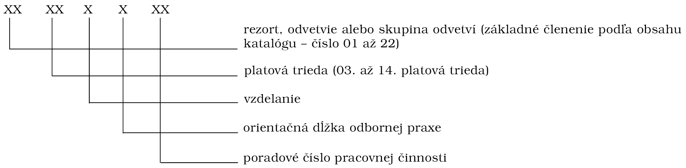

Príloha č. 1 k nariadeniu vlády č. 111/2002 Z. z.

- KATALÓG PRACOVNÝCH ČINNOSTÍ S PREVAHOU DUŠEVNEJ PRÁCE VO VEREJNEJ SLUŽBE

- Prehľad

01. | Spoločné pracovné činnosti ....................................................... | 1157

02. | Bezpečnosť a ochrana zdravia pri práci .............................................. | 1162

03. | Doprava, pošta a telekomunikácie .................................................. | 1163

04. | Financie ...................................................................... | 1168

05. | Geodézia, kartografia a kataster .................................................... | 1169

06. | Hospodárstvo .................................................................. | 1172

07. | Informatika .................................................................... | 1173

08. | Justícia ...................................................................... | 1175

09. | Kontrola ...................................................................... | 1176

10. | Kultúra ...................................................................... | 1176

11. | Normalizácia, metrológia a skúšobníctvo ............................................. | 1185

12. | Obrana ...................................................................... | 1187

13. | Pôdohospodárstvo ............................................................... | 1191

14. | Práca a sociálne veci ............................................................ | 1195

15. | Samospráva (vyšší územný celok a obec) ............................................. | 1198

16. | Sociálne zabezpečenie, trh práce a zdravotné poistenie ................................. | 1202

17. | Školstvo a telovýchova .......................................................... | 1208

18. | Veda, technika, výskum, vývoj ..................................................... | 1216

19. | Vnútro - Archívnictvo ............................................................ | 1219

20. | Vnútro - Všeobecná správa ....................................................... | 1220

21. | Zdravotníctvo .................................................................. | 1222

22. | Životné prostredie ............................................................... | 1231

&nbsp | Štruktúra číslovania pracovných činností ............................................ | 1235

01. SPOLOČNÉ PRACOVNÉ ČINNOSTI

03. PLATOVÁ TRIEDA

Kvalifikačné predpoklady: stredné vzdelanie a osobitný kvalifikačný predpoklad, ak je ustanovený osobitným predpisom.

03.2.1. Pracovné činnosti vyžadujúce stredné vzdelanie, orientačná dĺžka odbornej praxe nie je ustanovená:

01 Vybavovanie korešpondencie podľa pokynov alebo podľa všeobecných postupov.

02 Prijímanie a zhromažďovanie ekonomických, technických alebo prevádzkových podkladov.

03 Vedenie evidencie, záznamov, kartoték alebo protokolov.

04 Zabezpečovanie činnosti podateľne, registratúry organizačného útvaru alebo registratúrneho strediska.

05 Zisťovanie čiastkových štatistických údajov a ich sumarizácia.

06 Poskytovanie jednoduchých informácií o odborných agendách.

07 Manipulácia so správnymi poplatkami spojená s hmotnou zodpovednosťou.

04. PLATOVÁ TRIEDA

Kvalifikačné predpoklady: úplné stredné vzdelanie a osobitný kvalifikačný predpoklad, ak je ustanovený osobitným predpisom.

04.4.1. Pracovné činnosti vyžadujúce úplné stredné vzdelanie, orientačná dĺžka odbornej praxe nie je ustanovená:

01 Organizovanie a zabezpečovanie administratívnej a odbornej agendy vedúceho zamestnanca.

02 Spracúvanie prehľadov, výkazov alebo štatistík (napr. v personálnej oblasti, mzdovej oblasti).

03 Jednoduchá účtovnícka práca, vedenie jednotlivých účtov, kontrola správnosti účtovných dokladov.

04 Pokladničná služba v zariadení spoločného stravovania.

05 Komplexné zabezpečovanie činnosti podateľne, správy registratúry organizačného útvaru alebo registratúrneho strediska zamestnávateľa.

05. PLATOVÁ TRIEDA

Kvalifikačné predpoklady: úplné stredné vzdelanie a osobitný kvalifikačný predpoklad, ak je ustanovený osobitným predpisom.

05.4.3. Pracovné činnosti vyžadujúce úplné stredné vzdelanie, orientačná dĺžka odbornej praxe viac ako 1 rok:

01 Organizovanie a koordinovanie prác jednotlivých zložiek a útvarov s programom štatutárneho orgánu alebo vedúceho zamestnanca na druhom stupni riadenia, kontrola plnenia úloh.

02 Zabezpečovanie informačnej, organizačnej a evidenčnej práce sekretariátu v ústrednom orgáne štátnej správy alebo u zamestnávateľa na celoštátnej úrovni.

03 Čiastková práca na úseku ekonomiky práce.

04 Organizačné zabezpečovanie školiacich akcií alebo vzdelávacích akcií.

05 Zabezpečovanie agendy spojenej so správou budovy, hnuteľného majetku a nehnuteľného majetku alebo všetkého nepriemyselného hospodárstva vo vymedzenej oblasti (napr. zabezpečovanie údržby a opráv).

06 Komplexné zabezpečovanie a usmerňovanie práce registratúr zamestnávateľa.

06. PLATOVÁ TRIEDA

Kvalifikačné predpoklady: úplné stredné vzdelanie a osobitný kvalifikačný predpoklad, ak je ustanovený osobitným predpisom.

06.4.4. Pracovné činnosti vyžadujúce úplné stredné vzdelanie, orientačná dĺžka odbornej praxe viac ako 3 roky:

01 Samostatné zabezpečovanie čiastkovej práce v personálnej oblasti alebo v mzdovej oblasti.

02 Odborná účtovnícka práca (napr. v mzdovej učtárni, finančnej učtárni, v útvare evidencie zásob a majetku, v útvare zabezpečovania dávkovej prevádzky).

03 Samostatná účtovnícka práca v zariadení spoločného stravovania.

04 Pokladničná práca (vedenie pokladničnej knihy, vyhotovovanie príjmových a výdavkových dokladov vrátane výplaty v hotovosti).

05 Príprava a asistencia pri psychodiagnostických vyšetreniach uchádzačov o zamestnanie.

06 Zabezpečovanie zahraničných pracovných alebo služobných ciest a zahraničných pracovných alebo služobných stykov vrátane organizovania prijatí zahraničných delegácií.

07 Organizovanie a zabezpečovanie obstarávania prác, tovarov a služieb podľa platných právnych predpisov a spolupráca na vypracúvaní častí súťažných podkladov.

08 Samostatné organizovanie a zabezpečovanie činnosti prekladateľskej agentúry.

09 Rozpracúvanie úloh a opatrení civilnej ochrany, ich organizovanie a komplexné zabezpečovanie na úrovni zamestnávateľa.

10 Samostatné vybavovanie ucelenej agendy na úseku oslobodzovania občanov od povinnosti vykonať mimoriadnu službu na úrovni zamestnávateľa.

11 Samostatné zabezpečovanie a vykonávanie ochrany utajovaných skutočností tvoriacich predmet štátneho tajomstva alebo služobného tajomstva.

12 Zásobovanie skladov tovarom vrátane fyzickej inventarizácie tovarov a obalov, prepočet a sumarizácia hodnoty zásob, odsúhlasovanie s účtovnými dokladmi, vyčísľovanie inventúrnych rozdielov a vyhotovovanie protokolu.

13 Organizovanie a zabezpečovanie areálovej služby pri údržbe zelene, komunikácií a inžinierskych sietí.

14 Komplexné zabezpečovanie využívania dopravných prostriedkov.

15 Samostatné zabezpečovanie prevádzky autodopravy vrátane kontroly technického stavu vozidiel.

16 Koordinovanie prác zamestnancov vykonávajúcich rutinné pracovné činnosti s prevahou fyzickej práce (napr. na úseku rybného hospodárstva, pri údržbe verejnej zelene).

17 Sledovanie a riadenie centrálneho regulačného systému, zabezpečovanie kontroly ovládacích centier, klimatizačných zariadení, tepelného hospodárstva a výmenníkových staníc prostredníctvom špeciálneho programu výpočtovej techniky vrátane koordinovania odstraňovania chýb.

07. PLATOVÁ TRIEDA

Kvalifikačné predpoklady: úplné stredné vzdelanie a osobitný kvalifikačný predpoklad, ak je ustanovený osobitným predpisom, alebo vyššie odborné vzdelanie a osobitný kvalifikačný predpoklad, ak je ustanovený osobitným predpisom.

07.4.5. Pracovné činnosti vyžadujúce úplné stredné vzdelanie, orientačná dĺžka odbornej praxe viac ako 6 rokov:

01 Zabezpečovanie odbornej práce a agendy v kancelárii predstaviteľa štátnej moci (napr. koordinovanie spracúvania stanovísk a materiálov, organizačné zabezpečovanie medzinárodných stykov).

02 Samostatná odborná práca na vymedzenom úseku personálnej práce (napr. posudzovanie nároku na dovolenku, práca nadčas, podklady pre mzdovú učtáreň).

03 Samostatná odborná účtovnícka práca (napr. v mzdovej učtárni, finančnej učtárni, v útvare evidencie zásob a majetku, v útvare zabezpečovania dávkovej prevádzky).

04 Samostatná odborná práca na vymedzenom úseku ekonomiky práce.

05 Samostatná odborná práca na úseku rozpočtovania a financovania.

06 Organizovanie a zabezpečovanie obsluhy pri zahraničných návštevách na najvyššej úrovni (napr. prezi-dent-hlava štátu, predseda parlamentu, predseda a podpredseda vlády, minister, generálny tajomník Organizácie Spojených národov) vo vybraných účelových zariadeniach.

07 Zabezpečovanie odbornej agendy spojenej so sprístupňovaním informácií.

08 Spracúvanie návrhov opatrení na obdobie brannej pohotovosti štátu na úseku hospodárskej mobilizácie na úrovni zamestnávateľa.

09 Samostatné vybavovanie ucelenej agendy na úseku personálneho naplnenia funkcií týkajúcej sa brannej pohotovosti štátu, hospodárskej mobilizácie alebo inej krízovej situácie.

10 Usmerňovanie a kontrola utajovaných skutočností zamestnancom po získaní osvedčenia.1)

11 Komplexné bilancovanie dodávok, nákupu a merania spotreby energie (elektrina, teplo, plyn) a vody, kontrola ich racionálneho využívania.

12 Technický dozor nad drobnými stavbami, stavebnými úpravami, udržiavacími prácami a stavebnými časťami stavby.

13 Koordinovanie prác zamestnancov vykonávajúcich odborné pracovné činnosti s prevahou fyzickej práce (napr. vo výrobe, v opravárstve, v službách).

14 Koordinovanie a organizovanie prác zamestnancov s prevahou fyzickej práce (napr. na úseku ubytovania, stravovania, v stavebnej alebo špedičnej prevádzke) s plnou hmotnou zodpovednosťou.

08. PLATOVÁ TRIEDA

Kvalifikačné predpoklady: úplné stredné vzdelanie a osobitný kvalifikačný predpoklad, ak je ustanovený osobitným predpisom, alebo vyššie odborné vzdelanie a osobitný kvalifikačný predpoklad, ak je ustanovený osobitným predpisom, alebo bakalárske vzdelanie a osobitný kvalifikačný predpoklad, ak je ustanovený osobitným predpisom.

08.4.6. Pracovné činnosti vyžadujúce úplné stredné vzdelanie, orientačná dĺžka odbornej praxe viac ako 9 rokov:

01 Koordinovanie a organizovanie stravovacej jednotky s plnou hmotnou zodpovednosťou, uzatváranie hospodársko-dodávateľských zmlúv, starostlivosť o zamestnancov v stravovacej jednotke a starostlivosť o technickú úroveň zariadení.

02 Komplexné zabezpečovanie účtovníckych agend.

03 Zabezpečovanie odborných prehliadok a skúšok vyhradených tlakových, elektrických, plynových alebo zdvíhacích technických zariadení vykonávané zamestnancom po získaní osvedčenia o odbornej spôsobilosti.2)

04 Koordinovanie a zabezpečovanie činností spojených s procesom výberu zmluvného partnera pri obstarávaní tovarov, prác a služieb zamestnancom po získaní odbornej spôsobilosti.3)

05 Metodické usmerňovanie a kontrola utajovaných skutočností u zamestnávateľa na celoštátnej úrovni alebo u zamestnávateľa s priamo riadenými zamestnávateľmi vykonávané zamestnancom po získaní osvedčenia.1)

08.7.1. Pracovné činnosti vyžadujúce bakalárske vzdelanie, orientačná dĺžka odbornej praxe nie je ustanovená:

01 Zabezpečovanie personálnej politiky v priamom prepojení na problematiku odmeňovania.

02 Zabezpečovanie personálnej politiky a personálnej práce v oblasti výchovy a vzdelávania zamestnancov a starostlivosti o zamestnancov.

03 Organizovanie a koordinovanie prác pri zabezpečovaní vzdelávania dospelých.

04 Získavanie a spracúvanie informácií a vysvetlení pre verejnosť, masmediálnu oblasť alebo iné inštitúcie.

05 Metodická a kontrolná činnosť registratúrneho strediska na úseku správy registratúry u zamestnávateľa.

06 Koordinačná a metodická činnosť v oblasti autodopravy u zamestnávateľa na celoštátnej úrovni.

07 Protokolárne zabezpečovanie oficiálnych alebo zahraničných pracovných alebo služobných návštev.

09. PLATOVÁ TRIEDA

Kvalifikačné predpoklady: úplné stredné vzdelanie a osobitný kvalifikačný predpoklad ustanovený osobitným predpisom alebo vyššie odborné vzdelanie a osobitný kvalifikačný predpoklad, ak je ustanovený osobitným predpisom, alebo bakalárske vzdelanie a osobitný kvalifikačný predpoklad, ak je ustanovený osobitným predpisom, alebo vysokoškolské vzdelanie a osobitný kvalifikačný predpoklad, ak je ustanovený osobitným predpisom.

09.7.4. Pracovné činnosti vyžadujúce bakalárske vzdelanie, orientačná dĺžka odbornej praxe viac ako 3 roky:

01 Samostatné zabezpečovanie ekonomiky práce.

02 Samostatné zabezpečovanie rozpočtovania alebo financovania.

09.8.1. Pracovné činnosti vyžadujúce vysokoškolské vzdelanie, orientačná dĺžka odbornej praxe nie je ustanovená:

01 Samostatné zabezpečovanie práce na úseku personálnej politiky (napr. tvorba vnútorných predpisov, smerníc, pracovného poriadku, kolektívnej zmluvy).

02 Poskytovanie právneho poradenstva vo vymedzenej oblasti na úrovni zamestnávateľa.

03 Písomné preklady z cudzieho jazyka do slovenského jazyka a naopak.

04 Zabezpečovanie informačných, publicistických a tlačových vzťahov zamestnávateľa k verejnosti a k hromadným oznamovacím prostriedkom.

05 Zabezpečovanie správy hnuteľného majetku a nehnuteľného majetku, nepriemyselného hospodárstva a pomocných služieb (napr. správy budov).

06 Samostatná metodická a kontrolná činnosť v energetickom a vodnom hospodárstve u zamestnávateľa na celoštátnej úrovni.

07 Metodické usmerňovanie a kontrola registratúrnych stredísk pre priamo riadených zamestnávateľov.

08 Vypracúvanie analýz a plánovanie procesov vo verejnom obstarávaní zamestnancom po získaní odbornej spôsobilosti.3)

10. PLATOVÁ TRIEDA

Kvalifikačné predpoklady: bakalárske vzdelanie a osobitný kvalifikačný predpoklad, ak je ustanovený osobitným predpisom, alebo vysokoškolské vzdelanie a osobitný kvalifikačný predpoklad, ak je ustanovený osobitným predpisom.

10.8.3. Pracovné činnosti vyžadujúce vysokoškolské vzdelanie, orientačná dĺžka odbornej praxe viac ako 1 rok:

01 Komplexné zabezpečovanie personálnej politiky (napr. vykonávanie personálneho marketingu, výber, prijímanie a umiestňovanie zamestnancov, hodnotenie zamestnancov).

02 Komplexné zabezpečovanie ekonomiky práce vrátane mzdovej oblasti u zamestnávateľa s rozmanitou profesijnou štruktúrou zamestnancov.

03 Vstupné a doplnkové psychodiagnostické vyšetrenia uchádzačov o zamestnanie.

04 Tvorba a koordinovanie systémov vzdelávania zameraných na rozvoj ľudských zdrojov.

05 Samostatné odborné vypracúvanie podkladov pre zásadné akty riadenia pre štatutárny orgán alebo na rozhodovanie Predsedníctva Slovenskej akadémie vied.

06 Lektorská a školiaca činnosť vrátane účasti na overovaní získaných vedomostí na účel vydania osvedčenia.

07 Zabezpečovanie právnej agendy (napr. riešenie občianskoprávnych, obchodnoprávnych, pracovnoprávnych záležitostí) vrátane zastupovania zamestnávateľa v právnych sporoch.

08 Odborná špecializovaná práca na úseku rozpočtovania alebo financovania.

09 Tvorivé spracúvanie masmediálnej politiky a koordinovanie výstupov k verejnosti.

10 Zabezpečovanie realizácie medzinárodných dohôd vo zverenom teritóriu.

11 Analytická činnosť a príprava podkladov na rozhodovanie vo vymedzenej oblasti správy štátneho fondu.

12 Samostatné zabezpečovanie opatrení na obdobie brannej pohotovosti štátu na úseku hospodárskej mobilizácie u zamestnávateľa na celoštátnej úrovni alebo s priamo riadenými zamestnávateľmi.

13 Investičná činnosť pri príprave alebo uskutočňovaní stavieb alebo technologických častí stavieb.

14 Technický dozor nad stavbami a technologickými časťami stavieb.

15 Obstarávanie verejnoprospešných stavieb podľa zákona o koncesnom obstarávaní.

16 Komplexné zabezpečovanie správy rozsiahleho hnuteľného majetku a nehnuteľného majetku alebo rozsiahlych rekreačných zariadení na celoštátnej úrovni.

11. PLATOVÁ TRIEDA

Kvalifikačné predpoklady: vysokoškolské vzdelanie a osobitný kvalifikačný predpoklad, ak je ustanovený osobitným predpisom.

11.8.4. Pracovné činnosti vyžadujúce vysokoškolské vzdelanie, orientačná dĺžka odbornej praxe viac ako 3 roky:

01 Tvorba stratégie riadenia ľudských zdrojov (personálna oblasť vrátane odmeňovania) u zamestnávateľa s rozmanitou kvalifikačnou a profesijnou štruktúrou zamestnancov.

02 Koordinovanie a metodické usmerňovanie právnej agendy zamestnávateľa na celoštátnej úrovni.

03 Tvorba koncepcií a projektov vzdelávania (napr. pre zamestnancov štátnej služby alebo pre zamestnancov verejnej služby v rámci rezortu).

04 Komplexné zabezpečovanie prác na úseku rozpočtovania a financovania.

05 Tlmočenie z cudzieho jazyka do slovenského jazyka a naopak.

06 Analýza, posudzovanie a vyhodnocovanie investičnej činnosti z hľadiska územných celkov.

07 Koordinovanie, metodické usmerňovanie a organizovanie domácich výstav alebo zahraničných výstav.

08 Koordinačná činnosť pri zabezpečovaní technického rozvoja a realizácii technickoprevádzkových činností u zamestnávateľa s rozsiahlym majetkom.

09 Koordinačná a metodická činnosť pri rozhodovaní o efektívnom vynakladaní prostriedkov štátneho fondu.

10 Koordinačná a metodická činnosť pri zabezpečovaní opatrení na obdobie brannej pohotovosti štátu na úseku hospodárskej mobilizácie u zamestnávateľa na celoštátnej úrovni alebo u zamestnávateľa s priamo riadenými zamestnávateľmi.

11 Koncepčné a koordinačné zabezpečovanie súťažných podkladov s rozhodujúcim vplyvom na výsledok procesu verejného obstarávania zamestnancom po získaní odbornej spôsobilosti.3)

12. PLATOVÁ TRIEDA

Kvalifikačné predpoklady: vysokoškolské vzdelanie a osobitný kvalifikačný predpoklad, ak je ustanovený osobitným predpisom.

12.8.5. Pracovné činnosti vyžadujúce vysokoškolské vzdelanie, orientačná dĺžka odbornej praxe viac ako 6 rokov:

01 Koncepčná a analytická činnosť a príprava podkladov na rozhodovanie o ekonomických otázkach spadajúcich do rozsahu kompetencie ústredného orgánu štátnej správy alebo zamestnávateľa na celoštátnej úrovni.

02 Koordinovanie celoštátnych a medzinárodných programov v oblasti výskumu a vývoja a vedných prepojení na medzinárodnú vedecko-technickú spoluprácu a vedecko-technický rozvoj.

03 Riešenie zložitej právnej agendy vo viacerých oblastiach práva vrátane zastupovania zamestnávateľa alebo štátu v právnych sporoch.

04 Koncepčná a systémová činnosť pri rozhodovaní o opatreniach politiky štátu v oblasti správy štátneho fondu.

05 Koncepčná a koordinačná činnosť v oblasti duchovenských služieb a koordinovanie účasti cirkví a náboženských spoločností na duchovenskej starostlivosti vrátane vykonávania duchovenských činností.

06 Vypracúvanie priorít rozvojových programov verejných investícií v rezorte pre priamo riadených zamestnávateľov.

07 Koncepčná a metodická činnosť v investičnej výstavbe v rezorte pre priamo riadených zamestnávateľov.

08 Metodické usmerňovanie činností v oblasti verejného obstarávania z úrovne ústredného orgánu štátnej správy alebo zamestnávateľa na celoštátnej úrovni zamestnancom po získaní odbornej spôsobilosti.3)

13. PLATOVÁ TRIEDA

Kvalifikačné predpoklady: vysokoškolské vzdelanie a osobitný kvalifikačný predpoklad, ak je ustanovený osobitným predpisom.

13.8.6. Pracovné činnosti vyžadujúce vysokoškolské vzdelanie, orientačná dĺžka odbornej praxe viac ako 9 rokov:

01 Koordinovanie celoštátnych a medzinárodných systémov v multidisciplinárnych programoch Európskej únie (napr. pre výskum, vývoj a nové technológie).

02 Tvorba medzinárodných zmlúv alebo iných medzinárodných dokumentov, vypracúvanie právnych expertíz a právnych riešení na celoštátnej úrovni alebo s väzbou na zahraničie.

02. BEZPEČNOSŤ A OCHRANA ZDRAVIA PRI PRÁCI

07. PLATOVÁ TRIEDA

Kvalifikačné predpoklady: úplné stredné vzdelanie a osobitný kvalifikačný predpoklad, ak je ustanovený osobitným predpisom, alebo vyššie odborné vzdelanie a osobitný kvalifikačný predpoklad, ak je ustanovený osobitným predpisom.

07.4.5. Pracovné činnosti vyžadujúce úplné stredné vzdelanie, orientačná dĺžka odbornej praxe viac ako 6 rokov:

01 Zabezpečovanie a vykonávanie prác v oblasti bezpečnosti a ochrany zdravia pri práci zamestnancom po splnení odbornej spôsobilosti4) alebo v oblasti požiarnej ochrany zamestnancom po splnení odbornej spôsobilosti,5) alebo v oblasti hygieny práce na úrovni zamestnávateľa.

09. PLATOVÁ TRIEDA

Kvalifikačné predpoklady: úplné stredné vzdelanie a osobitný kvalifikačný predpoklad ustanovený osobitným predpisom alebo vyššie odborné vzdelanie a osobitný kvalifikačný predpoklad, ak je ustanovený osobitným predpisom, alebo bakalárske vzdelanie a osobitný kvalifikačný predpoklad, ak je ustanovený osobitným predpisom, alebo vysokoškolské vzdelanie a osobitný kvalifikačný predpoklad, ak je ustanovený osobitným predpisom.

09.8.1. Pracovné činnosti vyžadujúce vysokoškolské vzdelanie, orientačná dĺžka odbornej praxe nie je ustanovená:

01 Zabezpečovanie a metodické usmerňovanie plnenia úloh v oblasti bezpečnosti a ochrany zdravia pri práci zamestnancom po splnení odbornej spôsobilosti4) alebo v oblasti požiarnej ochrany zamestnancom po splnení odbornej spôsobilosti5) u zamestnávateľa.

10. PLATOVÁ TRIEDA

Kvalifikačné predpoklady: bakalárske vzdelanie a osobitný kvalifikačný predpoklad, ak je ustanovený osobitným predpisom, alebo vysokoškolské vzdelanie a osobitný kvalifikačný predpoklad, ak je ustanovený osobitným predpisom.

10.8.3. Pracovné činnosti vyžadujúce vysokoškolské vzdelanie, orientačná dĺžka odbornej praxe viac ako 1 rok:

01 Inšpekčná činnosť vo vymedzenej oblasti technických zariadení.

02 Metodické usmerňovanie plnenia úloh priamo riadených zamestnávateľov v oblasti bezpečnosti a ochrany zdravia pri práci zamestnancom po splnení odbornej spôsobilosti4) alebo v oblasti požiarnej ochrany zamestnancom po splnení odbornej spôsobilosti.5)

11. PLATOVÁ TRIEDA

Kvalifikačné predpoklady: vysokoškolské vzdelanie a osobitný kvalifikačný predpoklad, ak je ustanovený osobitným predpisom.

11.8.4. Pracovné činnosti vyžadujúce vysokoškolské vzdelanie, orientačná dĺžka odbornej praxe viac ako 3 roky:

01 Inšpekčná činnosť na vyhradených technických zariadeniach s vyššou mierou ohrozenia.

12. PLATOVÁ TRIEDA

Kvalifikačné predpoklady: vysokoškolské vzdelanie a osobitný kvalifikačný predpoklad, ak je ustanovený osobitným predpisom.

12.8.5. Pracovné činnosti vyžadujúce vysokoškolské vzdelanie, orientačná dĺžka odbornej praxe viac ako 6 rokov:

01 Inšpekčná činnosť v celej skupine technických zariadení alebo na súboroch technických zariadení vrátane vedenia inšpekčnej skupiny vo vymedzenej oblasti technických zariadení.

02 Koordinovanie a metodické usmerňovanie inšpekčnej činnosti na technických zariadeniach.

03. DOPRAVA, POŠTA A TELEKOMUNIKÁCIE

06. PLATOVÁ TRIEDA

Kvalifikačné predpoklady: úplné stredné vzdelanie a osobitný kvalifikačný predpoklad, ak je ustanovený osobitným predpisom.

06.4.4. Pracovné činnosti vyžadujúce úplné stredné vzdelanie, orientačná dĺžka odbornej praxe viac ako 3 roky:

01 Zabezpečovanie bezpečnosti cestujúcich na palube lietadla vrátane poskytovania služieb cestujúcim, zabezpečovanie dodržiavania prevádzkových a bezpečnostných predpisov na palube lietadla vykonávané zamestnancom po získaní odbornej spôsobilosti.6)

02 Odborné služby prevádzkového vybavovania cestujúcich, batožín a tovaru na letisku.

03 Zabezpečovanie a organizovanie objektívnej kontroly leteckých akcií a ich vyhodnocovanie.

04 Zabezpečovanie prevádzky celoštátneho informačného systému cestného hospodárstva v oblasti cestnej databanky v určenom rozsahu zberu, preberania, kontroly a spracúvania údajov ako súčasti geografického informačného systému.

05 Spracúvanie údajov pre potreby dopravnoinžinierskej analýzy a modelovania vrátane zhromažďovania a prípravy údajovej základne.

06 Spracúvanie vecných, finančných a časových údajov o pripravovaných stavbách.

07. PLATOVÁ TRIEDA

Kvalifikačné predpoklady: úplné stredné vzdelanie a osobitný kvalifikačný predpoklad, ak je ustanovený osobitným predpisom, alebo vyššie odborné vzdelanie a osobitný kvalifikačný predpoklad, ak je ustanovený osobitným predpisom.

07.4.5. Pracovné činnosti vyžadujúce úplné stredné vzdelanie, orientačná dĺžka odbornej praxe viac ako 6 rokov:

01 Samostatná odborná práca na úseku prevádzky a služieb pri vybavovaní cestujúcich, batožín a tovaru na letisku (napr. zabezpečovanie technologických postupov a inštrukcií obchodno-prevádzkového vybavovania cestujúcich, batožín a tovaru).

02 Organizovanie ekologicko-ornitologického prieskumu letiska.

03 Zabezpečovanie služieb operatívneho charakteru pri riadení prevádzky letiska poskytovaných leteckým dopravcom.

04 Analýza a samostatné spracúvanie databáz a ukazovateľov z cenových kalkulácií cestného hospodárstva.

05 Meračská práca pri vytyčovaní stavebných objektov a pri kontrolných meraniach dodržiavania priestorovej polohy objektov v procese prípravy, realizácie a prevádzky dopravných líniových stavieb.

06 Zabezpečovanie úloh spojených s majetkovou správou pozemných komunikácií na vymedzenom úseku.

07 Zabezpečovanie podkladov na majetkovoprávnu prípravu, zisťovanie vlastníckych vzťahov a užívacích vzťahov pre potreby investičnej výstavby.

08 Príprava analytických podkladov pre hodnotiace činnosti dopravného inžinierstva v oblasti cestnej dopravy.

08. PLATOVÁ TRIEDA

Kvalifikačné predpoklady: úplné stredné vzdelanie a osobitný kvalifikačný predpoklad, ak je ustanovený osobitným predpisom, alebo vyššie odborné vzdelanie a osobitný kvalifikačný predpoklad, ak je ustanovený osobitným predpisom, alebo bakalárske vzdelanie a osobitný kvalifikačný predpoklad, ak je ustanovený osobitným predpisom.

08.4.6. Pracovné činnosti vyžadujúce úplné stredné vzdelanie, orientačná dĺžka odbornej praxe viac ako 9 rokov:

01 Organizovanie leteckej agendy, spracúvanie prevádzkových a výcvikových programov pre palubných sprievodcov, organizovanie výcvikových programov, stanovovanie a skúšanie palubných sprievodcov podľa platných výcvikových noriem vykonávané zamestnancom po získaní odbornej spôsobilosti.6)

02 Organizovanie činností kolektívu palubných sprievodcov, spracúvanie predletových informácií, poskytovanie informácií palubným sprievodcom vykonávané zamestnancom po získaní odbornej spôsobilosti.6)

03 Kontrolovanie a posudzovanie stavu a prevádzkyschopnosti letiskových pohybových plôch a svetelných zabezpečovacích zariadení na letisku zamestnancom po získaní osvedčenia o odbornej spôsobilosti.2)

04 Zabezpečovanie funkčnosti systémov leteckej techniky vykonávané zamestnancom po získaní osvedčenia o odbornej spôsobilosti.2)

05 Koordinovanie činností prevádzkových služieb na letisku.

06 Príprava a realizácia opráv pozemných komunikácií vrátane súvisiacich objektov a diagnostikovanie a prehliadky vozoviek a mostov v štádiu výstavby, opráv a prevádzky v obvode strediska.

07 Zabezpečovanie dokumentácie (technickej a majetkovoprávnej) na investičnú činnosť v etape prípravy stavieb pozemných komunikácií.

08 Samostatná odborná práca pri spracúvaní majetkovoprávnej dokumentácie stavieb pozemných komunikácií.

09 Organizovanie činností pri zabezpečovaní údržby vymedzeného úseku pozemných komunikácií vykonávané zamestnancom po získaní oprávnenia na výkon činnosti.7)

10 Metodické usmerňovanie vykonávania zberu a spracúvania dát cestnej databanky.

11 Koordinovanie a zabezpečovanie odborných prác ochrany letiska zamestnancom po získaní odbornej spôsobilosti.8)

08.7.1. Pracovné činnosti vyžadujúce bakalárske vzdelanie, orientačná dĺžka odbornej praxe nie je ustanovená:

01 Zabezpečovanie leteckej prevádzky na letisku v stanovenom rozsahu.

02 Komplexné zabezpečovanie odborných prác pri obchodnom vybavovaní cestujúcich, batožín a tovaru na letisku.

03 Zabezpečovanie dispečerských prác medzi dodávateľom a odberateľom služieb a tovaru v rámci poskytovania handlingových služieb leteckým dopravcom.

04 Koordinovanie a zabezpečovanie skladovania leteckých pohonných látok.

05 Koordinovanie a zabezpečovanie práce pri plnení lietadiel leteckými pohonnými látkami.

06 Zabezpečovanie odbornej práce v oblasti marketingu a propagácie letísk.

07 Organizovanie a koordinovanie činností pri zabezpečovaní technickej obsluhy lietadiel.

08 Samostatná odborná práca v oblasti kontroly a cenotvorby v procese prípravy a realizácie stavieb pre potreby stavieb cestného hospodárstva.

09 Spracúvanie podkladov pri tvorbe krátkodobých a dlhodobých plánov v oblasti mechanizácie a dopravy v obvode strediska.

10 Operatívne riadenie prevádzky celoštátneho informačného systému diaľnic a ciest v obvode strediska v určenej časti (napr. časť diaľnice, tunel).

11 Tvorba dlhodobých plánov vo vymedzenej oblasti (napr. životné prostredie, zimná údržba) prevádzky a údržby pozemných komunikácií vrátane súvisiacich objektov na celoštátnej úrovni.

12 Samostatná odborná práca v oblasti majetkovej správy pozemných komunikácií vrátane súvisiacich objektov v určenom úseku.

13 Analytická činnosť v dopravnom inžinierstve v oblasti cestnej dopravy.

14 Analytická a hodnotiaca činnosť v oblasti zaradenia, zmeny zatriedenia, prečíslovania a vyradenia pozemných komunikácií z cestnej siete na celoštátnej úrovni.

15 Analytická a hodnotiaca činnosť v oblasti posudzovania pozemných komunikácií z hľadiska územnoplánovacej a projektovej dokumentácie v rozsahu okresnej pôsobnosti.

09. PLATOVÁ TRIEDA

Kvalifikačné predpoklady: úplné stredné vzdelanie a osobitný kvalifikačný predpoklad ustanovený osobitným predpisom alebo vyššie odborné vzdelanie a osobitný kvalifikačný predpoklad, ak je ustanovený osobitným predpisom, alebo bakalárske vzdelanie a osobitný kvalifikačný predpoklad, ak je ustanovený osobitným predpisom, alebo vysokoškolské vzdelanie a osobitný kvalifikačný predpoklad, ak je ustanovený osobitným predpisom.

09.7.4. Pracovné činnosti vyžadujúce bakalárske vzdelanie, orientačná dĺžka odbornej praxe viac ako 3 roky:

01 Zabezpečovanie prevádzky celoštátneho informačného systému cestného hospodárstva v oblasti cestnej databanky v celom rozsahu zberu, preberania, kontroly a spracúvania dát.

02 Organizovanie a zabezpečovanie odborných prác letiskovej ochrany letiska v Bratislave zamestnancom po získaní odbornej spôsobilosti.8)

03 Organizovanie činností pozemnej leteckej prevádzky na letisku.

04 Koordinovanie a organizovanie úloh majetkovej správy a údržby diaľnic v obvode strediska vykonávané zamestnancom po získaní oprávnenia na výkon činnosti.7)

09.8.1. Pracovné činnosti vyžadujúce vysokoškolské vzdelanie, orientačná dĺžka odbornej praxe nie je ustanovená:

01 Koordinovanie a metodické usmerňovanie činností leteckých dopravcov v oblasti poskytovania prevádzkových služieb.

02 Navrhovanie spôsobu a foriem marketingu v oblasti propagácie služieb leteckej dopravy.

03 Spracúvanie technologických postupov v oblasti energetického dispečingu technickej prevádzky letísk zamestnancom po získaní osvedčenia o odbornej spôsobilosti.2)

04 Príprava a realizácia opráv pozemných komunikácií vrátane súvisiacich objektov a diagnostikovanie vozoviek a mostov v štádiu výstavby, opráv a prevádzky v danej oblasti (napr. kraj, diaľničný úsek).

05 Operačné riadenie prevádzky celoštátneho informačného systému diaľnic a ciest v obvode strediska.

06 Spracúvanie geodetickej časti dokumentácie skutočného vyhotovenia dopravnej stavby a majetkovoprávnej dokumentácie v digitálnej forme.

07 Navrhovanie postupov týkajúcich sa cenovej časti zadávacích podkladov súťažných návrhov pre potreby cestného hospodárstva.

08 Preberanie a správa majetku pozemných komunikácií vrátane súvisiacich objektov na určenom úseku pozemnej komunikácie.

09 Tvorba dlhodobých plánov činností prevádzky a údržby pozemných komunikácií vrátane súvisiacich objektov na celoštátnej úrovni.

10 Tvorba krátkodobých a dlhodobých plánov v oblasti mechanizácie a dopravy v obvode strediska.

10. PLATOVÁ TRIEDA

Kvalifikačné predpoklady: bakalárske vzdelanie a osobitný kvalifikačný predpoklad, ak je ustanovený osobitným predpisom, alebo vysokoškolské vzdelanie a osobitný kvalifikačný predpoklad, ak je ustanovený osobitným predpisom.

10.8.3. Pracovné činnosti vyžadujúce vysokoškolské vzdelanie, orientačná dĺžka odbornej praxe viac ako 1 rok:

01 Samostatná údržba, oprava, kontrola a skúška lietadiel a ich systémov (napr. draky, elektrorádio, prístrojové vybavenie lietadla) vykonávané zamestnancom po získaní osvedčenia o odbornej spôsobilosti.2)

02 Tvorba metodiky zabezpečovania ochrany letísk zamestnancom po získaní odbornej spôsobilosti.8)

03 Koordinovanie a metodické usmerňovanie dispečerského riadenia na letisku.

04 Navigačná príprava letu.

05 Organizovanie plemenitby a chovu sokolovitých dravcov vrátane ich výcviku na účely ochrany letiska.

06 Investičná činnosť v etape predinvestičnej prípravy objektov alebo častí stavieb pozemných komunikácií.

07 Investičná činnosť v etape investičnej prípravy objektov alebo častí stavieb pozemných komunikácií.

08 Investičná činnosť v štádiu realizácie objektov alebo častí stavieb pozemných komunikácií.

09 Technický dozor na objektoch pozemných komunikácií.

10 Spravovanie majetku pozemných komunikácií vo zverenom obvode.

11 Budovanie a prevádzka celoštátneho informačného systému cestného hospodárstva v oblasti cestnej databanky ako súčasti geografického informačného systému a zabezpečovanie odborných činností pri centrálnom spracúvaní údajov pre celoštátny informačný systém cestného hospodárstva.

12 Zabezpečovanie právnej agendy a majetkovoprávnych vzťahov k nehnuteľnostiam v etape investičnej prípravy stavieb.

13 Vypracúvanie návrhov a zámerov rozvoja cestnej siete na úrovni kraja.

14 Vypracúvanie návrhov optimalizácie cestnej dopravy z hľadiska dopravného inžinierstva.

15 Koordinačná a hodnotiaca činnosť v oblasti opráv pozemných komunikácií vrátane súvisiacich objektov a diagnostikovania vozoviek a mostov na celoštátnej úrovni.

16 Koordinačná a analytická činnosť v oblasti celoštátneho informačného systému diaľnic a ciest v obvode strediska.

17 Vypracúvanie individuálnych postupov týkajúcich sa cenovej časti zadávacích podkladov súťažných návrhov s účasťou zahraničných finančných inštitúcií a fondov pre potreby cestného hospodárstva.

18 Koordinačná činnosť v oblasti plánovania mechanizácie a dopravy na celoštátnej úrovni.

19 Koordinačná a analytická činnosť v oblasti tvorby krátkodobých a dlhodobých plánov prevádzky a údržby pozemných komunikácií vrátane súvisiacich objektov na celoštátnej úrovni.

20 Koordinovanie a komplexné usmerňovanie činností letiskovej prevádzky.

21 Analýza vzniku nehôd a tvorba opatrení v oblasti bezpečnosti dopravy v rámci regiónu.

11. PLATOVÁ TRIEDA

Kvalifikačné predpoklady: vysokoškolské vzdelanie a osobitný kvalifikačný predpoklad, ak je ustanovený osobitným predpisom.

11.8.4. Pracovné činnosti vyžadujúce vysokoškolské vzdelanie, orientačná dĺžka odbornej praxe viac ako 3 roky:

01 Koordinovanie, zabezpečovanie a vyhodnocovanie vykonávania údržby lietadiel a ich systémov (napr. draky, elektrorádio, prístrojové vybavenie lietadla) vykonávané zamestnancom po získaní osvedčenia o odbornej spôsobilosti.2)

02 Koncepčná a koordinačná činnosť v oblasti rozvoja prevádzky letiska zamestnancom po získaní odbornej spôsobilosti.6)

03 Geodetická a kartografická práca v procese projektovej prípravy, realizácie a prevádzky dopravných líniových stavieb a vyvolaných investícií vykonávaná zamestnancom po získaní osobitnej odbornej spôsobilosti.9)

04 Koncepčná a analytická práca v oblasti investičnej činnosti v etape predinvestičnej prípravy väčších celkov stavieb pozemných komunikácií.

05 Koncepčná a analytická práca v oblasti investičnej činnosti v etape investičnej prípravy väčších celkov stavieb pozemných komunikácií.

06 Koncepčná a analytická práca v oblasti investičnej činnosti v štádiu realizácie väčších celkov stavieb pozemných komunikácií.

07 Technický dozor na stavbách pozemných komunikácií.

08 Zabezpečovanie právnej agendy a majetkovoprávnych vzťahov rozsiahlych investičných celkov od predinvestičnej prípravy až po porealizačné vyrovnania.

09 Tvorba celoštátneho informačného systému cestného hospodárstva a cestnej databanky ako súčasti geografického informačného systému, systémové práce v centrálnych bázach dát celoštátneho informačného systému cestného hospodárstva.

10 Koordinovanie a usmerňovanie činností v oblasti cien a investičného plánu pre potreby cestného hospodárstva.

11 Koncepčná činnosť v dopravnom inžinierstve v oblasti cestnej dopravy.

12 Analytická činnosť v oblasti dopravnoinžinierskych analýz a modelovania v cestnej doprave.

13 Koordinačná činnosť v oblasti spracúvania návrhov rozvoja cestnej siete na celoštátnej úrovni.

14 Analytická činnosť v oblasti opráv a diagnostiky vrátane vykonávania hlavných a mimoriadnych prehliadok pozemných komunikácií na celoštátnej úrovni.

15 Koordinačná činnosť v oblasti spravovania majetku pozemných komunikácií vrátane súvisiacich objektov na celoštátnej úrovni.

16 Koordinačná a analytická činnosť v oblasti celoštátneho informačného systému diaľnic a ciest na celoštátnej úrovni.

17 Koncepčná činnosť v oblasti bezpečnosti dopravy na celoštátnej úrovni.

18 Analytická, metodická a koordinačná činnosť na celoštátnej úrovni spojená s použitím pôžičiek a grantov z medzinárodných finančných inštitúcií a organizácií zabezpečujúcich rôzne formy finančnej pomoci.

19 Koordinačná a metodická činnosť v oblasti mechanizácie a dopravy na celoštátnej úrovni.

20 Metodická činnosť pri tvorbe komplexných dlhodobých plánov v oblasti prevádzky a údržby pozemných komunikácií vrátane súvisiacich objektov na celoštátnej úrovni.

12. PLATOVÁ TRIEDA

Kvalifikačné predpoklady: vysokoškolské vzdelanie a osobitný kvalifikačný predpoklad, ak je ustanovený osobitným predpisom.

12.8.5. Pracovné činnosti vyžadujúce vysokoškolské vzdelanie, orientačná dĺžka odbornej praxe viac ako 6 rokov:

01 Komplexné zabezpečovanie a vyhodnocovanie technických podmienok letu vykonávané zamestnancom po získaní odbornej spôsobilosti.6)

02 Komplexné zabezpečovanie leteckej navigácie na prípravu a vykonanie letu vykonávané zamestnancom po získaní odbornej spôsobilosti.6)

03 Koncepčná a metodická činnosť v oblasti spravovania majetku pozemných komunikácií vrátane súvisiacich objektov na celoštátnej úrovni s väzbami na zahraničie.

04 Koncepčná a koordinačná činnosť v oblasti rozvoja prevádzky letiska v Bratislave alebo letiska v Košiciach vykonávaná zamestnancom po získaní odbornej spôsobilosti.6)

05 Koordinovanie a metodické usmerňovanie geodetických a kartografických prác cestných stavieb a vyvolaných investícií na celoštátnej úrovni vrátane zodpovednosti za dodržiavanie priestorového uloženia stavieb vykonávané zamestnancom po získaní osobitnej odbornej spôsobilosti.9)

06 Koncepčná príprava a realizácia opráv pozemných komunikácií a diagnostikovanie vozoviek a mostov v štádiu výstavby, opráv a prevádzky na celoštátnej úrovni.

07 Koordinovanie investičnej činnosti v etape predinvestičnej prípravy komplexu stavieb pozemných komunikácií na celoštátnej úrovni.

08 Koordinovanie investičnej činnosti v etape investičnej prípravy komplexu stavieb pozemných komunikácií na celoštátnej úrovni.

09 Koordinovanie investičnej činnosti v štádiu realizácie komplexu stavieb pozemných komunikácií na celoštátnej úrovni.

10 Koordinovanie špecializovaných a tvorivých dopravnoinžinierskych prác v oblasti cestnej dopravy.

11 Koordinačná a metodická činnosť v oblasti dopravnoinžinierskych analýz a modelovania v cestnej doprave.

12 Koordinačná a metodická činnosť v oblasti koncepcie a rozvoja cestnej siete na celoštátnej úrovni s väzbami na zahraničie.

13 Koncepčná a metodická činnosť v oblasti cien a investičného plánu pre potreby cestného hospodárstva.

14 Koncepčná a metodická činnosť v oblasti celoštátneho informačného systému diaľnic a ciest na celoštátnej úrovni.

15 Koncepčná a metodická činnosť v oblasti postupov majetkovoprávnej prípravy stavieb z legislatívneho hľadiska na celoštátnej úrovni.

13. PLATOVÁ TRIEDA

Kvalifikačné predpoklady: vysokoškolské vzdelanie a osobitný kvalifikačný predpoklad, ak je ustanovený osobitným predpisom.

13.8.6. Pracovné činnosti vyžadujúce vysokoškolské vzdelanie, orientačná dĺžka odbornej praxe viac ako 9 rokov:

01 Riadenie lietadla s celkovou vzletovou hmotnosťou do 5 700 kg vykonávané zamestnancom po získaní odbornej spôsobilosti.6)

02 Koncepčná, koordinačná a metodická činnosť v oblasti rozvoja prevádzky letísk na celoštátnej úrovni vykonávaná zamestnancom po získaní odbornej spôsobilosti.6)

03 Koncepčná a systémová práca pri riešení úloh v oblasti investičnej činnosti na pozemných komunikáciách na celoštátnej úrovni a s väzbami na zahraničie.

14. PLATOVÁ TRIEDA

Kvalifikačné predpoklady: vysokoškolské vzdelanie a osobitný kvalifikačný predpoklad, ak je ustanovený osobitným predpisom.

14.8.6. Pracovné činnosti vyžadujúce vysokoškolské vzdelanie, orientačná dĺžka odbornej praxe viac ako 9 rokov:

01 Riadenie dopravného lietadla s celkovou vzletovou hmotnosťou nad 5 700 kg vykonávané zamestnancom po získaní odbornej spôsobilosti.6)

04. FINANCIE

08. PLATOVÁ TRIEDA

Kvalifikačné predpoklady: úplné stredné vzdelanie a osobitný kvalifikačný predpoklad, ak je ustanovený osobitným predpisom, alebo vyššie odborné vzdelanie a osobitný kvalifikačný predpoklad, ak je ustanovený osobitným predpisom, alebo bakalárske vzdelanie a osobitný kvalifikačný predpoklad, ak je ustanovený osobitným predpisom.

08.4.6. Pracovné činnosti vyžadujúce úplné stredné vzdelanie, orientačná dĺžka odbornej praxe viac ako 9 rokov:

01 Vymáhanie pohľadávok štátu v oblasti reštitúcií alebo v majetkovoprávnej oblasti.

02 Vnútroštátne vykonávanie medzištátnych majetkovoprávnych dohôd vrátane usporiadania nehnuteľného majetku do vlastníctva štátu.

10. PLATOVÁ TRIEDA

Kvalifikačné predpoklady: bakalárske vzdelanie a osobitný kvalifikačný predpoklad, ak je ustanovený osobitným predpisom, alebo vysokoškolské vzdelanie a osobitný kvalifikačný predpoklad, ak je ustanovený osobitným predpisom.

10.8.3. Pracovné činnosti vyžadujúce vysokoškolské vzdelanie, orientačná dĺžka odbornej praxe viac ako 1 rok:

01 Vymáhanie pohľadávok štátu v reštitučnej alebo majetkovoprávnej oblasti v obzvlášť zložitých prípadoch s komplikovaným právnym a skutkovým stavom.

02 Vnútroštátne vykonávanie medzištátnych majetkovoprávnych dohôd vrátane usporiadania nehnuteľného majetku do vlastníctva štátu v obzvlášť zložitých prípadoch s komplikovaným právnym a skutkovým stavom.

11. PLATOVÁ TRIEDA

Kvalifikačné predpoklady: vysokoškolské vzdelanie a osobitný kvalifikačný predpoklad, ak je ustanovený osobitným predpisom.

11.8.4. Pracovné činnosti vyžadujúce vysokoškolské vzdelanie, orientačná dĺžka odbornej praxe viac ako 3 roky:

01 Koordinačná a analytická činnosť v majetkovoprávnej oblasti na celoštátnej úrovni.

05. GEODÉZIA, KARTOGRAFIA A KATASTER

05. PLATOVÁ TRIEDA

Kvalifikačné predpoklady: úplné stredné vzdelanie a osobitný kvalifikačný predpoklad, ak je ustanovený osobitným predpisom.

05.4.3. Pracovné činnosti vyžadujúce úplné stredné vzdelanie, orientačná dĺžka odbornej praxe viac ako 1 rok:

01 Kartografická práca v grafickej a číselnej forme spojená s generalizáciou jednotlivých prvkov obsahu mapy podľa príslušných technických predpisov platných pre mapy veľkých, stredných a malých mierok.

02 Geodetická práca v podrobných geodetických sieťach a pri zbere a spracúvaní informácií na tvorbu štátnych základných mapových diel v teréne pod vedením vedúceho skupiny.

03 Geodetická práca pri zbere a spracúvaní informácií na tvorbu štátnych tematických mapových diel v teréne pod vedením vedúceho skupiny.

06. PLATOVÁ TRIEDA

Kvalifikačné predpoklady: úplné stredné vzdelanie a osobitný kvalifikačný predpoklad, ak je ustanovený osobitným predpisom.

06.4.4. Pracovné činnosti vyžadujúce úplné stredné vzdelanie, orientačná dĺžka odbornej praxe viac ako 3 roky:

01 Meračská práca v teréne v rámci meračskej skupiny pri tvorbe a obnove geodetických informácií katastra nehnuteľností.

02 Spracúvanie popisných a geodetických údajov katastra nehnuteľností a príprava podkladov na poskytovanie geodetických a kartografických informácií, zber a automatizované spracúvanie údajov pre geografický informačný systém v rastrovom a vektorovom stave.

03 Samostatné vypracúvanie jednotlivých častí štátneho tematického mapového diela.

07. PLATOVÁ TRIEDA

Kvalifikačný predpoklad: úplné stredné vzdelanie a osobitný kvalifikačný predpoklad, ak je ustanovený osobitným predpisom, alebo vyššie odborné vzdelanie a osobitný kvalifikačný predpoklad, ak je ustanovený osobitným predpisom.

07.4.5. Pracovné činnosti vyžadujúce úplné stredné vzdelanie, orientačná dĺžka odbornej praxe viac ako 6 rokov:

01 Odborná práca na úseku prípravy, kontroly a dokumentácie podkladov na tvorbu a vydávanie štátnych mapových diel, na tvorbu základnej bázy údajov jednotlivých ucelených častí automatizovaného informačného systému geodézie, kartografie a katastra.

02 Geodetická práca v podrobných geodetických sieťach pri zbere a spracúvaní informácií na tvorbu štátnych základných mapových diel.

03 Distribúcia máp, publikácií, technických predpisov, údajov základných a podrobných bodových polí, údajov základnej bázy geografických informačných systémov a poskytovanie informácií o uvedených dielach a údajoch.

04 Zber a spracúvanie informácií na tvorbu, obnovu a údržbu máp veľkých, stredných a malých mierok štátneho mapového diela v grafickej a číselnej forme.

05 Geodetická práca pri tvorbe a aktualizácii štátnych mapových diel a odborná činnosť na úseku spravovania katastra nehnuteľností.

06 Geodetická práca pri zbere a spracúvaní informácií na tvorbu štátnych tematických mapových diel.

07 Kartografická práca pri tvorbe štátnych tematických mapových diel v grafickej a digitálnej forme.

08. PLATOVÁ TRIEDA

Kvalifikačné predpoklady: úplné stredné vzdelanie a osobitný kvalifikačný predpoklad, ak je ustanovený osobitným predpisom, alebo vyššie odborné vzdelanie a osobitný kvalifikačný predpoklad, ak je ustanovený osobitným predpisom, alebo bakalárske vzdelanie a osobitný kvalifikačný predpoklad, ak je ustanovený osobitným predpisom.

08.4.6. Pracovné činnosti vyžadujúce úplné stredné vzdelanie, orientačná dĺžka odbornej praxe viac ako 9 rokov:

01 Obnova a aktualizácia súboru popisných informácií katastra nehnuteľností.

02 Obnova a aktualizácia súborov geodetických informácií katastra nehnuteľností.

08.7.1. Pracovné činnosti vyžadujúce bakalárske vzdelanie, orientačná dĺžka odbornej praxe nie je ustanovená:

01 Práca v geodetických základoch, určovanie základných vlícovacích bodov na blokovú analytickú aerotrianguláciu vrátane práce na tvorbe a obnove štátnych mapových diel.

02 Fotogrametrické vyhodnocovanie meračských snímok, spracúvanie mapových originálov štátnych mapových diel, ktorých výsledky sa preberajú do katastra nehnuteľností, a základnej bázy geografického informačného systému.

03 Práca pri revízii údajov na štátnych mapových dielach, štandardizácia geografického názvoslovia a základnej bázy údajov pre geografické informačné systémy a informačného systému geodetických bodových polí.

04 Štandardizácia geografického názvoslovia pre potreby štátnych tematických mapových diel a geografických informačných systémov pri revízii údajov štátnych tematických mapových diel.

09. PLATOVÁ TRIEDA

Kvalifikačné predpoklady: úplné stredné vzdelanie a osobitný kvalifikačný predpoklad ustanovený osobitným predpisom alebo vyššie odborné vzdelanie a osobitný kvalifikačný predpoklad, ak je ustanovený osobitným predpisom, alebo bakalárske vzdelanie a osobitný kvalifikačný predpoklad, ak je ustanovený osobitným predpisom, alebo vysokoškolské vzdelanie a osobitný kvalifikačný predpoklad, ak je ustanovený osobitným predpisom.

09.7.4. Pracovné činnosti vyžadujúce bakalárske vzdelanie, orientačná dĺžka odbornej praxe viac ako 3 roky:

01 Samostatná odborná práca v teréne v katastri nehnuteľností vyžadujúca ovládanie predchádzajúcich evidencií (pozemková kniha, pozemkový kataster, evidencia nehnuteľností).

02 Samostatné vykonávanie meračských prác v štátnych geodetických sieťach v rámci meračskej skupiny v teréne.

09.8.1. Pracovné činnosti vyžadujúce vysokoškolské vzdelanie, orientačná dĺžka odbornej praxe nie je ustanovená:

01 Geodetická práca v štátnych geodetických sieťach, podrobných bodových poliach alebo pri zbere a spracúvaní informácií na tvorbu štátnych mapových diel v teréne.

02 Určovanie základnej bázy geografického informačného systému, matematicko-kartografických prvkov a podrobného technologického postupu tvorby, obnovy a údržby základného štátneho mapového diela v grafickej a číselnej forme s dodržaním požadovaných parametrov presnosti.

03 Správa a aktualizácia fondu geografických názvov podľa výsledkov štandardizácie geografického názvoslovia na účely štátnych mapových diel, ostatných kartografických diel a geografických informačných systémov.

04 Určovanie obsahovej náplne a podrobných technologických postupov tvorby, obnovy a údržby štátnych tematických mapových diel v grafickej alebo číselnej forme s dodržaním požadovaných parametrov presnosti.

10. PLATOVÁ TRIEDA

Kvalifikačné predpoklady: bakalárske vzdelanie a osobitný kvalifikačný predpoklad, ak je ustanovený osobitným predpisom, alebo vysokoškolské vzdelanie a osobitný kvalifikačný predpoklad, ak je ustanovený osobitným predpisom.

10.7.5. Pracovné činnosti vyžadujúce bakalárske vzdelanie, orientačná dĺžka odbornej praxe viac ako 6 rokov:

01 Určovanie bodových polí metódou blokovej aerotriangulácie a fotogrametrická analýza leteckých meračských snímok na tvorbu priestorovej objektovo orientovanej databázy a na obnovu štátnych mapových diel v grafickej a číselnej forme vrátane kontroly.

10.8.3. Pracovné činnosti vyžadujúce vysokoškolské vzdelanie, orientačná dĺžka odbornej praxe viac ako 1 rok:

01 Samostatná odborná špecializovaná práca na úseku tvorby, vydávania, dokumentácie a rozširovania štátnych mapových diel, vydávanie dokumentovaných operátov alebo poskytovanie údajov z priestorových databáz automatizovaného informačného systému geodézie, kartografie a katastra oprávneným záujemcom na tvorbu a obnovu kartografických diel a tvorbu geografických informačných systémov.

02 Zabezpečovanie projektovej prípravy a koordinovanie prác pri tvorbe, obnove a údržbe štátneho mapového diela v grafickej a číselnej forme s dodržaním požadovaných parametrov presnosti v súlade s platnými technickými predpismi.

03 Geodetická práca pri správe, budovaní a obnove geodetických základov so stanovením vhodného postupu riešenia s cieľom dosiahnuť požadované parametre.

04 Štandardizácia geografického názvoslovia a unifikácia geografických názvov v štátnych mapových dielach, ostatných kartografických dielach, geografických informačných systémoch a zabezpečovanie medzinárodnej spolupráce na úrovni Organizácie Spojených národov v oblasti geografického názvoslovia.

05 Zabezpečovanie projektovej prípravy a koordinovanie prác na účel tvorby, obnovy a údržby štátneho tematického mapového diela v grafickej alebo číselnej forme.

11. PLATOVÁ TRIEDA

Kvalifikačné predpoklady: vysokoškolské vzdelanie a osobitný kvalifikačný predpoklad, ak je ustanovený osobitným predpisom.

11.8.4. Pracovné činnosti vyžadujúce vysokoškolské vzdelanie, orientačná dĺžka odbornej praxe viac ako 3 roky:

01 Zabezpečovanie katastrálneho konania na obnovu katastrálneho operátu, tvorbu integrovanej katastrálnej mapy a pri revízii údajov v katastrálnych operátoch.

02 Zabezpečovanie odbornej práce na úseku centrálneho spracúvania popisných a geodetických údajov katastra nehnuteľností, poskytovanie geodetických a kartografických informácií, automatizované spracúvanie údajov základnej bázy geografického informačného systému alebo informačného systému geodetických bodových polí.

03 Projektová práca pri tvorbe celoštátnej bázy dát automatizovaného informačného systému geodézie, kartografie a katastra, spravovanie údajov katastra nehnuteľností na celoštátnej úrovni, automatizované spravovanie údajov základnej bázy geografického informačného systému v rastrovom a vektorovom tvare v rozsahu celého územia štátu.

04 Organizovanie a vykonávanie meračských prác v celoštátnych geodetických základoch, tvorba bázy dát celoštátneho a medzinárodného významu vrátane rozhodovania o určení polohy geodetických bodov a o voľbe postupu ich merania.

05 Metodické usmerňovanie a komplexné zabezpečovanie prác na účel tvorby, obnovy a údržby štátneho mapového diela alebo štátneho tematického mapového diela.

12. PLATOVÁ TRIEDA

Kvalifikačné predpoklady: vysokoškolské vzdelanie a osobitný kvalifikačný predpoklad, ak je ustanovený osobitným predpisom.

12.8.5. Pracovné činnosti vyžadujúce vysokoškolské vzdelanie, orientačná dĺžka odbornej praxe viac ako 6 rokov:

01 Koordinovanie a zabezpečovanie odborných špecializovaných prác a spolupráca na medzirezortnej a medzinárodnej úrovni pri tvorbe, obnove a údržbe štátneho mapového diela v grafickej a číselnej forme alebo základnej bázy údajov pre geografické informačné systémy a pri tvorbe geodetických základov.

02 Spracúvanie projektov leteckého meračského snímkovania, koordinovanie a rozhodovanie o využití fotogrametrických metód pri tvorbe a analýze údajov na tvorbu a aktualizáciu základnej bázy údajov pre geografické informačné systémy a štátne mapové diela vykonávané zamestnancom po získaní osobitnej odbornej spôsobilosti.9)

03 Špecializovaná práca v štátnych geodetických sieťach, v štátnych mapových dielach a bázach celoštátneho významu vykonávaná zamestnancom po získaní osobitnej odbornej spôsobilosti.9)

04 Koncepčné a koordinačné zabezpečovanie špeciálnych činností pri tvorbe, správe a aktualizácii základnej bázy údajov pre geografické informačné systémy alebo štátne tematické mapové diela v grafickej a číselnej forme na medzinárodnej úrovni.

13. PLATOVÁ TRIEDA

Kvalifikačné predpoklady: vysokoškolské vzdelanie a osobitný kvalifikačný predpoklad, ak je ustanovený osobitným predpisom.

13.8.6. Pracovné činnosti vyžadujúce vysokoškolské vzdelanie, orientačná dĺžka odbornej praxe viac ako 9 rokov:

01 Koordinovanie a zabezpečovanie odborných činností na úseku centrálneho spracúvania vlastníckych vzťahov a údajov o geometrickom a polohovom určení nehnuteľností, automatizované spracúvanie údajov základnej bázy geografických informačných systémov v číselnom a grafickom tvare na medzinárodnej úrovni vykonávaná zamestnancom po získaní osobitnej odbornej spôsobilosti.9)

02 Koncepčná a tvorivá práca v štátnych geodetických sieťach, v štátnych mapových dielach a bázach dát celoštátneho a medzinárodného významu vykonávaná zamestnancom po získaní osobitnej odbornej spôsobilosti.9)

06. HOSPODÁRSTVO

09. PLATOVÁ TRIEDA

Kvalifikačné predpoklady: úplné stredné vzdelanie a osobitný kvalifikačný predpoklad ustanovený osobitným predpisom alebo vyššie odborné vzdelanie a osobitný kvalifikačný predpoklad, ak je ustanovený osobitným predpisom, alebo bakalárske vzdelanie a osobitný kvalifikačný predpoklad, ak je ustanovený osobitným predpisom, alebo vysokoškolské vzdelanie a osobitný kvalifikačný predpoklad, ak je ustanovený osobitným predpisom.

09.8.1. Pracovné činnosti vyžadujúce vysokoškolské vzdelanie, orientačná dĺžka odbornej praxe nie je ustanovená:

01 Samostatné spracúvanie podkladov z marketingových prieskumov cestovného ruchu a tvorba podkladov pre zameranie propagácie cestovného ruchu.

10. PLATOVÁ TRIEDA

Kvalifikačné predpoklady: bakalárske vzdelanie a osobitný kvalifikačný predpoklad, ak je ustanovený osobitným predpisom, alebo vysokoškolské vzdelanie a osobitný kvalifikačný predpoklad, ak je ustanovený osobitným predpisom.

10.8.3. Pracovné činnosti vyžadujúce vysokoškolské vzdelanie, orientačná dĺžka odbornej praxe viac ako 1 rok:

01 Sprostredkúvanie obchodných kontaktov v danom teritóriu vrátane informačnej činnosti o spracúvaných komoditách v zahraničí a vypracúvanie obchodnej stratégie pre vysielajúce firmy.

02 Expertízne a znalecké ohodnocovanie hmotného majetku a nehmotného majetku, práv hospodárskych subjektov na transformačné a ďalšie účely.

03 Konzultačná a poradenská činnosť pre právnické osoby alebo fyzické osoby pri zavádzaní systémov kvality (napr. v rámci STN ISO radu 9000).

04 Metodické usmerňovanie marketingu a propagácie cestovného ruchu na celoštátnej úrovni.

11. PLATOVÁ TRIEDA

Kvalifikačné predpoklady: vysokoškolské vzdelanie a osobitný kvalifikačný predpoklad, ak je ustanovený osobitným predpisom.

11.8.4. Pracovné činnosti vyžadujúce vysokoškolské vzdelanie, orientačná dĺžka odbornej praxe viac ako 3 roky:

01 Koordinačná, metodická a konzultačno-poradenská činnosť v oblasti spracúvania rozvojových štúdií, podnikateľských zámerov, ekonomických analýz a privatizačných projektov.

02 Spracúvanie koncepcie zavádzania systému kvality pre právnické osoby alebo fyzické osoby (napr. v rámci STN ISO radu 9000).

03 Koncepčná činnosť v oblasti marketingu a propagácie cestovného ruchu na celoštátnej úrovni.

12. PLATOVÁ TRIEDA

Kvalifikačné predpoklady: vysokoškolské vzdelanie a osobitný kvalifikačný predpoklad, ak je ustanovený osobitným predpisom.

12.8.5. Pracovné činnosti vyžadujúce vysokoškolské vzdelanie, orientačná dĺžka odbornej praxe viac ako 6 rokov:

01 Koncepčná a normotvorná činnosť v oblasti tvorby nových a osobitne zložitých postupov znaleckých posudkov transformácie hospodárskych subjektov vykonávaná zamestnancom po získaní odbornej spôsobilosti.10)

02 Koordinovanie celoštátnych a medzinárodných systémov v oblasti marketingu a propagácie cestovného ruchu.

07. INFORMATIKA

04. PLATOVÁ TRIEDA

Kvalifikačné predpoklady: úplné stredné vzdelanie a osobitný kvalifikačný predpoklad, ak je ustanovený osobitným predpisom.

04.4.1. Pracovné činnosti vyžadujúce úplné stredné vzdelanie, orientačná dĺžka odbornej praxe nie je ustanovená:

01 Príprava vstupných údajov pre hromadné spracovanie dát.

05. PLATOVÁ TRIEDA

Kvalifikačné predpoklady: úplné stredné vzdelanie a osobitný kvalifikačný predpoklad, ak je ustanovený osobitným predpisom.

05.4.3. Pracovné činnosti vyžadujúce úplné stredné vzdelanie, orientačná dĺžka odbornej praxe viac ako 1 rok:

01 Zabezpečovanie vstupných a výstupných dát a ich bezpečnosti.

06. PLATOVÁ TRIEDA

Kvalifikačné predpoklady: úplné stredné vzdelanie a osobitný kvalifikačný predpoklad, ak je ustanovený osobitným predpisom.

06.4.4. Pracovné činnosti vyžadujúce úplné stredné vzdelanie, orientačná dĺžka odbornej praxe viac ako 3 roky:

01 Zabezpečovanie prevádzky zariadení informačných systémov.

07. PLATOVÁ TRIEDA

Kvalifikačné predpoklady: úplné stredné vzdelanie a osobitný kvalifikačný predpoklad, ak je ustanovený osobitným predpisom, alebo vyššie odborné vzdelanie a osobitný kvalifikačný predpoklad, ak je ustanovený osobitným predpisom.

07.4.5. Pracovné činnosti vyžadujúce úplné stredné vzdelanie, orientačná dĺžka odbornej praxe viac ako 6 rokov:

01 Zabezpečovanie prevádzky časti informačného systému.

08. PLATOVÁ TRIEDA

Kvalifikačné predpoklady: úplné stredné vzdelanie a osobitný kvalifikačný predpoklad, ak je ustanovený osobitným predpisom, alebo vyššie odborné vzdelanie a osobitný kvalifikačný predpoklad, ak je ustanovený osobitným predpisom, alebo bakalárske vzdelanie a osobitný kvalifikačný predpoklad, ak je ustanovený osobitným predpisom.

08.4.6. Pracovné činnosti vyžadujúce úplné stredné vzdelanie, orientačná dĺžka odbornej praxe viac ako 9 rokov:

01 Vytváranie používateľských aplikácií na základe vopred pripravených algoritmov.

02 Zabezpečovanie diagnostiky informačných systémov.

09. PLATOVÁ TRIEDA

Kvalifikačné predpoklady: úplné stredné vzdelanie a osobitný kvalifikačný predpoklad ustanovený osobitným predpisom alebo vyššie odborné vzdelanie a osobitný kvalifikačný predpoklad, ak je ustanovený osobitným predpisom, alebo bakalárske vzdelanie a osobitný kvalifikačný predpoklad, ak je ustanovený osobitným predpisom, alebo vysokoškolské vzdelanie a osobitný kvalifikačný predpoklad, ak je ustanovený osobitným predpisom.

09.7.4. Pracovné činnosti vyžadujúce bakalárske vzdelanie, orientačná dĺžka odbornej praxe viac ako 3 roky:

01 Samostatná tvorba používateľských softvérových aplikácií.

02 Zabezpečovanie prevádzky počítačovej siete typu LAN alebo zariadení informačných systémov, bázy dát a aplikácií.

03 Diagnostikovanie a následné odstránenie chýb počítačových systémov a sietí.

04 Komplexné zabezpečovanie bežných požiadaviek i neštandardných požiadaviek na informácie z informačného systému zamestnávateľa.

09.8.1. Pracovné činnosti vyžadujúce vysokoškolské vzdelanie, orientačná dĺžka odbornej praxe nie je ustanovená:

01 Realizácia odborných informačných prieskumov a analyticko-syntetické spracúvanie informácií získaných zo špecializovaných zdrojov informácií (napr. vedecko-technické, ekonomické).

10. PLATOVÁ TRIEDA

Kvalifikačné predpoklady: bakalárske vzdelanie a osobitný kvalifikačný predpoklad, ak je ustanovený osobitným predpisom, alebo vysokoškolské vzdelanie a osobitný kvalifikačný predpoklad, ak je ustanovený osobitným predpisom.

10.8.3. Pracovné činnosti vyžadujúce vysokoškolské vzdelanie, orientačná dĺžka odbornej praxe viac ako 1 rok:

01 Systémová administrácia a údržba dát v informačných systémoch.

02 Správa bezpečnosti bázy dát v informačných systémoch.

03 Vypracúvanie analýz a podkladov na tvorbu aplikačných programov.

04 Zabezpečovanie chodu a údržby informačného systému.

05 Preberanie projektov aplikačného programového vybavenia vrátane testovania systémového a aplikačného programového vybavenia pre jednotlivé využívané typy počítačov.

06 Analýza a sprístupňovanie informačných zdrojov vo vymedzených oblastiach informácií (napr. vedecko-technické, ekonomické).

11. PLATOVÁ TRIEDA

Kvalifikačné predpoklady: vysokoškolské vzdelanie a osobitný kvalifikačný predpoklad, ak je ustanovený osobitným predpisom.

11.8.4. Pracovné činnosti vyžadujúce vysokoškolské vzdelanie, orientačná dĺžka odbornej praxe viac ako 3 roky:

01 Tvorba používateľských softvérových aplikácií pre rôzne typy počítačových architektúr a sietí alebo zabezpečovanie prevádzky, správy a inovácií web aplikácií.

02 Zabezpečovanie prevádzky zložitých počítačových sietí typu WAN.

03 Zabezpečovanie správy systémovej údržby databáz, databázového prostredia a databázových aplikácií.

04 Zabezpečovanie bezpečnostnej politiky v oblasti informačných a komunikačných technológií.

05 Systémová a metodická činnosť pri vývoji a správe informačných systémov.

06 Koordinovanie zavádzania projektov aplikačného programového vybavenia vrátane metodického usmerňovania a testovania systémového a aplikačného programového vybavenia s celoštátnou pôsobnosťou.

07 Koordinovanie komplexov špecializovaných odborných informačných činností vo väzbe na multidisciplinárne informačné zdroje vedecko-technických, ekonomických alebo iných informácií a globálne sieťové prostredie.

12. PLATOVÁ TRIEDA

Kvalifikačné predpoklady: vysokoškolské vzdelanie a osobitný kvalifikačný predpoklad, ak je ustanovený osobitným predpisom.

12.8.5. Pracovné činnosti vyžadujúce vysokoškolské vzdelanie, orientačná dĺžka odbornej praxe viac ako 6 rokov:

01 Vývoj zložitých aplikácií a informačných systémov v architektúre klient-server.

02 Systémová a metodická činnosť pri vývoji a správe sieťových operačných systémov.

03 Koordinovanie projektov zložitých počítačových sietí typu WAN s prepojením na medzinárodnú úroveň.

04 Systémová koordinácia projektových činností, analytická a metodická činnosť pri realizácii projektov alebo informačných technológií s celoštátnou pôsobnosťou.

05 Koncepčná, metodická a analytická činnosť pri projektovaní zložitých informačných systémov častí štátneho informačného systému alebo informačného systému s celoštátnou pôsobnosťou.

13. PLATOVÁ TRIEDA

Kvalifikačné predpoklady: vysokoškolské vzdelanie a osobitný kvalifikačný predpoklad, ak je ustanovený osobitným predpisom.

13.8.6. Pracovné činnosti vyžadujúce vysokoškolské vzdelanie, orientačná dĺžka odbornej praxe viac ako 9 rokov:

01 Koordinovanie systémových informačných činností, metodické usmerňovanie a projektové riadenie častí štátneho informačného systému alebo informačného systému s celoštátnou pôsobnosťou.

08. JUSTÍCIA

06. PLATOVÁ TRIEDA

Kvalifikačné predpoklady: úplné stredné vzdelanie a osobitný kvalifikačný predpoklad, ak je ustanovený osobitným predpisom.

06.4.4. Pracovné činnosti vyžadujúce úplné stredné vzdelanie, orientačná dĺžka odbornej praxe viac ako 3 roky:

01 Komplexné vykonávanie práce registratúry súdu.

02 Odborná práca pri sadzbe a úprave textov Zbierky zákonov alebo Obchodného vestníka pomocou počítačov a príslušného programového vybavenia.

07. PLATOVÁ TRIEDA

Kvalifikačné predpoklady: úplné stredné vzdelanie a osobitný kvalifikačný predpoklad, ak je ustanovený osobitným predpisom, alebo vyššie odborné vzdelanie a osobitný kvalifikačný predpoklad, ak je ustanovený osobitným predpisom.

07.4.5. Pracovné činnosti vyžadujúce úplné stredné vzdelanie, orientačná dĺžka odbornej praxe viac ako 6 rokov:

01 Samostatná odborná práca pri zabezpečovaní grafického spracúvania textu Zbierky zákonov alebo Obchodného vestníka.

10. PLATOVÁ TRIEDA

Kvalifikačné predpoklady: bakalárske vzdelanie a osobitný kvalifikačný predpoklad, ak je ustanovený osobitným predpisom, alebo vysokoškolské vzdelanie a osobitný kvalifikačný predpoklad, ak je ustanovený osobitným predpisom.

10.8.3. Pracovné činnosti vyžadujúce vysokoškolské vzdelanie, orientačná dĺžka odbornej praxe viac ako 1 rok:

01 Komplexné zabezpečovanie technickej úrovne vydávania Zbierky zákonov alebo Obchodného vestníka.

09. KONTROLA

07. PLATOVÁ TRIEDA

Kvalifikačné predpoklady: úplné stredné vzdelanie a osobitný kvalifikačný predpoklad, ak je ustanovený osobitným predpisom, alebo vyššie odborné vzdelanie a osobitný kvalifikačný predpoklad, ak je ustanovený osobitným predpisom.

07.4.5. Pracovné činnosti vyžadujúce úplné stredné vzdelanie, orientačná dĺžka odbornej praxe viac ako 6 rokov:

01 Vnútorná kontrolná činnosť v určenom rozsahu.

10. PLATOVÁ TRIEDA

Kvalifikačné predpoklady: bakalárske vzdelanie a osobitný kvalifikačný predpoklad, ak je ustanovený osobitným predpisom, alebo vysokoškolské vzdelanie a osobitný kvalifikačný predpoklad, ak je ustanovený osobitným predpisom.

10.8.3. Pracovné činnosti vyžadujúce vysokoškolské vzdelanie, orientačná dĺžka odbornej praxe viac ako 1 rok:

01 Samostatná vnútorná kontrolná činnosť vrátane realizácie výsledkov kontroly alebo vybavovanie podaní.

11. PLATOVÁ TRIEDA

Kvalifikačné predpoklady: vysokoškolské vzdelanie a osobitný kvalifikačný predpoklad, ak je ustanovený osobitným predpisom.

11.8.4. Pracovné činnosti vyžadujúce vysokoškolské vzdelanie, orientačná dĺžka odbornej praxe viac ako 3 roky:

01 Koordinovanie, organizovanie, metodické usmerňovanie a vedenie vnútornej kontrolnej činnosti u zamestnávateľa.

12. PLATOVÁ TRIEDA

Kvalifikačné predpoklady: vysokoškolské vzdelanie a osobitný kvalifikačný predpoklad, ak je ustanovený osobitným predpisom.

12.8.5. Pracovné činnosti vyžadujúce vysokoškolské vzdelanie, orientačná dĺžka odbornej praxe viac ako 6 rokov:

01 Koncepčná činnosť, koordinovanie, organizovanie, metodické usmerňovanie a vedenie kontrolnej činnosti u zamestnávateľa v jeho zriaďovateľskej pôsobnosti vrátane analytického posudzovania jej výsledkov a vypracúvania priorít jej zamerania.

10. KULTÚRA

04. PLATOVÁ TRIEDA

Kvalifikačné predpoklady: úplné stredné vzdelanie a osobitný kvalifikačný predpoklad, ak je ustanovený osobitným predpisom.

04.4.1. Pracovné činnosti vyžadujúce úplné stredné vzdelanie, orientačná dĺžka odbornej praxe nie je ustanovená:

01 Vykonávanie jednoduchej knihovníckej práce a informačnej činnosti pod odborným vedením.

02 Základné astronomické pozorovanie vrátane obsluhy špeciálnych zariadení hvezdárne pod odborným vedením.

03 Jednoduchá korektorská práca, kontrola správnosti a kvality autorských korektúr.

05. PLATOVÁ TRIEDA

Kvalifikačné predpoklady: úplné stredné vzdelanie a osobitný kvalifikačný predpoklad, ak je ustanovený osobitným predpisom.

05.4.3. Pracovné činnosti vyžadujúce úplné stredné vzdelanie, orientačná dĺžka odbornej praxe viac ako 1 rok:

01 Organizačné zabezpečovanie divadelného predstavenia alebo iného kultúrneho programu.

02 Sledovanie textu slovenského, prípadne cudzojazyčného umeleckého diela, napovedanie textu účinkujúcim pri skúškach a pri predstaveniach.

03 Vykonávanie základnej knihovníckej práce v oblasti budovania a ochrany knižničného fondu (napr. verifikácia a adjustácia knižničného fondu).

04 Astronomické pozorovanie špeciálnymi zariadeniami (napr. ďalekohľad, spektrograf, fotometer, koronograf).

05 Sprevádzanie a výklad v kultúrnych zariadeniach alebo v pamiatkových objektoch.

06. PLATOVÁ TRIEDA

Kvalifikačné predpoklady: úplné stredné vzdelanie a osobitný kvalifikačný predpoklad, ak je ustanovený osobitným predpisom.

06.4.4. Pracovné činnosti vyžadujúce úplné stredné vzdelanie, orientačná dĺžka odbornej praxe viac ako 3 roky:

01 Organizačné zabezpečovanie divadelného predstavenia alebo iného kultúrneho programu v rôznych priestorových podmienkach.

02 Samostatné sledovanie notovej a textovej predlohy operného diela, operetného diela alebo muzikálového umeleckého diela v slovenskom alebo v cudzojazyčnom prevedení.

03 Zabezpečovanie sprostredkovaných kultúrnych podujatí (napr. vystúpenie umeleckých telies, prípadne iných organizačných zoskupení).

04 Samostatné vykonávanie knihovníckej práce, súbežnej a retrospektívnej akvizície knižničných dokumentov.

05 Samostatné zabezpečovanie priebehu regionálnych astronomických podujatí.

06 Vedenie odbornej evidencie a dokumentácie zbierkových predmetov v múzeu alebo v galérii.

07 Sprevádzanie v kultúrnych zariadeniach alebo v pamiatkových objektoch s odborným výkladom a prekladom do jedného cudzieho jazyka.

08 Základné ošetrovanie a preventívna starostlivosť o zbierkové predmety, archívne dokumenty, knižničné fondy alebo mobiliárne fondy.

09 Spravovanie depozitárneho priestoru, starostlivosť o uložené zbierkové predmety v múzeu alebo v galérii.

10 Vyhotovovanie umelecky a výtvarne zameraných fotografií a fotomontáží vrátane simultánnych fotografií a fotodokumentácie zbierkových predmetov pod odborným vedením.

11 Odborná práca pri sadzbe a úprave textov vydávaných publikácií pomocou počítačov a príslušného programového vybavenia.

12 Samostatná korektorská práca, redakčné spracúvanie textu po jazykovej, štylistickej alebo grafickej stránke.

07. PLATOVÁ TRIEDA

Kvalifikačné predpoklady: úplné stredné vzdelanie a osobitný kvalifikačný predpoklad, ak je ustanovený osobitným predpisom, alebo vyššie odborné vzdelanie a osobitný kvalifikačný predpoklad, ak je ustanovený osobitným predpisom.

07.4.5. Pracovné činnosti vyžadujúce úplné stredné vzdelanie, orientačná dĺžka odbornej praxe viac ako 6 rokov:

01 Organizovanie a koordinovanie umelecko-prevádzkových úloh súboru vrátane prípravy návrhov plánov umeleckej prevádzky.

02 Zabezpečovanie kostýmovej výpravy a krojovej výpravy pre divadelné hry alebo tanečné vystúpenia.

03 Samostatné zabezpečovanie a realizovanie kultúrnych podujatí alebo vzdelávacích podujatí, programových a produkčných činností v kultúrnych zariadeniach, v osvetových zariadeniach alebo v účelových rekreačných zariadeniach.

04 Knihovnícka práca, poskytovanie bibliografických informácií a faktografických informácií, práca s čitateľom, výpožičná služba a s ňou súvisiace agendy, práca v študovniach a čitárňach.

05 Čiastková práca na tvorbe programov astronomickej činnosti vrátane vykonávania odborných astronomických pozorovaní.

06 Samostatné spracúvanie a vedenie odbornej evidencie a dokumentácie zbierkových predmetov v múzeu alebo v galérii.

07 Zabezpečovanie návštevníckej prevádzky a lektorovania v kultúrnych zariadeniach alebo v pamiatkových objektoch, sprevádzanie s nárokmi na odborný výklad s prekladom do dvoch a viacerých cudzích jazykov.

08 Samostatné konzervovanie alebo preparovanie zbierkových predmetov, archívnych dokumentov, knižničných fondov alebo mobiliárnych fondov.

09 Samostatné spravovanie depozitárnych priestorov, starostlivosť o uložené zbierkové predmety v múzeu alebo v galérii.

10 Samostatné vyhotovovanie fotodokumentácie zbierkových predmetov, hnuteľných pamiatok a nehnuteľných pamiatok, terénne a laboratórne vyhotovovanie fotografií, využitie videotechniky a výpočtovej techniky.

11 Realizácia priestorového riešenia a výtvarného stvárnenia výstav alebo výtvarného dotvorenia kultúrnych podujatí.

12 Zabezpečovanie technickej úrovne vydávanej publikácie celoštátneho významu.

13 Samostatná odborná práca pri sadzbe a úprave textu s obrázkami, s grafmi, s tabuľkami pomocou počítačov a príslušného programového vybavenia.

14 Zabezpečovanie elektronickej montáže, skenovanie a obsluha osvitového a vyvolávacieho zariadenia na vyhotovovanie filmov a tlačových podkladov s použitím profesionálneho programového vybavenia.

15 Zabezpečovanie distribúcie periodickej tlače alebo neperiodickej tlače vrátane sledovania vývoja trhu a vyhľadávania nových odbytových možností.

16 Koordinovanie manuálnych zamestnancov pri vykonávaní odborných prác v polygrafickom zariadení, určovanie technologických postupov tlačiarenskej výroby vrátane jej zabezpečovania.

07.6.1. Pracovné činnosti vyžadujúce vyššie odborné vzdelanie, orientačná dĺžka odbornej praxe nie je ustanovená:

01 Tvorivá interpretácia hudobných diel jednoduchších foriem.

02 Samostatné vykonávanie rozpisov a odpisov notového materiálu a iných hudobnín potrebných na štúdium a interpretáciu hudobných diel, hudobnodramatických diel alebo baletných diel.

08. PLATOVÁ TRIEDA

Kvalifikačné predpoklady: úplné stredné vzdelanie a osobitný kvalifikačný predpoklad, ak je ustanovený osobitným predpisom, alebo vyššie odborné vzdelanie a osobitný kvalifikačný predpoklad, ak je ustanovený osobitným predpisom, alebo bakalárske vzdelanie a osobitný kvalifikačný predpoklad, ak je ustanovený osobitným predpisom.

08.4.6. Pracovné činnosti vyžadujúce úplné stredné vzdelanie, orientačná dĺžka odbornej praxe viac ako 9 rokov:

01 Samostatné vykonávanie odbornej knihovníckej, bibliografickej, rešeršnej a inej informačnej agendy, spracúvanie záznamov o dokumente, informačná príprava používateľov.

02 Tvorba programov astronomickej činnosti vrátane samostatných odborných astronomických pozorovaní.

03 Samostatné spracúvanie a vedenie odbornej evidencie a dokumentácie zbierkových predmetov v múzeu alebo v galérii so zložitou štruktúrou zbierok a rozsiahlym viacodborovým zbierkovým fondom, vedenie dokumentácie z odbornej ochrany a pohybu zbierok.

04 Samostatné organizovanie návštevníckej prevádzky a lektorovania v kultúrnych zariadeniach alebo v pamiatkových objektoch, obsahová príprava lektorských textov a odborný výklad s diferencovaným prístupom pre jednotlivé skupiny návštevníkov (napr. deti, občania so zdravotným postihnutím).

05 Samostatné konzervovanie alebo preparovanie zbierkových predmetov, archívnych dokumentov, knižničných fondov alebo mobiliárnych fondov s aplikáciou zložitých metód a technologických postupov.

06 Koordinovanie a organizovanie správcov jednotlivých zbierok vo viacodborovom depozitári, analýza a vyhodnocovanie stavu zbierkových predmetov, spravovanie a starostlivosť o uložené zbierkové predmety v múzeu alebo v galérii.

07 Samostatná odborná práca pri vyhotovovaní fotoreprodukcií a umeleckých fotografií na prezentáciu a propagačné účely kultúrnych zariadení.

08 Röntgenovanie, snímkovanie a prieskum zbierkových predmetov, reprodukovanie a vyhodnocovanie röntgenových snímok.

09 Samostatné rozpracúvanie návrhov priestorového riešenia a výtvarného dotvorenia výstav alebo výtvarného dotvorenia kultúrnych podujatí podľa koncepcie výtvarnej štúdie formou realizačných projektov.

10 Koordinovanie prevádzky historických lesných úvraťových železníc so zreteľom na zachovanie a prezentáciu ich historických, technických a funkčných hodnôt vykonávané zamestnancom s odbornou spôsobilosťou.11)

08.6.4. Pracovné činnosti vyžadujúce vyššie odborné vzdelanie, orientačná dĺžka odbornej praxe viac ako 3 roky:

01 Réžia umeleckých diel jednoduchších foriem alebo pódiových kultúrnych vystúpení.

02 Tvorba dramaturgického plánu realizácie umeleckého diela alebo umeleckého programu menšieho rozsahu.

03 Naštudovanie a dirigovanie hudobných diel jednoduchších foriem.

04 Naštudovanie pódiových pásiem, tanečných diel alebo baletných diel po choreografickej stránke.

05 Tvorivá interpretácia jednotlivých rolí dramatického diela.

06 Tvorivá interpretácia kolektívnej časti baletného diela alebo tanečného diela.

07 Hudobné sprevádzanie nácviku alebo verejného vystúpenia hudobnodramatického diela, vokálno-symfonického diela, baletného diela alebo tanečného diela.

08 Zabezpečovanie hlasovej alebo pohybovej pripravenosti umelcov na zvládnutie umeleckého diela.

09 Tvorivá interpretácia kolektívnej časti hudobného diela alebo hudobnodramatického diela.

10 Budovanie a obnova fondu notového archívu vrátane úpravy študijných notových materiálov.

08.7.1. Pracovné činnosti vyžadujúce bakalárske vzdelanie, orientačná dĺžka odbornej praxe nie je ustanovená:

01 Tvorba, organizovanie a zabezpečovanie kultúrnych podujatí alebo vzdelávacích podujatí, programových činností a produkčných činností v kultúrnych alebo v osvetových zariadeniach.

02 Odborné spracúvanie, zhodnocovanie a sprístupňovanie múzejných zbierok alebo galerijných zbierok prírodných vied alebo spoločenských vied v rámci určenej koncepcie.

03 Strih a výroba audiovizuálnych programov.

04 Určovanie technologických postupov spracovania polygrafického výrobku vrátane kontroly dodržiavania výrobného postupu.

09. PLATOVÁ TRIEDA

Kvalifikačné predpoklady: úplné stredné vzdelanie a osobitný kvalifikačný predpoklad ustanovený osobitným predpisom alebo vyššie odborné vzdelanie a osobitný kvalifikačný predpoklad, ak je ustanovený osobitným predpisom, alebo bakalárske vzdelanie a osobitný kvalifikačný predpoklad, ak je ustanovený osobitným predpisom, alebo vysokoškolské vzdelanie a osobitný kvalifikačný predpoklad, ak je ustanovený osobitným predpisom.

09.7.4. Pracovné činnosti vyžadujúce bakalárske vzdelanie, orientačná dĺžka odbornej praxe viac ako 3 roky:

01 Samostatná tvorba programov astronomickej činnosti, spracúvanie a vyhodnocovanie získaných astronomických pozorovaní.

02 Snímanie a zabezpečovanie estetickej účinnosti a technickej dokonalosti obrazovej časti audiovizuálnych programov.

09.8.1. Pracovné činnosti vyžadujúce vysokoškolské vzdelanie, orientačná dĺžka odbornej praxe nie je ustanovená:

01 Réžia nahrávok a zvukových záznamov hudobných diel alebo slovesných diel.

02 Príprava umelcov na zvládnutie študovaného diela vrátane ich pravidelného udržiavania na potrebnej interpretačnej úrovni vykonávaná korepetítorom.

03 Tvorba umelecko-akustickej zložky verejnej hudobnej produkcie v súlade s umeleckými zámermi vedúceho súboru so zodpovednosťou za umeleckú a technickú zvukovú úroveň.

04 Tvorba, organizovanie a zabezpečovanie kultúrnych podujatí alebo vzdelávacích podujatí v kultúrnych zariadeniach alebo v osvetových zariadeniach s dosahom na región.

05 Individuálna práca so skupinami občanov so špecifickými potrebami (napr. občania so zrakovým postihnutím, sluchovým postihnutím) vyžadujúca špeciálne vedomosti a zručnosti a zabezpečovanie kultúrno-výchovných podujatí knižnice pre túto užívateľskú verejnosť.

06 Samostatné vykonávanie špecializovanej knihovníckej, metodickej, bibliografickej, referenčnej a inej informačnej činnosti, spracúvanie záznamov pre národnú bibliografiu a súborný katalóg, práca s automatizovanými informačnými zdrojmi.

07 Organizovanie a zabezpečovanie systému odbornej evidencie a dokumentácie zbierkových predmetov v múzeu alebo v galérii.

08 Samostatné spracúvanie, zhodnocovanie a sprístupňovanie múzejných zbierok alebo galerijných zbierok prírodných vied alebo spoločenských vied v príslušnom odbore.

09 Samostatné spracúvanie systému lektorovania, organizovania a zabezpečovania návštevníckej prevádzky v kultúrnych zariadeniach alebo v pamiatkových objektoch.

10 Samostatné spracúvanie návrhov na konzervovanie alebo preparovanie, zložité konzervovanie alebo preparovanie, odborný prieskum stavu zbierkových predmetov, archívnych dokumentov, knižničných fondov alebo mobiliárnych fondov.

11 Samostatné spravovanie rozsiahlych a materiálovo rôznorodých zbierok v múzeu alebo v galérii.

12 Samostatné zabezpečovanie odbornej technickej prípravy, organizovanie a realizácia domácich výstav a zahraničných výstav.

13 Tvorba návrhov priestorového výtvarného stvárnenia výstav alebo výtvarného dotvorenia kultúrnych podujatí.

14 Reštaurovanie vymedzených častí umeleckých diel maliarstva, sochárstva, úžitkového umenia, grafiky alebo dizajnu vrátane odborného prieskumu, spracúvanie dokumentácie a interpretácia dosiahnutých výsledkov.

15 Samostatné spracovanie a sprístupňovanie ústredného zoznamu kultúrnych pamiatok celoštátneho dosahu.

16 Základný prieskum vytypovaných pamiatok vrátane prípravných prác, vyhodnocovanie ich výsledkov a spracúvanie dokumentácie, stanovovanie príčin poškodenia pamiatok, overovanie a vyhodnocovanie účinnosti a vhodnosti sanačných a konzervačných zásahov pri starostlivosti o pamiatkový fond, vykonávanie pamiatkového dohľadu nad úpravou a obnovou pamiatok.

17 Samostatná tvorivá odborná publicistická činnosť.

18 Samostatné zabezpečovanie technickej úrovne a grafickej úrovne vydávaných publikácií alebo notografická príprava hudobného textu do tlače.

19 Tvorivé vykonávanie strihových prác filmov a audiovizuálnych programov.

10. PLATOVÁ TRIEDA

Kvalifikačné predpoklady: bakalárske vzdelanie a osobitný kvalifikačný predpoklad, ak je ustanovený osobitným predpisom, alebo vysokoškolské vzdelanie a osobitný kvalifikačný predpoklad, ak je ustanovený osobitným predpisom.

10.8.3. Pracovné činnosti vyžadujúce vysokoškolské vzdelanie, orientačná dĺžka odbornej praxe viac ako 1 rok:

01 Réžia umeleckých diel rôznych umeleckých disciplín alebo iných náročných pódiových kultúrnych vystúpení.

02 Vyhľadávanie a výber umeleckého diela (napr. hudobného diela, dramatického diela), príprava a úprava textu.

03 Vytváranie kostýmovej výpravy divadelného predstavenia alebo navrhovanie bábok.

04 Tvorivá interpretácia rolí hudobnodramatického diela alebo dramatického diela.

05 Tvorivá interpretácia umeleckého diela jednoduchších foriem v súlade s umeleckými zámermi choreografa (napr. baletným majstrom, tanečným majstrom).

06 Naštudovanie speváckych partov hudobnodramatického diela alebo vokálno-symfonického diela.

07 Príprava umelcov na zvládnutie študovaného diela z hľadiska pohybovej kultúry alebo hlasovej kultúry.

08 Tvorivá interpretácia kolektívnej časti hudobného diela, symfonického diela, vokálneho diela, vokálno-symfonického diela, komorného diela alebo hudobnodramatického diela s dosahom na ich prezentáciu na celoštátnej úrovni.

09 Tvorba umelecko-akustickej zložky umeleckého diela podľa zámerov režiséra so zodpovednosťou za umeleckú úroveň a technickú úroveň.

10 Tvorba a realizácia plánov činnosti umeleckej prevádzky, repertoárových a študijných plánov vrátane organizačného zabezpečovania zájazdov umeleckého telesa doma i v zahraničí.

11 Tvorba, organizovanie a zabezpečovanie náročných kultúrnych podujatí (napr. hudobné festivaly, divadelné festivaly) s nadregionálnom dosahom.

12 Tvorivé riešenie koncepcií, zámerov a realizácia osvetových činností (kultúrnych činností alebo vzdelávacích činností) s nadregionálnym dosahom.

13 Tvorba akvizičného programu, výber relevantných dokumentov do knižničného fondu so zreteľom na jeho profiláciu a vývoj používateľských potrieb vrátane zahraničnej akvizície.

14 Medziknižničná informačná služba na celoštátnej úrovni a medzinárodnej úrovni.

15 Samostatná metodická, prieskumná a analytická činnosť, spracúvanie materiálov a podkladov na plánovanie a koncepčnú prácu v odbore knihovníctva a informatiky, budovanie a sprístupňovanie informačných báz dát na odborovej úrovni, regionálnej úrovni alebo krajskej úrovni.

16 Tvorba a koordinovanie odborných programov astronomickej činnosti celoštátneho dosahu.

17 Tvorba systému odbornej evidencie a dokumentácie v múzeu alebo v galérii s rozsiahlym zbierkovým fondom.

18 Tvorba zbierok, výskum, odborné spracúvanie, vedecké zhodnocovanie a sprístupňovanie múzejných zbierok alebo galerijných zbierok prírodných vied alebo spoločenských vied v príslušnom odbore.

19 Analýza, vyhodnocovanie informácií a metodické usmerňovanie v určenej odbornej múzejnej činnosti.

20 Tvorba koncepcie a metodiky lektorovania, organizovania a zabezpečovania návštevníckej prevádzky v kultúrnych zariadeniach alebo v pamiatkových objektoch.

21 Komplexné vykonávanie odborných prieskumov stavu zbierkových predmetov, archívnych dokumentov, knižničných fondov alebo mobiliárnych fondov, určovanie konzervátorských postupov, tvorba faksimile a replík.

22 Samostatné spracúvanie systému odborného uloženia zbierok, určovanie depozitárneho režimu v múzeu alebo v galérii.

23 Tvorba štúdie technického a technologického riešenia výstav.

24 Tvorba výtvarnej štúdie a návrhov priestorového riešenia a výtvarného stvárnenia výstav alebo výtvarného dotvorenia kultúrnych podujatí.

25 Samostatné vykonávanie náročných reštaurátorských úkonov pri reštaurovaní umeleckých diel maliarstva, sochárstva, úžitkového umenia, grafiky, dizajnu alebo historickej knižnej väzby vrátane vykonávania odborného prieskumu a interpretácie dosiahnutých výsledkov.

26 Analýza, teoretické spracúvanie a sprístupňovanie ústredného zoznamu kultúrnych pamiatok celoštátneho dosahu.

27 Prieskum pamiatok, ich súborov a historických sídel, komplexné spracúvanie ich dokumentácie a vyhodnocovanie výsledkov prieskumných prác, riešenie koncepcií ochrany, obnovy a prezentácie pamiatok a historických sídel, samostatná poradenská činnosť a spracúvanie expertíz na riešenie zložitých problémov v starostlivosti o pamiatkový fond.

28 Samostatné spracúvanie výsledkov zamerania historických objektov vrátane spracúvania dokumentácie súvisiacej s pamiatkovou starostlivosťou.

29 Vykonávanie čiastkových technologických prieskumných prác na hnuteľných pamiatkach a nehnuteľných pamiatkach vrátane vyhodnocovania výsledkov technologických prieskumov.

30 Spracúvanie dramaturgických plánov a vyhľadávanie námetov pre tvorbu scenárov audiovizuálnych programov.

31 Réžia audiovizuálnych programov, zodpovednosť za ich umeleckú, odbornú, výtvarnú a technickú stránku.

32 Tvorivé riešenie výtvarnej a obrazovej stránky filmov a audiovizuálnych programov vrátane ich realizácie.

33 Komplexné zabezpečovanie polygrafickej výroby a koordinovanie činností pri určovaní a dodržiavaní technológie tlače.

11. PLATOVÁ TRIEDA

Kvalifikačné predpoklady: vysokoškolské vzdelanie a osobitný kvalifikačný predpoklad, ak je ustanovený osobitným predpisom.

11.8.4. Pracovné činnosti vyžadujúce vysokoškolské vzdelanie, orientačná dĺžka odbornej praxe viac ako 3 roky:

01 Réžia hudobnodramatických diel, hudobných diel, dramatických diel alebo pantomimických diel.

02 Spracúvanie dramaturgického plánu, vyhľadávanie, výber a príprava hudobnodramatických diel, hudobných diel alebo dramatických diel vrátane ich realizácie v spolupráci s autorom a režisérom.

03 Naštudovanie činohernej hudby a dirigovanie inštrumentálnych súborov.

04 Naštudovanie zborových diel, vokálno-symfonických diel alebo zborovej speváckej časti hudobnodramatických diel v pôsobnosti krajských alebo regionálnych kultúrnych inštitúcií.

05 Naštudovanie baletného diela alebo tanečného diela s jednotlivými interpretmi a zborom, naštudovanie pódiových pásiem a iných celovečerných kultúrnych vystúpení po choreografickej stránke.

06 Tvorba scénickej výpravy divadelného predstavenia alebo iného umeleckého programu.

07 Tvorivá interpretácia speváckych partov hudobnodramatických diel (napr. operety, muzikálu).

08 Tvorivá interpretácia ťažiskových rolí hudobnodramatického diela alebo dramatického diela.

09 Tvorivá interpretácia baletného diela alebo tanečného diela.

10 Naštudovanie speváckych partov rozsiahlych vokálnych diel, vokálno-symfonických diel alebo hudobnodramatických diel prezentovaných na najvyššej umeleckej, celoštátnej a medzinárodnej úrovni.

11 Tvorivá interpretácia kolektívnej časti hudobného diela, symfonického diela, komorného diela alebo hudobnej stránky hudobnodramatického diela alebo vokálno-symfonického diela.

12 Tvorivá interpretácia rozsiahlych vokálnych diel, vokálno-symfonických diel alebo hudobnodramatických diel na najvyššej umeleckej úrovni, celoštátnej úrovni a medzinárodnej úrovni.

13 Tvorba koncepcie, koordinovanie a metodické usmerňovanie náročných kultúrnych podujatí na celoštátnej úrovni.

14 Koordinovanie a metodické usmerňovanie osvetových činností (kultúrnych činností alebo vzdelávacích činností) z celoštátnej úrovne.

15 Tvorba špeciálnych liečebných programov, výchovných programov a relaxačných programov a projektov v rôznych umeleckých disciplínach (napr. hudobné, dramatické, hudobnodramatické, výtvarné) vrátane ich naštudovania so zdravotne postihnutými občanmi.

16 Tvorba koncepcií odborných špecializovaných knihovníckych, bibliografických a informačných činností odborového, krajského alebo celoštátneho charakteru vrátane ich kontroly.

17 Komplexné zabezpečovanie odbornej činnosti na úseku správy, spracúvania a sprístupňovania historických knižničných fondov vyžadujúce špecifické teoretické vedomosti, praktické poznatky a znalosť klasických jazykov.

18 Vykonávanie komplexného prieskumu, analýz, hodnotenia a interpretácie odborných informácií z knižničných fondov a informačných fondov pre potreby napr. vedy, výskumu, výroby alebo vedecko-pedagogickej činnosti.

19 Modifikácia medzinárodných noriem a aplikácia štátnych noriem na podmienky odbornej knižnično-informačnej činnosti na úrovni vedeckých alebo akademických knižníc.

20 Teoretické určovanie zásad spracúvania a sprístupňovania výsledkov vedecko-výskumnej činnosti v oblasti astronómie.

21 Tvorba koncepcie a metodické usmerňovanie v oblasti odbornej evidencie a dokumentácie zbierkových predmetov v múzeu alebo v galérii.

22 Tvorba koncepcie zbierkotvornej činnosti, metodické usmerňovanie, výskum, odborné spracúvanie a vedecké zhodnocovanie a sprístupňovanie múzejných zbierok alebo galerijných zbierok prírodných vied alebo spoločenských vied v príslušnom odbore celoštátneho významu.

23 Koordinovanie a metodické usmerňovanie múzejnej dokumentácie, odborných múzejných činností a systému sústavy múzeí a galérií.

24 Spracúvanie komplexných analýz a koncepcií odboru konzervátorstva a reštaurátorstva, konzervátorských a reštaurátorských metód s aplikáciou výsledkov výskumu, posudzovanie konzervátorských postupov a reštaurátorských postupov.

25 Komplexné riešenie a usmerňovanie systému odborného uloženia a ochrany zbierkových predmetov, analýza a vyhodnocovanie stavu zbierkového fondu v múzeu alebo v galérii.

26 Špeciálna reštaurátorská práca pri záchrane osobitne významných maliarskych diel, sochárskych diel, diel úžitkového umenia, grafiky, dizajnu alebo knižných artefaktov s tvorivou aplikáciou výsledkov analytických činností v odbore pamiatkovej starostlivosti.

27 Tvorba koncepcie spracúvania, vyhodnocovania a sprístupňovanie ústredného zoznamu kultúrnych pamiatok celoštátneho dosahu.

28 Tvorba zásad obnovy hnuteľných pamiatok a nehnuteľných pamiatok na základe výskumu.

29 Štátny dozor v oblasti pamiatkovej starostlivosti vrátane inšpekčnej, kontrolnej a preventívnej činnosti.

30 Tvorba návrhov rekonštrukcie alebo dotvorenia chýbajúcich častí umelecko-historických objektov, architektonických objektov alebo archeologických objektov osobitým spôsobom.

31 Vykonávanie ucelených technologických prieskumov hnuteľných pamiatok a nehnuteľných pamiatok, ich vyhodnocovanie a odborné spracúvanie technologických návrhov.

32 Príprava konečného zostavenia čísla periodika s následným zabezpečením jeho vydania.

33 Komplexné zabezpečovanie prevádzky redakcie, sumarizácia podkladov na vydanie a na zasadania redakčnej rady.

34 Komplexné zabezpečovanie obsahového, technického a výtvarného riešenia vydávaných publikácií alebo odbornej notografickej prípravy.

35 Tvorivá realizácia a stvárňovanie filmov a audiovizuálnych programov.

12. PLATOVÁ TRIEDA

Kvalifikačné predpoklady: vysokoškolské vzdelanie a osobitný kvalifikačný predpoklad, ak je ustanovený osobitným predpisom.

12.8.5. Pracovné činnosti vyžadujúce vysokoškolské vzdelanie, orientačná dĺžka odbornej praxe viac ako 6 rokov:

01 Vytváranie dlhodobých a krátkodobých dramaturgických koncepcií vrátane prezentácie umeleckého diela alebo umeleckého programu.

02 Naštudovanie a dirigovanie hudobnej stránky operetných diel, muzikálových diel a iných hudobných diel alebo tanečných diel.

03 Naštudovanie veľkých zborových diel, vokálno-symfonických diel a zborovej speváckej časti hudobnodramatických diel s dosahom na ich prezentáciu na celoštátnej úrovni a medzinárodnej úrovni.

04 Tvorba koncepcie scénografie vrátane vypracúvania návrhu na modernizáciu a rozvoj scénografie.

05 Tvorivá interpretácia rozsiahlych sólových operných rolí s dosahom na ich prezentáciu na celoštátnej úrovni a medzinárodnej úrovni.

06 Tvorivá interpretácia rozsiahlych sólových baletných rolí alebo tanečných rolí s dosahom na ich prezentáciu na celoštátnej úrovni a medzinárodnej úrovni.

07 Tvorba koncepcie a projektov náročných kultúrnych podujatí na celoštátnej úrovni vrátane zahraničnej prezentácie.

08 Tvorba koncepcie, projektov a prognóz rozvoja osvetovej činnosti (kultúrnej činnosti a vzdelávacej činnosti) z celoštátnej úrovne.

09 Tvorivé spracúvanie literárneho diela, dramatického diela, filmového diela, hudobného diela, hudobno-dramatického diela alebo výtvarného diela do elektronickej podoby vrátane tvorby nových umeleckých programov na digitálnych nosičoch.

10 Koordinovanie a metodické usmerňovanie tvorby a funkcií národných knižničných a informačných systémov, prieskum celoštátneho informačného fondu vrátane kontroly prác zaoberajúcich sa problematikou odborných špecializovaných knihovníckych, bibliografických a informačných činností celoštátneho významu.

11 Koordinovanie a metodické usmerňovanie náročných astronomických pozorovaní na celoštátnej úrovni.

12 Tvorba koncepcie rozvoja múzejníctva alebo galerijníctva, výskum, vedecké zhodnocovanie a sprístupňovanie múzejných zbierok alebo galerijných zbierok prírodných vied alebo spoločenských vied v príslušnom odbore medzinárodného významu.

13 Tvorba koncepcie a metodiky všeobecného systému odborného uloženia a ochrany zbierkových predmetov v múzeách alebo v galériách.

14 Koordinovanie a určovanie metód a metodiky reštaurovania vrátane vykonávania najnáročnejších reštau-rátorských prác.

15 Koordinovanie a metodické usmerňovanie systému evidencie a informatiky na úseku kultúrnych pamiatok v rámci štátneho informačného systému vrátane publikovania v počítačových sieťach.

16 Tvorba metodiky prieskumu pamiatkového fondu historických sídlisk a súborov pamiatok, spracúvanie koncepcií, koordinovanie a kontrola odborných prác zaoberajúcich sa problematikou pamiatkovej starostlivosti v regionálnom aj nadregionálnom rozsahu vrátane medzinárodnej spolupráce v rámci ochrany kultúrneho dedičstva.

17 Koordinovanie, metodické usmerňovanie a kontrola vykonávania štátneho dozoru v oblasti pamiatkovej starostlivosti na celoštátnej úrovni.

18 Tvorba metodiky dokumentovania všetkých typov historických objektov a pamiatkových výskumov.

19 Určovanie technologických postupov sanačných, konzervátorských a reštaurátorských prác na hnuteľných pamiatkach a nehnuteľných pamiatkach vrátane vykonávania odbornej metodickej činnosti v tejto oblasti.

20 Tvorivé riešenie a koordinovanie špecializovaných a koncepčných úloh v oblasti dizajnu s rozsiahlymi väzbami medzi rôznymi odbormi činnosti.

21 Tvorba koncepcie vydávaného periodika vrátane posudzovania jeho odbornej, tvorivej, technickej a výtvarnej úrovne.

13. PLATOVÁ TRIEDA

Kvalifikačné predpoklady: vysokoškolské vzdelanie a osobitný kvalifikačný predpoklad, ak je ustanovený osobitným predpisom.

13.8.6. Pracovné činnosti vyžadujúce vysokoškolské vzdelanie, orientačná dĺžka odbornej praxe viac ako 9 rokov:

01 Tvorivá realizácia hudobného diela, hudobnodramatického diela, dramatického diela, choreografického diela alebo pantomimického diela s dosahom na prezentáciu na celoštátnej úrovni a na medzinárodnej úrovni.

02 Naštudovanie a dirigovanie symfonických diel, vokálnych diel, vokálno-symfonických diel alebo hudobnodramatických diel s dosahom na ich prezentáciu na celoštátnej úrovni a na medzinárodnej úrovni.

03 Tvorivá realizácia baletných diel alebo pantomimických diel po choreografickej stránke s dosahom na ich prezentáciu na celoštátnej a na medzinárodnej úrovni.

04 Koordinovanie a spracúvanie koncepčných a rozvojových materiálov a projektov vrátane vývojových prác s dosahom na celý odbor činnosti knihovníctva, bibliografie a informatiky, usmerňovanie odborných špecializovaných knihovníckych, bibliografických a informačných činností celoštátneho a medzinárodného významu na úrovni ústredných knižníc.

05 Tvorba koncepčných a rozvojových projektov odbornej astronomickej činnosti vykonávaná zamestnancom po udelení vedecko-akademickej alebo umelecko-akademickej hodnosti.12)

06 Tvorivé riešenie vývojových trendov a prognóz v oblasti múzejníctva, galerijníctva a rozvoja muzeologickej teórie.

07 Špeciálne reštaurátorské a výskumné práce na dielach osobitného významu, vysokej historickej a kultúrnej hodnoty.

08 Tvorivé riešenie súhrnných koncepcií, prognóz a programov ochrany v oblasti pamiatkového fondu.

09 Tvorba koncepčných a rozvojových projektov a koordinovanie úloh štátneho dozoru v oblasti starostlivosti o kultúrne pamiatky.

10 Tvorba metodiky technologických návrhov reštaurovania, sanácie a konzervovania pamiatkových objektov s využívaním výsledkov vlastných výskumov a ich aplikácia v oblasti pamiatkovej starostlivosti.

11. NORMALIZÁCIA, METROLÓGIA A SKÚŠOBNÍCTVO

06. PLATOVÁ TRIEDA

Kvalifikačné predpoklady: úplné stredné vzdelanie a osobitný kvalifikačný predpoklad, ak je ustanovený osobitným predpisom.

06.4.4. Pracovné činnosti vyžadujúce úplné stredné vzdelanie, orientačná dĺžka odbornej praxe viac ako 3 roky:

01 Technická práca pri skúšaní, overovaní alebo kalibrácii meradiel pod odborným vedením.

02 Technická práca pri skúšaní a posudzovaní zhody výrobkov pod odborným vedením.

07. PLATOVÁ TRIEDA

Kvalifikačné predpoklady: úplné stredné vzdelanie a osobitný kvalifikačný predpoklad, ak je ustanovený osobitným predpisom, alebo vyššie odborné vzdelanie a osobitný kvalifikačný predpoklad, ak je ustanovený osobitným predpisom.

07.4.5. Pracovné činnosti vyžadujúce úplné stredné vzdelanie, orientačná dĺžka odbornej praxe viac ako 6 rokov:

01 Odborná technická práca pri etalonáži príslušnej veličiny (napr. kalibrácia, overovanie meradiel) vrátane podielu na rozvoji meracích metód vykonávaná zamestnancom po overení odbornej spôsobilosti.13)

02 Odborná technická práca vo vymedzenej oblasti skúšania výrobkov.

08. PLATOVÁ TRIEDA

Kvalifikačné predpoklady: úplné stredné vzdelanie a osobitný kvalifikačný predpoklad, ak je ustanovený osobitným predpisom, alebo vyššie odborné vzdelanie a osobitný kvalifikačný predpoklad, ak je ustanovený osobitným predpisom, alebo bakalárske vzdelanie a osobitný kvalifikačný predpoklad, ak je ustanovený osobitným predpisom.

08.4.6. Pracovné činnosti vyžadujúce úplné stredné vzdelanie, orientačná dĺžka odbornej praxe viac ako 9 rokov:

01 Samostatná odborná technická práca pri zabezpečovaní jednotnosti a potrebnej presnosti meradiel a merania vykonávaná zamestnancom po overení odbornej spôsobilosti.13)

02 Samostatná odborná technická práca pri skúšaní a posudzovaní zhody výrobkov.

09. PLATOVÁ TRIEDA

Kvalifikačné predpoklady: úplné stredné vzdelanie a osobitný kvalifikačný predpoklad ustanovený osobitným predpisom alebo vyššie odborné vzdelanie a osobitný kvalifikačný predpoklad, ak je ustanovený osobitným predpisom, alebo bakalárske vzdelanie a osobitný kvalifikačný predpoklad, ak je ustanovený osobitným predpisom, alebo vysokoškolské vzdelanie a osobitný kvalifikačný predpoklad, ak je ustanovený osobitným predpisom.

09.7.4. Pracovné činnosti vyžadujúce bakalárske vzdelanie, orientačná dĺžka odbornej praxe viac ako 3 roky:

01 Samostatné vykonávanie odbornej technicky náročnej práce v oblasti skúšania výrobkov.

09.8.1. Pracovné činnosti vyžadujúce vysokoškolské vzdelanie, orientačná dĺžka odbornej praxe nie je ustanovená:

01 Dozor nad jednotnosťou a správnosťou používaných meradiel a merania v akreditovaných laboratóriách.

10. PLATOVÁ TRIEDA

Kvalifikačné predpoklady: bakalárske vzdelanie a osobitný kvalifikačný predpoklad, ak je ustanovený osobitným predpisom, alebo vysokoškolské vzdelanie a osobitný kvalifikačný predpoklad, ak je ustanovený osobitným predpisom.

10.8.3. Pracovné činnosti vyžadujúce vysokoškolské vzdelanie, orientačná dĺžka odbornej praxe viac ako 1 rok:

01 Zabezpečovanie technickej normalizačnej činnosti vo vymedzenej oblasti.

02 Kalibrácia a oprava zložitých meradiel a zariadení vykonávaná zamestnancom po overení odbornej spôsobilosti.13)

03 Zabezpečovanie nových skúšobných postupov a metód na skúšanie výrobkov.

04 Vykonávanie činnosti posudzovania zhody.

05 Kalibrácia etalónov a zložitých meradiel a meracích zariadení v danej oblasti merania vykonávaná zamestnancom po overení odbornej spôsobilosti.13)

11. PLATOVÁ TRIEDA

Kvalifikačné predpoklady: vysokoškolské vzdelanie a osobitný kvalifikačný predpoklad, ak je ustanovený osobitným predpisom.

11.8.4. Pracovné činnosti vyžadujúce vysokoškolské vzdelanie, orientačná dĺžka odbornej praxe viac ako 3 roky:

01 Koordinovanie a metodické usmerňovanie činností v technickej normalizácii v celom vymedzenom rozsahu.

02 Metrologický dozor vrátane spracúvania metodík kalibrácie a opráv na celoštátnej úrovni vykonávaný zamestnancom po overení odbornej spôsobilosti.13)

03 Určovanie technologických postupov na kalibráciu a opravy meradiel a meracej techniky vykonávané zamestnancom po overení odbornej spôsobilosti.13)

04 Koordinovanie a metodické usmerňovanie v oblasti skúšobných postupov a vývoja nových metód na skúšanie výrobkov.

05 Tvorba systému posudzovania zhody vrátane kontroly jeho uplatňovania.

06 Technické osvedčovanie stavebných výrobkov.

07 Vykonávanie auditu systémov kvality.

08 Koordinovanie a metodické usmerňovanie v oblasti skúšobných postupov a vývoja nových metód na skúšanie meradiel a meracích zariadení vo vymedzenej oblasti merania vykonávané zamestnancom po overení odbornej spôsobilosti.13)

12. PLATOVÁ TRIEDA

Kvalifikačné predpoklady: vysokoškolské vzdelanie a osobitný kvalifikačný predpoklad, ak je ustanovený osobitným predpisom.

12.8.5. Pracovné činnosti vyžadujúce vysokoškolské vzdelanie, orientačná dĺžka odbornej praxe viac ako 6 rokov:

01 Tvorba koncepcie v oblasti technických noriem vo väzbe na medzinárodnú a európsku normalizáciu na celoštátnej úrovni.

02 Tvorba koncepcie systému posudzovania zhody alebo schvaľovania typov určených meradiel vrátane rozhodovania v procese posudzovania zhody alebo schvaľovania typov meradiel vykonávaná zamestnancom po overení odbornej spôsobilosti.13)

03 Koordinovanie a tvorivé riešenie úloh v oblasti auditu systémov kvality.

12. OBRANA

03. PLATOVÁ TRIEDA

Kvalifikačné predpoklady: stredné vzdelanie a osobitný kvalifikačný predpoklad, ak je ustanovený osobitným predpisom.

03.2.1. Pracovné činnosti vyžadujúce stredné vzdelanie, orientačná dĺžka odbornej praxe nie je ustanovená:

01 Kreslenie grafických dokumentov podľa predlohy.

05. PLATOVÁ TRIEDA

Kvalifikačné predpoklady: úplné stredné vzdelanie a osobitný kvalifikačný predpoklad, ak je ustanovený osobitným predpisom.

05.4.3. Pracovné činnosti vyžadujúce úplné stredné vzdelanie, orientačná dĺžka odbornej praxe viac ako 1 rok:

01 Zabezpečovanie prevádzky výcvikových zariadení (napr. trenažér) na prípravu a odborný výcvik špecialistov.

02 Vypracúvanie detailov, výkresov a zostáv podľa pokynov.

03 Zabezpečovanie agendy ubytovaných osôb v ubytovacích zariadeniach, vedenie ich evidencie, stanovovanie výšky a výber nájomného a určených poplatkov.

06. PLATOVÁ TRIEDA

Kvalifikačné predpoklady: úplné stredné vzdelanie a osobitný kvalifikačný predpoklad, ak je ustanovený osobitným predpisom.

06.4.4. Pracovné činnosti vyžadujúce úplné stredné vzdelanie, orientačná dĺžka odbornej praxe viac ako 3 roky:

01 Samostatné vypracúvanie jednoduchých častí projektu alebo jednoduchých častí výkresovej dokumentácie výrobnej alebo opravárenskej činnosti.

02 Samostatné spracúvanie technických noriem a podkladov pre normatívy, tvorba číselníkov a katalógov materiálu a techniky a ich aktualizácia.

03 Samostatné zabezpečovanie konania o predmetoch priemyselného vlastníctva, príprava podkladov pre rozhodovanie o poskytnutí právnej ochrany na predložené riešenia v oblasti ponúk zlepšovacích návrhov.

04 Vyhodnocovanie policajno-bezpečnostnej situácie vo vymedzenej oblasti.

07. PLATOVÁ TRIEDA

Kvalifikačné predpoklady: úplné stredné vzdelanie a osobitný kvalifikačný predpoklad, ak je ustanovený osobitným predpisom, alebo vyššie odborné vzdelanie a osobitný kvalifikačný predpoklad, ak je ustanovený osobitným predpisom.

07.4.5. Pracovné činnosti vyžadujúce úplné stredné vzdelanie, orientačná dĺžka odbornej praxe viac ako 6 rokov:

01 Určovanie rozsahu a technológie opráv špeciálnych strojov a mechanizačných prostriedkov vrátane zabezpečovania a vykonávania vstupnej kontroly, medzioperačnej kontroly a výstupnej kontroly.

02 Samostatné spracúvanie návrhov technickej ochrany objektov s celoarmádnou pôsobnosťou a ich kontrola.

03 Zabezpečovanie prevádzky vojenskej vlečky.

04 Vedenie centrálnej agendy zásobovania materiálom, muníciou alebo technickými prostriedkami v rezorte ministerstva obrany alebo ministerstva vnútra.

05 Samostatná odborná práca na úseku telekomunikačnej siete ozbrojených zložiek.

06 Samostatná odborná práca na úseku frekvenčného spektra a bezpečnosti spojenia.

07 Kontrolná činnosť v oblasti dodržiavania technológií podľa preberacieho plánu, posudzovanie chýb a odchýlok od technologickej dokumentácie a konštrukčnej dokumentácie vrátane vstupnej kontroly, medzioperačnej kontroly a výstupnej kontroly.

08 Príprava podkladov na rozhodovanie o pridelení bytu alebo o výmene bytu v rezorte ministerstva obrany alebo ministerstva vnútra.

08. PLATOVÁ TRIEDA

Kvalifikačné predpoklady: úplné stredné vzdelanie a osobitný kvalifikačný predpoklad, ak je ustanovený osobitným predpisom, alebo vyššie odborné vzdelanie a osobitný kvalifikačný predpoklad, ak je ustanovený osobitným predpisom, alebo bakalárske vzdelanie a osobitný kvalifikačný predpoklad, ak je ustanovený osobitným predpisom.

08.4.6. Pracovné činnosti vyžadujúce úplné stredné vzdelanie, orientačná dĺžka odbornej praxe viac ako 9 rokov:

01 Laboratórna kontrola kvalitatívnych parametrov vstupných látok na výrobu odmorovacích látok, dezaktivačných látok a dezinfekčných látok, overovanie kvality výrobkov alebo pohonných látok a mazív vykonávaná zamestnancom po vykonaní skúšky podľa osobitného predpisu.14)

02 Zabezpečovanie prevádzky strelnice vrátane zabezpečovania prevádzky elektrických zariadení zamestnancom po získaní osvedčenia o odbornej spôsobilosti.2)

03 Organizovanie a vykonávanie praktickej výučby a výcviku obsluhy motorových mechanizačných prostriedkov po vykonaní skúšky podľa osobitného predpisu.15)

04 Zabezpečovanie funkčnosti systémov pridelenej vojenskej leteckej techniky a zariadení letky.

05 Koordinovanie manuálnych zamestnancov pri výrobe funkčných vzorov, laboratórnych vzorov a prototypov alebo pri výrobe a opravách zariadení špeciálneho určenia (napr. optoelektronické zariadenia) u zamestnávateľa výskumu a vývoja.

06 Zabezpečovanie a vykonávanie prác spojených s výskumom, vývojom, výrobou a skúšaním výbušnín, výbušných predmetov, munície a pyrotechnických výrobkov vrátane ich evidencie, uskladňovania, skladovania a ničenia zamestnancom po vykonaní skúšky podľa osobitného predpisu.16)

07 Projektovanie stavieb menšieho rozsahu s jednoduchou konštrukciou a technológiou vykonávané zamestnancom po získaní oprávnenia na výkon činnosti.7)

09. PLATOVÁ TRIEDA

Kvalifikačné predpoklady: úplné stredné vzdelanie a osobitný kvalifikačný predpoklad ustanovený osobitným predpisom alebo vyššie odborné vzdelanie a osobitný kvalifikačný predpoklad, ak je ustanovený osobitným predpisom, alebo bakalárske vzdelanie a osobitný kvalifikačný predpoklad, ak je ustanovený osobitným predpisom, alebo vysokoškolské vzdelanie a osobitný kvalifikačný predpoklad, ak je ustanovený osobitným predpisom.

09.8.1. Pracovné činnosti vyžadujúce vysokoškolské vzdelanie, orientačná dĺžka odbornej praxe nie je ustanovená:

01 Kontrolná a revízna činnosť nad pyrotechnickými prácami a vykonávanie skúšok munície, prachov, trhavín a muničných elementov vrátane vyhľadávania a ničenia munície zamestnancom po vykonaní skúšky podľa osobitného predpisu.17)

02 Samostatné vypracúvanie vymedzenej časti projektu projektovanej stavby.

03 Zabezpečovanie prevádzky digitálneho telekomunikačného systému.

04 Samostatná odborná práca pri prevádzkových skúškach a opravách automatizovaných systémov letectva a protivzdušnej obrany.

05 Určovanie technologických postupov a zabezpečovanie opravárenskej činnosti špeciálnej výzbroje a techniky.

06 Plánovanie skúšobnej činnosti ústavu, zabezpečovanie a posudzovanie programových požiadaviek na skúšky špeciálnej vojenskej techniky vrátane koordinovania skúšok s vyžadujúcimi subjektmi.

07 Určovanie technologických postupov pri výrobe súčastí zariadení špeciálnej techniky.

10. PLATOVÁ TRIEDA

Kvalifikačné predpoklady: bakalárske vzdelanie a osobitný kvalifikačný predpoklad, ak je ustanovený osobitným predpisom, alebo vysokoškolské vzdelanie a osobitný kvalifikačný predpoklad, ak je ustanovený osobitným predpisom.

10.8.3. Pracovné činnosti vyžadujúce vysokoškolské vzdelanie, orientačná dĺžka odbornej praxe viac ako 1 rok:

01 Projektovanie bežných stavieb a objektov pre potreby výstavby stacionárnej vojenskej spojovacej sústavy vykonávané zamestnancom po získaní oprávnenia na výkon činnosti.7)

02 Koordinovanie a vykonávanie technických kontrol a skúšok na zložitých kontrolných meracích zariadeniach, diagnostických zariadeniach a skúšobných stendoch, kontrola dodržiavania zložitých a špeciálnych techník a technológií na úsekoch výroby, montáže a skúšok.

03 Vykonávanie štátneho odborného dozoru v príslušnej oblasti energetiky (elektrina, plyn, teplo).

04 Vykonávanie odborného technického dozoru nad vyhradenými technickými zariadeniami a vojenskou technikou pri výrobe a jej využívaní zamestnancom po získaní osvedčenia o odbornej spôsobilosti.2)

05 Zisťovanie príčin vzniku požiarov a analýza príčin vzniku požiarov vrátane spracúvania odborných posudkov o príčinách vzniku požiarov vo vojenských útvaroch alebo vojenských zariadeniach na území viacerých krajov vykonávané zamestnancom po získaní osvedčenia o odbornej spôsobilosti.5)

06 Organizovanie a zabezpečovanie systému vlasteneckej výchovy a etickej výchovy vo vojenskom útvare alebo vojenskom zariadení.

07 Zabezpečovanie prevádzky digitálnej telekomunikačnej siete vo vymedzenom územnom celku.

08 Samostatné rozpracúvanie koncepcie rozvoja armády vo vymedzenej oblasti s celoarmádnou pôsobnosťou z úrovne generálneho štábu.

09 Určovanie technologických postupov geodetických a kartografických prác pri topografickom mapovaní a činnostiach s ním spojených.

10 Inštruktorská činnosť na leteckých trenažéroch vrátane prípravy metodiky lietania.

11. PLATOVÁ TRIEDA

Kvalifikačné predpoklady: vysokoškolské vzdelanie a osobitný kvalifikačný predpoklad, ak je ustanovený osobitným predpisom.

11.8.4. Pracovné činnosti vyžadujúce vysokoškolské vzdelanie, orientačná dĺžka odbornej praxe viac ako 3 roky:

01 Výcvik špecialistov na boj zblízka v rezorte ministerstva obrany alebo ministerstva vnútra.

02 Vytváranie konfigurácií digitálnych telekomunikačných systémov na úrovni rezortu ozbrojených zložiek.

03 Systémová a metodická činnosť pri vývoji, implementovaní a údržbe automatizovaných systémov velenia letectva v pôsobnosti vzdušných síl.

04 Projektovanie zložitých a rozsiahlych investičných celkov alebo ich najnáročnejších stavebných a technologických častí vykonávané zamestnancom po získaní oprávnenia na výkon činnosti.7)

05 Kryptologicko-technická práca, testovanie a vyhodnocovanie špecifických parametrov, systémov a technických prostriedkov šifrovej ochrany informácií vrátane kontrolnej činnosti v rezorte.

06 Zložitá odborná práca v metodickej a kontrolnej oblasti pri zabezpečovaní šifrovej služby a bezpečnosti komunikačného prostredia v rezorte.

07 Vypracúvanie odborných patentových a technických stanovísk na riešenie špecifických problémov v technickej oblasti v rámci konania o prihláškach vynálezov, priemyselných vzorov a úžitkových vzorov, posudzovanie a rozhodovanie o najnáročnejších technických riešeniach oproti svetovému stavu techniky na základe analýzy plnenia zákonných patentovoprávnych kritérií.

08 Inšpekčná a kontrolná činnosť v investičnej výstavbe v rezorte ministerstva obrany alebo ministerstva vnútra vrátane jej plánovania, usmerňovania a vyhodnocovania vykonávaná zamestnancom po získaní oprávnenia na výkon činnosti.7)

09 Štátny odborný dozor v oblasti energetiky vrátane koordinovania a zabezpečovania štátnych programov v oblasti energetiky.

10 Štátny požiarny dozor v oblasti posudzovania projektovej dokumentácie stavieb, kontroly zabezpečovania požiarnej ochrany vo vojenských útvaroch alebo vojenských zariadeniach a v špeciálnej vojenskej technike vykonávaný zamestnancom po získaní osvedčenia o odbornej spôsobilosti.5)

11 Tvorba a koordinovanie systému vedeckých informácií a odborných informácií z oblasti vojenstva a bezpečnostnej politiky štátu.

12 Koordinačná, metodická a analytická činnosť vrátane prípravy podkladov na rozhodovanie vo vymedzenej oblasti s celoarmádnou pôsobnosťou z úrovne generálneho štábu.

13 Koordinačná a metodická činnosť v oblasti bytovej politiky v pôsobnosti ozbrojených zložiek.

14 Metodické usmerňovanie a vykonávanie výcviku pyrotechnikov všetkých ozbrojených zložiek vrátane určovania technologických postupov pyrotechnických prác zamestnancom po vykonaní skúšky podľa osobitného predpisu.17)

12. PLATOVÁ TRIEDA

Kvalifikačné predpoklady: vysokoškolské vzdelanie a osobitný kvalifikačný predpoklad, ak je ustanovený osobitným predpisom.

12.8.5. Pracovné činnosti vyžadujúce vysokoškolské vzdelanie, orientačná dĺžka odbornej praxe viac ako 6 rokov:

01 Samostatná diagnostická a preventívno-liečebná činnosť vo veterinárnej ošetrovni vykonávané veterinárnym lekárom po získaní osvedčenia o atestácii prvého stupňa.18)

02 Koordinovanie a kontrola veterinárneho zabezpečenia vo vymedzenom územnom celku vykonávané veterinárnym lekárom po získaní osvedčenia o atestácii druhého stupňa.18)

03 Štátny odborný dozor nad bezpečnosťou práce a bezpečnosťou technických zariadení a nad dodržiavaním ustanovených pracovných podmienok vo vojenských útvaroch alebo vojenských zariadeniach a v špeciálnej vojenskej technike vykonávaný zamestnancom po získaní osvedčenia o odbornej spôsobilosti.19)

04 Štátny odborný dozor nad bezpečnosťou práce a bezpečnosťou technických zariadení a nad dodržiavaním ustanovených pracovných podmienok pri projektovaní, výrobe a užívaní vyhradených technických zariadení a špeciálnej vojenskej techniky vrátane vykonávania úradných skúšok technických zariadení zamestnancom po získaní osvedčenia o odbornej spôsobilosti na výkon činnosti.19)

05 Koncepčné riešenie projektov veľmi zložitých stavieb a technologických celkov vrátane koordinovania činností jednotlivých častí projektu vykonávané zamestnancom po získaní oprávnenia na výkon činnosti.7)

06 Koncepčná činnosť v riadení, rozvoji a výstavbe armády na úrovni generálneho štábu.

13. PLATOVÁ TRIEDA

Kvalifikačné predpoklady: vysokoškolské vzdelanie a osobitný kvalifikačný predpoklad, ak je ustanovený osobitným predpisom.

13.8.6. Pracovné činnosti vyžadujúce vysokoškolské vzdelanie, orientačná dĺžka odbornej praxe viac ako 9 rokov:

01 Veterinárny dozor a zabezpečovanie dodržiavania príslušných veterinárno-hygienických požiadaviek a zásad a zoohygienických požiadaviek pri chove a výžive zvierat na celoštátnej úrovni vykonávané veterinárnym lekárom po získaní osvedčenia o atestácii druhého stupňa.18)

02 Koncepčná a metodická činnosť zdravotníckej služby v oblasti liečebno-preventívnej starostlivosti v ozbrojených silách vykonávané lekárom po získaní špecializácie druhého stupňa.20)

03 Koordinovanie celoštátnych systémov pri tvorbe a spracovaní úprav a noriem na podmienky Európskej únie v oblasti zabezpečenia obrany štátu a pri právnom zabezpečovaní plnenia záväzkov z medzinárodných zmlúv o spoločnej obrane proti napadnutiu na celoštátnej úrovni.

13. PÔDOHOSPODÁRSTVO

05. PLATOVÁ TRIEDA

Kvalifikačné predpoklady: úplné stredné vzdelanie a osobitný kvalifikačný predpoklad, ak je ustanovený osobitným predpisom.

05.4.3. Pracovné činnosti vyžadujúce úplné stredné vzdelanie, orientačná dĺžka odbornej praxe viac ako 1 rok:

01 Odborná rutinná práca v teréne s pokusníckou technikou a so špeciálnymi prístrojmi (napr. pedologické sondy) podľa metodických postupov merania vrátane odberu vzoriek.

06. PLATOVÁ TRIEDA

Kvalifikačné predpoklady: úplné stredné vzdelanie a osobitný kvalifikačný predpoklad, ak je ustanovený osobitným predpisom.

06.4.4. Pracovné činnosti vyžadujúce úplné stredné vzdelanie, orientačná dĺžka odbornej praxe viac ako 3 roky:

01 Samostatné odborné úkony pri prehliadke jatočných zvierat, mäsa a orgánov zvierat, vyšetrovanie zrakom, prerezávaním a narezávaním vykonávané zamestnancom po získaní osvedčenia o atestácii.18)

02 Odborná technická práca pri zakladaní, ošetrovaní a hodnotení poľných, skleníkových a laboratórnych registračných skúšok pesticídov.

03 Rutinná laboratórna práca pri analýzach odobratých vzoriek (napr. základné mikrobiologické, sérologické, virologické, patologické, parazitologické, hematologické, chemické, biochemické, toxikologické).

04 Príprava podkladov na vykonávanie certifikácie a posudzovania zhody vrátane laboratórnych a technických meraní poľnohospodárskych strojov, potravinárskych strojov alebo lesníckych strojov a zariadení.

05 Zber podkladov a informácií na tvorbu lesných hospodárskych plánov, zisťovanie stavu lesa a jeho priestorového rozdelenia, číselné a grafické spracúvanie výsledkov pod vedením vedúceho.

06 Koordinovanie prác manuálnych zamestnancov v chove, výcviku a plemenitbe koní v národnom parku.

07 Odborná lesnícka práca v teréne súvisiaca s plnením predpisov lesného hospodárskeho plánu vrátane zabezpečovania technologickej nadväznosti pracovných procesov v národnom parku.

08 Spracúvanie výkresov a konštrukčných podkladov výstavných expozícií alebo investičnej výstavby podľa rámcových dispozícií a náčrtov.

09 Zakladanie a vyhodnocovanie pokusov na sledovanie a kontrolu výskytu škodlivých činiteľov v lesoch.

07. PLATOVÁ TRIEDA

Kvalifikačné predpoklady: úplné stredné vzdelanie a osobitný kvalifikačný predpoklad, ak je ustanovený osobitným predpisom, alebo vyššie odborné vzdelanie a osobitný kvalifikačný predpoklad, ak je ustanovený osobitným predpisom.

07.4.5. Pracovné činnosti vyžadujúce úplné stredné vzdelanie, orientačná dĺžka odbornej praxe viac ako 6 rokov:

01 Laboratórna práca pri vyšetrovaní vzoriek biologického materiálu (napr. potravín, surovín živočíšneho pôvodu, krmív a kŕmnych komponentov pre hospodárske zvieratá, veterinárnych liečiv a diagnostika pôvodcov nákaz) vykonávaná zamestnancom po získaní osvedčenia o atestácii.18)

02 Odborná laboratórna práca pri analýzach vzoriek podľa predpísaných metód (napr. mikrobiologické, hematologické, chemické, biochemické, toxikologické).

03 Určovanie technologických postupov a koordinovanie prác manuálnych zamestnancov vo vymedzenom úseku činností pri príprave a realizácii výstavných akcií.

04 Samostatné spracúvanie kalkulácií na základe projektovej dokumentácie výstavníckeho alebo investičného charakteru.

05 Kontrola úžitkovosti hospodárskych zvierat vrátane ich označovania a registrácie v pridelenom plemenárskom obvode vykonávaná zamestnancom po získaní odbornej spôsobilosti.21)

06 Zisťovanie a spracúvanie informácií o stave lesa na tvorbu a obnovu lesných hospodárskych plánov, priestorové rozdelenie lesa, meranie lesného detailu a na jeho číselné a grafické spracúvanie.

07 Samostatná odborná lesnícka práca v teréne pri zabezpečovaní pestovných, ťažobných alebo ochranárskych prác v národnom parku.

08. PLATOVÁ TRIEDA

Kvalifikačné predpoklady: úplné stredné vzdelanie a osobitný kvalifikačný predpoklad, ak je ustanovený osobitným predpisom, alebo vyššie odborné vzdelanie a osobitný kvalifikačný predpoklad, ak je ustanovený osobitným predpisom, alebo bakalárske vzdelanie a osobitný kvalifikačný predpoklad, ak je ustanovený osobitným predpisom.

08.4.6. Pracovné činnosti vyžadujúce úplné stredné vzdelanie, orientačná dĺžka odbornej praxe viac ako 9 rokov:

01 Záchranárska práca pri úrazoch v horskom teréne.

02 Koordinovanie prác manuálnych zamestnancov v lesných prevádzkových jednotkách so zložitými pracovnými procesmi a následnými väzbami v drevárskej výrobe alebo pri výrobe sadeníc v škôlkárskych zariadeniach v národnom parku.

08.7.1. Pracovné činnosti vyžadujúce bakalárske vzdelanie, orientačná dĺžka odbornej praxe nie je ustanovená:

01 Samostatná odborná laboratórna práca s náročnou úpravou vzoriek biologického materiálu (napr. príprava vzoriek na určenie rezíduí pesticídov alebo polychlórovaných bifenylov, N-nitrozamínov, biotoxínov, geneticky modifikovaných organizmov alebo pri kalibrácii a validácii laboratórnych metód).

02 Samostatná odborná práca pri zbere a spracúvaní informácií na tvorbu a obnovu dlhodobého lesného hospodárskeho plánu.

09. PLATOVÁ TRIEDA

Kvalifikačné predpoklady: úplné stredné vzdelanie a osobitný kvalifikačný predpoklad ustanovený osobitným predpisom alebo vyššie odborné vzdelanie a osobitný kvalifikačný predpoklad, ak je ustanovený osobitným predpisom, alebo bakalárske vzdelanie a osobitný kvalifikačný predpoklad, ak je ustanovený osobitným predpisom, alebo vysokoškolské vzdelanie a osobitný kvalifikačný predpoklad, ak je ustanovený osobitným predpisom.

09.7.4. Pracovné činnosti vyžadujúce bakalárske vzdelanie, orientačná dĺžka odbornej praxe viac ako 3 roky:

01 Sledovanie a kontrola zdravotného stavu lesov a výskytu škodlivých činiteľov vrátane odborného dozoru pri realizácii ochranných opatrení.

09.8.1. Pracovné činnosti vyžadujúce vysokoškolské vzdelanie, orientačná dĺžka odbornej praxe nie je ustanovená:

01 Zložitá odborná práca pri laboratórnom vyšetrení odobratých vzoriek (napr. mikrobiologické, chemické, toxikologické, virologické vyšetrenia).

02 Odborná špecializovaná práca pri vykonávaní chemických analýz s použitím metód spektrografických, chromatografických, voltamperometrických, polarografických, elektroforetických, polymerázových reťazových reakcií, nukleárnomagnetickej rezonancie, izotopových stanovení a pod.

03 Samostatná odborná práca pri tvorbe lesných hospodárskych plánov a ďalších diel hospodárskej úpravy lesa.

10. PLATOVÁ TRIEDA

Kvalifikačné predpoklady: bakalárske vzdelanie a osobitný kvalifikačný predpoklad, ak je ustanovený osobitným predpisom, alebo vysokoškolské vzdelanie a osobitný kvalifikačný predpoklad, ak je ustanovený osobitným predpisom.

10.8.3. Pracovné činnosti vyžadujúce vysokoškolské vzdelanie, orientačná dĺžka odbornej praxe viac ako 1 rok:

01 Samostatná odborná práca pri vykonávaní mikrobiologických analýz (napr. bakteriológia, sérológia, virológia).

02 Samostatná odborná práca pri laboratórnom vyšetrovaní a vyhodnocovaní odobratých vzoriek biologického materiálu (napr. mikrobiologické, virologické, rádiodiagnostické, epizootologické, toxikologické, molekulovo genetických analýz, izotopových meraní) vykonávaná zamestnancom po získaní osvedčenia o atestácii.18)

03 Kontrola a dozor nad technologickými procesmi a technickou spôsobilosťou poľnohospodárskych strojov, potravinárskych strojov alebo lesníckych strojov a zariadení vrátane posudzovania zhody a skúšania.

04 Samostatné spracúvanie projektovej dokumentácie výstavných expozícií alebo investičnej výstavby.

05 Metodicko-poradenská činnosť v oblasti spracúvania rozvojových štúdií a podnikateľských zámerov na vidieku.

06 Samostatná analytická, hodnotiaca a rozhodovacia činnosť pri tvorbe lesných hospodárskych plánov a ďalších diel hospodárskej úpravy lesa vykonávaná zamestnancom po získaní odbornej spôsobilosti.22)

07 Samostatná odborná práca na úseku ochrany prírody pri vykonávaní lesníckych a ochranárskych činností v teréne so zameraním na uplatnenie zásad integrovanej ochrany prírody v národnom parku vykonávaná zamestnancom po získaní odbornej spôsobilosti.23)

08 Zabezpečovanie účelovej lesníckej práce a ochrany prírody pri diferencovanom obhospodarovaní lesov v národnom parku vykonávané zamestnancom po získaní odbornej spôsobilosti.24)

09 Kontrola zberu, spracúvania a skladovania semien, plodov a sadeníc lesných drevín vrátane kontroly ich akosti a zdravotného stavu.

10 Odborná rastlinolekárska starostlivosť v lesoch vrátane odborného dozoru pri realizácii ochranných opatrení.

11 Koordinovanie kontroly úžitkovosti a dedičnosti hospodárskych zvierat vrátane ich označovania a registrácie v rámci regiónu vykonávané zamestnancom po získaní odbornej spôsobilosti.21)

12 Analýza a vyhodnocovanie informačného systému trhu s drevom a ostatnými produktmi lesa v tuzemsku a v zahraničí.

13 Samostatná odborná práca súvisiaca s vykonávaním kontroly v mieste predkladania projektov u žiadateľa v rámci programu podpory rozvoja vidieka a poľnohospodárstva (napr. SAPARD).

14 Prieskumná a analytická činnosť v oblasti pozemkového fondu pri nakladaní s pôdou a spravovaní nehnuteľností vykonávaná zamestnávateľom s celoštátnou pôsobnosťou.

15 Komplexné zabezpečovanie prác na úseku vymáhania pohľadávok pozemkového fondu vrátane metodického usmerňovania regionálnych pracovísk.

16 Analytická činnosť a príprava podkladov na rozhodovanie vo vymedzenej oblasti organizovania agropotravinárskeho trhu.

11. PLATOVÁ TRIEDA

Kvalifikačné predpoklady: vysokoškolské vzdelanie a osobitný kvalifikačný predpoklad, ak je ustanovený osobitným predpisom.

11.8.4. Pracovné činnosti vyžadujúce vysokoškolské vzdelanie, orientačná dĺžka odbornej praxe viac ako 3 roky:

01 Samostatná špecializovaná práca pri vyhodnocovaní mikrobiologických, chemických, toxikologických, rádiologických alebo izotopových vyšetrení biologického materiálu alebo pri laboratórnej diagnostike nákaz vrátane prípravy laboratórnych diagnostických preparátov vykonávaná zamestnancom po získaní osvedčenia o atestácii prvého stupňa.18)

02 Tvorba metodík v oblasti kontroly kvality a obsahu zložiek mlieka vrátane koordinovania laboratórnych prác.

03 Koordinačná, metodická a konzultačná činnosť v oblasti spracúvania rozvojových štúdií, podnikateľských zámerov, analýz alebo expertíznych a znaleckých posudkov podľa medzinárodných kritérií OECD pri tvorbe projektov so zameraním na rozvoj vidieka.

04 Tvorba a komplexné spracúvanie lesných hospodárskych plánov, projektov a ďalších diel hospodárskej úpravy lesa vykonávané zamestnancom po získaní odbornej spôsobilosti.22)

05 Spracúvanie projektov účelových lesníckych a ochranárskych činností (napr. pestovná, ťažobná) v národnom parku vykonávané zamestnancom po získaní odbornej spôsobilosti.23)

06 Metodické usmerňovanie a koordinovanie systému lesníckej ochranárskej služby.

07 Koordinovanie a metodické usmerňovanie semenárskej kontroly v lesnom hospodárstve (napr. kontrola zberu, technológie spracúvania a skladovania semien, sadeníc a plodov lesných drevín) vrátane schvaľovania semenných zdrojov lesných drevín.

08 Kontrolná a audítorská činnosť zameraná na čerpanie prostriedkov štátneho rozpočtu a prostriedkov európskeho spoločenstva v rámci programu zameraného na rozvoj poľnohospodárstva a vidieka (napr. SAPARD).

09 Koncepčná a metodická činnosť pri zabezpečovaní systémov certifikačných akreditovaných laboratórií (napr. v rámci STN ISO radu 9000).

10 Rozhodovacia a koordinačná činnosť pri posudzovaní zhody a skúšaní poľnohospodárskych strojov, potravinárskych strojov a lesníckych strojov a zariadení vrátane vydávania rozhodnutí.

11 Metodické usmerňovanie v oblasti kontroly úžitkovosti a kontroly dedičnosti hospodárskych zvierat vrátane ich označovania a registrácie z úrovne regiónu vykonávané zamestnancom po získaní odbornej spôsobilosti.21)

12 Tvorba a rozvoj informačného systému o lesníckych komoditách pri zohľadnení väzieb na informačnú banku a informačné systémy v lesnom hospodárstve a na medzinárodné informačné systémy.

13 Odborná činnosť spojená s certifikáciou, posudzovaním zhody a skúšaním domácich a zahraničných potravinárskych výrobkov, poľnohospodárskych alebo tabakových výrobkov vrátane vydávania rozhodnutí.

14 Koordinačná a metodická činnosť pri rozhodovaní o efektívnom vynakladaní prostriedkov štátu na organizovanie agropotravinárskeho trhu.

12. PLATOVÁ TRIEDA

Kvalifikačné predpoklady: vysokoškolské vzdelanie a osobitný kvalifikačný predpoklad, ak je ustanovený osobitným predpisom.

12.8.5. Pracovné činnosti vyžadujúce vysokoškolské vzdelanie, orientačná dĺžka odbornej praxe viac ako 6 rokov:

01 Zabezpečovanie a metodické usmerňovanie špeciálnych laboratórnych prác, tvorba a zavádzanie nových laboratórnych metód vo veterinárnej diagnostike vrátane spracúvania špeciálnych laboratórnych diagnostických preparátov vykonávané zamestnancom po získaní osvedčenia o atestácii druhého stupňa.18)

02 Koordinovanie a metodické usmerňovanie veľtrhov s medzinárodnou účasťou (napr. Agrokomplex, Strojársky veľtrh, Autosalón).

03 Metodické usmerňovanie v oblasti plemenárstva hospodárskych zvierat (napr. kontrola úžitkovosti, kontrola dedičnosti, označovanie a registrácia) na celoštátnej úrovni vykonávané zamestnancom po získaní odbornej spôsobilosti.21)

04 Koordinovanie a metodické usmerňovanie v oblasti určovania paternity (overovanie pôvodu hospodárskych zvierat) konvenčnými sérologickými metódami alebo pomocou DNA.

05 Tvorba programov a projektov stratégií rozvoja vidieka pre vstup do Európskej únie.

06 Koordinovanie a tvorivé riešenie úloh súvisiacich s dielami hospodárskej úpravy lesov vo väzbe na uplatňovanie lesníckej politiky, tvorba a komplexné spracúvanie lesných hospodárskych plánov na celoštátnej úrovni vykonávané zamestnancom po získaní odbornej spôsobilosti.22)

07 Koordinačná činnosť na jednotlivých úsekoch účelovej lesníckej činnosti (napr. starostlivosť o les) a ochrany prírody s celospoločenským významom v národnom parku vykonávané zamestnancom po získaní odbornej spôsobilosti.24)

08 Koncepčná, koordinačná a kontrolná činnosť vrátane vedenia kontrolných akcií, spracúvanie programu kontroly a výberu podnikateľských subjektov na vykonanie kontroly použitia prostriedkov Európskej únie a štátneho rozpočtu.

09 Koncepčná a koordinačná činnosť v oblasti auditu všetkých činností súvisiacich s poskytovaním dotácií na rozvoj vidieka a poľnohospodárstva z prostriedkov Európskej únie a štátneho rozpočtu v subjekte na celoštátnej úrovni (napr. SAPARD).

10 Koncepčná a koordinačná činnosť v oblasti implementácie prístupového programu Európskej únie na vstup do Európskej únie a štrukturálnych fondov (napr. SAPARD).

11 Koncepčná a koordinačná činnosť v oblasti toku finančných prostriedkov z príspevkov Európskej únie a štátneho rozpočtu v prístupovom programe na vstup do Európskej únie a štrukturálnych fondov (napr. SAPARD).

12 Koncepčná a koordinačná činnosť na úseku vymáhania pohľadávok vo vymedzenej oblasti pozemkového fondu u zamestnávateľa na celoštátnej úrovni.

13 Metodická a analytická činnosť vo vymedzenej oblasti pozemkového fondu u zamestnávateľa na celoštátnej úrovni.

14 Koncepčná, koordinačná a metodická činnosť pri certifikácii, posudzovaní zhody a skúšaní domácich a zahraničných potravinárskych výrobkov, poľnohospodárskych výrobkov alebo tabakových výrobkov na celoštátnej úrovni.

15 Koncepčná a systémová činnosť pri rozhodovaní o opatreniach politiky štátu v oblastiach organizovania agropotravinárskeho trhu.

13. PLATOVÁ TRIEDA

Kvalifikačné predpoklady: vysokoškolské vzdelanie a osobitný kvalifikačný predpoklad, ak je ustanovený osobitným predpisom.

13.8.6. Pracovné činnosti vyžadujúce vysokoškolské vzdelanie, orientačná dĺžka odbornej praxe viac ako 9 rokov:

01 Koordinovanie a usmerňovanie veterinárnej biomedicíny pri riešení medzinárodných projektov vykonávané zamestnancom po získaní osvedčenia o atestácii druhého stupňa.18)

02 Tvorivé riešenie koncepcií medzinárodných veľtrhov.

03 Koncepčná a koordinačná činnosť v oblasti plemenárstva hospodárskych zvierat (kontrola úžitkovosti, kontrola dedičnosti, označovanie a registrácia) na celoštátnej úrovni vykonávaná zamestnancom po získaní odbornej spôsobilosti.21)

04 Koncepčné a tvorivé riešenie hospodárskej úpravy lesa pri uplatňovaní stratégie a koncepcie rozvoja lesného hospodárstva v súlade s medzinárodnými dohovormi a aktivitami v oblasti lesníctva vykonávané zamestnancom po získaní odbornej spôsobilosti.22)

05 Koncepčná a metodická činnosť na úseku starostlivosti o lesy, pri zabezpečovaní ochrany prírody a životného prostredia v súlade s medzinárodnými dohovormi, s aplikáciou na podmienky národného parku vykonávané zamestnancom po získaní odbornej spôsobilosti.24)

06 Koncepčná a koordinačná činnosť pri plnení úloh pozemkového fondu v oblasti nakladania s pôdou a spravovania nehnuteľností u zamestnávateľa na celoštátnej úrovni.

14. PRÁCA A SOCIÁLNE VECI

06. PLATOVÁ TRIEDA

Kvalifikačné predpoklady: úplné stredné vzdelanie a osobitný kvalifikačný predpoklad, ak je ustanovený osobitným predpisom.

06.4.4. Pracovné činnosti vyžadujúce úplné stredné vzdelanie, orientačná dĺžka odbornej praxe viac ako 3 roky:

01 Posudzovanie manuálnej zručnosti a technickej predstavivosti v rámci poradne pre voľbu povolania.

02 Realizovanie individuálneho adaptačného a opatrovateľského plánu z pohľadu zachovania a udržania zdravia občanov a poskytovania úkonov nahrádzajúcich samooobsluhu vrátane organizovania a prípravy preventívnych prehliadok, odborných vyšetrení a vedenia predpísanej dokumentácie.

07. PLATOVÁ TRIEDA

Kvalifikačné predpoklady: úplné stredné vzdelanie a osobitný kvalifikačný predpoklad, ak je ustanovený osobitným predpisom, alebo vyššie odborné vzdelanie a osobitný kvalifikačný predpoklad, ak je ustanovený osobitným predpisom.

07.4.5. Pracovné činnosti vyžadujúce úplné stredné vzdelanie, orientačná dĺžka odbornej praxe viac ako 6 rokov:

01 Výchova a starostlivosť o deti v rodinách na profesionálne vykonávanie náhradnej starostlivosti vo vlastnom rodinnom prostredí mimo detského domova poskytovaná profesionálnym náhradným rodičom.

02 Samostatné zabezpečovanie poskytovania zdravotnej starostlivosti občanom v zariadeniach sociálnych služieb alebo v špeciálnych výchovných zariadeniach a koordinovanie prác so zamestnávateľmi poskytujúcimi zdravotnú starostlivosť.

03 Sociálno-poradenská práca prvého kontaktu vrátane predbežnej klasifikácie problému klienta a poradenského usmernenia.

08. PLATOVÁ TRIEDA

Kvalifikačné predpoklady: úplné stredné vzdelanie a osobitný kvalifikačný predpoklad, ak je ustanovený osobitným predpisom, alebo vyššie odborné vzdelanie a osobitný kvalifikačný predpoklad, ak je ustanovený osobitným predpisom, alebo bakalárske vzdelanie a osobitný kvalifikačný predpoklad, ak je ustanovený osobitným predpisom.

08.4.6. Pracovné činnosti vyžadujúce úplné stredné vzdelanie, orientačná dĺžka odbornej praxe viac ako 9 rokov:

01 Výchova a starostlivosť o deti vyžadujúce zvýšenú výchovnú starostlivosť v rodinách na profesionálne vykonávanie náhradnej starostlivosti vo vlastnom rodinnom prostredí mimo detského domova poskytovaná profesionálnym náhradným rodičom s odbornou a pedagogickou spôsobilosťou určenou osobitným všeobecne záväzným právnym predpisom.25)

02 Formovanie a prehlbovanie praktických návykov a zručností občanov v oblasti pracovných aktivít a pracovnej terapie v zariadeniach na pracovnú rehabilitáciu občanov so zmenenou pracovnou schopnosťou alebo v zariadeniach sociálnych služieb.

03 Koordinovanie a vykonávanie špecializovaných terapeutických a sociálnych opatrení počas trvalej opatery telesne, duševne, zmyslovo alebo inak závažne postihnutého občana v zariadeniach na pracovnú rehabilitáciu občanov so zmenenou pracovnou schopnosťou, v zariadeniach sociálnych služieb alebo v špeciálnych výchovných zariadeniach vykonávané zamestnancom po získaní špecializácie v príslušnom odbore.20)

04 Koordinovanie a vykonávanie individuálneho rekondičného rehabilitačného plánu občana v zariadeniach na pracovnú rehabilitáciu občanov so zmenenou pracovnou schopnosťou alebo v zariadeniach sociálnych služieb zamestnancom po získaní špecializácie v príslušnom odbore.20)

05 Organizačné zabezpečovanie a metodické usmerňovanie poskytovania opatrovateľskej služby vrátane koordinovania a odborného riadenia zamestnancov poskytujúcich opatrovateľskú službu v domácnostiach opatrovaných osôb a opatrovateľskú starostlivosť v zariadeniach sociálnych služieb vykonávané zamestnancom po získaní špecializácie v príslušnom odbore.20)

06 Zabezpečovanie sociálnoprávnej agendy občanov v zariadeniach sociálnych služieb vrátane poskytovania sociálnoprávnej služby vykonávanej zamestnancom po overení odbornej spôsobilosti.26)

09. PLATOVÁ TRIEDA

Kvalifikačné predpoklady: úplné stredné vzdelanie a osobitný kvalifikačný predpoklad ustanovený osobitným predpisom, alebo vyššie odborné vzdelanie a osobitný kvalifikačný predpoklad, ak je ustanovený osobitným predpisom, alebo bakalárske vzdelanie a osobitný kvalifikačný predpoklad, ak je ustanovený osobitným predpisom, alebo vysokoškolské vzdelanie a osobitný kvalifikačný predpoklad, ak je ustanovený osobitným predpisom.

09.7.4. Pracovné činnosti vyžadujúce bakalárske vzdelanie, orientačná dĺžka odbornej praxe viac ako 3 roky:

01 Sociálna práca v zariadení sociálnych služieb (napr. vydávanie rozhodnutí o zaradení do poradovníka čakateľov na poskytovanie starostlivosti v zariadení sociálnych služieb, o poskytovaní starostlivosti v zariadení sociálnych služieb, o skončení poskytovania služieb v zariadení sociálnych služieb a o úhradách za poskytnutú starostlivosť v nich) vykonávaná zamestnancom po overení odbornej spôsobilosti.26)

02 Poskytovanie sociálnoprávneho poradenstva v rámci komplexných poradenských služieb.

09.8.1. Pracovné činnosti vyžadujúce vysokoškolské vzdelanie, orientačná dĺžka odbornej praxe nie je ustanovená:

01 Poskytovanie pomoci pri riešení problémov a náročných situácií v osobnostnom a rodinnom živote so zámerom udržiavať duševné zdravie vrátane preventívno-výchovnej činnosti v tejto oblasti.

10. PLATOVÁ TRIEDA

Kvalifikačné predpoklady: bakalárske vzdelanie a osobitný kvalifikačný predpoklad, ak je ustanovený osobitným predpisom, alebo vysokoškolské vzdelanie a osobitný kvalifikačný predpoklad, ak je ustanovený osobitným predpisom.

10.8.3. Pracovné činnosti vyžadujúce vysokoškolské vzdelanie, orientačná dĺžka odbornej praxe viac ako 1 rok:

01 Sociálne diagnostikovanie klientov pred nástupom do zariadenia sociálnych služieb a počas jeho pobytu v zariadení vykonávané zamestnancom po overení odbornej spôsobilosti.26)

02 Liečebno-výchovná starostlivosť o deti so zmyslovým, telesným, mentálnym postihnutím, so špecifickými poruchami učenia, s narušeným psychosociálnym vývinom alebo v ich kombinácii v rodinách na profesionálne vykonávanie náhradnej starostlivosti vo vlastnom rodinnom prostredí mimo detského domova poskytovaná profesionálnym náhradným rodičom, ktorý je psychológom alebo zamestnancom po splnení podmienok určených všeobecne záväzným právnym predpisom.25)

03 Vypracúvanie plánov výchovno-vzdelávacej činnosti orientovanej na individuálnu a skupinovú prácu s duševne postihnutými alebo inak postihnutými občanmi v zariadeniach sociálnych služieb vykonávané zamestnancom s odbornou a pedagogickou spôsobilosťou určenou osobitným všeobecne záväzným právnym predpisom.25)

04 Poradenská, preventívna a resocializačná činnosť v oblasti drogových závislostí, týrania, sexuálneho zneužívania, zanedbávania alebo šikanovania detí i dospelých osôb.

05 Poskytovanie pomoci pri riešení závažných krízových situácií, problémov a zlyhaní v osobnom živote, v partnerských a rodinných vzťahoch i v širšom sociálnopracovnom prostredí prostredníctvom poradenských a psychoterapeutických postupov vrátane preventívnej a resocializačnej práce s jednotlivcom a so skupinou.

06 Rozpracúvanie jednotlivých vzdelávacích a tréningových aktivít na celoštátnej i medzinárodnej úrovni (napr. semináre, sympóziá, konferencie).

11. PLATOVÁ TRIEDA

Kvalifikačné predpoklady: vysokoškolské vzdelanie a osobitný kvalifikačný predpoklad, ak je ustanovený osobitným predpisom.

11.8.4. Pracovné činnosti vyžadujúce vysokoškolské vzdelanie, orientačná dĺžka odbornej praxe viac ako 3 roky:

01 Psychologicko-preventívna starostlivosť o občanov so zmenenou pracovnou schopnosťou, individuálne a skupinové psychologické vyšetrenie vrátane poradenskej činnosti.

02 Psychologická práca na poradenskom úseku, diagnostické vyšetrenie v zariadeniach sociálnych služieb.

03 Koordinačná činnosť v oblasti sociálnej práce v zariadení sociálnych služieb vrátane metodického usmerňovania zamestnancov vykonávaná zamestnancom po overení odbornej spôsobilosti.26)

04 Poskytovanie pomoci diagnosticky najzávažnejšej skupine klientov prostredníctvom špeciálnych terapeutických techník a poradensko-psychologických postupov v situácii osobnostného alebo sociálneho postihu klienta.

05 Tvorba a realizácia poradenských, preventívnych alebo resocializačných programov v oblasti drogových závislostí, týrania, sexuálneho zneužívania, zanedbávania alebo šikanovania detí i dospelých osôb.

06 Koordinovanie a usmerňovanie poskytovania starostlivosti občanom v zariadeniach sociálnych služieb.

07 Vypracúvanie koncepcií a zámerov vzdelávacích aktivít na celoštátnej úrovni a na medzinárodnej úrovni, koordinovanie aktivít so zahraničnými inštitúciami.

12. PLATOVÁ TRIEDA

Kvalifikačné predpoklady: vysokoškolské vzdelanie a osobitný kvalifikačný predpoklad, ak je ustanovený osobitným predpisom.

12.8.5. Pracovné činnosti vyžadujúce vysokoškolské vzdelanie, orientačná dĺžka odbornej praxe viac ako 6 rokov:

01 Zabezpečovanie poskytovania zdravotnej starostlivosti v zariadeniach na pracovnú rehabilitáciu občanov so zmenenou pracovnou schopnosťou alebo v zariadeniach sociálnych služieb v záujme vytvorenia biopsychosociálnej integrity telesne, duševne, zmyslovo alebo inak závažne postihnutého občana lekárom po získaní špecializácie prvého stupňa.20)

02 Tvorba koncepčných, metodických a analytických materiálov v oblasti rodinnej politiky.

03 Koordinovanie a usmerňovanie poradensko-psychologických činností územných pracovísk na základe analýzy sociálnej situácie, sledovanie primeranosti metodologických postupov, príprava, overovanie a sprístupňovanie nových metodík, zabezpečovanie profesionálnej pomoci a supervízie.

15. SAMOSPRÁVA (VYŠŠÍ ÚZEMNÝ CELOK A OBEC)

03. PLATOVÁ TRIEDA

Kvalifikačné predpoklady: stredné vzdelanie a osobitný kvalifikačný predpoklad, ak je ustanovený osobitným predpisom.

03.2.1. Pracovné činnosti vyžadujúce stredné vzdelanie, orientačná dĺžka odbornej praxe nie je ustanovená:

01 Preberanie, zhromažďovanie a príprava podkladov v samospráve pod odborným vedením, čiastkové činnosti pri vybavovaní jednoduchých agend.

04. PLATOVÁ TRIEDA

Kvalifikačné predpoklady: úplné stredné vzdelanie a osobitný kvalifikačný predpoklad, ak je ustanovený osobitným predpisom.

04.4.1. Pracovné činnosti vyžadujúce úplné stredné vzdelanie, orientačná dĺžka odbornej praxe nie je ustanovená:

01 Vykonávanie hliadkovej služby pod dohľadom.

02 Vybavovanie rutinných odborných agend ako podklad na riadenie, rozhodovanie alebo kontrolu v samospráve (napr. v oblasti stavebného poriadku, ochrany spotrebiteľa, životného prostredia).

03 Spracúvanie prehľadov, výkazov alebo štatistík v samospráve ako podklad na riadenie, rozhodovanie alebo kontrolu.

04 Samostatné vedenie evidencie obyvateľstva.

05. PLATOVÁ TRIEDA

Kvalifikačné predpoklady: úplné stredné vzdelanie a osobitný kvalifikačný predpoklad, ak je ustanovený osobitným predpisom.

05.4.3. Pracovné činnosti vyžadujúce úplné stredné vzdelanie, orientačná dĺžka odbornej praxe viac ako 1 rok:

01 Spracúvanie, vedenie a spresňovanie dokumentácie civilnej ochrany na úrovni obce.

02 Správa poplatkov na úrovni obce.

03 Samostatné vedenie evidencie právnických osôb a fyzických osôb.

04 Dohľad na úseku ochrany spotrebiteľa a príprava podkladov na rozhodovanie.

05 Vybavovanie čiastkových odborných agend vo vymedzenej oblasti samosprávy (napr. v oblasti stavebného poriadku, ochrany spotrebiteľa, životného prostredia).

06 Kontrola stavu zabezpečenia požiarnej ochrany a stavu technických prostriedkov požiarnej ochrany právnických osôb a fyzických osôb na úrovni obce.

06. PLATOVÁ TRIEDA

Kvalifikačné predpoklady: úplné stredné vzdelanie a osobitný kvalifikačný predpoklad, ak je ustanovený osobitným predpisom.

06.4.4. Pracovné činnosti vyžadujúce úplné stredné vzdelanie, orientačná dĺžka odbornej praxe viac ako 3 roky:

01 Samostatné vykonávanie hliadkovej služby obecným policajtom po získaní odbornej spôsobilosti.27)

02 Odborná príprava podkladov na rozhodovanie na úseku cestných komunikácií v stanovenom rozsahu na úrovni obce.

03 Zabezpečovanie práce na úseku odpadového hospodárstva a ochrany zelene na úrovni obce.

04 Samostatné zabezpečovanie správy miestnych daní (napr. daň z nehnuteľnosti).

05 Sociálna činnosť v teréne vrátane poskytovania sociálno-právnej služby v rámci obce.

06 Zabezpečovanie výzbrojných a výstrojných súčiastok obecnej polície vrátane vedenia príslušnej evidencie vykonávané zamestnancom po získaní odbornej spôsobilosti.28)

07 Čiastková odborná činnosť na úseku rozvoja obce (napr. príprava podkladov pre projekty, zadávanie verejných prác).

08 Čiastková odborná činnosť na úseku regionálneho rozvoja podľa príslušných odvetví na úrovni obce.

07. PLATOVÁ TRIEDA

Kvalifikačné predpoklady: úplné stredné vzdelanie a osobitný kvalifikačný predpoklad, ak je ustanovený osobitným predpisom, alebo vyššie odborné vzdelanie a osobitný kvalifikačný predpoklad, ak je ustanovený osobitným predpisom.

07.4.5. Pracovné činnosti vyžadujúce úplné stredné vzdelanie, orientačná dĺžka odbornej praxe viac ako 6 rokov:

01 Samostatné vykonávanie hliadkovej služby so služobným psom alebo na služobnom koni obecným policajtom po získaní odbornej spôsobilosti.27)

02 Dozor nad hliadkovou službou a riešenie priestupkov vo vymedzenej oblasti vykonávaný obecným policajtom po získaní odbornej spôsobilosti.27)

03 Príprava podkladov na rozhodovanie o poskytovaní sociálnej služby vrátane služieb v zariadení, ktoré spravuje obec (napr. krízové stredisko, resocializačné zariadenie, domov pre osamelého rodiča, útulok).

04 Samostatné zabezpečovanie odbornej činnosti na úseku civilnej ochrany obyvateľstva obce v oblasti informačného systému civilnej ochrany alebo individuálnej ochrany obyvateľstva, zdravotníckych a veterinárnych opatrení alebo operačného systému prípravy na civilnú ochranu a komplexného záchranného systému.

05 Samostatné zabezpečovanie a vykonávanie odborných kontrolných a inšpekčných činností vo vymedzenej oblasti pamiatkovej starostlivosti.

06 Vybavovanie ucelených odborných agend vo vymedzenej oblasti samosprávy (napr. pri správe detských jaslí, klubov dôchodcov, sociálnych zariadení, kultúrnych zariadení, športových zariadení).

07 Samostatná kontrolná činnosť na úrovni samosprávy v určenom rozsahu.

08 Tvorba protipožiarnych opatrení vrátane prípravy podkladov na rozhodovanie na úrovni obce.

09 Vypracúvanie analýz a hodnotenie rozvoja obce podľa príslušných odvetví (napr. cestovný ruch, energetika, trh práce, zdravotníctvo, kultúra, demografia).

10 Vedenie matrík vrátane rozhodovacej činnosti a osvedčovania listín v obci vykonávané zamestnancom po vykonaní skúšky.29)

11 Vykonávanie odbornej činnosti alebo ucelenej agendy regionálneho rozvoja podľa príslušných odvetví na úrovni obce alebo vyššieho územného celku.

08. PLATOVÁ TRIEDA

Kvalifikačné predpoklady: úplné stredné vzdelanie a osobitný kvalifikačný predpoklad, ak je ustanovený osobitným predpisom, alebo vyššie odborné vzdelanie a osobitný kvalifikačný predpoklad, ak je ustanovený osobitným predpisom, alebo bakalárske vzdelanie a osobitný kvalifikačný predpoklad, ak je ustanovený osobitným predpisom.

08.4.6. Pracovné činnosti vyžadujúce úplné stredné vzdelanie, orientačná dĺžka odbornej praxe viac ako 9 rokov:

01 Samostatná odborná príprava rozhodnutí v oblasti cestnej dopravy v stanovenom rozsahu (napr. príprava rozhodnutí na prevádzkovanie mestskej hromadnej autobusovej dopravy) vykonávaná zamestnancom po získaní odbornej spôsobilosti.30)

02 Spracúvanie podkladov na rozhodovanie a vedenie evidencie na úseku cestnej dopravy a premávky na pozemných komunikáciách na úrovni vyššieho územného celku vykonávané zamestnancom po získaní odbornej spôsobilosti.30)

03 Samostatná vnútorná kontrolná činnosť u zamestnávateľa riadeného samosprávou.

04 Samostatná práca na úseku preverovania podnetov a sťažností občanov.

05 Organizačná a obsahová príprava a vykonávanie odbornej a fyzickej prípravy požiarneho družstva na požiarnej stanici, príprava a vykonávanie taktických a previerkových cvičení vykonávané zamestnancom po overení odbornej spôsobilosti.5)

06 Organizovanie činnosti požiarneho družstva pri rozsiahlejších požiaroch a zložitejších záchranných prácach pri povodniach a ostatných živelných pohromách a iných mimoriadnych udalostiach vykonávané zamestnancom po overení odbornej spôsobilosti.5)

07 Samostatná odborná práca na operatívno-technickom úseku na určovanie správnych postupov na záchranu osôb, zdolávanie požiarov a mimoriadnych udalostí v rámci Mestského hasičského a záchranného zboru hlavného mesta Slovenskej republiky Bratislavy vykonávaná zamestnancom po overení odbornej spôsobilosti.5)

08.7.1. Pracovné činnosti vyžadujúce bakalárske vzdelanie, orientačná dĺžka odbornej praxe nie je ustanovená:

01 Vypracúvanie analýz a hodnotenie regionálneho rozvoja podľa príslušných odvetví (napr. cestovný ruch, energetika, trh práce, zdravotníctvo, školstvo, kultúra, demografia) na úrovni vyššieho územného celku.

09. PLATOVÁ TRIEDA

Kvalifikačné predpoklady: úplné stredné vzdelanie a osobitný kvalifikačný predpoklad ustanovený osobitným predpisom, alebo vyššie odborné vzdelanie a osobitný kvalifikačný predpoklad, ak je ustanovený osobitným predpisom, alebo bakalárske vzdelanie a osobitný kvalifikačný predpoklad, ak je ustanovený osobitným predpisom, alebo vysokoškolské vzdelanie a osobitný kvalifikačný predpoklad, ak je ustanovený osobitným predpisom.

09.7.4. Pracovné činnosti vyžadujúce bakalárske vzdelanie, orientačná dĺžka odbornej praxe viac ako 3 roky:

01 Samostatná odborná činnosť vo vecne vymedzenej oblasti samosprávy (napr. bytová politika, výstavba miest alebo obcí).

02 Usmerňovanie a vykonávanie záchranných prác vrátane odborných služieb pri požiaroch a mimoriadnych udalostiach v zásahovom obvode mesta Bratislavy vykonávané hasičom po získaní odbornej spôsobilosti.5)

03 Zabezpečovanie zložitých odborných technicko-opravárenských prác a servisu špeciálnej techniky a technických prostriedkov požiarnej ochrany na zdolávanie požiarov a mimoriadnych udalostí v rámci Mestského hasičského a záchranného zboru hlavného mesta Slovenskej republiky Bratislavy vykonávané zamestnancom po získaní odbornej spôsobilosti.5)

09.8.1. Pracovné činnosti vyžadujúce vysokoškolské vzdelanie, orientačná dĺžka odbornej praxe nie je ustanovená:

01 Vykonávanie správy na úseku stavebného poriadku na úrovni obce.

02 Rozhodovanie v povoľovacom konaní v cestnom hospodárstve v stanovenom rozsahu na úrovni obce a kontrolná činnosť v cestnom hospodárstve vykonávané zamestnancom po získaní odbornej spôsobilosti.31)

03 Koncepcia tvorby a ochrany životného prostredia vrátane vydávania rozhodnutí a dozornej činnosti na úseku ochrany vôd, ochrany ovzdušia, ochrany prírody alebo odpadového hospodárstva na úrovni obce.

04 Tvorba koncepčných, metodických a analytických materiálov na úrovni obce.

05 Odborná práca na úseku spravovania nehnuteľností.

06 Rozhodovanie o žiadostiach, námietkach, odvolaniach a iných opravných prostriedkoch daňových subjektov v zmysle príslušných právnych predpisov (napr. daň z nehnuteľnosti).

07 Zisťovanie právnych vzťahov k nehnuteľnostiam na úrovni obce.

08 Odborná činnosť na úseku regionálneho rozvoja za vymedzené odvetvia (napr. cestovný ruch, energetika, trh práce, zdravotníctvo, školstvo, kultúra, demografia) na úrovni obce.

10. PLATOVÁ TRIEDA

Kvalifikačné predpoklady: bakalárske vzdelanie a osobitný kvalifikačný predpoklad, ak je ustanovený osobitným predpisom, alebo vysokoškolské vzdelanie a osobitný kvalifikačný predpoklad, ak je ustanovený osobitným predpisom.

10.8.3. Pracovné činnosti vyžadujúce vysokoškolské vzdelanie, orientačná dĺžka odbornej praxe viac ako 1 rok:

01 Uplatňovanie záložného práva na hnuteľné veci, nehnuteľné veci a pohľadávky daňových subjektov.

02 Vydávanie exekučných príkazov na predaj hnuteľných vecí a nehnuteľných vecí a vykonávanie všetkých úkonov s tým súvisiacich.

03 Vykonávanie všetkých úkonov súvisiacich s dražbou pri predaji hnuteľných vecí a nehnuteľných vecí.

04 Tvorba koncepcie regionálneho rozvoja vo vymedzenej oblasti na úrovni obce.

05 Rozhodovanie v povoľovacom konaní v cestnej doprave v stanovenom rozsahu na úrovni obce alebo samostatné vykonávanie dozoru v oblasti prevádzkovania mestskej hromadnej autobusovej dopravy vykonávané zamestnancom po získaní odbornej spôsobilosti.30)

06 Rozhodovanie v povoľovacom konaní v cestnom hospodárstve v stanovenom rozsahu na úrovni mesta a kontrolná činnosť v cestnom hospodárstve vykonávané zamestnancom po získaní odbornej spôsobilosti.31)

07 Tvorba koncepcie rozvoja sociálnych vecí na úrovni obce.

08 Analytická činnosť na operatívno-technickom úseku na určovanie správnych postupov na záchranu osôb, zdolávanie požiarov a mimoriadnych udalostí v rámci Mestského hasičského a záchranného zboru hlavného mesta Slovenskej republiky Bratislavy vykonávaná hasičom po získaní odbornej spôsobilosti.5)

09 Odborná špecializovaná práca v oblasti požiarneho dozoru alebo odborných služieb v rámci Mestského hasičského a záchranného zboru hlavného mesta Slovenskej republiky Bratislavy vykonávaná hasičom po získaní odbornej spôsobilosti.5)

11. PLATOVÁ TRIEDA

Kvalifikačné predpoklady: vysokoškolské vzdelanie a osobitný kvalifikačný predpoklad, ak je ustanovený osobitným predpisom.

11.8.4. Pracovné činnosti vyžadujúce vysokoškolské vzdelanie, orientačná dĺžka odbornej praxe viac ako 3 roky:

01 Tvorba koncepcie rozvoja mesta, mestskej časti mesta Bratislavy alebo mestskej časti mesta Košíc.

02 Koordinovanie činnosti mestskej polície mesta, mestskej časti mesta Bratislavy alebo mestskej časti mesta Košíc vykonávané mestským policajtom po získaní odbornej spôsobilosti.27)

03 Koordinovanie, organizovanie a vedenie prípravy, vykonávania a realizácie kontrolných akcií v pôsobnosti samosprávy.

04 Tvorba všeobecne záväzných právnych predpisov na úrovni samosprávy.

05 Tvorba koncepcie a koordinačná činnosť v oblasti územného a regionálneho rozvoja mesta alebo mestskej časti mesta Bratislavy alebo mestskej časti mesta Košíc.

06 Tvorba koncepcie rozvoja územia a obstarávanie územnoplánovacích podkladov a územnoplánovacej dokumentácie mesta alebo mestskej časti mesta Bratislavy alebo mestskej časti mesta Košíc.

07 Koncepčná a koordinačná činnosť súvisiaca s komplexným regionálnym rozvojom na úrovni vyššieho územného celku.

08 Koncepčná a rozhodovacia činnosť v povoľovacom konaní pre mestské dráhy v stanovenom rozsahu vrátane kontrolnej činnosti vo vymedzenom rozsahu na úrovni vyššieho územného celku.

09 Koncepčná a rozhodovacia činnosť v povoľovacom konaní v oblasti cestnej dopravy v stanovenom rozsahu vrátane kontrolnej činnosti v cestnej doprave na úrovni vyššieho územného celku.

10 Metodická činnosť na úseku odbornej prípravy a výcviku hasičskej jednotky pri špecializovaných činnostiach so zameraním na zásahovú a záchrannú činnosť vrátane overovania nových taktických postupov v rámci Mestského hasičského a záchranného zboru hlavného mesta Slovenskej republiky Bratislavy vykonávaná hasičom po získaní odbornej spôsobilosti.5)

11 Koncepčné a metodické usmerňovanie vykonávania služby, odborných služieb a organizačných útvarov v rámci Mestského hasičského a záchranného zboru hlavného mesta Slovenskej republiky Bratislavy vykonávané hasičom po získaní odbornej spôsobilosti.5)

12 Organizovanie a usmerňovanie síl a prostriedkov pri likvidácii zložitých požiarov alebo mimoriadnych udalostí a živelných pohrôm, pri nasadení viacerých hasičských jednotiek v obvode hasenia vykonávané hasičom po získaní odbornej spôsobilosti.5)

12. PLATOVÁ TRIEDA

Kvalifikačné predpoklady: vysokoškolské vzdelanie a osobitný kvalifikačný predpoklad, ak je ustanovený osobitným predpisom.

12.8.5. Pracovné činnosti vyžadujúce vysokoškolské vzdelanie, orientačná dĺžka odbornej praxe viac ako 6 rokov:

01 Tvorba koncepcie a programov rozvoja na úrovni mesta Bratislavy alebo mesta Košíc.

02 Tvorba koncepcie a koordinačná činnosť v oblasti územného a regionálneho rozvoja na úrovni mesta Bratislavy alebo mesta Košíc.

03 Tvorba koncepcie rozvoja územia a obstarávanie územnoplánovacích podkladov a územnoplánovacej dokumentácie na úrovni mesta Bratislavy alebo mesta Košíc.

04 Koordinovanie činnosti mestskej polície na úrovni mesta Bratislavy alebo mesta Košíc vykonávané mestským policajtom po získaní odbornej spôsobilosti.27)

05 Koordinovanie činností požiarnej ochrany na úrovni mesta Bratislavy vykonávané hasičom po získaní odbornej spôsobilosti.5)

06 Koncepčná a koordinačná činnosť v oblasti regionálneho rozvoja vyššieho územného celku.

07 Koncepčná, koordinačná a kontrolná činnosť pri vykonávaní verejnej správy a pri rozvoji a plnení úloh štátnej dopravnej politiky vykonávaná na úrovni vyššieho územného celku.

16. SOCIÁLNE ZABEZPEČENIE, TRH PRÁCE A ZDRAVOTNÉ POISTENIE

03. PLATOVÁ TRIEDA

Kvalifikačné predpoklady: stredné vzdelanie a osobitný kvalifikačný predpoklad, ak je ustanovený osobitným predpisom.

03.2.1. Pracovné činnosti vyžadujúce stredné vzdelanie, orientačná dĺžka odbornej praxe nie je ustanovená:

01 Práca s dávkovými spismi podľa daných postupov a prevádzkových režimov na vymedzenom úseku manipulácie.

04. PLATOVÁ TRIEDA

Kvalifikačné predpoklady: úplné stredné vzdelanie a osobitný kvalifikačný predpoklad, ak je ustanovený osobitným predpisom.

04.4.1. Pracovné činnosti vyžadujúce úplné stredné vzdelanie, orientačná dĺžka odbornej praxe nie je ustanovená:

01 Zabezpečovanie agendy súvisiacej so zánikom alebo s uvoľňovaním výplaty dávok dôchodkového zabezpečenia.

05. PLATOVÁ TRIEDA

Kvalifikačné predpoklady: úplné stredné vzdelanie a osobitný kvalifikačný predpoklad, ak je ustanovený osobitným predpisom.

05.4.3. Pracovné činnosti vyžadujúce úplné stredné vzdelanie, orientačná dĺžka odbornej praxe viac ako 1 rok:

01 Likvidácia individuálnych výplat dávok dôchodkového zabezpečenia podľa určených pracovných postupov.

06. PLATOVÁ TRIEDA

Kvalifikačné predpoklady: úplné stredné vzdelanie a osobitný kvalifikačný predpoklad, ak je ustanovený osobitným predpisom.

06.4.4. Pracovné činnosti vyžadujúce úplné stredné vzdelanie, orientačná dĺžka odbornej praxe viac ako 3 roky:

01 Vyhodnocovanie dôb zamestnania na účely dôchodkového zabezpečenia.

02 Registrácia subjektov zdravotného poistenia alebo odvádzateľov príspevku na poistenie v nezamestnanosti a do garančného fondu.

03 Príjem, evidovanie a spracúvanie prihlášok, odhlášok alebo mesačných výkazov poistencov alebo platiteľov v oblasti sociálneho zabezpečenia, alebo odvádzateľov príspevku na poistenie v nezamestnanosti a do garančného fondu.

04 Likvidácia individuálnych výplat dávok dôchodkového zabezpečenia v oblasti zahraničnej agendy alebo agendy osobitných druhov poukazov.

05 Likvidácia individuálnych výplat dávok dôchodkového zabezpečenia v oblasti exekučnej agendy.

06 Kontrola v likvidačnej časti pri výplatách dávok dôchodkového zabezpečenia.

07 Zabezpečovanie doplnkového poistenia, zmluvného poistenia a pripoistenia v zdravotnej poisťovni.

08 Organizačná práca marketingu zdravotnej poisťovne.

09 Overovanie správnosti údajov o výkonoch za poskytnuté zdravotnícke služby poistencom zdravotnej poisťovne vrátane ich spracovania.

10 Odborné spracúvanie podkladov súvisiacich s uplatňovaním náhrad nákladov za poskytnutú zdravotnú starostlivosť alebo vyplatených dávok sociálneho zabezpečenia v dôsledku protiprávneho konania tretej osoby.

07. PLATOVÁ TRIEDA

Kvalifikačné predpoklady: úplné stredné vzdelanie a osobitný kvalifikačný predpoklad, ak je ustanovený osobitným predpisom, alebo vyššie odborné vzdelanie a osobitný kvalifikačný predpoklad, ak je ustanovený osobitným predpisom.

07.4.5. Pracovné činnosti vyžadujúce úplné stredné vzdelanie, orientačná dĺžka odbornej praxe viac ako 6 rokov:

01 Výpočet dávok dôchodkového zabezpečenia na vymedzenom úseku.

02 Kontrola na úseku vyhodnocovania dôb zamestnania na účely dôchodkového zabezpečenia.

03 Analytická činnosť na úseku registrov subjektov zdravotného poistenia alebo odvádzateľov príspevku na poistenie v nezamestnanosti a do garančného fondu.

04 Kontrola platieb poistného alebo príspevku na poistenie v nezamestnanosti a do garančného fondu z dokladov.

05 Kontrola v likvidačnej časti na úseku individuálnych výplat dávok dôchodkového zabezpečenia v oblasti zahraničnej agendy alebo agendy osobitných druhov poukazov.

06 Kontrola v likvidačnej časti na úseku individuálnych výplat dávok dôchodkového zabezpečenia v oblasti exekučnej agendy.

07 Analýza a samostatné spracúvanie databáz a ukazovateľov k cenovým kalkuláciám v zdravotnej poisťovni.

08 Analýza výkonov za poskytnuté zdravotnícke služby poistencom zdravotnej poisťovne.

09 Rozhodovacia činnosť v oblasti posudkovej činnosti sociálneho zabezpečenia v prvom stupni správneho konania.

10 Poskytovanie základných informácií o službách úradu práce, o právach a povinnostiach nezamestnaných občanov, prijímanie žiadostí o sprostredkovanie zamestnania a ich evidencia.

11 Sprostredkovateľská činnosť pri umiestňovaní evidovaných nezamestnaných občanov a občanov hľadajúcich zamestnanie, príprava rozhodnutí na prvom stupni správneho konania.

12 Rozhodovanie o podpore v nezamestnanosti na prvom stupni správneho konania vrátane odbornej činnosti na úseku vyplácania podpory v nezamestnanosti.

13 Zabezpečovanie agendy v oblasti uplatňovania nástrojov aktívnej politiky trhu práce.

14 Zabezpečovanie agendy súvisiacej s územnou a medzinárodnou mobilitou práce pri poskytovaní služieb zamestnanosti z úrovne príslušného úradu práce.

15 Vyhľadávanie voľných pracovných miest, poskytovanie informácií zamestnávateľom o situácii na trhu práce v regióne.

08. PLATOVÁ TRIEDA

Kvalifikačné predpoklady: úplné stredné vzdelanie a osobitný kvalifikačný predpoklad, ak je ustanovený osobitným predpisom, alebo vyššie odborné vzdelanie a osobitný kvalifikačný predpoklad, ak je ustanovený osobitným predpisom, alebo bakalárske vzdelanie a osobitný kvalifikačný predpoklad, ak je ustanovený osobitným predpisom.

08.4.6. Pracovné činnosti vyžadujúce úplné stredné vzdelanie, orientačná dĺžka odbornej praxe viac ako 9 rokov:

01 Metodická činnosť v likvidačnej časti v oblasti dôchodkového zabezpečenia.

02 Rozhodovacia činnosť v oblasti výberu poistného alebo nemocenského poistenia na druhom stupni správneho konania.

03 Analytická činnosť v oblasti registra, výberu alebo vymáhania poistného na zdravotné poistenie, alebo príspevku na poistenie v nezamestnanosti a do garančného fondu na celoštátnej úrovni.

04 Kontrola poskytovania zdravotnej starostlivosti vo vymedzenej oblasti (napr. domáca ošetrovateľská starostlivosť, prírodné liečebné kúpele, výdajne zdravotníckych pomôcok, očné optiky).

05 Zabezpečovanie marketingovej činnosti zdravotnej poisťovne.

06 Kontrola u platiteľov poistného alebo odvádzateľov príspevku na poistenie v nezamestnanosti a do garančného fondu.

07 Rozhodovacia, metodická a kontrolná činnosť v oblasti posudkovej činnosti sociálneho zabezpečenia na druhom stupni správneho konania.

08 Odborná činnosť súvisiaca s uplatňovaním náhrad nákladov za poskytnutú zdravotnú starostlivosť alebo vyplatených dávok sociálneho zabezpečenia v dôsledku protiprávneho konania tretej osoby.

09 Odborné spracúvanie podkladov, rozhodovanie a vykonávanie odborných činností súvisiacich s poskytovaním dávok a peňažných náhrad z garančného fondu na regionálnej úrovni.

10 Sprostredkovateľsko-poradenská činnosť pre evidovaných nezamestnaných, ich kontaktovanie so zamestnávateľmi a rozhodovacia činnosť na prvom stupni správneho konania.

08.7.1. Pracovné činnosti vyžadujúce bakalárske vzdelanie, orientačná dĺžka odbornej praxe nie je ustanovená:

01 Metodické usmerňovanie poistencov, platiteľov, poskytovateľov alebo odvádzateľov príspevku na poistenie v nezamestnanosti a do garančného fondu.

02 Posudzovanie a rozhodovanie o nároku na dávku dôchodkového zabezpečenia a o jej výplate podľa predpisov o sociálnom zabezpečení.

03 Registrovanie platiteľov alebo odvádzateľov vrátane poradenstva v oblasti nemocenského poistenia alebo dôchodkového zabezpečenia.

04 Kalkulovanie nákladov skupín tovarov a výkonov uhrádzaných z prostriedkov zdravotného poistenia.

09. PLATOVÁ TRIEDA

Kvalifikačné predpoklady: úplné stredné vzdelanie a osobitný kvalifikačný predpoklad ustanovený osobitným predpisom, alebo vyššie odborné vzdelanie a osobitný kvalifikačný predpoklad, ak je ustanovený osobitným predpisom, alebo bakalárske vzdelanie a osobitný kvalifikačný predpoklad, ak je ustanovený osobitným predpisom, alebo vysokoškolské vzdelanie a osobitný kvalifikačný predpoklad, ak je ustanovený osobitným predpisom.

09.7.4. Pracovné činnosti vyžadujúce bakalárske vzdelanie, orientačná dĺžka odbornej praxe viac ako 3 roky:

01 Rozhodovacia činnosť v osobitných prípadoch (napr. mimoriadne odvolacie konanie vo veciach odvodu poistného, poplatku za nesplnenie oznamovacej povinnosti, penále a pokút) v oblasti výberu poistného alebo nemocenského poistenia na druhom stupni správneho konania.

02 Vystavovanie platobných výmerov, exekučných príkazov alebo zabezpečovanie vymáhania pohľadávok.

03 Schvaľovanie rozhodnutí o dávkach dôchodkového zabezpečenia a o ich výplate podľa predpisov o sociálnom zabezpečení a správneho poriadku.

04 Posudzovanie a rozhodovanie o nároku na dávku dôchodkového zabezpečenia a na jej výplatu podľa medzištátnych zmlúv o sociálnom zabezpečení.

05 Koordinačná činnosť marketingu zdravotnej poisťovne.

06 Špeciálna činnosť súvisiaca s uplatňovaním náhrad nákladov za poskytnutú zdravotnú starostlivosť alebo vyplatených dávok sociálneho zabezpečenia v dôsledku protiprávneho konania tretej osoby.

07 Podporovanie zamestnávania občanov formou uplatňovania nástrojov aktívnej politiky trhu práce z úrovne príslušného úradu práce.

08 Zabezpečovanie rekvalifikácie evidovaných nezamestnaných a zamestnaneckej rekvalifikácie v záujme zladenia potrieb trhu práce.

09 Koordinovanie a organizovanie odborných činností pri poskytovaní sprostredkovateľských služieb alebo pri rozhodovaní o podpore v nezamestnanosti na prvom stupni správneho konania.

10 Poskytovanie odborného poradenstva v informačno-poradenských strediskách alebo poradenských služieb na voľbu povolania, výber zamestnania, výber zamestnanca a na rekvalifikáciu.

11 Prieskum trhu práce na regionálnej úrovni na účely získavania voľných pracovných miest.

12 Rozhodovanie o povinnosti zaplatiť príspevok na poistenie v nezamestnanosti a penále na prvom stupni správneho konania.

13 Povoľovanie vykonávania práce nadčas nad hranice stanovené Zákonníkom práce.

09.8.1. Pracovné činnosti vyžadujúce vysokoškolské vzdelanie, orientačná dĺžka odbornej praxe nie je ustanovená:

01 Konzultačná a poradenská činnosť vo vymedzenej oblasti registra, výberu, vymáhania poistného, poplatku za nesplnenie oznamovacej povinnosti, penále a pokút alebo príspevku na poistenie v nezamestnanosti a do garančného fondu.

02 Vykonávanie odborných prác na celoštátnej úrovni v oblasti zahraničných vzťahov Sociálnej poisťovne, zdravotnej poisťovne alebo Národného úradu práce.

10. PLATOVÁ TRIEDA

Kvalifikačné predpoklady: bakalárske vzdelanie a osobitný kvalifikačný predpoklad, ak je ustanovený osobitným predpisom, alebo vysokoškolské vzdelanie a osobitný kvalifikačný predpoklad, ak je ustanovený osobitným predpisom.

10.7.5. Pracovné činnosti vyžadujúce bakalárske vzdelanie, orientačná dĺžka odbornej praxe viac ako 6 rokov:

01 Aprobačná činnosť v oblasti výberu poistného alebo nemocenského poistenia na druhom stupni správneho konania.

10.8.3. Pracovné činnosti vyžadujúce vysokoškolské vzdelanie, orientačná dĺžka odbornej praxe viac ako 1 rok:

01 Metodické usmerňovanie činností vo vymedzenej oblasti poistných vzťahov (napr. vznik poistného vzťahu, výška poistného, vymeriavací základ, kontrolná činnosť) z celoštátnej úrovne Sociálnej poisťovne, zdravotnej poisťovne alebo Národného úradu práce.

02 Metodická činnosť v oblasti doplnkového poistenia, zmluvného poistenia a pripoistenia.

03 Tvorba metodiky v oblasti výberu alebo vymáhania poistného, poplatku za nesplnenie oznamovacej povinnosti, penále a pokút.

04 Schvaľovanie rozhodnutí o dávke dôchodkového zabezpečenia a jej výplate podľa predpisov o sociálnom zabezpečení, podľa správneho poriadku a podľa medzištátnych zmlúv o sociálnom zabezpečení.

05 Tvorba a určovanie postupov v oblasti nemocenského poistenia alebo štátnych sociálnych dávok.

06 Koordinačná a kontrolná činnosť na prvom stupni správneho konania v oblasti sociálneho zabezpečenia.

07 Tvorba koncepcie, analýza a vyhodnocovanie činnosti registratúrneho strediska Sociálnej poisťovne, zdravotnej poisťovne alebo Národného úradu práce na celoštátnej úrovni vrátane ich organizačných jednotiek.

08 Presadzovanie stratégie zdravotnej poisťovne pri výkone práv akcionára.

09 Analýza nákladovej efektívnosti poskytnutých zdravotníckych služieb poistencom a vyhodnotenie ich vývoja.

10 Kalkulovanie individuálnych cien tovarov a služieb uhrádzaných z prostriedkov zdravotného poistenia.

11 Vykonávanie komplexnej kontrolnej činnosti v rozsahu pôsobnosti výkonných orgánov Sociálnej poisťovne, zdravotnej poisťovne alebo Národného úradu práce.

12 Poskytovanie právnych služieb a poradenstva v oblasti zamestnanosti na regionálnej úrovni vrátane rozhodovania o opravných prostriedkoch.

13 Koordinovanie a usmerňovanie činností sprostredkovateľsko-poradenských služieb vrátane vyhodnocovania výsledkov činností súvisiacich s poskytovaním služieb zamestnanosti.

14 Analýza stavu a vývoja situácie na trhu práce, tvorba a koordinovanie realizácie regionálnych programov podpory a oživenia zamestnanosti.

15 Poskytovanie odborného poradenstva klientom úradu práce a ich vzdelávanie a výcvik na regionálnej úrovni.

16 Rozhodovanie o udelení predchádzajúceho súhlasu zamestnávateľovi na rozviazanie pracovného pomeru so zamestnancom, ktorý je občanom so zmenenou pracovnou schopnosťou, na prvom stupni správneho konania.

11. PLATOVÁ TRIEDA

Kvalifikačné predpoklady: vysokoškolské vzdelanie a osobitný kvalifikačný predpoklad, ak je ustanovený osobitným predpisom.

11.8.4. Pracovné činnosti vyžadujúce vysokoškolské vzdelanie, orientačná dĺžka odbornej praxe viac ako 3 roky:

01 Analytická a metodická činnosť v oblasti sociálneho zabezpečenia alebo zdravotného poistenia.

02 Špecializovaná právna poradenská činnosť v oblasti výberu alebo vymáhania poistného, poplatku za nesplnenie oznamovacej povinnosti, penále a pokút.

03 Špecializovaná právna poradenská činnosť v oblasti výkonu nemocenského poistenia alebo štátnych sociálnych dávok.

04 Rozhodovacia činnosť na druhom stupni správneho konania v oblasti sociálneho zabezpečenia.

05 Analytická a metodická činnosť v marketingu zdravotnej poisťovne na celoštátnej úrovni.

06 Prerozdeľovanie poistného z výberu poistného medzi zdravotnými poisťovňami.

07 Tvorba metodických postupov pre činnosť zdravotnej poisťovne v oblasti výkonov zdravotníckych služieb.

08 Analytická a metodická činnosť v oblasti kalkulovania cien tovarov a služieb uhrádzaných z prostriedkov zdravotného poistenia.

09 Analytická a metodická činnosť v oblasti farmako-ekonomiky v zdravotnej poisťovni na celoštátnej úrovni.

10 Koordinovanie, usmerňovanie a organizovanie komplexnej kontrolnej činnosti nižších výkonných orgánov z úrovne Sociálnej poisťovne, zdravotnej poisťovne alebo Národného úradu práce.

11 Poskytovanie psychologického poradenstva pri posudzovaní osobnostných predpokladov, schopností a zručností na výber zamestnania, voľbu povolania evidovaným nezamestnaným, občanom ohrozeným stratou zamestnania, budúcim absolventom škôl a na výber zamestnanca pre zamestnávateľa.

12 Koordinovanie uplatňovania aktívnej politiky trhu práce a klientskych služieb zamestnanosti a tvorba regionálnych programov na podporu zamestnanosti, analýz o vývoji situácie na trhu práce v regióne (kraji).

13 Poskytovanie odborného poradenstva pre skupiny znevýhodnené na trhu práce a ohrozené stratou zamestnania a realizácia aktivít klubu práce.

14 Metodická činnosť na úseku správneho konania v oblasti zamestnanosti z celoštátnej úrovne.

12. PLATOVÁ TRIEDA

Kvalifikačné predpoklady: vysokoškolské vzdelanie a osobitný kvalifikačný predpoklad, ak je ustanovený osobitným predpisom.

12.8.5. Pracovné činnosti vyžadujúce vysokoškolské vzdelanie, orientačná dĺžka odbornej praxe viac ako 6 rokov:

01 Koncepčné a systémové riešenie doplnkového poistenia, zmluvného poistenia a pripoistenia.

02 Tvorivé a koncepčné riešenie najzložitejších úloh v oblasti vykonávania sociálneho zabezpečenia, zdravotného poistenia alebo politiky trhu práce pri modelovaní a reengineeringu pracovných procesov.

03 Tvorivé a koncepčné riešenie najzložitejších úloh v oblasti spracovania výsledkov modelovania a reengineeringu pracovných procesov vo vzťahu k informačnej podpore vykonávania sociálneho zabezpečenia, zdravotného poistenia alebo politiky trhu práce.

04 Koncepčná a metodická činnosť v rozhodovacej oblasti sociálneho zabezpečenia.

05 Tvorba koncepcie registra, výberu, vymáhania poistného alebo príspevku na poistné v nezamestnanosti a do garančného fondu.

06 Tvorba medzinárodných dokumentov v oblasti sociálneho zabezpečenia, zdravotného poistenia alebo politiky trhu práce v súčinnosti s ústrednými orgánmi štátnej správy.

07 Tvorba koncepcie sociálneho zabezpečenia.

08 Koncepčná činnosť v oblasti marketingu, tvorba marketingovej stratégie zdravotnej poisťovne na celoštátnej úrovni.

09 Modelovanie vývoja rozsahu a štruktúry poskytovania zdravotníckych služieb pre poistencov zdravotnej poisťovne.

10 Koncepčná a koordinačná činnosť v oblasti tvorby a aplikácie liekovej politiky v zdravotnej poisťovni na celoštátnej úrovni.

11 Kontrolná a revízna činnosť poskytovania zdravotnej starostlivosti vykonávaná lekárom po získaní špecializácie prvého stupňa.20)

12 Kontrolná a revízna činnosť poskytovania liekov alebo zdravotníckych pomôcok vykonávaná lekárnikom po získaní špecializácie prvého stupňa.20)

13 Metodická a analytická činnosť revízneho lekára v oblasti zdravotného poistenia vykonávaná lekárom po získaní špecializácie druhého stupňa alebo špecializácie prvého stupňa a nadstavbovej špecializácie.20)

14 Metodická a analytická činnosť revízneho lekárnika v oblasti zdravotného poistenia vykonávaná lekárnikom po získaní špecializácie druhého stupňa alebo špecializácie prvého stupňa a nadstavbovej špecializácie.20)

15 Metodická a analytická činnosť posudkového lekára v oblasti sociálneho zabezpečenia vykonávaná lekárom po získaní špecializácie druhého stupňa alebo špecializácie prvého stupňa a nadstavbovej špecializácie.20)

16 Posudková činnosť v oblasti sociálneho zabezpečenia vykonávaná lekárom po získaní špecializácie prvého stupňa a nadstavbovej špecializácie.20)

17 Lekárska posudková činnosť na účely zamestnanosti, posudzovanie zdravotnej spôsobilosti na prácu na účely sprostredkovania vhodného zamestnania evidovaným nezamestnaným vykonávaná lekárom po získaní špecializácie prvého stupňa a nadstavbovej špecializácie.20)

18 Navrhovanie priorít politiky trhu práce na celoštátnej úrovni.

19 Tvorba koncepčných, analytických a metodických materiálov v oblasti rekvalifikácie v nadväznosti na aktuálne spoločenské potreby a trendy na celoštátnej úrovni.

20 Tvorba koncepčných, metodických a analytických materiálov v oblasti regionálneho rozvoja zamestnanosti na celoštátnej úrovni.

21 Koncepčná, metodická a koordinačná činnosť na celoštátnej úrovni v oblasti kontrolnej činnosti Sociálnej poisťovne, zdravotnej poisťovne alebo Národného úradu práce.

22 Koordinovanie a metodické usmerňovanie nižších výkonných orgánov zo strany Národného úradu práce s cieľom zabezpečiť jednotný postup pri aplikácii zákona o zamestnanosti a s ním súvisiacich predpisov na celoštátnej úrovni.

23 Koordinovanie a metodické usmerňovanie nižších výkonných orgánov s cieľom zabezpečiť jednotný postup pri aplikácii zákonov v oblasti sociálneho zabezpečenia alebo zdravotného poistenia na celoštátnej úrovni.

24 Tvorba koncepčných, metodických, analytických a koordinačných materiálov na úrovni Národného úradu práce v oblasti realizácie poradenskej činnosti.

25 Tvorba koncepčných, metodických, analytických a koordinačných materiálov rozvoja služieb zamestnanosti v oblasti vzdelávania dospelých na celoštátnej úrovni.

26 Tvorba koncepčných, metodických a analytických materiálov v oblasti medzinárodnej mobility pracovnej sily na celoštátnej úrovni.

13. PLATOVÁ TRIEDA

Kvalifikačné predpoklady: vysokoškolské vzdelanie a osobitný kvalifikačný predpoklad, ak je ustanovený osobitným predpisom.

13.8.6. Pracovné činnosti vyžadujúce vysokoškolské vzdelanie, orientačná dĺžka odbornej praxe viac ako 9 rokov:

01 Spracovanie štruktúry integrovaného informačného systému a tvorba zásad jeho realizácie v súlade so schválenou architektúrou integrovaného informačného systému Sociálnej poisťovne, zdravotnej poisťovne alebo Národného úradu práce na celoštátnej úrovni.

02 Tvorba dlhodobých stratégií a koncepcií rozvoja a systémovej integrácie osobitných informačných systémov Sociálnej poisťovne, zdravotnej poisťovne alebo Národného úradu práce na celoštátnej úrovni a koordinovanie ich realizácie.

03 Tvorba koncepcie rozvoja a strategické plánovanie činnosti zdravotnej poisťovne na celoštátnej úrovni.

04 Koncepčná a koordinačná činnosť revízneho lekárstva v oblasti zdravotného poistenia vykonávaná zamestnancom po získaní špecializácie druhého stupňa alebo špecializácie prvého stupňa a nadstavbovej špecializácie.20)

05 Koncepčná činnosť posudkového lekára v oblasti sociálneho zabezpečenia vykonávaná lekárom po získaní špecializácie druhého stupňa alebo špecializácie prvého stupňa a nadstavbovej špecializácie.20)

06 Tvorba dlhodobých stratégií a medzinárodných dokumentov, koordinovanie činností systému sociálneho zabezpečenia.

07 Tvorba medzinárodných dokumentov, koordinovanie činností v oblasti právnych vzťahov z medzinárodných zmlúv v systémoch sociálneho zabezpečenia, zdravotného poistenia alebo trhu práce.

08 Tvorba dlhodobých stratégií politiky trhu práce, medzinárodných dokumentov, koordinovanie činností systému služieb zamestnanosti.

17. ŠKOLSTVO A TELOVÝCHOVA

03. PLATOVÁ TRIEDA

Kvalifikačné predpoklady: stredné vzdelanie a osobitný kvalifikačný predpoklad, ak je ustanovený osobitným predpisom.

03.2.1. Pracovné činnosti vyžadujúce stredné vzdelanie, orientačná dĺžka odbornej praxe nie je ustanovená:

01 Pomocná práca vykonávaná pomocným vychovávateľom pri zabezpečovaní výchovy a vzdelávania v školách a školských zariadeniach vrátane špeciálnych škôl alebo v špeciálnych výcvikových strediskách, v zariadeniach pre pracovnú rehabilitáciu občanov so zmenenou pracovnou schopnosťou alebo v zariadeniach sociálnych služieb, zabezpečovanie dozoru v noci a pri sebaobslužných činnostiach detí, mládeže alebo dospelých občanov.

05. PLATOVÁ TRIEDA

Kvalifikačné predpoklady: úplné stredné vzdelanie a osobitný kvalifikačný predpoklad, ak je ustanovený osobitným predpisom.

05.4.3. Pracovné činnosti vyžadujúce úplné stredné vzdelanie, orientačná dĺžka odbornej praxe viac ako 1 rok:

01 Pomocná práca vykonávaná pomocným vychovávateľom pri zabezpečovaní náhradnej výchovy detí, mládeže alebo dospelých občanov, najmä fyzická starostlivosť o deti, upevňovanie hygienických návykov, skvalitňovanie spoločenského správania detí, mládeže alebo dospelých občanov, vykonávanie pomocných prác pri realizácii výchovno-vzdelávacieho procesu, sledovanie zdravotného stavu a výchovy, dohľad v noci v internátnych školách a školských zariadeniach vrátane špeciálnych škôl, v zariadeniach pre pracovnú rehabilitáciu občanov so zmenenou pracovnou schopnosťou alebo v zariadeniach sociálnych služieb.

06. PLATOVÁ TRIEDA

Kvalifikačné predpoklady: úplné stredné vzdelanie a osobitný kvalifikačný predpoklad, ak je ustanovený osobitným predpisom.

06.4.4. Pracovné činnosti vyžadujúce úplné stredné vzdelanie, orientačná dĺžka odbornej praxe viac ako 3 roky:

01 Odborná technická práca pri zabezpečovaní pedagogického procesu a praktickej výučby poslucháčov vysokej školy alebo žiakov strednej školy.

02 Organizačné zabezpečovanie študijnej agendy študentov fakulty alebo vysokej školy.

03 Zabezpečovanie agendy pre vedeckovýskumnú činnosť a vedecký rast fakulty alebo vysokej školy.

07. PLATOVÁ TRIEDA

Kvalifikačné predpoklady: úplné stredné vzdelanie a osobitný kvalifikačný predpoklad, ak je ustanovený osobitným predpisom, alebo vyššie odborné vzdelanie a osobitný kvalifikačný predpoklad, ak je ustanovený osobitným predpisom.

07.4.5. Pracovné činnosti vyžadujúce úplné stredné vzdelanie, orientačná dĺžka odbornej praxe viac ako 6 rokov:

01 Výchovno-vzdelávacia činnosť zameraná na rozvíjanie vedomostí, zručností, návykov a na všestranný rozvoj osobnosti detí predškolského veku s využitím špecifických výchovných a vzdelávacích metód vykonávaná učiteľom materskej školy.

02 Výchovno-vzdelávacia činnosť vykonávaná vychovávateľom školského zariadenia, športového strediska mládeže, zariadenia pre pracovnú rehabilitáciu občanov so zmenenou pracovnou schopnosťou alebo zariadenia sociálnych služieb v čase mimo vyučovania, rozvíjajúca záujmovú a rekreačnú činnosť detí a mládeže, systematicky doplňujúca školskú výučbu.

03 Výchovno-vzdelávacia činnosť vykonávaná vychovávateľom v zariadeniach pre zrakovo postihnutých dospelých v čase mimo vyučovania.

04 Organizačné a ekonomické zabezpečovanie prevádzky samostatnej výchovnej skupiny spojené s vedením hospodárskej, stravovacej a sociálnej agendy so spoluúčasťou na výchovnom procese.

05 Samostatná odborná technická práca vrátane demonštrácie vybraných experimentov pre potreby pedagogického procesu na vysokej škole.

06 Vykonávanie športových činností v športových strediskách vrcholového športu so zaradením v širšom národnom reprezentačnom družstve.

07 Odborná metodická a trénerska činnosť, vypracúvanie programov telovýchovnej a športovej činnosti, usmerňovanie prípravy športovcov, špecialistov ozbrojených síl alebo ozbrojených bezpečnostných zborov.

08 Zabezpečovanie vrcholovej športovej prípravy športovcov mládežníckych kategórií.

08. PLATOVÁ TRIEDA

Kvalifikačné predpoklady: úplné stredné vzdelanie a osobitný kvalifikačný predpoklad, ak je ustanovený osobitným predpisom, alebo vyššie odborné vzdelanie a osobitný kvalifikačný predpoklad, ak je ustanovený osobitným predpisom, alebo bakalárske vzdelanie a osobitný kvalifikačný predpoklad, ak je ustanovený osobitným predpisom.

08.4.6 Pracovné činnosti vyžadujúce úplné stredné vzdelanie, orientačná dĺžka odbornej praxe viac ako 9 rokov:

01 Výchovno-vzdelávacia činnosť a individuálne orientovaná práca s deťmi predškolského veku so špeciálnymi výchovno-vzdelávacími potrebami, ktorú vykonáva učiteľ špeciálnej materskej školy, zameraná na tvorbu spoločenského poznania, mravného vedomia vrátane prosociálneho správania, rozvoj reči, tvorivých schopností a pracovných zručností po splnení podmienok určených všeobecne záväzným právnym predpisom.25)

02 Výchovno-vzdelávacia činnosť orientovaná na všestranný rozvoj osobnosti detí predškolského veku, na sociálno-emocionálny, intelektuálny a fyzický rozvoj, rozvoj reči, mravného a estetického vedomia, prosociálneho správania, komunikatívnych a tvorivých schopností, pracovných zručností a návykov a prípravu dieťaťa na školu, ktorú vykonáva učiteľ materskej školy s deťmi predškolského veku s využitím individuálneho prístupu po splnení podmienok určených všeobecne záväzným právnym predpisom.25)

03 Výchovno-vzdelávacia individuálne orientovaná činnosť s deťmi a žiakmi so špeciálnymi výchovno-vzdelávacími potrebami zameraná na rozvíjanie tvorivých schopností a zručností žiakov v čase mimo vyučovania v oblasti využívania voľného času, ktorú vykonáva vychovávateľ špeciálnej školy, špeciálneho výchovného zariadenia, zariadenia pre pracovnú rehabilitáciu občanov so zmenenou pracovnou schopnosťou alebo zariadenia sociálnych služieb po splnení podmienok určených všeobecne záväzným právnym predpisom.25)

04 Výchovno-vzdelávacia činnosť zameraná na všestranné rozvíjanie vedomostí, zručností a návykov detí a žiakov, formujúca ich vzdelávaciu, záujmovú a rekreačnú činnosť v čase mimo vyučovania, práca s deťmi a žiakmi so špeciálnymi výchovno-vzdelávacími potrebami začlenenými do štandardného vzdelávania, systematicky doplňujúca ich školskú výučbu, ktorú vykonáva vychovávateľ školy alebo školského zariadenia, alebo zariadenia sociálnych služieb po splnení podmienok určených všeobecne záväzným právnym predpisom.25)

05 Výchovno-vzdelávacia činnosť zameraná na získavanie odborných vedomostí, praktických zručností a návykov žiakov v odboroch prípravy na povolanie alebo u dospelých na pracovné uplatnenie, ktorú vykonáva majster odbornej výchovy v strednom odbornom učilišti, združenej strednej škole, odbornom učilišti, praktickej škole, učilišti, stredisku odbornej praxe, stredisku praktického vyučovania alebo výcvikovom stredisku po splnení podmienok určených všeobecne záväzným právnym predpisom.25)

06 Odborná práca pri zabezpečovaní študijnej a sociálnej agendy študentov fakulty alebo vysokej školy, sledovanie a overovanie získaných kreditov vrátane prípravy rozhodnutí.

07 Odborná práca pri zabezpečovaní vedeckovýskumnej činnosti a vedeckého rastu zamestnancov fakulty alebo vysokej školy.

08 Odborné zabezpečovanie agendy medzinárodných vzťahov fakulty alebo vysokej školy.

08.6.4. Pracovné činnosti vyžadujúce vyššie odborné vzdelanie, orientačná dĺžka odbornej praxe viac ako 3 roky:

01 Výchovno-vzdelávacia činnosť vykonávaná učiteľom základnej umeleckej školy zameraná na rozvoj schopností a zručností žiakov a rozširovanie vedomostí a návykov žiakov v prípravnom štúdiu a na prvom a druhom stupni základného štúdia a v štúdiu pre dospelých v základnej umeleckej škole.

02 Výchovno-vzdelávacia činnosť spojená s tvorivou prácou orientovanou na žiaka vrátane aktívnej účasti na všetkých umeleckých výkonoch žiaka v základnej umeleckej škole alebo na konzervatóriu.

08.7.1. Pracovné činnosti vyžadujúce bakalárske vzdelanie, orientačná dĺžka odbornej praxe nie je ustanovená:

01 Výchovno-vzdelávacia činnosť zameraná na rozvíjanie tvorivých schopností a zručností žiakov v čase mimo vyučovania v oblasti využívania voľného času, spoločenských a prírodných vied v školskom zariadení, v zariadení pre pracovnú rehabilitáciu občanov so zmenenou pracovnou schopnosťou, v zariadení sociálnych služieb alebo v športovom stredisku mládeže, ktorú vykonáva vychovávateľ s bakalárskym vzdelaním po splnení podmienok určených všeobecne záväzným právnym predpisom.25)

02 Výchovno-vzdelávacia činnosť zameraná na rozvíjanie tvorivých schopností a zručností žiakov v čase mimo vyučovania v oblasti využívania voľného času v školskom zariadení, v športovom stredisku mládeže alebo špeciálnom výchovnom zariadení vykonávaná vychovávateľom do splnenia podmienok určených všeobecne záväzným právnym predpisom.25)

03 Organizovanie a koordinovanie prác pri zabezpečovaní činnosti a prípravy športového družstva.

09. PLATOVÁ TRIEDA

Kvalifikačné predpoklady: úplné stredné vzdelanie a osobitný kvalifikačný predpoklad ustanovený osobitným predpisom alebo vyššie odborné vzdelanie a osobitný kvalifikačný predpoklad, ak je ustanovený osobitným predpisom, alebo bakalárske vzdelanie a osobitný kvalifikačný predpoklad, ak je ustanovený osobitným predpisom, alebo vysokoškolské vzdelanie a osobitný kvalifikačný predpoklad, ak je ustanovený osobitným predpisom.

09.5.6. Pracovné činnosti vyžadujúce úplné stredné vzdelanie a osobitný kvalifikačný predpoklad ustanovený osobitným predpisom, orientačná dĺžka odbornej praxe viac ako 9 rokov:

01 Výchovno-vzdelávacia individuálne orientovaná činnosť s deťmi a žiakmi so špeciálnymi výchovno-vzdelávacími potrebami zameraná na rozvíjanie ich tvorivých schopností a zručností v čase mimo vyučovania v oblasti využívania voľného času spojená so špeciálno-pedagogickou diagnostikou, ktorú vykonáva vychovávateľ špeciálnej školy, špeciálneho výchovného zariadenia, zariadenia pre pracovnú rehabilitáciu občanov so zmenenou pracovnou schopnosťou alebo zariadenia sociálnych služieb po splnení podmienok určených všeobecne záväzným právnym predpisom.25)

02 Výchovno-vzdelávacia činnosť zameraná na rozvoj a upevňovanie odborných praktických zručností a návykov žiakov so špeciálnymi výchovno-vzdelávacími potrebami s využitím zložitých kompenzačných technológií, ktorú vykonáva majster odbornej výchovy v špeciálnej strednej škole, učilišti, odbornom učilišti, praktickej škole, stredisku odbornej praxe alebo v stredisku praktického vyučovania po splnení podmienok určených všeobecne záväzným právnym predpisom.25)

09.7.4. Pracovné činnosti vyžadujúce bakalárske vzdelanie, orientačná dĺžka odbornej praxe viac ako 3 roky:

01 Výchovno-vzdelávacia činnosť zameraná na rozvíjanie tvorivých schopností a zručností žiakov v čase mimo vyučovania, v oblasti využívania voľného času, spoločenských a prírodných vied, na prácu s deťmi a žiakmi s postihnutím, ktorí sú začlenení do štandardného vzdelávania v škole, v školskom zariadení, v zariadení pre pracovnú rehabilitáciu občanov so zmenenou pracovnou schopnosťou, v zariadení sociálnych služieb alebo v športovom stredisku mládeže, ktorú vykonáva vychovávateľ s bakalárskym vzdelaním po splnení podmienok určených všeobecne záväzným právnym predpisom.25)

02 Výchovno-vzdelávacia činnosť zameraná na získavanie odborných vedomostí, praktických zručností a návykov žiakov v odboroch prípravy na povolanie so zreteľom na riešenie konkrétnych úloh v podmienkach praxe, ktorú vykonáva majster odbornej výchovy v strednom odbornom učilišti, združenej strednej škole, odbornom učilišti, učilišti, praktickej škole, stredisku praktického vyučovania alebo stredisku odbornej praxe po splnení podmienok určených všeobecne záväzným právnym predpisom.25)

03 Výchovno-vzdelávacia činnosť, ktorú vykonáva učiteľ základnej umeleckej školy, zameraná na posudzovanie talentu žiakov, rozvoj ich schopností, zručností a návykov a osvojovanie si vedomostí, ako aj na rozvoj umeleckej tvorivosti a odborná práca v príslušnom umeleckom odbore v prípravnom štúdiu, v štúdiu na prvom a druhom stupni a v štúdiu pre dospelých v základnej umeleckej škole po splnení podmienok určených všeobecne záväzným právnym predpisom.25)

04 Výchovno-vzdelávacia činnosť zameraná na tvorivosť žiakov, rozvoj ich zručností a návykov spojený s tvorivou a aktívnou účasťou na všetkých ich umeleckých výkonoch v základnej umeleckej škole alebo na konzervatóriu.

05 Samostatná odborná špecializovaná práca na úseku agendy medzinárodných vzťahov fakulty alebo vysokej školy.

06 Zabezpečovanie výchovy alebo prípravy športového družstva a vypracúvanie komplexných plánov športovej prípravy reprezentantov zaradených do širšieho kádra národného reprezentačného družstva.

07 Vykonávanie športových činností v športových strediskách vrcholového športu s umiestnením sa v prvej tretine štartového poľa na majstrovstvách sveta juniorov alebo na majstrovstvách Európy juniorov, alebo v prvej tretine štartového poľa svetového pohára juniorov alebo európskeho pohára juniorov.

09.8.1. Pracovné činnosti vyžadujúce vysokoškolské vzdelanie, orientačná dĺžka odbornej praxe nie je ustanovená:

01 Výchovno-vzdelávacia činnosť zameraná na rozvíjanie vedomostí, zručností a návykov a na všestranný rozvoj osobnosti detí predškolského veku s využitím špecifických diagnostických, výchovných a vzdelávacích metód, spojená s poradenskou a metodickou činnosťou, ktorú vykonáva učiteľ materskej školy po splnení podmienok určených všeobecne záväzným právnym predpisom.25)

02 Výchovno-vzdelávacia činnosť zameraná na rozvíjanie tvorivých schopností detí a mládeže v čase mimo vyučovania v oblasti využívania voľného času, spoločenských vied a prírodných vied vrátane spracúvania programov výchovnej a záujmovej činnosti, spojená s poradenskou činnosťou a diagnostikovaním, ktorú vykonáva vychovávateľ školy, školského zariadenia alebo zariadenia pre pracovnú rehabilitáciu občanov so zmenenou pracovnou schopnosťou po splnení podmienok určených všeobecne záväzným právnym predpisom.25)

03 Výchovno-vzdelávacia činnosť zameraná na rozširovanie a prehlbovanie vedomostí, zručností a návykov detí s využitím výchovných a vzdelávacích metód, ktorú vykonáva učiteľ základnej školy alebo strednej školy do splnenia podmienok určených všeobecne záväzným právnym predpisom.25)

04 Výchovno-vzdelávacia individuálne orientovaná činnosť so zdravotne postihnutými deťmi a mládežou s narušeným psycho-sociálnym vývinom zameraná na rozširovanie a prehlbovanie ich vedomostí, zručností a návykov, ktorú vykonáva učiteľ špeciálnej školy alebo zariadenia pre pracovnú rehabilitáciu do splnenia podmienok určených všeobecne záväzným právnym predpisom.25)

05 Výchovno-vzdelávacia činnosť zameraná na zotavenie a upevnenie zdravia a fyzickej zdatnosti detí a žiakov v škole v prírode, ktorú vykonáva pedagogický zamestnanec po splnení podmienok určených všeobecne záväzným právnym predpisom.25)

06 Samostatné vypracúvanie analýzy učebných osnov a metód výučby vrátane poradenskej činnosti pri stanovení nových učebných odborov a učebných osnov.

10. PLATOVÁ TRIEDA

Kvalifikačné predpoklady: bakalárske vzdelanie a osobitný kvalifikačný predpoklad, ak je ustanovený osobitným predpisom, alebo vysokoškolské vzdelanie a osobitný kvalifikačný predpoklad, ak je ustanovený osobitným predpisom.

10.7.5. Pracovné činnosti vyžadujúce bakalárske vzdelanie, orientačná dĺžka odbornej praxe viac ako 6 rokov:

01 Výchovno-vzdelávacia činnosť zameraná na získavanie odborných vedomostí, praktických zručností a návykov žiakov so špeciálnymi výchovno-vzdelávacími potrebami v odboroch praktickej prípravy na povolanie so zreteľom na ich druh a stupeň postihnutia, orientovaná na podmienky praxe, ktorú vykonáva majster odbornej výchovy v špeciálnej strednej škole, učilišti, odbornom učilišti, praktickej škole, v stredisku odbornej praxe, stredisku praktického vyučovania alebo v zariadeniach pre pracovnú rehabilitáciu po splnení podmienok určených všeobecne záväzným právnym predpisom.25)

02 Pedagogická činnosť vo vymedzenej oblasti vzdelávania, vedenie cvičení a podieľanie sa na zabezpečovaní ostatných vzdelávacích aktivít v bakalárskych študijných odboroch, ktorú vykonáva učiteľ vysokej školy.

10.8.3. Pracovné činnosti vyžadujúce vysokoškolské vzdelanie, orientačná dĺžka odbornej praxe viac ako 1 rok:

01 Výchovno-vzdelávacia činnosť, ktorú vykonáva učiteľ špeciálnej materskej školy, zameraná na rozvíjanie vedomostí, zručností, návykov a na všestranný rozvoj osobnosti detí predškolského veku so špeciálnymi výchovno-vzdelávacími potrebami s využitím špecifických diagnostických, výchovných a vzdelávacích metód, spojená s poradenskou a metodickou činnosťou po splnení podmienok určených všeobecne záväzným právnym predpisom.25)

02 Výchovno-vzdelávacia činnosť, ktorú vykonáva učiteľ materskej školy, zameraná na rozvíjanie vedomostí, zručností, návykov, tvorivých schopností a na všestranný rozvoj osobnosti detí predškolského veku s využitím špecifických diagnostických, výchovných, vzdelávacích a kontrolných metód, spojená s poradenskou a metodickou činnosťou po vykonaní skúšky podľa osobitného všeobecne záväzného právneho predpisu.25)

03 Výchovno-vzdelávacia činnosť zameraná na všestranný rozvoj detí predškolského veku, na formovanie vedomostí, zručností, návykov a tvorivých schopností vrátane spolupráce pri tvorbe variabilných metodických postupov v pedagogickej práci s deťmi predškolského veku s využitím špecifických diagnostických, variabilných výchovných a vzdelávacích metód, spojená s poradenskou a metodickou činnosťou, ktorú vykonáva učiteľ materskej školy po splnení podmienok podľa osobitného všeobecne záväzného právneho predpisu. 25)

04 Výchovno-vzdelávacia činnosť zameraná na rozvíjanie tvorivých schopností detí a mládeže v čase mimo vyučovania v oblasti spoločenských a prírodných vied vrátane vypracúvania programov výchovnej a záujmovej činnosti, spojená s poradenskou činnosťou a diagnostikovaním, ktorú vykonáva vychovávateľ školského zariadenia, športového strediska mládeže, vychovávateľ pre deti alebo dospelých občanov v zariadeniach sociálnych služieb po vykonaní skúšky podľa osobitného všeobecne záväzného právneho predpisu.25)

05 Výchovno-vzdelávacia činnosť zameraná na rozvíjanie tvorivých schopností detí a mládeže v čase mimo vyučovania v oblasti využívania voľného času, spoločenských vied a prírodných vied vrátane vypracúvania programov výchovnej a záujmovej činnosti alebo výchovno-vzdelávacia činnosť s deťmi a žiakmi so špeciálnymi výchovno-vzdelávacími potrebami spojená s poradenskou činnosťou a diagnostikovaním, ktorú vykonáva vychovávateľ školy alebo školského zariadenia, alebo zariadenia pre pracovnú rehabilitáciu občanov so zmenenou pracovnou schopnosťou po splnení podmienok určených všeobecne záväzným právnym predpisom.25)

06 Výchovno-vzdelávacia činnosť individuálne orientovaná na žiakov so špeciálnymi výchovno-vzdelávacími potrebami systematicky doplňujúca školskú výučbu, zameraná na rozvíjanie ich tvorivých schopností a zručností, ktorú vykonáva vychovávateľ špeciálnej školy, špeciálneho školského zariadenia alebo zariadenia sociálnych služieb po splnení podmienok určených všeobecne záväzným právnym predpisom.25)

07 Výchovno-vzdelávacia činnosť zameraná na rozširovanie a prehlbovanie vedomostí, zručností a návykov detí alebo mládeže s využitím špecifických diagnostických, vzdelávacích a kontrolných metód, ktorú vykonáva učiteľ základnej školy alebo strednej školy po splnení podmienok určených všeobecne záväzným právnym predpisom.25)

08 Výchovno-vzdelávacia činnosť zameraná na zisťovanie úrovne talentu, schopností a zručností žiakov, na rozvoj ich tvorivosti, na rozširovanie ich vedomostí, zručností a návykov, odborná práca v príslušnom umeleckom odbore v prípravnom štúdiu, v štúdiu na prvom a druhom stupni a v štúdiu pre dospelých na základnej umeleckej škole, ktorú vykonáva učiteľ základnej umeleckej školy po splnení podmienok určených všeobecne záväzným právnym predpisom.25)

09 Výchovno-vzdelávacia činnosť zameraná na rozširovanie, prehlbovanie a overovanie odborných vedomostí v praxi, na nadobúdanie zručností a návykov žiakov stredných odborných škôl s využitím špičkovej techniky a najnovších poznatkov, ktorú vykonáva zamestnanec školského hospodárstva.

10 Výchovno-vzdelávacia činnosť zameraná na získavanie a upevňovanie odborných vedomostí, zručností a návykov žiakov v náročných odboroch prípravy na povolanie so zreteľom na tvorivé aplikácie pri riešení konkrétnych zložitých úloh v podmienkach praxe, ktorú vykonáva majster odbornej výchovy v strednom odbornom učilišti, združenej strednej škole, odbornom učilišti, učilišti, praktickej škole, stredisku praktického vyučovania alebo stredisku odbornej praxe po splnení podmienok určených všeobecne záväzným právnym predpisom.25)

11 Výchovno-vzdelávacia činnosť vrátane tvorivej a koordinačnej práce orientovanej na žiaka, spojená s aktívnou účasťou na všetkých umeleckých výkonoch žiaka v základnej umeleckej škole alebo na konzervatóriu, ktorú vykonáva korepetítor po splnení podmienok určených všeobecne záväzným právnym predpisom.25)

12 Výchovno-vzdelávacia a koordinačná činnosť s rozsiahlymi vonkajšími väzbami zameraná na zotavenie a upevnenie zdravia a fyzickej zdatnosti detí a žiakov v škole v prírode, ktorú vykonáva pedagogický zamestnanec po vykonaní skúšky podľa osobitného všeobecne záväzného právneho predpisu.25)

13 Analýza metód výučby a príprava podkladov na tvorbu nových metodík učebných postupov pre stredné odborné školy.

14 Koordinovanie a samostatná odborná práca pri zabezpečovaní vedeckovýskumnej činnosti a vedeckého rastu fakulty alebo vysokej školy.

15 Koordinovanie a organizačné zabezpečovanie študijného procesu študentov fakulty alebo vysokej školy.

16 Koordinovanie a metodické usmerňovanie pracovísk fakulty alebo vysokej školy v rámci agendy medzinárodných vzťahov.

17 Zabezpečovanie výchovy alebo prípravy športového družstva, vypracúvanie komplexných plánov športovej prípravy a samotná príprava reprezentantov SR (účastníkov majstrovstiev sveta, olympijských hier alebo majstrovstiev Európy).

18 Vykonávanie športových činností v športových strediskách vrcholového športu s umiestnením sa v prvej tretine štartového poľa na majstrovstvách sveta alebo na olympijských hrách, do desiateho miesta na majstrovstvách Európy, do tretieho miesta na majstrovstvách sveta juniorov alebo majstrovstvách Európy juniorov.

11. PLATOVÁ TRIEDA

Kvalifikačné predpoklady: vysokoškolské vzdelanie a osobitný kvalifikačný predpoklad, ak je ustanovený osobitným predpisom.

11.8.4. Pracovné činnosti vyžadujúce vysokoškolské vzdelanie, orientačná dĺžka odbornej praxe viac ako 3 roky:

01 Výchovno-vzdelávacia činnosť zameraná na rozvíjanie vedomostí, zručností, návykov a tvorivých schopností a na všestranný rozvoj osobnosti detí predškolského veku so špeciálnymi výchovno-vzdelávacími potrebami s využitím špecifických diagnostických, výchovných a vzdelávacích metód, spojená s poradenskou a metodickou činnosťou, ktorú vykonáva učiteľ špeciálnej materskej školy po vykonaní skúšky podľa osobitného všeobecne záväzného právneho predpisu.25)

02 Výchovno-vzdelávacia činnosť zameraná na všestranný rozvoj osobnosti detí predškolského veku, na rozvíjanie ich vedomostí, zručností, návykov a tvorivých schopností vrátane samostatného vypracúvania metodických postupov pedagogickej práce s deťmi predškolského veku s využitím špecifických diagnostických, variabilných výchovných a vzdelávacích metód, spojená s poradenskou a metodickou činnosťou, ktorú vykonáva učiteľ materskej školy po vykonaní skúšky podľa osobitného všeobecne záväzného právneho predpisu.25)

03 Výchovno-vzdelávacia činnosť zameraná na rozvíjanie tvorivých schopností detí a mládeže v čase mimo vyučovania v oblasti spoločenských a prírodných vied vrátane spracúvania programov výchovnej a záujmovej činnosti alebo samostatná výchovno-vzdelávacia činnosť s deťmi a žiakmi so špeciálnymi výchovno-vzdelávacími potrebami spojená s poradenskou činnosťou a diagnostikovaním, ktorú vykonáva vychovávateľ školy, školského zariadenia, športového strediska mládeže alebo vychovávateľ pre deti alebo dospelých občanov v zariadeniach sociálnych služieb po vykonaní skúšky podľa osobitného všeobecne záväzného právneho predpisu.25)

04 Výchovno-vzdelávacia individuálne orientovaná činnosť zameraná na rozvoj tvorivých schopností žiakov so špeciálnymi výchovno-vzdelávacími potrebami v čase mimo vyučovania v oblasti využívania voľného času vrátane vypracúvania programov výchovnej a záujmovej činnosti s využitím špeciálnych výchovných metód, ktorú vykonáva vychovávateľ špeciálnej školy, špeciálneho výchovného zariadenia alebo zariadenia sociálnych služieb po splnení podmienok určených všeobecne záväzným právnym predpisom.25)

05 Výchovno-vzdelávacia individuálne orientovaná činnosť s deťmi a žiakmi so špeciálnymi výchovno-vzdelávacími potrebami, zameraná na rozširovanie a prehlbovanie ich vedomostí, zručností a návykov s využitím špeciálnych výchovných a vzdelávacích metód, ktorú vykonáva učiteľ špeciálnej školy po splnení podmienok určených všeobecne záväzným právnym predpisom.25)

06 Výchovno-vzdelávacia činnosť zameraná na rekvalifikáciu a rehabilitáciu zrakovo postihnutých, telesne postihnutých alebo inak zdravotne postihnutých dospelých, ktorú vykonáva učiteľ po splnení podmienok určených všeobecne záväzným právnym predpisom.25)

07 Výchovno-vzdelávacia činnosť zameraná na rozširovanie a prehlbovanie vedomostí, zručností a návykov žiakov s využitím špecifických diagnostických, vzdelávacích, kontrolných, organizačných a informačných metód, ktorú vykonáva učiteľ základnej školy alebo strednej školy po vykonaní skúšky podľa osobitného všeobecne záväzného právneho predpisu.25)

08 Výchovno-vzdelávacia činnosť zameraná na získavanie a upevňovanie odborných vedomostí, zručností a návykov žiakov so špeciálnymi výchovno-vzdelávacími potrebami v odboroch praktickej prípravy so zreteľom na ich postihnutie podľa odporúčania psychológa a špeciálneho pedagóga, orientovaná na podmienky praxe, ktorú vykonáva majster odbornej výchovy v špeciálnej strednej škole, učilišti, odbornom učilišti, praktickej škole, stredisku odbornej praxe, stredisku praktického vyučovania alebo v zariadeniach pre pracovnú rehabilitáciu občanov so zmenenou pracovnou schopnosťou po splnení podmienok určených všeobecne záväzným právnym predpisom.25)

09 Výchovno-vzdelávacia činnosť zameraná na upevňovanie odborných praktických zručností a návykov žiakov v náročných odboroch praktickej prípravy s využitím zložitých odborných technológií, ktorú vykonáva majster odbornej výchovy v strednom odbornom učilišti, združenej strednej škole, učilišti, praktickej škole, stredisku odbornej praxe alebo v stredisku praktického vyučovania po vykonaní skúšky podľa osobitného všeobecne záväzného právneho predpisu.25)

10 Výchovno-vzdelávacia činnosť zameraná na diagnostikovanie úrovne talentu, schopností a zručností žiakov, na rozvoj ich tvorivosti, rozširovanie vedomostí, zručností a návykov, spojená s odbornou a metodickou prácou v príslušnom umeleckom odbore v prípravnom štúdiu, v štúdiu na prvom a druhom stupni a v štúdiu pre dospelých na základnej umeleckej škole, ktorú vykonáva učiteľ základnej umeleckej školy po vykonaní skúšky podľa osobitného všeobecne záväzného právneho predpisu.25)

11 Výchovno-vzdelávacia činnosť spojená s tvorivou koordinačnou a metodickou prácou orientovanou na žiaka vrátane aktívnej účasti na všetkých jeho umeleckých výkonoch v základnej umeleckej škole alebo na konzervatóriu, ktorú vykonáva korepetítor po vykonaní skúšky podľa osobitného všeobecne záväzného právneho predpisu.25)

12 Výchovno-vzdelávacia činnosť zameraná na zabezpečovanie praktického vyučovania a záujmovej odbornej činnosti žiakov stredných odborných škôl vrátane koordinovania a usmerňovania odborných činností s rozsiahlymi vonkajšími väzbami v rámci výchovno-vzdelávacieho procesu, ktorú vykonáva zamestnanec školského hospodárstva po vykonaní skúšky podľa osobitného všeobecne záväzného právneho predpisu.25)

13 Zabezpečovanie hospodárskeho a správneho chodu stredného odborného učilišťa vrátane jeho jednotlivých súčastí.

14 Zabezpečovanie hospodárskeho a správneho chodu fakulty.

15 Pedagogická činnosť vo vymedzenej oblasti vzdelávania, vedenie cvičení a podieľanie sa na zabezpečovaní ostatných vzdelávacích aktivít v magisterských, inžinierskych alebo doktorských študijných odboroch, ktorú vykonáva učiteľ vysokej školy.

16 Výskumná a pedagogická činnosť zameraná na vykonávanie prípravných prác na vzdelávacie aktivity a vedenie cvičení v magisterských, inžinierskych alebo doktorských študijných odboroch, podieľanie sa na výskumnej alebo umeleckej činnosti pracoviska a zverejňovaní jej výsledkov, ktorú vykonáva učiteľ vysokej školy.

17 Výskumná a pedagogická činnosť, vedenie cvičení a záverečných prác v bakalárskych, magisterských, inžinierskych alebo doktorských študijných odboroch, zabezpečovanie exkurzií a odborných praxí študentov, podieľanie sa na výskumnej vývojovej alebo umeleckej činnosti pracoviska a zverejňovaní jej výsledkov, ktorú vykonáva učiteľ vysokej školy.

18 Zabezpečovanie a vykonávanie trénerských činností v príprave reprezentantov zaradených v strediskách vrcholového športu, v športových školách alebo v športových triedach s umiestnením do šiesteho miesta na majstrovstvách sveta alebo na majstrovstvách sveta juniorov, alebo na olympijských hrách, do tretieho miesta na majstrovstvách Európy alebo na majstrovstvách Európy juniorov, alebo prekonanie európskeho rekordu.

19 Vykonávanie športových činností v strediskách vrcholového športu s umiestnením sa do šiesteho miesta na majstrovstvách sveta alebo na majstrovstvách sveta juniorov, alebo na olympijských hrách, do tretieho miesta na majstrovstvách Európy alebo na majstrovstvách Európy juniorov, alebo prekonanie európskeho rekordu.

12. PLATOVÁ TRIEDA

Kvalifikačné predpoklady: vysokoškolské vzdelanie a osobitný kvalifikačný predpoklad, ak je ustanovený osobitným predpisom.

12.8.5. Pracovné činnosti vyžadujúce vysokoškolské vzdelanie, orientačná dĺžka odbornej praxe viac ako 6 rokov:

01 Výchovno-vzdelávacia činnosť zameraná na rozvoj tvorivých schopností detí a žiakov so špeciálnymi výchovno-vzdelávacími potrebami v čase mimo vyučovania v oblasti využívania voľného času vrátane vypracúvania programov výchovnej a záujmovej činnosti, spojená s poradenskou činnosťou, diagnostikovaním a využitím špeciálnych výchovných metód, ktorú vykonáva vychovávateľ špeciálnej školy, špeciálneho výchovného zariadenia alebo zariadenia sociálnych služieb po vykonaní skúšky podľa osobitného všeobecne záväzného právneho predpisu.25)

02 Výchovno-vzdelávacia individuálne orientovaná činnosť zameraná na rozširovanie a prehlbovanie vedomostí, zručností a návykov detí a žiakov so špeciálnymi výchovno-vzdelávacími potrebami s využitím špeciálnych diagnostických, výchovných, vzdelávacích, kontrolných, organizačných a informačných metód so zodpovednosťou za dosiahnuté výsledky práce, ktorú vykonáva učiteľ špeciálnej školy alebo učiteľ v zariadeniach pre pracovnú rehabilitáciu občanov so zmenenou pracovnou schopnosťou po vykonaní skúšky podľa osobitného všeobecne záväzného právneho predpisu.25)

03 Výchovno-vzdelávacia činnosť zameraná na rekvalifikáciu a rehabilitáciu zrakovo postihnutých, telesne postihnutých alebo inak zdravotne postihnutých dospelých, ktorú vykonáva učiteľ po vykonaní skúšky podľa osobitného všeobecne záväzného právneho predpisu.25)

04 Výchovno-vzdelávacia činnosť zameraná na rozvoj a upevňovanie odborných praktických zručností a návykov žiakov v náročných odboroch praktickej prípravy, individuálne orientovaná na žiakov so špeciálnymi výchovno-vzdelávacími potrebami s využitím zložitých kompenzačných a odborných technológií a s aktívnym vstupom do procesu diagnostiky a reedukácie žiaka alebo občana s postihnutím, ktorú vykonáva majster odbornej výchovy v špeciálnej strednej škole, učilišti, odbornom učilišti, praktickej škole, stredisku odbornej praxe alebo v stredisku praktického vyučovania po vykonaní skúšky podľa osobitného všeobecne záväzného právneho predpisu.25)

05 Samostatná odborná činnosť zahrnujúca liečebno-výchovnú, psychoterapeutickú, individuálne orientovanú starostlivosť o deti a mládež s narušeným psychosociálnym vývinom alebo s inými špeciálnymi výchovno-vzdelávacími potrebami, spojená so špeciálnopedagogickou diagnostikou a výchovným poradenstvom v nadväznosti na výchovno-vzdelávací proces, ktorú zabezpečuje liečebný pedagóg, školský špeciálny pedagóg, školský psychológ, odborný zamestnanec špeciálnopedagogickej poradne, pedagogicko-psychologickej poradne, diagnostického centra, špeciálneho výchovného zariadenia alebo špeciálnej školy, určenie preventívnych a diagnostických postupov jednotlivých prípadov.

06 Tvorba koncepcií a metodík vzdelávania pedagogických zamestnancov škôl a školských zariadení na celoštátnej úrovni, ktorú vykonáva zamestnanec po splnení podmienok určených všeobecne záväzným právnym predpisom.25)

07 Tvorba koncepcií a metodík vzdelávania pre stredné odborné školy vrátane tvorby vzdelávacích projektov, ktorú vykonáva zamestnanec po vykonaní skúšky podľa osobitného všeobecne záväzného právneho predpisu.25)

08 Koncepčná a analytická činnosť pri zabezpečovaní hospodárskeho a správneho chodu vysokej školy.

09 Výskumná a pedagogická činnosť, vedenie prednášok z vybraných kapitol, vedenie seminárov v bakalárskych, magisterských, inžinierskych alebo doktorských študijných odboroch, vedenie a oponovanie diplomových alebo rigoróznych prác, spolupráca na výskumnej, vývojovej alebo umeleckej činnosti pracoviska a autorstvo a spoluautorstvo na aktívnych výstupoch z tejto činnosti, ktorú vykonáva učiteľ vysokej školy po udelení vedecko-akademickej alebo umelecko-akademickej hodnosti.12)

10 Zabezpečovanie a vykonávanie trénerských činností v príprave reprezentantov v strediskách vrcholového športu s umiestnením do tretieho miesta na majstrovstvách sveta alebo na majstrovstvách sveta juniorov, alebo na olympijských hrách, vybojovanie prvého miesta na majstrovstvách Európy alebo na majstrovstvách Európy juniorov, alebo prekonanie svetového rekordu.

11 Vykonávanie športových činností v strediskách vrcholového športu s umiestnením sa do tretieho miesta na majstrovstvách sveta alebo na majstrovstvách sveta juniorov, alebo na olympijských hrách, vybojovanie prvého miesta na majstrovstvách Európy alebo na majstrovstvách Európy juniorov, alebo prekonanie svetového rekordu.

13. PLATOVÁ TRIEDA

Kvalifikačné predpoklady: vysokoškolské vzdelanie a osobitný kvalifikačný predpoklad, ak je ustanovený osobitným predpisom.

13.8.6. Pracovné činnosti vyžadujúce vysokoškolské vzdelanie, orientačná dĺžka odbornej praxe viac ako 9 rokov:

01 Tvorivé riešenie najzložitejších úloh rozvoja vedy a techniky zamerané na rozvíjanie poznania v študijnom odbore, tvorivá aplikácia výsledkov výskumu do pedagogickej činnosti, vedenie prednášok, vedenie doktorandov, výskumná alebo umelecká činnosť a zverejňovanie jej výsledkov, vedenie výskumných alebo umeleckých tímov, ktoré vykonáva učiteľ vysokej školy po získaní vedecko-pedagogického titulu alebo umelecko-pedagogického titulu.12)

14. PLATOVÁ TRIEDA

Kvalifikačné predpoklady: vysokoškolské vzdelanie a osobitný kvalifikačný predpoklad, ak je ustanovený osobitným predpisom.

14.8.6. Pracovné činnosti vyžadujúce vysokoškolské vzdelanie, orientačná dĺžka odbornej praxe viac ako 9 rokov:

01 Tvorivá špecializovaná a systémová práca zahrnujúca rozvíjanie poznania v študijnom odbore a objasňovanie vzťahov s ostatnými študijnými odbormi, tvorivá aplikácia výsledkov výskumu do pedagogickej a do vedeckej výchovy, vedenie prednášok a utváranie podmienok na interdisciplinárne formy práce, formovanie trendov a koncepcií v oblasti vedy a techniky alebo umenia, ktoré vykonáva učiteľ vysokej školy po získaní vedecko-pedagogického titulu alebo umelecko-pedagogického titulu.12)

18. VEDA, TECHNIKA, VÝSKUM, VÝVOJ

05. PLATOVÁ TRIEDA

Kvalifikačné predpoklady: úplné stredné vzdelanie a osobitný kvalifikačný predpoklad, ak je ustanovený osobitným predpisom.

05.4.3. Pracovné činnosti vyžadujúce úplné stredné vzdelanie, orientačná dĺžka odbornej praxe viac ako 1 rok:

01 Odborná rutinná práca s experimentálnou technikou a špeciálnymi prístrojmi podľa vopred zadaných metodických postupov a pokynov vrátane vedenia prvotných záznamov.

06. PLATOVÁ TRIEDA

Kvalifikačné predpoklady: úplné stredné vzdelanie a osobitný kvalifikačný predpoklad, ak je ustanovený osobitným predpisom. úplné stredné vzdelanie a osobitný kvalifikačný predpoklad, ak je ustanovený osobitným predpisom.

06.4.4. Pracovné činnosti vyžadujúce úplné stredné vzdelanie, orientačná dĺžka odbornej praxe viac ako 3 roky:

01 Odborná technická práca v určenom odbore pri riešení úloh rozvoja vedy a techniky vrátane vedenia prvotných záznamov.

02 Odborná laboratórna práca v určenom odbore pri riešení úloh rozvoja vedy a techniky vrátane vedenia prvotných záznamov.

03 Odborná dokumentačná práca pri spracúvaní technických, humanitných alebo ekonomických poznatkov v určenom odbore pri riešení úloh rozvoja vedy a techniky.

04 Samostatné vypracúvanie čiastkových podkladov na vyhodnocovanie vednej politiky a priorít vedy v rámci agend vedúceho funkcionára Slovenskej akadémie vied.

07. PLATOVÁ TRIEDA

Kvalifikačné predpoklady: úplné stredné vzdelanie a osobitný kvalifikačný predpoklad, ak je ustanovený osobitným predpisom, alebo vyššie odborné vzdelanie a osobitný kvalifikačný predpoklad, ak je ustanovený osobitným predpisom.

07.4.5. Pracovné činnosti vyžadujúce úplné stredné vzdelanie, orientačná dĺžka odbornej praxe viac ako 6 rokov:

01 Samostatná odborná technická práca v určenom odbore pri riešení úloh rozvoja vedy a techniky.

02 Samostatná odborná laboratórna práca v určenom odbore pri riešení úloh rozvoja vedy a techniky.

03 Samostatná odborná dokumentačná práca pri spracúvaní technických, humanitných alebo ekonomických poznatkov pri riešení úloh rozvoja vedy a techniky.

04 Samostatná odborná technická práca, spracúvanie technickej dokumentácie a výsledkov meraní v určenom odbore pri riešení úloh rozvoja vedy a techniky.

08. PLATOVÁ TRIEDA

Kvalifikačné predpoklady: úplné stredné vzdelanie a osobitný kvalifikačný predpoklad, ak je ustanovený osobitným predpisom, alebo vyššie odborné vzdelanie a osobitný kvalifikačný predpoklad, ak je ustanovený osobitným predpisom, alebo bakalárske vzdelanie a osobitný kvalifikačný predpoklad, ak je ustanovený osobitným predpisom.

08.7.1. Pracovné činnosti vyžadujúce bakalárske vzdelanie, orientačná dĺžka odbornej praxe nie je ustanovená:

01 Riešenie čiastkových problémov úloh rozvoja vedy a techniky pod odborným vedením.

09. PLATOVÁ TRIEDA

Kvalifikačné predpoklady: úplné stredné vzdelanie a osobitný kvalifikačný predpoklad ustanovený osobitným predpisom alebo vyššie odborné vzdelanie a osobitný kvalifikačný predpoklad, ak je ustanovený osobitným predpisom, alebo bakalárske vzdelanie a osobitný kvalifikačný predpoklad, ak je ustanovený osobitným predpisom, alebo vysokoškolské vzdelanie a osobitný kvalifikačný predpoklad, ak je ustanovený osobitným predpisom.

09.8.1. Pracovné činnosti vyžadujúce vysokoškolské vzdelanie, orientačná dĺžka odbornej praxe nie je ustanovená:

01 Riešenie čiastkových úloh rozvoja vedy a techniky pod odborným vedením.

10. PLATOVÁ TRIEDA

Kvalifikačné predpoklady: bakalárske vzdelanie a osobitný kvalifikačný predpoklad, ak je ustanovený osobitným predpisom, alebo vysokoškolské vzdelanie a osobitný kvalifikačný predpoklad, ak je ustanovený osobitným predpisom.

10.8.3. Pracovné činnosti vyžadujúce vysokoškolské vzdelanie, orientačná dĺžka odbornej praxe viac ako 1 rok:

01 Samostatné riešenie čiastkových úloh rozvoja vedy a techniky.

02 Koordinačná činnosť v oblasti vedeckej výchovy alebo posudzovanie plnenia kritérií na priznanie vedeckej kvalifikácie v Slovenskej akadémii vied.

11. PLATOVÁ TRIEDA

Kvalifikačné predpoklady: vysokoškolské vzdelanie a osobitný kvalifikačný predpoklad, ak je ustanovený osobitným predpisom.

11.8.4. Pracovné činnosti vyžadujúce vysokoškolské vzdelanie, orientačná dĺžka odbornej praxe viac ako 3 roky:

01 Samostatné riešenie úloh rozvoja vedy a techniky.

02 Analytická a syntetická práca pri príprave teoreticko-metodologických východísk úloh rozvoja vedy a techniky.

12. PLATOVÁ TRIEDA

Kvalifikačné predpoklady: vysokoškolské vzdelanie a osobitný kvalifikačný predpoklad, ak je ustanovený osobitným predpisom.

12.8.5. Pracovné činnosti vyžadujúce vysokoškolské vzdelanie, orientačná dĺžka odbornej praxe viac ako 6 rokov:

01 Tvorivé riešenie úloh rozvoja vedy a techniky s realizáciou ich výsledkov v hospodárskej a spoločenskej praxi vrátane odborného vedenia kolektívu vykonávané zamestnancom po udelení vedecko-akademickej alebo umelecko-akademickej hodnosti.12)

02 Koordinovanie výskumných a vývojových projektov, ktoré majú zásadný význam pre hospodársky a spoločenský rozvoj.

03 Koncepčná a koordinačná činnosť na úrovni najvyšších orgánov Slovenskej akadémie vied.

04 Koncepčná a analytická činnosť v príslušnej vednej oblasti Slovenskej akadémie vied.

05 Koncepčná a koordinačná činnosť v oblasti priorít vedy, techniky, výskumu alebo vývoja na celoštátnej úrovni.

13. PLATOVÁ TRIEDA

Kvalifikačné predpoklady: vysokoškolské vzdelanie a osobitný kvalifikačný predpoklad, ak je ustanovený osobitným predpisom.

13.8.6. Pracovné činnosti vyžadujúce vysokoškolské vzdelanie, orientačná dĺžka odbornej praxe viac ako 9 rokov:

01 Tvorivé riešenie úloh rozvoja vedy a techniky originálnym spôsobom s rozhodujúcim významom pre hospodársky a spoločenský rast vrátane odborného vedenia riešiteľského kolektívu vykonávané zamestnancom po udelení vedecko-akademickej alebo umelecko-akademickej hodnosti12) a po priznaní vedeckého kvalifikačného stupňa IIa.32)

02 Tvorba koncepcií a koordinovanie projektov medzinárodného významu v nadväznosti na integráciu programov Európskej únie a iných medzinárodných organizácií zamestnancom po udelení vedecko-akademickej alebo umelecko-akademickej hodnosti12) a po priznaní vedeckého kvalifikačného stupňa IIa.32)

03 Tvorba koncepcií a koordinovanie medzinárodnej spolupráce v oblasti vedy v nadväznosti na integráciu vedeckých programov Európskej únie a Vedeckého výboru NATO.

14. PLATOVÁ TRIEDA

Kvalifikačné predpoklady: vysokoškolské vzdelanie a osobitný kvalifikačný predpoklad, ak je ustanovený osobitným predpisom.

14.8.6. Pracovné činnosti vyžadujúce vysokoškolské vzdelanie, orientačná dĺžka odbornej praxe viac ako 9 rokov:

01 Tvorivé riešenie a koordinovanie úloh rozvoja vedy a techniky, ktorých cieľom je získať nové poznatky a vytvoriť nové hypotézy a teórie na rozvoj daného vedného odboru vrátane odborného vedenia riešiteľského kolektívu alebo riešiteľského tímu pre medzinárodné programy a projekty zamestnancom po udelení vedecko-akademickej alebo umelecko-akademickej hodnosti12) a po priznaní vedeckého kvalifikačného stupňa I.32)

02 Koordinovanie a tvorivé riešenie úloh rozvoja vedy a techniky s realizáciou jeho výsledkov s rozhodujúcim významom pre hospodársky a spoločenský rozmach vrátane vypracúvania návrhov náročných integrovaných alebo medzinárodných projektov s cieľom dosiahnuť nové technické alebo technologické riešenia spoločensky závažných problémov v praxi zamestnancom po udelení vedecko-akademickej alebo umelecko-akademickej hodnosti12) a po priznaní vedeckého kvalifikačného stupňa I.32)

19. VNÚTRO - ARCHÍVNICTVO

05. PLATOVÁ TRIEDA

Kvalifikačné predpoklady: úplné stredné vzdelanie a osobitný kvalifikačný predpoklad, ak je ustanovený osobitným predpisom.

05.4.3. Pracovné činnosti vyžadujúce úplné stredné vzdelanie, orientačná dĺžka odbornej praxe viac ako 1 rok:

01 Vedenie a doplňovanie evidencie archívnych fondov a zbierok podľa pokynov, vykonávanie odborných technických prác archívu.

06. PLATOVÁ TRIEDA

Kvalifikačné predpoklady: úplné stredné vzdelanie a osobitný kvalifikačný predpoklad, ak je ustanovený osobitným predpisom.

06.4.4. Pracovné činnosti vyžadujúce úplné stredné vzdelanie, orientačná dĺžka odbornej praxe viac ako 3 roky:

01 Vedenie odbornej dokumentácie archívu, spracúvanie novodobých archívnych fondov a príprava archívnych dokumentov na študijné účely.

07. PLATOVÁ TRIEDA

Kvalifikačné predpoklady: úplné stredné vzdelanie a osobitný kvalifikačný predpoklad, ak je ustanovený osobitným predpisom, alebo vyššie odborné vzdelanie a osobitný kvalifikačný predpoklad, ak je ustanovený osobitným predpisom.

07.4.5. Pracovné činnosti vyžadujúce úplné stredné vzdelanie, orientačná dĺžka odbornej praxe viac ako 6 rokov:

01 Spracúvanie a sprístupňovanie archívnych fondov s jednoduchou štruktúrou, vedenie odbornej dokumentácie prírastkov archívu a bádateľne archívu.

08. PLATOVÁ TRIEDA

Kvalifikačné predpoklady: úplné stredné vzdelanie a osobitný kvalifikačný predpoklad, ak je ustanovený osobitným predpisom, alebo vyššie odborné vzdelanie a osobitný kvalifikačný predpoklad, ak je ustanovený osobitným predpisom, alebo bakalárske vzdelanie a osobitný kvalifikačný predpoklad, ak je ustanovený osobitným predpisom.

08.4.6. Pracovné činnosti vyžadujúce úplné stredné vzdelanie, orientačná dĺžka odbornej praxe viac ako 9 rokov:

01 Spracúvanie a sprístupňovanie novodobých archívnych fondov a zbierok archívu a zabezpečovanie odbornej činnosti bádateľne archívu.

09. PLATOVÁ TRIEDA

Kvalifikačné predpoklady: úplné stredné vzdelanie a osobitný kvalifikačný predpoklad ustanovený osobitným predpisom alebo vyššie odborné vzdelanie a osobitný kvalifikačný predpoklad, ak je ustanovený osobitným predpisom, alebo bakalárske vzdelanie a osobitný kvalifikačný predpoklad, ak je ustanovený osobitným predpisom, alebo vysokoškolské vzdelanie a osobitný kvalifikačný predpoklad, ak je ustanovený osobitným predpisom.

09.8.1. Pracovné činnosti vyžadujúce vysokoškolské vzdelanie, orientačná dĺžka odbornej praxe nie je ustanovená:

01 Spracúvanie a sprístupňovanie novodobých archívnych fondov a zbierok so zložitejšou štruktúrou a jazykovo nenáročných starších archívnych fondov a zbierok, usmerňovanie bádateľne archívu.

10. PLATOVÁ TRIEDA

Kvalifikačné predpoklady: bakalárske vzdelanie a osobitný kvalifikačný predpoklad, ak je ustanovený osobitným predpisom, alebo vysokoškolské vzdelanie a osobitný kvalifikačný predpoklad, ak je ustanovený osobitným predpisom.

10.8.3. Pracovné činnosti vyžadujúce vysokoškolské vzdelanie, orientačná dĺžka odbornej praxe viac ako 1 rok:

01 Spracúvanie a sprístupňovanie starších archívnych fondov a zbierok so zložitou štruktúrou, ktoré vyžaduje osobitné jazykové znalosti.

11. PLATOVÁ TRIEDA

Kvalifikačné predpoklady: vysokoškolské vzdelanie a osobitný kvalifikačný predpoklad, ak je ustanovený osobitným predpisom.

11.8.4. Pracovné činnosti vyžadujúce vysokoškolské vzdelanie, orientačná dĺžka odbornej praxe viac ako 3 roky:

01 Riešenie koncepčných úloh archívu na úseku spracúvania, sprístupňovania a využívania archívnych dokumentov.

12. PLATOVÁ TRIEDA

Kvalifikačné predpoklady: vysokoškolské vzdelanie a osobitný kvalifikačný predpoklad, ak je ustanovený osobitným predpisom.

12.8.5. Pracovné činnosti vyžadujúce vysokoškolské vzdelanie, orientačná dĺžka odbornej praxe viac ako 6 rokov:

01 Určovanie teoretických zásad spracúvania a sprístupňovania archívnych dokumentov, sprístupňovania diplomaticky a paleograficky mimoriadne náročných fondov a zbierok.

20. VNÚTRO - VŠEOBECNÁ SPRÁVA

05. PLATOVÁ TRIEDA

Kvalifikačné predpoklady: úplné stredné vzdelanie a osobitný kvalifikačný predpoklad, ak je ustanovený osobitným predpisom.

05.4.3. Pracovné činnosti vyžadujúce úplné stredné vzdelanie, orientačná dĺžka odbornej praxe viac ako 1 rok:

01 Zabezpečovanie telekomunikačnej prevádzky v stálych, osobitných, mestských a medzinárodných telekomunikačných sieťach v osobitnom režime ozbrojených zložiek.

02 Zabezpečovanie preventívnych rehabilitácií príslušníkov ozbrojených zložiek formou vykonávania prác.

06. PLATOVÁ TRIEDA

Kvalifikačné predpoklady: úplné stredné vzdelanie a osobitný kvalifikačný predpoklad, ak je ustanovený osobitným predpisom.

06.4.4. Pracovné činnosti vyžadujúce úplné stredné vzdelanie, orientačná dĺžka odbornej praxe viac ako 3 roky:

01 Samostatná príprava, výchova a výcvik šteniat a mladých služobných psov vrátane zabezpečovania chovu.

02 Vymáhanie peňažných pohľadávok za neuhradené pokuty uložené v blokovom konaní.

03 Samostatná odborná práca pri príprave podkladov na rozhodovanie o zdravotnej spôsobilosti policajtov alebo profesionálnych vojakov vykonávať štátnu službu, o kúpeľnej starostlivosti a preventívno-liečebnej starostlivosti vykonávaná v rámci činnosti lekárskej komisie.

04 Likvidácia škôd vzniknutých na služobných motorových vozidlách v rezorte ministerstva vnútra.

05 Zabezpečovanie tuzemských rekreácií ozbrojených zložiek.

07. PLATOVÁ TRIEDA

Kvalifikačné predpoklady: úplné stredné vzdelanie a osobitný kvalifikačný predpoklad, ak je ustanovený osobitným predpisom, alebo vyššie odborné vzdelanie a osobitný kvalifikačný predpoklad, ak je ustanovený osobitným predpisom.

07.4.5. Pracovné činnosti vyžadujúce úplné stredné vzdelanie, orientačná dĺžka odbornej praxe viac ako 6 rokov:

01 Organizovanie a zabezpečovanie výcviku psovodov a psov a ich využitia v útvare.

02 Samostatné odborné úkony pri príprave a ošetrovaní zvierat vo veterinárnej ošetrovni, vo výcvikovom stredisku alebo v chovnej stanici.

03 Vedenie expertízneho protokolu vzoriek a stôp z miesta trestného činu.

04 Udržiavanie stálej pripravenosti chráneného pracoviska civilnej ochrany na úrovni okresu alebo kraja vykonávané zamestnancom po splnení osobitného kvalifikačného predpokladu.33)

05 Revízia prevádzky, údržby a opráv technických zariadení informačného systému civilnej ochrany v kraji vykonávaná zamestnancom po splnení osobitného kvalifikačného predpokladu.33)

06 Zabezpečovanie civilnej ochrany materiálom a technikou civilnej ochrany podľa stanovených noriem a limitov v kraji vykonávané zamestnancom po splnení osobitného kvalifikačného predpokladu.33)

07 Samostatná odborná práca na vymedzenom úseku rozhodovacieho procesu priznávania dávok sociálneho zabezpečenia alebo výsluhového zabezpečenia príslušníkov ozbrojených zložiek.

08. PLATOVÁ TRIEDA

Kvalifikačné predpoklady: úplné stredné vzdelanie a osobitný kvalifikačný predpoklad, ak je ustanovený osobitným predpisom, alebo vyššie odborné vzdelanie a osobitný kvalifikačný predpoklad, ak je ustanovený osobitným predpisom, alebo bakalárske vzdelanie a osobitný kvalifikačný predpoklad, ak je ustanovený osobitným predpisom.

08.4.6. Pracovné činnosti vyžadujúce úplné stredné vzdelanie, orientačná dĺžka odbornej praxe viac ako 9 rokov:

01 Technická práca na úseku linkového a rádiového spojenia vrátane technického servisu telekomunikačných zariadení a systémov v rezorte ministerstva vnútra alebo ministerstva obrany vykonávaná zamestnancom po získaní osvedčenia o odbornej spôsobilosti.32)

02 Odborná príprava vodičov služobných vozidiel a špeciálny výcvik vodičov služobných vozidiel v rezorte ministerstva vnútra alebo ministerstva obrany vykonávaná zamestnancom po získaní inštruktorského oprávnenia.34)

08.7.1. Pracovné činnosti vyžadujúce bakalárske vzdelanie, orientačná dĺžka odbornej praxe nie je ustanovená:

01 Zabezpečovanie zahraničných rekreácií pre priamo riadených zamestnávateľov ozbrojených zložiek.

02 Samostatné zabezpečovanie a riešenie prípadov v rozhodovacom procese priznávania dávok sociálneho zabezpečenia alebo výsluhového zabezpečenia príslušníkov ozbrojených zložiek.

09. PLATOVÁ TRIEDA

Kvalifikačné predpoklady: úplné stredné vzdelanie a osobitný kvalifikačný predpoklad ustanovený osobitným predpisom alebo vyššie odborné vzdelanie a osobitný kvalifikačný predpoklad, ak je ustanovený osobitným predpisom, alebo bakalárske vzdelanie a osobitný kvalifikačný predpoklad, ak je ustanovený osobitným predpisom, alebo vysokoškolské vzdelanie a osobitný kvalifikačný predpoklad, ak je ustanovený osobitným predpisom.

09.7.4. Pracovné činnosti vyžadujúce bakalárske vzdelanie, orientačná dĺžka odbornej praxe viac ako 3 roky:

01 Navrhovanie postupov a opatrení na úseku spracúvania dávok sociálneho zabezpečenia alebo výsluhového zabezpečenia príslušníkov ozbrojených zložiek.

09.8.1. Pracovné činnosti vyžadujúce vysokoškolské vzdelanie, orientačná dĺžka odbornej praxe nie je ustanovená:

01 Komplexné zabezpečovanie a metodické usmerňovanie kynologickej služby vrátane vykonávania kontroly na útvaroch.

10. PLATOVÁ TRIEDA

Kvalifikačné predpoklady: bakalárske vzdelanie a osobitný kvalifikačný predpoklad, ak je ustanovený osobitným predpisom, alebo vysokoškolské vzdelanie a osobitný kvalifikačný predpoklad, ak je ustanovený osobitným predpisom.

10.8.3. Pracovné činnosti vyžadujúce vysokoškolské vzdelanie, orientačná dĺžka odbornej praxe viac ako 1 rok:

01 Komplexné zabezpečovanie vykonávania sociálneho zabezpečenia alebo výsluhového zabezpečenia príslušníkov ozbrojených zložiek v rozsahu kompetencie zamestnávateľa na celoštátnej úrovni vrátane rozhodovacej činnosti.

11. PLATOVÁ TRIEDA

Kvalifikačné predpoklady: vysokoškolské vzdelanie a osobitný kvalifikačný predpoklad, ak je ustanovený osobitným predpisom.

11.8.4. Pracovné činnosti vyžadujúce vysokoškolské vzdelanie, orientačná dĺžka odbornej praxe viac ako 3 roky:

01 Koordinovanie a metodické usmerňovanie psychodiagnostickej činnosti v ozbrojených zložkách.

02 Koordinovanie a metodické usmerňovanie vykonávania sociálneho zabezpečenia alebo výsluhového zabezpečenia príslušníkov ozbrojených zložiek v rozsahu kompetencie zamestnávateľa na celoštátnej úrovni.

12. PLATOVÁ TRIEDA

Kvalifikačné predpoklady: vysokoškolské vzdelanie a osobitný kvalifikačný predpoklad, ak je ustanovený osobitným predpisom.

12.8.5. Pracovné činnosti vyžadujúce vysokoškolské vzdelanie, orientačná dĺžka odbornej praxe viac ako 6 rokov:

01 Tvorba koncepcie a programov dlhodobého rozvoja systému psychologickej služby v ozbrojených zložkách.

21. ZDRAVOTNÍCTVO

06. PLATOVÁ TRIEDA

Kvalifikačné predpoklady: úplné stredné vzdelanie a osobitný kvalifikačný predpoklad, ak je ustanovený osobitným predpisom.

06.4.4. Pracovné činnosti vyžadujúce úplné stredné vzdelanie, orientačná dĺžka odbornej praxe viac ako 3 roky:

01 Základné hematologické, imunologické a hemokoagulačné laboratórne vyšetrenia, odber vzoriek krvi na špeciálne hematologické vyšetrenia, základné vyšetrenia hodnôt krvných zložiek vykonávané zdravotným laborantom po overení odbornej spôsobilosti.20)

02 Asistencia farmaceutovi pri individuálnej príprave liečivých prípravkov všetkých liekových foriem a hromadnej príprave liečiv v šaržiach, spolupráca pri zabezpečovaní, uchovávaní, kontrole a výdaji doplnkového sortimentu a zdravotníckych pomôcok vykonávaná farmaceutickým laborantom po overení odbornej spôsobilosti.20)

03 Podiel na vykonávaní štátneho zdravotného a potravinového dozoru v oblasti hygieny a epidemiológie vrátane meraní, odberu vzoriek a ukladaní blokových pokút vykonávaný asistentom hygieny a epidemiológie po overení odbornej spôsobilosti.20)

04 Základné histologické a cytologické techniky pri príprave a spracúvaní bioptického alebo nekroptického materiálu vykonávané zdravotným laborantom po overení odbornej spôsobilosti.20)

05 Základné laboratórne vyšetrenia v odbore lekárskej mikrobiológie vykonávané zdravotným laborantom po overení odbornej spôsobilosti.20)

06 Základná rádiodiagnostická skiagrafia a asistencia pri zložitejších skiaskopických vyšetreniach s kontrastnými látkami alebo zložitejších rádiodiagnostických vyšetreniach vykonávaná rádiologickým asistentom po overení odbornej spôsobilosti.20)

07 Základné laboratórne vyšetrenia, príprava biologického materiálu, jeho testovanie a analyzovanie v odbore lekárskej genetiky vykonávané zdravotným laborantom po overení odbornej spôsobilosti.20)

08 Ošetrovateľská a hygienická starostlivosť o pacientov na lôžkových oddeleniach, asistencia lekárovi a sestre špecialistke pri liečebných, diagnostických a ošetrovateľských výkonoch vykonávaná sestrou po overení odbornej spôsobilosti.20)

09 Individuálna a skupinová liečebná rehabilitácia, zácvik používania ortopedických a protetických pomôcok alebo prístrojov a fyzikálna terapia vykonávaná rehabilitačným asistentom po overení odbornej spôsobilosti.20)

10 Asistencia pri zabezpečovaní liečebnej výživy pre pacientov v lôžkových zdravotníckych zariadeniach a pri kontrole prípravy a výdaja stravy vykonávaná asistentom výživy po overení odbornej spôsobilosti.20)

07. PLATOVÁ TRIEDA

Kvalifikačné predpoklady: úplné stredné vzdelanie a osobitný kvalifikačný predpoklad, ak je ustanovený osobitným predpisom, alebo vyššie odborné vzdelanie a osobitný kvalifikačný predpoklad, ak je ustanovený osobitným predpisom.

07.4.5. Pracovné činnosti vyžadujúce úplné stredné vzdelanie, orientačná dĺžka odbornej praxe viac ako 6 rokov:

01 Laboratórne vyšetrovanie podľa predpísaných metód na úseku klinickej biochémie vrátane výpočtu a analýzy nameraných hodnôt, špeciálne odbery biologického materiálu a jeho predanalytické spracúvanie vykonávané zdravotným laborantom po overení odbornej spôsobilosti.20)

02 Základné funkčné rádionuklidové a gamagrafické vyšetrenia, asistencia pri ožarovaní pacientov na kobaltových ožarovačoch a prístrojoch na povrchovú a hĺbkovú terapiu na oddelení nukleárnej medicíny alebo rádioterapie vykonávané rádiologickým asistentom po overení odbornej spôsobilosti.20)

03 Odborná ošetrovateľská starostlivosť v ambulancii primárnej starostlivosti vykonávaná sestrou po získaní dlhodobej prípravy.20)

04 Komplexná hygienická a ošetrovateľská starostlivosť o pacientov na lôžkových nemocničných oddeleniach vrátane asistencie lekárovi vykonávaná sestrou po overení odbornej spôsobilosti.20)

05 Samostatná odborná ošetrovateľská starostlivosť o pacientov v ambulancii na špeciálnych úsekoch činnosti (napr. funkčná diagnostika, EEG, EKG, audiometria) vykonávaná sestrou po získaní dlhodobej prípravy.20)

06 Ošetrovanie chorých, ranených a rodičiek, príprava na transport, poskytovanie základnej neodkladnej pomoci pri stavoch ohrozujúcich zdravie alebo život pod vedením lekára alebo zdravotníckeho záchranára špecialistu vykonávané zdravotníckym záchranárom po overení odbornej spôsobilosti.20)

07 Imunologické, sérologické a virologické vyšetrenia vrátane diferencovania náterov krvných a ostatných telesných tekutín vykonávané zdravotným laborantom po overení odbornej spôsobilosti.20)

08 Laboratórne vyšetrenia podľa predpísaných metód na úseku tkanivového bankovníctva vrátane predanalytického spracúvania vzoriek vykonávané zdravotným laborantom po overení odbornej spôsobilosti.20)

09 Laboratórne vyšetrenia podľa predpísaných metód v odbore lekárskej alebo klinickej mikrobiológie vykonávané zdravotným laborantom po overení odbornej spôsobilosti.20)

10 Samostatné odborné práce pri zabezpečovaní liečebnej výživy pacientov v lôžkových nemocničných oddeleniach, odborný dohľad nad prípravou a výdajom stravy pri tabletovom systéme vykonávané asistentom výživy po získaní špecializácie v príslušnom odbore.20)

11 Samostatná odborná ošetrovateľská starostlivosť o pacientov v odbornej ambulancii vykonávaná sestrou po získaní dlhodobej prípravy.20)

12 Odborná práca pri vedení zdravotnej dokumentácie a vypracúvanie povinných hlásení a štatistických výkazov za príslušný zdravotnícky odbor vykonávaná sestrou po získaní špecializácie v príslušnom odbore.20)

07.6.1. Pracovné činnosti vyžadujúce vyššie odborné vzdelanie, orientačná dĺžka odbornej praxe nie je ustanovená:

01 Merania a odbery vzoriek pri sledovaní faktorov životného a pracovného prostredia, vzoriek na expozičné testy a odbery biologického materiálu vrátane prípravy podkladov na vydávanie nápravných opatrení vykonávané diplomovaným asistentom hygieny a epidemiológie.

08. PLATOVÁ TRIEDA

Kvalifikačné predpoklady: úplné stredné vzdelanie a osobitný kvalifikačný predpoklad, ak je ustanovený osobitným predpisom, alebo vyššie odborné vzdelanie a osobitný kvalifikačný predpoklad, ak je ustanovený osobitným predpisom, alebo bakalárske vzdelanie a osobitný kvalifikačný predpoklad, ak je ustanovený osobitným predpisom.

08.4.6. Pracovné činnosti vyžadujúce úplné stredné vzdelanie, orientačná dĺžka odbornej praxe viac ako 9 rokov:

01 Laboratórne vyšetrenia podľa predpísaných metód v odbore klinickej mikrobiológie, na zabezpečenie bakteriologickej, virologickej, imunologickej, mykologickej alebo parazitologickej diagnostiky vykonávané zdravotným laborantom po získaní špecializácie v príslušnom odbore.20)

02 Chemicko-analytické, mikrobiologické a farmakologické skúšky pri laboratórnej kontrole liekov a skúšok zdravotníckych pomôcok vykonávané farmaceutickým laborantom po získaní špecializácie v príslušnom odbore.20)

03 Odborná spolupráca pri zabezpečovaní, príprave a kontrole liečiv alebo zabezpečovanie, uchovávanie a výdaj zdravotníckych potrieb, pomôcok, lekárenského doplnkového sortimentu a liekov, ktorých výdaj nie je viazaný na lekársky predpis, vykonávaná farmaceutickým laborantom po získaní špecializácie v príslušnom odbore.20)

04 Samostatný štátny zdravotný dozor, zisťovanie rizík vplývajúcich na zdravie ľudí, návrh opatrení na ochranu a podporu zdravia vykonávaný asistentom hygieny a epidemiológie po získaní špecializácie v príslušnom odbore.20)

05 Štátny zdravotný dozor na pracoviskách so zdrojmi ionizujúceho žiarenia a pri manipulácii s rádioaktívnym odpadom vykonávaný asistentom hygieny a epidemiológie po získaní špecializácie v príslušnom odbore.20)

06 Hematologické a imunohematologické laboratórne vyšetrenia, diferencovanie patologických krvných obrazov, kostných drení a uzlín vykonávané zdravotným laborantom po získaní špecializácie v príslušnom odbore.20)

07 Samostatné chemické a fyzikálne analýzy s cieľom detekcie rizikových faktorov zo zložiek životného a pracovného prostredia v štátnom zdravotnom ústave vykonávané zdravotným laborantom po získaní špecializácie v príslušnom odbore.20)

08 Imunologické alebo infektologické laboratórne vyšetrenia biologického materiálu a protilátok vykonávané zdravotným laborantom po získaní špecializácie v príslušnom odbore.20)

09 Špecializované biochemické alebo toxikologické laboratórne vyšetrenia podľa predpísaných metód, funkčné vyšetrenia obličiek, pečene, glycidového a lypidového metabolizmu, vyšetrenia enzýmov a vnútorného prostredia vykonávané zdravotným laborantom po získaní špecializácie v príslušnom odbore.20)

10 Špecializovaná laboratórna práca, diagnostické alebo rádioizotopové vyšetrenia v odbore nukleárnej medicíny alebo rádioterapie vykonávané rádiologickým asistentom po získaní špecializácie v príslušnom odbore.20)

11 Odborná laboratórna práca na niektorom z úsekov histológie, histochémie, cytológie alebo imunohistochémie vykonávaná zdravotným laborantom po získaní špecializácie v príslušnom odbore.20)

12 Špecializované skiagrafické vyšetrenia, špeciálne vyšetrenia na lokalizáciu cudzích telies vrátane asistencie pri náročných kontrastných vyšetreniach vykonávané rádiologickým asistentom po získaní špecializácie v príslušnom odbore.20)

13 Cytogenetické, genealogické a antropogenetické vyšetrenia vrátane vykonávania špeciálnych farbiacich metód v odbore lekárskej genetiky vykonávané zdravotným laborantom po získaní špecializácie v príslušnom odbore.20)

14 Odborné liečebné rehabilitačné úkony na úseku fyzikálnej terapie, ergoterapie a liečebnej telesnej výchovy vykonávané rehabilitačným asistentom po získaní špecializácie v príslušnom odbore.20)

15 Zabezpečovanie liečebnej výživy a stravovania zo stránky dietetickej, hospodárskej a prevádzkovej v lôžkovom zdravotníckom zariadení vrátane vypracúvania vhodných receptúr jedál a informačných pokynov na ich prípravu vykonávané asistentom výživy po získaní špecializácie v príslušnom odbore.20)

16 Zisťovanie sociálnej anamnézy chorého a sprostredkovanie sociálnej a právnej pomoci chorým vrátane poskytovania základných a zložitejších zdravotno-sociálnych služieb vyžadujúcich styk s orgánmi miestnej štátnej správy, súdov a iných právnických osôb a fyzických osôb vykonávané sestrou po získaní špecializácie v príslušnom odbore.20)

17 Samostatná odborná práca na špecializovanom poliklinickom oddelení pre liečbu tuberkulózy a respiračných chorôb vykonávaná kalmetizačnou alebo dispenzárnou sestrou po získaní špecializácie v príslušnom odbore.20)

18 Samostatná odborná práca v rozhodovaní a posudzovaní dôležitosti a urgentnosti ohlásených stavov na poskytnutie základnej neodkladnej pomoci pri stavoch ohrozujúcich zdravie alebo život vykonávaná zdravotníckym záchranárom na dispečingu po získaní špecializácie v odbore anestéziológia, resuscitácia a intenzívna starostlivosť.20)

19 Príprava setov inštrumentov a zdravotníckeho materiálu, ich dezinfekcia a sterilizácia vrátane kontroly efektu sterilizácie a dezinfekcie pre potreby zdravotníckeho zariadenia vykonávaná sestrou po získaní špecializácie v centrálnej sterilizácii.20)

20 Odborná práca spojená so sledovaním vitálnych funkcií pacienta po podaní premedikácie a spolupráca s lekárom anestéziológom počas operačných výkonov a zákrokov vykonávaná sestrou po získaní špecializácie v odbore anestéziológia, resuscitácia a intenzívna starostlivosť.20)

21 Komplexná ošetrovateľská starostlivosť pri ošetrovaní starých, dlhodobo chorých a multimorbídnych pacientov na geriatrickom lôžkovom oddelení vykonávaná sestrou po získaní špecializácie v príslušnom odbore.20)

22 Samostatná ošetrovateľská práca pri psychoterapii, režimovej, kognitívnej a behaviorálnej terapii na lôžkovom oddelení psychiatrie alebo v centrách liečby drogových závislostí vykonávaná sestrou po získaní špecializácie v príslušnom odbore.20)

23 Komplexná ošetrovateľská starostlivosť v domácom prostredí pacienta vykonávaná sestrou po získaní špecializácie v príslušnom odbore.20)

24 Samostatná ošetrovateľská práca na lôžkových oddeleniach pre fyziologických alebo patologických novorodencov alebo na nedonoseneckých oddeleniach vykonávaná sestrou po získaní špecializácie v príslušnom odbore.20)

25 Asistencia lekárovi pri endoskopických vyšetreniach vrátane špecializovaných prác pri odberoch materiálov na bakteriologické, cytologické alebo histologické vyšetrenia vykonávané sestrou po získaní špecializácie v príslušnom odbore.20)

26 Odborná ošetrovateľská starostlivosť vrátane zvýšenej hygienickej starostlivosti o pacientov po aplikácii rádioaktívnych žiaričov na lôžkových oddeleniach nukleárnej medicíny alebo rádioterapie vykonávaná sestrou po overení odbornej spôsobilosti.20)

08.6.4. Pracovné činnosti vyžadujúce vyššie odborné vzdelanie, orientačná dĺžka odbornej praxe viac ako 3 roky:

01 Samostatná odborná práca pri zabezpečovaní komplexného ošetrovateľského procesu a vykonávanie odborných ošetrovateľských prác na detskom lôžkovom oddelení diplomovanou detskou sestrou.

09. PLATOVÁ TRIEDA

Kvalifikačné predpoklady: úplné stredné vzdelanie a osobitný kvalifikačný predpoklad ustanovený osobitným predpisom, alebo vyššie odborné vzdelanie a osobitný kvalifikačný predpoklad, ak je ustanovený osobitným predpisom, alebo bakalárske vzdelanie a osobitný kvalifikačný predpoklad, ak je ustanovený osobitným predpisom, alebo vysokoškolské vzdelanie a osobitný kvalifikačný predpoklad, ak je ustanovený osobitným predpisom.

09.5.6. Pracovné činnosti vyžadujúce úplné stredné vzdelanie a osobitný kvalifikačný predpoklad ustanovený osobitným predpisom, orientačná dĺžka odbornej praxe viac ako 9 rokov:

01 Samostatná odborná práca na jednotkách intenzívnej starostlivosti spojená s poskytovaním komplexnej ošetrovateľskej starostlivosti zameranej na sledovanie a monitorovanie fyziologických funkcií a prejavov pacienta na jeho celkový telesný a duševný stav s použitím zložitých zdravotníckych prístrojov a nástrojov vykonávaná sestrou po získaní špecializácie v odbore anestéziológia, resuscitácia a intenzívna starostlivosť.20)

02 Ošetrovateľská starostlivosť o pacientov s akútnym alebo chronickým postihnutím funkcie obličiek alebo s akútnymi intoxikáciami na dialyzačnom oddelení vykonávaná sestrou po získaní špecializácie v príslušnom odbore.20)

03 Samostatná odborná ošetrovateľská práca na základe individuálnych potrieb pacientov a samostatné ošetrovateľské výkony podľa ordinácie lekára v lôžkových nemocničných oddeleniach vykonávané sestrou po získaní špecializácie v príslušnom odbore.20)

04 Samostatná odborná práca pri ošetrovaní chorých, ranených a rodičiek, príprava na transport, poskytovanie základnej neodkladnej pomoci pri stavoch ohrozujúcich zdravie alebo život vykonávaná zdravotníckym záchranárom po získaní špecializácie v odbore anestéziológia, resuscitácia a intenzívna starostlivosť.20)

05 Samostatná odborná ošetrovateľská práca na lôžkovom oddelení nukleárnej medicíny zameraná na liečbu s otvorenými rádioaktívnymi žiaričmi vykonávaná sestrou po získaní špecializácie v príslušnom odbore.20)

09.6.5. Pracovné činnosti vyžadujúce vyššie odborné vzdelanie, orientačná dĺžka odbornej praxe viac ako 6 rokov:

01 Hormonálne, imunochemické, toxikologické, hematologické alebo imunohematologické vyšetrenia vrátane výpočtu a analýzy nameraných hodnôt vykonávané diplomovaným medicínsko-technickým laborantom.

02 Samostatné odborné spracúvanie bioptického a nekroptického materiálu a vykonávanie imunohistochemických, imunoenzýmohistologických, histochemických alebo elektromikroskopických laboratórnych vyšetrení vrátane cytologického skríningu v odbore patológia alebo súdne lekárstvo vykonávané diplomovaným medicínsko-technickým laborantom.

03 Samostatné vykonávanie štátneho zdravotného dozoru, zber, príprava a spracúvanie vzoriek slúžiacich na analyzovanie zdravia obyvateľstva vrátane prípravy návrhu opatrení, sankcií a blokových pokút vykonávané diplomovaným asistentom hygieny a epidemiológie.

04 Odborné imunologické alebo mikrobiologické laboratórne vyšetrovanie podľa predpísaných metód vykonávané diplomovaným medicínsko-technickým laborantom.

05 Samostatná odborná ošetrovateľská práca na úseku starostlivosti o psychiatrických pacientov alebo pacientov drogovo závislých, monitorovanie vitálnych funkcií pacienta pred liečebným zákrokom, počas zákroku a po ňom so zameraním na mechanizmy osobnosti a na techniky zvládania stresu vrátane asistencie pri náročných terapeutických výkonoch lekára a psychoterapeuta vykonávaná diplomovanou psychiatrickou sestrou.

06 Samostatná odborná ošetrovateľská práca pri starostlivosti o tehotné ženy a šestonedieľky na gynekologicko-pôrodníckom oddelení vo všetkých oblastiach sekundárnej a následnej ošetrovateľskej starostlivosti vykonávaná diplomovanou pôrodnou asistentkou.

07 Samostatná odborná práca na operačných sálach spojená s prípravou na vykonanie operácie a inštrumentovanie pri náročných operačných výkonoch vykonávaná diplomovanou operačnou sestrou.

09.7.4. Pracovné činnosti vyžadujúce bakalárske vzdelanie, orientačná dĺžka odbornej praxe viac ako 3 roky:

01 Samostatná odborná ošetrovateľská práca sestry na lôžkovom oddelení vrátane podielu na organizovaní, koordinovaní a kontrole ošetrovateľskej starostlivosti a vyhodnocovaní individuálnych ošetrovateľských plánov.

02 Koordinovanie a kontrola laboratórnych vyšetrení podľa predpísaných metód na spoločných vyšetrovacích a liečebných zložkách vrátane tvorby a vyhodnocovania laboratórnych plánov.

09.8.1. Pracovné činnosti vyžadujúce vysokoškolské vzdelanie, orientačná dĺžka odbornej praxe nie je ustanovená:

01 Príprava a realizácia epidemiologických štúdií, hodnotenie faktorov pracovného prostredia a životného prostredia na zdravie obyvateľstva vykonávané iným zdravotníckym zamestnancom po overení odbornej spôsobilosti.20)

02 Odborné laboratórne vyšetrenia podľa predpísaných metód vrátane spracúvania základných analytických hodnotení na oddeleniach spoločných vyšetrovacích a liečebných zložiek vykonávané iným zdravotníckym zamestnancom po overení odbornej spôsobilosti.20)

03 Základná diagnostická činnosť v laboratóriu lekárskej genetiky vykonávaná iným zdravotníckym zamestnancom po overení odbornej spôsobilosti.20)

04 Asistencia pri komplexnom zabezpečovaní psychodiagnostiky, psychoterapie a poradenskej činnosti vykonávaná psychológom po overení odbornej spôsobilosti.20)

05 Terapeuticko-výchovná pomoc pri integrácii, reedukácii a resocializácii jedinca do spoločnosti vykonávaná liečebným pedagógom po overení odbornej spôsobilosti.20)

06 Farmaceutické laboratórne činnosti spojené s hodnotením kvality liekov alebo liečiv a liečivých prípravkov vykonávané farmaceutom po overení odbornej spôsobilosti.20)

07 Diagnostická a preventívno-liečebná činnosť vykonávaná lekárom po nástupnej praxi pod vedením lekára so špecializáciou v príslušnom odbore.

08 Štátny zdravotný a potravinový dozor, zisťovanie a spracúvanie údajov o zdravotnom stave obyvateľstva vo vzťahu k životným a pracovným podmienkam vykonávané lekárom pod vedením lekára so špecializáciou v príslušnom odbore.

09 Asistencia pri diagnostických činnostiach spojených s poskytovaním zdravotnej starostlivosti a spracúvanie základných analytických hodnotení vykonávané iným odborným zamestnancom v zdravotníctve do overenia odbornej spôsobilosti.20)

10 Odborná práca pri diagnostikovaní a terapii osôb s narušenou komunikačnou schopnosťou ľahkého a stredného stupňa alebo asistencia pri diagnostikovaní a terapii osôb s narušenou komunikačnou schopnosťou ťažkého stupňa vykonávaná logopédom po overení odbornej spôsobilosti.20)

10. PLATOVÁ TRIEDA

Kvalifikačné predpoklady: bakalárske vzdelanie a osobitný kvalifikačný predpoklad, ak je ustanovený osobitným predpisom, alebo vysokoškolské vzdelanie a osobitný kvalifikačný predpoklad, ak je ustanovený osobitným predpisom.

10.7.5. Pracovné činnosti vyžadujúce bakalárske vzdelanie, orientačná dĺžka odbornej praxe viac ako 6 rokov:

01 Organizácia, plánovanie, koordinovanie a kontrola ošetrovateľského procesu v rámci oddelenia alebo kliniky vrátane tvorby špecifických individuálnych ošetrovateľských postupov a plánov starostlivosti o pacienta vykonávané sestrou po získaní špecializácie v príslušnom odbore.20)

10.8.3. Pracovné činnosti vyžadujúce vysokoškolské vzdelanie, orientačná dĺžka odbornej praxe viac ako 1 rok:

01 Pitvanie a základné vyšetrovanie nekroptického alebo bioptického materiálu predpísanými histologickými alebo histochemickými technikami vykonávané lekárom pod vedením lekára so špecializáciou v príslušnom odbore.

02 Odborná laboratórna práca spojená s kontrolou kvality liekov a zdravotníckych pomôcok vrátane overovania liekopisných metód a postupov vykonávaná farmaceutom po získaní špecializácie prvého stupňa v príslušnom odbore.20)

03 Samostatná odborná práca v lekárni pri výdaji liekov na lekársky predpis a zdravotníckych pomôcok na lekársky poukaz s odbornou informáciou pacientovi a poradenskou činnosťou o užívaní lieku vykonávaná farmaceutom po úspešnom absolvovaní prvého roku špecializačnej prípravy prvého stupňa.20)

04 Registrácia liečiv a certifikácia zdravotníckych pomôcok a sledovanie nežiaducich účinkov liečiv vrátane metrologického overovania prístrojov a určených meradiel vykonávané farmaceutom po získaní špecializácie prvého stupňa v príslušnom odbore.20)

05 Teoretická a praktická príprava vrátane praktickej výučby zdravotníckych zamestnancov v rámci ďalšieho odborného vzdelávania vykonávaná lektorom po získaní pedagogickej spôsobilosti.35)

06 Samostatné vykonávanie základných diagnostických a liečebných výkonov alebo asistencia pri zložitejších diagnostických a liečebných výkonoch a úkonoch vykonávaná lekárom počas špecializačnej prípravy prvého stupňa.

07 Rozpracúvanie koncepcií a metodických usmernení, zabezpečovanie koordinovania kontroly, vypracúvanie analýz a hodnotení poskytovania ošetrovateľskej starostlivosti v zdravotníckom zariadení.

11. PLATOVÁ TRIEDA

Kvalifikačné predpoklady: vysokoškolské vzdelanie a osobitný kvalifikačný predpoklad, ak je ustanovený osobitným predpisom.

11.8.4. Pracovné činnosti vyžadujúce vysokoškolské vzdelanie, orientačná dĺžka odbornej praxe viac ako 3 roky:

01 Samostatná odborná špecializovaná práca súvisiaca s edukáciou, reedukáciou, rehabilitáciou a resocializáciou porúch reči, hlasu a sluchu vykonávaná klinickým logopédom po získaní špecializácie v príslušnom úseku činnosti.20)

02 Práca klinického psychológa pri uplatňovaní špecifických poznatkov a metód v oblasti duševnej hygieny a psychológie zdravia, komplexné zabezpečovanie úloh v oblasti psychodiagnostiky, psychoterapie a poradenskej činnosti o psychicky chorých po získaní špecializácie v príslušnom úseku činnosti.20)

03 Samostatná odborná práca v príslušnom odbore hygieny, epidemiológie, mikrobiológie alebo preventívneho pracovného lekárstva vykonávaná iným zdravotníckym zamestnancom po získaní špecializácie v príslušnom úseku činnosti.20)

04 Odborná špecializovaná laboratórna činnosť spojená s chemicko-toxikologickými, histochemickými, mikrobiologickými alebo inými vyšetreniami biologického materiálu vykonávaná na spoločných vyšetrovacích a liečebných zložkách zdravotníckych zariadení iným zdravotníckym zamestnancom po získaní špecializácie v príslušnom úseku činnosti.20)

05 Liečebno-pedagogické úkony, poskytovanie terapeuticko-výchovnej pomoci zrakovo, sluchovo, telesne alebo mentálne postihnutým pacientom a duševne chorým pri integrácii, reedukácii a resocializácii vykonávané liečebným pedagógom po získaní špeciálnej prípravy špecializácie v odbore liečebná pedagogika.20)

06 Samostatná odborná práca na úseku lekárskej mikrobiológie vrátane prípravy podkladov na rozhodovací proces vykonávaná lekárom po získaní špecializácie prvého stupňa v príslušnom odbore.20)

07 Odborné sterilizačné a iné dekontaminačné postupy v rámci prevencie vzniku a šírenia nozokomiálnych nákaz v oddelení centrálnej sterilizácie vykonávané lekárom, farmaceutom alebo iným zdravotníckym zamestnancom po získaní špecializácie v príslušnom odbore.20)

08 Štátny zdravotný a potravinový dozor vrátane prípravy podkladov na rozhodovanie orgánov v oblasti ochrany zdravia (napr. navrhovanie opatrení proti vzniku a šíreniu prenosných chorôb) vykonávaný lekárom po získaní špecializácie prvého stupňa v príslušnom odbore.20)

09 Inšpekčná činnosť na úseku farmaceutickej kontroly riadenia kvality výroby a distribúcie liekov, zdravotníckych pomôcok a kontroly lekární vykonávaná farmaceutom po získaní špecializácie prvého stupňa v príslušnom odbore.20)

12. PLATOVÁ TRIEDA

Kvalifikačné predpoklady: vysokoškolské vzdelanie a osobitný kvalifikačný predpoklad, ak je ustanovený osobitným predpisom.

12.8.5. Pracovné činnosti vyžadujúce vysokoškolské vzdelanie, orientačná dĺžka odbornej praxe viac ako 6 rokov:

01 Príprava liečiv a liečivých prípravkov na žiadanky z jednotlivých oddelení nemocnice s poliklinikou podľa liekopisných technologických operácií vykonávaná farmaceutom po získaní špecializácie prvého stupňa v príslušnom odbore.20)

02 Vedenie seminárov, konzultácií a školení v školiacich aktivitách a praktická výučba účastníkov ďalšieho vzdelávania zdravotníckych zamestnancov s vysokoškolským vzdelaním vykonávané asistentom po získaní špecializácie prvého stupňa v príslušnom odbore20) a po udelení vedecko-akademickej hodnosti.12)

03 Samostatná diagnostická a preventívno-liečebná činnosť na lôžkovom oddelení alebo v odbornej ambulancii v neoperačných odboroch vykonávaná lekárom po získaní špecializácie prvého stupňa v príslušnom odbore.20)

04 Celková alebo lokálna anestézia pri operačných zákrokoch vrátane kanylácie centrálnej venóznej sústavy a artériového systému vykonávaná lekárom po získaní špecializácie prvého stupňa v príslušnom odbore.20)

05 Diagnostická činnosť vrátane vykonávania pitiev a podielu na príprave a spracúvaní posudkov vykonávaná lekárom po získaní špecializácie prvého stupňa z patológie.20)

06 Samostatná diagnostická a preventívno-liečebná činnosť na lôžkovom nemocničnom oddelení v operačných odboroch vrátane konziliárnej činnosti vykonávaná lekárom po získaní špecializácie prvého stupňa v príslušnom odbore.20)

07 Samostatná odborná diagnostická a preventívno-liečebná činnosť v ambulancii operačných odborov vrátane operačných zákrokov vykonávaná lekárom po získaní špecializácie prvého stupňa v príslušnom operačnom odbore.20)

08 Diagnostické vyšetrenia pomocou zobrazovacích metód a ich vyhodnocovanie na spoločných vyšetrovacích a liečebných zložkách vykonávané lekárom po získaní špecializácie prvého stupňa v príslušnom odbore.20)

09 Rádioterapeutické alebo rádioizotopové výkony a náročné ožarovacie postupy vykonávané lekárom po získaní špecializácie prvého stupňa v príslušnom odbore.20)

10 Špecializovaná odborná činnosť v lekárni vrátane poskytovania poradenskej a metodickej činnosti odborným zdravotníckym zamestnancom vykonávaná farmaceutom po získaní špecializácie prvého stupňa v príslušnom odbore.20)

11 Samostatná diagnostická a preventívno-liečebná činnosť v ambulancii primárnej starostlivosti vykonávaná lekárom po získaní špecializácie prvého stupňa v príslušnom odbore.20)

12 Samostatné preventívno-liečebné a diagnostické úkony v odbornej stomatologickej ambulancii vykonávané lekárom po získaní špecializácie prvého stupňa v príslušnom odbore.20)

13 Mikroskopické analýzy cytogenetických preparátov vrátane stanovovania cytogenetickej diagnózy na základe zostavených karyotypov vykonávané iným zdravotníckym zamestnancom po získaní špecializácie z lekárskej genetiky.20)

14 Metodické usmerňovanie, kontrola a vypracúvanie expertných posudkov v rámci oblastných laboratórií humánnych liekov alebo veterinárnych liekov a zdravotníckych pomôcok vykonávané farmaceutom po získaní špecializácie druhého stupňa v príslušnom odbore.20)

15 Koordinovanie odborných činností v oblastných laboratóriách pri chemicko-analytickej a farmaceutickej kontrole humánnych liekov alebo veterinárnych liekov, farmaceutických látok a zdravotníckych pomôcok vykonávané farmaceutom po získaní špecializácie druhého stupňa v príslušnom odbore.20)

16 Diagnostická, preventívna a liečebná činnosť s uplatňovaním fyzikálnych a balneologických prostriedkov a liečebno-rehabilitačných postupov vykonávaná lekárom po získaní špecializácie prvého stupňa a nadstavbovej špecializácie z odboru fyziatria, balneológia a liečebná rehabilitácia.20)

17 Koordinovanie štátneho zdravotného dozoru v rozsahu pôsobnosti štátneho zdravotného ústavu na úseku plnenia programov ochrany a podpory zdravia vo vymedzenom spádovom území vykonávané lekárom po získaní špecializácie druhého stupňa v príslušnom odbore.20)

13. PLATOVÁ TRIEDA

Kvalifikačné predpoklady: vysokoškolské vzdelanie a osobitný kvalifikačný predpoklad, ak je ustanovený osobitným predpisom.

13.8.6. Pracovné činnosti vyžadujúce vysokoškolské vzdelanie, orientačná dĺžka odbornej praxe viac ako 9 rokov:

01 Samostatná odborná činnosť pri zabezpečovaní, uchovávaní a výdaji liekov a liečiv na požiadavky z nemocničných oddelení a kliník, konzultačná a informačná činnosť o liekoch a liečivách, spolupráca pri klinickom skúšaní liekov vykonávaná farmaceutom po získaní špecializácie druhého stupňa v príslušnom odbore.20)

02 Odborná špecializovaná diagnostická a preventívno-liečebná práca na lôžkovom neoperačnom oddelení vrátane konziliárnej činnosti vykonávaná lekárom po získaní špecializácie druhého stupňa v príslušnom odbore.20)

03 Príprava a vedenie seminárov, konzultácií a praktickej výučby školiacich aktivít usporadúvaných pre odborné vzdelávanie zamestnancov v zdravotníctve, oponovanie záverečných špecializačných atestácií a seminárnych prác lekárov a farmaceutov v Slovenskej postgraduálnej akadémii medicíny vykonávaná odborným asistentom po získaní špecializácie druhého stupňa v príslušnom odbore20) a po získaní vedecko-pedagogického titulu.12)

04 Štátny zdravotný a potravinový dozor, zabezpečovanie opatrení proti vzniku a šíreniu prenosných chorôb, chorôb z povolania a iných poškodení zdravia súvisiacich s prácou a spôsobom života vykonávané lekárom po získaní špecializácie druhého stupňa v príslušnom odbore.20)

05 Súdnolekárske a súdne pitvy, spracúvanie posudkov a konziliárna činnosť vykonávané lekárom po získaní nadstavbovej špecializácie zo súdneho lekárstva.20)

06 Štátny zdravotný dozor na úseku lekárskej bakteriológie, virológie, parazitológie, mykológie, antiinfekčnej imunológie, mikrobiológie životného prostredia a biológie životného prostredia vrátane tvorby podkladov na rozhodnutia vykonávaný lekárom po získaní špecializácie druhého stupňa v príslušnom odbore.20)

07 Štátny zdravotný dozor pri zisťovaní úrovne výskytu rádioaktivity vo výrobných prevádzkach, v pobytových priestoroch budov, baniach, vo vode, pôde a ovzduší a pri manipulácii s rádioaktívnym odpadom vykonávaný lekárom po získaní špecializácie druhého stupňa v príslušnom odbore.20)

08 Diagnostická činnosť na základe biochemických, imunochemických a toxikologických laboratórnych vyšetrení vrátane biochemických vyšetrení pomocou rádioizotopov a konziliárna služba vykonávané lekárom po získaní špecializácie druhého stupňa z klinickej biochémie.20)

09 Prevencia, diagnostika a terapia chorôb krvi a krvotvorby, využívanie krvi, krvotvorných buniek a orgánov na preventívne, diagnostické a liečebné účely, výskum fyziológie a patológie krvi, krvotvorných buniek a orgánov v úzkej spolupráci so všetkými odvetviami klinickej medicíny vykonávané lekárom po získaní nadstavbovej špecializácie z hematológie a transfuziológie.20)

10 Špecializované vyšetrenia pomocou diagnostického zobrazenia na spoločných vyšetrovacích a liečebných zložkách podľa predpísaných metód vykonávané lekárom po získaní druhej špecializácie v príslušnom odbore alebo po získaní prvej špecializácie a nadstavbovej špecializácie v príslušnom odbore.20)

11 Celková anestézia pri operačných zákrokoch u pacientov so zložitými komplikujúcimi ochoreniami a sprievodnými javmi vykonávaná lekárom po získaní špecializácie druhého stupňa v príslušnom odbore alebo špecializácie prvého stupňa a nadstavbovej špecializácie v príslušnom odbore.20)

12 Špecializované diagnostické a preventívno-liečebné zákroky a činnosť na lôžkových oddeleniach v operačných odboroch vrátane konziliárnej činnosti vykonávané lekárom po získaní špecializácie prvého stupňa a nadstavbovej špecializácie v príslušnom operačnom odbore alebo špecializácie druhého stupňa v príslušnom operačnom odbore.20)

13 Diagnostická a preventívno-liečebná činnosť vrátane operačných zákrokov a konziliárnej činnosti vykonávaná lekárom v špecializovaných ambulanciách lôžkových zdravotníckych zariadení po získaní špecializácie druhého stupňa v príslušnom operačnom odbore alebo špecializácie prvého stupňa a nadstavbovej špecializácie v príslušnom operačnom odbore.20)

14 Špecializovaná diagnostická a preventívno-liečebná činnosť vrátane konziliárnej činnosti a intenzívnych zákrokov v odborných ambulanciách neoperačných odborov po získaní špecializácie druhého stupňa v príslušnom odbore alebo špecializácie prvého stupňa a nadstavbovej špecializácie v príslušnom odbore.20)

15 Špecializované rádioterapeutické vyšetrenia alebo rádioizotopové vyšetrenia, zadávanie cieľových radiačných objemov, radiačnej techniky a celkovej tumóznej dávky vrátane konziliárnej činnosti na rádioterapeutických pracoviskách vykonávané lekárom po získaní špecializácie druhého stupňa v príslušnom odbore.20)

16 Štátna inšpekcia, dozor a kontrola v oblasti štandardizácie, farmaceutickej a zdravotníckej výroby vykonávané farmaceutom po získaní špecializácie druhého stupňa v príslušnom odbore.20)

17 Koncepčná, koordinačná a kontrolná činnosť pri dodržiavaní zásad štátnej liekovej politiky v nadväznosti na medzinárodné dohody a záväzky vykonávaná farmaceutom po získaní špecializácie druhého stupňa v príslušnom odbore.20)

18 Tvorba návrhu koncepcie štátnej liekovej politiky, koordinovanie systému liekovej politiky so systémami štátov Európskej únie a ostatnými štátmi sveta vykonávané farmaceutom po získaní špecializácie druhého stupňa a nadstavbovej špecializácie.20)

14. PLATOVÁ TRIEDA

Kvalifikačné predpoklady: vysokoškolské vzdelanie a osobitný kvalifikačný predpoklad, ak je ustanovený osobitným predpisom.

14.8.6. Pracovné činnosti vyžadujúce vysokoškolské vzdelanie, orientačná dĺžka odbornej praxe viac ako 9 rokov:

01 Diagnostická a preventívno-liečebná činnosť vykonávaná lekárom po získaní špecializácie druhého stupňa v príslušnom operačnom odbore alebo špecializácie prvého stupňa a nadstavbovej špecializácie v príslušnom operačnom odbore20) výlučne v špecializovaných ambulanciách kliník lôžkových zdravotníckych zariadení v operačných odboroch alebo vo vysokošpecializovaných odborných ústavoch v operačných odboroch vrátane konziliárnej činnosti.

02 Diagnostická a preventívno-liečebná činnosť v odbore urgentná medicína, neodkladná prednemocničná starostlivosť v terénnych podmienkach vykonávaná lekárom po získaní špecializácie druhého stupňa z urgentnej medicíny alebo špecializácie prvého stupňa a nadstavbovej špecializácie z urgentnej medicíny.20)

03 Tvorba koncepcie, náplne a obsahu špecializačných medicínskych odborov, zodpovednosť za úroveň praktickej výučby poskytovanej zdravotníckym zamestnancom pripravujúcim sa na kvalifikačné atestácie na Slovenskej postgraduálnej akadémii medicíny zamestnancom po získaní špecializácie druhého stupňa v príslušnom odbore20) a po získaní vedecko-pedagogického titulu.12)

04 Tvorivé riešenie náročných problémov biomedicínskeho charakteru s využitím moderných metód zodpovedajúcich príslušnému trendu rozvoja lekárskych vied, odborné prenášanie výsledkov vedeckovýskumnej činnosti do pedagogického procesu na klinických pracoviskách, teoretická a praktická výučba zamestnancov pripravujúcich sa na špeciálne odborné výkony v príslušnom medicínskom odbore vykonávané zamestnancom po získaní špecializácie druhého stupňa v príslušnom odbore20) a po získaní vedecko-pedagogického titulu.12)

05 Náročné diagnostické a preventívno-liečebné zákroky a činnosti vykonávané lekárom po získaní špecializácie druhého stupňa a nadstavbovej špecializácie v príslušnom operačnom odbore20) výlučne na klinikách lôžkových zdravotníckych zariadení v operačných odboroch alebo vo vysokošpecializovaných odborných ústavoch v operačných odboroch vrátane konziliárnej činnosti.

06 Intenzívna preventívno-liečebná starostlivosť na lôžkovom anesteziologicko-resuscitačnom oddelení alebo poskytovanie odborných zákrokov a výkonov výlučne na jednotkách intenzívnej starostlivosti kliník alebo vo vysokošpecializovaných odborných ústavoch vykonávané lekárom po získaní špecializácie druhého stupňa v príslušnom odbore.20)

07 Vyšetrovanie a diagnostika nekroptického alebo bioptického materiálu histologickými alebo cytologickými a imunohistochemickými technikami vrátane konziliárnej činnosti vykonávané lekárom po získaní špecializácie druhého stupňa z patológie alebo špecializácie prvého stupňa z patológie a nadstavbovej špecializácie v príslušnom odbore.20)

22. ŽIVOTNÉ PROSTREDIE

05. PLATOVÁ TRIEDA

Kvalifikačné predpoklady: úplné stredné vzdelanie a osobitný kvalifikačný predpoklad, ak je ustanovený osobitným predpisom.

05.4.3. Pracovné činnosti vyžadujúce úplné stredné vzdelanie, orientačná dĺžka odbornej praxe viac ako 1 rok:

01 Odborná technická práca súvisiaca s meraním a pozorovaním meteorologických prvkov a iných parametrov stavu atmosféry vrátane ich kódovania, kontroly a vysielania do zberného centra, prípadne priamo užívateľom.

02 Čiastková odborná technická práca podľa rámcových pokynov na úseku územného plánovania a stavebného poriadku vrátane práce v databázových, tabuľkových a textových počítačových programoch.

03 Vedenie dokumentácie ochrany prírody a krajiny vrátane poskytovania informácií z tejto oblasti.

04 Monitorovacia a kontrolná činnosť vo vymedzenej oblasti území národných parkov alebo chránených krajinných oblastí vrátane spoluúčasti na vykonávaní asanačných, rekonštrukčných a regulačných opatrení.

06. PLATOVÁ TRIEDA

Kvalifikačné predpoklady: úplné stredné vzdelanie a osobitný kvalifikačný predpoklad, ak je ustanovený osobitným predpisom.

06.4.4. Pracovné činnosti vyžadujúce úplné stredné vzdelanie, orientačná dĺžka odbornej praxe viac ako 3 roky:

01 Príprava a zabezpečovanie prieskumných a technických pozorovaní vôd.

02 Príprava a zabezpečovanie prieskumných a technických pozorovaní ovzdušia.

03 Meranie a pozorovanie meteorologických prvkov atmosféry, obsluha zložitých letiskových systémov, prípadne informačného a varovného systému pri jadrových elektrárňach vrátane šírenia kódových a nekódových správ, informácií, čiastočnej údržby systémov a brífingu pre civilnú leteckú dopravu.

04 Príjem, distribúcia a spracúvanie meteorologických, klimatologických a fenologických údajov vrátane lokalizácie porúch zariadení a prenosových ciest.

05 Environmentálna výchova v náučných lokalitách v sprístupnených jaskyniach.

06 Odborná technická práca na úseku územného plánovania, práca v grafických, databázových, tabuľkových a textových počítačových programoch s grafickými výstupmi.

07. PLATOVÁ TRIEDA

Kvalifikačné predpoklady: úplné stredné vzdelanie a osobitný kvalifikačný predpoklad, ak je ustanovený osobitným predpisom, alebo vyššie odborné vzdelanie a osobitný kvalifikačný predpoklad, ak je ustanovený osobitným predpisom.

07.4.5. Pracovné činnosti vyžadujúce úplné stredné vzdelanie, orientačná dĺžka odbornej praxe viac ako 6 rokov:

01 Spracúvanie a hodnotenie údajov o kvalite ovzdušia vrátane kontroly monitorovacích staníc.

02 Samostatná odborná práca vo vymedzenej oblasti územného plánovania a stavebného poriadku (napr. urbanizované prostredie, prírodné prostredie, infraštruktúra, informácie o území, informácie o výstavbe).

03 Zabezpečovanie práce technologických liniek pri zbere, kontrole, archivácii a spracúvaní režimových a operatívnych hydrologických informácií.

04 Spracúvanie, kontrola a oprava meteorologických údajov získaných dištančnými metódami pre potreby výstražnej služby.

05 Geologická práca v teréne a podzemí pri dokumentácii geologických a banských diel, pri spracúvaní prvotných geologických údajov nevyhnutných na tvorbu geologických máp a podkladov na analýzu geologickej stavby územia a jeho surovinovej prognózy.

06 Udržiavanie a obnova základného stáda ohrozených zvierat alebo cudzokrajných zvierat, rozhodovanie o kŕmnych dávkach, zabezpečovanie podmienok na úspešný odchov zvierat vrátane poradenskej činnosti a zabezpečovania prevádzky vymedzených pracovísk.

08. PLATOVÁ TRIEDA

Kvalifikačné predpoklady: úplné stredné vzdelanie a osobitný kvalifikačný predpoklad, ak je ustanovený osobitným predpisom, alebo vyššie odborné vzdelanie a osobitný kvalifikačný predpoklad, ak je ustanovený osobitným predpisom, alebo bakalárske vzdelanie a osobitný kvalifikačný predpoklad, ak je ustanovený osobitným predpisom.

08.4.6. Pracovné činnosti vyžadujúce úplné stredné vzdelanie, orientačná dĺžka odbornej praxe viac ako 9 rokov:

01 Samostatná terénna monitorovacia a kontrolná činnosť vo vymedzenej oblasti území národných parkov alebo chránených krajinných oblastí vrátane zabezpečovania asanačných, rekonštrukčných a regulačných opatrení.

08.7.1. Pracovné činnosti vyžadujúce bakalárske vzdelanie, orientačná dĺžka odbornej praxe nie je ustanovená:

01 Spracúvanie analýz a čiastkových syntéz vo vymedzenej oblasti územného plánovania na lokálnej úrovni obce.

02 Zabezpečovanie správy hmotného majetku sprístupnenej jaskyne vrátane usmerňovania ochranárskeho dozoru v podzemí.

03 Prieskumná a analytická činnosť v osobitne chránených častiach prírody.

04 Samostatné spracúvanie návrhových hydrologických veličín vrátane spracúvania základných hydrologických údajov a informácií.

05 Samostatná odborná práca v oblasti ochrany ovzdušia (napr. samostatná príprava posudkov, expertíz a štúdií).

06 Spracúvanie meteorologických alebo klimatologických údajov vrátane poskytovania operatívnych alebo režimových informácií.

07 Geologická práca v teréne a podzemí pri dokumentácii geologických objektov a zhotovovanie prvotnej geologickej dokumentácie pod vedením vedúceho pracovného kolektívu.

09. PLATOVÁ TRIEDA

Kvalifikačné predpoklady: úplné stredné vzdelanie a osobitný kvalifikačný predpoklad ustanovený osobitným predpisom alebo vyššie odborné vzdelanie a osobitný kvalifikačný predpoklad, ak je ustanovený osobitným predpisom, alebo bakalárske vzdelanie a osobitný kvalifikačný predpoklad, ak je ustanovený osobitným predpisom, alebo vysokoškolské vzdelanie a osobitný kvalifikačný predpoklad, ak je ustanovený osobitným predpisom.

09.8.1. Pracovné činnosti vyžadujúce vysokoškolské vzdelanie, orientačná dĺžka odbornej praxe nie je ustanovená:

01 Geologická práca v teréne a v podzemí pri dokumentácii geologických a banských diel, hodnotenie prvotnej geologickej dokumentácie a analýzy geologickej stavby územia a hodnotenie surovinových zdrojov.

02 Analýza vodnatosti a ďalších hydrologických režimov a návrhových charakteristík s využitím softvérového vybavenia pre potreby hydrológie, štatistiky a hromadného spracúvania údajov.

03 Spracúvanie analýz a syntéz vo vymedzenej oblasti územného plánovania na regionálnej úrovni (napr. národné parky, chránené krajinné oblasti).

04 Samostatné zabezpečovanie úloh na úseku ochrany prírodného prostredia (napr. smogové varovné a regulačné systémy, systém včasného varovania radiačnej nehody, monitorovanie emisií, monitorovanie imisií, monitorovanie rádioaktivity).

05 Analýza meteorologických alebo klimatologických informácií vrátane vydávania predpovedí počasia a výstrah na nebezpečné poveternostné javy alebo klimatické zmeny.

06 Monitorovanie a projektovanie jednotlivých zložiek prírodného prostredia na povrchu a v podzemí.

07 Samostatné spracúvanie systému lektorovania, organizovania a zabezpečovania prevádzky v environmentálnych vzdelávacích centrách a informačných strediskách ochrany prírody alebo životného prostredia.

10. PLATOVÁ TRIEDA

Kvalifikačné predpoklady: bakalárske vzdelanie a osobitný kvalifikačný predpoklad, ak je ustanovený osobitným predpisom, alebo vysokoškolské vzdelanie a osobitný kvalifikačný predpoklad, ak je ustanovený osobitným predpisom.

10.7.5. Pracovné činnosti vyžadujúce bakalárske vzdelanie, orientačná dĺžka odbornej praxe viac ako 6 rokov:

01 Samostatná analytická, rozhodovacia, kontrolná a koordinačná činnosť v oblasti ochrany prírodného prostredia vo vymedzenej oblasti územia národného parku alebo chránenej krajinnej oblasti.

10.8.3. Pracovné činnosti vyžadujúce vysokoškolské vzdelanie, orientačná dĺžka odbornej praxe viac ako 1 rok:

01 Rozhodovacia činnosť v oblasti meteorologického zabezpečovania vrátane prípravy meteorologických predpovedných a výstražných informácií pre leteckú dopravu.

02 Geologická práca pri projektovaní, vykonávaní a vyhodnocovaní ich výsledkov spojených s geologickým mapovaním územia, zostavovanie základných geologických máp a hodnotenie prognózovaných zdrojov nerastných surovín.

03 Spracúvanie metodických postupov v oblasti územného plánovania a priestorového rozvoja.

04 Metodické usmerňovanie realizácie štandardizačných postupov pri implementácii nástrojov environmentálneho manažérstva vrátane monitorovania a hodnotenia environmentálnej kvality techniky a technológií na celoštátnej úrovni.

05 Koordinovanie komplexného zabezpečovania činností náučných lokalít sprístupnených jaskýň vrátane vypracúvania programov ich rozvoja.

06 Rozhodovacia činnosť v oblasti hydrologických a vodohospodárskych informácií na celoštátnej úrovni.

07 Metodická činnosť pri riešení špecifických úloh v oblasti monitorovania prírodného prostredia na celoštátnej úrovni (napr. hodnotenie antropogénnych zásahov, navrhovanie opatrení na prevenciu, elimináciu a minimalizáciu negatívnych vplyvov na prírodné prostredie, usmerňovanie speleoklimatického a hydrologického monitorovania v jaskyniach).

08 Rozhodovacia činnosť v oblasti meteorológie a klimatológie pri zabezpečovaní ochrany obyvateľstva a majetku pred následkami prírodných katastrof a priemyselných havárií.

09 Expertná a posudková činnosť v oblasti techniky a technológie nakladania s odpadmi vrátane hodnotenia vplyvu odpadov na životné prostredie.

10 Expertná a posudková činnosť v oblasti chemickej bezpečnosti z aspektu ochrany a tvorby životného prostredia.

11 Tvorba koncepcie a metodiky lektorovania, organizovania a zabezpečovania návštevníckej prevádzky v environmentálnych vzdelávacích centrách a informačných strediskách ochrany prírody alebo životného prostredia.

11. PLATOVÁ TRIEDA

Kvalifikačné predpoklady: vysokoškolské vzdelanie a osobitný kvalifikačný predpoklad, ak je ustanovený osobitným predpisom.

11.8.4. Pracovné činnosti vyžadujúce vysokoškolské vzdelanie, orientačná dĺžka odbornej praxe viac ako 3 roky:

01 Zabezpečovanie ochrany geofondu, sledovanie stavu biocenózy s dôrazom na výskyt chránených a ohrozených druhov flóry a fauny, zabezpečovanie ochrany krajinotvornej vegetácie.

02 Koordinovanie meteorologickej služby s právnickými osobami alebo fyzickými osobami podieľajúcimi sa na zabezpečovaní leteckej dopravy, metodické vedenie leteckej meteorologickej služby na celoštátnej úrovni a v nadväznosti na medzinárodnú spoluprácu.

03 Koordinovanie odborných hydrologických a vodohospodárskych prác, systémových a vývojových prác v oblasti bilancovania vôd a hodnotenie antropogénnych zásahov do hydrologického režimu, vypracúvanie smerníc a predpisov pre prevádzku pozorovacích hydrologických sietí, spracúvanie a analýza informácií pre medzinárodnú výmenu hydrologických informácií.

04 Tvorba koncepcií územného plánovania a priestorového rozvoja územia vykonávaná na celoštátnej úrovni.

05 Tvorba návrhov koncepcií a koordinovanie riešenia úloh pri implementácii nástrojov environmentálneho manažérstva vrátane hodnotenia environmentálnej kvality techniky a technológií na celoštátnej úrovni.

06 Vypracúvanie prognóz na riešenie problematiky ochrany prírody a krajiny v chránených územiach.

07 Koordinovanie a usmerňovanie monitorovania prírodného prostredia na celoštátnej úrovni a spolupráca na medzinárodnej úrovni.

08 Tvorba metodík v oblasti meteorológie a klimatológie na účely predpovede počasia, výstrah alebo vývoja klimatického systému.

09 Projektovanie, geologické mapovanie a vyhodnocovanie výsledkov spojených s geologickým mapovaním a zostavovanie základných a účelových máp, hodnotenie zdrojov nerastných surovín a vôd vykonávané zamestnancom s odbornou spôsobilosťou.36)

12. PLATOVÁ TRIEDA

Kvalifikačné predpoklady: vysokoškolské vzdelanie a osobitný kvalifikačný predpoklad, ak je ustanovený osobitným predpisom.

12.8.5. Pracovné činnosti vyžadujúce vysokoškolské vzdelanie, orientačná dĺžka odbornej praxe viac ako 6 rokov:

01 Geologické mapovanie, zostavovanie základných máp nerastných surovín a prognóznych zdrojov, tematických máp a riešenie geologickej stavby územia vykonávané zamestnancom s odbornou spôsobilosťou.37)

02 Tvorba geologických koncepcií na regionálnej úrovni, rozvoj špecifických metodík spojený s geologickým mapovaním a zostavovaním základných a účelových geologických máp, hodnotenie zdrojov nerastných surovín a vôd vykonávané zamestnancom s odbornou spôsobilosťou.36)

03 Tvorba koncepcií a riešenie projektov z oblasti chemickej bezpečnosti zabezpečujúcich ochranu životného prostredia.

04 Tvorba koncepcií a riešenie projektov na budovanie technickej infraštruktúry odpadového hospodárstva na celoštátnej úrovni.

05 Tvorba koncepcií rozvoja ochrany prírody a krajiny vrátane spolupráce v rámci medzinárodného systému ekologickej siete.

06 Koncepčná a koordinačná činnosť v meteorológii a klimatológii na celoštátnej a medzinárodnej úrovni.

07 Koncepčná a koordinačná činnosť v oblasti územného plánovania a priestorového rozvoja územia republiky a zabezpečovanie územnoplánovacej činnosti na celoštátnej úrovni.

13. PLATOVÁ TRIEDA

Kvalifikačné predpoklady: vysokoškolské vzdelanie a osobitný kvalifikačný predpoklad, ak je ustanovený osobitným predpisom.

13.8.6. Pracovné činnosti vyžadujúce vysokoškolské vzdelanie, orientačná dĺžka odbornej praxe viac ako 9 rokov:

01 Tvorba geologických koncepcií celoštátneho významu, tvorba modelov geologického vývoja a metalogenetických modelov územia pre štátne koncepcie surovinovej politiky, zostavovanie celoštátnych geologických máp a spoluúčasť pri zostavovaní máp v rámci geologických systémov Európy vykonávané zamestnancom s odbornou spôsobilosťou.36)

02 Tvorba odborných štúdií a posudkov v oblasti hydrológie s nadväznosťami na vodné hospodárstvo s medzirezortným a medzinárodným dosahom vrátane spracúvania návrhov koncepcií rozvoja predmetných oblastí na celoštátnej úrovni a s medzinárodnými nadväznosťami.

03 Tvorba koncepcií a metodík, klasifikácia a modelovanie atmosférických procesov.

04 Spracúvanie stratégií, prognóz a koncepcií územného plánovania a priestorového rozvoja na celoštátnej a medzinárodnej úrovni.

05 Spracúvanie stratégie, prognóz a koncepcií v oblasti ochrany prírody a krajiny s celoštátnym a medzinárodným dosahom.

Štruktúra číslovania pracovných činností

Vzdelanie:

1 - vzdelanie nie je ustanovené

2 - stredné vzdelanie

3 - neobsadené

4 - úplné stredné vzdelanie

5 - úplné stredné vzdelanie a osobitný kvalifikačný predpoklad ustanovený osobitným predpisom

6 - vyššie odborné vzdelanie

7 - bakalárske vzdelanie

8 - vysokoškolské vzdelanie (okrem bakalárskeho vzdelania)

Orientačná dĺžka odbornej praxe:

1 - dĺžka odbornej praxe nie je ustanovená

2 - do 1 roka (vrátane)

3 - viac ako 1 rok

4 - viac ako 3 roky

5 - viac ako 6 rokov

6 - viac ako 9 rokov
