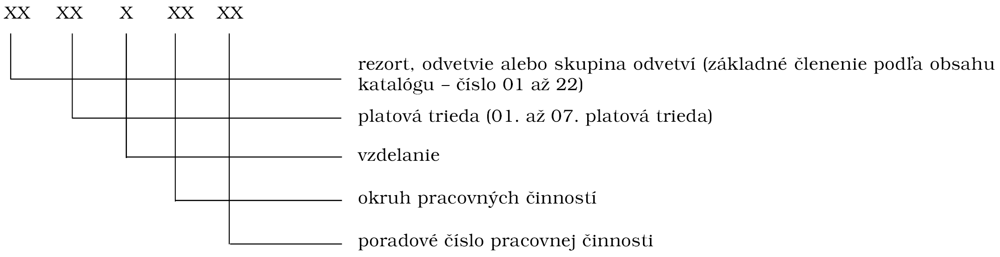

Príloha č. 2 k nariadeniu vlády č. 111/2002 Z. z.

- KATALÓG PRACOVNÝCH ČINNOSTÍ REMESELNÝCH, MANUÁLNYCH ALEBO MANIPULAČNÝCH S PREVAHOU FYZICKEJ PRÁCE VO VEREJNEJ SLUŽBE

- Prehľad

01. | Spoločné pracovné činnosti ....................................................... | 1238

03. | Doprava, pošta a telekomunikácie .................................................. | 1248

05. | Geodézia, kartografia a kataster .................................................... | 1253

10. | Kultúra ....................................................................... | 1254

12. | Obrana ....................................................................... | 1258

13. | Pôdohospodárstvo ............................................................... | 1260

14. | Práca a sociálne veci ............................................................. | 1265

15. | Samospráva (vyšší územný celok a obec) ............................................. | 1266

17. | Školstvo a telovýchova ........................................................... | 1275

19. | Vnútro - Archívnictvo ............................................................ | 1276

21. | Zdravotníctvo .................................................................. | 1276

22. | Životné prostredie ............................................................... | 1278

&nbsp | Štruktúra číslovania pracovných činností ............................................ | 1280

01. SPOLOČNÉ PRACOVNÉ ČINNOSTI

01. PLATOVÁ TRIEDA

Kvalifikačné predpoklady: neustanovujú sa.

01.1.01. Pracovné činnosti nevyžadujúce vzdelanie:

01 Kontrola príchodov a odchodov osôb a príjazdov a odjazdov vozidiel s prípadnou kontrolou batožín a vozidiel; vydávanie kľúčov.

02 Dozor v objektoch alebo zariadeniach, zabezpečovanie ochrany proti krádežiam, prepadnutiam alebo živelným pohromám.

03 Uvádzačská práca, podávanie informácií, kontrola vstupeniek, predaj propagačných materiálov.

04 Jednoduchá obsluha prevádzkových zariadení (napr. rozmnožovací stroj, kopírovací stroj, drvič papiera).

01.1.03. Pracovné činnosti nevyžadujúce vzdelanie z okruhu stravovania:

01 Pomocná práca pri výrobe jedál, zber a umývanie kuchynského riadu, čistenie a obsluha jednoúčelových kuchynských strojov a pod.

02 Výdaj jedál s prípadnou obsluhou stravníkov.

03 Obstarávanie desiat, nápojov vrátane vyúčtovania zverených súm.

01.1.04. Pracovné činnosti nevyžadujúce vzdelanie z okruhu ubytovania, upratovania a čistenia:

01 Bežné upratovanie vrátane vynášania odpadkov, čistenia kobercov vysávačom a dezinfekcia sociálnych zariadení; čistenie okien (bez ich rozobrania), interiérov, exteriérov; výmena záclon alebo závesov.

02 Zabezpečovanie prevádzky v šatniach, vydávanie kľúčov, bielizne a podávanie základných informácií o prevádzkovom poriadku zariadenia a o poskytovaných službách.

03 Starostlivosť o čistotu a poriadok v priestoroch účelového zariadenia (napr. ubytovňa, rekreačné zariadenie) vrátane inventára, výmena alebo prezliekanie bielizne, sprostredkúvanie služieb (napr. žehlenie obleku, čistenie obuvi).

04 Žehlenie posteľnej a rovnej bielizne ručne alebo na jednoduchých žehliacich strojoch vrátane ručného dožehľovania a skladania bielizne.

05 Pomocná práca pri bežnej údržbe odevu, bielizne alebo obuvi.

06 Jednoduchá práca v práčovni.

07 Ručné čistenie komunikácií a plôch zametaním, umývaním, zbieraním, zoškrabávaním a zhŕňaním nečistôt všetkého druhu vrátane udržiavania priechodnosti odpadových kanálov.

01.1.05. Pracovné činnosti nevyžadujúce vzdelanie z okruhu manipulácie:

01 Prijímanie, potvrdzovanie, triedenie a doručovanie záznamov (písomností) a zásielok vnútri u zamestnávateľa.

02 Evidovanie korešpondencie v registratúrnych denníkoch, sprostredkúvanie obehu spisov, dokladov, tlače u zamestnávateľa.

03 Najjednoduchšia pomocná práca podľa presných pokynov (napr. výdaj kníh, športových potrieb).

04 Príjem a výdaj materiálu z príručných skladov.

05 Ručné balenie sypkých, pevných alebo tekutých látok vrátane vizuálnej kontroly, váženia a uzatvárania obalov.

01.1.07. Pracovné činnosti nevyžadujúce vzdelanie z okruhu obsluhy, remeselných, opravárskych a udržbárskych prác:

01 Obsluha osobného výťahu vrátane poskytovania informácií; obsluha nákladného výťahu s prípadnou manipuláciou s nákladom.

02 Jednoduchá pomocná práca na vlečke, v sklade, v údržbárskej dielni, v opravárenskej dielni alebo v garáži.

03 Základná ručná zámočnícka práca (napr. zrážanie hrany, konzervovanie, čistenie, odmasťovanie, nanášanie ochrannej pasty alebo náteru, ohýbanie plechu s jedným alebo dvoma ohybmi vo zveráku alebo v ohýbačke).

04 Základná zámočnícka práca (napr. zhotovovanie tesnenia z rôznych materiálov vysekávaním alebo vystrihovaním).

05 Jednoduchá pomocná práca (napr. ukladanie materiálu, rozoberanie debnenia).

02. PLATOVÁ TRIEDA

Kvalifikačné predpoklady: neustanovujú sa.

02.1.01. Pracovné činnosti nevyžadujúce vzdelanie:

01 Odpisovanie textu z rukopisu alebo písanie podľa diktátu.

02 Rozkresľovanie konštrukčných podkladov podľa pokynov.

03 Zhotovovanie a dopĺňanie zoznamov inventára a sledovanie jeho pohybu, evidencia a výkazníctvo.

04 Vyhľadávanie, triedenie a označovanie spisov podľa vnútorných pravidiel zamestnávateľa, ukladanie a vyraďovanie bežných písomných materiálov.

05 Predaj vstupeniek na rôzne akcie so zodpovednosťou za správne vyúčtovanie tržieb.

06 Vyberanie poplatkov podľa vopred ustanovených sadzieb.

07 Informovanie občanov, prípadne právnických osôb alebo fyzických osôb o príslušnosti vnútorných útvarov alebo konkrétnych zamestnancov na vybavovanie ich podnetov, dopytov alebo sťažností.

08 Stráženie objektu so služobným psom vrátane starostlivosti o psa.

09 Dozor a ochrana zbierkových, múzejných alebo výstavných fondov, verejného priestoru alebo kultúrneho zariadenia.

02.1.02. Pracovné činnosti nevyžadujúce vzdelanie z okruhu polygrafie:

01 Rozmnožovanie a kopírovanie technických a iných dokumentov na rotačných xerografických a diazografických strojoch s pripojeným znášacím zariadením.

02 Pomocná práca v tlačiarni.

03 Príprava filmov na vyvolávanie, označovanie a spájanie filmov do pásov, obsluha zariadenia na hromadné vyvolávanie farebných filmov, diapozitívov a pozitívov; pozitívne retušovanie čiernobielych amatérskych zväčšenín; kopírovanie alebo zväčšovanie čiernobielych fotografií z negatívov.

02.1.03. Pracovné činnosti nevyžadujúce vzdelanie z okruhu stravovania:

01 Výroba jednoduchých druhov teplých jedál, polievok, cukrárskych výrobkov alebo jedál studenej kuchyne, dohotovovanie a výdaj jedál alebo rôznych príloh k hlavným jedlám.

02 Ručné vaľkanie chleba a ručné vyhotovovanie náročnejších druhov pečiva (napr. vianočka, hviezdičky, ozdobovanie koláčov, príprava lístkového cesta).

03 Sádzanie chleba zo slamienok do priebežných pecí.

04 Samostatný predaj tovaru a jedál v bufete s úpravou jedla na tanieri, výroba a výdaj teplých alebo nealkoholických nápojov.

05 Obsluha v jedálni účelového zariadenia.

02.1.04. Pracovné činnosti nevyžadujúce vzdelanie z okruhu ubytovania, upratovania a čistenia:

01 Domovnícka práca vrátane drobnej údržby (napr. výmena žiarovky), dozor nad používaním spoločných priestorov, udržiavanie čistoty a poriadku vo zverenom objekte.

02 Starostlivosť o zverené izby v účelovom zariadení a o ich príslušenstvo vrátane výmeny a prezliekania bielizne; samostatné vedenie príručného skladu vrátane hmotnej zodpovednosti; sprostredkúvanie služieb alebo obsluha minibaru vrátane odovzdávania podkladov na vyúčtovanie.

03 Pomocná recepčná práca v účelovom zariadení bez oddelenej činnosti vrátnice (napr. vedenie denníka ubytovaných, knihy návštev), vyberanie poplatkov za poskytované služby.

04 Čistenie a upratovanie veľkých plôch pomocou samohybného mechanizmu.

05 Čistenie všetkých typov rozoberateľných okien vrátane ich rozoberania a skladania.

06 Upratovanie po maliaroch, po murároch a pod. s použitím rôznych mechanických upratovacích strojov.

07 Komplexné upratovanie zdravotníckych pracovísk v zdravotníckom zariadení, v zariadení sociálnych služieb alebo v zariadení pre pracovnú rehabilitáciu a rekvalifikáciu občanov so zmenenou pracovnou schopnosťou.

08 Komplexné čistenie a údržba výrobných a prevádzkových priestorov vrátane čistenia značne znečistených plôch chemickými prostriedkami.

09 Príjem a výdaj zákaziek v zberniach vrátane vyberania poplatkov za služby a odvodu tržieb.

10 Príjem bielizne s kontrolou stavu, stupňa a charakteru zašpinenia a poškodenia s určením spôsobu prania a čistenia a jej značkovanie.

11 Obsluha zariadení na chemické čistenie odevov, pranie a odstreďovanie bielizne vrátane prípravy pracích, bieliacich, dezinfekčných, avivážnych a ostatných roztokov.

12 Žehlenie bielizne a pracovných odevov na viacvalcových žehliacich strojoch vrátane ručného dožehľovania a skladania.

13 Bežná oprava a údržba odevov, bielizne alebo obuvi.

14 Základná hygienická úprava vlasov, fúzov a brady.

02.1.05. Pracovné činnosti nevyžadujúce vzdelanie z okruhu manipulácie:

01 Prijímanie, potvrdzovanie, triedenie a doručovanie zásielok v spolupráci s poskytovateľmi transportných služieb spojené s hmotnou zodpovednosťou.

02 Samostatný príjem, skladovanie, ošetrovanie a výdaj výrobkov a materiálov vrátane vedenia evidencie.

03 Nakladanie a skladanie prepravovaných hmôt, výrobkov alebo tovaru na vozidlo a z vozidla.

04 Obsluha skladových mechanizačných prostriedkov.

05 Zabezpečovanie kotolne palivom ručne alebo mechanizačnými prostriedkami.

02.1.06. Pracovné činnosti nevyžadujúce vzdelanie z okruhu laboratórnej práce:

01 Pomocná práca pri príprave biologického materiálu na laboratórne vyšetrenie vrátane prípravy jednoduchých roztokov; mechanická práca pri príprave pôd.

02.1.07. Pracovné činnosti nevyžadujúce vzdelanie z okruhu obsluhy, remeselných, opravárskych a údržbárskych prác:

01 Obsluha reverzačných rotačných zásobníkov pri homogenizácii a dávkovaní odpadu do predkomory kotla.

02 Obsluha výmenníkovej stanice bez automatickej regulácie alebo redukčnej stanice diaľkového vykurovania.

03 Obsluha zásobníka s roštom, vibračného podávača alebo paketovacieho lisu vrátane ručnej manipulácie s tuhým odpadom.

04 Obsluha jednoduchého strojového zariadenia (napr. sušička, odstredivka, odmasťovacie zariadenie).

05 Pomocná práca pri obsluhe aktivačných nádrží, usadzovačov, čerpadiel a potrubí pri biologickom čistení odpadových vôd.

06 Pomocná práca pri obsluhe a údržbe energetických alebo vodohospodárskych zariadení.

07 Pomocná práca v autodielni.

08 Demontáž akumulátorových batérií, čistenie a konzervovanie povrchu článkov.

09 Jednoduchá kováčska práca (napr. ručné kovanie, ohýbanie, ostrenie a kalenie náradia).

10 Jednoduchá ručná zámočnícka práca (napr. ručné rezanie tenkostenného profilu, spájanie dielcov skrutkovaním, ohýbanie materiálu za studena).

11 Jednoduchá zámočnícka práca (napr. vŕtanie, brúsenie a zhotovovanie jednoduchej súčiastky).

12 Jednoduchá klampiarska práca v dielňach (napr. ručné a strojové strihanie tabuľového plechu, ohýbanie, vŕtanie a vystužovanie plechu, nitovanie a spájanie dielcov).

13 Jednoduchá stolárska práca (napr. pripravovanie lignátu, sololitu a pod. na rámy, priskrutkovanie drobného kovania).

14 Údržba lesoparku alebo ihriska vrátane údržby a starostlivosti o náradie.

03. PLATOVÁ TRIEDA

Kvalifikačné predpoklady: stredné vzdelanie.

03.2.01. Pracovné činnosti vyžadujúce stredné vzdelanie:

01 Dozor a ochrana zbierkových, múzejných a výstavných fondov, verejného priestoru alebo kultúrneho zariadenia s prípadným využívaním priemyselnej televízie, videotechniky vrátane spolupráce s políciou.

02 Ponuka a samostatný predaj tovaru, preberanie, uskladňovanie, vystavovanie a aranžovanie tovaru v predajni, vyberanie poplatkov alebo vystavovanie potrebného dokladu pre pokladnicu.

03.2.02. Pracovné činnosti vyžadujúce stredné vzdelanie z okruhu polygrafie:

01 Príprava tlačovej formy, nastavenie stroja, jednofarebná jednostranná tlač na maloformátovom stroji.

02 Údržba a bežná oprava ofsetového hárkového, xerografického a diazografického stroja s pripojeným znášacím zariadením.

03 Odborná práca pri fotografovaní čiernobielych fotografií, exteriérové fotografovanie, vyhotovovanie fotokópií z mikrofilmov a vyvolávanie negatívov.

04 Fotografovanie čiernobielych informatívnych materiálov a dokumentačných fondov; zhotovenie fotokópií z mikrofilmov s bežnými textovými predlohami.

05 Odborná práca pri vyvolávaní farebných filmov, kopírovaní, zväčšovaní alebo zmenšovaní fotografií a diapozitívov a pri príprave vývojok, ustaľovačov a iných chemikálií na spracúvanie farebných a inverzných filmov a kópií v automatoch.

03.2.03. Pracovné činnosti vyžadujúce stredné vzdelanie z okruhu stravovania:

01 Obsluha viacúčelového veľkokapacitného kuchynského stroja alebo viac jednoúčelových veľkokapacitných kuchynských strojov na výrobu pokrmov; obsluha veľkokapacitných chladiacich alebo mraziacich zariadení.

02 Výroba a výdaj bežných druhov teplých jedál alebo zložitých jedál studenej kuchyne a výroba polotovarov z predspracovaných surovín na prípravu hlavných jedál.

03 Výroba a výdaj bežných druhov múčnikov a cukrárskych výrobkov (napr. koláče, bábovky, vianočky), výroba teplých múčnikov (napr. šišky, ovocné nákypy), hromadná výroba cukrárskych výrobkov a múčnikov v závodnom, školskom alebo obdobnom stravovacom zariadení.

04 Samostatné preberanie objednávok, stolovanie a obsluha zákazníkov.

03.2.04. Pracovné činnosti vyžadujúce stredné vzdelanie z okruhu ubytovania, upratovania a čistenia:

01 Domovnícka práca vrátane údržby objektu (napr. oprava zámok, rôznych uzáverov), drobná murárska, stolárska, inštalatérska a záhradnícka práca s prípadným vykurovaním objektu.

02 Samostatné prijímanie a vybavovanie objednávok ubytovacích a iných služieb vrátane vedenia predpísanej evidencie a vyberania poplatkov za poskytované služby.

03 Šitie, oprava a úprava pracovných odevov, šatstva alebo bielizne.

04 Pletenie na mechanických strojoch (napr. typu WERA-U, DERA-B).

05 Strojové žehlenie odevov na lisoch, ručné žehlenie toaliet, divadelných kostýmov, hodvábnych výrobkov, individuálnych spoločenských odevov vrátane zložitého tvarovania tkanín (plisovanie) aj na strojoch.

06 Určovanie pracovného postupu a odstraňovanie škvŕn z bielizne, textílií, odevov alebo z iných výrobkov ľahkou detážou.

03.2.05. Pracovné činnosti vyžadujúce stredné vzdelanie z okruhu manipulácie:

01 Samostatné kvantitatívne, prípadne kvalitatívne preberanie tovarov, výrobkov, materiálov a surovín, ich skladovanie, kompletizácia pre odberateľa, obsluha skladovacích mechanizmov s využitím výpočtovej techniky, inventarizácia.

02 Ručný presun hmôt, polotovarov a výrobkov s hmotnosťou nad 50 kg.

03 Expedícia hotových výrobkov a zásielok.

04 Montáž a demontáž výstav a expozícií vrátane nakladania a vykladania exponátov a výstavného systému pri prevoze a dovoze výstav pri zvýšenom riziku poškodenia exponátov.

03.2.06. Pracovné činnosti vyžadujúce stredné vzdelanie z okruhu laboratórnej práce:

01 Starostlivosť o laboratórne zvieratá, kŕmenie vrátane prípravy krmiva, napájanie a hygienická starostlivosť, pomoc pri obsluhe zariadení na sterilizáciu krmív pre laboratórne zvieratá.

02 Ošetrovanie a odchov laboratórnych zvierat podľa hmotnostných kategórií, sledovanie zdravotného stavu zvierat.

03 Príprava pomôcok na laboratórne práce (napr. biologický materiál, kultivačné pôdy, jednoduché roztoky).

04 Dezinfekcia, dezinsekcia a deratizácia vrátane prípravy zariadení, pomôcok, chemických postrekov a vlastnej aplikácie chemických insekticídov; postreky alebo práškovanie v závislosti od charakteru a rozsahu zamorených priestorov; kladenie nástrah na hubenie hlodavcov.

05 Identifikácia a odber hrubých vzoriek podľa zjavných fyzikálnych vlastností podľa platných noriem, príprava analytických a referenčných vzoriek; príprava štandardných roztokov na analytické určovanie, kalibrácia vrátane presného určenia konštánt látok.

06 Príprava analytických a referenčných vzoriek vrátane sterilizácie laboratórneho skla a náradia pri náročných technológiách (napr. preukazovanie stopových prvkov v tkanivových kultúrach).

03.2.07. Pracovné činnosti vyžadujúce stredné vzdelanie z okruhu obsluhy, remeselných, opravárskych a údržbárskych prác:

01 Obsluha umývacieho tunela, šampónovanie, pastovanie a leštenie povrchu karosérie, podvozkov a motorov áut a odstraňovanie nedostatkov vzniknutých pri umývaní (napr. zaplavenie karburátora alebo zapaľovania vodou).

02 Obsluha a údržba strojových a rozvodných sústav malých kúpeľných a rehabilitačných zariadení s bazénom, s vaňovými a sprchovými boxmi a ďalšími procedúrami (napr. výmenníkové, čerpacie a filtračné zariadenie s prípadnou úpravou vody).

03 Obsluha teplovodného alebo horúcovodného kotla systému ústredného vykurovania s výkonom kotla do 5,8 MW, alebo nízkotlakového parného kotla s menovitým výkonom, alebo viac kotlov s prepočítaným výkonom do 8 t/h.

04 Zabezpečovanie prevádzky kotolne na tekuté alebo plynné palivo s poloautomatizovaným alebo s automatizovaným meraním alebo s reguláciou vrátane údržby a odstraňovania drobných porúch.

05 Obsluha výmenníkovej stanice s tepelným výkonom do 80 MW vrátane strojového príslušenstva (napr. obehové čerpadlo, ohrievač obehovej vody, prípadne redukčná stanica).

06 Údržba klimatizačných zariadení v rozsiahlych objektoch (napr. kontrola a výmena vreckových filtrov, čistenie rovnosmerných plôch výmenníkov ionizačných jednotiek).

07 Čistenie odpadových nádrží a obsluha čistiarne odpadových vôd.

08 Zisťovanie porúch a oprava rozvodov elektroinštalácie v objektoch s prípadnou výmenou vodičov vrátane premerania.

09 Výmena olejov a výplach motorov, prevodoviek a rozvodoviek, ošetrenie a výmena vložiek čističov oleja a vzduchu; premazávanie vozidiel podľa mazacieho plánu, premazanie pier a drobné opravy.

10 Demontáž a montáž palivového vedenia, ventilátorov, regulátorov vstrekovacieho čerpadla a pod., montáž hlavných skupín a celková montáž vozidla vrátane preskúšania, demontáž, oprava a montáž dopravného čerpadla alebo jednostupňového karburátora, oprava prevodovky, prídavnej prevodovky, dynama, elektrického čerpadla, spúšťača.

11 Striekanie vrchnej farby na veľkých alebo členitých plochách bez nárokov na vzhľad povrchu.

12 Prehliadka a oprava akumulátorových batérií v rozsahu medzi jednotlivými prehliadkami alebo ich bežná oprava.

13 Obsluha, údržba a bežná oprava lyžiarskeho vleku.

14 Obsluha a údržba potrubnej pošty.

15 Obsluha spaľovacieho zariadenia na špecifický odpad.

16 Základná údržbárska práca (napr. oprava elektromechanickej kontrolnej pokladnice, jednoduchého reprografického stroja).

17 Kováčska práca (napr. strojové zhotovovanie kováčskych výrobkov).

18 Stolárska, lakovnícka a murárska údržbárska práca.

04. PLATOVÁ TRIEDA

Kvalifikačné predpoklady: stredné vzdelanie.

04.2.01. Pracovné činnosti vyžadujúce stredné vzdelanie:

01 Ozbrojená ochrana a sprevádzanie peňažných zásielok a cenín.

02 Ochrana významného zariadenia (napr. Slovenská národná galéria, Slovenské národné múzeum), pamiatok alebo chránených objektov, spolupráca s orgánmi polície.

03 Zabezpečovanie a vykonávanie požiarneho dozoru v divadle, v koncertnej sieni alebo v inom kultúrnom zariadení vrátane prác pri zdolávaní mimoriadnych udalostí a záchrane osôb.

04 Plnenie základných povinností poriadkovej služby vo vymedzenom rozsahu.

05 Zaobstarávanie a nákup tovaru vrátane jeho uskladňovania, samostatného predaja, vystavovania a aranžovania v predajni, príprava podkladov na fakturáciu, inkaso alebo vystavovanie potrebného dokladu pre pokladnicu.

04.2.02. Pracovné činnosti vyžadujúce stredné vzdelanie z okruhu polygrafie:

01 Zhotovovanie farebných snímok, mikrofilmov, mikrofišov a ich kópií.

02 Vyvolávanie, zosilňovanie alebo zoslabovanie negatívov na farebnú fotografiu vrátane prípravy vyvolávacích roztokov a vykonávanie negatívnej retuše; duplikovanie mikrofilmov a mikrofišov na diazoduplikačné filmy so čpavkovým vyvolávaním, kopírovanie na halogenidostrieborné filmy.

03 Ručné kopírovanie, zväčšovanie alebo zmenšovanie z historických alebo umeleckých zbierkových negatívov stredných formátov s použitím zvláštnych techník retuše.

04 Zhotovovanie montáží pre jednofarebnú a dvojfarebnú ofsetovú tlač.

05 Príprava tlačovej formy, nastavovanie stroja, dvojfarebná jednostranná tlač na maloformátovom stroji.

06 Ručné zhotovovanie knižných dosiek a jednoduchej knižnej väzby.

07 Jednoduchá knihárska práca pri obnove knižných fondov.

04.2.03. Pracovné činnosti vyžadujúce stredné vzdelanie z okruhu stravovania:

01 Úprava jatočného mäsa, hydiny a rýb na kuchynské spracovanie.

02 Zabezpečovanie postupov výroby jedál zmenovým kuchárom vo viaczmennej prevádzke (napr. v nemocnici, v domove mládeže, v internáte, v zariadení sociálnych služieb) vrátane ich výdaja.

03 Výroba technologicky náročných teplých jedál alebo špecialít studenej kuchyne s prípadným využitím veľkokapacitných programovo riadených kuchynských strojov.

04 Výroba a výdaj technologicky náročných cukrárskych výrobkov alebo špecialít cukrárskej výroby, spracúvanie vlastných receptúr a kalkulácií vrátane kontroly hotových výrobkov.

05 Príprava tabule, stolovanie a obsluha najmä pri osobitných príležitostiach (napr. banket, recepcia) vrátane dokončovania jedál pri stole a ich konečnej úpravy.

06 Výroba pekárskych výrobkov vrátane expedície podľa objednávok.

07 Obsluha skupiny veľkokapacitných a programovo riadených kuchynských strojov na výrobu alebo mrazenie pokrmov v centrálnej kuchyni alebo vo vývarovni vrátane určenia technologického postupu a kontroly hotových výrobkov.

09 Samostatné preberanie objednávok, vystavovanie a aranžovanie jedál, stolovanie a obsluha zákazníkov vrátane inkasa tržieb.

04.2.04. Pracovné činnosti vyžadujúce stredné vzdelanie z okruhu ubytovania, upratovania a čistenia:

01 Zabezpečovanie upratovacích a doplňujúcich prác v účelovom zariadení; vedenie príručného skladu.

02 Samostatné prijímanie a vybavovanie objednávok ubytovacích a iných hotelových služieb, inkaso valút, vedenie predpísanej evidencie.

04.2.05. Pracovné činnosti vyžadujúce stredné vzdelanie z okruhu manipulácie:

01 Druhové, kvantitatívne a kvalitatívne preberanie tovaru, jeho uskladnenie s využitím výpočtovej techniky a sledovanie podmienok uskladnenia.

04.2.06. Pracovné činnosti vyžadujúce stredné vzdelanie z okruhu laboratórnej práce:

01 Bežná laboratórna práca pri vykonávaní základných chromatografických analýz.

04.2.07. Pracovné činnosti vyžadujúce stredné vzdelanie z okruhu obsluhy, remeselných, opravárskych a údržbárskych prác:

01 Obsluha a bežná údržba strojových a rozvodných sústav plaveckého bazénu nad 20 m dĺžky alebo stredných kúpeľných zariadení s bežnými vodoliečebnými procedúrami (napr. horúci vzduch, para, sauna), obsluha a bežná údržba čerpacej, filtračnej, výmenníkovej a klimatizačnej stanice; úprava a rozbory vody.

02 Obsluha a údržba klimatizačného zariadenia zloženého z vykurovacích, z chladiacich a z mraziacich elementov (chladiaci výkon cca 3,5 MW), nastavovanie termostatov vstupnej vody, predohrievačov ľahkých vykurovacích olejov a uzatváranie armatúr na okruhoch vykurovacieho média.

03 Zabezpečovanie prevádzky parného kotla s menovitým výkonom alebo viacerých kotlov s prepočítaným výkonom do 60 t/h alebo horúcovodného kotla s menovitým výkonom alebo viacerých kotlov s prepočítaným výkonom do 35 MW.

04 Technické zabezpečovanie chodu strojového zariadenia na výrobu ľadu vrátane opravy a bežnej údržby s prípadnou obsluhou agregátov núdzového osvetlenia.

05 Montáž a zapájanie elektroinštalácie v objektoch a zariadeniach vrátane rozvodných skríň.

06 Oprava a údržba elektrického alebo strojového zariadenia (napr. oprava elektrickej inštalácie, osvetlenia nemocnice, liečebného zariadenia, školy, školského zariadenia, kina, divadla, reprezentačných miestností).

07 Zabezpečovanie chodu a oprava elektrických strojov a zariadení (napr. šijací stroj, pletací stroj).

08 Kontrola, výmena a oprava jednotlivých častí celkov, systémov, skupín vozidiel (napr. chladiaca sústava, palivový systém, brzdový systém, podvozkové skupiny, riadenie, elektrosústava), kontrola a nastavovanie geometrie obidvoch náprav.

09 Leštenie karosérií osobných automobilov po konečnom nástreku; konečné striekanie rovných plôch karosérií automobilov alebo autobusov vrátane tmelenia, brúsenia a čistenia zvarovaných častí.

10 Zhotovovanie alebo výmena poškodenej zvarovanej časti karosérie alebo kostry automobilu vrátane vyrovnávania (napr. dvere, podlaha, blatník, strecha), zhotovovanie dielcov z materiálov všetkých druhov a ich montáž do špeciálnych a účelových vozidiel bez zmeny technickej spôsobilosti, oprava a výmena častí výfukového systému, oprava poškodených plastových častí motora vozidla lepením.

11 Špecializovaná zámočnícka práca (napr. oprava nosných oceľových konštrukcií) vrátane kontroly zvarov, tvarovania, brúsenia, lícovania a opravy nástrojov.

12 Údržba a oprava spojovacích rozvodov (napr. hlásky), rozvodov elektrickej a požiarnej signalizácie, kontrola, oprava a výmena jednotlivých častí spojovacích celkov (napr. panel rozhlasovej ústredne, telefónnej ústredne, zosilňovacej stanice).

05. PLATOVÁ TRIEDA

Kvalifikačné predpoklady: stredné vzdelanie alebo úplné stredné vzdelanie.

05.3.01. Pracovné činnosti vyžadujúce stredné vzdelanie alebo úplné stredné vzdelanie:

01 Ozbrojená ochrana návštevníkov a ich majetku pri hromadných podujatiach; ozbrojená ochrana významných kultúrnych objektov, spolupráca s orgánmi polície.

02 Zabezpečovanie ochrany, prepravy a doručovania písomností a iných materiálov označených rôznym stupňom utajenia a kuriérskych zásielok.

03 Ozbrojená ochrana a stráženie dôležitých objektov s veľkým množstvom výbušnín, zbraní alebo horľavín.

04 Základný výcvik a ošetrovanie psov v chovateľskej stanici zaoberajúcej sa veľkochovom psov až po ich odovzdanie do priameho výkonu.

05 Zabezpečovanie prevádzky zvereného úseku prevádzkovej jednotky (napr. predajňa, stravovacia jednotka), vybavovanie reklamácií a objednávok.

05.3.02. Pracovné činnosti vyžadujúce stredné vzdelanie alebo úplné stredné vzdelanie z okruhu polygrafie:

01 Príprava tlačovej formy, nastavovanie stroja, dvojfarebná obojstranná tlač na maloformátovom stroji.

02 Zhotovovanie kombinovaných viacfarebných montáží pre ofsetovú tlač.

03 Individuálne a špecializované fotografovanie.

04 Špecializované fotografovanie, zhotovovanie mikrofilmov a mikrofišov vzácnych knižných publikácií evidovaných ako kultúrne pamiatky na čiernobiely i farebný materiál.

05 Snímanie na mikrografických krokových aj súradnicových kamerách s ručnou voľbou expozície alebo s automatickým riadením expozície.

06 Ručné kopírovanie a zväčšovanie z historických zbierkových negatívov väčšieho formátu s využitím špeciálnych prístrojov a s použitím zvláštnych fotografických techník a retuše a konečná úprava výsledkov na bádateľské, zbierkové, výstavné a publikačné účely.

07 Príprava predlôh na zhotovovanie výťažkov na skenovanie a montáž farebných výťažkov (diapozitívov).

08 Odborná knihárska práca na knižných väzbách, spracúvanie ručnej väzby vrátane zdobenia dosiek, kartonáže a rezačskej práce.

09 Samostatné zabezpečovanie reprografickej práce pomocou výpočtovej techniky a kopírovacích strojov vrátane zabezpečovania ich údržby a opráv.

05.3.03. Pracovné činnosti vyžadujúce stredné vzdelanie alebo úplné stredné vzdelanie z okruhu stravovania:

01 Výroba veľmi náročných národných špecialít alebo výroba najnáročnejších špecialít studenej kuchyne na banket a recepciu, organizácia výroby jedál na slávnostné príležitosti vrátane zostavovania vlastných receptúr vybraných pokrmov.

02 Zhotovovanie zložitých a výtvarne náročných cukrárskych výrobkov podľa individuálnych požiadaviek alebo podľa vlastných návrhov.

03 Zabezpečovanie výroby cukrárskych výrobkov, múčnikov a cukrárskych špecialít pre osobitné akcie, prevažne podľa vlastných receptúr a kalkulácií s použitím rôznej technológie, prípadná účasť na výrobe.

04 Organizovanie práce obsluhujúcich zamestnancov pri zahraničných návštevách (napr. hlava štátu, predseda a podpredseda parlamentu, predseda a podpredseda vlády, minister, generálny tajomník OSN, generálny tajomník NATO) vo vybranom zariadení, uvádzanie hostí na miesta pri stole, preberanie a realizácia najzložitejších objednávok s poradenskou službou.

05 Výroba najzložitejších diétnych jedál podľa diétneho programu záväzného v zdravotníckom zariadení, v školskom zariadení alebo v zariadení sociálnych služieb, alebo v stravovacom zariadení strediska vrcholového športu.

05.3.05. Pracovné činnosti vyžadujúce stredné vzdelanie alebo úplné stredné vzdelanie z okruhu manipulácie:

01 Vedenie skladu drobného hmotného majetku a pomocného materiálu a vedenie predpísanej evidencie v účelovom zariadení.

02 Skladovanie a ošetrovanie špeciálnych druhov materiálov v skladoch osobitného určenia, vedenie ich evidencie.

05.3.06. Pracovné činnosti vyžadujúce stredné vzdelanie alebo úplné stredné vzdelanie z okruhu laboratórnej práce:

01 Analýza neštandardných vzoriek inštrumentálnymi metódami (napr. preparačná metóda, špeciálny rozbor rafinérskych výrobkov).

05.3.07. Pracovné činnosti vyžadujúce stredné vzdelanie alebo úplné stredné vzdelanie z okruhu obsluhy, remeselných, opravárskych a údržbárskych prác:

01 Zabezpečovanie chemickotechnologických procesov na čistiarni odpadových vôd, meranie prietokov, koncentrácie látkového znečistenia privádzaných a vypúšťaných vôd, práca s chemikáliami.

02 Zabezpečovanie prevádzky chemickej úpravovne vody, odoberanie vzoriek, vykonávanie rozborov a skúšok vrátane ich vyhodnocovania.

03 Zabezpečovanie prevádzky strojového zariadenia veľkého kúpeľného zariadenia alebo rehabilitačného zariadenia s viacerými bazénmi a špeciálnymi vodnými zariadeniami alebo s vodoliečebnými zariadeniami.

04 Oprava a údržba elektrických zariadení alebo strojových zariadení (napr. oprava ofsetového tlačiarenského alebo knihárskeho stroja a zariadenia, oprava parného kotla od 20 do 160 t/h, oprava a nastavenie kamery na záznam zvuku, oprava všetkých druhov premietacích zariadení v kinách).

05 Zabezpečovanie prevádzky parného kotla s menovitým výkonom alebo viacerých kotlov s prepočítaným výkonom do 300 t/h alebo horúcovodného kotla s menovitým výkonom alebo viacerých kotlov s prepočítaným výkonom do 180 MW.

06 Zabezpečovanie prevádzky výmenníkovej stanice s tepelným výkonom od 150 do 300 MW vrátane pridruženého zariadenia (napr. obehové čerpadlo, ohrievač obehovej vody, redukčná stanica).

07 Obsluha parného alebo elektrického napájacieho agregátu s menovitým hmotnostným prietokom nad 208 kg/s (cca 750 t/h) a tlakom nad 5 MPa.

08 Zabezpečovanie prevádzky, údržba a oprava veľkých klimatizačných zariadení pozostávajúcich z parovodných alebo z teplovodných kotlových jednotiek s výkonom cca 8,1 MW, turbokompresorov chladiacich zmesí, klimatizačných jednotiek a ich príslušenstva.

09 Montáž, oprava a revízia osobných a lôžkových výťahov s nosnosťou do 500 kg a rýchlosťou 0,7 m/s, riadených magnetickými snímačmi.

10 Celková oprava, výmena a nastavenie skupín a systémov vozidiel (motor, prevodovka, spojka), podvozkových skupín (náprava), riadenia, brzdovej sústavy, elektrosústavy, záručná prehliadka vozidiel s použitím diagnostiky.

11 Príprava karosérie a častí karosérie pred striekaním, konečné striekanie členitých plôch autobusov alebo automobilov mimo linky vrátane opráv (napr. dodržiavanie farebných odtieňov na všetkých plochách).

12 Výmena alebo oprava značne deformovanej karosérie ručne alebo hydraulickým zariadením a plameňom vrátane výmeny čelného skla lepením alebo opravy poškodených častí autoskiel.

13 Oprava elektrickej inštalácie a elektrického zariadenia obrábacích strojov a tvarovacích strojov formou výmeny alebo priama oprava poškodených elektrických zariadení vrátane odskúšania ich funkcie.

14 Oprava, údržba a nastavovanie elektrotechnických systémov na meranie a reguláciu teplôt alebo iných veličín (napr. zapisovač, regulátor, snímač, prenosové zariadenie).

15 Zabezpečovanie, obsluha a údržba chodu transformačnej stanice.

16 Obsluha a oprava elektrických rozvodov vrátane rozvodní VN/NN, náhradných zdrojov elektrickej energie, dieselagregátov s výkonom nad 200 kVA.

17 Revízia alebo skúšanie prenosných elektrických spotrebičov.

18 Vysokošpecializovaná zámočnícka práca vyžadujúca osobitné oprávnenie (napr. zváranie tlakových nádob, oceľových konštrukcií).

19 Strojové čistenie skladovacích nádrží pohonných hmôt a mazadiel vrátane vykonávania ich údržby a kontroly s použitím dýchacej techniky.

06. PLATOVÁ TRIEDA

Kvalifikačné predpoklady: úplné stredné vzdelanie.

06.4.01. Pracovné činnosti vyžadujúce úplné stredné vzdelanie:

01 Ozbrojená ochrana osôb pri hromadných podujatiach.

02 Zabezpečovanie ozbrojenej ochrannej služby v organizačnej jednotke s veľkým množstvom výbušnín, zbraní, horľavín alebo jedov.

03 Zabezpečovanie ochrany, prepravy a doručovania písomností a iných materiálov označených rôznym stupňom utajenia a kuriérskych zásielok na diplomatické misie do zahraničia vrátane príjmu, evidencie a dopravy diplomatických zásielok.

04 Zabezpečovanie prevádzky v prevádzkových jednotkách (napr. predajňa, stravovacia jednotka) a vybavovanie reklamácií a objednávok vrátane kontrolnej činnosti.

06.4.02. Pracovné činnosti vyžadujúce úplné stredné vzdelanie z okruhu polygrafie:

01 Zhotovovanie kombinovaných viacfarebných montáží pre tlač bez použitia kolíčkového spôsobu.

02 Príprava tlačovej formy, nastavovanie stroja, viacfarebná obojstranná tlač na hárkovacom veľkoformátovom stroji.

03 Zalamovanie náročných textov publikácií, oblamovanie obrázkov podľa predlohy s využitím výpočtovej techniky.

04 Zhotovovanie umelecky a výtvarne zameraných farebných fotografií a fotomontáží vrátane simultánnych fotografií, ktoré zobrazujú na jednej fotografii niekoľko fáz, polôh a stavov fotografovaného subjektu.

05 Zhotovovanie viacfarebných poltónových a autotypických výťažkov s použitím všetkých druhov korekčných masiek a s využitím rôznych grafických programov.

06 Špeciálna knihárska práca (napr. ručné zhotovovanie koženej väzby unikátnych kníh).

07 Reštaurovanie historickej knižnej väzby.

08 Príprava tlačovej formy, nastavenie tlačiarenského stroja, náročná obojstranná braillová tlač.

06.4.03. Pracovné činnosti vyžadujúce úplné stredné vzdelanie z okruhu stravovania:

02 Organizovanie výroby jedál vrátane určovania technologických postupov a kalkulácií, zostavovanie vlastných receptúr a jedálnych lístkov pri osobitných príležitostiach (napr. banket, recepcia, akcia s medzinárodnou účasťou).

06.4.07. Pracovné činnosti vyžadujúce úplné stredné vzdelanie z okruhu obsluhy, remeselných, opravárskych a údržbárskych prác:

01 Individuálna remeselná kusová výroba vrátane renovácie súčiastok, náhradných dielcov alebo špeciálnych prípravkov bez určených technologických postupov a výkresovej dokumentácie pomocou špeciálnych obrábacích strojov.

02 Kontrola vozidiel po oprave, diagnostika chýb technického stavu vozidiel, testovanie motorov a elektrického príslušenstva vozidiel.

03 Oprava ťažko havarovaných motorových vozidiel vrátane vyrovnania tak, aby sa dodržali základné body geometrie vozidiel stanovené výrobcom, prestavba motorových vozidiel na špeciálne účely po schválení zmeny technickej spôsobilosti.

04 Zabezpečovanie prevádzky, údržba a oprava poloautomatizovaných a automatizovaných klimatizačných zariadení pre veľmi rozsiahle objekty s výkonom tepelných zdrojov cca 11,6 MW, turbokompresorov, chladiacich veží, klimatizačných jednotiek a ich príslušenstva.

05 Zabezpečovanie prevádzky parného kotla s menovitým výkonom alebo viacerých kotlov s prepočítaným výkonom nad 300 t/h alebo horúcovodného kotla s menovitým výkonom alebo viacerých kotlov s prepočítaným výkonom nad 180 MW.

06 Zabezpečovanie prevádzky výmenníkovej stanice s tepelným výkonom nad 300 MW vrátane pridruženého zariadenia (napr. obehové čerpadlo, ohrievač obehovej vody, redukčná stanica).

07 Oprava, údržba a nastavenie zložitej meracej techniky a regulačnej techniky (napr. pri riadení technologického procesu úpravy vody) vrátane uvedenia do chodu.

08 Oprava, údržba a príprava špeciálnych technických prostriedkov na zabezpečovanie výcviku a vyučovacieho procesu (napr. špeciálny výcvikový trenažér).

09 Vykonávanie pravidelných emisných kontrol vozidiel so zážihovými benzínovými motormi.

10 Zisťovanie a hodnotenie technického stavu cestných vozidiel; najzložitejšie merania a hodnotenie technického stavu vozidiel na ich ďalšiu spôsobilosť.

11 Servisná a mechanická práca pri príprave a nastavovaní súťažného stroja na cyklistické preteky podľa stanovených kritérií.

12 Oprava zložitých automatických zariadení reprografickej techniky schopnej automaticky spracúvať komplexnú technológiu tlače.

13 Montáž, opravy, zapájanie, údržba, kontrola, revízia a nastavovanie alebo demontáž špeciálnych výťahov s pamäťovým riadením a logickými obvodmi alebo výťahových systémov Simplex, Duplex, Triplex a vyšších sústav s pamäťovými a logickými obvodmi, s nosnosťou nad 500 kg a rýchlosťou 1,4 m/s.

07. PLATOVÁ TRIEDA

Kvalifikačné predpoklady: úplné stredné vzdelanie.

07.4.01. Pracovné činnosti vyžadujúce úplné stredné vzdelanie:

01 Špeciálna ozbrojená individuálna ochrana.

07.4.02. Pracovné činnosti vyžadujúce úplné stredné vzdelanie z okruhu polygrafie:

01 Príprava tlačovej formy, nastavovanie stroja, náročná obojstranná viacfarebná tlač na hárkovacom veľkoformátovom stroji vyžadujúca presné dodržanie farieb podľa originálu.

02 Vypracúvanie návrhov a samostatné zhotovovanie umelecky vysoko náročných knihárskych výrobkov zdobených napr. vypaľovaním, morením, intarziou.

07.4.03. Pracovné činnosti vyžadujúce úplné stredné vzdelanie z okruhu stravovania:

01 Organizovanie práce zamestnancov pri zahraničných návštevách na najvyššej úrovni (napr. hlava štátu, predseda a podpredseda parlamentu, predseda a podpredseda vlády, minister, generálny tajomník OSN, generálny tajomník NATO) vo vybranom účelovom zariadení pri výrobe teplých a studených pokrmov vrátane zostavovania vlastných receptúr, technologických postupov a kalkulácií (napr. špecialít šéfkuchára) a pri výrobe jedál podľa špeciálnych požiadaviek cudzích národov alebo pri osobitných príležitostiach.

07.4.07. Pracovné činnosti vyžadujúce úplné stredné vzdelanie z okruhu obsluhy, remeselných, opravárskych a údržbárskych prác:

01 Zabezpečovanie montáže vysokotlakových systémov ústredného vykurovania so skúškami, vyregulovanie a uvedenie systému do prevádzky.

02 Kontrola a oprava najzložitejších typov vozidiel s využitím diagnostických a elektronických zariadení, oprava, diagnostika a výmena elektronických riadiacich jednotiek a palubných počítačov.

03. DOPRAVA, POŠTA A TELEKOMUNIKÁCIE

02. PLATOVÁ TRIEDA

Kvalifikačné predpoklady: neustanovujú sa.

02.1.01. Pracovné činnosti nevyžadujúce vzdelanie:

01 Doručovanie súdnych zásielok.

02 Vedenie a bežná údržba zvereného motorového vozidla (napr. multikára, plošinový motorový vozík, malotraktor) s príslušným osvedčením.

03 Zavesovanie (odpútavanie) bremien na žeriav rôznymi spôsobmi vrátane bremien nepravidelných tvarov pomocou hákov, klieští, plošín a viazačov vrátane bežnej údržby závesných prostriedkov.

02.1.30. Pracovné činnosti nevyžadujúce vzdelanie z okruhu spojov:

01 Obsluha pobočkových telefónnych ústrední, ďalekopisov a telefaxov; obsluha centrálnych staníc alebo dispečingov zvolávacích zariadení a vyrozumievacích zariadení a pod.

02 Oprava krokového voliča automatickej telefónnej ústredne (napr. výmena dotykových ramien, skúšanie voličov na prerušenie, výmena káblov).

03 Zabezpečenie technickej prevádzky reléových pobočkových ústrední typu ÚSR 1/4, ÚSR 1/6 a ÚRS 1/10.

04 Skúška jednotlivých častí automatických telefónnych a ďalekopisných ústrední voličových systémov, lokalizácia chybného zariadenia alebo chybných voličov a ich vypojenie z prevádzky.

05 Meranie elektrických parametrov jednotlivých diskrétnych súčiastok.

06 Montáž snímačov signalizačných a zabezpečovacích zariadení.

07 Základná odborná práca pri opravách mechanických podskupín ďalekopisného stroja.

08 Prípravná práca na výrobu, montáž alebo opravy rádiokomunikačných zariadení (napr. príprava jednotlivých častí anténových jednotiek a anténových zariadení).

09 Prelaďovanie krátkovlnných vysielačov do výkonu 60 kW podľa kmitočtového plánu.

10 Prípravná práca na montáž a opravy káblov, zalievanie káblových súborov vrátane prípravy zalievacej hmoty.

11 Montáž výstroja na ležiacich stožiaroch, montáž izolátorov na napájačových a odporových vedeniach, príprava dĺžok vodičov a lán na výrobu anténových systémov, kotiev a bleskozvodných zariadení.

12 Príprava a výroba čiastkových konštrukcií anténových stožiarov vrátane anténových držiakov.

03. PLATOVÁ TRIEDA

Kvalifikačné predpoklady: stredné vzdelanie.

03.2.01. Pracovné činnosti vyžadujúce stredné vzdelanie:

02 Vedenie, obsluha a údržba ľahkých traťových mechanizmov (napr. motorový vozík, koľajový zdvihák typu MAMUT a PRM).

03 Vedenie a údržba kolesových traktorov s prívesom pri doprave.

04 Vedenie motorových vozíkov s prídavnými a doplnkovými zariadeniami a mechanizmami (napr. so zahrnovacou radlicou, so žeriavovým hákom, s klieštinami, s hydraulickým drapákom) na viacúčelové používanie.

05 Vedenie motorových vozíkov a ťahačov so spaľovacím motorom (napr. BPHO, DPHO, Multicar) a malých traktorov s rýchlosťou do 15 km/h aj pri jazde na verejných komunikáciách vrátane manipulácie s bremenami.

06 Odborná práca pri opravách zariadení koľajových tratí a dohľad nad správnym stavom koľajových spodkov a zvrškov, oprava výšky a smeru koľají a výhybiek, výmena koľajových polí, koľají a výhybiek, pochôdzka na pridelených úsekoch tratí, hlásenie porúch a pod.

07 Odborná práca pri zabezpečovaní jazdy a posunu vlakov vrátane obsluhy ručne a miestne prestavovaných výhybiek, prevádzkové ošetrovanie výhybiek a zisťovanie voľnosti vlakovej cesty.

08 Obsluha a údržba dieselových motorov poháňajúcich jednotlivé agregáty vrátane kontroly mastenia a chladenia (napr. kormidelnícke zariadenie), ich údržba, čistenie a výmena olejových filtrov.

09 Údržba cestného telesa a objektov na cestnom telese bez používania malej strojovej mechanizácie (napr. ručné odkopávky, prekopávky, zárezy, oprava zvodidiel).

10 Viazanie nepravidelných telies pri montáži spravidla v súčinnosti viacerých zdvíhacích zariadení (napr. teleso turbíny, mostná konštrukcia, lokomotíva pri nehode).

11 Vedenie, obsluha a bežná údržba stavebných mechanizačných prostriedkov (napr. samopojazdný statický zhutňovací valec so šírkou behúňa do 2 m, stroj na rezanie živičných a betónových kobercov, lopatové rýpadlo do 2 m3 obsahu lopaty).

03.2.30. Pracovné činnosti vyžadujúce stredné vzdelanie z okruhu spojov:

01 Pravidelná funkčná skúška spojovacích ciest zariadení voličových telefónnych a ďalekopisných ústrední, samostatné odstraňovanie nepravidelnosti v prevádzke.

02 Montáž alebo prevádzková údržba staničných akumulátorových batérií.

03 Výmena modulov elektrických zariadení s digitálnym riadiacim systémom, ktorých chyba je priamo indikovaná diagnostikou systému (napr. ústredňa typu ÚE 10 - ÚE 200. Alcatel - Austria 5200 BCM).

04 Zhotovovanie systémových prepojovacích káblov vrátane zapojenia konektorov alebo zhotovovanie zložitej drôtovej formy bez ukladacieho predpisu.

05 Montáž stojanových konštrukcií a roštov podľa projektovej dokumentácie.

06 Kontrola a nastavovanie úrovne signálov na prenosových zariadeniach bez komplexného vyhodnocovania zistených hodnôt.

07 Základné nastavenie ďalekopisného stroja podľa predpisu výrobcu.

08 Zostavenie a montáž rozvodnej dosky ďalekopisného stroja.

09 Spolupráca pri mechanickom zastavovaní anténových jednotiek, koaxiálnych deličov, smerových väzieb, impedančných transformátorov pre vysielacie zariadenia.

10 Montáž alebo oprava časti vodného alebo vzduchového chladenia vysielačov, osadzovanie držiakov na anténové jednotky, koaxiálne deliče a napájače.

11 Zriaďovanie oznamovacích vedení a signalizačných rozvodov v priemyselných a bytových objektoch so zapojením telefónnej stanice.

12 Zabezpečovanie technickej prevádzky nadzemných telekomunikačných vedení vrátane výzbroje.

13 Odpancierovanie káblových koncov, príprava káblových koncov na meranie.

14 Montáž alebo oprava zvodov a viac ako štvordrôtových napájačov s konštantnou impedanciou a mechanických anténových prepínačov.

15 Spolupráca pri úpravách anténových systémov a nosičov vrátane výmeny kotiev, impregnácie kotevných lán a výmeny závesných lán antén.

16 Obsluha oblastných telefónnych ústrední, ďalekopisov a telefaxov, obsluha centrálnych staníc alebo dispečingov, zvolávacích a vyrozumievacích zariadení a pod. určených na medzištátny styk pri dodržiavaní zásad civilnej a vojenskej medzinárodnej komunikácie a zabezpečujúcich prechod na poľnú spojovaciu sústavu.

04. PLATOVÁ TRIEDA

Kvalifikačné predpoklady: stredné vzdelanie.

04.2.01. Pracovné činnosti vyžadujúce stredné vzdelanie:

01 Vedenie a bežná údržba cestných motorových vozidiel určených na prepravu osôb s počtom do 22 miest na sedenie okrem miesta pre vodiča alebo vozidiel s celkovou hmotnosťou do 12 000 kg.

02 Vedenie, obsluha a údržba hnacích vozidiel (rušňov) na vlečkách.

03 Vedenie motorového vozňa alebo súpravy mestskej koľajovej dopravy.

04 Obsluha a samostatné zabezpečovanie technickej prevádzky strojového zariadenia a elektrického zariadenia plavidiel vrátane údržby a opravy lodného zariadenia.

05 Samostatná odborná práca pri údržbe, oprave a montáži koľajových tratí a ich zariadení, pochôdzka pridelených úsekov troj- a viackoľajových tratí, oprava výšky a smeru koľají s bezpodvalovým upevnením koľajníc, montáž výhybiek na drevených podvaloch a pod.

06 Zabezpečovanie pohybu vlaku horskej lesnej železnice podľa prepravného a cestovného poriadku a prevádzkových a bezpečnostných pomerov na trati.

07 Odborná práca pri zabezpečovaní posunu železničných vozňov pri rozchode od 900 mm, obsluha bŕzd jednotlivých vozňov alebo ich skupín a pod.

08 Zabezpečovanie bezpečnosti cestujúcich v prepravných priestoroch, kontrola stavu vlakovej súpravy, kontrola dokladov o zaplatení cestovného, obsluha a kontrola osvetlenia a pod.

09 Odborná práca pri údržbe a oprave vozňového parku a zabezpečovanie spôsobilosti vozňového parku v súlade s prevádzkovým poriadkom.

10 Vedenie, obsluha a bežná údržba strojových súprav na pretláčanie potrubia pod komunikáciami a objektmi.

11 Odborná práca pri údržbe cestného telesa a objektov na cestnom telese s obsluhou strojových zariadení a malej mechanizácie (napr. frézovanie povrchu vozovky, zhutňovanie povrchu vozovky).

12 Kladenie liatych asfaltových a asfaltobetónových dlažieb (s prípadnými stužujúcimi vložkami z pletiva) ručným nanášaním, vypracúvaním a zhutňovaním povrchu na chodníkoch, vozovkách alebo v halách.

13 Vedenie, obsluha a bežná údržba napríklad

- baranidiel a vyťahovačov,

- dózerov, skrejprov a grejdrov s výkonom motora do 132 kW,

- betonární s poloautomatickým ovládaním,

- čerpacích súprav na dopravu a ukladanie betónových zmesí a mált s výkonom do 25 m3 za hodinu,

- strojových súprav na pretláčanie potrubia pod komunikáciami a objektmi,

- lopatových rýpadiel nad 2 m3 obsahu lopaty.

14 Vedenie a obsluha kozových žeriavov pri montáži viacposchodových budov, vežových žeriavov s nosnosťou do 80 t alebo mostových žeriavov s nosnosťou nad 50 t.

15 Obsluha autožeriavov s nosnosťou nad 3 t do 8 t na háku pri premiestňovaní bremien.

04.2.30. Pracovné činnosti vyžadujúce stredné vzdelanie z okruhu spojov:

01 Montáž alebo samostatné zabezpečovanie technickej prevádzky a skúšok na ucelenej časti telefónnych alebo ďalekopisných ústrední na vymedzenom čiastkovom úseku vrátane údržby príslušných poloautomatických skúšobných zariadení.

02 Montáž alebo samostatné zabezpečovanie technickej prevádzky reléových a hľadačových pobočkových ústrední typu ÚSR 2/9/2, ÚSR 3/15/3 a ÚSH.

03 Montáž alebo samostatné zabezpečovanie technickej prevádzky komplexov ochranných a signalizačných zariadení so skupinovými skriňami, napájačmi a kódovými hlásičmi.

04 Výmena chybných modulov elektrických zariadení identifikovaných pomocou diagnostického zariadenia vrátane prekladu kódu (napr. EPEX).

05 Montáž alebo samostatné zabezpečovanie technickej prevádzky prenosových multiplexných zariadení.

06 Dielenská oprava elektromechanických ďalekopisných strojov vrátane prídavných zariadení.

07 Zostavovanie vysielacích anténových jednotiek, koaxiálnych deličov a smerových väzieb vrátane elektrického zapojenia.

08 Montáž koaxiálnych napájačov, koaxiálnych deličov a smerových väzieb vysielacích anténových systémov, frekvenčne modulovaných VKV vysielačov, dehydrátorov a umelých záťaží nahradzujúcich anténové systémy.

09 Zriaďovanie vonkajšieho prípojného vedenia účastníckej stanice (samonosným káblom alebo vodičom) a montáž účastníckeho zariadenia.

10 Samostatné zabezpečovanie technickej prevádzky účastníckych telefónnych zariadení (vonkajšie sady, podvojné prípojky, skupinové prípojky, sekretárske reléové zariadenia, telefónne prístroje).

11 Montáž a oprava kapacitne nevyrovnávaných telekomunikačných káblov.

12 Montáž alebo oprava vysielacích anténových zariadení typu Rhombus. L-anténa, ŠUS-anténa.

05. PLATOVÁ TRIEDA

Kvalifikačné predpoklady: stredné vzdelanie alebo úplné stredné vzdelanie.

05.3.01. Pracovné činnosti vyžadujúce stredné vzdelanie alebo úplné stredné vzdelanie:

01 Vedenie a bežná údržba cestných motorových vozidiel určených na prepravu osôb s počtom nad 22 miest na sedenie okrem miesta pre vodiča alebo vozidiel s celkovou hmotnosťou nad 12 000 kg, alebo špeciálnych motorových vozidiel a techniky na údržbu pozemných komunikácií (napr. zametač s objemom zásobníka nad 5 m3, autožeriav s nosnosťou nad 8 ton, nakladač).

02 Obsluha, údržba a oprava ťažkých mechanizmov na úpravu štrkového lôžka (napr. PUŠL 71, PUŠL 74, ZŠ 72).

03 Vedenie, obsluha a údržba hnacích vozidiel (rušňov) na posune.

04 Zabezpečovanie pracovného režimu strojov, prevádzková údržba strojov, montážna práca, oprava strojového zariadenia a obsluha elektrozariadenia.

05 Zložitá odborná práca pri posune so železničnými vozňami pri rozchode od 900 mm, obsluha bŕzd jednotlivých vozňov alebo ich skupín a pod.

06 Zložitá odborná práca pri komplexnej technickej kontrole železničných vozňov vrátane stanovovania technológie opráv a skúšok bŕzd vlakov.

07 Oprava a údržba nosných častí mostných objektov (napr. osadzovanie a výmena ložísk a dilatačných zariadení, napínanie oceľových lán prepiatych dielcov a monolitických konštrukcií).

08 Špeciálne rozbory rafinérskych výrobkov, skúšanie olejov na hypoidných skúšobných strojoch, stanovovanie oktánového čísla motorových palív, rozbory leteckých palív (termická stabilita, modifikovaný separačný index, lumiometrické číslo).

09 Oprava náročných špeciálnych mechanizmov leteckej dopravy vyžadujúcich zvláštne oprávnenia (napr. štartovací agregát, odmrazovač, pozemný zdroj).

10 Vedenie, obsluha a bežná údržba napríklad

- dózerov, skrejprov, grejdrov s výkonom motora nad 132 kW,

- plnoautomatizovaných miešarní zmesí so sústavami dopravy, skladovania, triedenia a dávkovania materiálu,

- stavebných vežových (šplhacích) žeriavov s nosnosťou nad 80 t.

05.3.30. Pracovné činnosti vyžadujúce stredné vzdelanie alebo úplné stredné vzdelanie z okruhu spojov:

01 Montáž, oživovanie alebo samostatné zabezpečovanie technickej prevádzky, vykonávanie funkčných skúšok a nastavovanie parametrov diaľkových volieb.

02 Montáž, oživovanie alebo samostatné zabezpečovanie technickej prevádzky telefónnych alebo ďalekopisných ústrední voličových systémov.

03 Montáž, oživovanie alebo samostatné zabezpečovanie technickej prevádzky telefónnych ústrední s krížovými spínačmi typu ATZ 64, CA 102 a Uk 10.

04 Montáž alebo samostatné zabezpečovanie technickej prevádzky napájačov s automatickou reguláciou.

05 Montáž alebo samostatné zabezpečovanie technickej prevádzky prenosových linkových traktov (napr. KNK 12) vrátane diagnostických systémov.

06 Montáž alebo zabezpečovanie technickej prevádzky koncových zariadení na prenos dát s rýchlosťou do 1 200 Bd (modem ZDP 1200).

07 Vedenie prác v traťových, sieťových a účastníckych rozvádzačoch pri presmerovaní účastníckych vedení alebo okruhov v miestnej telefónnej sieti za prevádzky.

08 Samostatné zabezpečovanie technickej prevádzky účastníckych koncových zariadení s elektronickými prvkami (napr. AWS, AWS 8/3, MPM-90, RSS 77, záznamové telefónne zariadenia).

09 Montáž alebo oprava kapacitne vyrovnávaných telekomunikačných káblov.

10 Vedenie montáže alebo opráv kapacitne nevyrovnávaných telekomunikačných káblov.

11 Montáž alebo oprava anténových systémov typu discon, kvadrant, unipol, anténových systémových systémov, VKV vysielačov vrátane napájačov.

06. PLATOVÁ TRIEDA

Kvalifikačné predpoklady: úplné stredné vzdelanie.

06.4.01. Pracovné činnosti vyžadujúce úplné stredné vzdelanie:

01 Náročné technické meranie telekomunikačných zariadení, spracúvanie čiastkových podkladov vrátane vedenia príslušnej dokumentácie.

02 Samostatné zabezpečovanie obsluhy a údržby plavidla (osobná motorová loď).

03 Samostatné zabezpečovanie obsluhy, technickej prevádzky, montážnych prác a opráv strojového a elektrického zariadenia lode vrátane elektronavigačných prístrojov.

04 Vykonávanie špecializovanej práce súvisiacej s pozemnou obsluhou lietadiel vrátane obsluhy technických prostriedkov slúžiacich na obsluhu lietadla na vybavovacej ploche, ktoré sa nezaznamenávajú do palubnej dokumentácie.

05 Usmerňovanie pohybu lietadiel na pohybových a pristávacích dráhach podľa pokynov letiskovej riadiacej veže.

06 Práca spojená s biologickou ochranou letísk, zabezpečovanie bezpečnosti leteckej plochy v oblasti ochrany lietadiel pred kolíziou so živočíchmi.

07 Vedenie a organizovanie práce

- zariadení na úpravu štrkového lôžka (napr. PUŠL 71, PUŠL 74),

- strojov na zhutňovanie štrkového lôžka (napr. ZŠ 72, KZ 1000, MZF),

- vyťahovákov podvalov (napr. SVP 60, SVP 74),

- motorových vozíkov (napr. MUV 69, MUV 80, MUV 90).

08 Obsluha, údržba a oprava

- automatických strojov na komplexnú rekonštrukciu železničných tratí (napr. strojová podbíjačka radu 07, 08 a typu BEAWER 400 a BEAWER 400.1),

- ťažkých traťových strojov na rekonštrukciu železničných tratí (napr. PKP 25/20).

09 Vedenie, obsluha a údržba

- hnacích vozidiel stavebnej a stavebnomontážnej činnosti na železnici,

- špecializovaných súprav.

10 Vedenie, obsluha a bežná údržba ťažobných strojov na zvláštne zemné práce (napr. zakladanie, pilotáž).

11 Odborná práca pri oprave, revízii a údržbe energetických zariadení na letiskových plochách (napr. záblesková sústava, optická dátová sieť).

12 Oprava a nastavovanie technických zariadení určených na snímanie a vyhodnocovanie stavu pozemných komunikácií s ohľadom na poveternostné podmienky (napr. Boschung).

13 Vedenie a obsluha špeciálnych mechanizmov určených na diagnostikovanie mostov (napr. Numela, Barin).

14 Vedenie a bežná údržba špeciálnych motorových vozidiel a techniky určených na zimnú údržbu pozemných komunikácií (napr. sypač, snehová fréza a pod.) alebo špeciálnych mechanizmov na údržbu pozemných komunikácií (napr. UNIMOG, UDS, kanalizačno-fekálna nadstavba, umývač tunela), vedenie, údržba a obsluha ťažkej ženijnej techniky alebo vyslobodzovacej techniky.

06.4.30. Pracovné činnosti vyžadujúce úplné stredné vzdelanie z okruhu spojov:

01 Vedenie montáže, oživovanie alebo zabezpečovanie technickej prevádzky telefónnych alebo ďalekopisných ústrední s elektronickými prvkami (napr. PK, UK 11, UK 112, CA 1002, AKD, AXB-conc 1000) vrátane diagnostických zariadení.

02 Vedenie montáže, oživovanie alebo samostatné zabezpečovanie technickej prevádzky a nastavovanie parametrov diaľkových volieb s elektronickými prvkami (napr. DVE).

03 Vedenie montáže, oživovanie alebo zabezpečovanie technickej prevádzky elektronických zariadení s kódovou alebo priamou diagnostikou vrátane programovania podľa požiadaviek zákazníka (napr. EPEX, UE 200).

04 Zabezpečovanie technickej prevádzky rádiotelefónnej spojovej siete.

05 Uvedenie do prevádzky a vykonávanie opráv elektronických ďalekopisných strojov.

06 Samostatné zabezpečovanie technickej prevádzky koncových zariadení na prenos dát s rýchlosťou nad 1 200 Bd.

07 Samostatné zabezpečovanie technickej prevádzky faksimilných zariadení na prenos novinových stránok.

08 Uvedenie do prevádzky a zabezpečovanie technickej prevádzky telefaxových zariadení.

09 Vedenie montáže alebo opráv technologických zariadení vysielačov s výkonom nižším ako 5 kW a súboru VKV vysielačov s výkonom nižším ako 1 kW vrátane združovača.

10 Montáž alebo oprava koaxiálnych alebo optických telekomunikačných káblov.

11 Vedenie montáže alebo opráv zložitých anténových systémov (napr. antén synfázových, logaritmicko--periodických, anténových sústav, VKV vysielačov, anténových systémov rádioreléových trás).

07. PLATOVÁ TRIEDA

Kvalifikačné predpoklady: úplné stredné vzdelanie.

07.4.01. Pracovné činnosti vyžadujúce úplné stredné vzdelanie:

01 Vedenie, oprava a údržba špecializovaných mechanizmov leteckej dopravy, ktoré si vyžadujú osobitné oprávnenie (napr. odmrazovacie zariadenie lietadla, odfukovacie zariadenie na sneh pomocou reaktívneho motora, ťahač lietadla, plniace zariadenia pohonných látok lietadla).

02 Kontrola a oprava vybranej leteckej techniky a príprava strojov na lietanie po vykonaní predpísaných prác.

03 Vedenie a organizovanie práce

- ťažkých traťových strojov (napr. PKP 25/20) na rekonštrukciu tratí (trhanie a kladenie koľajových polí),

- automatických strojov na komplexnú rekonštrukciu železničných tratí vrátane úpravy nivelety a smeru koľaje (napr. automatické strojové podbíjačky radu 07, 08, 09 a typu BEAWER 400.1, MATISA B-241 s rádiovým zariadením).

04 Kontrola, diagnostikovanie a oprava elektronických riadiacich jednotiek, hydraulických a mechanických jednotiek špeciálnych mechanizmov určených na diagnostikovanie mostov (napr. mostná plošina Numela, Barin).

07.4.30. Pracovné činnosti vyžadujúce úplné stredné vzdelanie z okruhu spojov:

01 Vedenie montáže, oživovanie alebo zabezpečovanie technickej prevádzky digitálnych telefónnych ústrední a telekomunikačných zariadení riadených mikroprocesorom a pulzovo kódovou moduláciou vrátane údržby periférnych zariadení; lokalizácia a odstraňovanie porúch nezistiteľných diagnostikou systému (napr. XE 10, AXE, Schrank Multidat 10000, EWSD, SEL systém 12 B).

02 Diagnostika, lokalizácia porúch a oprava modulov digitálnych telekomunikačných zariadení v servisnom stredisku.

03 Vedenie montáže, oživovanie a zabezpečovanie technickej prevádzky digitálnych zariadení na prenos dát vrátane diagnostickej techniky.

04 Servisná oprava elektronických častí digitálnych telekomunikačných zariadení alebo zariadení s mikroprocesorovými prvkami.

05 Vedenie montáže alebo opráv koaxiálnych optických telekomunikačných káblov.

06 Vedenie montáže alebo opráv najzložitejších anténových systémov (napr. ARPO, viacposchodových synfáznych antén, viacposchodových vysielacích televíznych a VKV rozhlasových antén vrátane napájačov).

05. GEODÉZIA, KARTOGRAFIA A KATASTER

01. PLATOVÁ TRIEDA

Kvalifikačné predpoklady: neustanovujú sa.

01.1.01. Pracovné činnosti nevyžadujúce vzdelanie:

01 Jednoduchá pomocná práca pri geodetických meraniach v teréne.

02. PLATOVÁ TRIEDA

Kvalifikačné predpoklady: neustanovujú sa.

02.1.01 Pracovné činnosti nevyžadujúce vzdelanie:

01 Najjednoduchšia geodetická, kartografická a reprodukčná práca (napr. pomocná práca pri meraní a jeho zabezpečení, stabilizácia meračských značiek) podľa pokynov.

03. PLATOVÁ TRIEDA

Kvalifikačné predpoklady: stredné vzdelanie.

03.2.01. Pracovné činnosti vyžadujúce stredné vzdelanie:

01 Jednoduchá geodetická alebo kartografická práca (napr. adjustácia meračských zápisníkov, meračských náčrtov) podľa pokynov nadriadeného.

05. PLATOVÁ TRIEDA

Kvalifikačné predpoklady: stredné vzdelanie alebo úplné stredné vzdelanie.

05.3.01. Pracovné činnosti vyžadujúce stredné vzdelanie alebo úplné stredné vzdelanie:

01 Zhotovovanie digitálnych kópií zo starých dokumentačných fondov mapových a písomných operátov katastra nehnuteľností; zhotovovanie jednofarebných poltónových alebo sieťových negatívov a diapozitívov z jednoduchej predlohy pre ofsetovú farebnú tlač.

07. PLATOVÁ TRIEDA

Kvalifikačné predpoklady: úplné stredné vzdelanie.

07.4.01. Pracovné činnosti vyžadujúce úplné stredné vzdelanie:

01 Ručné spracúvanie vydavateľských originálov máp vrátane generalizácie polohopisu a výškopisu, transformácia máp z iného kartografického zobrazenia a ručná oprava chýb v jednotlivých tlačových podkladoch.

02 Najnáročnejšia oprava, zoraďovanie a nastavovanie elektronických geodetických prístrojov, špeciálnej výpočtovej techniky a zobrazovacej techniky; oprava, nastavovanie a zoraďovanie prístrojov pozemnej a leteckej fotogrametrie.

10. KULTÚRA

02. PLATOVÁ TRIEDA

Kvalifikačné predpoklady: neustanovujú sa.

02.1.20. Pracovné činnosti nevyžadujúce vzdelanie z okruhu umelecko-remeselnej výroby:

01 Zhotovovanie a upravovanie povrchu jednotlivých častí modelov z dreva, z plexiskla, z novoduru a pod. na konečnú farebnú úpravu modelov, drobné povrchové úpravy pri oprave modelov.

02.1.21. Pracovné činnosti nevyžadujúce vzdelanie z okruhu manipulácie v kultúre:

01 Manipulácia so žiarovkovými svietidlami na osvetľovacích mostoch, roštoch, portáloch a galériách, ich nasmerovanie, nastavovanie uhla rozptylu klapiek, komínov, roliet a ostatného príslušenstva vrátane údržby.

02.1.22. Pracovné činnosti nevyžadujúce vzdelanie z okruhu divadelníctva:

01 Zhotovovanie dratiev a vylepovanie vnútra obuvi.

02 Spracúvanie vlasovej suroviny pre vlásenkársku výrobu vrátane samostatnej prípravy farbiacich kúpeľov.

03 Nákup, príprava a udržiavanie osobných a spotrebných divadelných rekvizít, ich aranžovanie a inštalácia na scéne.

04 Zostavovanie fundusových prvkov, praktikáblov, schodísk, okien, dverí a ich spájanie so zabezpečením stability na vyznačený pôdorys členitej dekorácie; obsluha javiskovej mechanizácie (napr. pevné točne, ťahadlá na povrazisko, prepadliská).

03. PLATOVÁ TRIEDA

Kvalifikačné predpoklady: stredné vzdelanie.

03.2.20. Pracovné činnosti vyžadujúce stredné vzdelanie z okruhu umelecko-remeselnej výroby:

01 Zostavovanie a rozoberanie dekorácií z jednoduchých dekoračných prvkov, nakladanie, skladanie a prenášanie dekoračných prvkov, schodov, praktikáblov, kulís a ostatných častí scénickej výpravy, ich umiestňovanie na scéne alebo v sklade podľa určeného poradia a druhov.

02 Zhotovovanie detailov podľa čiastkových výkresov na statických modeloch, zhotovovanie jednoduchej terénnej úpravy modelov; zhotovenie detailov pre architektonické a urbanistické statické modely.

03.2.21. Pracovné činnosti vyžadujúce stredné vzdelanie z okruhu manipulácie v kultúre:

01 Rozmiestňovanie, obsluha a bežná údržba žiarovkových a oblúkových svietidiel vrátane zoradenia a nastavenia svetelného toku a svetelnej stopy s ohľadom na intenzitu a rovnomerné rozloženie svetla, rozvodných stolíkov a ich mechanických a elektrických častí; obsluha tvarovacích a reportážnych svetlometov.

02 Príprava a obsluha pevne zabudovaného premietacieho zariadenia vrátane prípravy a ošetrovania filmových kópií.

03 Samostatné preberanie rekvizít, ich skladovanie a vykonávanie inventarizácie.

03.2.22. Pracovné činnosti vyžadujúce stredné vzdelanie z okruhu divadelníctva:

01 Našívanie zvrškov a oprava scénickej obuvi a krojovej obuvi.

02 Drobná oprava poškodených divadelných kostýmov používaných pri predstavení, ich pranie, žehlenie a balenie; spolupráca pri obliekaní účinkujúcich umelcov a obliekanie do jednoduchších druhov scénických kostýmov.

03 Zhotovovanie základných prvkov scénických kostýmov.

04 Pútkovanie vláseniek, šitie montúr, úprava jednoduchších účesov, riasenie a lepenie vláseniek a fúzov.

04. PLATOVÁ TRIEDA

Kvalifikačné predpoklady: stredné vzdelanie.

04.2.20. Pracovné činnosti vyžadujúce stredné vzdelanie z okruhu umelecko-remeselnej výroby:

01 Zhotovovanie jednoduchých výrobkov úžitkového umenia, ornamentálnych i figurálnych intarzií, morenie domácich drevín so zachovaním kresby vrátane konečnej povrchovej úpravy.

02 Zhotovovanie umeleckých úžitkových a dekoratívnych predmetov moderného a historického charakteru z kovov pri realizácii umeleckých prvkov vo výstavnej a v interiérovej tvorbe všetkých druhov.

03 Odlievanie častí modelov z plastických látok (napr. dentakryl, epoxidové živice), kompletizácia ich zostáv a podzostáv do celku podľa výkresov; zložitá terénna úprava modelov.

04 Zhotovovanie menších plastických modelov, rôznych plastík a odliatkov (divadelné rekvizity) alebo prvkov výzdoby scénických dekorácií z najrôznejších materiálov.

04.2.21. Pracovné činnosti vyžadujúce stredné vzdelanie z okruhu manipulácie v kultúre:

01 Príprava a obsluha premietacieho zariadenia v kine vrátane obsluhy analógovej reprodukcie zvuku.

02 Samostatné zabezpečovanie, uskladňovanie a označovanie, vedenie a expedovanie filmov podľa požiadaviek a vnútorných predpisov zamestnávateľa.

04.2.22. Pracovné činnosti vyžadujúce stredné vzdelanie z okruhu divadelníctva:

01 Technické zabezpečovanie funkcie rekvizít (napr. strelné zbrane), vytváranie zvukových alebo optických efektov pyrotechnickými prostriedkami podľa scenára.

02 Zhotovovanie spodkov a náročných vrchných častí špeciálnej obuvi.

03 Zhotovovanie častí scénických kostýmov alebo krojov, úpravy scénických kostýmov alebo krojov a doplnkov pri alternáciách hercov, ich rozvešiavanie v šatniach účinkujúcich umelcov, vedenie evidencie scénických kostýmov alebo krojov a obliekanie účinkujúcich sólistov do náročných druhov kostýmov alebo krojov.

04 Zhotovovanie bežných divadelných a módnych vláseniek rôznych typov vrátane farbenia; jednoduchšia charakterová maskérska práca spojená s úpravou účesov účinkujúcich umelcov.

05 Samostatné postavenie členitých a veľkorozmerných realistických javiskových scénických výprav na točni vrátane obsluhy veľkej a zložitej mechanizácie (napr. točne s premenlivými polohami), odborná oprava zložitých scénických dekoračných prvkov.

05. PLATOVÁ TRIEDA

Kvalifikačné predpoklady: stredné vzdelanie alebo úplné stredné vzdelanie.

05.3.20. Pracovné činnosti vyžadujúce stredné vzdelanie alebo úplné stredné vzdelanie z okruhu umelecko-remeselnej výroby:

01 Čalúnenie nábytku materiálmi individuálnych tvarov a vzorov podľa návrhov výtvarníka alebo podľa vlastných návrhov bez deľby práce, s výtvarným riešením priestoru; usmerňovanie a organizovanie dekoratérskej práce; zhotovovanie a oprava všetkých druhov čalúneného slohového nábytku; zhotovovanie viacstupňových opôn.

02 Zhotovovanie individuálnych scénických doplnkov z dreva prevažne ručne; zhotovovanie umelecko-remeselných stolárskych výrobkov interiérového a exteriérového charakteru.

03 Zhotovovanie formy na odlievanie častí modelov z epoxidových živíc a dentakrylu; zhotovovanie a zostavenie funkčných modelov; zhotovovanie a zostavovanie architektonických a urbanistických modelov väčších celkov (napr. mesto, priehradná hrádza).

04 Zhotovovanie veľkoplošných nástenných malieb, patinovanie štukových ornamentov, maliarske napodobňovanie rôznych druhov materiálov, kreslenie veľmi zložitých znakov s použitím figurálnych a ornamentálnych motívov podľa predlohy výtvarníka alebo podľa vlastného návrhu.

05 Zhotovovanie základných výtvarne menej náročných scénických konštrukcií podľa výkresovej dokumentácie; zhotovovanie a zostavovanie zložitých tvarových dielov výstavných vitrín, expozícií stálych výstav.

05.3.21. Pracovné činnosti vyžadujúce stredné vzdelanie alebo úplné stredné vzdelanie z okruhu manipulácie v kultúre:

01 Obsluha a nastavovanie pracovných charakteristík reprodukčného zariadenia, realizácia elektroakustickej zložky inscenácie na scéne i za scénou, technické zabezpečovanie nahrávania a zhrávania podľa scenára.

02 Príprava a obsluha premietacieho zariadenia v kine vrátane obsluhy digitálnej reprodukcie zvuku.

03 Zabezpečovanie stavby a montáže orchestriska na domácom pódiu a na iných pódiách pri zájazdoch orchestra.

05.3.22. Pracovné činnosti vyžadujúce stredné vzdelanie alebo úplné stredné vzdelanie z okruhu divadelníctva:

01 Zhotovovanie civilných a dobových kostýmov a dobovej bielizne vrátane aranžovania jednotlivých kostýmových súčastí.

02 Individuálna ručná výroba tanečnej obuvi, baletnej obuvi alebo krojovej obuvi vrátane jej opravy, farbenia a striekania.

03 Zhotovovanie výtvarne náročných dobových vlásenkárskych výrobkov alebo masiek so zložitým technologickým a výtvarným riešením podľa výtvarného návrhu s použitím prírodných materiálov aj umelých materiálov; charakterová maskérska práca s použitím plastickej modelácie.

04 Zhotovovanie návrhu a strihu historických alebo modelových klobúkov, doplnkov a ozdôb s náročným aranžovaním pre potreby divadelných inscenácií.

05 Organizovanie stavby členitých javiskových celkov, ich úprav, premien a demontáží na javiskách so zložitou modernou javiskovou technológiou.

06 Tvorba bábok a ich pohybového mechanizmu podľa návrhu výtvarníka a predstáv režiséra vrátane úprav bábok pre rôzne scény a na rôzne účely.

05.3.23. Pracovné činnosti vyžadujúce stredné vzdelanie alebo úplné stredné vzdelanie z okruhu výstavníctva:

01 Montáž technického zariadenia, výstavníckych prvkov, výroba výstavníckych prvkov a inštalovanie exponátov.

06. PLATOVÁ TRIEDA

Kvalifikačné predpoklady: úplné stredné vzdelanie.

06.4.20. Pracovné činnosti vyžadujúce úplné stredné vzdelanie z okruhu umelecko-remeselnej výroby:

01 Samostatné zhotovovanie najnáročnejších umelecko-remeselných čalúnnických výrobkov zložitých slohov podľa výtvarných návrhov.

02 Zhotovovanie nábytku podľa návrhu vrátane prípravy materiálu; zhotovovanie intarzií výtvarne náročných a zložitých slohových častí scénických dekorácií.

03 Zhotovovanie výtvarne náročných konštrukcií scénických dekorácií, výroba zložitého kovového nábytku, výroba rekvizít.

04 Zhotovovanie veľmi zložitých funkčných modelov s elektronickým vybavením.

05 Zhotovovanie formy, odlievanie plastických doplnkov, kašírovanie.

06 Zhotovovanie a montáž technicky a výtvarne najnáročnejších funkčných modelov na vývojové účely pri dodržaní presných technických parametrov a podmienok vrátane ich priemyselného a výtvarného riešenia, určovanie grafickej úpravy a farebného poňatia modelov a prípadné predvádzanie modelov na zahraničných veľtrhoch a výstavách (napr. model historickej budovy, funkčné strojnotechnologické modely).

07 Zhotovovanie slohových malieb vrátane samostatného doplnenia daného námetu; sondáže vrstiev malieb, určenie chemických a fyzikálnych vlastností použitých materiálov; vytváranie scénických malieb všetkých druhov.

08 Zhotovovanie modelov a plastík všetkých druhov z rôznych materiálov a povrchových úprav podľa návrhu výtvarníka pre scénografickú výrobu; snímanie masiek alebo častí tváre živých modelov.

09 Údržba a priebežné ladenie všetkých klávesových nástrojov podľa sluchu (napr. klavír, organ, spinety, čembalo).

06.4.21. Pracovné činnosti vyžadujúce úplné stredné vzdelanie z okruhu manipulácie v kultúre:

01 Nastavovanie všetkých druhov osvetľovacích zariadení vrátane statických a kinetických projekcií na domácej aj cudzej scéne podľa tvorivých zámerov inscenátorov s použitím predných aj zadných projekcií a iných divadelných efektov.

02 Nastavovanie a obsluha zariadenia na tvorbu zvukov elektronickou cestou, usmerňovanie prevádzky súboru elektronických štúdiových a prenosných zariadení a zariadení na magnetický záznam a reprodukciu zvuku.

03 Zabezpečovanie dokumentačného spracúvania zápisov o zvukovom a zvukovo-obrazovom zázname, zabezpečovanie vstupov pre výpočtový systém.

04 Vykonávanie, usmerňovanie a kontrola bezporuchovej prevádzky technických zariadení, elektrických a elektrotechnických systémov v kultúrnych zariadeniach (napr. pri scénických výpravách).

06.4.22. Pracovné činnosti vyžadujúce úplné stredné vzdelanie z okruhu divadelníctva:

01 Zhotovovanie náročných scénických kostýmov alebo krojov s využitím rôznych druhov materiálov vrátane aranžovania kostýmových alebo krojových prvkov.

02 Samostatné zhotovovanie strihov jednotlivých kostýmových častí a dobovej bielizne.

03 Zhotovovanie náročnej historickej obuvi z rôznych materiálov a rôznou technológiou podľa návrhu výtvarníka bez deľby práce podľa dobových štýlov a potrieb scénickej praxe.

04 Samostatné technologické navrhovanie a komplexné zhotovovanie individuálnych masiek alebo vláseniek v súlade s charakterom výrazu historických, súčasných alebo iných charakterových postáv s použitím najrôznejších materiálov a špeciálnej technológie podľa návrhu výtvarníka s použitím vlastnej tvorivej metódy; snímanie masiek hercov.

05 Technické zabezpečovanie, úprava, údržba a príprava koncertného pódia, rozmiestňovanie ťažkých hudobných nástrojov, notových pultov a notového materiálu na koncertných pódiách.

06 Samostatné nastavovanie zvukových zariadení a svetelných zariadení, výroba plejbeku a jeho realizácia v danom programe.

06.4.23. Pracovné činnosti vyžadujúce úplné stredné vzdelanie z okruhu výstavníctva:

01 Realizácia technickej časti výstav, výroba náročných výstavníckych prvkov, montáž zložitého technického zariadenia a inštalácia exponátov.

07. PLATOVÁ TRIEDA

Kvalifikačné predpoklady: úplné stredné vzdelanie.

07.4.20. Pracovné činnosti vyžadujúce úplné stredné vzdelanie z okruhu umelecko-remeselnej výroby:

01 Vytváranie najnáročnejších malieb všetkých druhov figurálnej, architektonickej a krajinárskej kompozície so zachovaním autorského rukopisu s výtvarným doriešením pri mnohonásobnom zväčšení rôznymi technológiami na rôznych materiáloch.

02 Modelovanie figurálnych alebo architektonických plastík v priestorovom riešení; zhotovovanie sôch v životnej alebo nadživotnej veľkosti podľa návrhov výtvarníka, s navrhovaním vlastnej technológie spracúvania.

03 Reštaurovanie historicky cenných diel s mechanickou a chemickou úpravou kovu, dreva, textilu, skla a papiera podľa pokynov orgánov štátnej pamiatkovej starostlivosti.

04 Vytváranie najnáročnejších veľkoplošných kompozícií gobelínov, dekoračných závesov, opôn a pod. z rôznych materiálov s vlastným dotváraním alebo podľa vlastných návrhov.

05 Zhotovovanie výtvarne najnáročnejších kovových zostáv a drevených zostáv architektúry monumentálneho poňatia v kombinácii s rôznymi druhmi materiálov.

06 Zhotovovanie tepanej i kovanej figurálnej plastiky podľa návrhu výtvarníka alebo vlastného návrhu.

07 Zhotovovanie najnáročnejších umelecko-rezbárskych výrobkov, rezbovanie figúr a reliéfov z dreva podľa umeleckých návrhov výtvarníka.

07.4.21. Pracovné činnosti vyžadujúce úplné stredné vzdelanie z okruhu manipulácie v kultúre:

01 Zostavovanie svetelného scenára predstavenia a záznam svetelných scén na reguláciu osvetlenia do riadiaceho systému elektronických regulátorov scénického osvetlenia na báze počítačov vrátane opráv regulátorov.

02 Spracúvanie analógového a digitálneho záznamu zvuku z rôznych druhov nosičov vrátane strihu, vykonávanie nevyhnutných technických úprav a doplnenie PQ kódov.

07.4.22. Pracovné činnosti vyžadujúce úplné stredné vzdelanie z okruhu divadelníctva:

01 Samostatné zhotovovanie strihov najnáročnejších a špeciálnych prototypov a modelov scénických kostýmov vrátane spracúvania s použitím kombinácií rôznych druhov materiálov a povrchových úprav.

02 Zhotovovanie najnáročnejších a špeciálnych prototypov a modelov scénických kostýmov v súlade s režijnou koncepciou inscenácie podľa návrhov výtvarníka s tvorivým uplatnením poznatkov historických vývojových etáp v odievaní.

03 Samostatné vypracúvanie návrhov a zhotovovanie vzorov najnáročnejších modelov scénickej obuvi a krojovej obuvi, rôzne ortopedické úpravy pri dodržaní náročných tvarov podľa požiadaviek výtvarníka s použitím špeciálnych materiálov a mimoriadnych výrobných technológií bez deľby práce podľa dobových štýlov a potrieb scénickej praxe.

07.3.23. Pracovné činnosti vyžadujúce úplné stredné vzdelanie z okruhu výstavníctva:

01 Samostatná realizácia technickej časti výstavy, výroba špeciálnych výstavníckych prvkov, montáž technologicky zložitého výstavníckeho zariadenia, inštalácia exponátov.

12. OBRANA

03. PLATOVÁ TRIEDA

Kvalifikačné predpoklady: stredné vzdelanie.

03.2.01. Pracovné činnosti vyžadujúce stredné vzdelanie:

01 Gravírovanie rôznych znakov na doskovitých a skriňovitých polotovaroch do rôznych materiálov vrátane upnutia obrobku a šablón a nastavovania stroja.

02 Obsluha lisov na termoplasty a gumy vrátane montáže foriem, ich nastavovania na stroji, kontroly kvality a bežnej údržby stroja.

03 Základná odborná práca pri ručnej obsluhe strojov a zariadení v laboračnej výrobe a pri laborácii skupín a podskupín výrobkov (napr. sušenie, váženie, dávkovanie a temperácia).

04. PLATOVÁ TRIEDA

Kvalifikačné predpoklady: stredné vzdelanie.

04.2.01. Pracovné činnosti vyžadujúce stredné vzdelanie:

01 Oprava optických častí menej zložitých optických prístrojov.

02 Rezanie optických polotovarov na poloautomatických strojoch s rovnobežnosťou a rovinnosťou 0,05/100.

03 Osadzovanie dosiek plošných spojov a hybridných integrovaných obvodov podľa výkresu.

04 Bežná odborná práca pri kontrole polotovarov, zostáv alebo výrobkov meraním na meracích zariadeniach, meranie rozmerov zložitých obrobkov zhotovených s presnosťou IT 4-5 alebo nedeštruktívne skúšanie jednoduchých výrobkov ultrazvukovými prístrojmi vrátane vypisovania skúšobného protokolu.

05 Príprava munície, raketových motorov, meracích prístrojov, hydraulických systémov, prípravkov a snímačov na balistické a na statické skúšky.

05. PLATOVÁ TRIEDA

Kvalifikačné predpoklady: stredné vzdelanie alebo úplné stredné vzdelanie.

05.3.01. Pracovné činnosti vyžadujúce stredné vzdelanie alebo úplné stredné vzdelanie:

01 Zložitá individuálna remeselná práca pri vývoji laboratórnych vzorov, funkčných vzorov a prototypov v rámci riešenia úloh rozvoja vedy a techniky podľa predlohy.

02 Oprava optických častí optických a optoelektronických prístrojov vrátane ich justáže (napr. ďalekohľad D6, D7, Di6, 6 x 30).

03 Zložitá odborná práca pri strojovom opracúvaní optických polotovarov vrátane dokončovacích operácií (napr. tvarovanie plôch, vŕtanie, jemné brúsenie, leštenie).

04 Pyrotechnická práca pri ničení výbušnín a munície známeho pôvodu a neznámeho pôvodu.

06. PLATOVÁ TRIEDA

Kvalifikačné predpoklady: úplné stredné vzdelanie.

06.4.01. Pracovné činnosti vyžadujúce úplné stredné vzdelanie:

01 Individuálna remeselná práca so značným podielom tvorivej nápaditosti pri vývoji laboratórnych vzorov, funkčných vzorov a prototypov v rámci riešenia úloh rozvoja vedy a techniky podľa zámeru riešiteľa.

02 Oprava zložitých elektrických, optoelektrických alebo optických systémov vrátane ich nastavovania (napr. infraprístroj PPN-2, NSP-2, ďalekohľad PGO-7V, diely systémov riadenia paľby tanku T-55, T-72).

03 Vysokoodborná práca pri strojovom spracúvaní optických súčiastok vrátane dokončovacích operácií (napr. viacvrstvové naparovanie, rytie optických krížov, leštenie strechových hranolov).

04 Montáž a zapájanie veľmi zložitých elektronických zariadení a oživovanie zložitých elektronických zariadení (napr. elektronické a počítačové jednotky na snímanie fyzikálnych veličín, riadiace a výpočtové jednotky systémov na vedenie paľby hlavňových zbraní).

05 Elektrochemické pokovovanie súčiastok s 10 a viac tolerovanými rozmermi vrátane prípravy všetkých druhov kúpeľov na pokovovanie a fosfátovanie.

06 Kalenie a popúšťanie opracúvaných dielcov z ocele, z neželezných kovov a z ich zliatin náchylných na deformácie s požiadavkami na dodržiavanie pevnostných hodnôt.

07 Vedenie, obsluha, oprava a údržba špeciálnej vojenskej techniky a špeciálnych technických zariadení (napr. tank, obrnený transportér).

08 Celková oprava všetkých typov strelných zbraní vrátane zhotovovania súčastí všetkých druhov, povrchových úprav kovových častí a drevených častí zbrane a vykonávania funkčných skúšok a nastrelenia.

09 Skúšanie nových a vývojových zbraní a munície, profylaktická kontrola zbraní a zbraňových systémov pri streľbe.

07. PLATOVÁ TRIEDA

Kvalifikačné predpoklady: úplné stredné vzdelanie.

07.4.01. Pracovné činnosti vyžadujúce úplné stredné vzdelanie:

01 Sústruženie povrchu niekoľkonásobne osadeného čela, diery a vnútorného vybrania, brúsenie čelných plôch prídavným zariadením na odliatku otočného stola s presnosťou IT 5 s požiadavkou dodržiavania predpísanej súososti a rovnobežnosti všetkých plôch na zvislom sústruhu.

02 Oprava veľmi zložitých elektronických, optoelektronických alebo optických systémov vrátane ich nastavovania (napr. buzola PAB, PAB 2A, ďalekohľad AST, ASTi, systém riadenia paľby tanku T-55, TPD-K1 tanku T-72).

03 Brúsenie na rovinných brúskach a hrotových brúskach alebo na brúskach na diery s presnosťou IT 4-2 vrátane dodržiavania tolerancie tvaru a polohy.

04 Oprava, kompletovanie, nastavovanie najzložitejších elektrotechnických a elektronických zariadení (napr. systém riadenia paľby tanku) do špeciálnej vojenskej pásovej techniky a vojenskej kolesovej techniky.

05 Kontrolné meranie a identifikácia chýb na laboratórnych vzoroch, funkčných vzoroch a prototypoch špeciálnej vojenskej techniky pomocou počítačovo orientovaných systémov a zariadení (napr. digitálny osciloskop, sieťový tester).

13. PÔDOHOSPODÁRSTVO

01. PLATOVÁ TRIEDA

Kvalifikačné predpoklady: neustanovujú sa.

01.1.10. Pracovné činnosti nevyžadujúce vzdelanie z okruhu záhradníctva a ovocinárstva:

01 Jednoduchá ručná práca v záhradníctve a ovocinárstve s použitím bežného náradia.

02 Jednoduchá a pomocná ručná práca v záhradách, v sadoch, v lesoch alebo pri zabezpečovaní verejnej a inej zelene s použitím bežného náradia (napr. kosenie, strihanie, polievanie, sadenie, pletie, čistenie, zber).

01.1.13. Pracovné činnosti nevyžadujúce vzdelanie z okruhu živočíšnej výroby:

01 Jednoduchá pomocná práca pri chove úžitkových zvierat.

01.1.15. Pracovné činnosti nevyžadujúce vzdelanie z okruhu lesníctva, drevárstva a poľovníctva:

01 Montáž a demontáž výtlačného zavlažovacieho zariadenia v lesných škôlkach.

02 Zalievanie záhonov v škôlkach ručne s prinášaním vody vo vedrách; ošetrovanie obaľovaných sadeníc na záhonoch (napr. prihnojovanie, zavlažovanie, pletie).

03 Ručné poprašovanie semenáčov a sadeníc chemickými prostriedkami; príprava substrátu, plnenie téglikov, vreciek, polyetylénových pásov hnojivovými substrátmi.

04 Balenie a príprava semenáčov a sadeníc lesných drevín na expedíciu.

05 Zatieňovanie a odtieňovanie záhonov v lesných škôlkach tienidlami vrátane ich prenášania a ukladania; zazimovanie sadeníc v lesných škôlkach (napr. listovkou, rašelinou, pilinami).

06 Pozemné signalizovanie asanovaných plôch pri leteckom prášení.

07 Plnenie jám snehom a ľadom na zakladanie sadeníc.

08 Ručná príprava pôdy plytkým zhrňovaním na prirodzenú obnovu lesa.

09 Práca pri taxácii a pri vyznačovaní ťažieb dreva; práca v drobnej lesnej výrobe (napr. výroba čalúnnickej trávy, brezového a vŕbového prútia, ozdobnej čečiny, tienidiel).

10 Práca v prevádzke poľovníctva (napr. odchyt drobnej zveri, dezinfekcia poľovníckeho zariadenia).

02. PLATOVÁ TRIEDA

Kvalifikačné predpoklady: neustanovujú sa.

02.1.10. Pracovné činnosti nevyžadujúce vzdelanie z okruhu záhradníctva a ovocinárstva:

01 Výsadba a ošetrovanie bežných druhov kvetín a rastlín vrátane ručnej prípravy pôdy.

02 Odborná ručná práca v záhradách, v sadoch, v lesoch alebo pri zabezpečovaní verejnej a inej zelene s použitím bežného náradia.

03 Práca s drobnými mechanizmami pri údržbe a tvorbe záhrad, sadov, lesov, verejnej a inej zelene.

04 Ručné ukladanie a vykladanie alebo rozhadzovanie kompostu, zeminy, maštaľného hnoja, priemyselných hnojív a pod.

05 Výsadba ovocných drevín vrátane úpravy koreňov bez rezu koruny.

02.1.13. Pracovné činnosti nevyžadujúce vzdelanie z okruhu živočíšnej výroby:

01 Pomocná práca pri chove, ošetrovaní a kŕmení zvierat.

02 Ošetrovanie a chov hydiny v úžitkových malochovoch.

03 Jednoduchá práca pri obsluhe prístrojov vo všetkých oddeleniach veterinárnej diagnostiky.

02.1.14. Pracovné činnosti nevyžadujúce vzdelanie z okruhu rybného hospodárstva:

01 Príprava optimálneho rybničného prostredia na hospodársky chov sladkovodných rýb (hnojenie a meliorácia) s prevahou ručnej práce.

02 Sledovanie krmív, návoz krmiva, vyskladňovanie síl; výber kŕmnych miest, vyčistenie, označenie, dezinfekcia, prípadne dávkovanie kŕmnych zmesí vrátane nastavenia a údržby strojového vybavenia lode v rybnom hospodárstve.

02.1.15. Pracovné činnosti nevyžadujúce vzdelanie z okruhu lesníctva, drevárstva a poľovníctva:

01 Presekávanie, znášanie a pálenie haluziny po ťažbe dreva.

02 Ošetrovanie uskladnených semien a plodov lesných drevín (napr. prehadzovaním, triedením) podľa biologických požiadaviek jednotlivých druhov proti znehodnoteniu.

03 Predosevná príprava semien (napr. macerácia, máčanie v auxínoch alebo v kyselinách, stratifikácia, skúška klíčivosti), sejba semien lesných drevín v lesných škôlkach.

04 Obsluha mechanickej osievacej linky a linky na výrobu obaľovaných sadeníc lesných drevín.

05 Ručná príprava pôdy pri zakladaní alebo prevádzke lesných škôlok (napr. hlboké prekopávanie, planírovanie, rigolovanie, rýľovanie, úprava záhonov, chodníkov, priekop).

06 Škôlkovanie sadeníc ručne.

07 Zber semien a plodov lesných drevín a krov na semenných plantážach zo zeme a zo zoťatých stromov; drvenie, vytĺkanie smrekových šišiek alebo jelšových šištíc.

08 Vyzdvihovanie, triedenie, úprava, zakladanie a uskladnenie, prípadne expedícia semenáčov a sadeníc schopných výsadby.

09 Okopávanie, kyprenie a pletie záhonov semenáčov a sadeníc v lesných škôlkach; okopávanie a kyprenie lesných kultúr.

10 Pristrihávka, prerezávka a výroba vianočných stromčekov ručne.

11 Ručná príprava pôdy a sadba sadeníc alebo sejba semien lesných drevín v nezaburinených a v ľahko až stredne rozpojiteľných pôdach.

12 Ochrana lesných kultúr a lesa mechanicky (napr. vyžínaním, obaľovaním, rázsochami).

13 Výroba a stavba oplotenia v lesných porastoch a oplotenia lesných škôlok vrátane prípravy materiálu.

14 Odchyt raticovej zveri.

15 Pálenie dreveného uhlia v milieroch a v retortách bez spracúvania plynných splodín.

16 Kopanie a udržiavanie protipožiarnych pásov, priekop, poľovných chodníkov, hraničných kopcov a pod.

03. PLATOVÁ TRIEDA

Kvalifikačné predpoklady: stredné vzdelanie.

03.2.10. Pracovné činnosti vyžadujúce stredné vzdelanie z okruhu záhradníctva a ovocinárstva:

01 Výsadba a ošetrovanie okrasných kríkov alebo ovocných kríkov a stromov vrátane úpravy koreňov a nadzemných častí.

02 Výsadba ovocných drevín vrátane úpravy koreňov, nadzemných častí a ďalších prác.

03 Príprava a kultivovanie pôdy malou mechanizáciou na zakladanie trávnikov, kvetinových záhonov, trvaliek, liečivých rastlín a pod.

04 Výsev semien sejacím strojom (napr. kvetín, zeleniny).

03.2.11. Pracovné činnosti vyžadujúce stredné vzdelanie z okruhu rastlinnej výroby:

01 Poľnohospodárska práca pri zakladaní, ošetrovaní a zbere poľnohospodárskych plodín podľa metodiky štátnych odrodových pokusov.

02 Dozor, obsluha a údržba mechanizačnej osievacej linky a linky na výrobu obaľovaných sadeníc.

03 Rozmetávanie priemyselných hnojív a maštaľných hnojív.

04 Vláčenie, smykovanie a ostatná predsejbová príprava pôdy, technický záber náradia do 6 metrov.

05 Mechanizovaná práca v sadoch (bránenie medzi riadkami, dopravná práca).

06 Obsluha techniky, pohyb a práca mimo spevnených komunikácií a plôch a tvorba záhrad, sadov, lesov, verejnej a inej zelene.

03.2.12. Pracovné činnosti vyžadujúce stredné vzdelanie z okruhu vinárstva a vinohradníctva:

01 Sírenie hrozna a muštu siričitanom vrátane výpočtu dávok a prípravy roztokov.

02 Obsluha drvičov a odzrňovačov hrozien, regulácia rmutu do zásobníkov lisov v predpísanom čase, kontrola kvality drvenia a odzrňovania.

03.2.13. Pracovné činnosti vyžadujúce stredné vzdelanie z okruhu živočíšnej výroby:

01 Ošetrovanie výkrmného hovädzieho dobytka, jalovíc a teliat v maštaliach bez mechanizácie.

02 Ošetrovanie ošípaných, baranov a oviec v úžitkových chovoch.

03 Základná práca pri ošetrovaní zvierat podľa pokynov.

04 Rozpoznávanie príznakov ochorenia, vykonávanie základných zooveterinárnych opatrení, asistencia pri veterinárnych zákrokoch.

05 Vedenie poťahu pri vykonávaní prác v poľnohospodárskej výrobe alebo v lesníckej činnosti, jazda na pracovisko a späť.

06 Kŕmenie a ošetrovanie ťažných koní, ošetrovanie postrojov, prívesných zariadení a vozov, spolupráca pri kovaní a preprave koní.

07 Samostatné ošetrovanie produkčných a chovných včelstiev.

08 Odchov matiek na úrovni registrovaných alebo úžitkových chovov včelstiev.

09 Manipulácia pri presune a zvoze kadáverov a konfiškátov na určené miesto; odchyt mäsožravých zvierat, preprava do veterinárneho strediska nákladným motorovým vozidlom do 3,5 tony.

03.2.14. Pracovné činnosti vyžadujúce stredné vzdelanie z okruhu rybného hospodárstva:

01 Oprava a údržba prevádzkových zariadení rybníkov, stavidiel výpustných zariadení, splavov, hrádzí.

03.2.15. Pracovné činnosti vyžadujúce stredné vzdelanie z okruhu lesníctva, drevárstva a poľovníctva:

01 Lúštenie šišiek v diskontinuálnych komorových luštiarňach a dolúšťovacími bubnami alebo v kontinuálnych pásových luštiarňach vrátane regulácie luštiaceho procesu vo fáze predsušenia, sušenia a dolúšťovania pomocou diaľkovo ovládaného zariadenia.

02 Predčistenie semien na čistiacich strojoch, odkrídlovanie semien a čistenie semien ihličnanov na palcovej alebo kartáčovej odkrídlovačke.

03 Obsluha škôlkovacích a zalesňovacích strojov nesených na traktore.

04 Zostavovanie, obsluha a údržba veľkoplošných závlahových súprav všetkých druhov v lesných škôlkach vrátane regulácie závlahovej dávky a určovania smeru rozvodu hlavných a vedľajších závlahových liniek.

05 Ručná príprava pôdy a výsadba sadeníc lesných drevín v zaburinených pôdach a v ťažko a vo veľmi ťažko rozpojiteľných pôdach.

06 Výroba a stavba lesníckych, poľovníckych a lesoparkových účelových zariadení vrátane prípravy materiálu.

07 Odchov a ošetrovanie pernatej zveri vo veľkochovoch.

08 Spolupráca pri sústreďovaní dreva.

09 Samostatná manipulácia a druhovanie dreva v manipulačno-expedičnom sklade a odvoznom mieste vrátane rozvaľovania hromád, skracovania rezom, premiestňovania, navaľovania, ukladania, štiepania a pod.

10 Ručné spúšťanie dreva po svahu vrátane stavby a udržiavania šmykov.

11 Ručné odvetvovanie a odkôrňovanie predstínaných stromov.

12 Ochrana lesných kultúr a lesa chemickými prostriedkami (napr. náterom, postrekom) vrátane prípravy postrekov.

04. PLATOVÁ TRIEDA

Kvalifikačné predpoklady: stredné vzdelanie.

04.2.10. Pracovné činnosti vyžadujúce stredné vzdelanie z okruhu záhradníctva a ovocinárstva:

01 Výsadba kvetinových skupín farebne zladených a usporiadaných do ornamentov podľa návrhu odborníka.

02 Množenie, sadenie do črepníkov a presádzanie náročných druhov rastlín vrátane rozsádzania rastlín; ošetrovanie a regulácia rýchleného rastu rastlín s úpravou vlhkosti, tepla a svetla.

03 Kladenie trávnatého povrchu s určením postupov práce a spôsobu ošetrovania (napr. prihnojovanie, kosenie).

04 Výchovný alebo udržiavací rez drevín podľa druhov alebo odrôd vrátane klasifikácie škôlkarských výpestkov.

04.2.11. Pracovné činnosti vyžadujúce stredné vzdelanie z okruhu rastlinnej výroby:

01 Sejba poľnohospodárskych plodín strojmi na presný výsev a univerzálnymi sejacími strojmi.

02 Oprava a nastavovanie poľnohospodárskych strojov a traktorov.

03 Chemická ochrana a hnojenie poľnohospodárskych kultúr postrekom a posypom.

04 Chemické postreky, dezinfekcia pôdy, konzervovanie stromov a prihnojovanie všetkých záhradníckych kultúr vrátane určenia druhu prostriedku, dávky a času jeho aplikácie.

05 Sejba plodín strojom pre presný výsev, bezorbová sejba na stroji na výsev špeciálnych plodín.

06 Siatie plodín univerzálnymi sejacími strojmi so záberom 6 m a viac.

07 Chemická ochrana a hnojenie poľnohospodárskych kultúr postrekom závesnými a samojazdnými postrekovačmi.

08 Selekcia a odber vrúbľov.

09 Vykonávanie všetkých druhov rezov ovocných drevín vrátane triedenia a klasifikácie vybraných alebo vykopaných drevín v škôlkach.

10 Mechanizovaná práca v sadoch (napr. pneumatický rez, striasacie zariadenie, chemická ochrana).

04.2.12. Pracovné činnosti vyžadujúce stredné vzdelanie z okruhu vinárstva a vinohradníctva:

01 Sceľovanie prírodných vín vrátane vyhodnocovania základných organoleptických vlastností (chuť, vzhľad, farba, vôňa).

02 Usmerňovanie procesu lisovania hrozna a ovocia na hydraulických lisoch vrátane regulácie tlaku v priebehu lisovania (predlisovanie a dolisovanie).

04.2.13. Pracovné činnosti vyžadujúce stredné vzdelanie z okruhu živočíšnej výroby:

01 Usmerňovanie rozmnožovacích, uznaných a oblastných chovov včiel.

02 Ošetrovanie koní vo výcviku, výcvik pod sedlom a v záprahu.

03 Ošetrovanie dojníc vrátane dojenia v maštaliach s nízkym a stredným stupňom mechanizácie.

04 Samostatné bežné ošetrovanie zvierat vrátane kŕmenia zvierat, pomoc pri veterinárnych zákrokoch.

05 Prípravná práca spojená s pitvou a manipulácia s telami mŕtvych zvierat; pomocná práca veterinárneho charakteru a jednoduché laboratórne postupy.

06 Jednoduchá, fyzicky náročná práca vo veterinárnych zariadeniach.

07 Práca pri dezinsekcii a dezinfekcii objektov zvlášť nebezpečnými jedmi pri ničení škodcov a obťažujúceho hmyzu s určením postupu a podmienok aplikácie v spolupráci s orgánmi hygienickej služby a veterinárnej služby.

08 Úprava výsekového mäsa na kuchynské spracovanie vrátane jeho triedenia podľa druhov.

04.2.14. Pracovné činnosti vyžadujúce stredné vzdelanie z okruhu rybného hospodárstva:

01 Odborná práca pri výlove, záťahu, jadrení a brakovaní rýb.

02 Odchov plôdikov, násad a trhových rýb.

04.2.15. Pracovné činnosti vyžadujúce stredné vzdelanie z okruhu lesníctva, drevárstva a poľovníctva:

01 Vyvetvovanie vysokých stromov vykonávané výstupom do korún.

02 Sústreďovanie dreva poťahom z lesných porastov.

03 Vedenie, obsluha a údržba mechanizačných prostriedkov v lesníckej a poľnohospodárskej činnosti v lesných porastoch, v lesných škôlkach a pod. alebo pri vykonávaní správy pozemných komunikácií (napr. traktor s prídavným zariadením, odvetvovací stroj, odkôrňovací stroj, čelný nakladač, jamkovač, rotačná sekačka, motorová píla, štiepkovací stroj a pod.).

04 Sústreďovanie dreva lanovými systémami vrátane ich montáže a demontáže.

05 Samostatné druhovanie dreva bez spolupráce s manipulačným majstrom (napr. na poloautomatickej manipulačnej linke).

06 Samostatné druhovanie prírezov a reziva bez spolupráce s majstrom pri rámovej píle, omietačke, skracovačke, rozmetacej píle a frézke.

07 Obsluha, oprava a údržba jednoduchších mechanizačných prostriedkov v pridruženej drevárskej výrobe (napr. rámová píla, omietačka, skracovačka, rozmetacia píla, frézka na výrobu tvarovaných profilov, nakladač Kramer).

08 Brúsenie pílových listov na rámovú pílu.

05. PLATOVÁ TRIEDA

Kvalifikačné predpoklady: stredné vzdelanie alebo úplné stredné vzdelanie.

05.3.11. Pracovné činnosti vyžadujúce stredné vzdelanie alebo úplné stredné vzdelanie z okruhu rastlinnej výroby:

01 Vedenie, nastavenie a oprava kombinovaných zberačov na zber poľnohospodárskych plodín.

02 Vedenie, obsluha a nastavenie samojazdných zberových rezačiek na zber zelenej a zvädnutej krmoviny, suchej krmoviny a slamy.

03 Vedenie, obsluha a nastavenie kombinovaných zberačov na zber technických plodín, okopanín, zeleniny a pod.

04 Vedenie, obsluha a nastavenie samojazdných zberových strojov na zber zrnín, semien a okopanín vrátane adaptérov na zber kukurice.

05.3.12. Pracovné činnosti vyžadujúce stredné vzdelanie alebo úplné stredné vzdelanie z okruhu vinárstva a vinohradníctva:

01 Úprava a ošetrovanie hroznových muštov v produkčných pivniciach (sledovanie priebehu kvasného procesu organolepticky, kontrola odkysľovania na kaloch, stáčanie vína z kalov a konzervácia vína komprimovaným kysličníkom siričitým).

02 Výroba dezertných vín z hroznových muštov, zo zostáv prírodných vín a z extraktu korenitých látok a liehových výluhov.

05.3.13. Pracovné činnosti vyžadujúce stredné vzdelanie alebo úplné stredné vzdelanie z okruhu živočíšnej výroby:

01 Usmerňovanie procesu dojenia v kruhových, tandemových, rybinových a oválnych typoch a dojenie do potrubí dojárne vrátane biologickej kontroly mlieka a zdravotného stavu dojníc v produkčnej maštali.

02 Omračovanie a usmrcovanie dobytka, dokrmovaných teliat a koní vrátane výsekového spracúvania.

05.3.14. Pracovné činnosti vyžadujúce stredné vzdelanie alebo úplné stredné vzdelanie z okruhu rybného hospodárstva:

01 Usmerňovanie výlovu rybníkov vrátane prípravy rybníkov na výlov.

05.3.15. Pracovné činnosti vyžadujúce stredné vzdelanie alebo úplné stredné vzdelanie z okruhu lesníctva, drevárstva a poľovníctva:

01 Obsluha, oprava alebo údržba mechanizačných prostriedkov v pridruženej drevárskej výrobe (napr. manipulačná a triediaca linka Baljer-Zembrod).

02 Trhanie šišiek, imela a imelovca, zber semien a vrúbľov s výstupom do korún stojacich stromov.

03 Ťažba dreva motorovou pílou vrátane odvetvovania s technologickou nadväznosťou na ďalšie práce ťažbovej výroby (napr. prúdová výroba v komplexnej čate).

04 Vedenie, obsluha a údržba špeciálnych strojov s výkonom motora nad 132 kW pri príprave pôdy na obnovu lesa, zakladanie škôlok a pod. vrátane mechanizovaného klčovania pňov v lesných terénoch.

05 Sústreďovanie dreva mechanizačnými prostriedkami (napr. traktor, navážacia súprava) vrátane mechanizovaného zhrňovania haluziny po ťažbe dreva.

06 Koordinovanie montáže, údržby, prevádzky a demontáže lanových systémov pri sústreďovaní dreva.

06. PLATOVÁ TRIEDA

Kvalifikačné predpoklady: úplné stredné vzdelanie.

06.4.12. Pracovné činnosti vyžadujúce úplné stredné vzdelanie z okruhu vinárstva a vinohradníctva:

01 Usmerňovanie kontinuálnych biologicko-chemických a fyzikálnych procesov pri prekvasovaní prírodných vín v tlakových aparatúrach tankovej kolóny pri výrobe šumivého vína, šokovanie zostáv prírodných vín pasterizáciou a vymrazovaním, udržiavanie prietoku podľa ich akostných parametrov, zabezpečovanie rozmnožovania počtu kvasiniek, tepelných a tlakových vplyvov, kontinuálne dávkovanie tirážneho a expedičného likéru, filtrácia a podchladzovanie vyrobeného šumivého vína.

06.4.15. Pracovné činnosti vyžadujúce úplné stredné vzdelanie z okruhu lesníctva, drevárstva a poľovníctva:

01 Údržba a oprava elektroinštalácie nízkeho napätia a elektrických automatických systémov mechanizácie drevárskej výroby.

02 Vedenie, obsluha, údržba a oprava viacúčelových ťažbových strojov, procesorov a strojov na stínanie stromov.

14. PRÁCA A SOCIÁLNE VECI

02. PLATOVÁ TRIEDA

Kvalifikačné predpoklady: neustanovujú sa.

02.1.01. Pracovné činnosti nevyžadujúce vzdelanie:

01 Opatrovateľská služba v domácnosti pre deti alebo pre mobilných občanov, v domove s opatrovateľskou službou alebo v stanici osobnej hygieny pre občanov vyžadujúcich opatrovateľskú starostlivosť.

02 Čiastková starostlivosť o občanov ťažko sociálne prispôsobivých pod vedením sociálneho pracovníka.

03 Pomocná práca pri ošetrovaní a výchove detí v jasliach a dodržiavanie denného režimu a bezpečnosti detí v jasliach.

03. PLATOVÁ TRIEDA

Kvalifikačné predpoklady: stredné vzdelanie.

03.2.01. Pracovné činnosti vyžadujúce stredné vzdelanie:

01 Opatrovateľská služba v zariadení sociálnych služieb, v zariadení pre pracovnú rehabilitáciu a rekvalifikáciu občanov so zmenenou pracovnou schopnosťou alebo opatrovateľská služba pre imobilných občanov v domácnosti, komplexná starostlivosť o ich domácnosť vrátane starostlivosti o donášku bielizne, paliva a pod.

04. PLATOVÁ TRIEDA

Kvalifikačné predpoklady: stredné vzdelanie.

04.2.01. Pracovné činnosti vyžadujúce stredné vzdelanie:

01 Pestúnska starostlivosť o chorých, o občanov v zariadení sociálnych služieb alebo v zariadení pre pracovnú rehabilitáciu a rekvalifikáciu občanov so zmenenou pracovnou schopnosťou; vykonávanie základných sociálnych a zdravotníckych služieb v zdravotníckom zariadení alebo v zariadení sociálnych služieb pre zdravotne postihnutých občanov.

02 Pestúnska starostlivosť a pomocná práca pri ošetrovaní a výchove detí v jasliach alebo v zariadení sociálnych služieb pre deti, dodržiavanie denného režimu a starostlivosť o bezpečnosť detí.

03 Fyzicky veľmi namáhavá opatrovateľská práca v domácnosti ťažko pohyblivých a nepohyblivých občanov (napr. prenášanie, kúpanie, osobná hygiena).

04 Rutinná práca pri vytváraní, prehlbovaní a upevňovaní hygienických, spoločenských a pracovných návykov občanov v zariadení sociálnych služieb, v zariadení pre pracovnú rehabilitáciu a rekvalifikáciu občanov so zmenenou pracovnou schopnosťou alebo u pacientov v odbornej zdravotníckej liečebni a ústave.

15. SAMOSPRÁVA (VYŠŠÍ ÚZEMNÝ CELOK A OBEC)

01. PLATOVÁ TRIEDA

Kvalifikačné predpoklady: neustanovujú sa.

01.1.01. Pracovné činnosti nevyžadujúce vzdelanie:

01 Protipožiarne hliadkovanie.

02 Kontrola a váženie vrátane evidencie a spolupráce pri vykladaní špeciálnych vozov na zber tuhého komunálneho odpadu.

03 Triedenie fliaš, črepov, plastických látok, vyextrahovaného textilu, vlasov, vriec a pod. individuálne alebo na páse vrátane prípadného vyklepávania.

01.1.07. Pracovné činnosti nevyžadujúce vzdelanie z okruhu obsluhy, remeselných, opravárskych a údržbárskych prác:

01 Frézovanie alebo obrábanie jednoduchých dielcov na nastavených strojoch.

02 Sústruženie podložky z tyčového materiálu na úplne nastavenom automatickom sústruhu.

03 Bodové zváranie malých dielcov s vizuálnou kontrolou.

02. PLATOVÁ TRIEDA

Kvalifikačné predpoklady: neustanovujú sa.

02.1.01. Pracovné činnosti nevyžadujúce vzdelanie:

01 Zhotovovanie plošných pútačov, dekoračných prvkov, nápisov podľa šablóny, bežná úprava a výzdoba výkladných skríň a pod. podľa schválených typových návrhov, upevňovanie pútačov a dopĺňanie inštalovaného tovaru pomôckami, technické opracúvanie rôznych materiálov pri výrobe jednotlivých prvkov na aranžovanie.

02 Upratovanie, umývanie a dezinfekcia podlahy a stien kobiek a spaľovní, krematórií, manipulačných priestorov, obradnej siene, chladiacich priestorov, sociálneho zariadenia a katafalku.

03 Úprava hrobových miest, polievanie kvetov, udržiavanie čistoty cintorínskych zariadení, hrobov, kobiek, odvážanie odpadu, vykopávanie jamiek na ukladanie urien a na vsyp popola.

04 Ručné čistenie kanalizačných zariadení vrátane manipulácie, obsluha kalových polí v čistiarni odpadových vôd.

05 Manipulácia s nádobami, s popolnicami, s kontajnermi, plnými aj prázdnymi, pri odvoze tuhého komunálneho odpadu.

06 Čistenie a hrubá dezinfekcia nádob, popolníc, kontajnerov a zariadení na odvoz odpadkov, bežná údržba zdvíhacích mechanizmov a vykladacích mechanizmov.

07 Osádzanie, výmena alebo oprava nosných stĺpikov cestných dopravných značiek, montáž a demontáž značiek na stĺpy verejného osvetlenia alebo na iné účelové konštrukcie pozdĺž ciest a nad cestami vrátane úprav nosných konzol a pod. na ich uchytenie.

08 Značenie povrchu vozoviek striekacou pištoľou alebo nátermi formou deliacich čiar a značiek na vymedzenie jazdných pruhov, križovatiek, priechodov pre chodcov a pod. vrátane vymeriavania a čistenia povrchu a nástreku alebo náteru emulzie s uplatnením opatrenia obmedzujúceho alebo vylučujúceho cestnú premávku.

02.1.07. Pracovné činnosti nevyžadujúce vzdelanie z okruhu obsluhy, remeselných, opravárskych a údržbárskych prác:

01 Prípravná a montážna práca pri montážach a opravách výťahov, spolupráca pri osadzovaní a opravách výťahového stroja, nastavenie kabíny, zavesenie nosných lán, montáž alebo oprava jednoduchých prevodových skríň, navíjacích bubnov alebo montáž a zapojenie jednoduchých elektrických prístrojov ako koncových vypínačov, drevených spínačov a pod.

02 Základná maliarska práca (napr. príprava základného materiálu, sadrovanie, umývanie starých malieb, čistenie malieb čistiacou hmotou).

03 Prvé a druhé poťahovanie drobného nábytku, okenných rámov a krídel tmelom.

04 Vkladanie alebo odoberanie a ukladanie materiálu pri všetkých drevoobrábacích strojoch alebo dopravných pásoch so súčasným účelovým triedením.

05 Kladenie a oprava dlažieb a drevených klátikov; obrovnávanie svahov a dlažieb priekop.

06 Inštalačná a kúrenárska práca (napr. príprava dielcov potrubia, armatúr, rozoberanie potrubia na ďalšie použitie).

07 Izolatérska práca (napr. príprava izolačného materiálu, zhotovovanie rôznych druhov rovných izolačných vložiek).

08 Kladenie, lepenie a zváranie podlahových povlakov; kladenie textilných podlahových krytín; prebrúsenie vlysových alebo parketových podláh.

09 Sklenárska práca (napr. zasklievanie bežných konštrukcií) v dielni.

10 Jednoduchá tesárska práca (napr. zhotovenie provizórneho oplotenia, murárske kozy, lešenárske podlahy, jednoduché debniace dielce).

11 Jednoduchá murárska alebo maliarska práca (napr. vyrovnávanie podkladov stierkovými hmotami, dodatočné osadenie drobných stavebných predmetov, komínových dvierok, ventilačných mriežok, konzol).

12 Obsluha a bežná údržba stavebných mechanizmov (napr. miešacích súprav na výrobu jedného druhu zmesi) alebo demontáž jednoduchších agregátov, strojov a zariadení.

13 Jednoduchá kamenárska práca (napr. ručné štiepanie bridlicových dosiek), dlažbová a obkladová práca.

14 Jednoduchá betonárska práca (napr. miešanie zmesí, výroba záhradných obrubníkov, dlaždíc).

15 Rovnanie, strihanie a ohýbanie betonárskej ocele podľa výkresu výstuže s výberom materiálu.

16 Bodové zváranie častí výstuže so zostavením podľa výkresu.

17 Základná elektromontážna práca (napr. osadzovanie konzol, odbočkových škatúľ, podperných a priechodných izolátorov, základových rámov a konštrukcií pod prístroje).

18 Základná frézarská práca na jednoduchých dielcoch v dielenskej tolerancii.

19 Zhotovovanie tvarovo jednoduchých krytov z niekoľkých dielcov s hmotnosťou jednotlivých dielcov do 5 kg alebo z jedného kusa s hmotnosťou do 10 kg a nadstavcov; obsluha jednoúčelových strojov pri zhotovovaní dielcov a výrobkov z jemných plechov (napr. obsluha lemovacieho stroja).

20 Ohýbanie rúrok s priemerom do 30 mm v rozsahu 1 - 2 plošných ohybov vrátane rezania (ručne alebo strojovo) a plnenia rúrok pieskom.

21 Čiastková práca pri opravách priamočinných a regulačných prístrojov na získavanie informácií bez diaľkového prenosu (napr. manometer), ovládacích obvodov na riadenie elektrických servomotorov z miesta.

22 Základná odborná práca pri montáži meracích a regulačných zariadení (napr. montáž a zapájanie signalizačných svietidiel a transparentov, ovládacích tlačidiel).

23 Zhotovovanie a oprava doplnkov elektrických prívodov prenosných a bezpečnostných osvetlení vrátane ich zapojenia.

24 Odpojenie a vybratie elektromerov, ustanovenie a zapojenie nového elektromeru, preskúšanie jeho funkcie.

25 Sústruženie jednoduchého puzdra s presnosťou IT 12 na nastavenom revolverovom sústruhu.

26 Sústruženie povrchov, čiel a zrážanie hrán čapov s presnosťou IT 12 na hrotovom sústruhu.

27 Rezanie nekovových materiálov všetkého druhu alebo rezanie i rozbrusovanie kovových materiálov s priemerom do 40 mm alebo s prierezom do 1 250 mm2, strihanie plechov tabuľovými nožnicami na doraz.

28 Ručné brúsenie rovných alebo mierne zaoblených plôch s rozmerom do 10 000 mm2 alebo dielcov s dĺžkou do 400 mm na stojanových brúskach, prípadne kefovanie a leštenie dielcov veľkosti opracovanej plochy do 10 000 mm2 alebo dielca s dĺžkou do 800 mm.

29 Zostavovanie jednoduchých podskupín strojov a zariadení (napr. hadice palivového alebo olejového potrubia so skrutkovaním, narážanie guličkového ložiska).

30 Zhotovovanie konzol, príchytiek, strmeňov, opierok a pod. vrátane rozmeriavania východiskového materiálu, delenie, rovnanie, vŕtanie, brúsenie, pilovanie a pod.

31 Odporové zváranie na lisoch; vysokofrekvenčné spájkovanie.

32 Zváranie na tupo s kontrolou tesnosti alebo s deštrukčnou skúškou.

03. PLATOVÁ TRIEDA

Kvalifikačné predpoklady: stredné vzdelanie.

03.2.01. Pracovné činnosti vyžadujúce stredné vzdelanie:

01 Individuálne zhotovovanie technicky náročných pútačov, samostatné prispôsobenie rámcových alebo typových návrhov podľa miestnych a časových požiadaviek.

02 Zhotovovanie rôznych šablón, matríc, foriem a pod. na výrobu pútačov vrátane úprav (napr. zmenšenie) pôvodného návrhu.

03 Prerokúvanie požiadaviek na priebeh obradu s pozostalými, obstarávanie pohrebných dokladov, zabezpečovanie kvetinovej výzdoby, spevákov, hudobníkov, rečníkov a organizovanie plynulého chodu pohrebu; kontrola jednotlivých častí pohrebu.

04 Aranžovanie vencov a kvetinovej výzdoby katafalku, preberanie kvetinových darov, opravovanie poškodených vencov, odstraňovanie výzdoby po obrade, obsluhovanie mechanického zariadenia katafalku, aranžovanie pohrebnej výzdoby v smútočných sieňach.

05 Usmerňovanie práce pri umiestňovaní a montáži dopravných značiek a značenie povrchu vozovky na usmerňovanie cestnej premávky podľa predpisov o umiestňovaní a údržbe cestných dopravných značiek vo vymedzenom priestore vrátane rozhodnutí o opatreniach prechodného obmedzenia alebo usmernenia pohybu cestných vozidiel.

06 Ručné čistenie kanalizačných sietí.

07 Ručné čistenie, dezinfekcia a obsluha jednoduchých vodárenských zariadení.

08 Dozor nad sústredenou skládkou tuhého komunálneho odpadu a kontrola základných fyzikálnych, chemických a biologických odpadov, organizovanie plnenia skládky, planírovanie povrchu skládky.

09 Ručný výkop, zasypanie hrobu a úprava hrobu na určenom mieste.

03.2.07. Pracovné činnosti vyžadujúce stredné vzdelanie z okruhu obsluhy, remeselných, opravárskych a údržbárskych prác:

01 Inštalačná a kúrenárska práca (napr. zostavenie a montáž vykurovacích telies, montáž ručných čerpadiel krídlových dvojčinných, demontáž kotlov dodaných vcelku, potrubia a armatúr na ďalšiu montáž).

02 Oprava domácich vrtuľových alebo závitových pračiek bez vyhrievania s odstredivkami a čerpadlami.

03 Odpojenie, výmena, úprava prívodu a zapojenia plynových spotrebičov bez elektrickej časti.

04 Bežná oprava mechanických šijacích strojov vrátane nastavenia.

05 Oprava, výmena dielcov a nastavovanie chodu bicyklov a detských vozidiel vrátane zvárania kovov a povrchových úprav.

06 Inštalácia, bežná oprava a preventívna údržba rotačných čerpadiel do tlaku 1 MPa a výkonu 100 l/min dodávaných vcelku na spoločnej základovej doske s pohonom alebo ručných čerpadiel krídlových dvojčinných 3/4„ - 5/4“ a pieskových so sacím košom.

07 Oprava elektrických rotačných a tepelných spotrebičov pre domácnosť (napr. vysávač, mixér, žehlička, kuchynský robot).

08 Oprava zámkov a zatváracích zariadení vrátane zhotovovania kľúčov.

09 Montáž, nastavenie a oprava lyží alebo korčúľ vrátane ich brúsenia, vypletanie tenisových rakiet a pod.

10 Obsluha drviacich, strihacích, mlecích a lisovacích strojov a liniek vrátane nastavenia, kontrola kvality v expedícii.

11 Montáž, demontáž a oprava vodovodných a kanalizačných prípojok zo všetkých materiálov.

12 Zhotovovanie, montáž, oprava, zapojenie, údržba, kontrola alebo demontáž úchytiek, pružín, vodiacich líšt, svoriek, reťazí, mechanického zatvárania dverí, signálnych žiaroviek, elektromagnetických bŕzd, privolávačov alebo prepínačov, koncových vypínačov, spínačov závesov, tlačidlových skríň a obmedzovačov rýchlosti výťahov.

13 Montáž a zapájanie komplexnej bytovej elektroinštalácie, trojfázových spínačov, prepínačov a spúšťačov, vzduchových a olejových stýkačov nízkeho napätia.

14 Oprava vápenných, glejových a latexových malieb v bielych, svetlých a polosvetlých tónoch, malieb vzorovaných valčekovaním alebo jednoduchým šablónovaním vrátane škrabania a protiplesňového a dezinfekčného náteru stien.

15 Zhotovovanie dekoračných linkrúst jednofarebných alebo jednoduchých vzorov alebo bandážovanie rohov, trhlín a špár plátnom a spojovacou zmesou; lepenie tapiet na malých plochách (napr. sokle).

16 Natieranie a oprava náterov na rôznych podkladoch, strešných konštrukciách, mostoch, stožiaroch, halách a pod. bez plného tmelenia.

17 Hobľovanie reziva, prírezov, vlysov a veľkoplošných materiálov na hrúbkovacích troj- alebo štvorstranných hobľovačkách a rovinných frézach vrátane nastavenia.

18 Kladenie obalených drvín vozoviek a chodníkov.

19 Zatepľovanie stien izolačnými materiálmi; zhotovovanie a oprava izolácií proti zemnej vlhkosti; zhotovovanie a oprava jednovrstvových krytín ťažkými izolačnými pásmi.

20 Lepenie podlahových povlakov na schodiskách alebo s úpravou do tvarov a vzorov.

21 Rozoberanie krytín všetkých druhov s vytriedením, dočasné pokrývanie striech škridlicami.

22 Zasklievanie bežných konštrukcií rôznych druhov všetkými druhmi skla na stavbe; dvojité zasklievanie okien a dverí do profilovej gumy na stavbe.

23 Výroba, oprava a montáž klampiarskych výrobkov (napr. odpadové rúry, oplechovanie rovných plôch).

24 Stolárska práca (napr. ručná úprava osadzovaných stolárskych výrobkov, montáž líšt, dosiek, krytov na stavbách).

25 Zhotovovanie rámového oplotenia, pevných okien, oplechovanie dverí a pod.

26 Konštrukčná práca (napr. obkladanie stien a stropov doskami, zhotovovanie záklopov a podbíjanie z dosiek).

27 Debniaca práca (napr. debnenie stužujúcich pásov a vencov na nosnom murive, debnenie dosiek, pätiek a obrubníkov).

28 Lešenárska práca (napr. stavba a rozoberanie všetkých druhov ochranných lešení do výšky 10 m a ohradení).

29 Vymurovanie priečok zo siporexu, zhotovovanie ochrannej izolačnej prímurovky; betónovanie stavebných konštrukcií z prostého betónu.

30 Osadzovanie jednotlivých železobetónových dielcov, (napr. základných blokov, stĺpov, stožiarov, stropných nosníkov, prekladov).

31 Vedenie, obsluha a bežná údržba stavebných mechanizačných prostriedkov (napr. samopojazdných zhutňovacích statických valcov so šírkou behúňa do 2 m, strojov na rezanie živičných a betónových kobercov, lopatových rýpadiel do 2 m3 obsahu lopaty).

32 Obsluha deliacich a rámových píl pri rezaní mäkkých kameňov kremičitým pieskom alebo liatinovou drvinou vrátane osadenia blokov kameňa.

33 Zhotovovanie betónových a terazzových výrobkov s nanášaním vrstiev terazza, tmelením a brúsením (napr. schodiskové stupne, obklady a parapety).

34 Zhotovovanie betónových a železobetónových výrobkov (napr. preklady, skruže, cestné vpuste a vstupné šachty).

35 Ukladanie výstuže podľa výkresu do debnenia na stavbe do hmotnosti 60 kg na 1 m3 betónu.

36 Zostavovanie asynchrónnych elektromotorov s rotorom nakrátko do 5 kW.

37 Zisťovanie príčin chýb elektrickej inštalácie, oprava jednotlivých častí inštalácie vrátane výmeny vodičov v inštalačných rúrkach; zisťovanie príčin porúch podružných rozvádzačov prechodových skríň s prípadnou výmenou chybných častí.

38 Frézovanie zárezov matíc a viachranov na kľúče s použitím deliaceho prístroja.

39 Frézovanie s presnosťou IT 11 na frézkach s NC riadením.

40 Zhotovovanie tvarovo zložitejších krytov z plechov z niekoľkých častí s hmotnosťou jednotlivých častí nad 5 kg až do 50 kg vrátane zostehovania a vyrovnania po zváraní.

41 Zostavovanie závitových spojov s ručným rezaním závitov nad 2„ závitnicou alebo potrubia s prírubami vrátane uskutočňovania tlakových skúšok do 4 MPa.

42 Ohýbanie rúrok s priemerom nad 30 mm až do priemeru 75 mm v rozsahu 1 - 7 plošných ohybov alebo 1 - 6 priestorových ohybov.

43 Sústruženie osadeného povrchu, čiel a dier vrátane vnútorného zápichu klzného krúžku s presnosťou IT 10 na nastavenom revolverovom NC sústruhu; sústruženie čiel, povrchu, osadenia a hrán, vŕtanie priechodnej diery, rezanie závitu závitníkom a upichnutie zátky s presnosťou IT 12 na hrotovom sústruhu.

44 Vŕtanie a sústruženie dier ojnice s presnosťou IT 12 na vodorovnej vyvrtávačke.

45 Rovnanie dielcov, klinov, výstuh, dosiek, prírub, pásnic a pod. kladivom alebo lisom s dodržaním predpísanej tolerancie.

46 Ručné rezanie závitov, zaškrabávanie malých plôch do roviny alebo vzorkovanie plôch na dosiahnutie požadovaného vzhľadu.

47 Zostavovanie podskupín (napr. na hriadeľ a pero nalisovať koleso, zabrúsiť sedlo ventilu vrátane odskúšania tesnosti).

48 Zváranie potrubia, potrubných dielcov, armatúr, nádrží a nádob z ocele triedy 10, 11, 12 vo všetkých polohách (okrem pevnej polohy zvarenca) s pracovným tlakom menším ako 0,6 MPa s požiadavkou vizuálnej kontroly.

49 Naváranie uhlíkových, legovaných a špeciálnych ocelí a ich zliatin bez kontroly akosti návarov.

04. PLATOVÁ TRIEDA

Kvalifikačné predpoklady: stredné vzdelanie.

04.2.01. Pracovné činnosti vyžadujúce stredné vzdelanie:

01 Individuálne priestorové riešenie a samostatné stvárnenie zložitého aranžovania (napr. výstav), názorné vystihnutie ideového zámeru výberom a harmonickou kombináciou tovaru s prostriedkami názornej reklamy; ručné písanie rôznymi druhmi ozdobného písma na rôzne druhy materiálu.

02 Zhotovovanie individuálnych svadobných kytíc, slávnostných kvetinových vencov a kytíc.

03 Vybavovanie truhiel podľa objednávok, umývanie, holenie a obliekanie zosnulých do truhiel; čistenie a dezinfekcia priestorov áut a prenosných truhiel, letovanie vložiek a truhiel na prevoz, prenášanie zosnulých do pohrebných vozidiel, chladiacich zariadení, márnic, na patológiu a pod., stiahnutie katafalku, prípadne nosenie truhiel.

04 Preberanie zosnulých v truhlách, ukladanie truhiel do kobiek, vedenie evidenčných kníh a prevoz zosnulých; upravovanie zosnulých v truhlách pred identifikáciou pozostalými, pripevňovanie žiaruvzdorných čísel na truhly, kontrola totožnosti, prenášanie truhiel na katafalk, vydávanie truhiel s telami na spopolnenie, manipulácia s truhlami v chladiarenských priestoroch.

05 Upravovanie interiérov objektov na nasledujúci pohreb, presuny truhiel, čistenie, bielenie a dezinfekcia objektov, osadzovanie koľajníc, odčerpávanie vody, uzatváranie hrobu alebo hrobky, otváranie a zamurovávanie vchodu do hrobiek, exhumácia zotletých a nezotletých zostatkov na určené miesto, odnášanie a ukladanie truhiel do hrobu, odpratávanie starého hrobového príslušenstva, ukladanie urien s popolom zosnulých, vykonávanie vsypov alebo rozptylov, vedenie príslušnej evidencie zosnulých a hrobov.

06 Spopolňovanie zosnulých, obsluhovanie spaľovacích pecí vrátane hydraulických výťahov, odsávačov, kontrolných prístrojov na usmerňovanie a sledovanie spaľovacieho procesu.

07 Nastavovanie, údržba a vykonávanie bežných opráv v spaľovacích zariadeniach; čistenie a úprava popola, ukladanie popola do urien, vsyp alebo rozptyl popola, prípadne pietny akt vsypu alebo rozptylu popola.

08 Všetky úpravy vlasov, fúzov a brady.

04.2.07. Pracovné činnosti vyžadujúce stredné vzdelanie z okruhu obsluhy, remeselných, opravárskych a údržbárskych prác:

01 Oprava, údržba a zabezpečovanie chodu mechanických strojov a zariadení (napr. vežové hodiny, stenové hodiny).

02 Montáž, nastavovanie, skúšanie vrátane odovzdávania nákladných výťahov s nosnosťou do 100 kg a s rýchlosťou do 0,5 m/s technickej kontrole.

03 Montáž, oprava, zapojenie, údržba, kontrola, účasť na revízii, nastavovanie alebo demontáž prevodoviek, výťahových strojov, kabín, protiváh, vlečných lán, navíjacích bubnov, elektromotorov, vlečných káblov, bezpečnostných uzáverov, stolových výťahov s nosnosťou do 1 000 kg, s rýchlosťou do 0,25 m/s, nákladných výťahov s nosnosťou do 3 200 kg a s rýchlosťou do 0,7 m/s, obežných výťahov do výšky 6. poschodia a s rýchlosťou do 0,36 m/s alebo skipových výťahov s nosnosťou do 900 kg a s rýchlosťou do 0,25 m/s.

04 Oprava poloautomatických domácich pračiek, odstrediviek a sušičiek vybavených čerpadlami, časovým ovládaním a bezpečnostným zariadením.

05 Oprava kotlov a armatúr prietokových ohrievačov všetkých značiek, ich vodných a plynových častí vrátane zabezpečovacieho ventilu, plynových a kombinovaných sporákov a pod.

06 Výmena, úprava prívodu a zapojenia plynových spotrebičov s elektrickými regulačnými a zabezpečovacími prvkami.

07 Rekonštrukcia domáceho plynového spotrebiča na iný druh plynu (napr. výmena trysiek, horákov, nastavovania termostatu).

08 Oprava bicyklov (napr. oprava rámu zarovnaním a tvrdým pájkovaním).

09 Strojové čistenie kanalizačných sietí a zariadení vrátane údržby a opráv.

10 Montážne a prevádzkové práce na vodovodnom a kanalizačnom potrubí vrátane vykonávania údržby a opráv.

11 Maľovanie a oprava malieb v niekoľkých tónoch alebo vzoroch zložitým šablónovaním, spevňovanie povrchu podkladu s úpravou vhodných spojidiel vrátane izolácie zatečených škvŕn a opravy maľby.

12 Zhotovovanie dekoračných linkrúst zložitejších vzorov alebo z niekoľkých farieb, lepenie tapiet všetkých druhov na steny a na stropy, napodobňovanie bežných mramorov a kamenín maľbou, valčekovaním stien tapetovými valčekmi (napr. tapetový vzor presne na seba nadväzujúci, kombinácia tapetových valčekov).

13 Natieranie a opravy náterov s plným tmelením a vybrúsením.

14 Frézovanie drevených prírezov, vlysov a plošného materiálu nad 40 mm2 odoberaného materiálu alebo frézovanie plných plôch a rámových zostáv po obvode (napr. deliaca stena, balkónový rám).

15 Kladenie dlažieb riadkových, krúžkových alebo diagonálnych; zhotovovanie dlažieb pri úpravách riečnych korýt z lomového kameňa; kladenie liatych asfaltobetónových dlažieb.

16 Inštalačná a kúrenárska práca (napr. montáž a opravy potrubia vnútornej kanalizácie, dodatočné urobenie prípojok plynovodov pre spotrebiče, montáž obehových čerpadiel na nízkotlakové a teplovodné systémy s vyregulovaním chodu a s preskúšaním podľa STN 736660 a STN 060310, zhotovovanie tlakových expanzných nádrží zváraním).

17 Tepelná izolácia potrubia a ohybov s povrchovou úpravou fóliami alebo plechom; zhotovenie izolácie asfaltovými tmelmi roztieraním za tepla a zažehlením vrchnej vrstvy.

18 Ručné navíjanie statorov trojfázových asynchrónnych elektromotorov s výkonom do 10 kW.

19 Kladenie a prekladanie vlysových, parketových a korkových podláh z dyhovaných dosiek v bežnom vyhotovení; zhotovovanie stierkových, liatych alebo striekaných podlahovín zo živice.

20 Zhotovovanie a oprava krytín na rôznych väzbách šikmých striech (nečlenité plochy); pokrývanie a oprava krytín tvarových štítov, atikového muriva, komínových hlavíc a pod.

21 Zasklievanie okien, stien a interiérov profilovým sklom.

22 Výroba, oprava a montáž tvarovo zložitých klampiarskych výrobkov (napr. strešný žľab, strešné okno, nadstavec, prechodový kus z pozinkovaného plechu).

23 Osadzovanie výrobkov z tvrdého dreva alebo dyhovaného dreva, priečok bytových inštalačných jadier, dverí, okien a pod. s prípadnými úpravami na stavbách; montáž akustických zásten.

24 Zhotovovanie a montáž dverí, stien a brán s rozmermi viac ako 2 400 x 2 100 mm z profilov valcovaných a tenkostenných; zhotovovanie a montáž zámočníckych výrobkov (napr. otváracie okno, svetlík).

25 Konštrukčná práca (napr. zhotovenie trámových, fošňových stropov so zhotovením komínových výmen, vonkajšieho alebo vnútorného obloženia hobľovanými doskami, rozoberanie konštrukcií krovov tesársky viazaných).

26 Debniaca práca (napr. debnenie konštrukcií s ústupkami a výstupkami, debnenie doskových stropov).

27 Lešenárska práca (napr. stavba drevených lešení do výšky 10 m, rozoberanie všetkých druhov lešení s výškou nad 10 m, postavenie rúrkových lešení s výškou nad 10 m).

28 Murovanie lícového muriva z tehál, tvárnic, aj sklenených; zhotovovanie a oprava jednoduchých omietok hladkých; zhotovovanie a oprava vnútorných dlažieb.

29 Betónovanie stavebných konštrukcií so zložitou a s hustou výstužou (do 90 kg/m3), nosných múrov, prievlakov, pilierov a ríms.

30 Osadzovanie panelov bytovej výstavby a občianskej výstavby do 8 podlaží.

31 Opracúvanie (napr. lemovanie, hrotovanie, zrnovanie) hrubých a čistých kamenných kvádrov bez použitia šablón.

32 Osadenie jednoduchých kamenárskych výrobkov; strojové brúsenie a leštenie kamenárskych výrobkov.

33 Ukladanie výstuže podľa výkresu do debnenia na stavbe s hmotnosťou od 60 kg do 90 kg výstuže na 1 m3 betónu.

34 Zhotovovanie rovného potrubia s prírubami s priemerom nad 300 mm alebo hranatého potrubia nad 250 x 250 mm vrátane rozbočiek, kolien a pod.

35 Zhotovovanie segmentových potrubí, kovaných, rezaných a stáčaných prechodov mimoosových, profilových a hladkých s priemerom do 200 mm.

36 Frézovanie strojových súčastí na hotovo, s toleranciou IT 8-7, frézovanie tvaru nástrojov a šablón s prídavkom na brúsenie.

37 Frézovanie jednoduchých závitov na závitových frézach; hobľovanie rybinovej vložky (tvar s uhlom).

38 Sústruženie čela, čelného zápichu, povrchu a čela náboja, zrazenie hrán, vŕtanie a vysústruženie diery s presnosťou IT 11 a navrtávanie dier po obvode, čela náboja obežného lopatkového kolesa vrátane výmeny nástrojov a doladenia nastavenia na základne nastavenom viacvretenovom automatickom sústruhu s osadením viac ako 8 nástrojmi.

39 Rezanie kyslíkom na viachorákových strojoch s číslicovým riadením alebo na strojoch riadených fotobunkou podľa šablóny alebo s predohrevom.

40 Zváranie konštrukcií z plechu, z tyčí, z profilov a z rúrok ocele triedy 10, 11, 12 vo všetkých polohách bez predohrevu s požiadavkou kontroly zvaru röntgenom alebo ultrazvukom na trhliny alebo navrtávacou skúškou, alebo s predohrevom minimálne 150 stupňov C s vizuálnou kontrolou akosti zvaru.

41 Zváranie tenkostenných konštrukcií elektrickým oblúkom z plechov, z tyčí, z profilov a z rúrok ocele triedy 10, 11, 12 do hrúbky plechov 3 mm s požiadavkou vizuálnej kontroly akosti zvarov.

42 Zhotovovanie zvarov s požiadavkou na pevnosť podľa noriem na výstuži alebo na výstužných dielcoch.

43 Zváranie elektrickým oblúkom pevnostných zvarov (napr. väzník, nosník), zváranie plameňom (napr. had na sálavé vykurovanie) a vyrovnávanie konštrukcií po zváraní.

05. PLATOVÁ TRIEDA

Kvalifikačné predpoklady: stredné vzdelanie alebo úplné stredné vzdelanie.

05.3.01. Pracovné činnosti vyžadujúce stredné vzdelanie alebo úplné stredné vzdelanie:

01 Individuálne zhotovovanie reklamných pútačov najzložitejších tvarov (napr. figurálne, štylizované, pohybové, svetelné, ornamentálne, plošné a plastické) podľa vlastných návrhov rôznymi technikami tvarovania, modelovania, kreslenia a pod.

02 Samostatná realizácia námetov s textami, nápismi a pod., samostatná realizácia výtvarne vysoko- náročného aranžovania a dekorovania (napr. miestností, sál na trhové akcie, prehliadky) podľa vlastných návrhov.

03 Úpravy vlasov náročnými spôsobmi (napr. zhotovovanie osobitne náročných spoločenských účesov, zhotovovanie špeciálnych módnych strihov vlasov).

05.3.07. Pracovné činnosti vyžadujúce stredné vzdelanie alebo úplné stredné vzdelanie z okruhu obsluhy, remeselných, opravárskych a údržbárskych prác:

01 Koordinovanie montážnych, prevádzkových, údržbárskych a opravárskych prác na vodovodnom a na kanalizačnom potrubí a na vodohospodárskych objektoch vrátane zákrokovej služby.

02 Montáž, oprava, zapojenie, údržba, kontrola, revízia, nastavovanie alebo demontáž nákladných výťahov s nosnosťou nad 3 200 kg, obežných výťahov nad výšku 6. poschodia, rýchlovýťahov bez pamäťových a logických obvodov a pod.

03 Koordinovanie montážnych prác, odborných prehliadok a skúšok, odstraňovanie zistených chýb na prevodovkách, výťahových strojoch, kabínach, protiváhach, vlečných lanách, navíjacích bubnoch, elektromotoroch, vlečných kábloch, bezpečnostných uzáveroch výťahov s nosnosťou do 1 000 kg a s rýchlosťou do 0,25 m/s, nákladných výťahov s nosnosťou do 3 200 kg a s rýchlosťou do 0,7 m/s, osobných a lôžkových výťahov s nosnosťou do 5 000 kg a s rýchlosťou do 0,7 m/s, obežných výťahov do výšky 6. poschodia a s rýchlosťou do 0,25 m/s alebo skupinových výťahov s nosnosťou do 900 kg a s rýchlosťou do 0,25 m/s.

04 Samostatné zhotovovanie a montáž horákového telesa kotlov ústredného kúrenia nad 100 kW podľa výkresovej dokumentácie; zisťovanie porúch, opravy a nastavovanie agregátov plynového kúrenia a pod.

05 Inštalačná a kúrenárska práca, napr. samostatná montáž a oprava domových plynovodov s príslušenstvom vrátane skúšok (okrem rodinných domov), samostatná montáž a opravy potrubia a armatúr v kotolniach a v strojovniach, montáž a oprava potrubia domových vodovodov s príslušenstvom vrátane vykonania skúšok tesnosti podľa STN 736660 a STN 060310 a pod.

06 Maľovanie a oprava zložitých a náročných malieb v divadlách, v kultúrnych domoch a pod. (napr. napodobňovaním architektonických prvkov a skulptúr plastickým linkovaním alebo dekoračných linkrúst s modelovaním znakov, písma, obrazcov).

07 Natieračská práca pri obnove pamiatok, historicky cenných predmetov a konštrukcií.

08 Stolárska stavebná práca (napr. osádzanie veľkorozmerných a členitých okien a dverí z tvrdého dreva, prípadne okien a dverí v slohovom štýle, kazetové obloženie stien a stropov podľa návrhov, prípadne z dyhovaného materiálu alebo drevených krivočiarych schodov).

09 Kladenie a oprava vejárových alebo ornamentálnych dlažieb podľa projektu; zakladanie dlažieb na križovatkách a klopených úsekoch ciest; zakladanie, vyváženie, kladenie a opravy ťažkých dlažieb.

10 Kladenie a oprava vlysových alebo parketových podláh v zložitých vzoroch alebo plochách tvarovo členených podľa predlôh alebo vlastného návrhu.

11 Zhotovovanie a oprava kombinovaných vnútorných dlažieb a obkladov rôznymi druhmi materiálov.

12 Zhotovovanie a oprava krytín zo škridiel, šablón, prírodnej bridlice a pod. a členitých striech s prienikmi.

13 Zasklievanie priečelných stien s plochou nad 4 m2; osadzovanie a zasklievanie celosklenených vstupných stien s dverami a s nadsvetlíkmi tvrdeným zrkadlovým sklom v objektoch reprezentatívneho charakteru.

14 Výroba, oprava a montáž tvarovo najzložitejších klampiarskych výrobkov (napr. strešný žľab, krytina a ďalšie prvky) z medeného a hliníkového plechu.

15 Osadzovanie veľkorozmerných, členitých alebo slohových okien a dverí, zhotovovanie kazetového obloženia a pod.; montáž akustických obložení z dyhovaných a z leštených prvkov s akustickou účinnosťou s vysokou náročnosťou na funkčnú účinnosť a na presné remeselné spracúvanie.

16 Montáž podhľadov a stien (napr. systémov FEAL, SIDELVAR).

17 Konštrukčná práca (napr. zakladanie stavieb a tesárskych konštrukcií) podľa situačných a vykonávacích výkresov, zhotovovanie a osadzovanie krovov a nosníkov sedlových striech a pultových striech, zhotovovanie a osadzovanie drevených priamočiarych schodov a hobľovaných palubových podláh.

18 Debniaca práca (napr. debnenie konštrukcií kruhových, zakrivených a preborených plôch, debnenie atík, ríms a zábradlí všetkých druhov).

19 Lešenárska práca (napr. stavby drevených lešení nad 10 m, postavenie mimoriadne náročných rúrkových konštrukcií, napr. veží) podľa projektov a statických výpočtov.

20 Vymurovanie muriva z kameňa vrátane jeho opracúvania, vymurovanie režného muriva a jednoduchých klenieb; zhotovovanie a oprava cementových omietok hladených oceľovým hladidlom, štukových omietok a omietok šľachtených, škrabaných.

21 Zhotovovanie a oprava kamenárskych výrobkov (napr. klenbové kusy, schody kosé, oblúkové a vretenové).

22 Brúsenie a leštenie tvarovo náročných kamenárskych výrobkov s ručným dopracúvaním.

23 Zhotovovanie šablónových alebo profilových stavebných kamenárskych výrobkov s jednoduchými profilmi, s jemne zrnovanými plochami (napr. čistých soklov, rovných zábradlových kusov, profilovaných schodov).

24 Ukladanie výstuže podľa výkresov do debnenia na stavbe s hmotnosťou výstuže nad 90 kg na 1 m3 betónu.

25 Frézovanie na konvenčných kopírovacích frézkach s presnosťou IT 11-8.

26 Sústruženie povrchu, čela, čelného vybrania, diery a klinových drážok stupňovitej remenice s presnosťou IT 7 na hrotovom sústruhu.

27 Sústruženie vonkajšieho jednoduchého tvarového závitu v dĺžke do 500 mm.

28 Sústruženie vonkajšej guľovej plochy s presnosťou IT 9.

05.3.31. Pracovné činnosti vyžadujúce stredné vzdelanie alebo úplné stredné vzdelanie z okruhu požiarnej ochrany:

01 Riziková práca pri zdolávaní mimoriadnych udalostí a záchrana osôb pomocou technických prostriedkov a záchranárskych prostriedkov vrátane ich obsluhy (napr. izolačný dýchací prístroj, zásahový oblek) a zabezpečovanie potrebného spojenia predpísaným spôsobom pomocou telefónneho a rádiového spojenia počas zásahu i mimo neho.

02 Vedenie a obsluha požiarnych automobilov a inej špeciálnej techniky, starostlivosť o zverené technické prostriedky, výzbroj a výstroj.

06. PLATOVÁ TRIEDA

Kvalifikačné predpoklady: úplné stredné vzdelanie.

06.4.01. Pracovné činnosti vyžadujúce úplné stredné vzdelanie:

01 Usmerňovanie, riešenie a stvárnenie rozsiahleho, umelecky originálneho a výtvarne mimoriadne náročného aranžovania, dekorovania a výzdoby.

06.4.07. Pracovné činnosti vyžadujúce úplné stredné vzdelanie z okruhu obsluhy, remeselných, opravárskych a údržbárskych prác:

01 Usmerňovanie odborných prehliadok a skúšok, odstraňovanie zistených nedostatkov na nákladných výťahoch s nosnosťou nad 3 200 kg, na obežných výťahoch nad 6 poschodí, na rýchlovýťahoch a pod.

02 Inštalačná a kúrenárska práca (napr. samostatná montáž a opravy rozvodov a zariadení v zložitých redukčných staniciach alebo v kotolniach s kombinovaným rozvodom inštalácií s vykonaním skúšok, s vyregulovaním a s uvedením zariadenia do činnosti, samostatná montáž kotolní, redukčných, akumulačných a výmenníkových staníc) vrátane preskúšania a uvedenia do činnosti.

03 Zhotovovanie a oprava krytín na strechách zvláštnych tvarov (napr. kužeľové, ihlanové, kupolové); zhotovovanie a oprava tvrdých krytín umeleckých a historických pamiatok vrátane výberu materiálu v spolupráci alebo podľa dispozícií pamiatkarov.

04 Zhotovovanie presného akustického systému podľa individuálnych architektonických návrhov rôzne tvarovaných plôch v divadlách, rozhlasových a televíznych štúdiách a pod.

05 Zhotovovanie a montáž veľkorozmerných ťažkých brán alebo brán s vchodovými dverami, výkladných skríň, vchodových dverí a portálov obložených hliníkom alebo inými neželeznými kovmi a pod.

06 Rozmeriavanie a zakladanie všetkých druhov muriva podľa výkresov v členitých základoch, vynášanie výšok, zhotovenie a kontrola väzieb muriva pri krížení a pod.

07 Zhotovovanie vonkajších obkladov priečelí mramorovými, travertínovými alebo leštenými kamennými doskami.

08 Výmena nosných stĺpov a pilierov s vymurovaním, s domurovaním a s rekonštrukciou profilovaných kamenných a tehlových prvkov.

09 Sanácia historických murovaných konštrukcií vyrovnaním vychýleného muriva, deformovaných klenieb a pod.

10 Zhotovovanie a oprava omietok šľachtených, škrabaných, farebne členitých, sadrových so štukatérskou úpravou, z umelého kameňa alebo z mramoru s rôznou povrchovou úpravou.

11 Zhotovovanie náročných stavebných výrobkov presne opracovaných, s čistými ostrými hranami (napr. profilované členité zábradlové kusy, rímsy, mnohosteny, ihlany), s ručným dopracúvaním a so zhotovením náročných povrchových úprav.

12 Elektroiskrové zhotovovanie dvoch a viac dier alebo tvarov s presnosťou IT 6.

13 Vŕtanie, vystruženie a sústruženie rôznych dier nožom do telesa s presnosťou IT 6 s požiadavkou dodržania predpísanej presnosti rozstupov dier na vodorovnej vyvrtávačke.

14 Sústruženie vnútornej guľovej plochy s presnosťou IT 9.

15 Usmerňovanie a vykonávanie prác podľa prevádzkového poriadku na vodovodných systémoch vrátane kontroly, montáže a uvádzania sietí do prevádzky.

06.4.31. Pracovné činnosti vyžadujúce úplné stredné vzdelanie z okruhu požiarnej ochrany:

01 Riziková práca pri zdolávaní mimoriadnych udalostí a záchrana osôb v ochranných oblekoch, pomocou špeciálnej požiarnej techniky a vyslobodzovacej techniky (napr. výsuvný automobilový rebrík, evakuačné zariadenie a záchranárske zariadenie).

02 Vedenie, obsluha, oprava a údržba zásahovej požiarnej techniky, záchranárskej techniky a vecných prostriedkov požiarnej ochrany.

07. PLATOVÁ TRIEDA

Kvalifikačné predpoklady: úplné stredné vzdelanie.

07.4.07. Pracovné činnosti vyžadujúce úplné stredné vzdelanie z okruhu obsluhy, remeselných, opravárskych a údržbárskych prác:

01 Vymurovanie a oprava veľmi zložitých tehlových a kamenných klenieb (napr. krížové, vejárové) na pamiatkovo chránených objektoch, zhotovovanie, oprava a dopĺňanie veľmi náročných omietok so zložitou ornamentálnou maltovou dekoráciou, viacfarebných sgrafít a omietok intarzií.

02 Výmena narušených častí kamenných konštrukčných prvkov so zabezpečením podopierajúcou konštrukciou pri obnove pamiatok (napr. častí samonosných schodísk, klenieb).

03 Elektroiskrové obrábanie vodiacej dosky (tvarové diery a tvary lícovať s príslušnými razníkmi) s presnosťou IT 5 vrátane nastavenia stroja s CNC systémom.

04 Sústruženie osemnásobne osadeného povrchu zápichov a dvojchodového modulového závitu závitovkového hriadeľa s presnosťou IT 5 na hrotovom sústruhu.

07.4.31. Pracovné činnosti vyžadujúce úplné stredné vzdelanie z okruhu požiarnej ochrany:

01 Najzložitejšia riziková práca pri zdolávaní mimoriadnych udalostí, záchranná práca, vyslobodzovacia práca a evakuačná práca s použitím špeciálnej vyslobodzovacej techniky, oživovacej techniky, detekčnej techniky a hasiacej techniky (napr. detektor plynov a pár, oživovacia technika); vykonávanie práce pod vodnou hladinou, vo výškach, nad voľnou hĺbkou a pod.

02 Špecializovaná technická práca a odborné služby požiarnej ochrany na mieste zásahu.

17. ŠKOLSTVO A TELOVÝCHOVA

02. PLATOVÁ TRIEDA

Kvalifikačné predpoklady: neustanovujú sa.

02.1.01. Pracovné činnosti nevyžadujúce vzdelanie:

01 Bežná školnícka práca (napr. otváranie a zatváranie školských budov, upratovanie a udržiavanie vonkajších priestorov školy, dozor nad dodržiavaním poriadku, drobná údržbárska práca).

02 Zabezpečovanie dodržiavania prevádzkového poriadku a pravidiel bezpečnosti a ochrany zdravia návštevníkov sauny, bazénu, klubu dôchodcov, ihriska, klziska a pod.

03 Zabezpečovanie dodržiavania prevádzkového poriadku plavárne alebo kúpaliska; záchrana a poskytovanie prvej pomoci topiacim sa, kontrola teploty vody, vzduchu, čistoty bazénu a hygienického stavu vody.

04 Príprava rôznych kúpeľov, aplikácia procedúr, obsluha kúpeľných zariadení, fitnescentra, solária, sauny s kontrolou teploty vzduchu, pary, vody a dozor nad bezpečnosťou prevádzky, vykonávanie bežnej údržby a dezinfekcie zariadení.

03. PLATOVÁ TRIEDA

Kvalifikačné predpoklady: stredné vzdelanie.

03.2.01. Pracovné činnosti vyžadujúce stredné vzdelanie:

01 Školnícka práca vrátane jednoduchej remeselnej údržby objektov (napr. oprava zámkov, rôznych uzáverov), bežná oprava a údržba elektrických, signalizačných, kúrenárskych, vodovodných a klimatizačných inštalácií a armatúr, stavebná oprava (napr. zasklievanie okien), drobná stolárska a murárska práca a ďalšie práce remeselného charakteru vrátane prípadnej obsluhy kúrenia.

02 Dozor nad prevádzkou areálu fitnescentra, príprava cvičebných programov s využitím zvolených testov a goniometrie, kontrola počas cvičení, aplikácia špeciálneho cvičenia (napr. pri vertebrogénnych problémoch).

04. PLATOVÁ TRIEDA

Kvalifikačné predpoklady: stredné vzdelanie.

04.2.01. Pracovné činnosti vyžadujúce stredné vzdelanie:

01 Inštalovanie a technická obsluha simultánnej techniky pri organizovaní seminárov, obsluha audiovizuálnych a reprografických pomôcok vrátane bežnej údržby a vedenia príslušného kabinetu vo vzdelávacom zariadení.

19. VNÚTRO - ARCHÍVNICTVO

02. PLATOVÁ TRIEDA

Kvalifikačné predpoklady: neustanovujú sa.

02.1.01. Pracovné činnosti nevyžadujúce vzdelanie:

01 Dislokačná, manipulačná a pomocná práca na všetkých úsekoch archívnej činnosti.

03. PLATOVÁ TRIEDA

Kvalifikačné predpoklady: stredné vzdelanie.

03.2.01 Pracovné činnosti vyžadujúce stredné vzdelanie:

01 Pomocná práca náročná na fyzickú námahu, presnosť a spoľahlivosť na všetkých úsekoch archívnej činnosti (predarchívna starostlivosť, evidencia, spracúvanie, sprístupňovanie, využívanie a ochrana archívnych dokumentov).

21. ZDRAVOTNÍCTVO

02. PLATOVÁ TRIEDA

Kvalifikačné predpoklady: neustanovujú sa.

02.1.01. Pracovné činnosti nevyžadujúce vzdelanie:

01 Pomocná práca na nemocničných alebo poliklinických oddeleniach, v zariadeniach sociálnych služieb, v zariadeniach pre pracovnú rehabilitáciu a rekvalifikáciu občanov so zmenenou pracovnou schopnosťou, na oddeleniach klinickej biochémie, hematológie, v hygienických a v mikrobiologických laboratóriách, v odborných liečebných ústavoch alebo v zariadeniach lekárenskej služby; sprevádzanie chodiacich chorých a postihnutých na odborné vyšetrenia.

02 Pomocná práca pri dezinfekcii a sterilizácii nástrojov, prístrojov, aparatúr a iného špeciálneho zdravotníckeho materiálu v zdravotníckych zariadeniach.

03 Čistenie prístrojov a iných pomôcok, umývanie a ukladanie laboratórneho skla, obalového a prevádzkového materiálu, likvidácia zvyškov vyšetrovaného materiálu, prenášanie materiálu na vyšetrenie.

04 Obsluha kúpeľného zariadenia, solária alebo sauny s kontrolou teploty vzduchu, pary a vody, zabezpečovanie dodržiavania prevádzkového poriadku, vykonávanie bežnej údržby a dezinfekcie zariadenia.

05 Pomocná práca v zubnom laboratóriu (napr. vylievanie odliatkov, leštenie zubných náhrad).

03. PLATOVÁ TRIEDA

Kvalifikačné predpoklady: stredné vzdelanie.

03.2.01. Pracovné činnosti vyžadujúce stredné vzdelanie:

01 Pomocná a obslužná práca pri opatrovaní detí, občanov a chorých na nemocničných oddeleniach, vo všetkých druhoch zariadení sociálnych služieb alebo v zariadeniach pre pracovnú rehabilitáciu a rekvalifikáciu občanov so zmenenou pracovnou schopnosťou, vyžadujúce fyzickú námahu.

02 Prevoz chorých so zdravotnou dokumentáciou na odborné vyšetrenia alebo na liečebné zákroky.

03 Aplikácia liečebných procedúr podľa postupov určených vyššie kvalifikovaným zdravotníckym zamestnancom (napr. zábaly bahnom, ovíjanie parafínom, škótske streky, žiarovkové potné kúpele, Priessnitzove zábaly) vrátane osobnej starostlivosti a dozoru.

04 Aplikácia zábalov a masírovanie častí alebo celého tela ručne a s využitím rôznych masážnych pomôcok, prístrojov a zariadení.

05 Pomocná a obslužná práca v zdravotníckych zariadeniach spojená s prípravou operačného inštrumentária a pomôcok na sterilizáciu, zostavovanie súprav sterilných nástrojov pre oddelenia, výdaj sterilného materiálu, obsluha prístrojovej techniky na umývanie, pranie, sušenie a výrobu destilovanej vody.

06 Príprava pomôcok alebo špeciálneho zdravotníckeho materiálu v sadrovniach, asistencia lekárovi pri fixácii končatín a prevoz nepohyblivých pacientov na lôžkovú časť príslušného oddelenia.

04. PLATOVÁ TRIEDA

Kvalifikačné predpoklady: stredné vzdelanie.

04.2.01. Pracovné činnosti vyžadujúce stredné vzdelanie:

01 Fyzicky namáhavá pomocná práca zdravotníckeho charakteru na oddeleniach pacientov trvale ležiacich, na oddeleniach pacientov so zvýšeným psychiatrickým dohľadom alebo na obdobných zdravotníckych pracoviskách pri priamom styku s pacientom alebo v zariadeniach sociálnych služieb.

02 Obslužná ošetrovateľská práca alebo opatrovateľská práca na oddeleniach pacientov s ťažkým psychickým postihnutím v psychiatrických liečebniach alebo na uzatvorených psychiatrických oddeleniach.

03 Prenášanie a prevoz ťažko pohyblivých a nepohyblivých pacientov alebo občanov v zariadeniach sociálnych služieb; prevoz pacientov sanitnými motorovými vozidlami vrátane poskytovania základnej zdravotnej starostlivosti.

04 Hygienická očista a pomoc pri úprave tiel zomrelých, odvoz zomrelých.

05 Prípravná práca spojená s pitvou a manipuláciou s telami zomrelých, ich obliekanie a úprava do rakvy.

06 Asistencia pri vykonávaní liečebnej telesnej výchovy, rehabilitačných zákrokoch a liečbe prácou (napr. polohovanie pacientov pri rehabilitačných zákrokoch, pri nácviku chôdze, pri liečbe prácou).

07 Spracúvanie dentálneho materiálu podľa pokynov ošetrujúceho lekára.

08 Jednoduchá práca v ortopedickej protetike na ortopedickoprotetických pomôckach pri ich zhotovovaní, oprave a úprave, základné pracovné postupy opracúvania kovov, plastov a iných materiálov používaných v ortopedickej protetike (napr. rezanie, brúsenie, strihanie, nitovanie, lepenie).

09 Zhotovovanie zložitých kopýt podľa deformácií nôh pre ortopedickú obuv a ich individuálna výroba podľa nákresov.

05. PLATOVÁ TRIEDA

Kvalifikačné predpoklady: stredné vzdelanie alebo úplné stredné vzdelanie.

05.3.01. Pracovné činnosti vyžadujúce stredné vzdelanie alebo úplné stredné vzdelanie:

01 Laboratórna práca v pitevniach a zhotovovanie muzeálnych, výučbových nekroptických suchých a vlhkých preparátov, balzamovanie a špeciálna práca s mŕtvymi telami vrátane nástrekov.

02 Vyslobodzovacia práca pri havarijných situáciách a poskytovanie neodkladnej starostlivosti vrátane prevozu ranených alebo chorých z miesta havárie sanitnými motorovými vozidlami rýchlej zdravotníckej pomoci.

03 Klasická masáž, reflexná masáž alebo poskytovanie elektroliečby, svetloliečby a vodoliečby v zdravotníckych zariadeniach, v rehabilitačných ústavoch, v oddeleniach liečebnej telesnej výchovy, v zariadeniach sociálnych služieb alebo v zariadeniach pre pracovnú rehabilitáciu a rekvalifikáciu občanov so zmenenou pracovnou schopnosťou.

04 Navrhovanie konštrukcie a zhotovovanie dielcov protéz (napr. holenný diel stehennej protézy, na chodidlá a ruky), modelovanie laminátových panvových košov, korzetov a ich častí.

05 Základná aj zložitejšia ortopedickoprotetická práca, zhotovovanie základných typov prístrojov, protéz a ortéz, rôzne druhy prác na ortopedickoprotetických pomôckach, oprava a úprava všetkých druhov pomôcok.

06 Zhotovovanie vzoriek a výkroj zvrškov bežnej ortopedickej obuvi, lepenie a šitie vzorov pre bežnú ortopédiu (napr. deformácie); zhotovovanie korekčných a vyrovnávacích vložiek do ortopedickej obuvi.

07 Bandážovanie atypických extenčných a redresných korzetov, prístrojov a protéz.

06. PLATOVÁ TRIEDA

Kvalifikačné predpoklady: úplné stredné vzdelanie.

06.4.01. Pracovné činnosti vyžadujúce úplné stredné vzdelanie:

01 Oprava zubných náhrad, zhotovovanie snímateľných náhrad, zhotovovanie jednoduchých ortopedických platní a monoblokov, ich oprava bez použitia špeciálnych materiálov.

02 Individuálne zhotovovanie prístrojov, protéz a liečebných pomôcok na skúšku, zhotovovanie ich vzoriek, výkroj zvrškov a zhotovovanie ortopedickej obuvi; individuálna výroba ortopedickej protetiky podľa merných podkladov.

03 Zhotovovanie protéz, prístrojov a objímkových prístrojov na končatiny, individuálna výroba podľa merných podkladov alebo sadrových negatívov, ručná práca v oblasti celej ortopedickej protetiky.

07. PLATOVÁ TRIEDA

Kvalifikačné predpoklady: úplné stredné vzdelanie.

07.4.01. Pracovné činnosti vyžadujúce úplné stredné vzdelanie:

01 Zhotovovanie protézových náhrad všetkých tried (snímateľných aj fixných) z drahých a náhradných kovov a iných špeciálnych materiálov, zhotovovanie špeciálnych platní a aktivátorov; špeciálna ortodontická práca.

02 Zložitá ortopedickoprotetická práca a úprava liečebných pomôcok, zhotovovanie a redresné upravovanie prístrojov, protéz a ortéz, zložitá bandážna a obuvnícka práca, zhotovovanie zložitých liečebných pomôcok a ortéz axiálneho skeletu.

03 Oprava a nastavovanie nástrojov na mikrochirurgiu alebo zhotovovanie prototypov chirurgických nástrojov; testovanie dýchacieho prístroja pre klinické prostredie.

04 Oprava a nastavovanie zložitých regulačných obvodov a zariadení diaľkového merania a zapisovania pre nemocnice.

05 Samostatné zhotovovanie stomatologických protéz a čeľustnoortopedických aparátov, stomatochirurgických dláh, epitéz a iných pomôcok v oblasti stomatológie a ďalších medicínskych odborov, oprava stomatologických protéz a čeľustnoortopedických aparátov.

22. ŽIVOTNÉ PROSTREDIE

01. PLATOVÁ TRIEDA

Kvalifikačné predpoklady: neustanovujú sa.

01.1.01. Pracovné činnosti nevyžadujúce vzdelanie:

01 Umývanie a asanácia laboratórneho skla a aparatúr, spojené s neutralizáciou kyselinového a alkalického odpadu pri používaní predpísaných prostriedkov.

02. PLATOVÁ TRIEDA

Kvalifikačné predpoklady: neustanovujú sa.

02.1.01. Pracovné činnosti nevyžadujúce vzdelanie:

01 Budovanie a údržba technických zariadení na ochranu dokumentácie a na výskum prírody na povrchu.

02 Úprava turistických trás, označovanie chránených území v jednoduchých terénoch.

03 Preprava osôb na člnoch v podzemí v jednoduchých plavebných podmienkach.

03. PLATOVÁ TRIEDA

Kvalifikačné predpoklady: stredné vzdelanie.

03.2.01. Pracovné činnosti vyžadujúce stredné vzdelanie:

01 Práca v čate pri zabezpečovaní geologického prieskumu (napr. príprava meracích sond a zariadení pri kartonážnych meraniach, ukladanie a zapájanie meracích prístrojov v geofyzikálnom prieskume).

02 Obsluha drviarne s pridruženým zariadením (napr. sústavou zásobníkov, podávačov, drvičov a dopravníkov) na drvenie prírodného kameniva a ílov.

03 Odber hrubých vzoriek podľa zjavných fyzikálnych vlastností, príprava analytických a referenčných vzoriek.

04. PLATOVÁ TRIEDA

Kvalifikačné predpoklady: stredné vzdelanie.

04.2.01. Pracovné činnosti vyžadujúce stredné vzdelanie:

01 Príprava mikroskopických preparátov na geologické pozorovanie a meranie (nábrusy alebo leštené plochy na mikroskopické štúdium, výbrusy z kompaktných a homogénnych materiálov) zo vzoriek hornín, zemín a iných materiálov.

02 Odber vzoriek z vrtov a z povrchových prieskumných diel; odber vzoriek v podzemí.

03 Budovanie a údržba technických zariadení vo vstupoch do jaskýň a vo vnútorných priestoroch jaskýň vrátane opráv elektrickej inštalácie vo vlhkom prostredí.

04 Samostatná práca v čate pri zabezpečovaní geologického prieskumu pri kartonážnych meraniach.

05. PLATOVÁ TRIEDA

Kvalifikačné predpoklady: stredné vzdelanie alebo úplné stredné vzdelanie.

05.3.01. Pracovné činnosti vyžadujúce stredné vzdelanie alebo úplné stredné vzdelanie:

01 Sprístupňovanie krasových javov a jaskýň vrátane prípadného vykonávania strelmajstrovských prác; dokumentácia (základná) nových objavov a konzervácia objavených krasových javov.

02 Príprava mikroskopických preparátov na geologické pozorovanie a meranie z rozpadových a narušených hornín za použitia špecifických metód.

03 Samostatná odborná ošetrovateľská práca vrátane prípravy krmív a kŕmenia zvierat; pomoc pri všetkých typoch veterinárnych zákrokov; manipulácia so zvieratami; základná údržba expozícií zvierat vrátane vykonávania základných technických úprav.

06. PLATOVÁ TRIEDA

Kvalifikačné predpoklady: úplné stredné vzdelanie.

06.4.01. Pracovné činnosti vyžadujúce úplné stredné vzdelanie:

01 Príprava vzoriek separovaných minerálov a vzoriek špeciálneho určenia.

02 Komplexný chov zvierat viac ako troch zoologických skupín vrátane prípravy a podávania najzložitejších diét a liekov podľa pokynov veterinárneho lekára, vyhľadávanie náhradného kŕmenia.

03 Komplexné ošetrovanie a chov vzácnych alebo ohrozených druhov zvierat vrátane samostatného vedenia umelého odchovu ich mláďat; samostatná expedičná činnosť na prezentáciu zvierat návštevníkom; úprava životného prostredia v expozíciách podľa biologických a teritoriálnych nárokov jednotlivých druhov zvierat.

07. PLATOVÁ TRIEDA

Kvalifikačné predpoklady: úplné stredné vzdelanie.

07.4.01. Pracovné činnosti vyžadujúce úplné stredné vzdelanie:

01 Zabezpečovanie chodu zložitej technologickej linky, kontrola a nastavenie elektroniky systémov vrátane obsluhy špeciálnych zariadení metrológie a klimatológie.

02 Udržiavanie a obnova základného stáda ťažko chovateľných alebo nebezpečných druhov zvierat, zabezpečovanie podmienok na úspešný odchov zvierat; vykonávanie odborných prác vrátane poradenskej činnosti; zabezpečovanie prevádzky zverených pracovísk

Štruktúra číslovania pracovných činností

Vzdelanie:

1 - vzdelanie nie je ustanovené

2 - stredné vzdelanie

3 - stredné vzdelanie alebo úplné stredné vzdelanie

4 - úplné stredné vzdelanie

Okruh pracovných činností:

01 - pracovné činnosti bez členenia na vecné okruhy

02 - polygrafia a reprografia

03 - stravovanie

04 - ubytovacie služby, upratovanie, čistenie

05 - manipulačné činnosti

06 - laboratórne činnosti

07 - obslužné, remeselné, opravárske a údržbárske činnosti

10 - záhradníctvo a ovocinárstvo

11 - rastlinná výroba

12 - vinohradníctvo a vinárstvo

13 - živočíšna výroba

14 - rybné hospodárstvo

15 - lesníctvo, drevárstvo a poľovníctvo

20 - umeleckoremeselná výroba

21 - manipulačné činnosti v kultúre

22 - divadelnícke činnosti

23 - výstavnícke činnosti

24 - publikačné a redakčné činnosti

30 - spoje

31 - požiarna ochrana
