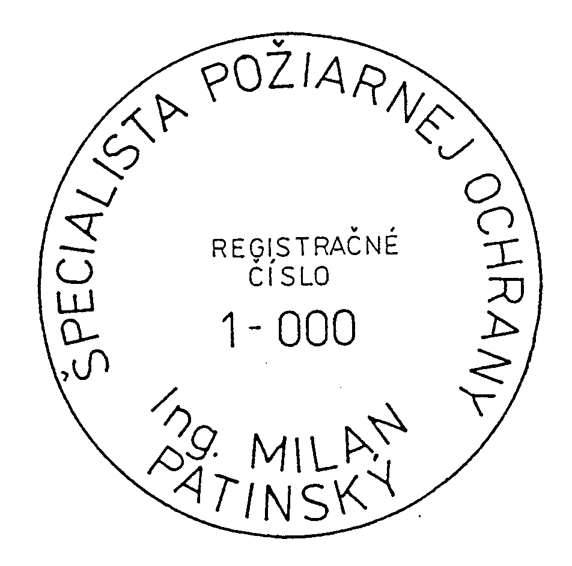

Príloha č. 6 k vyhláške č. 121/2002 Z. z.

- (Vzor)

- Pečiatka špecialistu požiarnej ochrany

  - Pečiatka špecialistu požiarnej ochrany je okrúhla s priemerom 35 mm. V texte pečiatky sa uvedie meno a priezvisko s titulmi, registračné číslo osvedčenia a slová ŠPECIALISTA POŽIARNEJ OCHRANY.

- 
