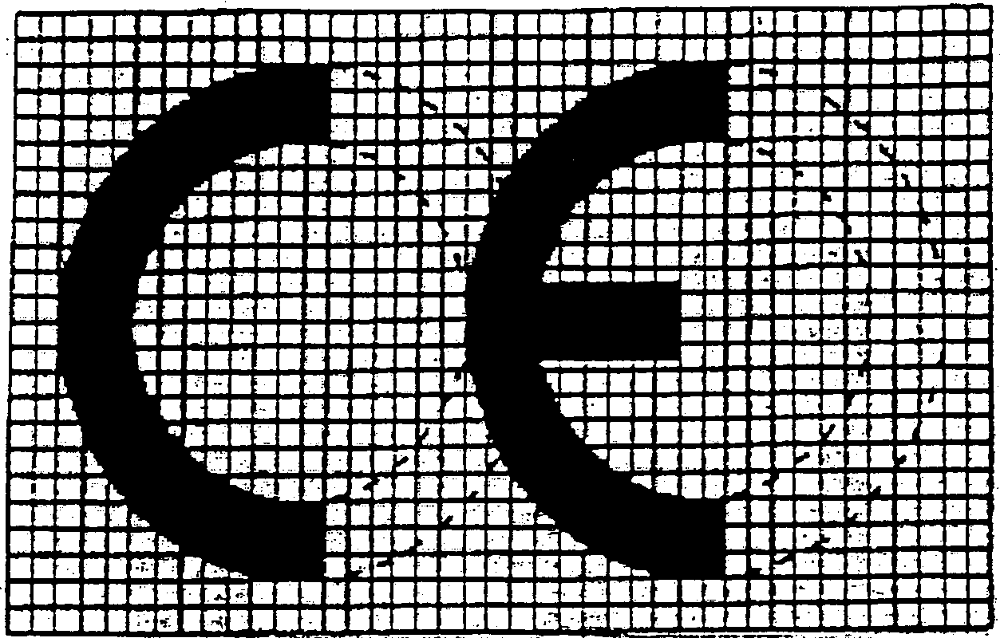

# Čl. I

- 1. V úvodnej vete sa slová „§ 12 ods. 5" nahrádzajú slovami „§ 12 ods. 8" a slová „(ďalej len zákon)" sa nahrádzajú slovami „v znení zákona č. 436/2001 Z. z. (ďalej len „zákon") a podľa § 2 ods. 1 písm. h) zákona č. 19/2002 Z. z., ktorým sa ustanovujú podmienky vydávania aproximačných nariadení vlády Slovenskej republiky".

- 2. V § 1 sa vkladá nový odsek 1, ktorý znie:

- „(1)

- Týmto nariadením sa transponuje do právneho poriadku Slovenskej republiky príslušná smernica Európskych spoločenstiev.1)“.

- Poznámka pod čiarou k odkazu 1 znie:

- „1) Smernica Rady č. 90/396/EHS z 29. júna 1990 v znení smernice č. 93/68/EHS o vzájomnom prispôsobovaní právnych predpisov členských štátov platných pre plynové spotrebiče.“.

- Doterajšie odseky 1 až 3 sa označujú ako odseky 2 až 4.

- 3. V § 1 ods. 4 písm. c) sa na úvod dopĺňa slovo „zároveň".

- 4. V § 2 odsek 2 znie:

- „(2)

- Ak sú technické požiadavky na spotrebiče a vybavenie konkretizované harmonizovanými slovenskými technickými normami alebo slovenskými technickými normami vhodnými na posudzovanie zhody podľa § 5 ods. 6 zákona a vlastnosti spotrebičov a vybavenia sú s nimi v súlade, považujú sa technické požiadavky podľa odseku 1 za splnené.“.

- 5. V § 3 ods. 1 až 3 sa slovo „dovozca" nahrádza slovom „splnomocnenec".

- 6. V § 3 ods. 3 sa slovo „technickú" nahrádza slovom „príslušnú".

- 7. V § 3 ods. 4 sa slovo „technickej" nahrádza slovom „konštrukčnej".

- 8. § 3 sa dopĺňa odsekom 5, ktorý znie:

- „(5)

- Výrobca alebo jeho splnomocnenec zabezpečí preklad do štátneho jazyka nevyhnutnej časti dokumentácie, ktorú na základe odôvodnenej žiadosti požaduje orgán dohľadu podľa § 13 ods. 3 zákona. Orgán dohľadu musí v žiadosti rešpektovať požiadavku primeranosti rozsahu požadovanej dokumentácie vo vzťahu k riziku, ktoré určený výrobok predstavuje.“.

- 9. V § 4 sa v úvodnej vete vypúšťajú slová „sa vypracúva v štátnom jazyku a".

- 10. V § 4 písm. a) sa slovo „dovozcovi" nahrádza slovom „splnomocnencovi".

- 11. V § 4 písm. h) sa slovo „dovozcu" nahrádza slovom „splnomocnenca".

- 12. § 4 sa dopĺňa písmenom i), ktoré znie:

- „i)

- na výrobky vyrobené mimo štátov, s ktorými má Slovenská republika uzatvorenú medzinárodnú zmluvu, tiež identifikačné údaje dovozcu.“.

- 13. Za § 4 sa vkladá § 4a, ktorý znie:

- 㤠4a

- Pri výrobkoch, ak tak ustanovuje medzinárodná zmluva, ktorou je Slovenská republika viazaná, sa pod pojmom vyhlásenie o zhode rozumie ES vyhlásenie o zhode, skúška typu ES skúška typu, overovanie zhody ES overovanie zhody, inšpekcia zavedeného systému kvality ES inšpekcia zavedeného systému kvality. Na tieto výrobky sa umiestňuje označenie CE podľa § 21 zákona (príloha č. 4).“.

- 14. V prílohe č. 1 bode 1.1 sa vypúšťajú slová „ani životné prostredie".

- 15. V prílohe č. 1 bode 1.3 sa slovo „vykonané" nahrádza slovom „vyhotovené" a za slovo „výrobcu" sa vkladajú slová „na inštaláciu".

- 16. V prílohe č. 1 bod 3.7 Potraviny, pitná a úžitková voda znie:

- „Materiály a súčasti používané na výrobu spotrebiča bez ohľadu na právne predpisy, ktoré sa na ne vzťahujú, ktoré prichádzajú do styku s potravinami, pitnou alebo úžitkovou vodou, nesmú nepriaznivo ovplyvňovať ich kvalitu.“.

- 17. V prílohe č. 2 bodoch 1.2, 1.5, 2.1, 2.2, 3.1, 3.3.1, 4.1, 4.3.1, 5.1, 5.2 a 6.1 sa slovo „dovozca" nahrádza slovom „splnomocnenec".

- 18. V prílohe č. 2 bode 1.3.1 sa vypúšťa slovo „technickú".

- 19. V prílohe č. 2 sa za bod 1.5 vkladajú body 1.6 a 1.7, ktoré znejú:

- „1.6 Autorizovaná osoba bezodkladne informuje iné autorizované osoby o vydaných certifikátoch typu. Tie sú oprávnené dostať rovnopis certifikátu typu alebo jeho doplnky. Rovnako sú na základe odôvodnenej žiadosti oprávnené dostať kópiu prílohy k certifikátu a protokoly o vykonaných skúškach.

- 1.7 Ak autorizovaná osoba odmietne vydať certifikát typu alebo ho odníme, musí o tom informovať úrad a tiež iné autorizované osoby s príslušným odôvodnením.“.

- 20. V prílohe č. 2 bode 2.1 druhá veta znie: "Výrobca alebo jeho splnomocnenec vypracuje a uchováva písomné vyhlásenie o zhode na výrobky vyrobené mimo štátov, s ktorými má Slovenská republika medzinárodnú zmluvu.".

- 21. Príloha č. 3 znie:

- „Príloha č. 3 k nariadeniu vlády č. 393/1999 Z. z.

- OBSAH KONŠTRUKČNEJ DOKUMENTÁCIE

- 1. Konštrukčná dokumentácia obsahuje

- a) všeobecný opis spotrebiča alebo vybavenia,

- b) konštrukčné a výrobné výkresy, schémy komponentov, konštrukčných skupín, schémy zapojení atď.,

- c) opisy a vysvetlenia nevyhnutné na pochopenie týchto podkladov vrátane funkcie spotrebičov alebo vybavení,

- d) zoznam technických predpisov a slovenských technických noriem použitých úplne alebo čiastočne a opisy riešení, ktoré boli prijaté na splnenie technických požiadaviek tam, kde neboli použité harmonizované slovenské technické normy alebo kde takéto normy neexistujú alebo nekonkretizujú všetky technické požiadavky, ktoré sa na spotrebič alebo vybavenie vzťahujú,

- e) protokoly o skúškach,

- f) návody na inštaláciu a použitie.

- 2. Ak je to potrebné, dokumentácia obsahuje tiež

- a) vyhlásenie o zhode vzťahujúce sa na vybavenie zabudované do spotrebiča, ak bolo vydané,

- b) správy a oznámenia autorizovanej osoby vzťahujúce sa na spotrebič alebo vybavenie, ak boli vydané,

- c) iný dokument, ktorý umožní autorizovanej osobe zlepšiť posudzovanie.“.

- 22. Za prílohu č. 3 sa vkladajú prílohy č. 4 až 6, ktoré znejú:

- „Príloha č. 4 k nariadeniu vlády č. 393/1999 Z. z.

- ZNAČKA ZHODY - OZNAČENIE CE

- Označenie CE sa skladá z písmen „CE" podľa § 21 zákona.

- 

- Ak je označenie zmenšené alebo zväčšené, mierka rozmerov zostáva zachovaná.

- Jednotlivé prvky označenia CE majú približne rovnaký vertikálny rozmer, ktorý je najmenej 5 mm.

- Na výrobku alebo na štítku s údajmi musí byť označenie CE spolu s nasledujúcimi údajmi:

- a) názov výrobcu alebo jeho identifikačná značka,

- b) obchodný názov výrobku,

- c) typ elektrického napájania, ak je použité,

- d) kategória výrobku,

- e) posledné dvojčíslie roka, v ktorom bolo označenie CE umiestnené.

- Informácie potrebné na inštaláciu možno doplniť v závislosti od povahy zariadenia.

- Príloha č. 5 k nariadeniu vlády č. 393/1999 Z. z.

- MINIMÁLNE POŽIADAVKY NA AUTORIZOVANÉ OSOBY

- Autorizovaná osoba podľa § 11 zákona určená autorizujúcim orgánom spĺňa nasledujúce minimálne požiadavky:

- 1. disponuje dostatkom zamestnancov, nevyhnutnými prostriedkami a technickým vybavením,

- 2. je technicky spôsobilá a má stálych zamestnancov s požadovanou odbornosťou,

- 3. je nezávislá pri vykonávaní skúšok, príprave protokolov, vydávaní certifikátov a vykonávaní overovacej činnosti požadovanej týmto nariadením od zamestnancov a technických zamestnancov vo vzťahu ku všetkým kruhom, skupinám alebo osobám majúcim priamy alebo nepriamy záujem na príslušnom výrobku,

- 4. jej zamestnanci dodržiavajú obchodné tajomstvo,

- 5. má poistenie zodpovednosti za škodu spôsobenú zamestnancami, ak táto zodpovednosť nie je pokrytá štátom v rámci platnej legislatívy.

- Plnenie požiadaviek v bodoch 1 a 2 pravidelne kontroluje autorizujúci orgán.

- Príloha č. 6 k nariadeniu vlády č. 393/1999 Z. z.

- ZOZNAM TRANSPONOVANÝCH SMERNÍC

- Týmto nariadením sa úplne transponuje táto smernica:

- 1. Smernica Rady č. 90/396/EHS z 29. júna 1990 v znení smernice č. 93/68/EHS o vzájomnom prispôsobovaní právnych predpisov členských štátov platných pre plynové spotrebiče.

- 2. Preklad tejto smernice je v Centrálnej prekladateľskej jednotke sekcie Inštitút pre aproximáciu práva Úradu vlády Slovenskej republiky.„.
