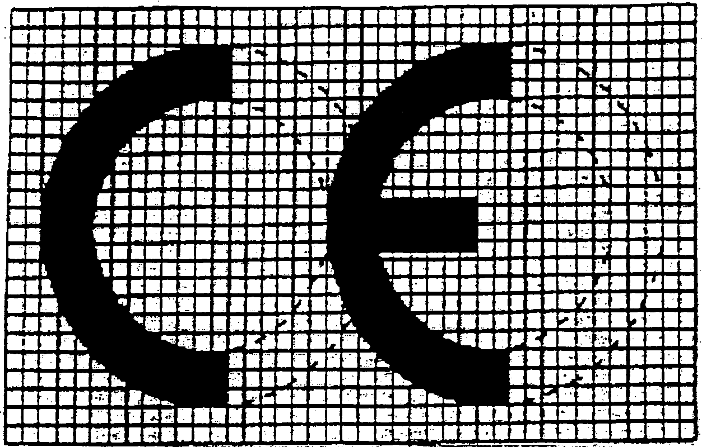

# Čl. I

Nariadenie vlády Slovenskej republiky č. 391/1999 Z. z., ktorým sa ustanovujú podrobnosti o technických požiadavkách na strojové zariadenia v znení nariadenia vlády Slovenskej republiky č. 475/2000 Z. z. sa mení a dopĺňa takto:

- 1. V úvodnej vete sa slová „§ 12 ods. 5" nahrádzajú slovami „§ 12 ods. 8" a slová „(ďalej len „zákon")" sa nahrádzajú slovami „v znení zákona č. 436/2001 Z. z. (ďalej len „zákon") a podľa § 2 ods. 1 písm. h) zákona č. 19/2002 Z. z., ktorým sa ustanovujú podmienky vydávania aproximačných nariadení vlády Slovenskej republiky".

- 2. V § 1 sa vkladá nový odsek 1, ktorý znie:

- „(1)

- Týmto nariadením sa transponuje do právneho poriadku Slovenskej republiky príslušná smernica Európskych spoločenstiev.1)“.

- Poznámka pod čiarou k odkazu 1 znie:

- „1) Smernica Rady č. 98/37/ES z 22. júna 1998 v znení smernice č. 98/79/ES o aproximácii zákonov členských štátov týkajúcich sa strojových zariadení.“.

- Doterajšie odseky 1 až 3 sa označujú ako odseky 2 až 4.

- Doterajší odkaz a poznámka pod čiarou k odkazu 1 sa označujú ako odkaz a poznámka pod čiarou k odkazu 1a.

- 3. V § 1 ods. 2 písm. c) sa za slovo „vozidlu" vkladajú slová „alebo k traktoru".

- 4. V § 2 ods. 1 písmeno i) znie:

- „i)

- dopravné prostriedky, t. j. vozidlá a ich prívesné zariadenia určené výhradne na leteckú dopravu cestujúcich alebo na dopravu cestujúcich po cestných, železničných alebo vodných cestách, ako aj dopravné prostriedky, ak sú projektované na leteckú dopravu tovaru a na dopravu tovaru po verejných cestných alebo železničných komunikáciách alebo po vode; vozidlá používané v odvetví ťažby nerastov nie sú vylúčené,“.

- 5. V § 2 ods. 1 písm. l) sa slovo „lesnícke" nahrádza slovom „lesné".

- 6. § 3 znie:

- 㤠3

- (1)

- Výrobca alebo dovozca strojového zariadenia vykoná alebo nechá vykonať posúdenie zhody strojového zariadenia alebo bezpečnostnej časti s technickými požiadavkami (ďalej len „posúdenie zhody") podľa § 12 ods. 3 zákona týmito postupmi:

- a)

- na strojové zariadenie alebo bezpečnostnú časť neuvedenú v prílohe č. 4 pripraví výrobca alebo dovozca technickú dokumentáciu podľa prílohy č. 2 a vykoná alebo nechá vykonať posúdenie zhody [§ 12 ods. 3 písm. a) zákona],

- b)

- na strojové zariadenie alebo bezpečnostnú časť uvedené v prílohe č. 4, ktorých vlastnosti nie sú v súlade s harmonizovanými slovenskými technickými normami, alebo ak takéto normy nekonkretizujú všetky technické požiadavky, ktoré sa na dané strojové zariadenie alebo bezpečnostnú časť vzťahujú, zabezpečí ich výrobca alebo dovozca pred uvedením na trh posúdenie zhody vzorky strojového zariadenia (ďalej len „preskúšanie typu") autorizovanou osobou [§ 12 ods. 3 písm. b) zákona] podľa prílohy č. 6,

- c)

- na strojové zariadenie alebo bezpečnostnú časť uvedené v prílohe č. 4, ktorých vlastnosti sú v súlade s harmonizovanými slovenskými technickými normami alebo so slovenskými technickými normami vhodnými na posudzovanie zhody, ktoré konkretizujú všetky technické požiadavky, výrobca alebo dovozca podľa svojho rozhodnutia

- 1.

- vypracuje technickú dokumentáciu podľa prílohy č. 2 a zašle ju autorizovanej osobe podľa § 11 zákona, ktorá potvrdí príjem technickej dokumentácie a archivuje ju, alebo

- 2.

- predloží technickú dokumentáciu podľa prílohy č. 2 autorizovanej osobe, ktorá overí, či harmonizované slovenské technické normy alebo slovenské technické normy vhodné na posudzovanie zhody výrobca alebo dovozca správne použil, a autorizovaná osoba vypracuje osvedčenie o úplnosti a vhodnosti technickej dokumentácie na posúdenie zhody, alebo

- 3.

- podrobí vzorku strojového zariadenia preskúšaniu typu autorizovanou osobou podľa prílohy č. 6.

- (2)

- Autorizovaná osoba informuje úrad, ako aj iné osoby autorizované na činnosť podľa tohto nariadenia o odmietnutí vydať certifikát alebo o jeho zrušení.

- (3)

- Pri bezpečnostnej časti overuje autorizovaná osoba aj jej vhodnosť na plnenie bezpečnostných funkcií deklarovaných výrobcom.

- (4)

- Zoznam všetkých nariadení vlády, podľa ktorých bola posúdená zhoda strojového zariadenia, sa uvádza v dokumentácii priloženej k príslušnému strojovému zariadeniu.

- (5)

- Pri strojovom zariadení podľa § 2 ods. 1 písm. a) a b) určenom na začlenenie do iného strojového zariadenia alebo na montáž s iným strojovým zariadením tak, že vznikne strojové zariadenie, na ktoré sa vzťahuje toto nariadenie, nevyžaduje sa vykonať posúdenie zhody jeho vlastností s technickými požiadavkami, ak toto zariadenie nie je schopné fungovať samostatne a ak výrobca, dovozca alebo splnomocnenec vydá vyhlásenie o takomto určení strojového zariadenia podľa § 5 ods. 3.

- (6)

- Na veľtrhoch, výstavách, predvádzacích akciách a pod. je možné vystavovať strojové zariadenia alebo bezpečnostné časti, ktoré nie sú v súlade s technickými požiadavkami, za predpokladu, že z viditeľného označenia je zrejmé, že tieto strojové zariadenia alebo bezpečnostné časti nie sú v súlade s týmto nariadením a že nie sú na predaj, kým ich výrobca, dovozca alebo splnomocnenec so sídlom na území Slovenskej republiky alebo na území štátu Európskych spoločenstiev (ďalej len „splnomocnenec") neuvedie do súladu s týmto nariadením. Počas predvádzania sa musia prijať primerané bezpečnostné opatrenia, ktorými sa zabezpečí ochrana osôb.“.

- 7. V § 4 sa doterajší text označuje ako odsek 1 a dopĺňa sa odsekom 2, ktorý znie:

- „(2)

- Výrobca alebo jeho splnomocnenec zabezpečí preklad do štátneho jazyka nevyhnutnej časti dokumentácie, ktorú na základe odôvodnenej žiadosti požaduje orgán dohľadu podľa § 13 ods. 3 zákona. Orgán dohľadu musí v žiadosti rešpektovať požiadavku primeranosti rozsahu požadovanej dokumentácie vo vzťahu k riziku, ktoré určený výrobok predstavuje.“.

- 8. V § 5 ods. 1 úvodnej vete sa vypúšťajú slová „sa vypracúva v štátnom jazyku a".

- 9. V § 5 ods. 1 písm. a) sa na konci pripájajú slová „pri dovážaných výrobkoch, ktoré nemajú pôvod v štátoch Európskych spoločenstiev, aj o dovozcovi,".

- 10. V § 5 ods. 1 písmeno c) znie:

- „c)

- potvrdenie výrobcu alebo dovozcu, že vlastnosti strojového zariadenia spĺňajú technické požiadavky podľa tohto nariadenia alebo požiadavky iných technických predpisov, že strojové zariadenie alebo bezpečnostná časť za podmienok obvyklého alebo výrobcom alebo dovozcom určeného použitia neohrozuje zdravie ani bezpečnosť osôb, a tam, kde je to vhodné, ani domácich zvierat a že prijal opatrenia, ktorými zabezpečuje zhodu všetkých strojových zariadení uvádzaných na trh s technickou dokumentáciou a s technickými požiadavkami,“.

- 11. V § 5 odseky 2 a 3 znejú:

- „(2)

- Vyhlásenie o zhode na bezpečnostnú časť podľa § 1 ods. 2 písm. d) uvádzanú na trh samostatne obsahuje:

- a)

- meno a adresu výrobcu alebo jeho splnomocnenca a v prípade dovážaných výrobkov, ktoré nemajú pôvod v štátoch Európskych spoločenstiev, aj dovozcu; ak vyhlásenie vydáva splnomocnenec alebo dovozca, uvádza aj obchodný názov a adresu výrobcu,

- b)

- opis bezpečnostnej časti (napr. názov, typ, značku, model, sériové číslo, ak existuje, a pod.),

- c)

- opis bezpečnostnej funkcie, ktorú bezpečnostná časť plní, ak to nie je zrejmé z jej opisu,

- d)

- názov a adresu autorizovanej osoby a číslo certifikátu typu, ak je to podstatné,

- e)

- názov a adresu autorizovanej osoby, ktorej bola zaslaná dokumentácia podľa § 3 ods. 1 písm. c) bodu 1, ak je to podstatné,

- f)

- názov a adresu autorizovanej osoby, ktorej bola zaslaná dokumentácia na overenie podľa § 3 ods. 1 písm. c) bodu 2, ak je to podstatné,

- g)

- ak je to podstatné, zoznam harmonizovaných slovenských technických noriem, ktoré sa pri posúdení zhody použili,

- h)

- ak je to podstatné, zoznam slovenských technických noriem a použité technické špecifikácie,

- i)

- identifikáciu osoby zodpovednej za podpísanie vyhlásenia v mene výrobcu alebo splnomocnenca.

- (3)

- Vyhlásenie o zhode na strojové zariadenia určené na začlenenie do iného strojového zariadenia alebo na montáž s iným strojovým zariadením obsahuje:

- a)

- meno a adresu výrobcu alebo splnomocnenca, pri dovážaných výrobkoch, ktoré nemajú pôvod v štátoch Európskych spoločenstiev, aj identifikačné údaje o dovozcovi, ktorý vyhlásenie vydáva,

- b)

- opis strojového zariadenia alebo časti strojového zariadenia,

- c)

- ak je to podstatné, meno a adresu autorizovanej osoby a číslo certifikátu typu,

- d)

- názov a adresu autorizovanej osoby, ktorej bola zaslaná dokumentácia podľa § 3 ods. 1 písm. c) bodu 1, ak je to podstatné,

- e)

- názov a adresu autorizovanej osoby, ktorej bola zaslaná dokumentácia na overenie podľa § 3 ods. 1 písm. c) bodu 2, ak je to podstatné,

- f)

- zoznam harmonizovaných slovenských technických noriem, ak sa použili,

- g)

- stanovisko, že strojové zariadenie nemožno uviesť do prevádzky, ak na strojové zariadenie, do ktorého bolo včlenené, nebolo vyhlásené za zhodné s ustanoveniami tohto nariadenia,

- h)

- dátum a miesto vydania vyhlásenia, meno, priezvisko a funkciu zodpovednej osoby, výrobcu alebo dovozcu, jej podpis a odtlačok pečiatky.“.

- 12. V § 6 sa za odsek 1 vkladá nový odsek 2, ktorý znie:

- „(2)

- Na výrobky, ak tak ustanovuje medzinárodná zmluva, ktorou je Slovenská republika viazaná, sa vydá ES vyhlásenie o zhode, pričom na výrobky, ktorých vlastnosti boli posúdené podľa § 3 ods. 1 písm. b), sa toto ES vyhlásenie o zhode vydáva na základe ES certifikátu typu a výrobok sa označí označením CE.“.

- Doterajšie odseky 2 až 4 sa označujú ako odseky 3 až 5.

- 13. V prílohe č. 1 Všeobecné požiadavky bode 1 sa za slová „strojovom zariadení" vkladajú slová „alebo bezpečnostnej časti (ďalej len „strojové zariadenie")".

- 14. V prílohe č. 1 bode 1.1.1 písm. b) sa na konci vypúšťa čiarka a pripájajú sa slová "- osoba vystavená ohrozeniu,".

- 15. V prílohe č. 1 bode 1.1.2 písm. b) bod 3 znie:

- „3.

- informuje používateľa o zostatkovom riziku vyplývajúcom zo zlyhania vykonaných bezpečnostných opatrení; určí prípadnú potrebu špeciálneho vyškolenia a používania osobných ochranných pracovných prostriedkov.“.

- 16. V prílohe č. 1 bode 1.1.2 písm. f) sa slová „ohrozenia personálu" nahrádzajú slovom „rizika".

- 17. V prílohe č. 1 bode 1.1.3 sa slovo „vzniknuté" nahrádza slovom „vytvorené", slovo „príslušných" sa nahrádza slovom „ohrozených" a slová „nemohlo nastať ohrozenie obsluhy" sa nahrádzajú slovami „nemohla nastať nebezpečná situácia".

- 18. V prílohe č. 1 bode 1.1.5 písm. c) bode 1 sa na konci vypúšťa čiarka a pripája sa slovo „alebo".

- 19. V prílohe č. 1. bode 1.1.5 písm. c) bode 2 sa slovo „nosenie" nahrádza slovom „zdvíhanie".

- 20. V prílohe č. 1 bode 1.1.5 sa na konci pripája táto veta: „Osobitné opatrenia treba dodržať pri manipulácii s nástrojmi alebo s časťami strojov, ktoré môžu byť nebezpečné (tvar, materiál, atď.), a to aj v prípade, ak majú nízku hmotnosť.".

- 21. V prílohe č. 1 bode 1.2.2 neoznačený text za písmenom g) znie:

- „Ak je ovládač navrhnutý a vyrobený na viaceré rôzne funkcie, t. j. jeho funkcia je viacúčelová (napr. klávesnica a pod.), musí byť príslušná ovládacia funkcia zrozumiteľne vyznačená, prípadne aj predmetom potvrdenia. Ovládače sa musia skonštruovať tak, aby uplatnením ergonomických zásad bolo ich umiestnenie, pohyb a odpor proti ovládaniu v súlade s činnosťou, ktorú majú vykonávať. Do úvahy sa musí vziať aj obmedzenie spôsobené nevyhnutným alebo predpokladaným používaním osobných ochranných pracovných prostriedkov (ako je obuv, rukavice a pod.). Strojové zariadenie musí byť vybavené ukazovateľmi požadovanými na bezpečné fungovanie (stupnicami, signalizačnými zariadeniami a pod.), ktoré musia byť viditeľné pre obsluhu z jej pracovného miesta. Z hlavného pracovného miesta má obsluha možnosť presvedčiť sa, že v nebezpečnom priestore sa nenachádzajú žiadne osoby. Ak to nie je možné, ovládací systém sa musí navrhnúť a vyrobiť tak, aby kedykoľvek, keď sa má zariadenie spustiť, vydalo akustický alebo vizuálny výstražný signál. Ohrozená osoba musí mať čas a možnosť okamžitým zásahom zabrániť uvedeniu stroja do chodu.“.

- 22. V prílohe č. 1 bode 1.2.3 sa za slová „ohrozenie obsluhy" vkladajú slová „obsluhujúcej tieto rôzne ovládače".

- 23. V prílohe č. 1 bode 1.2.4 nadpis znie: „Zariadenie na zastavenie chodu, vypínacie zariadenie".

- 24. V prílohe č. 1 bode 1.2.4 Núdzové zastavenie písm. b) bod 3 znie:

- „3.

- ak je to potrebné, spustiť alebo zabrániť spusteniu určitých bezpečnostných pohybov.“.

- 25. V prílohe č. 1 bode 1.2.5 sa slovo „uzamykateľným" nahrádza slovom „blokovateľným" a slová „k zodpovedajúcej polohe prepínača treba priradiť tieto riadiace pokyny" sa nahrádzajú slovami „volič prevádzkového režimu musí súčasne uskutočniť".

- 26. V prílohe č. 1 bode 1.2.5 písm. a) sa slová „riadiaceho systému" nahrádzajú slovami „ovládacieho režimu alebo riadiaceho režimu".

- 27. V prílohe č. 1 bode 1.2.5 písm. b) sa slovo „kontinuálne" nahrádza slovom „nepretržite".

- 28. V prílohe č. 1 bode 1.2.5 písm. d) sa slovo „senzory" nahrádza slovom „snímače".

- 29. V prílohe č. 1 bode 1.3.3 sa v názve a texte slovo „odletujúcimi" nahrádza slovom „vymrštenými".

- 30. V prílohe č. 1 bode 1.3.8 písm. a) bode 2 sa za číslo „1.4.2.2" dopĺňajú slová „písm. a)".

- 31. V prílohe č. 1 bode 1.3.8 písm. b) bode 2 sa za číslo „1.4.2.2" dopĺňajú slová „písm. b)".

- 32. V prílohe č. 1 bode 1.5.4 sa slová „musí obsahovať návod" nahrádzajú slovami „musia obsahovať návody".

- 33. V prílohe č. 1 bode 1.6.1 sa slová „za bezpečných podmienok (pozri najmä bod 1.2.5)" nahrádzajú slovami „bez rizika (1.2.5)".

- 34. V prílohe č. 1 bode 1.6.3 sa slová „Hlavný (centrálny) ovládač musí byť uzamykateľný" nahrádzajú slovami „Hlavný vypínač musí byť blokovateľný" a slová „ovládača (permanentné vypnutie)" sa nahrádzajú slovami „vypínača (trvalé vypnutie)".

- 35. V prílohe č. 1 bode 1.7 sa slovo „Oznamovacie" nahrádza slovom „Indikátory".

- 36. V prílohe č. 1 bode 1.7.1 sa slovo „Oznamovače" nahrádza slovami „Indikátory".

- 37. V prílohe č. 1 bode 1.7.3 sa slová „v štátnom jazyku" nahrádzajú slovami „v jazyku krajiny, v ktorej sa má strojové zariadenie používať, alebo v jazyku zrozumiteľnom pre obsluhu".

- 38. V prílohe č. 1 bode 1.7.4 písm. b) sa vypúšťa slovo „slovenskou".

- 39. V prílohe č. 1 bode 1.7.5 písmeno b) znie:

- „b)

- Pri uvedení do prevádzky sa musí dodať návod na používanie v štátnom jazyku spolu so strojovým zariadením a ten musí prípadne upozorniť na nevhodný spôsob používania strojového zariadenia.“.

- 40. V prílohe č. 1 bode 1.7.5 písmeno e) znie:

- „e)

- V návodoch sa tam, kde je to vhodné, musia uviesť požiadavky na inštaláciu a montáž strojového zariadenia, aby sa znížil hluk a vibrácie (napr. tlmiče, druh a hmotnosť základovej dosky a pod.).“.

- 41. V prílohe č. 1 bode 2.1 písm. a) sa slová „sa dostávajú alebo sa môžu dostať" nahrádzajú slovami „sú v kontakte alebo sú určené na to, aby sa dostali".

- 42. V prílohe č. 1 bode 2.1 písm. c) sa čiarka na konci nahrádza bodkou a pripája sa veta „Skrutky, matice a nity sa môžu použiť len v prípade, ak sú technicky nevyhnutné,".

- 43. V prílohe č. 1 bode 2.2 písm. c) sa slovo „náhradné" nahrádza slovom „rovnocenné".

- 44. V prílohe č. 1 bode 3 sa za slovo „výrobca" vkladajú slová „alebo jeho splnomocnenec".

- 45. V prílohe č. 1 bode 3.1.3 sa slovo „pokynmi" nahrádza slovom „návodmi".

- 46. V prílohe č. 1 bode 3.4.3 sa za slovo „výrobca" vkladajú slová „alebo jeho splnomocnenec".

- 47. V prílohe č. 1 bode 3.4.4 sa za slovo „výrobca" vkladajú slová „alebo jeho splnomocnenec".

- 48. V prílohe č. 1 bode 4 sa za slovo „vyhoveli" vkladajú slová „ďalej uvedeným".

- 49. V prílohe č. 1 bode 4.1.2.1 sa za slovo „výrobca" vkladajú slová „alebo jeho splnomocnenec".

- 50. V prílohe č. 1 bode 4.1.2.4 sa za slovo „výrobca" vkladajú slová „alebo jeho splnomocnenec".

- 51. V prílohe č. 1 bode 4.1.2.5 písm. f) sa za slovo „výrobca" vkladajú slová „alebo jeho splnomocnenec" a za slovo „vykoná" sa vkladajú slová „alebo si nechá vykonať".

- 52. V prílohe č. 1 bode 4.2.4 sa za slovo „výrobca" vkladajú slová „alebo jeho splnomocnenec".

- 53. V prílohe č. 1 bode 4.3.1 sa za slovo „výrobcu" vkladajú slová „alebo jeho splnomocnenca".

- 54. V prílohe č. 1 bode 4.3.2 písm. c) sa slovo „menovitú" nahrádza slovami „najväčšiu pracovnú".

- 55. V prílohe č. 1 bode 4.3.2 písm. d) sa vypúšťa slovo „slovenskou".

- 56. Prílohy č. 2 a 3 znejú:

- „Príloha č. 2 k nariadeniu vlády č. 391/1999 Z. z.

- NÁLEŽITOSTI A OBSAH VYHLÁSENIA O ZHODE

- A. Obsah ES vyhlásenia o zhode strojových zariadení

- Vyhlásenie o zhode musí obsahovať tieto údaje:

- a) názov a adresu výrobcu alebo jeho splnomocnenca,

- b) opis strojového zariadenia (značku, typ, výrobné číslo, ak existujú, atď.),

- c) všetky príslušné ustanovenia, ktorým strojové zariadenie vyhovuje,

- d) v prípade potreby názov a adresu autorizovanej osoby a číslo certifikátu skúšky typu,

- e) v prípade potreby názov a adresu autorizovanej osoby, ktorej bola poskytnutá dokumentácia podľa § 3 ods. 2 písm. c) bodu 1,

- f) v prípade potreby názov a adresu autorizovanej osoby, ktorá vykonala overenie podľa § 3 ods. 2 písm. c) bodu 2,

- g) v prípade potreby odkazy na harmonizované slovenské technické normy,

- h) v prípade potreby použité slovenské technické normy a technické predpisy,

- i) identifikáciu osoby oprávnenej podpisovať za výrobcu vyhlásenie o zhode alebo jeho splnomocnenca.

- B. Obsah vyhlásenia, ktoré vydáva výrobca alebo jeho splnomocnenec

- Vyhlásenie, ktoré vydáva výrobca a ktoré je uvedené v § 5 ods. 2, musí obsahovať tieto podrobné údaje:

- a) názov a adresu výrobcu alebo jeho splnomocnenca,

- b) opis strojového zariadenia alebo častí strojového zariadenia,

- c) v prípade potreby meno a adresu autorizovanej osoby a číslo certifikátu skúšky typu,

- d) v prípade potreby názov a adresu autorizovanej osoby, ktorej bol zaslaný súbor dokumentácie podľa § 3 ods. 2 písm. c) bodu 1,

- e) v prípade potreby názov a adresu autorizovanej osoby, ktorá vykonala overenie podľa § 3 ods. 2 písm. c) bodu 2,

- f) v prípade potreby odkazy na harmonizované slovenské technické normy,

- g) vyhlásenie, že strojové zariadenie sa nesmie uviesť do prevádzky, ak na strojové zariadenie, do ktorého sa má toto strojové zariadenie začleniť, nebola vyhlásená zhoda s ustanoveniami tohto nariadenia,

- h) identifikácia osoby s podpisovým právom.

- C. Obsah ES vyhlásenia o zhode bezpečnostnej časti samostatne uvádzanej na trh

- ES vyhlásenie o zhode musí obsahovať tieto podrobné údaje:

- a) názov a adresu výrobcu alebo jeho splnomocnenca,

- b) opis bezpečnostného komponentu (značku, typ, výrobné číslo, ak existujú, atď.),

- c) bezpečnostnú funkciu, ktorú plní bezpečnostný komponent, ak nie je zrejmá z opisu,

- d) v prípade potreby názov a adresu autorizovanej osoby a číslo certifikátu typovej skúšky,

- e) v prípade potreby názov a adresu autorizovanej osoby, ktorej bol zaslaný súbor dokumentácie podľa § 3 ods. 2 písm. c) bodu 1,

- f) v prípade potreby názov a adresu autorizovanej osoby, ktorá vykonala overenie podľa § 3 ods. 2 písm. c) bodu 2,

- g) v prípade potreby odkazy na harmonizované slovenské technické normy,

- h) v prípade potreby použité slovenské technické normy a technické predpisy,

- i) určenie osoby oprávnenej podpisovať za výrobcu alebo jeho splnomocnenca.

- Príloha č. 3 k nariadeniu vlády č. 391/1999 Z. z.

- ZNAČKA ZHODY

- Značka zhody pozostáva z písmen „CE“ a má túto formu:

- 

- Ak sa označenie CE zmenší alebo zväčší, vzájomné proporcie podľa nákresu sa musia dodržať.

- Rôzne časti označenia CE musia mať v zásade rovnaký zvislý rozmer, ktorý nesmie byť menší ako 5 mm. V prípade malorozmerových strojových zariadení sa tento najmenší rozmer nemusí dodržať.„.

57. Za prílohu č. 4 sa pripájajú prílohy č. 5 až 8, ktoré znejú:

„Príloha č. 5 k nariadeniu vlády č. 391/1999 Z. z.

ES VYHLÁSENIE O ZHODE

1. ES vyhlásenie o zhode je dokument, ktorým výrobca alebo splnomocnenec vyhlasuje, že strojové zariadenie, ktoré sa uvádza na trh, vyhovuje všetkým technickým požiadavkám na bezpečnosť a zdravie, ktoré sa na ne vzťahujú.

2. Podpísanie vyhlásenia o zhode s predpismi Európskych spoločenstiev oprávňuje výrobcu alebo jeho splnomocnenca pripevňovať na strojové zariadenia označenie CE.

3. Výrobca alebo splnomocnenec musí ešte pred vypracovaním ES vyhlásenia o zhode zabezpečiť a musí byť schopný zaručiť, že ďalej uvedená dokumentácia je a zostane k dispozícii v jeho objektoch pre potreby kontroly:

a) Súbor technickej konštrukčnej dokumentácie, ktorý obsahuje

1. celkový výkres strojového zariadenia spolu s výkresmi ovládacích obvodov,

2. kompletné podrobné výkresy doplnené rôznymi záznamami o výpočtoch, o výsledkoch skúšok atď., potrebné na účely kontroly zhody strojového zariadenia so základnými požiadavkami na ochranu zdravia a zaistenie bezpečnosti,

3. zoznam

a) základných požiadaviek tohto nariadenia,

b) noriem a

c) ostatných technických špecifikácií, ktoré sa použili v priebehu návrhu strojového zariadenia,

4. opis metód zvolených na vylúčenie rizika, ktoré spôsobujú strojové zariadenia,

5. v prípade potreby akúkoľvek technickú správu alebo certifikát získaný od kompetentného orgánu alebo laboratória; orgán alebo laboratórium sa považuje za kompetentné, ak spĺňa kritériá hodnotenia stanovené v príslušných harmonizovaných normách,

6. v prípade ak výrobca vyhlasuje zhodu s niektorou harmonizovanou normou, ktorá sa týka jeho výrobku, aj každú technickú správu obsahujúcu výsledky skúšok, ktoré vykonal podľa svojej voľby buď výrobca, alebo kompetentný orgán, alebo laboratórium,

7. výtlačok návodov na strojové zariadenie.

b) V prípade sériovej výroby vnútorné opatrenia, ktoré sa budú realizovať s cieľom zabezpečiť, aby si strojové zariadenia udržali zhodu s ustanoveniami tohto nariadenia.

Výrobca musí vykonať potrebné výskumné a vývojové práce alebo skúšky komponentov, príslušenstva alebo kompletného strojového zariadenia a určiť, či je strojové zariadenie podľa projektu alebo konštrukcie schopné bezpečnej montáže a uvedenia do prevádzky.

Ak po náležite zdôvodnenej žiadosti od orgánu dohľadu túto dokumentáciu výrobca nepredloží, vzniknú dostatočné dôvody na pochybnosti o predpoklade zhody s požiadavkami tohto nariadenia.

4. Dokumentácia podľa bodu 3

a) nemusí byť trvale k dispozícii, ale musí byť k dispozícii a musí byť poskytnutá v čase, ktorý zodpovedá jej dôležitosti. Nemusí obsahovať podrobné návrhy ani žiadne iné špecifické informácie týkajúce sa podzostáv používaných pri výrobe strojových zariadení, ak ich znalosti nie sú podstatné na účely overenia zhody so základnými bezpečnostnými požiadavkami,

b) sa musí uchovať a byť stále k dispozícii pre kompetentné národné inštitúcie najmenej 10 rokov od dátumu výroby strojových zariadení alebo od dátumu výroby poslednej jednotky v prípade sériovej výroby,

c) musí byť vypracovaná v jednom z jazykov Európskych spoločenstiev okrem návodu na používanie strojového zariadenia.

Príloha č. 6 k nariadeniu vlády č. 391/1999 Z. z.

ES SKÚŠKA TYPU

1. ES skúška typu je postup, ktorým autorizovaná osoba zisťuje a overuje, či vzor strojového zariadenia vyhovuje tým ustanoveniam tohto nariadenia, ktoré sa na ňu vzťahujú.

2. Žiadosť o vykonanie ES skúšky typu podáva výrobca alebo jeho splnomocnenec jedinej nezávislej autorizovanej osobe na stroje. Žiadosť obsahuje

a) názov a adresu výrobcu alebo splnomocnenca a miesto výroby strojového zariadenia,

b) súbor technickej dokumentácie, ktorý obsahuje najmenej

1. celkový výkres strojového zariadenia spolu s výkresmi ovládacích obvodov,

2. kompletné podrobné výkresy doplnené rôznymi záznamami o výpočtoch, výsledkoch skúšok atď., potrebné na účely kontroly zhody strojového zariadenia so základnými požiadavkami na ochranu zdravia a zaistenie bezpečnosti,

3. opis metód zvolených na vylúčenie ohrozenia, ktoré spôsobuje strojové zariadenie, a zoznam použitých noriem,

4. výtlačok návodov na strojové zariadenie,

5. v prípade sériovej výroby vnútorné opatrenia, ktoré sa realizujú s cieľom zabezpečiť, aby strojové zariadenia udržali zhodu s ustanoveniami tohto nariadenia. Žiadosť sprevádza strojové zariadenie, ktoré je predstaviteľom plánovanej výroby strojových zariadení, alebo, ak je to vhodné, oznámenie o tom, kde možno vykonať skúšku strojového zariadenia. Uvedená dokumentácia nemusí obsahovať podrobné návrhy ani žiadne iné špecifické informácie týkajúce sa podzostáv používaných pri výrobe strojového zariadenia, ak ich poznanie nie je dôležité na účely posúdenia zhody so základnými bezpečnostnými požiadavkami.

3. Autorizovaná osoba vykoná ES typovú skúšku takýmto spôsobom:

a) preskúma súbor technickej konštrukčnej dokumentácie, overí jej primeranosť a preskúša strojové zariadenie, ktoré jej výrobca dodal alebo sprístupnil,

b) skúškou strojového zariadenia

1. zisťuje, či bolo vyrobené v zhode so súborom technickej konštrukčnej dokumentácie a či ho možno bezpečne používať v pracovných podmienkach, ktoré sú pre strojové zariadenie určené,

2. skontroluje, či normy, ak boli použité, boli správne uplatnené,

3. vykoná príslušné prehliadky a skúšky, ktorými skontroluje, či strojové zariadenie zodpovedá tým základným požiadavkám na ochranu zdravia a zaistenie bezpečnosti, ktoré naň platia.

4. Ak vzor vyhovuje ustanoveniam, ktoré naň platia, autorizovaná osoba vypracuje certifikát o ES skúške typu a pošle ho žiadateľovi (výrobcovi alebo jeho splnomocnencovi). V certifikáte sa konštatujú závery skúšok, uvádzajú sa podmienky, akým možno dané strojové zariadenie vystaviť, a certifikát možno doplniť opismi a výkresmi potrebnými na identifikáciu schváleného vzoru. Komisia, členské štáty Európskych spoločenstiev a ostatné poverené orgány môžu dostať kópiu certifikátu osvedčenia a na základe odôvodnenej žiadosti aj kópiu súboru technickej konštrukčnej dokumentácie a správ o vykonaných prehliadkach a skúškach.

5. Výrobca alebo splnomocnenec informuje autorizovanú osobu o akýchkoľvek úpravách, aj o úpravách malého rozsahu, ktoré urobil alebo ktoré plánuje urobiť na strojovom zariadení, ktorého vzor sa skúšal. Autorizovaná osoba tieto úpravy preskúša a informuje výrobcu alebo splnomocnenca so sídlom na území Slovenskej republiky alebo na území štátu Európskych spoločenstiev, či certifikát ES skúšky typu zostáva v platnosti.

6. Autorizovaná osoba, ktorá odmietne vydať certifikát ES skúšky typu, o tom informuje ostatné autorizované osoby. Autorizovaná osoba, ktorá zruší certifikát ES skúšky typu, o tom informuje ten štát, ktorý ju poveril. Príslušný štát o tom informuje ostatné členské štáty Európskych spoločenstiev a Komisiu a uvedie dôvody rozhodnutia.

7. Súbory dokumentácie a korešpondencia súvisiaca s postupmi ES skúšky typu sa vypracováva v štátnom jazyku alebo v jazyku, ktorý je prijateľný pre autorizovanú osobu.

Príloha č. 7 k nariadeniu vlády č. 391/1999 Z. z.

MINIMÁLNE POŽIADAVKY NA AUTORIZOVANÉ OSOBY

1. Autorizovaná osoba, jej riaditeľ a zamestnanci zodpovední za vykonávanie skúšok nesmú byť konštruktérmi, projektantmi, výrobcami, dodávateľmi ani tými, čo inštalujú strojové zariadenie, ktoré kontrolujú, ani splnomocnencom žiadnej z týchto strán. Nesmú byť zainteresovaní priamo ani ako splnomocnenci v návrhu, konštrukcii, uvádzaní na trh alebo v údržbe strojového zariadenia. To však nebráni možnosti výmeny technických informácií medzi výrobcom a autorizovanou osobou.

2. Autorizovaná osoba a jej zamestnanci vykonávajú skúšky s vysokou profesionalitou a odbornou spôsobilosťou a nesmú byť vystavení akýmkoľvek tlakom a ovplyvňovaniu, osobitne finančnému, ktorý by mohol ovplyvniť ich posudzovanie alebo výsledky kontroly, najmä zo strany osôb, ktoré by mohli mať záujem na výsledkoch posudzovania.

3. Autorizovaná osoba musí mať k dispozícii potrebné vybavenie a personál, ktoré jej umožnia administratívne a technicky adekvátne plniť úlohy spojené s kontrolou. Musí mať aj prístup k zariadeniam potrebným na špeciálne overovanie.

4. Zamestnanci, ktorí sú zodpovední za skúšanie, musia mať

a) primeranú technickú a profesionálnu prax,

b) uspokojivé znalosti požiadaviek skúšok, ktoré sa majú vykonávať, a primeranú skúsenosť s takýmito skúškami,

c) schopnosť vypracovať certifikáty, záznamy a správy, ktoré sa požadujú na doloženie vykonaných skúšok.

5. Nestrannosť zamestnancov vykonávajúcich inšpekciu musí byť zaručená. Ich odmeňovanie nesmie závisieť od počtu vykonaných skúšok alebo od výsledkov takýchto skúšok.

6. Autorizovaná osoba musí mať poistenie zodpovednosti, ak to nie je v zodpovednosti štátu.

7. Zamestnanci autorizovanej osoby sú povinní dodržiavať profesionálnu mlčanlivosť o všetkých informáciách, ktoré získali pri vykonávaní úloh (okrem kompetentných štátnych orgánov toho štátu, kde sa skúšky vykonávajú) podľa tohto nariadenia a ostatných právnych predpisov, ktoré sa na nich vzťahujú.

Príloha č. 8 k nariadeniu vlády č. 391/1999 Z. z.

ZOZNAM TRANSPONOVANÝCH SMERNÍC

Týmto nariadením sa úplne transponuje táto smernica:

1. Smernica Rady č. 98/37/ES z 22. júna 1998 v znení smernice č. 98/79/ES o aproximácii zákonov členských štátov týkajúcich sa strojových zariadení.

2. Preklad tejto smernice sa nachádza v Centrálnej prekladateľskej jednotke sekcie Inštitút pre aproximáciu práva Úradu vlády Slovenskej republiky.„.
