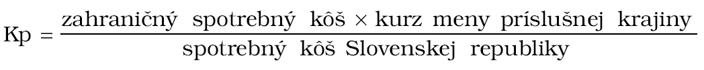
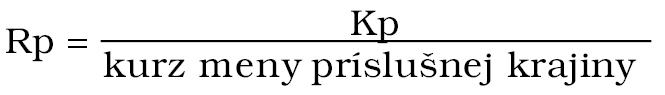

Príloha č. 1 k nariadeniu vlády č. 164/2002 Z. z.

- SPÔSOB A POSTUP VÝPOČTU PLATOVEJ RELÁCIE 1. Na základe prílohy č. 2 a 3 tohto nariadenia vlády vypracuje služobný úrad Slovenskej republiky v príslušnej krajine cenovú dokumentáciu - spotrebný kôš. Cenovú dokumentáciu vypracuje v jednotkových cenách, t. j. za 1kg, 1 l, 1 ks, 1 pár, 1 kWh, 1 vstupenku, 1 titul v cenovom rozpätí miestneho trhu I. a II. Ak je v príslušnej krajine viac sídiel služobných úradov Slovenskej republiky, cenovú dokumentáciu vypracuje služobný úrad v hlavnom meste krajiny. Ak je viac sídiel služobných úradov Slovenskej republiky v hlavnom meste krajiny, cenovú dokumentáciu vypracujú spoločne.

- 2. Cenovú dokumentáciu treba vypracovať vždy k 31. 12. príslušného roka v cenách k 30. 9. príslušného roka a počas roka v prípade rastu cien zahraničného spotrebného koša oproti predchádzajúcemu spotrebnému košu a rastu cien podľa štatistík Medzinárodného menového fondu (MMF) a Organizácie spojených národov (OSN) o viac ako 10 %. Ak niektorá z položiek v cenovej dokumentácii chýba, zníži sa o túto položku aj hodnota spotrebného koša Slovenskej republiky.

- 3. Určí sa platový koeficient (Kp) ako pomer hodnoty zahraničného spotrebného koša prepočítaného na slovenské koruny a hodnoty spotrebného koša Slovenskej republiky:

- 

- 4. Porovná sa úroveň cien zahraničného spotrebného koša s predchádzajúcim spotrebným košom a vykoná sa objektivizácia platového koeficientu. Objektivizácia platového koeficientu sa realizuje prostredníctvom

- a) indexu rastu cien podľa štatistiky Medzinárodného menového fondu (International Financial Statistics of International Monetary Fund),

- b) indexu rastu cien podľa štatistiky Organizácie Spojených národov (United Nations Monthly Bulletin of Statistics),

- c) indexu odloženej kúpnej sily.

- 5. Objektivizovaný platový koeficient je súčtom týchto hodnôt: 10 % platového koeficientu podľa cenovej dokumentácie, 20 % indexu rastu životných nákladov podľa štatistiky MMF, 40 % indexu rastu životných nákladov podľa štatistiky OSN a 30 % indexu odloženej kúpnej sily.

- 6. Určí sa platová relácia (Rp) ako pomer objektivizovaného platového koeficientu a kurzu meny príslušnej krajiny:

- 

- 7. V prípade každého zvýšenia cien zahraničného spotrebného koša oproti predchádzajúcemu spotrebnému košu sa platová relácia vypočíta z cenovej dokumentácie zaslanej k 31. 12. príslušného roka vždy do 31. 3. nasledujúceho roka. V ostatných prípadoch zvýšenia cien podľa bodu 2 tejto prílohy sa vypočíta platová relácia do 1 mesiaca od prijatia cenovej dokumentácie.

- 8. Určí sa objektivizovaná platová relácia (Rpo), ktorou sa násobí časť platu poskytnutá v cudzej mene podľa § 98 ods. 1 zákona č. 312/2001 Z. z. v znení neskorších predpisov

- Rpo = Rp x (100 – X)/100,

- kde X = ostatné zvýšenie platových taríf v nadväznosti na príslušné nariadenie vlády Slovenskej republiky o zvýšení platových taríf štátnych zamestnancov.

- 9. Ustanovenie bodu 8 sa rovnako použije aj pri určovaní objektivizovanej platovej relácie pri poskytovaní časti platu v peňažných prostriedkoch v cudzej mene podľa § 22 ods. 1 zákona č. 553/2003 Z. z. o odmeňovaní niektorých zamestnancov pri výkone práce vo verejnom záujme a o zmene a doplnení niektorých zákonov v znení zákona č. 231/2006 Z. z., podľa § 109 ods. 2 a 3 zákona č. 73/1998 Z. z. o štátnej službe príslušníkov Policajného zboru, Slovenskej informačnej služby, Zboru väzenskej a justičnej stráže Slovenskej republiky a Železničnej polície v znení neskorších predpisov, podľa § 150 zákona č. 346/2005 Z. z. o štátnej službe profesionálnych vojakov ozbrojených síl Slovenskej republiky a o zmene a doplnení niektorých zákonov a podľa § 101a zákona č. 200/1998 Z. z. o štátnej službe colníkov a o zmene a doplnení niektorých ďalších zákonov v znení neskorších predpisov.
