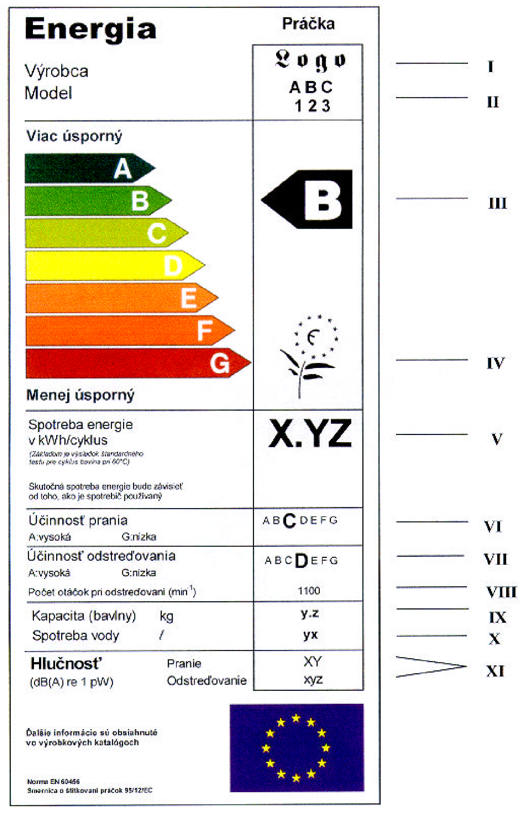
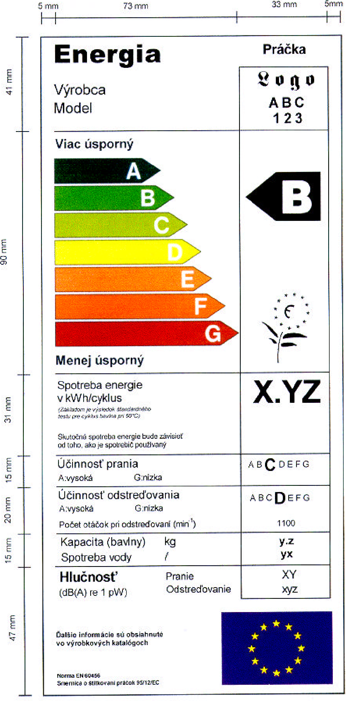

Príloha č. 1 k nariadeniu vlády č. .../2002 Z. z.

- Energetický štítok

- Údaje na energetickom štítku

- I. Názov a obchodná značka výrobcu.

- II. Identifikačný kód práčky.

- III. Trieda energetickej hospodárnosti podľa prílohy č. 4. Trieda je uvedená vo výške príslušnej šípky.

- IV. Ekologická značka EÚ (kvietok), ak bola práčke udelená.

- V. Spotreba energie v kWh na jeden cyklus pre štandardný cyklus prania bavlny pri teplote 60 oC podľa skúšobných postupov konkretizovaných v harmonizovaných normách.

- VI. Trieda účinnosti prania podľa prílohy č. 4.

- VII. Trieda účinnosti odstreďovania podľa prílohy č. 4.

- VIII. Maximálna rýchlosť rotácie dosiahnutá pre štandardný cyklus prania bavlny pri teplote 60 oC podľa skúšobných postupov konkretizovaných v harmonizovaných normách.

- IX. Výkon práčky pre štandardný cyklus prania bavlny pri teplote 60 oC podľa skúšobných postupov konkretizovaných v harmonizovaných normách.

- X. Spotreba vody pre štandardný cyklus prania bavlny pri teplote 60 oC podľa skúšobných postupov konkretizovaných v harmonizovaných normách.

- XI. Hlučnosť počas cyklov prania a odstreďovania s použitím štandardného cyklu pri teplote 60 oC nameraná podľa osobitného predpisu.2)

- Tlač

- Použité farby

- CMYB - tyrkysová, fialová, žltá, čierna.

- Príklad použitia farieb:

- 07X0: 0 % tyrkysová, 70 % fialová, 100 % žltá, 0 % čierna.

- Šípky:

- - A: X0X0,

- - B: 70X0,

- - C: 30X0,

- - D: 00X0,

- - E: 03X0,

- - F: 07X0,

- - G: 0XX0.

- Farba rámčeka X070.

- Celý text je čierny. Podklad je biely.
