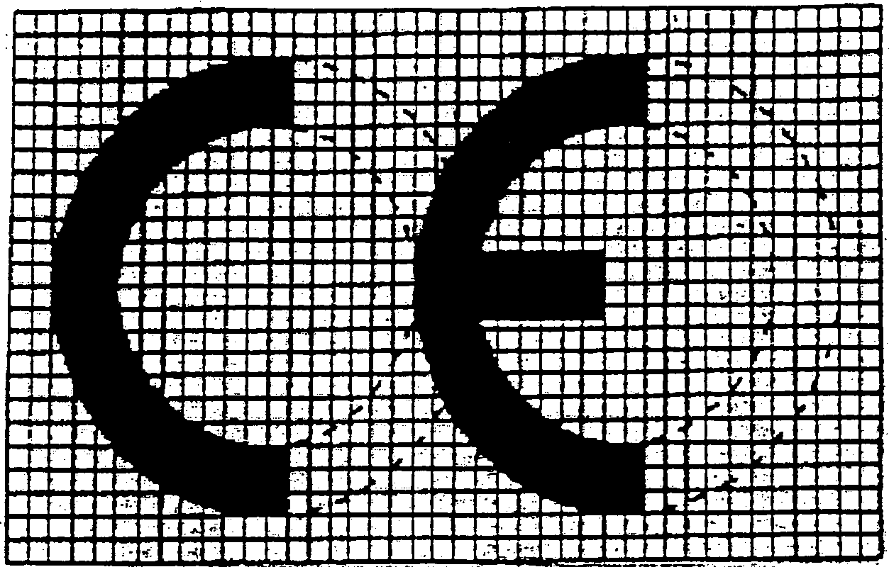

Príloha č. 9 k nariadeniu vlády č. 183/2002 Z. z.

- ZNAČKA ZHODY - OZNAČENIE CE

- Označenie CE sa skladá z písmen „CE“, ktoré má túto grafickú podobu:

- 

- Ak je označenie CE zmenšené alebo zväčšené, mierka rozmerov zostáva zachovaná.

- Jednotlivé prvky označenia CE majú rovnakú výšku, ktorá je najmenej 5 mm. Tieto najmenšie rozmery sa nemusia dodržať pre bezpečnostné komponenty s malými rozmermi.

- Za označením CE nasleduje posledné dvojčíslie roka, v ktorom sa posúdenie zhody vykonalo, a identifikačný kód autorizovanej osoby podľa § 6 ods. 3 tohto nariadenia.
