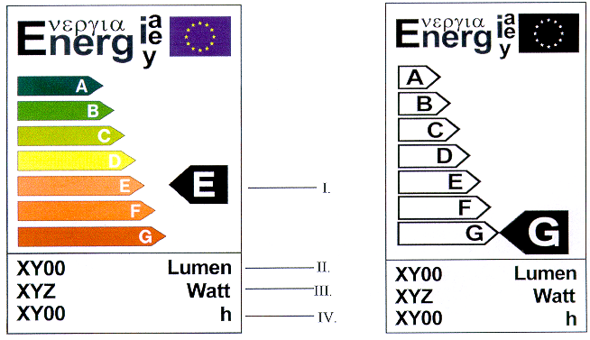
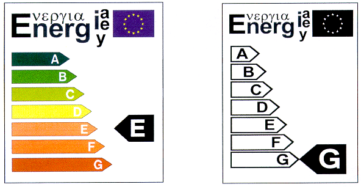
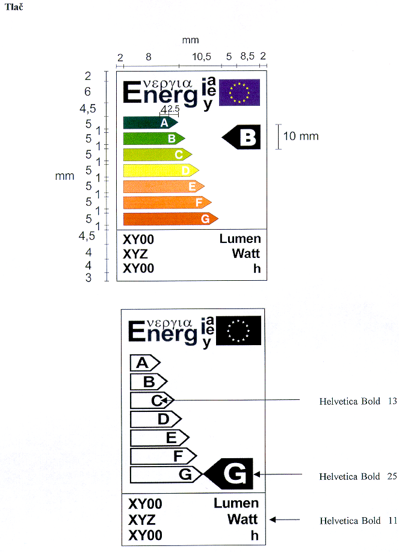

Príloha č. 1 k nariadeniu vlády č. 188/2002 Z. z.

- ENERGETICKÝ ŠTÍTOK

- 1. Energetický štítok sa vyberá z týchto možností. Ak energetický štítok nie je vytlačený na obale, ale je použitý separátny energetický štítok umiestnený na obale alebo pripevnený k obalu, musí sa použiť farebná verzia energetického štítku. Ak sa použije čiernobiela verzia energetického štítku, tlač a pozadie môžu mať ľubovoľné farby, ktoré zachovávajú čitateľnosť energetického štítku.

- 

- 2. Špecifické informácie pre potreby vytvorenia energetického štítku:

- I. Trieda energetickej hospodárnosti svietidla určená podľa prílohy č. 4. Toto indikačné písmeno musí byť umiestnené na tej istej úrovni ako príslušná šípka.

- II. Svetelný tok svietidla v lumenoch zmeraný podľa skúšobných postupov určených v harmonizovaných normách.

- III. Príkon svietidla vo wattoch zmeraný podľa skúšobných postupov určených v harmonizovaných normách.

- IV. Priemerná vypočítaná životnosť svietidla v hodinách zmeraná podľa skúšobných postupov určených v harmonizovaných normách. Ak na obale nie je žiadna iná informácia o životnosti svietidla, tento údaj sa môže vynechať.

- 3. Ak sú informácie špecifikované v bode 2 bodoch II a III, a keď je to použiteľné aj v bode IV, uvedené niekde inde na obale svietidla, môžu sa z energetického štítka spolu s prázdnym okrajom, ktorý ich obsahuje, vynechať. Energetický štítok sa potom vyberie z týchto možností:

- Okolo energetického štítku musí byť minimálne 5 mm prázdny okraj. Ak neexistuje žiadna strana obalu dostatočne veľká na to, aby mohla obsahovať energetický štítok s prázdnym okrajom, alebo keď by to pokrývalo viac ako 50 % plochy povrchu väčšej strany, energetický štítok a prázdny okraj sa môžu zmenšiť, ale nie viac, ako je potrebné na splnenie uvedených podmienok. V žiadnom prípade sa však energetický štítok nesmie zmenšiť po dĺžke na menej ako 40 % jeho štandardnej veľkosti. Ak je obal príliš malý na to, aby na ňom mohol byť umiestnený takýto zmenšený energetický štítok, energetický štítok sa musí pripevniť k svietidlu alebo k obalu. Keď sa však spolu so svietidlom vystavuje energetický štítok v plnej veľkosti (napríklad pripevnený k regálu, na ktorom je svietidlo vystavené), tento energetický štítok sa môže vynechať.

- Použité farby:

- Farebná verzia:

- CMYB - tyrkysová, fialová, žltá, čierna.

- Príklad použitia farieb:

- 07X0: 0 % tyrkysová, 70 % fialová, 100 % žltá, 0 % čierna.

- Šípky:

- A: X0X0,

- B: 70X0,

- C: 30X0,

- D: 00X0,

- E: 03X0,

- F: 07X0,

- G: 0XX0.

- Farba rámčeka X070.

- Celý text je čierny. Podklad je biely.
